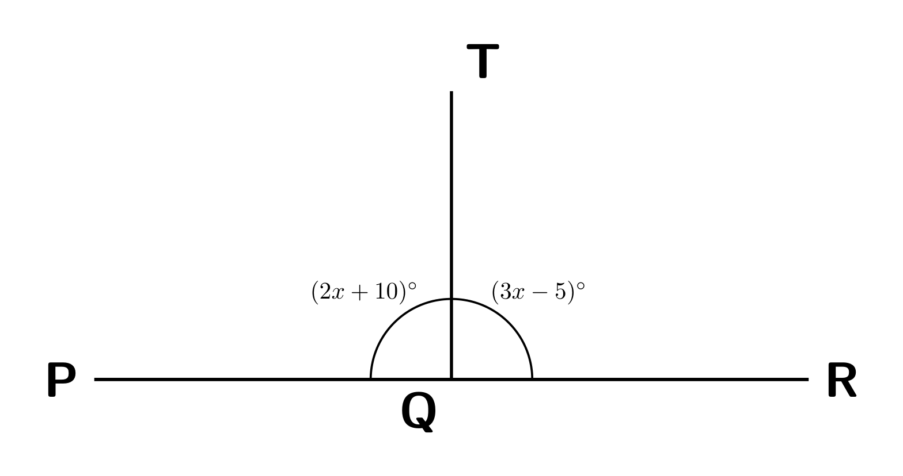
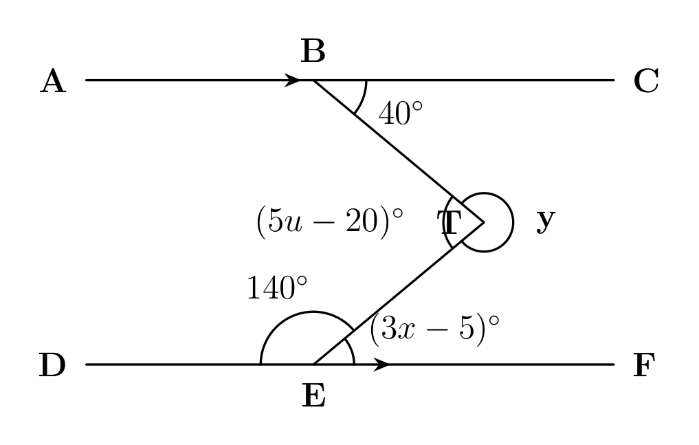
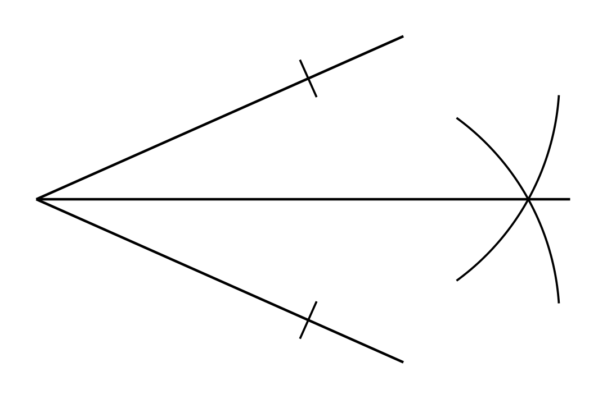
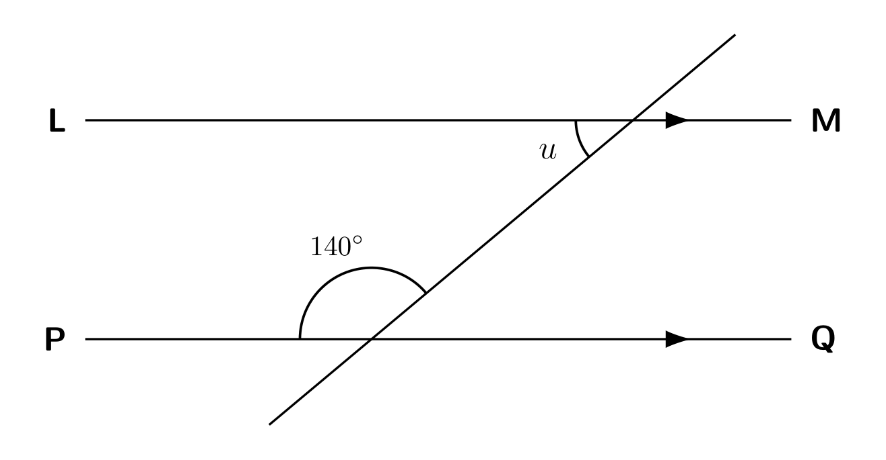
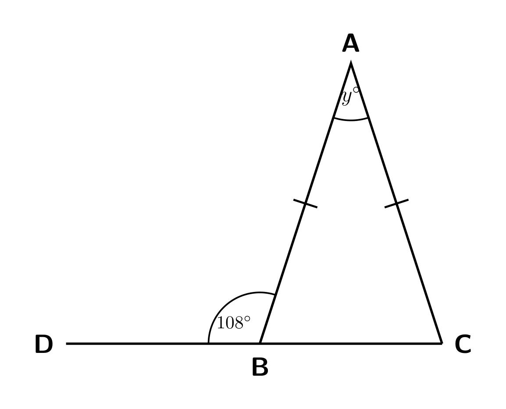
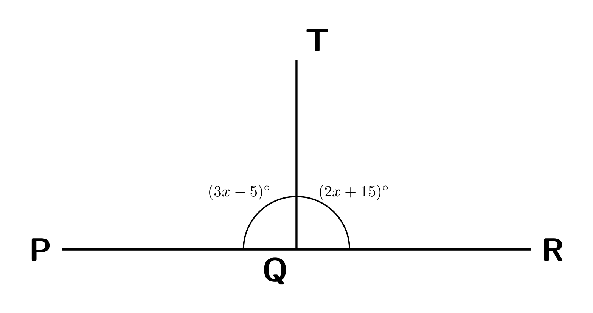
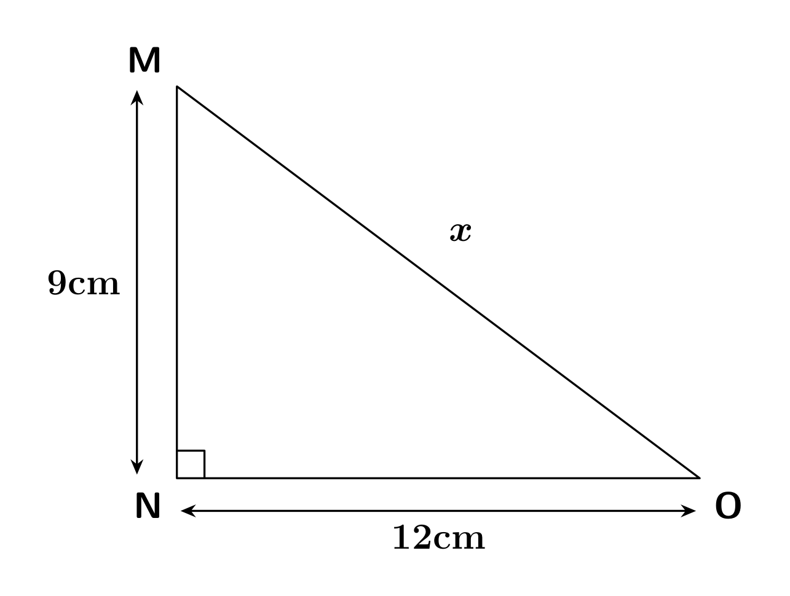
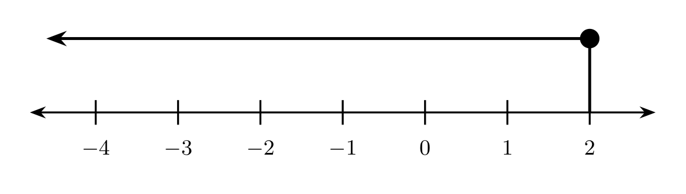

# STARALEX EDUCATIONAL COMPLEX — GHANA
## Basic Education Certificate Examination — **MOCK EXAMINATION**
### MATHEMATICS 2&1 — ESSAY **AND** OBJECTIVE — 2 hours

**Name:** ………………………………………………………… **Index Number:** ………………………

*Do **not** open this booklet until you are told to do so. While you are waiting, read and observe the following instructions carefully. Write your **name** and **index number in ink** in the spaces provided above.*

*This booklet consists of **two** papers. Answer Paper **2**, which comes first, in your answer booklet and Paper **1** on your Objective Test answer sheet. Paper **2** will last **1 hour** after which the answer booklet will be collected. Do **not** start Paper **1** until you are told to do so. Paper **1** will last **1 hour**.*

*The use of calculators is **not** allowed.*

<!-- pagebreak -->

# PAPER 2 — ESSAY — 1 hour

**Answer four questions only.**
**All questions carry equal marks.**
**All** working must be clearly shown. Marks will **not** be awarded for **correct** answers without corresponding working.

---

### Question 1

**(a)** Expand and simplify: (2y + 1)(y − 4).

**(b)** Factorise completely: 3xy − 6xz − 4y + 8z.

**(c)** The volume V of a box with a square base of side 2x is given by the relation V = 4x²h.
**(i)** Make h the subject of the relation.
**(ii)** Find the value of h when V = 108 and x = 3.

<!-- pagebreak -->

### Question 2

**(a)** Solve: (2x + 5)/3 = (x + 7)/2

**(b)** Solve the inequality 5x − 3 > 2x + 9 and illustrate your answer on a number line.

**(c)** Kofi is three times as old as Esi. In eight years' time, Kofi will be twice as old as Esi.
Find their present ages.

<!-- pagebreak -->

### Question 3

**(a)** Given the relation y = 4x − 1, copy and complete the table of values below:

| x | 1 | 2 | 3 | 4 | 5 |
|---|---|---|---|---|---|
| y | 3 | m | 11 | 15 | n |

**(b)** The first four terms of a sequence are 1, 4, 9, 16, …
**(i)** Write down the 5th term.
**(ii)** Find the 10th term.
**(iii)** State the rule for the sequence.

**(c)** Yaw reads 15 pages of a storybook on the first day. Each day after that, he reads 4 more pages than the previous day.
How many pages does he read on the 10th day?

<!-- pagebreak -->

### Question 4

**(a)** In the diagram, PQR is a straight line.
**(i)** Find the value of x.
**(ii)** Find the larger of the two angles.

*Diagram **not** drawn to scale.*

**(b)** The exterior angle of a triangle is 4x° and the two interior opposite angles are (x + 30)° and (2x − 10)°.
**(i)** Find the value of x.
**(ii)** Hence, find the size of the exterior angle.

**(c)** The base angles of an isosceles triangle are (3y − 6)° each, and the apex angle is 30°.
**(i)** Find the value of y.
**(ii)** Calculate the size of each base angle.

<!-- pagebreak -->

### Question 5

**(a)** Using a ruler and a pair of compasses only,
**(i)** construct an angle of 60° at a point Q;
**(ii)** construct the bisector of this angle.

What is the size of each of the two equal parts?

**(b)** A ladder leans against a vertical wall. The foot of the ladder is 5 m from the base of the wall, and the top of the ladder reaches a window 12 m above the ground.
**(i)** Illustrate the information in a diagram.
**(ii)** Calculate the length of the ladder.

**(c)** Calculate the perimeter of the triangle formed by the ladder, the wall and the ground.

<!-- pagebreak -->

### Question 6

**(a)** In the diagram, AC and DF are parallel lines, and BT and ET form a V-shape between them.
**(i)** Calculate the value of the reflex angle y.
**(ii)** State one angle relationship you used in (i).

*Diagram **not** drawn to scale.*

**(b)** In the diagram, the angle marked (3x − 5)° is the angle between TE and the line DF on the side of F.
**(i)** Find the value of x.
**(ii)** Calculate the size of the angle FET.

**(c)** In the diagram, the angle marked (5u − 20)° is the angle between TB and TE on the side facing A and D.
**(i)** Find the value of u.
**(ii)** Calculate the size of the angle BTE.

<!-- pagebreak -->

### Question 7

**(a)** The top of a vertical mast is 26 m above the ground. A support wire runs from the top of the mast to a peg on the ground 10 m from the foot of the mast.
**(i)** Illustrate the information in a diagram.
**(ii)** Calculate the length of the wire.

**(b)** A boat sails 12 km due east from a harbour H to a point P, and then 9 km due north from P to Q. Calculate the distance from H to Q.

**(c)** Show that a triangle with sides 7 cm, 24 cm and 25 cm is right-angled.

<!-- pagebreak -->

### Question 8

**(a)** Asana is paid GH₵ 25.00 per day for picking cashew nuts. If her daily wage increased by 10% and she worked for 30 days, how much will she be paid?

**(b)** Two brothers, Kojo and Yaw, shared GH₵ 8,100.00 from the sale of their produce in the ratio 4 : 5.
**(i)** Calculate each brother's share.
**(ii)** How much more did Yaw receive than Kojo?

**(c)** A trader bought a bag of rice for GH₵ 2,500.00 and sold it for GH₵ 3,250.00.
Calculate the percentage profit.

---

**END OF ESSAY TEST**

<!-- pagebreak -->

# PAPER 1 — OBJECTIVE TEST — 1 hour

*Answer **all** the questions.*

*Each question is followed by **four** options lettered **A** to **D**. Find the **correct** option for **each** question and shade **in pencil** on your answer sheet, the space which bears the same letter as the option you have chosen. Give only **one** answer to **each** question. An example is given below.*

> **If 3n + 2 = 8, find the value of n.**
> **A.** 10  **B.** 6  **C.** 3  **D.** 2
> *The correct answer is 2, which is lettered **D**, and therefore answer space **D** would be shaded.*
>
> `A ☐  B ☐  C ☐  D ☑`

*Think carefully before you shade the answer spaces. Erase your first answer completely and shade the appropriate space for the new answer.*

*Do all rough work on this paper.*

*Now answer the following questions.*

---

**1.** A trader sold a school bag for GH₵ 48.00 and made a profit of 20% on the cost. Find the cost of the bag.

A. GH₵ 9.60  
B. GH₵ 38.40  
C. GH₵ 40.00  
D. GH₵ 57.60  

<!-- pagebreak -->

**2.** Evaluate: −15 − (−20) + (−10)

A. −15  
B. −5  
C. 5  
D. 15  

**3.** Evaluate: 8.4 × 0.25 ÷ 0.6

A. 0.35  
B. 14  
C. 35  
D. 3.5  

**4.** The numbers −9, −5, m, 3, 7, 11 form a pattern in which each number is 4 more than the one before it. Find the value of m.

A. −1  
B. −3  
C. 1  
D. 5  

**5.** Evaluate: 3¼ + 1⅚

A. 2⅖  
B. 4 11/12  
C. 5 1/12  
D. 4 1/12  

**6.** Evaluate: 2⅖ − 1⅔

A. 8/15  
B. 7/8  
C. 1 4/15  
D. 11/15  

<!-- pagebreak -->

**7.** If 0.03 × k = 2.4, find k.

A. 0.072  
B. 0.08  
C. 80  
D. 800  

**8.** If p = 2 and q = ¾, evaluate p²(q − 1).

A. −3  
B. −1  
C. 1  
D. 3  

**9.** Express 12.5% as a fraction in its lowest terms.

A. 1/80  
B. 1/12  
C. 1/8  
D. 1/4  

**10.** Ama and Kwame shared GH₵ 45.00 in the ratio 2 : 3. Find **Kwame's** share.

A. GH₵ 18.00  
B. GH₵ 27.00  
C. GH₵ 45.00  
D. GH₵ 54.00  

<!-- pagebreak -->

**11.** Expand and simplify: (x − 2)(x + 4)

A. x² + 2x + 8  
B. x² + 6x − 8  
C. x² − 2x − 8  
D. x² + 2x − 8  

**12.** Simplify: x − 5(3 − 2x) − 12x + 7

A. −21x − 8  
B. 3x − 8  
C. −x − 8  
D. 23x − 8  

**13.** Factorise: 2pq + 6p − 6q − 18

A. 2(p + 3)(q − 3)  
B. (p − 3)(q + 3)  
C. 2(q − 3)(p + 3)  
D. 2(q + 3)(p − 3)  

**14.** Factorise: 3a²b − 9ab²

A. 3ab(a − 9b)  
B. 3ab(a + 3b)  
C. 3ab(a − 3b)  
D. 3a²b(1 − 3b)  

<!-- pagebreak -->

**15.** If m = b² − t, make t the subject of the relation.

A. t = m − b²  
B. t = b² + m  
C. t = −b² − m  
D. t = b² − m  

**16.** Solve: ¾x = 2¼

A. 9/16  
B. 1⅓  
C. 27/16  
D. 3  

**17.** Solve: 2(x + 3) − 4 = 12

A. 4  
B. 5  
C. 7  
D. 11  

**18.** Ama is three times as old as Kofi. The sum of their ages is 40 years. How old is Ama?

A. 8 years  
B. 10 years  
C. 30 years  
D. 32 years  

<!-- pagebreak -->

**19.** Find the 8th term of the sequence 3, 7, 11, …

A. 29  
B. 33  
C. 35  
D. 31  

**20.** A relation maps x onto y as follows: 1 → 4, 2 → 2, 3 → 0, 4 → −2, 5 → −4. Which of the following is the rule of the mapping?

A. y = −2x + 2  
B. y = 2x + 2  
C. y = 6 − x  
D. y = −2x + 6  

**21.** Kwaku saves GH₵ 800.00 in the first month and increases his savings by GH₵ 50.00 each month. How much will he save in the 6th month?

A. GH₵ 1,100.00  
B. GH₵ 1,050.00  
C. GH₵ 1,000.00  
D. GH₵ 1,150.00  

**22.** A rectangular garden has a perimeter of 66 m. If the length is twice the width, find the width.

A. 9 m  
B. 11 m  
C. 22 m  
D. 33 m  

<!-- pagebreak -->

**23.** The line which intersects two or more parallel lines at different points is called

A. a transversal  
B. a perpendicular  
C. a bisector  
D. a median  

**24.** In the diagram below, the construction shown is for

A. constructing a perpendicular  
B. bisecting an angle  
C. bisecting a line segment  
D. constructing 60°  

<!-- pagebreak -->

**25.** In the diagram, LM and PQ are parallel lines cut by a transversal. Find the value of u.

*Diagram **not** drawn to scale.*

A. 40°  
B. 50°  
C. 140°  
D. 220°  

**26.** When a transversal intersects two parallel lines, the corresponding angles are

A. supplementary  
B. complementary  
C. equal  
D. alternate  

<!-- pagebreak -->

**27.** In the diagram, |AB| = |AC|. Find the value of y.

*Diagram **not** drawn to scale.*

A. 36°  
B. 54°  
C. 72°  
D. 108°  

**28.** In the diagram, PQR is a straight line. Find the value of x.

*Diagram **not** drawn to scale.*

A. 32  
B. 34  
C. 36  
D. 38  

<!-- pagebreak -->

**29.** Kofi marked out a triangular vegetable plot ABC. If angle A = 38° and angle B = 54°, what is the size of angle C?

A. 78°  
B. 92°  
C. 98°  
D. 88°  

**30.** Three women contributed money towards a business in the ratio 2 : 3 : 4. The total contribution was GH₵ 5,400.00. How much did the woman who contributed the **largest** share pay?

A. GH₵ 1,200.00  
B. GH₵ 1,800.00  
C. GH₵ 2,400.00  
D. GH₵ 2,700.00  

**31.** Two complementary angles are in the ratio 2 : 3. Find the larger angle.

A. 36°  
B. 45°  
C. 54°  
D. 60°  

**32.** The cross-section of the roof of a kiosk is an isosceles triangle with apex angle 40°. Find each base angle.

A. 50°  
B. 60°  
C. 140°  
D. 70°  

<!-- pagebreak -->

*Use the information below to answer questions **33** and **34**.*

In the diagram, MNO is a right-angled triangle, right-angled at N, with |MN| = 9 cm and |NO| = 12 cm.

*Diagram **not** drawn to scale.*

**33.** Find the length |MO|.

A. 13 cm  
B. 15 cm  
C. 16 cm  
D. 21 cm  

**34.** Calculate the perimeter of triangle MNO.

A. 24 cm  
B. 27 cm  
C. 36 cm  
D. 45 cm  

<!-- pagebreak -->

**35.** Adwoa walked 12 km due north from her home to the market, and then 5 km due east to the school. Calculate the shortest distance between her home and the school.

A. 12 km  
B. 13 km  
C. 17 km  
D. 30 km  

**36.** Solve: 7 − 2x > 15 − 4x

A. x > 4  
B. x < 4  
C. x > 11  
D. x < 8  

**37.** Which of the following inequalities is represented by the number line below?

A. x < 2  
B. x ≤ 2  
C. x > 2  
D. x ≥ 2  

**38.** A trader bought a basket containing 20 mangoes. 20% of the mangoes were rotten. How many mangoes were **not** rotten?

A. 4  
B. 5  
C. 16  
D. 80  

<!-- pagebreak -->

**39.** A mason mixed sand and cement in the ratio 2 : 5. If the total mass of the mixture is 35 kg, find the mass of the sand used.

A. 10 kg  
B. 5 kg  
C. 14 kg  
D. 25 kg  

**40.** A farmer feeds his 8 goats with 200 kg of feed in a week. How many goats can he feed with 500 kg of feed?

A. 20 goats  
B. 16 goats  
C. 25 goats  
D. 32 goats  

---

**END OF PAPER**

<!-- pagebreak -->

# MARKING SCHEME

*(Method = **M1**, Accuracy = **A1**, Independent result = **B1**; "or" separates acceptable alternative judgements. −1 ou/wu or 2 dp, once only, per question.)*

## PAPER 2

### Question 1 — [15 marks]

- **(a)** Expanding both brackets: 2y(y − 4) + 1(y − 4) = 2y² − 8y + y − 4 — **M1** for correct expansion of each bracket; **B1** for the partial products −8y and +y correctly kept — **A1** for 2y² − 8y + y − 4. Collecting like terms — **M1**; answer **2y² − 7y − 4** — **A1**. *(5)*
- **(b)** Grouping: 3x(y − 2z) − 4(y − 2z) — **M1** for a correct first grouping; **M1** for making (y − 2z) common in both groupings (any correct second grouping); **B1** for the correct second bracket (3x − 4); **A1** for (y − 2z)(3x − 4); **B1** for checking by expansion (or an equivalent correct alternative grouping). *(5)*
- **(c)** (i) h = V ÷ 4x², i.e. **h = V/(4x²)** — **M1** for dividing both sides by 4x²; **A1** for the subject form. (ii) Substituting V = 108, x = 3: h = 108 ÷ (4 × 9) — **M1** for correct substitution; **A1** for denominator 36; **A1** for **h = 3**. *(5)*

### Question 2 — [15 marks]

- **(a)** Cross-multiplying 2(2x + 5) = 3(x + 7) — **M1** (insist on both sides expanded/shown); **A1** for 4x + 10 = 3x + 21. Moving like terms together — **M1**; **x = 11** — **A1**. *(4)*
- **(b)** Moving terms: 5x − 2x > 9 + 3 — **M1**; 3x > 12 — **A1**. Dividing both sides by 3 — **M1**; **x > 4** — **A1**. Number line: open circle at 4, arrow to the right — **B1** for a correctly drawn number line. *(5)*
- **(c)** Taking Esi's present age as e, Kofi = 3e — **B1**. In 8 years: 3e + 8 = 2(e + 8) — **M1** for forming the equation; **M1** for expanding/moving terms to 3e + 8 = 2e + 16. **A1** for e = 8; **A1** for full answer: Esi = 8 years, Kofi = 24 years. **B1** for an acceptable alternative correct method (e.g. 8 years = one age step). *(6)*

### Question 3 — [15 marks]

- **(a)** Substituting x = 2 into y = 4x − 1 — **M1**; **m = 7** — **A1**; substituting x = 5 — **M1**; **n = 19** — **A1**; **B1** for all five y-values correct. *(5)*
- **(b)** Recognising the pattern 1², 2², 3², 4², … — **M1**; **25** as the 5th term — **A1**; **100** as the 10th term — **A1**; rule stated as "square of the term position" or n² — **B1**. *(4)*
- **(c)** Identifying the first day's reading as the first term of the pattern (15, 19, 23, …) — **M1**; counting the nine increases to reach the 10th day (insist on the count 10 − 1 = 9) — **M1**; writing the 10th-day reading as 15 + 4 × 9 — **M1**; **A1** for **51 pages**. **B1** for a complete listing (15, 19, 23, 27, 31, 35, 39, 43, 47, 51) accepted as method; **A1** for stating the relation T₁₀ = a + (n − 1)d with a = 15 and d = 4. *(6)*

### Question 4 — [15 marks]

- **(a)** Writing the angle-sum equation (2x + 10)° + (3x − 5)° = 180° (angles on a straight line) — **M1**; **A1** for 5x + 5 = 180. Solving — **M1**; **x = 35** — **A1**; larger angle = 3(35)° − 5° = **100°** — **A1**. *(5)*
- **(b)** Using the exterior-angle fact (exterior = sum of the two interior opposite angles) — **B1**; forming (x + 30)° + (2x − 10)° = 4x° — **M1**; **x = 20** — **A1**; exterior angle = 4 × 20 = **80°** — **A1**; verification that the two interior opposite angles sum to the exterior ((x + 30)° + (2x − 10)° = 50° + 30° = 80°) — **B1**. *(5)*
- **(c)** Equation 2(3y − 6)° + 30° = 180° — **M1**; expanded 6y − 12 + 30 = 180 — **M1**; **y = 27** — **A1**; each base angle = 3(27)° − 6° = **75°** — **A1**; check 75° + 75° + 30° = 180° — **B1**. *(5)*

### Question 5 — [15 marks]

- **(a)** Constructing 60°: two arcs struck with equal radius from marks on both arms so that the crossing lies level with the arms — **M1**; bisector constructed from a second pair of equal arcs — **M1**; bisector ray drawn through the arc crossings — **B1**; each half of the 60° angle = **30°** — **A1**; the 60° angle and the bisector labelled on the construction — **B1**. *(5)*
- **(b)** (i) A right-angled triangle labelled with the wall 12 m, ground 5 m and the right angle marked — **B1**. (ii) Applying Pythagoras' theorem: x² = 5² + 12² = 25 + 144 — **M1**; x² = 169 — **A1**; taking the square root — **M1**; ladder = **13 m** — **A1**; 5 : 12 : 13 triple stated as an alternative — **B1**. *(6)*
- **(c)** Perimeter = 5 + 12 + 13 — **M1**; **30 m** — **A1**; correct units (m) shown with every length — **B1**; the ladder length of 13 m carried over from (b) — **B1**. *(4)*

### Question 6 — [15 marks]

- **(a)** (i) Drawing the helper line through T parallel to AC and DF, and transferring the 40° at B to T by **alternate angles** — **M1**; the angle TE makes with the same helper = 180° − 140° = **40°** (co-interior angles supplementary) — **M1**; angles at a point about T: y = 360° − (40° + 40°) — **M1**; **y = 280°** — **A1**. (ii) **B1** for stating any one relationship used correctly: alternate angles are equal; co-interior angles are supplementary; angles at a point sum to 360°. *(5)*
- **(b)** Angles on a straight line DF at E are supplementary: 140° + (3x − 5)° = 180°, i.e. 3x − 5 = 40 — **M1**; solving: 3x = 45 — **A1**; **x = 15** — **A1**; substituting: 3(15)° − 5° = **40°** — **M1** and **A1**. **or** by **alternate angles**: (3x − 5)° = 40°, transferring the 40° at B with a helper line through T parallel to AC and DF — the same marks (award for either route). *(5)*
- **(c)** Angles at a point about T: the angle BTE = 360° − y = 360° − 280° — **M1**; **angle BTE = 80°** — **A1** (**or** 40° + 40° = 80° by **alternate angles** with the helper line at T). Then 5u − 20 = 80 — **M1**; **u = 20** — **A1**; **B1** for checking by substitution (5(20) − 20 = 80 ✓) or stating the relationship used. *(5)*

### Question 7 — [15 marks]

- **(a)** (i) Right-angled triangle with the mast vertical labelled 26 m, the peg on the ground 10 m from the foot labelled, and the wire drawn as the hypotenuse — **B1**; right angle marked between the mast and the ground — **B1**. (ii) Pythagoras for the leg: x² = 26² − 10² — **M1**; = 676 − 100 = 576 — **A1**; wire = √576 = **24 m** — **A1**. *(5)*
- **(b)** d² = 12² + 9² — **M1**; = 144 + 81 = 225 — **A1**; taking the square root — **M1**; distance from H to Q = **15 km** — **A1**. *(4)*
- **(c)** Writing each square: 7² = 49, 24² = 576, 25² = 625 — **B1**; adding the two shorter squares: 7² + 24² = 49 + 576 = 625 — **M1**; **A1** for the sum **625** — **B1** for comparing with the longest side: 25² = 625 (equal) — **B1** for applying the **converse** of Pythagoras' theorem; **B1** for placing the right angle opposite the 25 cm side (between the 7 cm and 24 cm sides). *(6)*

### Question 8 — [15 marks]

- **(a)** New daily wage = 110/100 × 25.00 — **M1**; GH₵ 27.50 — **A1** (2 dp). Payment for 30 days: 27.50 × 30 — **M1**; **GH₵ 825.00** — **A1**. *(4)*
- **(b)** Total ratio parts = 4 + 5 = 9 — **M1**. Kojo: 4/9 × 8,100.00 = **GH₵ 3,600.00** — **A1**; Yaw: 5/9 × 8,100.00 = **GH₵ 4,500.00** — **A1**. Difference Yaw − Kojo — **M1**; **GH₵ 900.00** — **A1**. *(5)*
- **(c)** Profit = 3,250.00 − 2,500.00 = GH₵ 750.00 — **M1** (insist on the subtraction); profit written as a fraction of the cost — **B1** for 750/2,500 (= 3/10). Percentage profit = profit/cost × 100% — **M1**; 750/2,500 × 100 — **M1**; **30%** — **A1**; **B1** for full working with GH₵ signs and % kept at every step. *(6)*

## PAPER 1 — Answer key

| Q | Ans | Q | Ans | Q | Ans | Q | Ans |
|---|---|---|---|---|---|---|---|
| 1 | C | 11 | D | 21 | B | 31 | C |
| 2 | B | 12 | C | 22 | B | 32 | D |
| 3 | D | 13 | D | 23 | A | 33 | B |
| 4 | A | 14 | C | 24 | B | 34 | C |
| 5 | C | 15 | D | 25 | A | 35 | B |
| 6 | D | 16 | D | 26 | C | 36 | A |
| 7 | C | 17 | B | 27 | A | 37 | B |
| 8 | B | 18 | C | 28 | B | 38 | C |
| 9 | C | 19 | D | 29 | D | 39 | A |
| 10 | B | 20 | D | 30 | C | 40 | A |

## PAPER 1 — Working notes (selected items)

- **1.** Cost = selling price ÷ 1.2 = 48.00 ÷ 1.2 = **GH₵ 40.00** (C). GH₵ 57.60 = opposite direction (buying at 48, selling 20% up).
- **4.** Common difference is 4: m = −5 + 4 = **−1** (A).
- **7.** k = 2.4 ÷ 0.03 = **80** (C); 0.072 multiplies instead of divides.
- **12.** x − 5(3 − 2x) − 12x + 7 = x − 15 + 10x − 12x + 7 = **−x − 8** (C). A = dropped the − sign on 5(3 − 2x); B = dropped it on −12x; D = dropped it on both.
- **13.** 2pq + 6p − 6q − 18 = 2p(q + 3) − 6(q + 3) = **2(q + 3)(p − 3)** (D).
- **16.** x = (2¼) ÷ ¾ = 3 (D). 27/16 multiplies ¾ × 2¼ instead of dividing.
- **20.** Each step of x adds −2 to y; y = −2x + 6 (D).
- **25.** u and 140° are co-interior angles between the parallels, so u = 180° − 140° = **40°** (A).
- **27.** Interior base angle = 180° − 108° = 72°, so y = 180° − 2 × 72° = **36°** (A).
- **28.** (3x − 5)° + (2x + 15)° = 180° → 5x + 10 = 180 → x = **34** (B).
- **33.** |MO|² = 9² + 12² = 81 + 144 = 225 → |MO| = **15 cm** (B). 13 cm is the classic 5 : 12 : 13 slip; 21 cm = 9 + 12 added.
- **34.** Perimeter = 9 + 12 + 15 = **36 cm** (C).
- **35.** Shortest distance = hypotenuse: √(12² + 5²) = √169 = **13 km** (B). 17 km = walking path; 30 km = walking path plus hypotenuse.
- **36.** 7 − 2x > 15 − 4x → 7 + 2x > 15 → 2x > 8 → **x > 4** (A).
- **37.** Solid dot at 2 with the ray pointing left (smaller values included): **x ≤ 2** (B).
- **39.** Sand = 2/7 of 35 kg = **10 kg** (A). 14 kg = the error of taking 2/5 of 35.
- **40.** 200 kg feeds 8 goats → 25 kg per goat → 500 ÷ 25 = **20 goats** (A). 25 is the kg-per-goat value mistaken as the answer.
