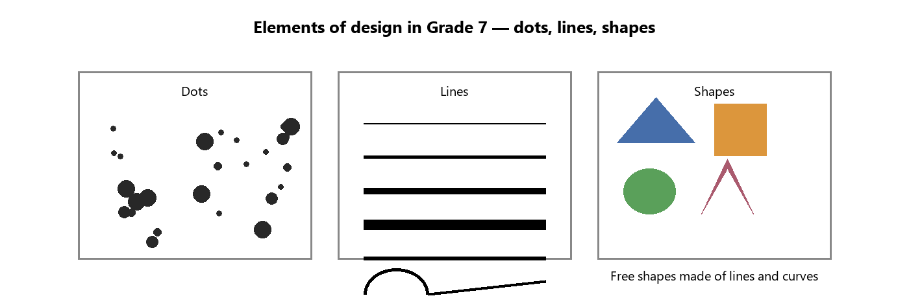
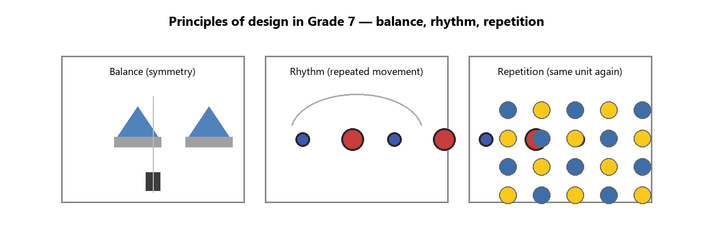
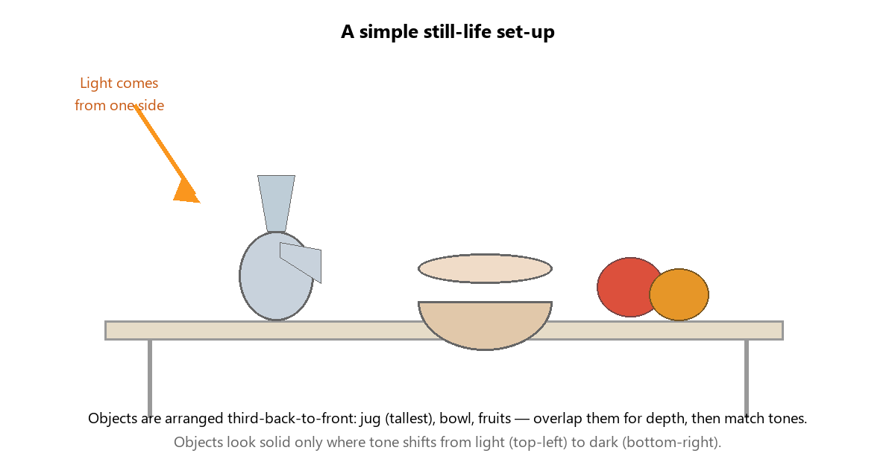
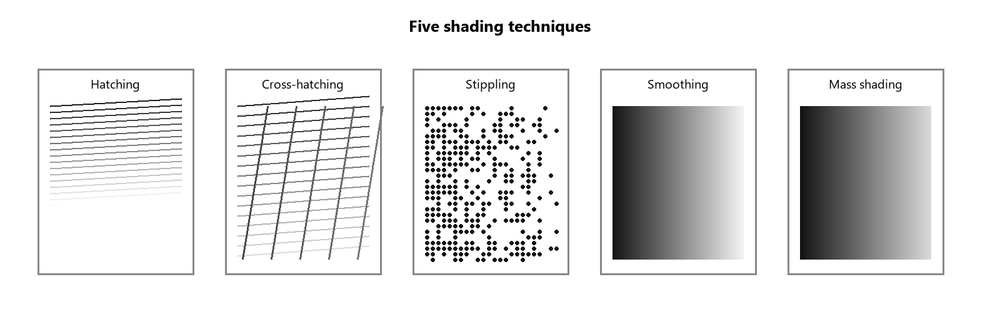
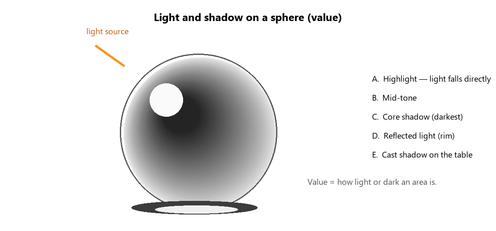
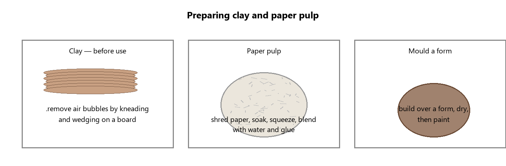
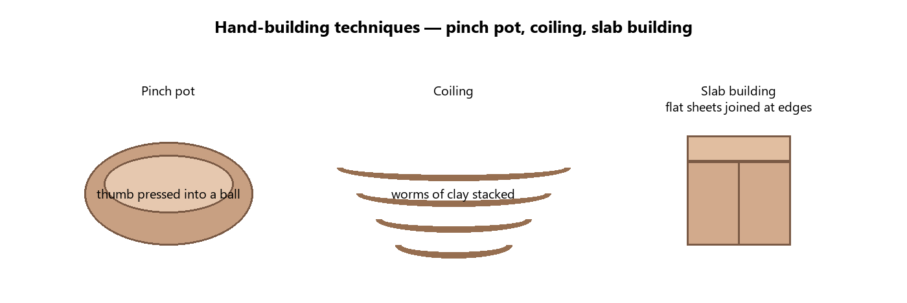
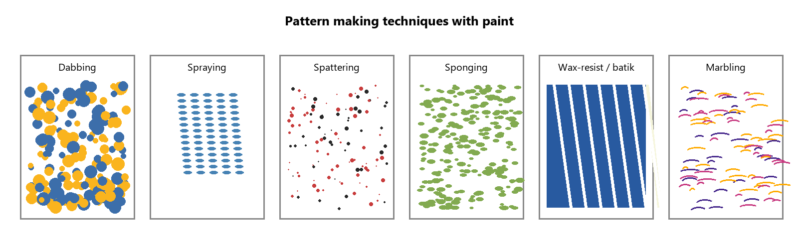
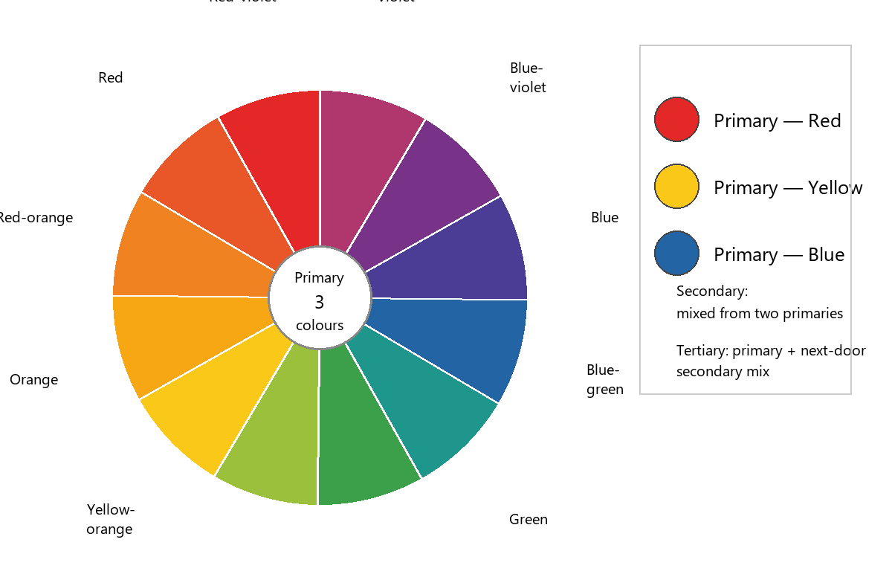
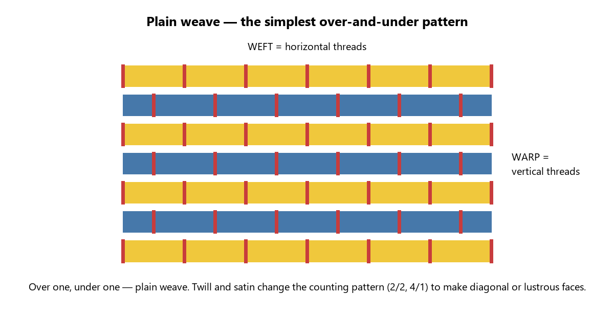

# Creative Arts & Design — Visual Arts (Grades 7–9)
## Complete Theory Lessons and Questions & Answers Scheme

*Based on the NaCCA Creative Arts and Design Common Core Programme (CCP) Curriculum for JHS1 (B7) – JHS3 (B9) and the official lesson plan (CAD-Lesson-Plan-B7-B9.md).*

**Visual Arts Only** — carries all Design lessons (1 period/week) and Visual Arts proper lessons (2 periods/week) across Basic 7, Basic 8, and Basic 9.

---

### Curriculum Structure
- **Grade 7 (Basic 7)**: Lessons 01–18 — Design in Nature, Elements (dots, lines, shapes), Principles (balance, rhythm, repetition), Manual/Digital Tools, Models, Design Process, Community Artefacts, Still-Life Shading, Clay/Papier-Mâché, Pattern Making, Local Culture, Exhibitions, Appraisal, Local Artworks.
- **Grade 8 (Basic 8)**: Lessons 01–18 — Design as Expression, Texture and Colour, Unity and Variety, 2-D Drawing Tools, Model Making, Evaluating Products, Community Problems, Printmaking, Observational Drawing, Weaving, Cross-Cultural Art, Exhibition Management, Critical Appraisal, Prominent Ghanaian Artists (Antobam, Okoh, Glover, Boateng, Clottey).
- **Grade 9 (Basic 9)**: Lessons 01–18 — Design Concepts, Form and Value, Variety and Proportion, 3-D Drawing Tools, Energy Innovation, Modifying Products, Community Prototypes, Casting, Assemblage, Folding, Found-Object Construction, Philosophical Artworks, Full Exhibition Planning, Peer Review, African Visual Artists, Cross-Disciplinary Connections.

<!-- pagebreak -->

# PART 1: GRADE 7 VISUAL ARTS

*Creative Arts & Design (CCP) · built from `CAD-Lesson-Plan-B7-B9.md` — Visual Arts section, Grade 7.*
<!-- pagebreak -->

## Lesson 01 — Design in nature and the manmade environment

Everything around us was either made by nature or made by people. Designers watch natural things like spider webs, seashells and bird beaks, and borrow their shapes and patterns to make useful things. In this lesson you learn what design is and how nature inspires the manmade environment.

**Words to know first**
- **Design** — a plan for making something useful or beautiful.
- **Nature** — the world of plants, animals, land and water.
- **Manmade** — made or shaped by human beings.
- **Environment** — everything living and non-living around us.
- **Inspire** — gives somebody a good idea to work from.

### Theory Questions and Answers

Q1. What is design?
Ans. Design is a plan or arrangement for making something useful and beautiful.

Q2. What is the natural environment?
Ans. The natural environment is everything made by nature, such as rivers, hills, trees and animals.

Q3. What is the manmade environment?
Ans. The manmade environment is everything made by human beings, such as houses, roads, chairs and phones.

Q4. State three designs found in nature.
Ans.
- The spider's web
- The honeycomb of the bee
- The pattern on butterfly wings

Q5. State three designs found in the manmade environment.
Ans.
- Houses and bridges
- Kente cloth patterns
- Car tyres and wheels

Q6. How does nature inspire manmade designs?
Ans. Designers observe the shapes, patterns and structures in nature and copy them to solve human problems.

Q7. Differentiate between the natural environment and the manmade environment.
Ans. The difference is who made the things:

| Natural environment | Manmade environment |
| --- | --- |
| Made by nature, not by people | Made by people from natural materials |
| Examples: rivers, hills, trees, spider webs | Examples: houses, roads, chairs, phones |

The difference is the maker: nature makes its own designs, while people plan and make theirs.

Q8. Which animal inspired the design of Japan's fast bullet train?
Ans. The kingfisher bird — its sharp, pointed beak gave the train's nose a streamlined shape that cuts quietly through the air.

Q9. Which building copied the design of the termite anthill?
Ans. The Eastgate Building in Zimbabwe, which copies how anthills keep themselves cool.

Q10. State three reasons why design is important.
Ans.
- It solves everyday problems.
- It makes life comfortable and beautiful.
- It creates jobs and wealth for people.

Q11. What is observation?
Ans. Observation is carefully watching things around you to note their shape, pattern and colour.

Q12. Why is observing nature a good starting point in art?
Ans. It gives free, endless ideas of dots, lines, shapes and patterns to work from.

Q13. Give one manmade product that borrowed an idea from a natural design.
Ans. The fast train's streamlined nose borrowed its shape from the kingfisher's beak.

*Notice:* Classic design links to remember: the kingfisher's beak inspired the Shinkansen Bullet Train, and the anthill inspired the Eastgate Building in Zimbabwe.

### Worked exam exemplars

1. Natural design influenced the invention of modern objects. Which animal's beak influenced the design of Japan's bullet train? *(bank)* [2 marks]
   Model answer: The kingfisher. (2 marks — naming the bird 1, its meaning as the streamlined nose idea 1)
2. The Creative Art teacher of Kaison International School took the class to the school park for sightseeing. After discussing the natural and manmade things around the school, the teacher then tasked learners to associate the things observed to elements of design. Select the natural things that the learners can associate with the element dot. *(bank, mock)* [3 marks]
   A. Sand particles, stones and seeds  B. Sand particles, vehicle tyres and balls  C. Seeds, balls and vehicle tyres  D. Seeds, balls and beads
   Model answer: A — sand particles, stones and seeds are small round natural spots, so they show the element dot. (3 marks — correct set 2, linking dots to small round things 1)
3. A Ghanaian creative art teacher is teaching the concept of biomimicry — using designs and systems found in nature as inspiration for human innovation. The teacher shows a design for a building inspired by the spiral shape of a seashell. How may the teacher encourage the learners to think critically about the biomimicry design of the seashell-inspired building? *(bank)* [3 marks]
   Model answer: Ask the learners to consider how the seashell's spiral shape contributes to its function and how it influences the building's design. (3 marks — looking at the shape 1, shape serving function 1, shape shaping the building 1)

### Exercises

**Paper 1 — Objective**

1.  Which of the following is a natural artwork?
    A. Spider's web        B. Television set        C. Wooden bench        D. Umbrella
    Answer: A — a spider weaves its web by itself, with no human hand.
2.  Identify an element of design in nature that shows line.
    A. A river flowing across the land        B. Sand grains        C. Seeds        D. Stones
    Answer: A — the river draws a long, narrow mark across the land, like a line.
3.  Which of the following buildings was inspired by the termite anthill?
    A. The Eastgate Building in Zimbabwe        B. The Cape Coast Castle        C. The Accra Sports Stadium        D. The Independence Arch
    Answer: A — Eastgate copies the anthill's natural cooling design.
4.  Using natural designs to inspire human inventions is called
    A. biomimicry        B. repetition        C. appreciation        D. migration
    Answer: A — biomimicry copies nature's designs to solve human problems.
5.  Which of the following is a manmade design?
    A. A wooden chair        B. A mountain        C. A river        D. A forest
    Answer: A — a chair is planned and made by people.

**Paper 2 — Theory**

1.  (a) What is the natural environment?  (2 marks)
    (b) State three natural designs that can inspire manmade designs.  (3 marks)
    (c) Explain how the shape of a bird's beak can inspire the design of a fast train.  (3 marks)

Answers
    (a) The natural environment is everything made by nature, such as rivers, hills and trees.  (2 marks — "made by nature" 1, examples 1)
    (b) • The spider's web
        • The honeycomb
        • The pattern on butterfly wings
        (1 mark each × any 3 = 3 marks)
    (c) The designer studies the pointed, streamlined shape of the beak and gives the train's front the same shape, so the train moves fast and quietly.  (3 marks — studying the beak 1, copying the shape 1, benefit 1)

2.  (a) What is design?  (2 marks)
    (b) Give two reasons why design is important in the community.  (2 marks)
    (c) Name one natural object and one manmade object, and state one design element (dot, line or shape) each one shows.  (4 marks)

Answers
    (a) Design is a plan or arrangement for making something useful and beautiful.  (2 marks)
    (b) • It solves everyday problems.
        • It makes life beautiful and creates work.  (1 mark each = 2 marks)
    (c) Example: a spider's web (natural) shows lines; a church building (manmade) shows shapes.  (1 mark each object + 1 mark each element = 4 marks)

3.  Write the three steps you would follow to observe a tree carefully, and say what design elements you would look for.  (3 marks)
Answers
    1. Stand still and look at the whole tree first.
    2. Move closer and study one part at a time.
    3. Note and record the dots (seeds/fruits), lines (branches) and shapes (leaves/crown) you see.
    (1 mark each step = 3 marks; listing the three elements also earns the recording mark)

## Lesson 02 — Elements of design — dots, lines and shapes

Every design is built from small parts, just as a sentence is built from words. At Grade 7 the elements of design are dots, lines and shapes. This lesson defines each element and shows how designers combine them to build pictures and patterns.

*Figure: The three Grade 7 elements of design — dots, lines and shapes — shown side by side.*

**Words to know first**
- **Element** — a basic unit or part of a design.
- **Dot** — a small round spot made by a tool.
- **Line** — a long, thin mark from one point to another.
- **Shape** — a flat, closed area made when lines meet.
- **Motif** — a small design repeated to form a pattern.

### Theory Questions and Answers

Q1. What is an element of design?
Ans. An element of design is a basic unit, such as a dot, line or shape, used to build a design.

Q2. State the three elements of design studied at Grade 7.
Ans.
- Dots
- Lines
- Shapes

Q3. What is a dot?
Ans. A dot is a small round spot made where the nib or point of a tool touches the paper.

Q4. State three uses of dots in a design.
Ans.
- They can build up tone and shading.
- They can make patterns and parts of a motif.
- They can show details like the heads of people in a crowd.

Q5. What is a line?
Ans. A line is a long, thin mark drawn from one point to another; it is the element that defines the outline of a shape.

Q6. State three types of lines.
Ans.
- Straight lines (vertical, horizontal, diagonal)
- Curved lines
- Zigzag lines

Q7. What is a shape?
Ans. A shape is a flat, closed area made when lines meet, such as a circle, square or triangle.

Q8. State three geometric shapes a designer uses.
Ans.
- Circle
- Square
- Triangle

Q9. Differentiate between a line and a shape.
Ans. The difference is whether the space is closed:

| Line | Shape |
| --- | --- |
| A long, thin mark between two points | A closed, flat area with an edge all round |
| Used to draw outlines and build tone | Used to fill, arrange and build patterns |

The difference is closure — a line only suggests an edge, while a shape encloses space.

Q10. Give three natural things that show each element.
Ans. Dots — sand grains, seeds, stones; lines — tree branches, rivers, spider-web threads; shapes — honeycombs, leaves, moon face.

Q11. How do designers use the three elements together?
Ans. They arrange dots, lines and shapes to build motifs, patterns and complete designs.

Q12. Which element begins where a pencil touches the paper?
Ans. A dot — the first smallest unit of any design.

Q13. Give one emotional or natural meaning of a diagonal line.
Ans. A diagonal line suggests energy and movement, like a lightning bolt or a running athlete.

Q14. Why do we call the dot the basic unit of design?
Ans. Every line is a row of dots, and every shape is made of lines, so all designs begin from dots.

*Notice:* Design is graded across the years: Grade 7 works with dots, lines and shapes; Grade 8 adds texture and colour; Grade 9 adds form and value.

### Worked exam exemplars

1. Elements are used to form a composition. Which element of art is used to define the outline of a shape? *(bank)* [2 marks]
   Model answer: A line. (2 marks — naming "line" 1, "outlines a shape" 1)
2. Which of the following design elements can be used to create heads in a crowd? *(bank)* [2 marks]
   Model answer: Dots — small round dots drawn side by side show the heads of many people from a distance. (2 marks — naming dots 1, explaining the crowd use 1)
3. Ama uses a series of lines moving away from a spot. Which of the following lines does she use? *(bank)* [2 marks]
   Model answer: Radial lines — lines that spread out from one central spot. (2 marks — "radial" 1, "spread from a centre" 1)

### Exercises

**Paper 1 — Objective**

1.  Which of the following is the basic unit of design that begins where a pencil touches paper?
    A. Shape        B. Line        C. Dot        D. Texture
    Answer: C — the first mark a pencil makes on paper is a small round dot.
2.  What are the elements of design often observed in nature and the manmade environment?
    A. Dots, lines and shapes        B. Unity, balance and rhythm        C. Painting, printing and gluing        D. Brightness, weight and time
    Answer: A — dots, lines and shapes are the Grade 7 building units of design.
3.  Which of the following groups shows only shapes?
    A. Circle, square, triangle        B. Line, dot, curve        C. Rhythm, balance, unity        D. Pencil, paper, brush
    Answer: A — a circle, square and triangle are all closed, flat areas.
4.  In designing a poster for a musical festival, which of the following lines would an artist use to depict energy and movement?
    A. Vertical        B. Horizontal        C. Diagonal        D. Dotted
    Answer: C — slanting diagonal lines suggest energy and action.
5.  Which of the following shows lines only?
    A. A flowing river        B. Sand grains        C. Seeds        D. Stones
    Answer: A — the sand grains, seeds and stones read as dots, while the river reads as a line.

**Paper 2 — Theory**

1.  (a) Define the following elements of design: (i) dot  (ii) line  (iii) shape.  (6 marks)
    (b) Give one natural object that shows (i) dots and (ii) lines.  (2 marks)
    (c) State two ways dots can be used in a design.  (2 marks)

Answers
    (a) (i) A dot is a small round spot made where the point of a tool touches the paper. (2 marks)
        (ii) A line is a long, thin mark drawn from one point to another. (2 marks)
        (iii) A shape is a flat, closed area made when lines meet. (2 marks)
    (b) (i) Sand grains or seeds show dots. (1 mark)
        (ii) A tree branch or river shows lines. (1 mark)
    (c) • To build tone or shading.
        • To make patterns and parts of a motif.  (1 mark each = 2 marks)

2.  The Creative Art teacher of Kaison International School took the class to the school park for sightseeing. After discussing the natural and manmade things around the school, the teacher then tasked learners to associate the things observed to elements of design.  (4 marks)
    (i) Identify one natural object that the learners would cite as an example of a line.
    (ii) Draw the example identified in (i).
Answers
    (i) A tree branch (or a river or a spider-web thread).  (2 marks)
    (ii) Drawing shows a long, thin mark running from one point to another, with no colour fill.  (2 marks — a single clean line mark 1, no shading or fill 1)

3.  In five numbered steps, describe how to create a simple design that uses all three elements.  (5 marks)
Answers
    1. Lightly dot in the seed shapes of the picture.
    2. Join the dots with lines to form the outlines.
    3. Close the outlines to complete the shapes.
    4. Add rows of dots inside some shapes for tone.
    5. Go over the final lines neatly to finish the design.
    (1 mark each step = 5 marks)

## Lesson 03 — Principles of design — balance, rhythm and repetition

Dots, lines and shapes are the building blocks; the principles of design are the rules for arranging them well. At Grade 7 the three key principles are balance, rhythm and repetition. This lesson explains each principle and shows how a design stays pleasing to the eye.

*Figure: Symmetrical balance, radial balance, and repetition building rhythm across a design.*

**Words to know first**
- **Principle** — a rule for arranging design elements well.
- **Balance** — an even pull of visual weight on both sides of a work.
- **Symmetry** — two equal sides that mirror each other.
- **Rhythm** — the beat or flow that carries the eye across a design.
- **Repetition** — using the same element again and again.

### Theory Questions and Answers

Q1. What is a principle of design?
Ans. A principle of design is a rule that guides how elements are arranged so the whole work looks organised and pleasing.

Q2. State the three principles of design studied at Grade 7.
Ans.
- Balance
- Rhythm
- Repetition

Q3. What is balance?
Ans. Balance is the even arrangement of visual weight on either side of an artwork.

Q4. State three types of balance.
Ans.
- Symmetrical (formal) balance
- Asymmetrical (informal) balance
- Radial balance

Q5. What is symmetrical balance?
Ans. Symmetrical balance places identical objects at equal distances on both sides of a central line.

Q6. What is radial balance?
Ans. Radial balance sends lines or objects spreading out from one central spot, like the spokes of a wheel.

Q7. What is rhythm?
Ans. Rhythm is the repeated flow or beat in a design that leads the viewer's eye around the work.

Q8. What is repetition?
Ans. Repetition is using the same dot, line, shape or colour again and again in a design.

Q9. Differentiate between rhythm and repetition.
Ans. The difference is flow against repeat:

| Repetition | Rhythm |
| --- | --- |
| The same element used again and again | The movement or beat created by repeating elements |
| A brick pattern with equal blocks | The way the eye steps from brick to brick across the wall |

The difference is that repetition supplies the repeated parts, while rhythm is the movement those parts create.

Q10. State three ways a designer creates rhythm.
Ans.
- Repeating the same shape or line in an order
- Changing the size of shapes little by little
- Turning lines so they seem to move in one direction

Q11. What is dominance?
Ans. Dominance is the principle that makes one part of a design stand out more than the rest.

Q12. Why does a poster designer need balance?
Ans. It stops the work from looking heavy on one side and makes the whole design restful to view.

Q13. In four numbered steps, describe how to check that a collage is balanced. (4 marks — procedural task)
Ans.
1. Draw a faint central line on the work.
2. Place matching shapes at equal distances on both sides of it.
3. Step back and compare the visual weight of the two halves.
4. Move pieces until both sides feel evenly weighted.

Q14. Which principle gives the repeated equal stripes in a patterned cloth?
Ans. Repetition — the same stripe is used again and again across the cloth.

Q15. How do the three principles work together in a real design?
Ans. Repeated parts build rhythm, and their even sharing across the work gives the design balance.

*Notice:* The Grade 7 principles of design are balance, rhythm and repetition; Grade 8 moves on to unity and variety, and Grade 9 to variety and proportion.

### Worked exam exemplars

1. A type of balance in which identical objects are placed at equal distances on both sides of a central line is called what? *(bank)* [2 marks]
   Model answer: Symmetrical (formal) balance. (2 marks — "symmetrical/formal" 1, "equal both sides of a central line" 1)
2. Mensah is experimenting with lines to suggest movement in a design. What principle is he going to achieve? *(bank)* [2 marks]
   Model answer: Rhythm — the flowing, ordered movement the repeated lines create for the eye. (2 marks — naming rhythm 1, explaining the movement 1)
3. Tim decides to design a pattern for his school's Friday wear. Identify the set of principles of design he would use. *(bank)* [2 marks]
   A. Variety, unity and balance  B. Balance, unity and colour  C. Contrast, balance and lines  D. Rhythm, variety and form
   Model answer: A — variety, unity and balance are principles of design; colour and line are elements, so the rest are mixed sets. (2 marks — correct set 1, rejecting sets with elements 1)

### Exercises

**Paper 1 — Objective**

1.  In a composition, objects of the same kind and weight placed on either side of a central line forms
    A. a formal (symmetrical) balance        B. an informal (asymmetrical) balance        C. an irregular balance        D. a radial balance
    Answer: A — equal matching things on both sides of a central line is symmetrical or formal balance.
2.  Adjoa wants the school emblem to be the first thing people notice in her poster. The principle of design she should apply is
    A. rhythm        B. balance        C. dominance        D. repetition
    Answer: C — dominance makes that one part stand out above the rest.
3.  Which principle of design refers to the visual arrangement where elements are repeated in a specific order?
    A. Balance        B. Rhythm        C. Dominance        D. Proportion
    Answer: B — repeating elements in an ordered flow gives the design its rhythm.
4.  A wheel with spokes spreading from the centre shows which type of balance?
    A. Radial balance        B. Symmetrical balance        C. Asymmetrical balance        D. Broken balance
    Answer: A — spokes radiating from a centre is the radial type of balance.
5.  Which of the following is a principle of design used to organize elements for creative expression?
    A. Balance        B. Dot        C. Line        D. Square
    Answer: A — balance (with rhythm and repetition) arranges elements; dots, lines and squares are elements.

**Paper 2 — Theory**

1.  Complete the table below by providing two examples each of the following principles of design in the environment.  (8 marks)

| Principle of design | Two examples in the environment |
| --- | --- |
| Rhythm |  |
| Balance |  |
| Repetition |  |
| Dominance |  |

Answers
    • Rhythm — the stepped lines of a staircase; the repeated waves on the sea. (2 marks)
    • Balance — a see-saw with equal children; window panes set evenly either side of a door. (2 marks)
    • Repetition — the prefabricated tiles on a patchwork wall; equal fence posts in a row. (2 marks)
    • Dominance — the black star standing out on the national flag; a big clock face on a hall wall. (2 marks)

2.  (a) What is balance in design?  (2 marks)
    (b) State three types of balance.  (3 marks)
    (c) Kofi is designing a poster for a school sports day event. Explain with one example how he can create balance in his composition.  (3 marks)

Answers
    (a) Balance is the even arrangement of visual weight on either side of an artwork.  (2 marks)
    (b) • Symmetrical (formal) balance
        • Asymmetrical (informal) balance
        • Radial balance
        (1 mark each × any 3 = 3 marks)
    (c) He can place matching shapes or equal-size blocks on both sides of the central line of the poster, for example identical sized balls left and right, so no side looks heavier.  (3 marks — matching/equal arrangement 2, restored example 1)

3.  Write the four numbered steps a learner follows to check that a collage is balanced.  (4 marks)
Answers
    1. Draw a faint central line on the work.
    2. Place matching shapes at equal distances on both sides of it.
    3. Step back and compare the visual weight of the two halves.
    4. Move pieces until both halves feel evenly weighted.
    (1 mark each step = 4 marks)

## Lesson 04 — Manual tools and materials for outline drawing, shading and colouring

Before any artwork, the artist must know the tools and materials of the studio and how they behave. This lesson walks you through the manual tools for outline drawing, shading and colouring, and the pencil grades behind soft and hard marks. You also learn the safe, orderly way to set up a drawing.

**Words to know first**
- **Manual** — worked by hand, not by electricity.
- **Tool** — something you hold and use to do the work.
- **Material** — the substance you draw, shade or colour on or with.
- **Outline** — the outer boundary lines of a drawing.
- **Grade** — the letter and number showing pencil softness.

### Theory Questions and Answers

Q1. What is a manual tool?
Ans. A manual tool is a hand-held instrument, such as a pencil or T-square, used to carry out drawing work without electricity.

Q2. State four manual tools for outline drawing.
Ans.
- T-square
- Set square
- Protractor
- Pencil

Q3. State the use of (i) a T-square and (ii) a set square.
Ans.
- The T-square draws parallel horizontal lines and gives a true edge.
- The set square draws vertical lines and fixed angles such as 45° and 60°.

Q4. What is a protractor used for?
Ans. A protractor measures and marks angles when you are laying out a drawing.

Q5. What is a material, in art?
Ans. A material is the substance used in the work, such as paper to draw on or crayon to colour with.

Q6. Differentiate between a tool and a material.
Ans. The difference is use against substance:

| Tool | Material |
| --- | --- |
| Used to carry out the work | The substance the work is done on or with |
| Examples: pencil, T-square, eraser | Examples: paper, crayon, poster colour |

The difference is that a tool does the working, while a material is worked upon or laid down.

Q7. How are pencil grades listed?
Ans. Pencil grades run from hard to soft:

| Grade | Nature of line |
| --- | --- |
| 2H | Very hard — light, thin construction lines |
| HB | Medium — everyday writing and outlines |
| 2B and softer | Soft — dark, rich tones for shading |

Q8. Which letter grades soft pencils?
Ans. The letter B grades soft, dark pencils; the higher the number before B, the softer and darker the lead.

Q9. Which pencil grade is best for light outline lines?
Ans. A hard grade such as 2H, because it leaves a light guideline that is easy to erase.

Q10. Which pencil grade is best for shading the dark areas of a drawing?
Ans. A soft grade such as 2B, which builds deep, solid tone quickly.

Q11. State three colouring materials.
Ans.
- Crayons
- Colour pencils
- Poster (water) colours

Q12. Why should drawing tools be kept clean?
Ans. Clean tools stay accurate and leave clean marks instead of smudges.

Q13. In four numbered steps, describe how to set up for an outline drawing. 
Ans.
1. Fix the paper firmly on a drawing board with clips.
2. Align the T-square along the board to establish a true horizontal baseline.
3. Draw the layout lightly with a 2H or HB pencil.
4. Check lengths and angles with the set square and protractor, then go over the final outline.

Q14. Why do we first draw the outline lightly?
Ans. Light guidelines can be corrected or erased without spoiling the final work.

Q15. What is shading?
Ans. Shading is making areas darker or lighter in a drawing to show its form and depth.

*Notice:* This drawing strand repeats every year but grows deeper: Grade 7 works with freehand outline drawing, Grade 8 with 2-D drawing, and Grade 9 with 3-D drawing.

### Worked exam exemplars

1. Soft lead pencils are graded with the letter ____. *(bank)* [2 marks]
   Model answer: B — the letter marking soft, black leads. (2 marks — letter B 1, meaning soft 1)
2. Akosua wants to use the mass shading technique to render a two-dimensional drawing solid. Identify the most appropriate type of pencil for the task. *(bank)* [2 marks]
   Model answer: A soft pencil such as 2B or 4B — it lays down dark tone and fills areas solidly. (2 marks — soft grade named 1, reason 1)
3. Kojo is shading a drawing of a cylinder and wants to give it a solid form. Which pencil grade would be most suitable for shading the dark areas? *(bank)* [2 marks]
   Model answer: A soft grade such as 2B (or 4B) — soft leads build the deep dark areas that give the cylinder its solid form. (2 marks — soft grade 1, reason 1)

### Exercises

**Paper 1 — Objective**

1.  The manual tool used for measuring and marking out angles is the
    A. T-square        B. protractor        C. eraser        D. brush
    Answer: B — a protractor measures and marks angles accurately.
2.  The manual tool that draws parallel horizontal lines along a true edge is the
    A. protractor        B. ruler        C. T-square        D. set square
    Answer: C — the T-square slides along the board to give parallel horizontal lines.
3.  Kojo is shading a drawing of a cylinder and wants to give it a solid form. Which pencil grade would be most suitable for shading the dark areas?
    A. 4H        B. 2H        C. HB        D. 2B
    Answer: D — the soft 2B lead builds the deep dark tone the cylinder needs.
4.  Pencil is mainly used for ______.
    A. drawing outlines        B. digging        C. cutting paper        D. sewing
    Answer: A — the pencil draws the light outline a drawing is built on.
5.  Which of the following is a material rather than a tool?
    A. T-square        B. paper        C. set square        D. ruler
    Answer: B — paper is the substance you draw on; the rest are hand tools.

**Paper 2 — Theory**

1.  DESIGN (Compulsory). Create a random line doodle pattern and hatch the various sections with colour pencil. The pattern should be in primary colours. *(bank)* [15 marks]
Answers
    Marking points: a full-coverage random design of interlacing lines drawn freehand (4); distinct sections closed off (4); all sections evenly hatched with colour pencil in one direction (4); only primary colours — red, yellow, blue — used throughout (3). (Total 15 marks)

2.  (a) State three manual tools used in outline drawing.  (3 marks)
    (b) Give one use each of any two of the tools in (a).  (2 marks)
    (c) Put the following pencil grades in order from hardest to softest: HB, 2H, 2B.  (3 marks)

Answers
    (a) • T-square  • Set square  • Protractor
        (1 mark each × any 3 = 3 marks)
    (b) • T-square — draws parallel horizontal lines.
        • Protractor — measures and marks angles.
        (1 mark each = 2 marks)
    (c) 2H → HB → 2B.  (3 marks — one mark per correct position)

3.  Write the four numbered steps for setting up a drawing board before making an outline.  (4 marks)
Answers
    1. Fix the paper firmly on the board with clips.
    2. Slide the T-square head along the board for a true horizontal edge.
    3. Draw the layout lightly with a 2H or HB pencil.
    4. Check lengths and angles with set square and protractor before finishing the outline.
    (1 mark each step = 4 marks)

## Lesson 05 — Digital tools for drawing, shading and colouring — portfolio

Some artworks are made entirely on screen. Digital tools draw, shade and colour with a computer or tablet, and the finished works are stored in a portfolio. This lesson shows the digital tools available, their advantages, and the way learners keep and show their best works.

**Words to know first**
- **Digital** — worked with computers and electronics.
- **Software** — a program that runs on a computer.
- **Stylus** — a digital pen used on a screen or tablet.
- **Portfolio** — a safe file holding a person's best artworks.
- **Freehand** — drawn by hand without rulers.

### Theory Questions and Answers

Q1. What is a digital tool?
Ans. A digital tool is an electronic device or program, such as a computer or drawing application, used to make artworks.

Q2. Mention four digital tools for drawing, shading and colouring.
Ans.
- A computer
- A graphics tablet with a stylus
- Drawing and painting software (Microsoft Paint, Adobe Photoshop, CorelDRAW)
- A scanner or smartphone camera

Q3. Which digital tool is commonly used for freehand drawing?
Ans. A stylus (digital pen) on a graphics tablet, which behaves like a pencil on paper.

Q4. Which digital tool is commonly used to create 3-D designs and shapes?
Ans. 3-D modelling software, such as Tinkercad, which builds solid forms on screen.

Q5. Select the digital tools an artist could combine for a poster job.
Ans. A scanner, drawing and painting software such as Adobe Photoshop, and a computer.

Q6. Which of these is NOT a digital drawing, shading and colouring tool?
Ans. A crayon — it is a manual colouring material; the rest are digital.

Q7. Differentiate between manual and digital tools.
Ans. The difference is hand power against electronics:

| Manual tools | Digital tools |
| --- | --- |
| Easy to buy and carry | Fast and easy to edit (undo, change colour) |
| Need no power or screen | Need power, storage and software |

The difference is that manual work is done directly by hand, while digital work is done through a computer or tablet.

Q8. Give two benefits of digital freehand drawing.
Ans.
- Mistakes can be undone and corrected easily.
- Finished works can be shared or printed quickly without the mess of paint.

Q9. What is a portfolio?
Ans. A portfolio is the collection of a learner's or artist's best works, kept safely to show progress.

Q10. Where is a portfolio of artworks normally kept?
Ans. In an archive — a clean, dry file, folder or case that protects the works.

Q11. Why does a learner keep a portfolio?
Ans. It records progress, shows culture and history, and presents the learner at exhibitions or interviews.

Q12. What is a digital portfolio?
Ans. A portfolio whose works are saved as photographs or scans in folders on a computer or memory drive.

Q13. In five numbered steps, describe how to build and keep a portfolio. 
Ans.
1. Select your best finished works.
2. Label each one with your name, title, date and medium.
3. Photograph or scan each work.
4. Save the files in a clearly named folder.
5. Back the folder up on a memory drive or online storage.

Q14. State two things that must be written on a portfolio work label.
Ans. The title of the work and the name of the artist (with its date and medium).

*Notice:* The portfolio grows with the learner — Grade 7 keeps freehand/outline works in it, Grade 8 adds 2-D works, and Grade 9 adds 3-D works.

### Worked exam exemplars

1. Mr. Adamu is an artist who wants to design a poster for one of his customers. Select the digital tools that he could use for the work. *(bank)* [2 marks]
   A. A-4 sheets, scanner and a computer  B. Computer, A-4 sheets and Adobe Photoshop  C. Photoshop, scanner and A-4 sheets  D. Scanner, Adobe Photoshop and a computer
   Model answer: D — a scanner feeds images in, Photoshop edits and colours them, and the computer runs the work; A-4 sheet is a manual material. (2 marks — correct set 1, rejecting sets with paper 1)
2. (i) What are digital tools? (ii) Mention four digital tools for drawing, shading and colouring. *(bank)* [6 marks]
   Model answer: (i) Digital tools are electronic devices or programs used to create artworks. (2 marks — definition 1, "electronic/program" 1) (ii) • Computer • Graphics tablet with stylus • Drawing software (e.g. Microsoft Paint, Photoshop) • Scanner or smartphone (1 mark each × any 4 = 4 marks)

### Exercises

**Paper 1 — Objective**

1.  Which of the following is not a digital drawing, shading and colouring tool?
    A. Microsoft Paint        B. Stylus        C. Graphics tablet        D. Crayon
    Answer: D — the crayon is a manual colouring material, not a digital tool.
2.  Identify a digital tool which is commonly used for freehand drawing.
    A. Stylus        B. Printer        C. Speaker        D. Photocopier
    Answer: A — the stylus draws directly on a screen like a pencil on paper.
3.  Which digital tool is commonly used to create 3-D designs and shapes?
    A. A calculator        B. 3-D modelling software        C. A radio        D. A photocopier
    Answer: B — 3-D modelling software builds solid shapes on screen.
4.  A portfolio of an artwork, reflecting the history and culture of a group of people, is usually kept in
    A. an archive        B. a dustbin        C. a kitchen pot        D. a wheelbarrow
    Answer: A — a clean archive or file keeps the works safe from damage.
5.  Select the benefit of using digital tools for freehand drawing. *(bank)*
    A. Mistakes can be undone and corrected quickly        B. The paper gets dirtier        C. It wastes more paint        D. It spoils the drawing
    Answer: A — the undo key erases mistakes without harming the work.

**Paper 2 — Theory**

1.  (a) What are digital tools?  (2 marks)
    (b) Mention four digital tools for drawing, shading and colouring.  (4 marks)
    (c) State one reason why digital drawing suits poster work like Mr. Adamu's poster job.  (2 marks)

Answers
    (a) Digital tools are electronic devices or programs used to create artworks.  (2 marks)
    (b) • Computer • Graphics tablet with stylus • Drawing software (Microsoft Paint/Photoshop/CorelDRAW) • Scanner or smartphone
        (1 mark each × any 4 = 4 marks)
    (c) Digital work is easy to edit, so colours, lettering and pictures can be changed quickly before printing.  (2 marks)

2.  (a) What is a portfolio?  (2 marks)
    (b) Where is a portfolio usually kept, and why?  (3 marks)
    (c) Write the five numbered steps for building and keeping a portfolio.  (5 marks)

Answers
    (a) A portfolio is the collection of a learner's or artist's best artworks kept safely.  (2 marks)
    (b) In an archive (a clean, dry file, folder or case) so the works are protected from dirt, water and tearing.  (3 marks — place 1, any two reasons 2)
    (c) 1. Select your best finished works.
        2. Label each one (name, title, date, medium).
        3. Photograph or scan each work.
        4. Save the files in a clearly named folder.
        5. Back the folder up on a drive or online.
        (1 mark each step = 5 marks)

3.  Differentiate between manual tools and digital tools, giving one example of each.  (4 marks)
Answers
    Manual tools are worked directly by hand without electricity, for example a pencil; digital tools are electronic devices or programs, for example Adobe Photoshop on a computer.  (2 marks each side — distinction 1, example 1)

## Lesson 06 — Models of simple shapes and forms (cardboard, Styrofoam, clay, pulp paper)

A flat drawing can stand up! Taken from lines and simple shapes, learners build small solid models — cubes, cylinders, cones — from cardboard, Styrofoam, clay and pulp paper. This lesson teaches shape against form, the modelling materials, and the safe, tidy way to build a model.

**Words to know first**
- **Model** — a small solid copy of a real object.
- **Form** — a solid, three-dimensional shape.
- **Cardboard** — thick, stiff paper used for model building.
- **Styrofoam** — a light, soft foam board easy to cut.
- **Pulp paper** — soft paper paste used in papier-mâché work.

### Theory Questions and Answers

Q1. What is a model in design?
Ans. A model is a small solid copy of an object or building, made to study or plan the real thing.

Q2. What is a form?
Ans. A form is a solid, three-dimensional shape with length, width and height, such as a cube.

Q3. Differentiate between shape and form.
Ans. The difference is flat against solid:

| Shape | Form |
| --- | --- |
| Flat, two-dimensional (length and width only) | Solid, three-dimensional (length, width and height) |
| Example: a drawn square | Example: a modelled cube |

The difference is depth — a shape lies flat on paper, while a form stands out in space.

Q4. What is the 3-D form of a square?
Ans. The cube.

Q5. State four materials used for making models of simple shapes and forms.
Ans.
- Cardboard
- Styrofoam
- Clay
- Pulp paper (papier-mâché)

Q6. Why is Styrofoam a good modelling material?
Ans. It is light and soft, so it is easy to cut and shape with simple tools.

Q7. Which material suits a soft, rounded model best?
Ans. Clay — it is pliable when wet and can be pressed into rounds by hand.

Q8. What is a maquette?
Ans. A maquette is a miniature model of an object made in clay or wax to plan the real work.

Q9. State three tools for model building.
Ans.
- Scissors
- Craft knife (used with care on a cutting board)
- White glue

Q10. In five numbered steps, describe how to make a simple cube from cardboard. 
Ans.
1. Draw the cube net (six joined square faces with folding tabs) on the cardboard.
2. Cut the net out carefully with scissors or a craft knife.
3. Score and fold along all the edges.
4. Glue the tabs down and press the faces together.
5. Leave it to dry, then check that the edges are square.

Q11. Why should a craft knife be cut with, on a cutting board, and away from the body?
Ans. It protects the fingers, the table and the blade from damage and injury.

Q12. Give one safe place to keep modelling tools after work.
Ans. Packed in a toolbox or drawer out of the reach of small children.

Q13. What is a prototype?
Ans. A prototype is an early working model of a design, built to test the idea before the real product is made.

Q14. State two reasons for making a model instead of the real product at once.
Ans.
- A model is cheap, so mistakes cost little.
- It tests size, shape and fit before time and money are spent on the real thing.

### Worked exam exemplars

1. The technique of representing an object in a miniature form using clay or wax is known as what? *(bank)* [2 marks]
   Model answer: A maquette. (2 marks — naming maquette 1, explaining "miniature planning model" 1)
2. A 3-dimensional form of a square is the ______. *(bank)* [2 marks]
   A. cone  B. cube  C. cuboid  D. cylinder
   Model answer: B — the cube, made of six equal square faces. (2 marks — cube 1, naming its square faces 1)

### Exercises

**Paper 1 — Objective**

1.  Which of the following is not a material for modelling?
    A. Clay        B. Cardboard        C. Pulp paper        D. Glass
    Answer: D — glass is hard and brittle, unlike the soft modelling materials.
2.  A 3-dimensional form of a square is the
    A. cone        B. cube        C. cuboid        D. cylinder
    Answer: B — six equal squares fold into a cube.
3.  Which material would you choose for a light model that is easy to cut?
    A. Styrofoam        B. Stone        C. Metal sheet        D. Glass
    Answer: A — Styrofoam is light and cuts with a simple knife.
4.  Which tool cuts model cardboard safely?
    A. Scissors on a cutting board        B. T-square        C. Protractor        D. Hammer
    Answer: A — scissors (or a craft knife) on a board cuts cardboard cleanly and safely.
5.  Which pair of materials belong to modelling work?
    A. Clay and cardboard        B. Saw and chisel        C. T-square and ruler        D. Kiln and furnace
    Answer: A — clay and cardboard are both modelling materials.

**Paper 2 — Theory**

1.  Japan Motors Company Limited is organising a school-based competition on a prototype new car, intended to be manufactured in 2030.  *(bank)* [5 marks]
    (i) Identify one technique you can use in carrying out the project.  [1 mark]
    (ii) Indicate two materials needed in carrying out the project.  [2 marks]
    (iii) List two tools involved in achieving the technique in (i).  [2 marks]
Answers
    (i) Modelling (building a maquette of the car).  (1 mark)
    (ii) • Clay or Styrofoam  • Cardboard  (1 mark each = 2 marks)
    (iii) • Cutting tool (craft knife/scissors)  • Glue  (1 mark each = 2 marks)

2.  (a) What is the difference between a shape and a form?  (4 marks)
    (b) State four materials used for making models.  (2 marks)
    (c) Write the five numbered steps for making a simple cube from cardboard.  (5 marks)

Answers
    (a) A shape is flat and two-dimensional, like a drawn square; a form is solid and three-dimensional, like a modelled cube.  (2 marks each side)
    (b) • Cardboard  • Styrofoam  • Clay  • Pulp paper
        (any 4, at ½ mark each = 2 marks)
    (c) 1. Draw the cube net with folding tabs.
        2. Cut the net out carefully.
        3. Score and fold along the edges.
        4. Glue the tabs and press faces together.
        5. Dry and check the edges are square.
        (1 mark each step = 5 marks)

3.  Give two reasons why a designer builds a model or prototype before making the real product.  (4 marks)
Answers
    • It is cheap, so mistakes cost little.
    • It tests the size, shape and fit before real materials are spent.
    (2 marks each = 4 marks)

## Lesson 07 — Creativity versus innovation

Ideas start in the head; innovation puts them into our hands. Creativity is the daydreaming and imagining that produces new useful ideas, while innovation turns those ideas into real products and services. This lesson separates the two terms and shows how both solve problems in society.

**Words to know first**
- **Creativity** — producing new useful ideas from what exists.
- **Innovation** — turning new ideas into real useful products.
- **Idea** — a thought or plan in the mind.
- **Improve** — make something better than before.
- **Solution** — an answer that solves a problem.

### Theory Questions and Answers

Q1. What is creativity?
Ans. Creativity is the ability to produce new and useful ideas, things or solutions from existing materials or situations.

Q2. What is innovation?
Ans. Innovation is turning a new idea into a real, useful product or process that improves life.

Q3. Which of the two comes first?
Ans. Creativity — the idea must exist in the mind before it can be made real.

Q4. Differentiate between creativity and innovation.
Ans. The difference is thinking against making:

| Creativity | Innovation |
| --- | --- |
| Producing new useful ideas in the mind | Turning those ideas into real useful products |
| Example: imagining a wheelchair made from bicycle parts | Example: actually building and testing that wheelchair |

The difference is that creativity thinks up the idea, while innovation carries it into reality.

Q5. How does creativity contribute to developing design solutions to societal problems?
Ans. It brings fresh ideas that can be turned into useful products, such as low-cost wheelchairs or hearing aids, that improve life.

Q6. Give two examples of design solutions that solve problems in society.
Ans.
- Wheelchairs, which help people who cannot walk to move about
- Hearing aids, which help people with hearing loss to hear

Q7. Give two local designs that solve problems in the community.
Ans.
- The cutlass, used for clearing and harvesting on farms
- The farming basket, used for carrying farm produce

Q8. State three ways learners show creativity in the art room.
Ans.
- Imagining new uses for old objects
- Combining different materials in one design
- Colouring or patterning common objects in new ways

Q9. State three benefits of creativity and innovation to the community.
Ans.
- They solve everyday problems.
- They create jobs and income.
- They keep the culture and story of the people alive.

Q10. Why are local materials useful to a creative artist?
Ans. They are cheap and near at hand, so ideas can be tested quickly with little cost.

Q11. Give one example of an innovative improvement to a simple product.
Ans. Adding wheels and a handle to a school bag so that it can be pulled instead of lifted.

Q12. What is a design solution?
Ans. A design solution is an artefact or system designed to answer a particular problem.

Q13. In four numbered steps, describe how a creative idea becomes an innovative product. 
Ans.
1. Observe the problem and imagine new ideas.
2. Sketch the best idea clearly.
3. Build a model or prototype of it.
4. Test and improve it until it works well.

Q14. Why should schools teach creativity and innovation?
Ans. They equip learners to solve problems and earn a living instead of only memorising facts.

### Worked exam exemplars

1. The ability to produce new and useful ideas, things or solutions from existing materials or situations is called what? *(bank)* [2 marks]
   Model answer: Creativity. (2 marks — naming creativity 1, echoing "new and useful ideas" 1)
2. (ii) What is the difference between creativity and innovation? *(bank)* [2 marks]
   Model answer: Creativity is coming up with new useful ideas, while innovation is putting those ideas into practice to make new or improved products. (2 marks — creativity defined 1, innovation defined 1)

### Exercises

**Paper 1 — Objective**

1.  The ability to produce new and useful ideas, things or solutions from existing materials or situations is called
    A. appreciation        B. innovation        C. imitation        D. creativity
    Answer: D — producing new useful ideas from what exists is creativity itself.
2.  Turning a new idea into a real, useful product is called
    A. innovation        B. repetition        C. observation        D. meditation
    Answer: A — innovation carries the idea into a working product.
3.  Adding wheels to a school bag so it can be pulled along shows
    A. appreciation        B. innovation        C. observation        D. decoration
    Answer: B — an improved, useful change to an existing product is innovation.
4.  Which pair are design solutions that solve problems of people?
    A. Wheelchairs and hearing aids        B. Pollution and noise        C. Rain and wind        D. Sand and stones
    Answer: A — wheelchairs and hearing aids are designed answers to human problems.
5.  Which of the following is one of the local designs examined when planning farm design solutions?
    A. The farming basket        B. The television        C. The aeroplane        D. The mobile phone
    Answer: A — the farming basket carries produce on the farm.

**Paper 2 — Theory**

1.  (a) What is creativity?  (2 marks)
    (b) What is the difference between creativity and innovation?  *(bank)* (2 marks)
    (c) Give two design solutions that solve problems in the community, and state the problem each solves.  (4 marks)

Answers
    (a) Creativity is the ability to produce new and useful ideas, things or solutions.  (2 marks)
    (b) Creativity thinks up new useful ideas; innovation turns those ideas into real, useful products or processes.  (2 marks — one mark each side)
    (c) • Wheelchairs/hearing aids — they help people with walking or hearing difficulties.
        • The cutlass or farming basket — they solve farm work needs.
        (1 mark each example + 1 mark each problem = 4 marks)

2.  (a) State three ways learners can show creativity in the art room.  (3 marks)
    (b) State three benefits of creativity and innovation to the community.  (3 marks)
    (c) Write the four numbered steps by which a creative idea becomes an innovative product.  (4 marks)

Answers
    (a) • Imagining new uses for old objects
        • Combining different materials in one design
        • Patterning common objects in new ways
        (1 mark each = 3 marks)
    (b) • They solve everyday problems.
        • They create jobs and income.
        • They keep the culture and story of the people alive.
        (1 mark each = 3 marks)
    (c) 1. Observe the problem and imagine ideas.
        2. Sketch the best idea clearly.
        3. Build a model or prototype.
        4. Test and improve it until it works.
        (1 mark each step = 4 marks)

3.  State two local designs and the community problem each one helps to solve.  (4 marks)
Answers
    • The cutlass — clearing and harvesting on the farm.
    • The kitchen stool — safe, low seating in the kitchen.
    (2 marks each = 4 marks)

## Lesson 08 — The design process

Every useful product starts as a problem in someone's daily life. A good designer does not guess; they follow a clear set of steps called the design process. In this lesson, you will learn the eight steps of the design process from finding the problem to finishing a working product.

**Words to know first**
- **Design process** — a step-by-step method used to create solutions to problems.
- **Problem identification** — noticing and clearly stating what is wrong or needed.
- **Design brief** — a short statement explaining what you intend to design and make.
- **Specification** — a list of conditions and rules the product must meet.
- **Ideation** — thinking up and sketching different possible solutions.
- **Prototype** — a full-scale working model used to test a design.

### Theory Questions and Answers

Q1. What is the design process?
Ans. The design process is a series of organised steps that a designer follows to solve a problem and create a product.

Q2. What is the first stage in the design process?
Ans. Identifying and defining the problem that needs to be solved.

Q3. What is a design brief?
Ans. A design brief is a short, clear statement that states the problem to be solved and outlines what is to be made.

Q4. What is a design specification?
Ans. A design specification is a detailed list of exact requirements, measurements, materials, and safety rules that the finished product must meet.

Q5. State four factors to consider when writing design specifications.
Ans.
- Function: what the product must do
- Materials: what the product should be made from
- Target user: who will use the product
- Cost and safety: keeping the product affordable and safe to handle

Q6. What is ideation?
Ans. Ideation is generating a wide variety of possible design ideas and preliminary sketches to solve the problem.

Q7. State the eight sequential steps of the design process.
Ans.
1. Define the problem
2. Write the design brief and specifications
3. Conduct research and gather information
4. Ideate and generate multiple sketch ideas
5. Select and develop the best design
6. Make a mock-up or prototype
7. Test and evaluate the prototype against the specifications
8. Refine and modify the design based on test results

Q8. Why is research necessary in the design process?
Ans. It helps the designer gather useful information on existing products, user needs, and available materials before making decisions.

Q9. What is a prototype?
Ans. A prototype is a first full-scale working model built to test whether a design works as intended.

Q10. What is the difference between a mock-up and a prototype?
Ans. The difference is function and finish:

| Mock-up | Prototype |
| --- | --- |
| A rough, non-working model made from quick materials (cardboard, paper) to check size and appearance | A working model made from actual or similar materials to test real function and strength |

The difference is that a mock-up tests visual size and proportion, while a prototype tests actual working performance.

Q11. Why must a prototype be tested and evaluated?
Ans. Testing reveals design faults, weaknesses, and user difficulties so they can be corrected before final production.

Q12. What does refining a design mean?
Ans. Refining means making adjustments and corrections to the design based on test feedback to produce the final, best version.

### Worked exam exemplars

1. The design process begins with which of the following activities? *(bank)* [2 marks]
   A. Gathering materials  B. Identifying the problem  C. Testing the prototype  D. Painting the product
   Model answer: B — Identifying the problem. (2 marks — naming the starting step 1, stating that a designer must first know what problem needs solving 1)
2. State three stages in the design process. *(bank)* [3 marks]
   Model answer:
   • Identifying the problem / writing the design brief
   • Generating ideas and preliminary sketches
   • Making and testing a prototype
   (1 mark each for any 3 valid stages = 3 marks)
3. At what point should a designer share a prototype with a client for feedback? *(bank, 2024)* [2 marks]
   Model answer: During the testing and evaluation stage, before final production begins. (2 marks — during testing 1, to get feedback before finalizing 1)

### Exercises

**Paper 1 — Objective**

1.  The statement that clearly defines the problem to be solved and what is to be made is called a
    A. balance sheet        B. design brief        C. sales invoice        D. pattern block
    Answer: B — a design brief states the problem and what the designer plans to make.
2.  Which of the following activities comes immediately after generating design ideas?
    A. Defining the problem        B. Selecting and developing the best idea        C. Marketing the finished item        D. Discarding all sketches
    Answer: B — after generating several ideas, the designer evaluates and chooses the best one.
3.  A rough three-dimensional model made from cardboard to check appearance and size is a
    A. template        B. mock-up        C. fixture        D. blueprint
    Answer: B — a mock-up is a quick non-working model for checking appearance.
4.  Why is a prototype tested in the hands of real users?
    A. To hide its defects from the public        B. To discover weaknesses and improve it        C. To increase its selling price immediately        D. To avoid cleaning the workshop
    Answer: B — real user testing exposes flaws so the design can be improved.
5.  Which design step ensures that mistakes in the prototype are corrected before mass production?
    A. Defining the brief        B. Refinement and modification        C. Gathering raw materials        D. Stippling
    Answer: B — refinement corrects defects uncovered during testing.

**Paper 2 — Theory**

1.  (a) Define the term design process. (2 marks)
    (b) List four stages involved in the design process. (4 marks)
    (c) State two reasons why a designer builds a prototype before final production. (4 marks)

Answers
    (a) The design process is a step-by-step method followed by designers to solve a specific problem and produce a useful product. (2 marks)
    (b) • Identifying the problem / design brief
        • Research and investigation
        • Generating ideas / sketching
        • Making a prototype / testing
        (1 mark each = 4 marks)
    (c) • To test if the product works properly and is safe to use. (2 marks)
        • To save money by catching and fixing design mistakes before real materials are committed. (2 marks)

2.  (a) What is a design specification? (2 marks)
    (b) State three items that should be included in a design specification. (3 marks)
    (c) Differentiate between a mock-up and a prototype. (3 marks)

Answers
    (a) A design specification is a list of exact conditions, rules, and measurements a product must satisfy. (2 marks)
    (b) • Function (what it must do)
        • Materials to be used
        • Target user / ergonomics / dimensions
        (1 mark each = 3 marks)
    (c) A mock-up is a rough, non-functional model made from cheap materials like paper or cardboard to inspect appearance, whereas a prototype is a working model made to test actual function and strength. (3 marks — mock-up 1, prototype 1, distinction 1)

<!-- pagebreak -->

## Lesson 09 — Applying the design process to artefacts that solve community problems

Design is not just for drawings in a book; it is for solving real problems in our homes, schools, and towns. In Ghana, communities face challenges such as littering, safe fruit picking, low-cost crop storage, and ergonomic kitchen seating. In this lesson, you will learn how to apply the design process to create simple, working artefacts that solve local problems.

**Words to know first**
- **Artefact** — a manmade object produced to serve a human purpose.
- **Community** — a group of people living together in the same area.
- **Ergonomics** — designing objects to fit human body comfort and safety.
- **Found materials** — discarded or natural materials collected locally at no cost.
- **Evaluation** — judging how well a finished product meets its intended goal.

### Theory Questions and Answers

Q1. What is an artefact?
Ans. An artefact is any object made or shaped by human skill to solve a problem or satisfy a need.

Q2. State three common problems in local communities that design can help solve.
Ans.
- Accumulation of plastic waste and litter in school compounds
- Back pain caused by carrying heavy loads or sitting on improper stools
- Fruit bruising and injury during harvest from tall trees

Q3. How does the design process aid in creating artefacts to solve community problems?
Ans. It guides the designer to understand the people's exact difficulty, plan carefully, and test low-cost local materials before building the final solution.

Q4. Give two examples of traditional Ghanaian artefacts and state the problem each solved.
Ans.
- The woven cane basket: solved the problem of carrying and aerating harvested farm crops.
- The low wooden kitchen stool: solved the problem of sitting comfortably near ground-level hearths and cooking fires.

Q5. How can school learners apply the design process to solve a litter problem on campus?
Ans. By identifying where rubbish gathers, designing waste bins from discarded wooden pallets or wire mesh, building prototypes, and placing them where students gather.

Q6. State four qualities of a good community design solution.
Ans.
- It must solve the actual problem effectively.
- It must be affordable to make and maintain.
- It must be safe and easy for community members to use.
- It should use locally available materials.

Q7. State the six practical steps learners follow when making an artefact to solve a school problem.
Ans.
1. Survey the school to identify an acute practical problem.
2. Write a clear design brief outlining the proposed artefact.
3. Sketch three different creative design concepts.
4. Select the best design using criteria such as cost, ease of making, and durability.
5. Construct a prototype using accessible local materials.
6. Test the artefact in the school and gather user feedback for improvement.

Q8. What are found materials and why are they recommended for school design projects?
Ans. Found materials are discarded or readily available everyday items (such as plastic containers, bottle caps, wire, carton boxes) that cost nothing and encourage recycling.

Q9. How does ergonomics improve the design of a farming tool or kitchen stool?
Ans. It shapes the handle or seat to fit the human hand and body comfortably, reducing fatigue and preventing blisters and body strains.

Q10. What is client feedback in community design?
Ans. Client feedback is the comments, complaints, and praise given by community members after testing an artefact.

### Worked exam exemplars

1. How does the design process aid in creating artefacts to solve local community problems? *(bank)* [2 marks]
   Model answer: It provides a systematic step-by-step approach that ensures the problem is properly investigated and the solution is thoroughly tested before use. (2 marks — systematic approach 1, ensuring real solution/testing 1)
2. State two problems in the local community and suggest one designed artefact to address each problem. [4 marks]
   Model answer:
   • Problem 1: Plastic bottle littering in the community. Artefact: A collection bin woven from wire mesh and bamboo strips. (2 marks)
   • Problem 2: Hand fatigue and cuts during mango harvesting. Artefact: A fruit-picking pole fitted with a wire ring and cloth catching-bag. (2 marks)

### Exercises

**Paper 1 — Objective**

1.  An object made by human hand to serve a practical purpose is known as an
    A. element        B. artefact        C. organism        D. impression
    Answer: B — an artefact is any manmade object fashioned for human use.
2.  Which of the following is the most important factor when designing an artefact for rural farmers?
    A. Making it expensive and heavy        B. Using scarce imported metals        C. Durability, low cost, and ease of maintenance        D. Painting it with gold foil
    Answer: C — tools for local farmers must be durable, affordable, and easy to maintain.
3.  Designing the handle of a cutlass to fit the human hand comfortably without causing blisters is an example of
    A. ergonomics        B. proportion        C. pigmentation        D. lithography
    Answer: A — ergonomics is designing tools and objects to suit human body comfort and safety.
4.  Why should learners use found materials when building design prototypes?
    A. To make the project unnecessarily heavy        B. To reduce cost and practice environmental recycling        C. Because new materials are forbidden by law        D. To produce weak items that break immediately
    Answer: B — found materials cost nothing and promote environmental recycling.
5.  What should a student designer do if community members complain that a fruit-picker prototype drops fruits?
    A. Argue with the users and dismiss them        B. Refine the design by deepening the collection bag        C. Throw away the concept and stop studying art        D. Increase the price of the picker
    Answer: B — design testing feedback is used to refine and improve the product.

**Paper 2 — Theory**

1.  (a) State three problems found in Ghanaian schools that can be solved by design. (3 marks)
    (b) For one of the problems mentioned in (a), write a short design brief. (3 marks)
    (c) List four local materials you could use to make a working prototype for that brief. (4 marks)

Answers
    (a) • Scattered empty water sachets and bottle litter.
        • Lack of organized storage for classroom brooms and dusters.
        • Spoiled books caused by carrying them in unpadded bags.
        (1 mark each = 3 marks)
    (b) "Design and construct a durable, freestanding storage rack for classroom brooms and cleaning tools using discarded wooden packing crates." (3 marks — clear purpose 1, target object 1, material indicated 1)
    (c) • Scrap wooden slats/strips
        • Wire or nails
        • Sandpaper (for smoothing splinters)
        • Discarded cardboard or bamboo poles
        (1 mark each = 4 marks)

2.  (a) State two reasons why client or community feedback is critical in the design process. (2 marks)
    (b) Describe two ways a kitchen stool can be modified to make it more ergonomic. (4 marks)

Answers
    (a) • It shows whether the artefact truly solves the users' problem in practice. (1 mark)
        • It reveals safety hazards and design flaws before final production. (1 mark)
    (b) • Curving or dishing the seat surface slightly to fit the human pelvis comfortably. (2 marks)
        • Smoothing all rough edges and rounding the corners to prevent splinters and leg bruises. (2 marks)

<!-- pagebreak -->

## Lesson 10 — Tools, materials and techniques for still-life drawing, pattern making and modelling — safe use, cleaning and storage

Creating artwork requires the right tools and materials, as well as the discipline to handle them safely. Whether you are drawing a group of objects, printing patterns on cloth, or shaping clay, caring for your equipment ensures good results and prevents accidents in the art room.

**Words to know first**
- **Still-life** — an arrangement of non-living objects placed together for drawing or painting.
- **Medium** (plural: **media**) — the material used to create an artwork (e.g., pencil, clay, ink).
- **Clay** — fine-grained natural earth that becomes plastic when wet and hard when fired.
- **Papier-mâché** — mashed paper pulp mixed with paste or glue used for modelling.
- **Maintenance** — keeping tools clean, sharp, and in good working order.

### Theory Questions and Answers

Q1. What is still-life drawing?
Ans. Still-life drawing is the drawing of an arrangement of non-living, inanimate objects such as pots, fruits, books, and bottles.

Q2. List four manual tools and materials used in still-life drawing.
Ans.
- Drawing pencils of varying grades (HB, 2B, 4B, 6B)
- Cartridge paper or drawing pad
- Drawing board and bulldog clips or masking tape
- Eraser (putty or vinyl eraser) and pencil sharpener

Q3. What tools and materials are used in simple pattern making?
Ans.
- Cardboard, foam, leaves, or potato blocks (for stamping)
- Brushes, sponges, and dabbing rags
- Poster paints, textile dyes, or coloured inks
- Paper, plain calico, or cotton fabric

Q4. What tools and materials are used in clay modelling?
Ans.
- Natural clay and water
- Modelling boards and rolling pins
- Wooden modelling tools (spatulas) and wire clay-cutters
- Sponge and water bowl for smoothing

Q5. What tools and materials are used in papier-mâché modelling?
Ans.
- Old newspapers or cardboard sheets
- Water basin and pestle and mortar (for pounding pulp)
- Starch or PVA white glue paste
- Armature wires or cardboard frames for internal support

Q6. State three general safety rules to observe in the art workshop.
Ans.
- Keep the floor dry and clear of wet clay slips or spilled paint to avoid slips.
- Cut away from your body when using craft knives and scissors.
- Wear an apron or overall to protect clothes, and wash hands thoroughly after handling dyes or clay.

Q7. How should drawing pencils and paper be cleaned and stored?
Ans. Keep pencils sharpened in a pencil pouch or tin; store drawing paper flat in clean, dry portfolios away from moisture and direct sunlight.

Q8. How should brushes be cleaned and preserved after painting or dabbing?
Ans. Wash brushes in clean soapy water immediately after use, reshape the bristles with your fingers, and store them upright in a jar with bristles pointing up.

Q9. How should leftover clay be preserved for future lessons?
Ans. Sprinkle the clay with water, wrap it securely in airtight polythene bags, and store it in a covered plastic bucket or clay bin so it does not dry out.

Q10. How should modelling tools and work surfaces be maintained?
Ans. Scrape off dried clay with a damp cloth, wash tools in clean water, wipe them dry to prevent mould or rust, and sponge down tables before leaving.

Q11. Why is it dangerous to inhale dry clay dust in the art studio?
Ans. Breathing dry clay dust over long periods can damage the lungs because it contains fine silica particles.

### Worked exam exemplars

1. Akosua has finished using her paintbrushes after a pattern-making lesson. How should she store them to preserve the bristles? *(bank)* [2 marks]
   Model answer: Wash them clean in water, reshape the bristles with fingers, and place them handle-down in a container so the bristles point upright. (2 marks — washing/reshaping 1, storing bristles up 1)
2. State two precautions to observe when preparing clay in the school workshop. [2 marks]
   Model answer:
   • Sponge down the work surfaces wet rather than sweeping dry dust to avoid breathing in silica particles.
   • Keep the floor free from wet clay lumps to prevent learners from slipping.
   (1 mark each for any 2 sensible precautions = 2 marks)

### Exercises

**Paper 1 — Objective**

1.  An arrangement of inanimate objects such as pots, bottles, and fruit set up for drawing is called a
    A. landscape        B. seascape        C. still-life        D. portrait
    Answer: C — still-life is the drawing of inanimate, non-moving objects.
2.  Which pencil grade produces the softest and darkest line suitable for shading deep shadows?
    A. 4H        B. 2H        C. HB        D. 6B
    Answer: D — B grades are soft and black; 6B is darker and softer than HB or H grades.
3.  To prevent natural clay from hardening into a dry rock between lessons, it should be stored in
    A. direct hot sunlight        B. an airtight plastic bag in a covered bin        C. an open cardboard box        D. an open metal tray
    Answer: B — airtight plastic bags keep moisture from evaporating.
4.  Why should paintbrush bristles never be left resting bent on the bottom of a water container?
    A. The bristles will permanently deform and split        B. The water will catch fire        C. The handle will grow longer        D. The bristles will turn into wire
    Answer: A — resting on bristles permanently curls and destroys their shape.
5.  Which tool is used by a sculptor or potter to cut large blocks of raw wet clay cleanly?
    A. A hacksaw        B. A wire clay-cutter        C. A razor blade        D. A chisel
    Answer: B — a taut wire with wooden toggle handles slices through wet clay cleanly.

**Paper 2 — Theory**

1.  (a) State three tools or materials needed to set up and draw a still-life group. (3 marks)
    (b) Describe two safety rules to follow when working with cutting tools in the art room. (4 marks)
    (c) State how you would store finished dry drawings to protect them from damage. (3 marks)

Answers
    (a) • Drawing paper / cartridge paper
        • Shading pencils (e.g. 2B, 4B)
        • Drawing board and clips
        (1 mark each = 3 marks)
    (b) • Always cut away from your body and fingers, never toward yourself. (2 marks)
        • Retract or sheath blades immediately after use and never walk around with an exposed blade. (2 marks)
    (c) Store them flat in an artists' folder or portfolio, interleaving sheets with clean newsprint or tracing paper to prevent pencil smudging. (3 marks — flat storage 1, portfolio/folder 1, interleaving/preventing smudge 1)

2.  (a) State two steps for cleaning paintbrushes after a fabric-printing lesson. (2 marks)
    (b) State two ways of caring for clay modelling tools. (2 marks)

Answers
    (a) • Rinse the bristles under running water with mild soap until no colour remains. (1 mark)
        • Reshape the wet hairs into a neat point and stand the brush upright in a jar to dry. (1 mark)
    (b) • Wash off all clay residues with water and a soft rag after use. (1 mark)
        • Dry wooden tools thoroughly before storing to prevent rotting or warping. (1 mark)

<!-- pagebreak -->

## Lesson 11 — Still-life drawing and shading techniques (hatching, cross-hatching, smoothing, mass shading, stippling)

When you look at an object in the light, one side is bright, one side is dark, and it casts a shadow on the table. Shading turns flat outline drawings into solid, three-dimensional forms. In this lesson, you will learn the five classic shading techniques and how to apply them to still-life drawings.

**Words to know first**
- **Tone (or Value)** — the lightness or darkness of a colour or shade.
- **Highlight** — the brightest spot on an object where light hits directly.
- **Cast shadow** — the dark shadow projected by an object onto a nearby surface.
- **Hatching** — shading using series of closely spaced parallel lines.
- **Cross-hatching** — shading using intersecting sets of parallel lines.
- **Stippling** — shading by applying countless small dots.

### Theory Questions and Answers

Q1. What is shading in drawing?
Ans. Shading is the darkening of parts of an illustration to create the illusion of three-dimensional depth, light, and shadow.

Q2. What is tone or value in art?
Ans. Tone or value is the degree of lightness or darkness of an area in an artwork.

Q3. What is hatching?
Ans. Hatching is a shading technique that uses a series of closely spaced parallel straight lines to build tone.

Q4. What is cross-hatching?
Ans. Cross-hatching is a shading technique in which two or more sets of parallel lines intersect at an angle to create darker tones.

Q5. What is smoothing (blending)?
Ans. Smoothing is a shading technique where pencil strokes are rubbed or blended together with a paper stump, tissue, or finger to create a seamless, continuous tone without visible lines.

Q6. What is mass shading?
Ans. Mass shading is applying tone broadly using the flat side of the pencil lead rather than the sharp tip to cover large areas quickly.

Q7. What is stippling?
Ans. Stippling is creating tonal gradations through the grouping and density of small dots or speckles.

Q8. How does dot density create tone in stippling?
Ans. Placing dots close together creates dark shadows, while placing dots far apart creates light areas.

Q9. State the key tonal zones seen when light shines on a sphere.
Ans.
- Highlight (brightest reflection)
- Mid-tone or halftone (true body colour)
- Core shadow (darkest area where light cannot reach)
- Reflected light (light bounced back from the table into the shadow)
- Cast shadow (shadow thrown onto the ground or wall)

Q10. Compare the five shading techniques in a summary table.
Ans.

| Technique | Description | Visual Appearance |
| --- | --- | --- |
| Hatching | Single direction parallel lines | Clean, linear texture |
| Cross-hatching | Intersecting sets of parallel lines | Dense, rich mesh pattern |
| Smoothing | Blended, rubbed graphite | Smooth, photographic graduation |
| Mass shading | Flat side of soft pencil lead | Broad, uniform textured wash |
| Stippling | Dots and speckles | Granular, patterned surface |

Q11. Why should an artist not outline an object with a dark line before shading?
Ans. Hard outline boundaries destroy the illusion of roundness; real objects are defined by changes in tone against their background, not black borders.

Q12. Which pencil grades are best suited for light tones and dark tones?
Ans. Harder pencils (H, 2H) produce light, fine lines for highlights, while softer pencils (2B, 4B, 6B) produce rich, dark tones for deep shadows.

### Worked exam exemplars

1. Shading an artwork using a series of small dots and speckles is called what? *(bank)* [2 marks]
   Model answer: Stippling (or pointillism). (2 marks — naming stippling 1, describing dots 1)
2. Which of the following shading techniques produces a smooth, even tone without any visible pencil strokes? *(bank)* [2 marks]
   A. Hatching  B. Cross-hatching  C. Smoothing (blending)  D. Stippling
   Model answer: C — Smoothing (blending). (2 marks — correct option C 1, explanation of blending strokes 1)
3. Ama wants to give depth to her drawing of a sphere. Mention three tonal zones she must show on the sphere. [3 marks]
   Model answer:
   • Highlight
   • Core shadow
   • Reflected light (or Cast shadow)
   (1 mark each for any 3 recognized tonal zones = 3 marks)

### Exercises

**Paper 1 — Objective**

1.  Shading an artwork using a series of small dots and speckles is called
    A. hatching        B. stippling        C. frottage        D. marbling
    Answer: B — stippling builds values and tone through dots.
2.  Which shading technique uses two sets of parallel lines crossing each other?
    A. Cross-hatching        B. Smoothing        C. Dabbing        D. Sponging
    Answer: A — cross-hatching consists of crossing sets of parallel lines.
3.  The brightest spot on a shaded ceramic pot where light hits directly is called the
    A. cast shadow        B. core shadow        C. highlight        D. penumbra
    Answer: C — the highlight is the point of direct light reflection.
4.  Akosua is using the stippling technique to shade her drawing. What tool is she most likely using?
    A. A wide paintbrush        B. A fine-tipped pen or sharp pencil        C. A sponge        D. A palette knife
    Answer: B — fine-point pens or pencils place crisp, controlled dots for stippling.
5.  What shading method uses the broad, flat side of a soft graphite lead to cover large shadow areas?
    A. Mass shading        B. Stencilling        C. Wet-on-wet        D. Etching
    Answer: A — mass shading lays down tone with the side of the lead.

**Paper 2 — Theory**

1.  (a) What is tone (value) in visual art? (2 marks)
    (b) Differentiate between hatching and cross-hatching. (4 marks)
    (c) Make a freehand sketch of a sphere showing highlight, core shadow, and cast shadow. (4 marks)

Answers
    (a) Tone is the lightness or darkness of a shade or colour in an artwork. (2 marks)
    (b) Hatching uses a single set of parallel lines running in one direction to build tone, whereas cross-hatching uses two or more sets of intersecting lines that cross over each other at angles to create deeper tones. (4 marks — hatching 2, cross-hatching 2)
    (c) Sketch shows:
        - A round circular outline of a sphere (1 mark)
        - Light highlight left white on top-facing side (1 mark)
        - Dark curved core shadow along the opposite side (1 mark)
        - Elliptical cast shadow on the ground surface (1 mark)

2.  (a) State two advantages of using the smoothing (blending) technique. (2 marks)
    (b) Explain why stippling requires patience and care from an artist. (2 marks)

Answers
    (a) • It creates a very realistic, smooth transition of tone without visible pencil lines. (1 mark)
        • It is ideal for rendering soft textures like skin or shiny fruits. (1 mark)
    (b) It requires placing thousands of individual dots with even pressure; rushing causes irregular lines and blotches rather than smooth tones. (2 marks)

<!-- pagebreak -->

## Lesson 12 — Preparing and modelling with clay and paper pulp (papier-mâché)

Clay comes from the ground, and paper pulp comes from discarded paper, but both can be shaped by human hands into vessels, animals, and relief sculptures. Modelling is an additive art process — you build up forms piece by piece. In this lesson, you will learn how to prepare clay and paper pulp and shape them using traditional hand-building techniques.

**Words to know first**
- **Plasticity** — the ability of moist clay or pulp to be shaped easily and hold that shape without cracking.
- **Wedging (kneading)** — pressing and slamming clay repeatedly to remove air pockets and make it uniform.
- **Slip** — a creamy liquid mixture of clay and water used like glue to join clay parts.
- **Pinch pot** — a pot formed by pressing the thumb into a clay ball and pinching the walls upward.
- **Coil building** — building pottery by rolling long clay ropes and layering them in rings.
- **Slab building** — building forms from rolled flat sheets of uniform thickness.

### Theory Questions and Answers

Q1. What is clay?
Ans. Clay is a fine-grained natural soil material containing minerals that becomes plastic when wet and permanently hard when baked or fired.

Q2. What is papier-mâché?
Ans. Papier-mâché is a modelling medium made of shredded paper pulp or paper strips bound together with starch, flour paste, or white glue.

Q3. What are the four main stages in preparing raw natural clay for modelling?
Ans.
1. Digging and drying the clay lumps in the sun.
2. Crushing the dried lumps and soaking them in water (slaking).
3. Sieving the wet slurry through a wire screen to remove stones, roots, and sand.
4. Drying on a plaster or canvas bed to a workable consistency, followed by wedging.

Q4. What is wedging or kneading, and why is it important?
Ans. Wedging is the vigorous pressing, cutting, and folding of clay to eliminate air bubbles and ensure an even moisture content throughout.

Q5. What happens if clay containing trapped air bubbles is fired in a kiln?
Ans. The trapped air expands rapidly when heated and causes the pot to crack or explode violently.

Q6. Describe the five steps in preparing paper pulp (papier-mâché).
Ans.
1. Tear old newspaper or waste paper into tiny bits (about 1 cm square).
2. Soak the paper bits in a bucket of warm water for at least 24 hours.
3. Pound or mash the soaked paper with a mortar and pestle until it forms a smooth pulp.
4. Squeeze out excess water through a clean cotton cloth.
5. Mix the moist pulp thoroughly with cassava starch paste or PVA glue until dough-like.

Q7. What is the pinch pot technique?
Ans. A hand-building technique in which a smooth ball of clay is pressed in the centre with the thumb and pinched with fingers in a spiral motion to form walls.

Q8. What is the coil method of pottery?
Ans. A hand-building technique in which clay is rolled into long, snake-like ropes and coiled layer upon layer onto a base, with the seams smoothed together.

Q9. What is the slab method of pottery?
Ans. A hand-building technique in which clay is rolled flat into sheets of uniform thickness, cut into shapes, and joined at the edges using slip and scoring.

Q10. What is scoring and slipping?
Ans. Scoring is scratching grooves into the joining edges of clay, and slipping is brushing liquid clay (slip) onto the grooves so the two pieces bond strongly.

Q11. Why must finished clay pots dry slowly in the shade before firing?
Ans. Drying too fast in hot sun causes the outside to shrink faster than the inside, creating cracks.

Q12. What is firing?
Ans. Firing is the process of baking dry clay items in a high-temperature kiln or open bonfire to turn the clay into hard, permanent ceramic terracotta.

### Worked exam exemplars

1. The stage in clay preparation in which clay is kneaded like dough to push out trapped air bubbles is called what? *(bank)* [2 marks]
   Model answer: Wedging (or kneading). (2 marks — naming wedging 1, explaining removal of air bubbles 1)
2. A modelling method of rolling clay into long ropes and winding them up to build a pot is known as what? *(bank)* [2 marks]
   Model answer: Coil method (or coiling). (2 marks — coil method 1, rope description 1)
3. In the absence of white wood glue, which local material is suitable for making papier-mâché paste? *(bank)* [2 marks]
   A. Engine oil  B. Cassava starch paste  C. Kerosene  D. Sand
   Model answer: B — Cassava starch paste. (2 marks — identifying starch paste 1, explains adhesive property 1)

### Exercises

**Paper 1 — Objective**

1.  The property that allows moist clay to be shaped into any form without cracking is
    A. porosity        B. plasticity        C. elasticity        D. density
    Answer: B — plasticity is the clay's ability to bend and hold shape without fracturing.
2.  Trapped air bubbles inside a clay article must be removed by wedging because they
    A. make the clay too cold        B. cause the pot to explode during firing        C. attract insects to the pot        D. turn the clay white
    Answer: B — heated trapped air expands and shatters the ceramic during firing.
3.  The technique where a ball of clay is opened with the thumb and pressed with the fingers is the
    A. slab method        B. pinch pot method        C. casting method        D. wheel throwing
    Answer: B — the pinch pot is formed by thumb pressure and finger pinching.
4.  Liquid clay with the consistency of thick cream used to glue clay slabs together is called
    A. glaze        B. slip        C. wax        D. varnish
    Answer: B — slip is liquid clay used as an adhesive.
5.  Which adhesive is made locally by boiling starch powder in water for paper pulp modelling?
    A. PVA synthetic resin        B. Cassava starch paste        C. Epoxy glue        D. Rubber cement
    Answer: B — cassava starch paste is a reliable, low-cost local binder for paper pulp.

**Paper 2 — Theory**

1.  (a) What is wedging in clay preparation? (2 marks)
    (b) Describe three hand-building techniques used in clay modelling. (6 marks)
    (c) State two precautions to take when drying wet clay sculptures. (2 marks)

Answers
    (a) Wedging is the process of kneading and throwing clay against a board to expel air pockets and create uniform consistency. (2 marks)
    (b) • Pinch pot method: Shaping a ball of clay by pressing the thumb into the centre and pinching the walls outward to uniform thickness. (2 marks)
        • Coil method: Rolling clay into long cylindrical ropes and winding them upward in concentric layers, smoothing the seams inside and out. (2 marks)
        • Slab method: Rolling clay flat with a rolling pin into sheets of even thickness, cutting geometric panels, and joining them with score-and-slip. (2 marks)
    (c) • Dry the clay slowly in the shade away from direct wind or sun to prevent uneven shrinkage. (1 mark)
        • Cover large pieces lightly with plastic during early drying so thin handles do not dry faster than thick bases. (1 mark)

2.  (a) State the five sequential steps in preparing paper pulp (papier-mâché). (5 marks)
    (b) Mention two advantages of paper pulp over natural clay for classroom modelling. (2 marks)

Answers
    (a) 1. Tear waste paper into small bits.
        2. Soak paper bits in water for 24 hours.
        3. Pound paper into a fine pulp in a mortar.
        4. Squeeze out excess water through a cloth.
        5. Mix pulp with starch or PVA glue paste thoroughly.
        (1 mark each = 5 marks)
    (b) • Paper pulp is lightweight and does not shatter into sharp fragments if dropped. (1 mark)
        • It does not require high-temperature kiln firing to set hard. (1 mark)

<!-- pagebreak -->

## Lesson 13 — Pattern making techniques (dabbing, sponging, spraying, wax-resist/crayon batik, marbling)

A single motif repeated across a cloth or wall turns an empty space into a living design. From Ghanaian Adinkra cloth to Kente borders, patterns are everywhere in our culture. In this lesson, you will explore five creative pattern-making techniques: dabbing, sponging, spraying, wax-resist (crayon batik), and marbling.

**Words to know first**
- **Motif** — a single unit of design or symbol that is repeated to make a pattern.
- **Pattern** — a decorative design created by repeating a motif at regular intervals.
- **Dabbing** — applying colour by pressing a cloth wad or cotton pad repeatedly onto a surface.
- **Wax-resist** — applying wax to block dye from penetrating certain areas of cloth or paper.
- **Marbling** — floating colours on water and swirling them into veins before transferring to paper.

### Theory Questions and Answers

Q1. What is a motif in art?
Ans. A motif is a single design idea, shape, or symbol that forms the building block of a pattern.

Q2. What is a pattern?
Ans. A pattern is a decorative design formed by the regular or planned repetition of one or more motifs.

Q3. What is the dabbing technique?
Ans. Dabbing is a technique in which colour is applied by gently pressing a wad of cloth, cotton wool, or soft leather onto a surface.

Q4. What is the sponging technique?
Ans. Sponging is applying paint to paper or fabric using a natural or synthetic sponge to create porous, cloud-like, textured impressions.

Q5. What is the spraying technique?
Ans. Spraying is a pattern technique in which liquid paint is flicked or atomised across a stencil onto paper using a stiff brush (like an old toothbrush) and a wire screen.

Q6. What is a stencil?
Ans. A stencil is a thin sheet of cardboard, plastic, or paper with a design cut out of it, through which paint is applied to print the shape.

Q7. What is wax-resist (crayon batik)?
Ans. Wax-resist is a technique where designs are drawn with molten wax or wax crayons; when a watery wash is brushed over, the oily wax repels the dye, keeping the design clean.

Q8. What scientific principle makes wax-resist work?
Ans. The principle that oil (wax) and water do not mix — the water-based dye cannot stick to the greasy wax.

Q9. What is paper marbling?
Ans. Marbling is a method where oil-based or thinned colours are floated on a liquid bath, combed into swirly veined patterns, and transferred onto paper laid gently on top.

Q10. Compare the five pattern techniques in a quick reference table.
Ans.

| Technique | Main Tool | Surface Effect |
| --- | --- | --- |
| Dabbing | Cloth pad / rag | Soft, stippled texture |
| Sponging | Natural/synthetic sponge | Porous, mottled, organic pattern |
| Spraying | Toothbrush & wire mesh / stencil | Fine mist of tiny speckles |
| Wax-resist (batik) | Wax crayon or melted wax & dye | Bold linear shapes resisting colour |
| Marbling | Oil colours on water bath | Swirling, stone-like veins |

Q11. State three traditional Ghanaian cloths that rely on pattern-making techniques.
Ans.
- Adinkra cloth (stamped geometric and philosophical symbols)
- Kente cloth (woven geometric stripe and block patterns)
- Batik cloth (wax-resist dyed cotton fabrics)

Q12. What is a repeat pattern?
Ans. A repeat pattern is a design where the motif is repeated in a structured grid, such as half-drop, mirror, brick, or radial repeat.

### Worked exam exemplars

1. Maame intends to make a wax-resist design on cotton fabric. Which property of wax makes this technique work? *(bank)* [2 marks]
   Model answer: Wax is greasy and repels water; therefore, water-based dye cannot penetrate the waxed areas. (2 marks — oil/water repulsion 1, wax blocking dye 1)
2. Mention two tools needed to produce a sprayed stencil pattern in the classroom. [2 marks]
   Model answer:
   • An old toothbrush (or spray diffuser)
   • A wire mesh / screen (or stencil cut-out)
   (1 mark each = 2 marks)
3. A student created a pattern by dipping an open-cell sponge into tempera paint and pressing it rhythmically on sugar paper. Which technique did the student use? [2 marks]
   Model answer: Sponging. (2 marks — naming sponging 1, noting porous texture 1)

### Exercises

**Paper 1 — Objective**

1.  A single shape or visual unit that is repeated to create a pattern is called a
    A. motif        B. canvas        C. mural        D. binder
    Answer: A — a motif is the fundamental repeating unit of a pattern.
2.  The wax-resist technique works because
    A. water dissolves wax instantly        B. wax repels water-based dye        C. wax burns the cloth        D. dye turns wax into paint
    Answer: B — wax is hydrophobic and repels water-based dyes.
3.  Which tool is used to flick a fine mist of colour across a stencil in the spraying technique?
    A. A palette knife        B. An old toothbrush rubbed against a wire mesh        C. A heavy iron hammer        D. A smoothing iron
    Answer: B — a toothbrush stroked over a mesh creates a spray of fine droplets.
4.  Floating thinned oil colours on water, swirling them with a comb, and lifting the print on paper is called
    A. marbling        B. stippling        C. frottage        D. embossing
    Answer: A — marbling transfers floating swirled colours from liquid onto paper.
5.  Which traditional Ghanaian cloth uses carved calabash stamps dipped in natural adinkra aduru ink to create patterns?
    A. Kente        B. Adinkra        C. Fugu        D. Bark cloth
    Answer: B — Adinkra cloth is stamped with carved calabash stamps.

**Paper 2 — Theory**

1.  (a) Define the term pattern in art. (2 marks)
    (b) Describe the steps for creating a crayon wax-resist pattern on paper. (5 marks)
    (c) State two safety rules when melting wax for fabric batik. (3 marks)

Answers
    (a) A pattern is a decorative design formed by the planned, repeated arrangement of one or more motifs. (2 marks)
    (b) 1. Draw your motifs firmly on paper using wax crayons, pressing hard to leave thick wax. (2 marks)
        2. Mix a watery wash of water-soluble poster colour or black ink. (1 mark)
        3. Brush the wash smoothly across the entire paper surface. (1 mark)
        4. Observe the wax repelling the paint so the crayon drawing shines brightly through. (1 mark)
    (c) • Melt wax in a double boiler (water bath), never directly over open high flame, to prevent fires. (2 marks)
        • Work in a well-ventilated room to avoid inhaling wax fumes. (1 mark)

2.  (a) Differentiate between dabbing and sponging. (3 marks)
    (b) List three natural objects you can collect from the school garden to use as stamping motifs. (3 marks)

Answers
    (a) Dabbing uses a wad of soft cloth or rag to deposit flat, stippled marks, whereas sponging uses a porous sponge to produce irregular, open, cloud-like textures. (3 marks)
    (b) • Veined leaves
        • Cross-section of an okra pod
        • Bark or cut onion/potato
        (1 mark each = 3 marks)

<!-- pagebreak -->

## Lesson 14 — Design and produce own visual artworks reflecting local history and culture

Ghanaian art is deeply woven with our ancestors' stories, values, and traditions. Every carved chief's stool, stamped Adinkra cloth, and ceremonial bead necklace carries a message about who we are. In this lesson, you will learn how to draw upon the rich history and culture of your local community to design and create authentic visual artworks.

**Words to know first**
- **Culture** — the entire way of life, customs, beliefs, and artistic expressions of a group of people.
- **Heritage** — traditions, monuments, and values passed down from past generations.
- **Adinkra symbols** — visual symbols created by the Akans that represent proverbs, philosophies, and historical events.
- **Regalia** — distinctive emblems, clothing, and ornaments worn or carried by royal chiefs.
- **Indigenous** — originating naturally from a particular place; native.

### Theory Questions and Answers

Q1. What is culture in visual art?
Ans. Culture is the shared beliefs, customs, history, and way of life of a people expressed through their visual symbols, dress, and artefacts.

Q2. What is an indigenous visual artwork?
Ans. An indigenous visual artwork is an artwork made by local craftspeople using native materials and traditional techniques rooted in local heritage.

Q3. State four traditional Ghanaian visual artworks that reflect culture and history.
Ans.
- Kente cloth (woven strips carrying royal names and moral proverbs)
- Adinkra cloth (stamped symbols carrying philosophical sayings)
- Carved royal stools (symbols of authority and ancestral connection)
- Cast brass weights and gold jewellery (historic trade and royal regalia)

Q4. Mention three common Adinkra symbols and state their meanings.
Ans.
- **Gye Nyame** ("Except God"): represents the supremacy and omnipotence of God.
- **Sankofa** ("Go back and get it"): represents learning wisdom from past history to guide the future.
- **Dwennimmen** ("Ram's horns"): represents strength, courage, and humility.

Q5. How do carved Akan stools reflect local history and chieftaincy?
Ans. Each stool has a unique central pillar design (such as the elephant, leopard, or knot) that records a chief's historic deeds, status, and community proverbs.

Q6. State the five steps a learner follows to design an artwork reflecting local culture.
Ans.
1. Research local history, oral legends, and community festivals.
2. Select a meaningful cultural theme or symbol.
3. Make preliminary thumbnail sketches exploring different compositions.
4. Choose appropriate local materials (clay, wood, calico, natural dyes).
5. Produce the finished artwork with care and prepare it for presentation.

Q7. Why is it important for young artists to reflect local culture in their works?
Ans. It preserves historical memory, instils cultural pride, and prevents foreign cultures from completely replacing our traditional identity.

Q8. Give two examples of how traditional festivals inspire visual artworks.
Ans.
- Painting colourful festival processions, palanquins, and traditional drummers
- Designing posters, brochures, and banners to publicise local celebrations like Homowo, Kundum, or Hogbetsotso

Q9. How can an artist show respect for cultural taboos when creating an artwork?
Ans. By asking community elders about sacred symbols, avoiding insulting religious emblems, and seeking permission before depicting royal sacred items.

Q10. What is functional art in traditional Ghanaian society?
Ans. Artworks made to be used in everyday life or rituals (such as clay water pots, carved wooden spoons, and fishing baskets), rather than hung on a wall only for decoration.

### Worked exam exemplars

1. Red, yellow, green, and black are colours used in the flag of Ghana. The colour yellow symbolizes what? *(bank)* [2 marks]
   Model answer: The mineral wealth of the country (especially gold). (2 marks — naming mineral wealth/gold 2)
2. Mention three Ghanaian cultural symbols and explain the philosophical meaning of one. [4 marks]
   Model answer:
   • Gye Nyame, Sankofa, Dwennimmen. (3 marks — 1 mark each)
   • Sankofa means one should return to past history to retrieve forgotten knowledge and wisdom to build a better future. (1 mark for accurate explanation)

### Exercises

**Paper 1 — Objective**

1.  Which Ghanaian symbol depicts a bird turning its head backward to pick an egg off its back?
    A. Gye Nyame        B. Sankofa        C. Bi Nka Bi        D. Aya
    Answer: B — Sankofa depicts a bird retrieving an egg from its back, meaning learn from the past.
2.  The Akan carved stool is a sacred symbol associated with
    A. modern road construction        B. chieftaincy and ancestral authority        C. motor mechanics        D. banking transactions
    Answer: B — royal carved stools embody ancestral authority and chieftaincy.
3.  Which of the following materials is an indigenous textile dye obtained from the bark of the badee tree?
    A. Adinkra aduru        B. Acrylic paint        C. Poster tempera        D. Turpentine
    Answer: A — adinkra aduru is the traditional black dye boiled from tree bark and iron slag.
4.  Why did our ancestors incorporate proverbs into visual art like Kente and goldweights?
    A. Because they lacked alphabetic writing and used visual art to teach wisdom and record history        B. Because they were forbidden from speaking        C. To make articles heavier to lift        D. To confuse neighboring towns
    Answer: A — visual symbols served as visual books recording wisdom, history, and moral teachings.
5.  Which colour in Ghanaian royal culture is associated with spiritual purity, victory, and joy?
    A. Black        B. Red        C. White        D. Brown
    Answer: C — white (fufuo) signifies purity, holiness, joy, and thanksgiving.

**Paper 2 — Theory**

1.  (a) What is culture? (2 marks)
    (b) Name two indigenous visual artworks produced in Ghana and state the cultural purpose of each. (4 marks)
    (c) Make a neat drawing of the Sankofa symbol and explain its moral message. (4 marks)

Answers
    (a) Culture is the total way of life of a group of people, including their language, customs, beliefs, festivals, and arts. (2 marks)
    (b) • Kente cloth: Worn during durbars, weddings, and state ceremonies as royal dress showing dignity and prestige. (2 marks)
        • Adinkra cloth: Stamped with funerary symbols and worn during mourning and memorial services to express sorrow and philosophical hope. (2 marks)
    (c) Drawing shows:
        - A stylized bird with its neck curved completely backward towards its tail. (2 marks)
        - An egg held gently in the bird's beak or resting on its back. (1 mark)
        - Moral message: It is never a mistake or shame to go back and recover wisdom or good values left behind in the past. (1 mark)

2.  (a) State three reasons why visual art is important in Ghanaian chieftaincy. (3 marks)
    (b) List four stages in producing a carved wooden stool. (4 marks)

Answers
    (a) • It symbolizes royal authority and lineage (e.g. state swords and stools). (1 mark)
        • It communicates royal proverbs through linguist staffs (okyeame poma). (1 mark)
        • It adds splendour and visual beauty to festivals and durbars. (1 mark)
    (b) 1. Select and fell appropriate wood (e.g. Osese wood).
        2. Rough out the basic rectangular block with an adze and axe.
        3. Carve the crescent seat, central pillar motif, and base with chisels.
        4. Smooth the surface with rasp files and sandpaper, then polish or oil.
        (1 mark each step = 4 marks)

<!-- pagebreak -->

## Lesson 15 — Planning a display of artworks — keeping a portfolio, exhibiting in class, school and community

Creating art is only the first half of an artist's journey; the second half is sharing it with an audience. When artworks stay hidden in a dark closet, no one learns from them. In this lesson, you will learn how to maintain an organized artist portfolio and how to plan, label, and mount an art exhibition in your classroom, school, or community.

**Words to know first**
- **Portfolio** — a portable folder or digital collection displaying an artist's best work and progress over time.
- **Exhibition** — a public showing of artworks to attract viewers, communicate ideas, or sell works.
- **Mounting (matting)** — fixing an artwork onto a stiff cardboard backing to protect and frame it neatly.
- **Label** — a small card placed beside an artwork showing title, artist name, medium, and date.
- **Curator** — the person in charge of selecting, organizing, and caring for items in an exhibition.

### Theory Questions and Answers

Q1. What is an art portfolio?
Ans. An art portfolio is a neat folder, binder, or digital archive containing a curated selection of a learner's drawings, sketches, and finished artworks.

Q2. State three reasons why keeping an art portfolio is beneficial to a learner.
Ans.
- It tracks the learner's artistic growth and improvement over time.
- It protects artworks from getting creased, soiled, or torn.
- It provides evidence of skill for grading, school admission, or employment.

Q3. What is an art exhibition?
Ans. An art exhibition is a planned public display of artworks in a hall, gallery, or open space to be viewed and appreciated by an audience.

Q4. State three purposes of organizing an art exhibition in a school.
Ans.
- To display learners' creative talents and build their confidence.
- To educate the school and public about social and cultural issues.
- To sell artworks and generate funds for learners and the art department.

Q5. What is mounting an artwork?
Ans. Mounting is attaching a drawing or print onto a clean, stiff cardboard border (mat) with equal margins to protect it and enhance its visual appearance.

Q6. State the four essential pieces of information that must appear on an artwork exhibition label.
Ans.
- Title of the artwork
- Name of the artist
- Medium or materials used (e.g., Pencil on paper, Clay, Batik on calico)
- Year of production (and price, if for sale)

Q7. State the six key steps in planning a successful school art exhibition.
Ans.
1. Decide the exhibition theme, date, and target audience.
2. Select and book a clean, well-lit venue with good visitor circulation.
3. Select and curate the best artworks from learners' portfolios.
4. Mount, frame, and attach neat identification labels to every piece.
5. Publicise the event through posters, invitation letters, and announcements.
6. Set up displays with proper eye-level hanging and prepare a visitors' guestbook.

Q8. What is eye-level hanging in an exhibition?
Ans. Hanging artworks so that the centre of the image sits at the average adult eye height (approximately 1.5 metres from the floor).

Q9. What are the duties of the exhibition publicity team?
Ans. Designing invitation cards, producing promotional banners, making announcements, and informing the press or school community about the exhibition.

Q10. Why should an exhibition provide a visitors' register or comments book?
Ans. It collects valuable feedback, criticisms, and praises from the audience to help artists understand how their work was received.

### Worked exam exemplars

1. An exhibition is a display of products to attract viewers. All the following are reasons why we exhibit our products EXCEPT to: *(bank)* [2 marks]
   A. showcase creative talent  B. attract buyers and patrons  C. damage our artworks by exposing them  D. educate the community
   Model answer: C — damage our artworks by exposing them. (2 marks — identifies incorrect option C 1, explains that exhibitions are meant to protect and honour art, not damage it 1)
2. State three details that must be written on the display label of an artwork during an exhibition. [3 marks]
   Model answer:
   • Title of the artwork
   • Artist's name
   • Medium used (e.g. oil on canvas, clay, pencil)
   (1 mark each for any 3 valid details = 3 marks)

### Exercises

**Paper 1 — Objective**

1.  A dedicated folder used to collect and preserve an artist's best sketches and completed works is called a
    A. ledger        B. portfolio        C. receipt book        D. calendar
    Answer: B — a portfolio stores and presents an artist's collection of works.
2.  Fixing a drawing onto a firm cardboard sheet with neat surrounding borders before hanging is called
    A. wedging        B. mounting        C. throwing        D. slaking
    Answer: B — mounting frames and reinforces a two-dimensional artwork.
3.  At what height should the visual centre of a framed artwork typically be hung on a gallery wall?
    A. Near the ceiling (3 metres high)        B. At eye level (around 1.5 metres from the floor)        C. Directly resting on the floor        D. Behind a curtain
    Answer: B — eye level (about 1.5 m) allows comfortable viewing without neck strain.
4.  Which detail is NOT necessary on a standard exhibition artwork label?
    A. Name of the artist        B. Medium used        C. Title of the work        D. Artist's home phone number
    Answer: D — labels carry title, artist, medium, and year; private phone numbers are not shown on public wall labels.
5.  What is the purpose of placing a guestbook at the exit of an art exhibition?
    A. To charge an exit fine        B. To collect visitor feedback, comments, and signatures        C. To count how many pencils were used        D. To confiscate cameras
    Answer: B — a guestbook records visitor impressions, criticisms, and encouragement.

**Paper 2 — Theory**

1.  (a) Define the term art exhibition. (2 marks)
    (b) State three benefits a Grade 7 learner gains from exhibiting their artworks. (3 marks)
    (c) Write a model display label for a clay pot titled "Dawn Harvest" made by learner Kofi Mensah in 2026. (3 marks)

Answers
    (a) An art exhibition is a public presentation and display of artworks arranged for people to view, appreciate, or purchase. (2 marks)
    (b) • It builds self-confidence and pride in their creative abilities. (1 mark)
        • It allows them to receive constructive feedback to improve their work. (1 mark)
        • It teaches organizational skills and teamwork. (1 mark)
    (c) **Title:** Dawn Harvest (1 mark)
        **Artist:** Kofi Mensah (1 mark)
        **Medium:** Terracotta clay (1 mark)
        **Year:** 2026

2.  (a) State four committees needed to organize a school art exhibition. (4 marks)
    (b) Mention one responsibility for each committee stated in (a). (4 marks)

Answers
    (a) & (b):
        • **Planning / Curatorial Committee:** Selects artworks and decides theme and layout. (2 marks)
        • **Mounting / Display Committee:** Mounts, frames, labels, and hangs pieces safely on display panels. (2 marks)
        • **Publicity / Marketing Committee:** Designs posters and distributes invitations. (2 marks)
        • **Reception / Hospitality Committee:** Welcomes guests, manages guestbook, and coordinates refreshments. (2 marks)
        *(Any four paired correctly = 8 marks total for Q2)*

<!-- pagebreak -->

## Lesson 16 — Appreciation and appraisal of own and others' artworks using art language

When you look at a painting or sculpture, it is easy to say "I like it" or "it is ugly." But a true artist looks deeper. Art appreciation and appraisal use art language — terms like balance, harmony, tone, form, and texture — to understand why an artwork was made and how well it communicates its message. In this lesson, you will learn the four-step method for appraising works of art.

**Words to know first**
- **Appreciation** — understanding, enjoying, and valuing the qualities of an artwork.
- **Appraisal (criticism)** — a balanced judgement evaluating the strengths and weaknesses of an artwork.
- **Criteria** — standards or benchmarks used to make an objective judgment.
- **Art language** — specific vocabulary based on the elements and principles of design.
- **Constructive feedback** — helpful advice given politely to assist an artist to improve.

### Theory Questions and Answers

Q1. What is art appreciation?
Ans. Art appreciation is the understanding, enjoyment, and valuation of the aesthetic qualities, skill, and meaning of an artwork.

Q2. What is art appraisal?
Ans. Art appraisal is the critical evaluation and analysis of an artwork against specific artistic standards and criteria.

Q3. What is the difference between ordinary opinion and art appraisal?
Ans. An ordinary opinion is a personal feeling without reasons ("I just like it"), whereas art appraisal gives clear reasons based on the elements and principles of design.

Q4. State the four standard steps in appraising an artwork.
Ans.
1. **Description**: What do you see? (Facts: artist, title, subject matter, medium, visible objects).
2. **Analysis**: How is it organised? (How elements like lines, shapes, colours, balance, and rhythm work together).
3. **Interpretation**: What is the message? (The mood, feeling, meaning, or story the artist is conveying).
4. **Judgement / Evaluation**: Is the artwork successful? (A reasoned conclusion on its overall artistic value and impact).

Q5. What questions do you ask during the **Description** stage?
Ans.
- What is the title and who created it?
- What medium and technique were used?
- What physical objects, people, or scenes are depicted?

Q6. What questions do you ask during the **Analysis** stage?
Ans.
- How are lines, colours, and textures arranged?
- Where is the focal point (centre of interest)?
- What kind of balance (symmetrical or asymmetrical) is used?

Q7. What questions do you ask during the **Interpretation** stage?
Ans.
- What mood does the artwork create (joyful, somber, mysterious)?
- What cultural or social message is the artist trying to communicate?
- Why did the artist choose those specific colours and symbols?

Q8. What questions do you ask during the **Judgement** stage?
Ans.
- Does the artwork succeed in its intended purpose?
- Is the craftsmanship and technique of high quality?
- What are its key strengths and how could it be improved?

Q9. What is constructive criticism, and why is it important in the classroom?
Ans. Constructive criticism is pointing out weaknesses politely while suggesting specific ways to improve, helping classmates grow without hurting their feelings.

Q10. How does learning art language improve a student's own artmaking?
Ans. It teaches students to look critically at their own work, spot design errors, and make intentional choices about colour, composition, and form.

### Worked exam exemplars

1. In art appreciation, the kind of tools, materials, designs, and styles used in an artwork determine what? *(bank)* [2 marks]
   Model answer: The aesthetic quality, technique, and cultural identity of the artwork. (2 marks — identifying technique/aesthetic quality 1, cultural/stylistic identity 1)
2. State the four stages of the art appraisal framework in their correct order. [4 marks]
   Model answer:
   1. Description
   2. Analysis
   3. Interpretation
   4. Judgement (Evaluation)
   (1 mark each in correct order = 4 marks)

### Exercises

**Paper 1 — Objective**

1.  The first stage in appraising an artwork, where you state only the observable facts and objects, is
    A. Judgement        B. Description        C. Interpretation        D. Speculation
    Answer: B — Description lists visible facts (artist, title, medium, objects) without judging.
2.  Examining how an artist used balance, contrast, and rhythm to organize a composition belongs to
    A. Description        B. Analysis        C. Firing        D. Wedging
    Answer: B — Analysis examines the relationships among elements and principles of design.
3.  Asking "What mood or idea is the artist communicating?" belongs to which stage of criticism?
    A. Interpretation        B. Description        C. Registration        D. Framing
    Answer: A — Interpretation explains meaning, mood, and symbolism.
4.  Giving helpful advice that highlights strengths while suggesting improvements is called
    A. destructive criticism        B. constructive feedback        C. silent appraisal        D. copyright infringement
    Answer: B — constructive feedback aims to build skill through positive, specific advice.
5.  Which of the following phrases represents an informed art appraisal rather than a mere guess?
    A. "This painting is nice because my brother likes red."        B. "The high contrast between the dark background and the bright yellow focal point creates a dramatic focal point."        C. "I don't like it because it looks strange."        D. "This drawing is bad because it is big."
    Answer: B — it uses design language (contrast, focal point) to justify the evaluation.

**Paper 2 — Theory**

1.  (a) Differentiate between art appreciation and art appraisal. (4 marks)
    (b) Explain why a student should avoid saying simply "It is nice" when critiquing a classmate's artwork. (2 marks)

Answers
    (a) Art appreciation is understanding, enjoying, and valuing the beauty and meaning of an artwork, whereas art appraisal is the critical analysis and evaluation of an artwork against specific artistic principles and standards. (4 marks — appreciation 2, appraisal 2)
    (b) "It is nice" gives no specific reason; it fails to explain which elements worked well or how the student can improve their technique. (2 marks)

2.  Imagine you are appraising a painting of a busy Ghanaian fish market. Write two analytical sentences describing:
    (a) The use of colour and mood. (2 marks)
    (b) The centre of interest (focal point). (2 marks)

Answers
    (a) "The vibrant warm yellows and oranges of the women's headscarves create an energetic, bustling morning atmosphere." (2 marks — naming colour 1, explaining mood 1)
    (b) "The eye is immediately drawn to the large silver fish in the foreground basket because it has the brightest highlight and sharpest contrast." (2 marks — identifying focal object 1, explaining why through contrast/highlight 1)

<!-- pagebreak -->

## Lesson 17 — Narrating own views of the community's history, culture, environment and topical issues

Art is a powerful voice. Throughout history, Ghanaian artists have painted durbars, carved historical victories, and drawn political cartoons to address urgent issues. You do not need to wait for adulthood to speak out; you can use your art to tell stories about your hometown's traditions, celebrate your culture, or call attention to problems like plastic pollution.

**Words to know first**
- **Narrative art** — art that tells a story or describes an event.
- **Topical issue** — an important subject of current public debate or concern.
- **Galamsey** — illegal, unregulated small-scale gold mining that damages rivers and farmlands in Ghana.
- **Sanitation** — public cleanliness and the proper disposal of sewage and waste.
- **Illustration** — a drawing or picture that accompanies and explains a written or oral story.

### Theory Questions and Answers

Q1. What is narrative art?
Ans. Narrative art is visual artwork that tells a story, illustrates a historical event, or narrates personal experiences.

Q2. What is a topical issue in the community?
Ans. A topical issue is an important present-day problem or matter of public concern that affects people's lives and environment.

Q3. State four topical issues in Ghanaian communities that an artist can highlight.
Ans.
- Plastic waste accumulation and poor community sanitation
- River pollution and deforestation caused by illegal mining (galamsey)
- Road traffic accidents and reckless driving
- Child labor and the importance of keeping every child in school

Q4. How can a visual artwork educate people about environmental sanitation?
Ans. A poster or public mural showing clean gutters versus blocked, flooding gutters can visually convince residents to dispose of rubbish responsibly.

Q5. State three local historical themes a student can narrate through drawing.
Ans.
- The migration and settlement story of your ethnic group
- The heroism of historic leaders (e.g., Yaa Asantewaa, King Osei Tutu I, Tetteh Quarshie)
- The celebration of traditional festivals like Homowo, Aboakyer, or Hogbetsotso

Q6. What visual tools does an artist use to tell an emotional story in a drawing?
Ans.
- Facial expressions and body language of figures
- Dynamic action poses and gesture lines
- Symbolic colours (e.g., dark, muddy tones for destruction; bright, vibrant colours for joy and celebration)

Q7. State the five steps in creating an illustrative drawing based on a community story.
Ans.
1. Interview an elder or research a community story or issue.
2. Identify the dramatic climax or central message of the story.
3. Make rough thumbnail sketches testing different figure compositions.
4. Draw the final outlines with balanced scale and proportion.
5. Apply shading or colour to direct the viewer's attention to the main event.

Q8. How does narrative art preserve local history?
Ans. It creates a lasting visual record of events, customs, and ancestral heroes that can be understood by all people, even those who cannot read words.

Q9. What is a comic strip, and how can it be used as narrative art?
Ans. A comic strip is a sequence of drawings in panels that tells a story with speech bubbles, making it an engaging tool to teach children about health, honesty, or safety.

Q10. How can school artists display topical artworks to influence the community?
Ans. By mounting exhibitions during Parent-Teacher Association (PTA) meetings, painting murals on approved school boundary walls, or carrying placards in community parades.

### Worked exam exemplars

1. In Ghana, most people wear black or red at funerals to mourn. Worn by demonstrators, what do the same colours signify? *(bank)* [2 marks]
   Model answer: Displeasure, protest, and public grievance over poor conditions or injustice. (2 marks — identifying protest/displeasure 1, public grievance/mourning link 1)
2. State two topical issues an artwork could address in your community. *(bank)* [2 marks]
   Model answer:
   • Plastic waste pollution in gutters and water bodies.
   • Water pollution and farmland destruction caused by illegal mining (galamsey).
   (1 mark each for any 2 sensible issues = 2 marks)

### Exercises

**Paper 1 — Objective**

1.  Visual art that tells a story or depicts a sequence of events is known as
    A. narrative art        B. kinetic art        C. non-objective art        D. digital coding
    Answer: A — narrative art specifically tells a story or recounts an event.
2.  Which topical issue in Ghana involves the pollution of rivers like the Pra and Birim through illegal mining?
    A. Galamsey        B. Afforestation        C. Irrigation        D. Terracing
    Answer: A — galamsey refers to illegal small-scale mining that pollutes water bodies.
3.  Why are posters effective in public health and sanitation campaigns?
    A. Because they use bold images and short slogans that deliver messages quickly        B. Because they are always made of gold        C. Because they cost millions of cedis        D. Because nobody ever looks at them
    Answer: A — bold pictures and brief text communicate public messages swiftly.
4.  In a poster warning against speeding on the highway, which colour is most appropriate for the border to signal danger?
    A. Light pink        B. Vivid red        C. Dull gray        D. Pale green
    Answer: B — red is universally recognized as the warning color for danger and stop.
5.  Visual representations of historical leaders like Yaa Asantewaa help students to
    A. forget their culture        B. appreciate courage and cultural heritage        C. avoid drawing women        D. stop reading history books
    Answer: B — depicting heroes reinforces civic pride, bravery, and history.

**Paper 2 — Theory**

1.  (a) What is a topical issue? (2 marks)
    (b) Describe a scene for an artwork you would create to campaign against littering in your school. (4 marks)
    (c) State two artistic elements you would emphasize in this artwork to make it compelling. (4 marks)

Answers
    (a) A topical issue is a current matter of widespread public interest, concern, or debate. (2 marks)
    (b) The scene depicts a school courtyard divided in two: on the left, careless students dropping sachet water plastics into a clogged gutter; on the right, clean students neatly placing crushed plastic bottles into a colour-coded recycling bin under flowering trees. (4 marks — clear contrasting concept 2, specific visual details 2)
    (c) • **Contrast:** Using dull, muddy greys on the litter side against bright, cheerful greens and blues on the clean side. (2 marks)
        • **Focal Point:** Centering an eye-catching signpost that reads "Clean School, Bright Future" with bold lettering. (2 marks)

2.  (a) State three reasons why visual art is an effective medium for community education. (3 marks)
    (b) Name two Ghanaian festivals and state the historical event each celebrates. (4 marks)

Answers
    (a) • Pictures cross language and literacy barriers — even those who cannot read understand images. (1 mark)
        • Visuals create strong emotional memories faster than spoken words alone. (1 mark)
        • Artworks displayed in public spaces (like murals) reach hundreds of people daily. (1 mark)
    (b) • **Homowo** (Ga people): Celebrates the end of a historic famine through hooting at hunger. (2 marks)
        • **Hogbetsotso** (Anlo Ewe people): Commemorates the historic migration and escape from the tyrannical King Agorkoli of Notsie. (2 marks)

<!-- pagebreak -->

## Lesson 18 — Identifying local visual artworks that reflect history, culture and the environment

Look around your town or village: the pottery bowl holding soup, the carved chief's stool, the woven fishing net, the brass necklace, and the colorful kente cloth worn at church. These are not factory imports; they are traditional visual artworks produced by skilled Ghanaian hands from local natural materials. In this final Grade 7 lesson, you will learn to identify these indigenous arts and discover how they reflect our environment, history, and culture.

**Words to know first**
- **Textiles** — fabrics and cloths made by weaving, printing, or felting threads.
- **Pottery (ceramics)** — objects formed from clay and hardened by heat.
- **Basketry** — the craft of weaving unspun vegetable fibers into containers and mats.
- **Carving** — shaping wood, stone, or calabash by cutting away unwanted parts.
- **Beadwork** — stringing small decorative beads made of glass, clay, seeds, or bauxite into jewellery.

### Theory Questions and Answers

Q1. What are traditional Ghanaian visual arts?
Ans. They are indigenous arts and crafts produced by local artisans using traditional tools and native materials to serve cultural and domestic needs.

Q2. What are the six main branches of traditional Ghanaian visual art?
Ans.
- Textiles (weaving and printing)
- Pottery and ceramics
- Wood carving
- Basketry and mat weaving
- Metalwork and jewellery
- Beadwork and leatherwork

Q3. Describe traditional Ghanaian pottery and state its raw material.
Ans. Pottery is the shaping of local clay into cooking pots, water coolers (asanka/ayawa), and storage vessels, fired in open bonfires.

Q4. Describe wood carving and mention three items made by Ghanaian wood carvers.
Ans. Wood carving is subtracting wood from seasoned tree trunks using adzes, gouges, and chisels to make:
- Royal stools
- Linguist staffs (okyeame poma)
- Mortars and pestles, and wooden cooking spoons

Q5. What is traditional textile weaving, and where is it famously practiced in Ghana?
Ans. Textile weaving is interlocking warp and weft yarns on narrow strip looms to produce cloth; famous centres include Bonwire and Adanwomase (Ashanti) and Agotime-Kpetoe (Volta).

Q6. What materials are used in traditional Ghanaian basketry?
Ans. Vegetable fibres such as cane, raffia, bamboo, palm fronds, elephant grass, and reeds.

Q7. What items are produced through basketry?
Ans. Farming baskets, winnowing trays, fishing traps, baby cots, hats, and sleeping mats.

Q8. Describe Ghanaian beadwork and state three materials used to make traditional beads.
Ans. Beadwork is crafting and stringing decorative beads worn around the neck, wrists, waist, and ankles; materials include recycled crushed glass (Krobo beads), bauxite stone, clay, brass, and seashells.

Q9. How do local visual artworks depend on the natural environment?
Ans. Artisans gather their raw materials directly from their immediate environment: potters dig clay near riverbeds, weavers cut cane in swamps, carvers fell forest trees, and beadmakers collect bauxite and sand.

Q10. How do local visual artworks preserve cultural heritage?
Ans. They keep ancient crafting techniques alive across generations, embody moral proverbs, and provide sacred regalia for traditional leadership.

Q11. State three economic benefits of traditional arts and crafts to the Ghanaian economy.
Ans.
- They provide employment and income for thousands of rural and urban craftspeople.
- They attract foreign tourists who purchase souvenirs, bringing in foreign exchange.
- They save money by providing locally made household goods instead of imported plastic wares.

### Worked exam exemplars

1. Which traditional Ghanaian craft produces the grater bowl known as *asanka* (or *apotoyewa*) used in kitchens? *(bank)* [2 marks]
   Model answer: Pottery (ceramics). (2 marks — naming pottery/ceramics 2)
2. Mention three raw materials collected from the local Ghanaian environment for producing handicrafts. [3 marks]
   Model answer:
   • Natural clay (for pottery)
   • Timber / Osese wood (for wood carving)
   • Cane / raffia / reeds (for basketry)
   (1 mark each for any 3 valid materials = 3 marks)

### Exercises

**Paper 1 — Objective**

1.  Which traditional craft produces the *okyeame poma* (linguist staff) carried in royal durbars?
    A. Basketry        B. Wood carving        C. Glass blowing        D. Welding
    Answer: B — linguist staffs are carved from wood and covered with gold leaf.
2.  The famous grinding and mashing bowl called *asanka* is produced by
    A. a blacksmith        B. a potter        C. a tailor        D. a carpenter
    Answer: B — potters hand-build and fire terracotta asanka bowls.
3.  Which town in the Eastern Region of Ghana is internationally famous for manufacturing powdered-glass Krobo beads?
    A. Somanya and Krobo Odumase        B. Bolgatanga        C. Axim        D. Wa
    Answer: A — the Krobo area (Somanya, Odumase) is renowned for powdered glass beadmaking.
4.  Basket weavers in Bolgatanga in northern Ghana primarily use which natural fibre?
    A. Nylon monofilament        B. Elephant grass (vetiver grass)        C. Steel wire        D. Rubber strips
    Answer: B — Bolga baskets are hand-woven from sturdy local elephant grass.
5.  Traditional Ghanaian visual arts are considered sustainable because they
    A. utilize renewable local natural materials and recycle waste        B. consume massive amounts of diesel fuel        C. are made only of imported plastic        D. are discarded after one hour
    Answer: A — they rely on local, biodegradable natural resources and recycling.

**Paper 2 — Theory**

1.  (a) List four branches of traditional Ghanaian visual arts. (4 marks)
    (b) For two of the branches listed in (a), name one town or area in Ghana where it is traditionally produced. (2 marks)
    (c) State two cultural functions of traditional beads in Ghanaian rites of passage. (4 marks)

Answers
    (a) • Pottery / Ceramics
        • Wood carving
        • Textile weaving / printing
        • Basketry
        (1 mark each = 4 marks)
    (b) • Pottery: Pankrono (Ashanti) or Vume (Volta). (1 mark)
        • Textile weaving (Kente): Bonwire (Ashanti) or Agotime-Kpetoe (Volta). (1 mark)
    (c) • In naming and puberty rites (like Dipo), beads worn around the waist and neck symbolize beauty, maturity, and moral purity. (2 marks)
        • Specific antique beads worn at funerals communicate family status, wealth, and respect for departed ancestors. (2 marks)

2.  (a) Contrast traditional pottery with modern factory plastic bowls (give two differences). (4 marks)
    (b) State two environmental advantages of using woven cane baskets instead of single-use polythene bags. (2 marks)

Answers
    (a) • Pottery is made from natural earth clay fired in bonfires, while plastic bowls are made from synthetic petroleum chemicals. (2 marks)
        • Pottery keeps drinking water naturally cool through evaporation and does not leach chemicals into hot food, whereas plastic degrades and can leach toxic compounds. (2 marks)
    (b) • Woven cane baskets are 100% biodegradable and do not choke soil or marine life. (1 mark)
        • They are reusable for many years, eliminating mountains of disposable plastic sachet litter. (1 mark)

<!-- pagebreak -->

# PART 2: GRADE 8 VISUAL ARTS

*Creative Arts & Design (CCP) · built from `CAD-Lesson-Plan-B7-B9.md` — Visual Arts section, Grade 8.*
<!-- pagebreak -->

## Lesson 01 — Design in the environment — using elements and principles as a medium of expression

Everything you see — a spider's web, a radio, the Ghana flag — is designed. A designer looks at things, breaks them into simple parts (dot, line, shape, texture, colour) and arranges them using rules (balance, unity, rhythm…) to pass a message. In this lesson we learn to see those parts and rules all around us, and to use them as our own way of speaking through art.

**Words to know first**
- **Design** — a plan or arrangement put into a work of art.
- **Element** — a basic part used to build a design.
- **Principle** — a rule used to arrange the elements.
- **Medium** — the means an artist uses to pass a message.
- **Manmade** — made by people, not by nature.

### Theory Questions and Answers

Q1. What is design?
Ans. Design is a plan or arrangement a maker puts into a work of art to make it useful and attractive.

Q2. What does it mean to use the elements and principles of design as a medium of expression?
Ans. It means passing your feelings or ideas to others by carefully arranging dots, lines, shapes, textures and colours according to rules like balance and unity.

Q3. State three elements of design.
Ans.
- Dots
- Lines
- Shapes
(Also texture and colour, which you meet fully in the next lesson.)

Q4. What can a dot represent in the environment?
Ans. A dot represents any small round object such as sand particles, seeds, stones or dew drops on a leaf.

Q5. What is a line, and what feeling do diagonal lines communicate?
Ans. A line is a mark made by a moving point, and diagonal lines communicate energy and movement.

Q6. Give the six-point colour wheel relationship in one sentence.
Ans. There are three primary colours (red, yellow, blue) which mix to give three secondary colours (orange, green, violet).

Q7. State three principles of design.
Ans.
- Balance
- Unity
- Rhythm
(Also repetition, contrast, proportion, emphasis and variety.)

Q8. Contrast an element of design with a principle of design.

| Element of design | Principle of design |
| :--- | :--- |
| It is the "building brick" a work is made from. | It is the "rule" used to arrange the bricks. |
| Examples: dot, line, shape, texture, colour. | Examples: balance, unity, rhythm, variety, contrast. |

The difference is that elements are the materials of expression while principles are the rules that organise them.

Q9. How does nature act as a source of design ideas?
Ans. Nature acts as a source of design ideas because its shapes, colours and rhythms can be observed and copied or adapted into manmade designs.

Q10. How is design in the manmade environment different from design in nature?
Ans. Manmade design is planned by people, while design in nature grows on its own — but people study nature's designs and borrow from them.

Q11. Give the steps for using the elements and principles to design a poster.
Ans.
1. Decide the message the poster must carry.
2. Choose the elements (line, shape, texture, colour) that will carry the message.
3. Make several small rough sketches (thumbnail ideas).
4. Arrange the chosen elements using principles such as balance, unity and emphasis.
5. Select the best sketch and produce the clean poster.

Q12. How can an artist use colour to express celebration?
Ans. The artist uses bright, warm colours such as red, yellow and orange, because they shout happiness the way festival costumes do.

Q13. Why must an artist train the eyes before the hands?
Ans. An artist must train the eyes first because you can only arrange well what you have observed well.

Q14. State two reasons why design matters in daily life.
Ans.
- Design makes the things we use easier and safer to use.
- Design beautifies the environment and passes cultural messages.

*Notice:* Design is graded across the years — Grade 7 studied dots, lines and shapes with balance, rhythm and repetition; Grade 8 adds texture and colour with unity and variety; Grade 9 goes deeper into form and value. Classic links to remember: the kingfisher's beak inspired the Shinkansen Bullet Train, and the anthill inspired the Eastgate Building in Zimbabwe.

### Worked exam exemplars

1. *Design can be described as a* A. basic shape of an artwork. B. form of colourful artwork. C. plan within a work of art. D. skill to produce tools. *(bank, n.d.)* [1 mark]
   **Answer: C** — a design is a plan the maker arranges into a work of art.

2. *Read the scenario below carefully and use it to answer the question. The Creative Art teacher of Kaison International School took the class to the school park for sightseeing. After discussing the natural and manmade things around the school, the teacher then tasked learners to associate the things observed to elements of design. Select the natural things that the learners can associate with the element dot. A. Sand particles, stones and seeds B. Sand particles, vehicle tyres and balls C. Seeds, balls and vehicle tyres D. Seeds, balls and beads.* *(bank, n.d.)* [1 mark]
   **Answer: A** — sand particles, stones and seeds are small, natural, dot-like objects; tyres and balls are manmade.

3. *Read the scenario below carefully and use it to answer the question. An artist wants to decorate a plain T-shirt for a friend. State the element of design the artist must think of first when deciding where to place the design on the T-shirt.* *(bank, n.d.)* [2 marks]
   **Model answer:** The artist must think of shape and line, because the outline of the motif and its position on the flat T-shirt decide where the eye goes first. (2 marks — element named 1, reason 1.)

### Exercises

**Paper 1 — Objective**

1. *Design can be described as a* A. basic shape of an artwork B. form of colourful artwork C. plan within a work of art D. skill to produce tools
   Answer: C — design is the arrangement or plan inside a work of art.

2. *Select the natural things that the learners can associate with the element dot.* A. Sand particles, stones and seeds B. Sand particles, vehicle tyres and balls C. Seeds, balls and vehicle tyres D. Seeds, balls and beads
   Answer: A — sand particles, stones and seeds are natural dot-like objects.

3. *In designing a poster for a musical festival, which of the following lines would an artist use to depict energy and movement?* A. Vertical B. Horizontal C. Diagonal D. Circular
   Answer: C — diagonal lines lean across the frame and suggest energy and movement.

4. Which of the following is **not** an element of design?
   A. Line        B. Colour        C. Balance        D. Shape
   Answer: C — balance is a principle (a rule), not an element (a building part).

5. A learner makes a poster with equal-size colourful shapes on both sides.
   A. Balance        B. Variety        C. Tone        D. Texture
   Answer: A — equal visual weight on both sides is balance.

**Paper 2 — Theory**

6. (a) Distinguish between elements and principle of design. (2 marks)
    (b) State three elements of design seen in the environment. (3 marks)
    (c) State two principles of design a designer uses to arrange them. (2 marks)

**Answers**
    (a) Elements are the parts a work is built from, while principles are the rules used to arrange those parts. (2 marks — both sides needed)
    (b) • Dots • Lines • Shapes (any three; texture and colour also correct — 1 mark each × any 3 = 3 marks)
    (c) • Balance • Unity (1 mark each, any two = 2 marks)

7. (a) What is a design brief in poster making? (2 marks)
    (b) List the five steps for producing a poster from the elements and principles of design. (5 marks)
    (c) Explain one way a diagonal line changes the message of a poster. (2 marks)

**Answers**
    (a) A design brief is a short written statement of the problem and what the designer intends to make. (2 marks — "statement of problem/intention")
    (b) Decide the message → choose the elements → make rough sketches → arrange with principles → produce the clean copy. (1 mark each = 5 marks)
    (c) A diagonal line makes the poster look lively and full of movement instead of quiet. (2 marks — identifies diagonal, gives feeling)

8. As a Creative Arts and Design learner sent to note design features of your school compound:
    (a) State one natural design feature and one manmade design feature you would record. (2 marks)
    (b) State the element of design each feature in (a) shows best. (2 marks)
    (c) Suggest one way your class could use the two features in a collage of the school. (2 marks)

**Answers**
    (a) • Example: a tree (natural) • Example: the school gate (manmade) (1 mark each = 2 marks)
    (b) Tree — line (or shape); gate — shape (or pattern). (1 mark each = 2 marks, any sensible element)
    (c) Cut out shapes/textures of the tree and gate and arrange them in balance on the collage. (2 marks — reuses feature 1, arrangement stated 1)

<!-- pagebreak -->

## Lesson 02 — Elements of design — texture and colour

This year the elements lesson moves from dots, lines and shapes (which you learned in Grade 7) to **texture** and **colour**. Texture is how a surface looks and feels; colour is the light effect our eyes detect. Together they give a flat drawing its life.

**Words to know first**
- **Texture** — how the surface of a thing looks and feels.
- **Colour** — the appearance a surface shows from its light.
- **Primary colour** — a colour that cannot be mixed from others.
- **Complementary** — colours directly opposite on the colour wheel.
- **Tone** — the lightness or darkness of a colour or area.

### Theory Questions and Answers

Q1. What is texture?
Ans. Texture is how the surface of a thing looks and feels — rough, smooth, soft or hard.

Q2. What is colour?
Ans. Colour is the visual effect a surface gives because of the light it reflects to the eye.

Q3. State the two main types of texture.
Ans.
- Actual (tactile) texture, which you can really touch.
- Visual (implied) texture, which is only made to look rough or smooth on a flat surface.

Q4. Contrast natural texture with manmade texture.

| Natural texture | Manmade texture |
| :--- | :--- |
| Made without human help — bark of trees, raffia, animal fur. | Made by people — woven kente, brick walls, plastics. |
| Usually irregular and uncountable patterns. | Usually repeated, regular patterns. |

The difference is that nature makes irregular textures while people often repeat textures in order.

Q5. Explain briefly how texture and colour interact to give visual and tactile quality.
Ans. Texture catches light unevenly while flat surfaces catch it evenly, so a rough surface painted dark looks ragged and deep, while the same colour on a smooth surface looks calm and shiny — texture decides how the colour's lightness and darkness reaches the eye.

Q6. What are primary colours?
Ans. Primary colours are red, yellow and blue — colours that cannot be made by mixing other colours.

Q7. How are secondary colours made?
Ans. Secondary colours are made by mixing two primary colours — red plus yellow gives orange, yellow plus blue gives green, and blue plus red gives violet.

Q8. What are complementary colours?
Ans. Complementary colours are colours that sit directly opposite each other on the colour wheel, such as red and green, and using them side by side creates a strong contrast.

Q9. Distinguish warm colours from cool colours.
Ans. Warm colours (red, yellow, orange) remind us of fire and sunshine, while cool colours (blue, green, violet) remind us of water, forest and shade.

Q10. What is the tone of a colour?
Ans. Tone is the relative lightness or darkness of a colour or an area in a design.

Q11. Give the steps for showing a rough texture in a drawing.
Ans.
1. Look closely at the real surface to see the direction and size of its marks.
2. Use light random strokes, dots or scribbles to imitate the marks.
3. Build the strokes up gradually in direction and depth.
4. Darken the hollow places and leave the raised places fair.
5. Step back and compare with the real surface, then adjust.

Q12. State two ways colour is used to send meaning in Ghana.
Ans.
- Red, gold/yellow, green and black on the national flag stand for the struggle, mineral wealth, vegetation and African black-star hope.
- Black or red cloth is worn at funerals to show mourning, while white is worn at naming ceremonies and happy events.

Q13. Which colour best expresses youthfulness and freshness, and why?
Ans. Green, because it is the colour of new leaves and growing things.

Q14. What happens when a primary colour and its neighbours are mixed?
Ans. Neighbouring colours on the wheel blend smoothly and do not clash, unlike complementary colours which excite the eye.

*Notice:* Design remains graded across the years — Grade 7: dots, lines, shapes; Grade 8 (this lesson): texture and colour; Grade 9 will add form and value as elements of design.

### Worked exam exemplars

1. *An artist mixes one table spoon of a red colour with another table spoon of a blue colour. What colour will the artist achieve?* A. Green B. Orange C. Yellow D. Violet *(bank, n.d.)* [1 mark]
   **Answer: D** — red and blue are neighbouring primaries and their mixture is violet, a secondary colour.

2. *Juuba intends to paint a poster with cool colours. Identify the set of cool colours Juuba could use.* A. Blue, yellow and violet B. Green, violet and blue C. Orange, blue and red D. Red, yellow and orange *(bank, n.d.)* [1 mark]
   **Answer: B** — green, violet and blue all appear on the cool side of the colour wheel.

3. *(a) In the space provided, draw the six point colour wheel. (b) List the complementary pair formed by one primary and one secondary colour.* *(bank, n.d.)* [4 marks]
   **Model answers:** (a) The wheel shows red, yellow, blue and between them orange, green, violet, arranged in a circle. (3 marks — primaries 1, secondaries 1, correct order 1.) (b) Red–green (gold/yellow–violet or blue–orange also correct). (1 mark — any one pair.)

### Exercises

**Paper 1 — Objective**

1. *In designing, texture can be described as* A. the way a surface looks and feels B. the weight of a material C. the price of a material D. the size of a material
    Answer: A — texture is about the surface being rough, smooth, soft or hard.

2. *Colours that are directly opposite on the colour wheel are called* A. primary colours B. complementary colours C. tertiary colours D. warm colours
    Answer: B — opposite colours on the wheel are complementary.

3. *Which of the following is a secondary colour?* A. Red B. Blue C. Green D. Yellow
    Answer: C — green is mixed from two primaries (yellow and blue).

4. *Ama wants her design to represent youthfulness and a sense of freshness. Which colour should she incorporate to best convey these qualities?* A. Grey B. Green C. Black D. Brown
    Answer: B — green is the colour of fresh, young leaves.

5. Which texture is best shown in a drawing with short random strokes and dots?
    A. A polished mirror        B. A smooth tiled wall        C. A rough tree trunk        D. A still water surface
    Answer: C — rough bark is drawn with irregular, random marks.

**Paper 2 — Theory**

6. (a) (i) Distinguish between elements and principle of design. (2 marks)
    (ii) Explain briefly how texture and colour interact with each other to translate their visual and tactile quality. (3 marks)
    (b) State two examples of natural textures. (2 marks)
    (c) State one meaning colour carries in the Ghana national flag. (1 mark)

**Answers**
    (a) (i) Elements are the building parts (dot, line, shape, texture, colour) while principles are the rules (balance, unity, rhythm) used to arrange them. (2 marks — one sentence both sides.) (ii) Texture controls how light plays on the colour: rough surfaces break the light and look deep and ragged, smooth surfaces return it evenly and look flat and shiny, so colour shows its lightness and darkness differently on each surface. (3 marks — interaction 1, rough effect 1, smooth effect 1.)
    (b) • Bark of a tree • Raffia or animal fur (any two — 1 mark each = 2 marks)
    (c) Gold/yellow stands for mineral wealth (or red — struggle for independence; green — vegetation; black — African hope). (1 mark)

7. (a) In the space provided, draw the six point colour wheel. Use any pattern to mark the primary colours, and use a second pattern to mark the secondary colours. (7 marks)
    (b) List the three cool colours found on the colour wheel you drew. (3 marks)
    (c) State the two primary colours you would mix to make orange. (2 marks)

**Answers**
    (a) Wheel shows red, yellow, blue evenly spaced, with orange between red and yellow, green between yellow and blue, and violet between blue and red. (7 marks — 1 per correct position × 6, neatness 1.)
    (b) • Blue • Green • Violet (1 mark each = 3 marks)
    (c) Red and yellow. (1 mark each = 2 marks)

8. Your class must paint a mural on the wall of the school park.
    (a) State the four-stage working order: prepare the surface, sketch, apply the colour, protect the finish. (4 marks) *(write them as a numbered list)*
    (b) State one texture you would imitate on the wall and how you would imitate it. (2 marks)
    (c) Give one cool colour and one warm colour that would suit the mural. (2 marks)

**Answers**
    (a) 1. Clean and prepare the wall to hold the paint. 2. Sketch the design lightly on the wall. 3. Apply colour, filling large areas first and details last. 4. Seal or protect the finished mural. (4 marks — 1 per stage in order)
    (b) Example: rough bark — apply paint in uneven dabs and random strokes to break the light. (2 marks — texture 1, method 1)
    (c) Example cool: blue/green (trees, water); example warm: yellow/orange (sunlight). (1 mark each = 2 marks)

<!-- pagebreak -->

## Lesson 03 — Principles of design — unity and variety

The elements are your bricks; the principles are the building rules. This year the focus principles are **unity** (all parts agreeing as one whole) and **variety** (controlled differences that stop a design being boring), with balance, rhythm and proportion from Grade 7 still at work underneath.

**Words to know first**
- **Unity** — all parts of a work agreeing into one whole.
- **Variety** — controlled differences that keep a design lively.
- **Emphasis** — the part of a design the eye meets first.
- **Rhythm** — repeated elements creating a feeling of movement.
- **Proportion** — the size relationship between parts.

### Theory Questions and Answers

Q1. What is unity in design?
Ans. Unity is the principle that binds all parts of an artwork together into one whole.

Q2. What is variety in design?
Ans. Variety is the use of controlled differences in elements so that a design stays interesting instead of dull.

Q3. Contrast unity with variety.

| Unity | Variety |
| :--- | :--- |
| Pulls all the parts together into one whole. | Spreads controlled differences through the parts. |
| Without it a work looks loose and scattered. | Without it a work looks flat and monotonous. |

The difference is that unity joins the design while variety keeps the joined design from being boring.

Q4. How do unity and variety work together in one artwork?
Ans. A good artwork repeats one family of shapes or colours for unity, then shifts sizes or adds one contrasting accent for variety.

Q5. State three other principles of design that support unity and variety.
Ans.
- Balance
- Rhythm
- Proportion
(Also repetition, contrast and emphasis.)

Q6. What is rhythm in design?
Ans. Rhythm is the regular repetition of elements of design to create a feeling of movement.

Q7. What is emphasis, and how is it achieved?
Ans. Emphasis is arranging the design so that one part — for example the school emblem on a poster — is the first thing the eye notices; it is achieved by size, colour contrast or position.

Q8. What is proportion?
Ans. Proportion is the relationship in size between the objects that make up an artwork.

Q9. What is balance?
Ans. Balance is arranging the visual weight of the parts so the design does not look lop-sided — equal on both sides of an imagined centre.

Q10. How do the principles act together as a medium of creative expression?
Ans. The principles are the grammar of visual language — by combining unity, variety, balance, rhythm and proportion, the artist controls exactly how the viewer's eye travels and what feeling remains.

Q11. State three ways to create variety in a textile pattern.
Ans.
- Vary the size of repeats of one motif.
- Alternate two or three colours instead of one.
- Change the direction or spacing of the repeats.

Q12. State three ways to build unity in the same pattern.
Ans.
- Repeat one main motif everywhere in the design.
- Keep to one or two related colour families.
- Use even spacing and consistent line weight.

Q13. Give the steps for laying out a design that shows both unity and variety.
Ans.
1. Choose one main motif for the whole design.
2. Repeat it evenly to bind the design (unity).
3. Change the size, colour or direction of some repeats (variety).
4. Check balance and rhythm by viewing from a distance.
5. Refine the accents so one area is emphasised but the whole still agrees.

Q14. Why can a design with only variety never succeed?
Ans. Because differences without any agreement scatter the eye, so the design breaks into separate pieces instead of one message.

*Notice:* The principles are also graded across the years — Grade 7: balance, rhythm, repetition; Grade 8 (this lesson): unity and variety; Grade 9: variety and proportion. Learn the pairs; the same principles reappear every year.

### Worked exam exemplars

1. *The principle of design that binds all parts of an artwork together into one whole is* A. unity B. variety C. contrast D. balance *(bank, n.d.)* [1 mark]
   **Answer: A** — unity is the "one whole" principle.

2. *An artist arranges five circles of various sizes and colours in a design. It suggests that the artist is using the principle of* A. variety B. unity C. balance D. tone *(bank, n.d.)* [1 mark]
   **Answer: A** — varied sizes and colours of the same motif is controlled difference, that is, variety.

3. *Tim decides to design a pattern for his school's Friday wear. Identify the set of principles of design he would use. (i) (ii) (iii)* *(bank, n.d.)* [3 marks]
   **Model answer:** ① Variety — differences in motif size and colour give the cloth interest. ② Unity — repeated motifs bind the whole cloth together. ③ Balance — the repeats are evenly weighted so no corner feels heavier. (1 mark each = 3 marks.)

### Exercises

**Paper 1 — Objective**

1. *Adjoa wants the school emblem to be the first thing people notice in her poster. The principle of design she should apply is* A. emphasis B. texture C. shading D. blending
    Answer: A — making one part the first point of attention is emphasis.

2. *The regular repetition of elements of design to create a feeling of movement is* A. rhythm B. value C. texture D. form
    Answer: A — repeated elements + feeling of movement = rhythm.

3. *The relationship in size between the objects that make up an artwork is* A. proportion B. pattern C. hue D. media
    Answer: A — size relationships are proportion.

4. *The striking difference between light and dark in a work of art is* A. contrast B. harmony C. unity D. sequence
    Answer: A — a strong difference, such as light against dark, is contrast.

5. In a design, colour contrasting is achieved by using
    A. the same colour throughout        B. complementary colours        C. only line drawing        D. only grey tones
    Answer: B — opposite colours on the wheel clash pleasurably and give strong contrast.

**Paper 2 — Theory**

6. (a) An artist arranges five circles of various sizes and colours in a design. State the principle this shows and explain it. (2 marks)
    (b) State three ways of creating variety in a design. (3 marks)
    (c) State two ways of making sure the same design still shows unity. (2 marks)

**Answers**
    (a) The principle is variety; it is the use of controlled differences so the design stays lively. (2 marks — name 1, meaning 1.)
    (b) • Vary the sizes of repeats • Alternate colours • Change directions or spacing (1 mark each × any 3 = 3 marks)
    (c) • Repeat one main motif • Keep one or two related colour families (1 mark each = 2 marks)

7. (a) What is unity in design? (2 marks)
    (b) Give the five steps for laying out a fabric pattern that shows unity and variety. (5 marks)
    (c) Explain one difference between unity and rhythm. (2 marks)

**Answers**
    (a) Unity is the principle that binds all parts of an artwork into one whole. (2 marks — "binds parts/one whole".)
    (b) Choose one main motif → repeat it evenly → vary size, colour or direction of some repeats → check balance and rhythm from a distance → emphasise the focal part. (5 marks — 1 per step.)
    (c) Unity joins everything into one whole, while rhythm is the repeated, moving feel created by regular repeats. (2 marks — both sides of the difference.)

8. (a) Define emphasis as used in design. (2 marks)
    (b) State three devices a designer uses to emphasise the school emblem on a poster. (3 marks)
    (c) State the principle each device in (b) also supports. (2 marks)

**Answers**
    (a) Emphasis is arranging the design so that one part catches the eye before any other part. (2 marks — "one part first".)
    (b) • Make it larger • Give it a contrasting colour • Place it at the centrepoint or along the strongest line (1 mark each × any 3 = 3 marks)
    (c) Contrast and balance (size also touches proportion). (2 marks — any two sensible links.)

<!-- pagebreak -->

## Lesson 04 — Manual tools, materials and techniques for 2-D drawing, shading and colouring

Grade 7 taught you freehand outline drawing. This year the same tools do heavier work: full 2-D drawing with control of line, shading and colour. A 2-D drawing shows only height and width on a flat surface, and shading is what makes it look solid and real.

**Words to know first**
- **2-D** — flat, with only height and width.
- **Hatching** — shading with fine parallel strokes.
- **Cross-hatching** — strokes crossed over each other to darken.
- **Stippling** — shading with dots of different density.
- **Mass shading** — broad smooth tone over a whole area.

### Theory Questions and Answers

Q1. What is a 2-D drawing?
Ans. A 2-D drawing is a flat picture that shows only height and width, with no depth.

Q2. State three manual tools needed for 2-D drawing.
Ans.
- Pencils and an eraser
- Ruler, T-square and set square
- Protractor and compass

Q3. State three colouring materials used with manual drawings.
Ans.
- Crayons
- Colour pencils
- Watercolour paints

Q4. What do the letters on pencil grades mean?
Ans. H means hard (faint, fine lines), B means soft (dark, bold tones), and HB is the middle grade for general outlines.

Q5. Contrast hatching with cross-hatching.

| Hatching | Cross-hatching |
| :--- | :--- |
| Fine parallel strokes in one direction. | Fine strokes crossing over earlier strokes. |
| Gives a light, even tone. | Builds a deeper, darker tone. |

The difference is that crossing the strokes doubles the layers so the shade becomes progressively darker.

Q6. Name four shading techniques used on 2-D drawings.
Ans.
- Hatching
- Cross-hatching
- Stippling
- Mass shading
(Smoothing — softening the tone with bare fingers or paper — is also acceptable.)

Q7. What is stippling?
Ans. Stippling is shading by placing dots so that crowded dots make dark areas and scattered dots make light areas.

Q8. Give the steps for shading a drawn solid shape.
Ans.
1. Decide where the light is coming from.
2. Shade the darkest areas away from the light first.
3. Apply hatching, cross-hatching, stippling or mass shading in that order of darkness.
4. Keep white areas like reflections untouched.
5. Blend or soften edges of the tones so the object looks rounded.

Q9. How is watercolour classified as a colouring medium?
Ans. Watercolour is a wet medium, because it must be mixed or thinned with water before use.

Q10. Why do artists test strokes on rough paper before the final sheet?
Ans. To check the tone and colour match what the final drawing needs, so mistakes stay on the rough sheet, not the artwork.

Q11. State three ways to keep manual drawing tools in good condition.
Ans.
- Cap the pencils and wash brushes after use and dry them properly.
- Store rulers, T-squares and set squares flat so they do not bend.
- Keep sharp tools away from colleagues until they can be stored safely.

Q12. How is tone used with colour?
Ans. Tone is the relative lightness or darkness of colour; by pressing lightly or heavily, or layering colour, the artist creates light and dark sides that make the shape look solid.

Q13. Why is the 2-D drawing focus important for Grade 8?
Ans. Because controlled line, value and colour on a flat surface is the foundation that Grade 9's 3-D drawing will build upon.

Q14. What is the first stage of every shaded 2-D drawing?
Ans. A light outline sketch — structure first, details and dark tones last.

*Notice:* The Grade 7 drawing sub-strand (freehand/outline) repeats at Grade 8 level as 2-D drawing — the tools and lessons are the same, only the control of line, tone and colour deepens.

### Worked exam exemplars

1. *The relative lightness or darkness of a colour, object, or area in design is known as* A. tone B. textured area C. balance D. pattern *(bank, n.d.)* [1 mark]
   **Answer: A** — relative lightness or darkness is tone.

2. *Water colour is an example of ........ medium.* A. dry B. wet C. solid D. fixed *(bank, n.d.)* [1 mark]
   **Answer: B** — watercolour must be wetted before use, so it is a wet medium.

3. *(a) Using crayon or colour pencil, draw a cone in the space provided and render it solid using the mass shading technique. (b) In the spaces provided below, draw any two different objects that are conical in shape. Use the stippling technique to shade the drawn object in Box 'A' and the hatching technique to shade the other in Box 'B'.* *(bank, n.d.)* [8 marks]
   **Model answers:** (a) The cone is drawn with a circular base in perspective, an apex point, and one broad swept tone from light (side nearest the lamp) to dark edge — mass shading means smooth continuous tone, no visible strokes. (4 marks — cone shape 2, smooth tonal range 2.) (b) Box 'A' is built from dots, sparse on the lit side and crowded on the dark side; Box 'B' is built from parallel strokes, increasing layers where it should be dark. (4 marks — 2 per box, technique identifiable.)

### Exercises

**Paper 1 — Objective**

1. *The relative lightness or darkness of a colour, object, or area in design is known as* A. tone B. texture C. form D. rhythm
    Answer: A — tone is the light/dark degree of an area.

2. *Adjawa is inspired by nature to draw trees in her sketchbook. How would she effectively depict the texture of the tree bark?* A. Use of zigzag lines B. Use of cool colours C. Use of random lines D. Use of bright colours
    Answer: C — rough bark is imitated with irregular, random strokes.

3. Which pencil grade gives the darkest soft tone?
    A. 2H        B. HB        C. 2B        D. 6B
    Answer: D — the higher the B number, the softer and darker the mark.

4. Which of the following is **not** a shading technique?
    A. Hatching        B. Stippling        C. Wedging        D. Mass shading
    Answer: C — wedging is a clay-preparation step, not a shading technique.

5. Which tool is used to draw accurate vertical lines for a 2-D layout?
    A. T-square together with a set square        B. A soft rag        C. A blending stump        D. A paint roller
    Answer: A — the T-square guides the set square for true verticals.

**Paper 2 — Theory**

6. (a) What is mass shading? (2 marks)
    (b) State the five steps for shading a drawn solid shape. (5 marks)
    (c) State two uses of the HB pencil grade in a 2-D drawing. (2 marks)

**Answers**
    (a) Mass shading is applying one broad, smooth tone over a whole area so no individual strokes remain visible. (2 marks — "broad/smooth tone".)
    (b) Fix the light source → shade the darkest areas first → apply technique in order of darkness → keep reflections white → soften tone edges. (5 marks — 1 each.)
    (c) • Light first outlines • General medium shading (1 mark each = 2 marks)

7. (a) Draw a cone in the space provided and render it solid using the mass shading technique. (4 marks)
    (b) Draw any two different objects that are conical in shape. Use stippling to shade the object in Box 'A' and hatching to shade the other in Box 'B'. (6 marks)
    (c) Name the technique used in each box. (2 marks)

**Answers**
    (a) Correct cone with circle base and apex, one continuous smooth tone from light to dark. (4 marks — shape 2, smooth tone 2.)
    (b) Two conical objects (party hat, ice-cream cone), Box 'A' shaded only with dots, Box 'B' only with parallel strokes. (6 marks — objects 2, stippling correct 2, hatching correct 2.)
    (c) Box 'A' — stippling; Box 'B' — hatching. (1 mark each = 2 marks)

8. (a) State three ways of caring for manual drawing and colouring tools. (3 marks)
    (b) State two safety precautions when using sharp drawing tools. (2 marks)
    (c) Contrast a wet colouring medium with a dry one. (3 marks)

**Answers**
    (a) • Wash and dry brushes • Cap pencils/pens • Store rules flat (1 mark each × any 3 = 3 marks)
    (b) • Cut away from the body • Pass scissors handle-first / store sharp points covered (1 mark each = 2 marks)
    (c) A wet medium (watercolour, poster colour) must be mixed with water; a dry medium (crayon, colour pencil) works straight on the surface. (3 marks — wet defined 1, dry defined 1, contrast sense 1.)

<!-- pagebreak -->

## Lesson 05 — Digital tools for 2-D drawing, shading and colouring — portfolio

The same 2-D drawing you make with pencil and paper can be made with a computer, a tablet or a smartphone. Digital drawing needs devices, applications and files, and the finished works should be collected in a **portfolio** so that nothing good is lost.

**Words to know first**
- **Digital tool** — an electronic device or application used to make art.
- **Application** — a program that does a job on a device.
- **Digital pen (stylus)** — a pen used to draw directly on an electronic screen.
- **Portfolio** — a folder of carefully kept samples of your works.
- **File** — a saved piece of work stored on a device.

### Theory Questions and Answers

Q1. What is a digital tool?
Ans. A digital tool is an electronic device or application used to draw, shade and colour instead of manual ones.

Q2. State four digital tools for drawing, shading and colouring.
Ans.
- A computer or tablet
- A digital pen (stylus)
- A drawing application such as Adobe Photoshop or MS Paint
- A scanner and a printer

Q3. Name one application used for digital drawing.
Ans. An application used for digital drawing is Adobe Photoshop (MS Paint is also acceptable).

Q4. Contrast manual drawing with digital drawing.

| Manual drawing | Digital drawing |
| :--- | :--- |
| Uses pencil, paper, crayons. | Uses devices, stylus, applications. |
| Mistakes stay until erased by hand. | Mistakes can be undone instantly; work saved as files. |

The difference is that digital tools can undo, re-colour and copy work in seconds, while manual work shows the hand's real marks everywhere.

Q5. Why is digital drawing economical?
Ans. It is economical because the artist draws and retries on one screen instead of spending new sheets of paper for every attempt.

Q6. Give the steps for producing a digital poster.
Ans.
1. Choose the device and open the drawing application.
2. Sketch the layout with light strokes on the screen.
3. Use layers — one for lines, another for colour fills.
4. Apply shading and colour with the application's tools, then edit and undo freely.
5. Save the file, back it up, then print or send the poster out.

Q7. What is a portfolio?
Ans. A portfolio is a folder in which an artist collects, arranges and keeps samples of his own works.

Q8. State the steps for keeping a proper portfolio.
Ans.
1. Collect every good finished work.
2. Select only the best works to keep.
3. Label each work with title, date and material used.
4. Arrange the works in date or theme order.
5. Store the portfolio flat and dry, and keep the digital folder backed up.

Q9. Why should a portfolio be kept by every Grade 8 learner?
Ans. It becomes the evidence of the learner's growth, and it is what will be examined and exhibited when the class displays artworks.

Q10. State two care steps for digital devices.
Ans.
- Keep devices dry and away from dust, and follow the correct shut-down steps.
- Save work regularly and keep copies (back-up) so files are not lost.

Q11. State two disadvantages of depending only on digital tools.
Ans.
- A flat battery or software failure can stop all work.
- Over-reliance weakens the learner's manual hand control.

Q12. What does a scanner do in the digital drawing process?
Ans. A scanner copies a manual drawing into the computer so it can be coloured or edited digitally.

Q13. How does a digital artist show light and dark?
Ans. The artist uses the application's shading tools to add darker and lighter fills, or uses lower and higher brightness on the colour, just as tone works on paper.

Q14. Why should files be named clearly?
Ans. Clear file names let the artist find the right work quickly when the portfolio is needed for an exhibition or assessment.

*Notice:* The design sub-strand's second lesson (digital tools and exhibiting a portfolio) repeats each year and slowly deepens — Grade 7 freehand, Grade 8 2-D drawing, Grade 9 3-D drawing — so a well-kept portfolio grows across all three years.

### Worked exam exemplars

1. *Mr. Adamu is an artist who wants to design a poster for one of his customers. Select the digital tools that he could use for the work.* A. A-4 sheets, scanner and a computer B. Computer, A-4 sheets and Adobe Photoshop C. Photoshop, scanner and A-4 sheets D. Scanner, Adobe Photoshop and a computer *(bank, n.d.)* [1 mark]
   **Answer: D** — only D lists three fully digital tools; A-4 sheets of paper are manual materials.

2. *Which of the following is not a digital drawing, shading and colouring tool?* A. Graphics tablet B. T-square C. Stylus D. Smartphone *(bank, n.d.)* [1 mark]
   **Answer: B** — a T-square is a manual drawing instrument, not an electronic tool.

3. *(a) What are digital tools? (2 marks) (b) Mention four digital tools for drawing, shading and colouring. (4 marks)* *(bank, 2025)*
   **Model answers:** (a) Digital tools are electronic devices and applications used to produce artwork. (2 marks — "electronic" 1, "make art" 1.) (b) • Computer or tablet • Digital pen (stylus) • Scanner • Drawing application such as Adobe Photoshop (1 mark each × any 4 = 4 marks.)

### Exercises

**Paper 1 — Objective**

1. *Mr. Adamu is an artist who wants to design a poster for one of his customers. Select the digital tools that he could use for the work.* A. A-4 sheets, scanner and a computer B. Computer, A-4 sheets and Adobe Photoshop C. Photoshop, scanner and A-4 sheets D. Scanner, Adobe Photoshop and a computer
    Answer: D — scanner, application and computer are all digital; paper is not.

2. *Which of the following is not a digital drawing, shading and colouring tool?* A. Graphics tablet B. T-square C. Stylus D. Smartphone
    Answer: B — a T-square is a manual tool.

3. The main advantage of a drawing application's undo command is that it
    A. prints the picture        B. removes the last mistake instantly        C. throws away the whole file        D. turns the device off
    Answer: B — undo corrects the last action without ruining the sheet.

4. A learner's finished digital drawings are stored as
    A. files on the device        B. chalk marks        C. bricks        D. SMS letters
    Answer: A — saved artwork becomes files, which should be backed up.

5. Why must a digital artist save work regularly?
    A. To waste battery        B. So that a power failure does not erase the work        C. To slow the device        D. So the file grows bigger
    Answer: B — regular saving plus back-up protects the work.

**Paper 2 — Theory**

6. (a) What is a portfolio? (2 marks)
    (b) State the five steps for keeping a portfolio. (5 marks)
    (c) State two reasons why a portfolio is important to a Grade 8 learner. (2 marks)

**Answers**
    (a) A portfolio is a folder in which an artist collects, labels and keeps samples of his works. (2 marks — "folder"/"keeps works".)
    (b) Collect works → select the best → label each with title, date and material → arrange in order → store flat and dry, back up files. (5 marks — 1 per step.)
    (c) • It shows the learner's growth and progress • It is the evidence used for assessment and exhibitions (1 mark each = 2 marks)

7. (a) What are digital tools? (2 marks)
    (b) Mention four digital tools for drawing, shading and colouring. (4 marks)
    (c) State one advantage and one disadvantage of digital drawing. (2 marks)

**Answers**
    (a) Digital tools are electronic devices and applications used to produce artwork. (2 marks — "electronic" 1, "produce art" 1.)
    (b) • Computer or tablet • Digital pen (stylus) • Scanner • Drawing application (e.g. Adobe Photoshop) (1 mark each × any 4 = 4 marks)
    (c) Advantage — mistakes can be undone/cheap retries; disadvantage — device failure or flat battery stops work. (1 mark each = 2 marks)

8. (a) State the five steps for producing a digital poster. (5 marks)
    (b) State two care measures for an electronic drawing device. (2 marks)
    (c) Contrast a manual drawing with a digital drawing in one sentence each. (3 marks)

**Answers**
    (a) Open the application → sketch the layout → build layers → shade and colour with the tools → save, back up and output. (5 marks — 1 per step.)
    (b) • Keep the device dry and dust-free • Shut down properly and keep files backed up (1 mark each = 2 marks)
    (c) Manual — made with hand-held tools such as pencil and paper, marks cannot be undone easily; Digital — made on a screen with a stylus and application, and can be edited and copied endlessly. (3 marks — manual 1, digital 1, clear difference 1.)

<!-- pagebreak -->

## Lesson 06 — Design ideas and model-making from 2-D drawings (templates, cardboard, Styrofoam, pulp paper, clay)

A drawing lives on paper; a model gives the same idea body. Grade 8 turns 2-D drawings into simple 3-D models using templates and materials like cardboard, Styrofoam, pulp paper (papier-mâché) and clay.

**Words to know first**
- **Model** — a copy of a design idea made in 3-D form.
- **Template** — a cut-out shape used as a guide to copy a shape.
- **Wedging** — kneading clay to push trapped air out.
- **Firing** — baking shaped clay in a kiln until hard.
- **Papier-mâché** — a moulding paste made of soaked paper and glue.

### Theory Questions and Answers

Q1. What is a model in design?
Ans. A model is a three-dimensional copy of a design idea, made so the designer can see, test and improve the idea before the real thing is built.

Q2. What is a template?
Ans. A template is a cut-out shape placed on the material so that every piece copied from it keeps the same outline.

Q3. State three materials used for model-making in the design class.
Ans.
- Cardboard
- Styrofoam
- Clay
(Pulp paper / papier-mâché is also correct.)

Q4. Contrast a 2-D drawing with a 3-D model.

| 2-D drawing | 3-D model |
| :--- | :--- |
| Flat — has height and width only. | Solid — has height, width and depth. |
| Made with pencil on paper. | Made from real materials like clay or cardboard. |

The difference is that a model adds depth andtouchable real material to a flat idea.

Q5. State the steps for turning a 2-D drawing into a cardboard model.
Ans.
1. Finalise the 2-D design and decide its height, width and depth.
2. Trace each side shape onto a template.
3. Draw around the template on cardboard and cut the pieces with care.
4. Join the pieces with glue or tape, strengthening the corners.
5. Add surface details and paint, then review the model against the original drawing.

Q6. How is clay tested for suitability before a big work?
Ans. clay is tested by the squeeze (elastic) test — a rolled coil bends without cracking — and by the wash test, which shows gritty unwanted particles.

Q7. State the steps for preparing clay for use.
Ans.
1. Pick out stones and rubbish from the clay.
2. Soak and pound the clay until it is even.
3. Wedge the clay — knead it like dough to push trapped air bubbles out.

Q8. What is the technique whereby a ball of clay is opened by pressing with the thumb and shaped with the fingers?
Ans. That technique is the pinch pot, one of the hand-building methods.

Q9. What is the modelling method of rolling clay into long ropes and winding them up to build a pot?
Ans. That method is coiling.

Q10. What is a slab?
Ans. A slab is a flat piece of even-thickness clay used for building pottery forms, cut from a rolled-out sheet of clay.

Q11. Why is a finished clay pot fired, and what is the process called?
Ans. The pot is put in a kiln to make it permanent, and the process is called firing.

Q12. Give the steps for making a papier-mâché (pulp paper) model.
Ans.
1. Shred or tear writing paper into small pieces.
2. Soak the paper in water until soft.
3. Beat it into a smooth pulp and mix it with glue or paste.
4. Mould the pulp over the form or inside the mould.
5. Allow it to dry hard, then sand and paint it.

Q13. State one technique for decorating a finished model.
Ans. Incised lines or impressed motifs carved into the surface before it dries are one decoration technique (painting after drying is also correct).

Q14. State two precautions to observe when modelling with clay.
Ans.
- Wash hands after handling clay and keep clay dust out of your mouth and eyes.
- Wedge clay properly so trapped air cannot crack the piece during firing.

*Notice:* The Grade 7 modelling lessons (cardboard, Styrofoam, clay, pulp paper — pinching, coiling, slab building, papier-mâché) repeat in Grade 8 on a 2-D drawing base: the model now follows a real measured design, not a free idea.

### Worked exam exemplars

1. *A 3-dimensional form of a square is the* A. cone B. cube C. cuboid D. cylinder *(bank, n.d.)* [1 mark]
   **Answer: B** — a cube is the square grown into three equal dimensions.

2. *(a) Aku has been tasked to produce a vase with clay for the upcoming interschool art competition. (i) List two tests that can be done on the clay for its suitability. (ii) Describe in three steps how to prepare the clay for the task. (iii) Identify one technique that can be used to decorate the vase.)* *(bank, n.d.)* [6 marks]
   **Model answers:** (a)(i) • Squeeze (elastic) test • Wash test (1 mark each = 2 marks.) (ii) 1. Pick out stones and rubbish. 2. Soak and pound the clay until even. 3. Wedge to drive out trapped air. (3 marks — 1 per step, in order.) (iii) Incised (carved) line decoration, or impressing motifs, or painting. (1 mark.)

### Exercises

**Paper 1 — Objective**

1. *After modelling a clay pot, Naa put it in a kiln to make it permanent. The process Naa carried out is* A. melting B. glazing C. firing D. burning
    Answer: C — firing in a kiln hardens clay permanently.

2. *The stage in clay preparation in which clay is kneaded like dough to push out trapped air bubbles is* A. wedging B. pouring C. carving D. burnishing
    Answer: A — kneading out air is wedging.

3. *The technique whereby a ball of clay is opened by pressing with the thumb and shaped with the fingers is* A. pinching B. cording C. slabbing D. screwing
    Answer: A — thumb-pressing a clay ball is the pinch pot technique.

4. *A modelling method of rolling clay into long ropes and winding them up to build a pot is* A. coiling B. twisting C. knotting D. layering
    Answer: A — rolled ropes of clay wound up is coiling.

5. *A flat piece of even-thickness clay used for building pottery forms is called a* A. slab B. pellet C. sheet D. wafer
    Answer: A — even-thickness flat clay is a slab.

**Paper 2 — Theory**

6. (a) Aku is to produce a vase with clay for an interschool art competition.
    (i) List two tests that can be done on the clay for its suitability. (2 marks)
    (ii) Describe in three steps how to prepare the clay for the task. (3 marks)
    (iii) Identify one technique that can be used to decorate the vase. (1 marks)
    (b) Explain the term modelling as used in Creative Arts and Design. (2 marks)
    (c) State two precautions to observe while modelling with clay. (2 marks)

**Answers**
    (a)(i) • Squeeze (elastic) test • Wash test (1 mark each = 2 marks)
    (ii) 1. Pick out stones and rubbish. 2. Soak and pound until even. 3. Wedge to remove trapped air. (3 marks — 1 per step.)
    (iii) Incised lines, impressed motifs or painting. (1 mark)
    (b) Modelling is shaping a soft material such as clay or pulp paper by hand or with simple tools into a solid form. (2 marks — "shaping soft material".
)
    (c) • Wedge out trapped air • Keep dust out of mouth/eyes and wash hands (1 mark each = 2 marks)

7. (a) What is a template? (2 marks)
    (b) List the five steps for turning a 2-D drawing into a cardboard model. (5 marks)
    (c) State one advantage of making a model before building the real product. (2 marks)

**Answers**
    (a) A template is a cut-out guide shape used to copy the same outline onto material. (2 marks — "cut-out guide".)
    (b) Finalise the design → make templates → trace and cut pieces → join with glue/tape → detail, paint and review. (5 marks — 1 per step.)
    (c) The designer sees and corrects faults cheaply before spending on the real product. (2 marks — reasoning accepted.)

8.(a) State the five steps for making a papier-mâché model. (5 marks)
    (b) Mention three materials, apart from clay, used for model-making. (3 marks)
    (c) Contrast a 2-D drawing with a 3-D model. (3 marks)

**Answers**
    (a) Tear paper → soak → beat to pulp with glue → mould over the form → dry, then paint. (5 marks — 1 per step.)
    (b) • Cardboard • Styrofoam • Pulp paper/papier-mâché (1 mark each × any 3 = 3 marks)
    (c) The drawing is flat with height and width only, while the model is solid with depth and made of real material. (3 marks — 2-D 1, 3-D 1, difference 1.)

<!-- pagebreak -->

## Lesson 07 — Creativity versus innovation

Creativity is the thinking part; innovation is the doing part. Every new useful thing around you — from a better kitchen stool to a hearing aid — began as a creative idea, then became an innovation when somebody turned it into real, useful form.

**Words to know first**
- **Creativity** — the ability to produce new and useful ideas.
- **Innovation** — turning ideas into useful products or solutions.
- **Fluency** — thinking of many ideas quickly.
- **Originality** — thinking of unusual, one-of-a-kind ideas.
- **Trait** — a habit that shows in a person's behaviour.

### Theory Questions and Answers

Q1. What is creativity?
Ans. Creativity is the ability to produce new and useful ideas, things or solutions.

Q2. What is innovation?
Ans. Innovation is making new and useful things or solutions from existing materials, ideas or situations — turning a creative idea into something that works.

Q3. Contrast creativity with innovation.

| Creativity | Innovation |
| :--- | :--- |
| Happens in the mind — an idea is born. | Happens in the hand — the idea becomes a product. |
| Needs imagination. | Needs skill, tools and action. |

The difference is that creativity produces ideas while innovation puts those ideas to use.

Q4. State three creative thinking skills.
Ans.
- Fluency — producing many ideas in a short time.
- Flexibility — moving freely from one approach to another.
- Originality — producing rare, unusual ideas.
(Elaboration — building details onto a basic idea — is also correct.)

Q5. State three qualities every creative person should possess.
Ans.
- Curiosity — always asking questions and probing.
- Open-mindedness — accepting new views and strange ideas.
- Determination — continuing after failed attempts.
(Imagination, willingness to take risks and keen observation are also correct.)

Q6. A teacher asked learners to mention as many uses of the calabash as possible within one minute. Which creative thinking skill were the learners demonstrating?
Ans. The learners were demonstrating fluency — many ideas in a very short time.

Q7. Give the steps for using creativity to solve a simple school problem.
Ans.
1. Define the problem clearly (for example, flooded classroom).
2. Generate many ideas without judging them (ideation).
3. Select the most workable idea.
4. Try it out (prototype and test).
5. Refine and put it to permanent use.

Q8. State four design solutions that solve society's problems.
Ans.
- Prosthetics, which replace lost hands or legs.
- Wheelchairs, which carry people who cannot walk.
- Hearing aids, which help people with hearing loss.
- The cutlass, kitchen stool and farming basket — everyday Ghanaian designs that answer farming and home needs.

Q9. How does creativity contribute to developing design solutions to societal problems?
Ans. Creativity supplies the fresh ideas that designers then shape, test and refine into products which meet the problem properly.

Q10. Why does innovation matter more than a good idea alone?
Ans. Because an idea that is never made into a useful product solves nobody's problem.

Q11. Ama collected discarded bottles and bottle caps and turned them into a beautiful flower vase for the classroom. Which word best describes what Ama demonstrated?
Ans. Ama demonstrated innovation — she turned existing (discarded) materials into a new, useful product.

Q12. State three habits that kill creativity.
Ans.
- Fear of being laughed at.
- Always copying what others do.
- Giving up after the first failure.

Q13. State two benefits of creativity to the community.
Ans.
- It creates new jobs and products from local materials.
- It solves everyday problems affordably.

Q14. How can a learner build creative habits?
Ans. By observing keenly, asking questions, trying many small experiments and finishing the ones that work.

*Notice:* Design solutions to examine locally include the prosthetics, wheelchairs and hearing aids studied at Grade 7, and for later grades energy conservation and energy efficiency; local designs to examine include the cutlass in farming, the kitchen stool and the farming basket.

### Worked exam exemplars

1. *What is the difference between creativity and innovation?* *(bank, n.d.)* [2 marks]
   **Model answer:** Creativity is the ability to produce new and useful ideas, while innovation is turning those ideas into useful products or solutions. (2 marks — creativity 1, innovation with usable products/solutions 1.)

2. *Explain three qualities every creative person should possess.* *(bank, n.d.)* [9 marks]
   **Model answers:** ① Curiosity — the creative person keeps asking "why" and "what if", which opens up new paths. ② Open-mindedness — strange-sounding ideas are welcomed instead of dismissed, so real original work survives. ③ Determination — most first attempts fail, so persistence is what finally turns the idea into a working solution. (3 marks each: quality 1, explanation 2.)

3. *Which of the following traits best describes a creative person?* *(bank, n.d.)* [1 mark]
   **Model answer:** Curiosity (other correct options include imaginativeness and observation). (1 mark.)

### Exercises

**Paper 1 — Objective**

1. *The ability to produce new and useful ideas, things or solutions from existing materials or situations is called* A. innovation B. imitation C. fabrication D. procrastination
    Answer: A — making new, useful things from existing situations is innovation.

2. *A teacher asked learners to mention as many uses of the calabash as possible within one minute. The creative thinking skill the learners were demonstrating is* A. fluency B. flexibility C. originality D. elaboration
    Answer: A — many ideas in one minute is fluency.

3. *Which of the following traits best describes a creative person?* A. Curiosity B. Sleepiness C. Laziness D. Bluntness
    Answer: A — a creative person is curious and probing.

4. *Ama collected discarded bottles and bottle caps and turned them into a beautiful flower vase for the classroom. Ama has demonstrated*
    A. recycling    B. hoarding    C. wastage    D. polluting
    Answer: A — turning discarded material into a new useful product is recycling in action.

5. An idea that is never made into a product is described as
    A. an unrealised idea        B. an innovation        C. a prototype        D. a patent
    Answer: A — creativity without action is only an unrealised idea; innovation completes it.

**Paper 2 — Theory**

6. (a) What is creativity? (2 marks)
    (b) What is the difference between creativity and innovation? (2 marks)
    (c) Give two examples of design solutions that solve society's problems. (2 marks)

**Answers**
    (a) Creativity is the ability to produce new and useful ideas. (2 marks — "new ideas" 1, "useful" 1.)
    (b) Creativity lives in the mind as ideas, while innovation turns those ideas into real, useful products or solutions. (2 marks — one sentence both sides.)
    (c) • Wheelchairs • Hearing aids (prosthetics, cutlass, kitchen stool, farming basket also correct — 1 mark each = 2 marks)

7. (a) State three creative thinking skills. (3 marks)
    (b) Explain any one of the skills stated in (a). (2 marks)
    (c) State two habits that kill creativity. (2 marks)

**Answers**
    (a) • Fluency • Flexibility • Originality (elaboration accepted — 1 mark each = 3 marks)
    (b) Example: Fluency is the ability to pour out many ideas in a short time, like listing many uses of a calabash in one minute. (2 marks — named 0, explained 2.)
    (c) • Fear of ridicule • Always copying others (1 mark each = 2 marks)

8. Read the scenario: your community lacks a safe place to dry maize away from domestic animals.
    (a) State two design solutions you could suggest. (2 marks)
    (b) State the creative thinking skill each solution shows. (2 marks)
    (c) Explain one way your suggestion becomes an innovation and not merely an idea. (2 marks)

**Answers**
    (a) • A raised bamboo drying platform • A screened drying rack from woven cane (any two sensible — 1 mark each = 2 marks)
    (b) Platform — originality; cane rack — flexibility. (2 marks — any sensible match, 1 each.)
    (c) When the platform is actually built from local materials and used by farmers, the idea has become an innovation. (2 marks — "built/used" 1, link to innovation 1.)

<!-- pagebreak -->

## Lesson 08 — The design process and evaluating products

Good design is never an accident. Designers use an orderly series of steps — define, brief, investigate, ideate, invent, prototype, test, refine — and then evaluate honestly whether the finished product truly solves the problem.

**Words to know first**
- **Design process** — the ordered steps a designer follows to solve a problem.
- **Design brief** — a written statement of the problem and intended design.
- **Investigation** — gathering and studying facts about the problem.
- **Prototype** — a first working sample of the design.
- **Evaluation** — judging the finished product against its aim.

### Theory Questions and Answers

Q1. What is the design process?
Ans. The design process is the set of ordered activities a designer goes through before coming out with effective design products.

Q2. State the steps of the design process in order.
Ans.
1. Define the problem.
2. Write the design brief.
3. Investigate (research) the problem.
4. Ideate — generate many ideas.
5. Invent — select and develop the best idea.
6. Prototype — model or make the first sample.
7. Test the prototype.
8. Evaluate and refine the design.

Q3. What is a design brief?
Ans. A design brief is a clear written statement of the problem and what the designer intends to design, written before work begins.

Q4. What happens in the investigation stage?
Ans. The designer gathers and studies facts about the problem — who the users are, how the product will be used, and what materials and conditions apply.

Q5. What happens in the ideation stage?
Ans. The designer generates as many idea sketches as possible without judging them, so that a rich choice exists.

Q6. Contrast testing with evaluation.

| Testing | Evaluation |
| :--- | :--- |
| Trying the prototype out in real use. | Judging the outcome against the brief and needs. |
| Shows whether it works at all. | Shows how well it works and what to improve. |

The difference is that testing asks "does it work?", while evaluation asks "how well, and what next?".

Q7. What is a prototype?
Ans. A prototype is the first working sample of the design, made cheaply to test the idea before the final product.

Q8. Give the steps for writing and using a design brief.
Ans.
1. Write who the product is for (the user).
2. State the problem in one or two clear sentences.
3. State exactly what you intend to design and its main requirements (size, materials, safety, cost).
4. Agree the conditions in which it must work.
5. Keep the brief beside you at every stage and check against it at the end.

Q9. Why are ideas developed before production?
Ans. Because producing without developed ideas wastes materials and time, and often fails the user's actual need.

Q10. State the four things to check when evaluating a product.
Ans.
- Does it truly solve the stated problem?
- Is it safe and comfortable to use?
- Did it follow the design brief (size, cost, materials)?
- Could tools, techniques or materials be improved next time?

Q11. What should happen when the test shows a failure?
Ans. The designer refines the design — returns to the sketches and prototype, corrects the fault, then tests again.

Q12. Why is the design process considered a cycle rather than a straight line?
Ans. Because evaluation can send the designer back to earlier stages for improvement, repeating until the product is effective.

Q13. Safety, comfort and colours for children are considered at which stage?
Ans. In the investigation stage, where the designer studies the user and how the artefact will be used.

Q14. Why is a prototype cheaper than jumping straight to the final product?
Ans. Because a small sample reveals faults before costly full-scale materials are committed.

*Notice:* The design process is examined every year (Grades 7, 8 and 9) — learn the eight steps exactly as named in the plan: define, brief, research, ideation, invent, prototype, test, refine. The same steps are applied at Grade 9 to energy-conserving designs.

### Worked exam exemplars

1. *Before beginning her project, Sena wrote a clear statement of the problem and what she intended to design. The document Sena wrote is a* A. design brief B. receipt C. report card D. letter *(bank, n.d.)* [1 mark]
   **Answer: A** — a statement of problem and intended design is a design brief.

2. *Explain the following terms as used in innovation or creative process: ideation; prototype; invent.* *(bank, n.d.)* [6 marks]
   **Model answers:** Ideation — generating as many ideas as possible without judging them (2 marks). Prototype — a first working sample made to test the idea (2 marks). Invent — selecting the best idea and developing it into a workable design (2 marks).

3. *State two reasons for developing ideas before the production of the product.* *(bank, n.d.)* [2 marks]
   **Model answers:** • Developed ideas prevent wasted materials and rework on products that would fail. • They make sure the design answers the user's real need before money is spent. (1 mark each, any two = 2 marks.)

### Exercises

**Paper 1 — Objective**

1. *Before beginning her project, Sena wrote a clear statement of the problem and what she intended to design. The document Sena wrote is a* A. design brief B. catalogue C. story book D. questionnaire
    Answer: A — statement of problem and intention = design brief.

2. *In idea development, the stage of gathering and studying of facts about a problem is* A. investigation B. brainstorming C. firing D. mounting
    Answer: A — gathering and studying facts is investigation.

3. *In the idea development process, trying out the design to find out whether it solves the problem identified is* A. testing B. ideation C. defining D. wedging
    Answer: A — trying out in use is testing.

4. Which step always comes first in the design process?
    A. Testing        B. Defining the problem        C. Prototyping        D. Refining
    Answer: B — you cannot solve a problem you have not defined.

5. The first cheap working sample of a design is the
    A. finishe product        B. prototype        C. patent        D. advert
    Answer: B — a prototype is the first working sample.

**Paper 2 — Theory**

6. (a) Explain the following terms as used in the innovation or creative process: (i) ideation (ii) prototype (iii) invent. (6 marks)
    (b) What is evaluation in design? (2 marks)
    (c) State two questions to ask when evaluating a finished product. (2 marks)

**Answers**
    (a) (i) Ideation is generating many possible ideas without judging them. (2 marks) (ii) Prototype is the first working sample made to test the design. (2 marks) (iii) Invention is choosing the best idea and developing it into a workable design. (2 marks)
    (b) Evaluation is judging the finished product against the brief and the user's need. (2 marks — "judge" 1, "against need/brief" 1.)
    (c) • Does it solve the stated problem? • Is it safe and comfortable to use? (any two sensible — 1 mark each = 2 marks)

7. (a) What is a design brief? (2 marks)
    (b) In an orderly manner, list the first four steps in idea development. (4 marks)
    (c) State two reasons for developing ideas before the production of the product. (2 marks)

**Answers**
    (a) A design brief is a written statement of the problem and what the designer intends to produce. (2 marks — problem 1, intention 1.)
    (b) 1. Define the problem. 2. Write the design brief. 3. Investigate the problem. 4. Generate ideas (ideation). (1 mark each, in order = 4 marks)
    (c) • Avoids wasted materials and rework • Ensures the design meets the real need (1 mark each = 2 marks)

8. (a) State the four things to check when evaluating a product. (4 marks)
    (b) A learner's prototype bent when tested. State the next step the learner should take and why. (3 marks)
    (c) Why is the design process called a cycle? (2 marks)

**Answers**
    (a) • Solves the problem • Safe and comfortable • Follows the brief (size, cost, materials) • Improvement possible next time (1 mark each = 4 marks)
    (b) The learner should refine the design — return to the sketches and prototype, strengthen the weak part, and test again, because testing and refining continue until the product works. (3 marks — refine 1, method 1, reason 1.)
    (c) Because evaluation can send the designer back to earlier stages, so the process repeats in a loop until the product is effective. (2 marks.)

<!-- pagebreak -->

## Lesson 09 — Applying the design process to solve community problems

The design process only proves itself when it answers a real problem your neighbours actually feel. This lesson walks the same eight steps onto a community floor — a dirty compound, a broken bench, a leaking school roof — and turns a class into a design team.

**Words to know first**
- **Community problem** — a difficulty affecting people living together.
- **Stakeholder** — a person the problem or product directly affects.
- **Locally available material** — materials found within the community.
- **Appropriate technique** — the right making method for the material.
- **Maintain** — to keep a product working after it is made.

### Theory Questions and Answers

Q1. What is a community problem, in design terms?
Ans. A community problem is a shared difficulty — like poor sanitation or waste litter — that an artefact or artwork can help to reduce or remove.

Q2. Where does the design process start for a community problem?
Ans. It starts by defining the problem exactly — for example, "learners drop litter because there are no labelled dustbins."

Q3. Who must the designer consult during investigation?
Ans. The stakeholders — the very people who suffer the problem and who will use the solution.

Q4. Give the steps for designing an artwork that solves a community problem.
Ans.
1. Define the community problem precisely.
2. Write the design brief — the intended artwork and its requirements.
3. Investigate: talk to users, survey the site, list available materials and tools.
4. Ideate and invent: sketch many solutions and select the best.
5. Prototype, test with real users, then refine and place the final artwork where it serves.

Q5. A class must produce artworks that educate learners on keeping the school compound and classrooms neat. Give two suitable artworks.
Ans.
- Labelled dustbins and posters sited at well-walked corners.
- A large wall mural showing do's and don'ts of neatness.

Q6. What appropriate technique would suit each artwork in Q5?
Ans. The dustbin labels and posters suit stencil or block printing, while the mural suits mass painting with poster colour.

Q7. State the first four design processes you would use for such artworks.
Ans.
- Definition of the problem.
- Design brief.
- Investigation of the problem.
- Generation of ideas (ideation).

Q8. State two types of balance that could be used in the artworks and explain one.
Ans. Formal (symmetrical) balance and informal (asymmetrical) balance; formal balance places objects of the same kind and weight on either side of a central line, giving a calm, orderly look.

Q9. Enumerate two precautions that should be observed during the production of the artworks.
Ans.
- Use ladders and helpers correctly when working at height on the mural.
- Keep sharp cutting tools handled safely and wash paint tools immediately after use.

Q10. How do locally available materials help community design?
Ans. They keep cost within the community's reach and make repairs easy, since the same materials are nearby.

Q11. Why must real users test a community design?
Ans. Because the users' daily reality — strength, height, habits, safety — only shows up during use, not on the drawing board.

Q12. What is the final stage after a successful community artwork is installed?
Ans. Maintenance and follow-up — cleaning, repairing and evaluating whether behaviour (for example, litter) has actually improved.

Q13. State two community problems suitable for design solutions in Ghana.
Ans.
- Poor waste disposal and littering.
- Flooding around drainage channels.

Q14. How does the design process help create artefacts that solve local problems?
Ans. It forces the designer to find the true need first, develop and test an answer against that need, and refine until the artefact really works for the community.

*Notice:* The design-process sub-strand is examined yearly; Grade 8 examples to keep in mind are local designs such as the cutlass in farming, the kitchen stool and the farming basket, and how each one answers a community need.

### Worked exam exemplars

1. *Design process refers to a set of activities a designer goes through before coming out with effective design products. The following are steps of the design process except* A. defining the problem B. investigating C. prototyping D. advertising *(bank, n.d.)* [1 mark]
   **Answer: D** — advertising is not a step of the design process.

2. *Give two artworks that you would produce to educate learners on keeping the school compound neat.* *(bank, n.d.)* [2 marks]
   **Model answers:** • Labelled dustbins placed at corners. • A neatness poster or wall mural. (1 mark each, any two sensible = 2 marks.)

3. *In an orderly manner, state the first four design processes that you would use in designing the artworks.* *(bank, n.d.)* [4 marks]
   **Model answers:** ① Definition of the problem. ② Design brief. ③ Investigation of the problem. ④ Generation of ideas (ideation). (1 mark each, in order = 4 marks.)

### Exercises

**Paper 1 — Objective**

1. *Design process refers to a set of activities a designer goes through before coming out with effective design products. The following are steps in the design process except* A. defining the problem B. investigation C. testing D. collecting users' complaints about the finished useless design
    Answer: D — an invented, unrelated activity is not a step; the rest are real steps of the process.

2. In the design process, investigating a problem includes determining the
    A. use of the article    B. artist's birth year    C. price of shares    D. colour of the examiner's pen
    Answer: A — investigation determines how the article will be used and by whom.

3. Who should test a solution built for market sellers?
    A. The test setters        B. The market sellers        C. The designers alone        D. The printers
    Answer: B — the real users reveal the true strengths and failures.

4. A community artwork is finally useful when it is
    A. published on social media    B. placed where it serves the user and maintained    C. kept in the storeroom    D. priced highly
    Answer: B — serving plus maintaining makes a design real.

5. The best first action before designing a litter solution is
    A. defining the problem with the users        B. buying paint        C. printing posters        D. framing a picture
    Answer: A — definition (with stakeholders) opens the whole process.

**Paper 2 — Theory**

6. A Creative Art and Design teacher assigned the class to produce artworks intended to educate learners on keeping the school compound and the classrooms neat. As a Creative Art and Design learner:
    (a) Give two artworks that you would produce to solve the problem. (2 marks)
    (b) State the appropriate technique that you would use to produce each artwork in (a) above. (2 marks)
    (c) In an orderly manner, state the first four design processes that you would use in designing the artworks. (4 marks)
    (d) Balance is one of the key principles of design that could be used in the production of the artworks in (a). Identify any two types of balance and explain only one of them. (3 marks)
    (e) Enumerate two precautions that should be observed during the production of the artworks in (a) above. (2 marks)

**Answers**
    (a) • Labelled dustbins • Neatness posters/wall mural (1 mark each, any two = 2 marks)
    (b) Dustbin labels — stencil printing; mural — painting with poster colour. (1 mark each = 2 marks, any sensible technique.)
    (c) 1. Definition of the problem. 2. Design brief. 3. Investigation of the problem. 4. Generation of ideas (ideation). (1 mark each, in order = 4 marks)
    (d) • Formal (symmetrical) balance • Informal (asymmetrical) balance — formal balance places objects of the same kind and weight on either side of a central line. (2 + 1 = 3 marks)
    (e) • Handle cutting tools safely • Work safely at height/use ladders correctly (any two sensible — 1 mark each = 2 marks)

7. (a) What is a stakeholder? (2 marks)
    (b) Give the five steps for designing an artwork that solves a community problem. (5 marks)
    (c) State one reason why locally available materials are preferred. (2 marks)

**Answers**
    (a) A stakeholder is a person the problem or the designed product directly affects or uses. (2 marks — "affected/uses" 1, "person" 1.)
    (b) Define the problem → write the brief → investigate with users and site → ideate and invent → prototype, test, refine, install. (5 marks — 1 per step.)
    (c) They keep the cost within the community's reach and make repairs easy. (2 marks.)

8. (a) Define a community problem and give one example. (2 marks)
    (b) State how the design process helps in creating artefacts to solve local community problems. (3 marks)
    (c) State the final stage after a community artwork has been installed. (2 marks)

**Answers**
    (a) A community problem is a difficulty shared by people living together — for example littering. (2 marks — definition 1, example 1.)
    (b) It finds the true need first through definition and investigation, develops an answer against that need, and tests and refines until the artefact works. (3 marks — needs 1, develop 1, test/refine 1.)
    (c) Maintenance and follow-up — evaluate whether the problem has reduced and repair the work. (2 marks.)

<!-- pagebreak -->

## Lesson 10 — Media and techniques for observation, memory and imagination drawing, print making and weaving — safe use and storage

Grade 8 opens three new making areas — drawing types, print making and weaving. Every area needs the right medium, and every medium needs safe use, cleaning, maintenance and storage, or both the artist and the tools suffer.

**Words to know first**
- **Medium (plural: media)** — the material used to create the artwork.
- **Wet media** — media mixed or thinned with water or oil.
- **Dry media** — media used directly without mixing.
- **Maintenance** — keeping tools working well after use.
- **Storage** — keeping tools safely where they do not get damaged.

### Theory Questions and Answers

Q1. What is a medium in art?
Ans. A medium is the material an artist uses to create the artwork, such as pencil, watercolour or raffia.

Q2. State three ways of using wet media safely.
Ans.
- Mix and thin wet media with clean water only, and never taste or drink them.
- Cap containers tightly after use so they do not spill or dry up.
- Wash skin and clothes immediately if paint or ink touches them.

Q3. Give the steps for cleaning wet media tools after printing or painting.
Ans.
1. Scrape or squeeze out excess paste or ink from the tool.
2. Wash the tool in clean water until no colour remains.
3. Dry it completely before returning it to the shelf.

Q4. Contrast wet media with dry media.

| Wet media | Dry media |
| :--- | :--- |
| Must be mixed or thinned with water or oil before use. | Used directly without any mixing. |
| Examples: watercolour, poster colour, acrylic, Indian ink, tempera. | Examples: crayon, pastel, charcoal, colour pencil. |

The difference is that wet media change state with water, while dry media work straight on the surface.

Q5. Why are metal tools oiled after use?
Ans. Tools are oiled after use to prevent them from rusting.

Q6. State three general safety precautions in the art studio.
Ans.
- Cut away from your body and pass sharp tools handle-first.
- Sweep or mop spills and dust immediately to prevent slips.
- Keep flammable pastes and inks away from flame and out of reach of small children.

Q7. How should sharp cutting tools be stored?
Ans. Sharp tools should be cleaned, dried, kept in a closed toolbox with points covered, and stored out of the reach of small children.

Q8. State the steps for storing weaving materials.
Ans.
1. Arrange labelled shelves or trays for each material type.
2. Coil or bundle yarns, raffia and reeds neatly so they do not tangle.
3. Keep them dry and away from insects and damp.

Q9. What happens if damp raffia is stored badly?
Ans. Damp raffia rots, loses colour and strength, and breaks during weaving.

Q10. Which medium would suit an observation drawing that may later be erased and redone?
Ans. A dry medium such as pencil, which can be lifted cleanly with an eraser.

Q11. Why must printing blocks be washed immediately after use?
Ans. Because drying paste and ink stick to the cut surfaces and ruin the next print.

Q12. State two maintenance routines for weaving tools.
Ans.
- Check the loom's threads and fittings before each session and tighten or re-tie them.
- Wash and dry beaters and shuttles, then store them in the toolbox.

Q13. Why should the studio be kept tidy while working?
Ans. A tidy studio prevents accidents, protects the media from contamination and keeps every tool findable.

Q14. What is the difference between maintenance and storage?
Ans. Maintenance keeps tools working well (cleaning, oiling, repair), while storage puts them away safely where nothing can damage them.

*Notice:* The Grade 7 media-and-techniques work (still-life drawing, pattern making — dabbing, sponging, spraying, stippling, wax-resist, marbling — and clay/pulp modelling) grows in Grade 8 into observation, memory and imagination drawing, print making and weaving, each still demanding safe use, maintenance and storage.

### Worked exam exemplars

1. *If tempera, acrylic and Indian ink are classified as wet media, then dry media would include* A. charcoal, crayon and poster colour B. crayon, pastel and charcoal C. poster colour, conté and pastel D. pastel, poster colour and crayon *(bank, n.d.)* [1 mark]
   **Answer: B** — crayon, pastel and charcoal are the only fully dry set offered.

2. *Tools are oiled after use to* A. ensure they remain accurate B. prevent them from rusting C. preserve the cutting edges D. maintain their attractiveness *(bank, n.d.)* [1 mark]
   **Answer: B** — oil blocks moisture, so metal parts do not rust.

3. *Differentiate between wet and dry media.* *(bank, n.d.)* [3 marks]
   **Model answer:** Wet media, such as watercolour, acrylic and Indian ink, must be mixed or thinned with water before use, while dry media, such as crayon, pastel and charcoal, are applied directly without mixing. (3 marks — wet defined 1, dry defined 1, contrast 1.)

### Exercises

**Paper 1 — Objective**

1. *Tools are oiled after use to* A. keep them accurate B. prevent rusting C. sharpen edges D. brighten them
    Answer: B — oil prevents rust.

2. *If tempera, acrylic and Indian ink are classified as wet media, then dry media would include* A. charcoal, crayon and poster colour B. crayon, pastel and charcoal C. pastel, poster colour and crayon D. poster colour, watercolour and pastel
    Answer: B — crayon, pastel and charcoal need no mixing.

3. *Water colour is an example of ........ medium.* A. wet B. dry C. mass D. mixed
    Answer: A — watercolour is thinned with water; it is wet media.

4. The safest way to pass scissors to a classmate is
    A. pointing the blades forward        B. handle first        C. spinning it over        D. throwing gently
    Answer: B — handle-first passing keeps the blade away from hands.

5. Bundled yarns, raffia and reeds should be stored
    A. in water    B. damp    C. dry, labelled and insect-free    D. unsorted under the bed
    Answer: C — dry labelled storage prevents rot, tangle and insects.

**Paper 2 — Theory**

6. (a) What is a medium? (2 marks)
    (b) Differentiate between wet and dry media, giving two examples of each. (4 marks)
    (c) State one medium suited to an observation drawing that may be corrected several times, and one reason. (2 marks)

**Answers**
    (a) A medium is the material an artist uses to create an artwork. (2 marks — "material" 1, "create art" 1.)
    (b) Wet media must be mixed or thinned with water before use, e.g. watercolour, Indian ink; dry media are applied directly without mixing, e.g. crayon, charcoal. (4 marks — definitions 2, examples 2.)
    (c) Pencil, because it can be erased cleanly when corrections are needed. (2 marks — medium 1, reason 1.)

7. (a) Enumerate two precautions that should be observed during the production of artworks. (2 marks)
    (b) List the three steps for cleaning wet-media tools after painting or printing. (3 marks)
    (c) State two maintenance routines for weaving tools. (2 marks)

**Answers**
    (a) • Cut away from the body with sharp tools • Mop spills and dust immediately (any two sensible — 1 mark each = 2 marks)
    (b) Scrape out excess paste → wash in clean water until no colour remains → dry completely before storage. (1 mark each = 3 marks)
    (c) • Check loom threads/fittings before use • Wash and dry beaters and shuttles then store (1 mark each = 2 marks)

8. (a) List three wet media useful for printing on cloth. (3 marks)
    (b) State the steps for storing weaving materials. (3 marks)
    (c) State one consequence of poor storage of raffia. (2 marks)

**Answers**
    (a) • Textile ink • Fabric paint • Acrylic colour (any three sensible wet media — 1 mark each = 3 marks)
    (b) Arrange labelled trays → coil and bundle each material → store dry, away from damp and insects. (1 mark each = 3 marks)
    (c) It rots, loses colour and strength, and breaks during weaving. (2 marks — any one consequence fully stated.)

<!-- pagebreak -->

## Lesson 11 — Print making — relief, direct, stencil and block printing

Print making is the art of making many copies of one design from a prepared surface. A carved lino cut, a leaf pressed on cloth, a cut card with dabbed ink, or a stamped block — each is a print, and each belongs to one of this lesson's methods.

**Words to know first**
- **Print making** — making many copies of a design from a surface.
- **Relief printing** — printing from the raised (remaining) areas.
- **Stencil printing** — pushing colour through cut openings in card.
- **Block printing** — stamping an inked carved block onto a surface.
- **Serigraphy (screen printing)** — printing through a stretched mesh screen.

### Theory Questions and Answers

Q1. What is print making?
Ans. Print making is a technique of making many copies of a design from one prepared surface such as a block, screen or cut card.

Q2. State the four printing methods studied at Grade 8.
Ans.
- Relief (low/relief) printing
- Direct printing
- Stencil printing
- Block printing

Q3. What is relief printing?
Ans. Relief printing is printing from what remains raised — the artist cuts the design away from lino or wood, and the raised, inked parts print the image.

Q4. What is direct printing?
Ans. Direct printing is pressing found objects — leaves, strings, fingers, bottle tops — coated with colour directly onto the surface so their texture prints.

Q5. What is stencil printing?
Ans. Stencil printing is cutting openings in a card sheet, laying it on the surface, and dabbing or spraying colour through the openings.

Q6. What is block printing?
Ans. Block printing is carving a design on a block of wood, rubber or other firm material, inking it and pressing it repeatedly to stamp the same image many times.

Q7. Contrast stencil printing with block printing.

| Stencil printing | Block printing |
| :--- | :--- |
| Colour passes through cut openings in a flat card. | Colour is stamped from a carved raised block. |
| Edges may fray if the card is thin. | The same clean image repeats many times. |

The difference is that a stencil is a hole for colour to pass, while a block is a stamp that carries colour.

Q8. Which printing method suits a party that wants thousands of rally cloths in several colours?
Ans. Screen printing (serigraphy), because one prepared screen prints a large quantity quickly, and each colour needs its own screen.

Q9. Give the steps for making a block print.
Ans.
1. Draw the design on a block of firm material.
2. Carve away the parts that must not print.
3. Roll printing ink or paste evenly over the raised design.
4. Press the inked block firmly onto the paper or cloth.
5. Lift the block, and repeat to make as many copies as wanted.

Q10. Give the steps for making a stencil print.
Ans.
1. Draw the design on a sheet of stiff card.
2. Cut out the areas that must receive colour.
3. Lay the card on the paper or cloth.
4. Dab or spray colour through the cut openings.
5. Lift the stencil carefully and allow the print to dry.

Q11. Which tool ensures an even distribution of paste on the surface during printing?
Ans. A squeegee (or spreading knife) pulls the paste evenly across a screen or surface.

Q12. State three reasons a screen-printed rally cloth is appropriate for a large party.
Ans.
- One screen prints the same design hundreds of times quickly.
- Each colour gets its own screen, so several colours are possible.
- The prints are durable and clear on cloth.

Q13. Why is repetition useful in print making?
Ans. Because repeated impressions of one motif — held together by unity and rhythm — build a patterned cloth or border.

Q14. State two safety precautions when carving and printing.
Ans.
- Cut away from the body and keep fingers behind the cutting tool.
- Wash paste and ink off tools and skin immediately, and keep media away from the mouth.

*Notice:* Grade 7's pattern techniques (dabbing, sponging, spraying, stippling, wax-resist and marbling) feed into this year's true print methods; in the bank, party-cloth printing scenarios are common — remember one colour = one screen.

### Worked exam exemplars

1. *Print-making is a technique of making ........ copies.* A. many B. single C. faded D. manual *(bank, n.d.)* [1 mark]
   **Answer: A** — the entire point of print making is producing many copies.

2. *Kingsley wants to create a print using the block printing technique. What is the main characteristic of block printing?* *(bank, n.d.)* [1 mark]
   **Model answer:** A design carved on a block is inked and stamped repeatedly, printing the same image each time. (1 mark — "carved block"/"stamped repeatedly".)

3. *Read the scenario below carefully and use it to answer the question. "The Agbo Women" political party has 800,000 delegates. The party intends to print clothes for their upcoming rally. Yellow, Blue and Black are the colours for the political party. Select the number of screens to be developed in printing the clothes.* *(bank, n.d.)* [2 marks]
   **Model answer:** Three screens — one screen for each colour (yellow, blue and black). (2 marks — one screen per colour 1, correct count 1.)

### Exercises

**Paper 1 — Objective**

1. *Printmaking is a technique of making ........ copies.* A. many B. single C. manual D. secret
    Answer: A — print making exists to produce many copies.

2. *Kingsley wants to create a print using the block printing technique. What is the main characteristic of block printing?* A. Colour passes through cut card openings B. An inked carved block is stamped repeatedly on the surface C. Objects are thrown on wet paint D. Only pencil copies are made
    Answer: B — the carved, inked block stamps the same image repeatedly.

3. *Read the scenario carefully: "The Agbo Women" political party has 800,000 delegates and intends to print clothes for their upcoming rally in Yellow, Blue and Black. Identify the appropriate printing method.* A. Block printing B. Stencil printing C. Frottage printing D. Serigraphy printing
    Answer: D — for huge cloth quantities in several colours, screen printing (serigraphy) is the method.

4. *Select the number of screens to be developed in printing the clothes (three party colours).* A. One B. Two C. Three D. Four
    Answer: C — each colour needs its own screen.

5. Which method prints from **raised** surfaces?
    A. Relief printing        B. Stencil printing        C. Shadow printing        D. Air printing
    Answer: A — relief prints from the areas left standing after carving.

**Paper 2 — Theory**

6. (a) The Black star party has 85,000 members. The party intends to embark on a rally in December, 2025. They have therefore decided to print a new cloth for the rally. As a student artist:
    (i) Identify the most appropriate method to be used for printing the cloth for the members. (2 marks)
    (ii) State two reasons for the choice of printing method identified in (i) above. (4 marks)
    (iii) List three wet media that would be useful for the printing of the cloth. (3 marks)

**Answers**
    (a)(i) Screen printing (serigraphy). (2 marks)
    (ii) ① One screen prints the same design hundreds of copies quickly, which suits the 85,000 members. ② Each colour (yellow, blue, black) gets its own screen and the prints stay durable on cloth. (2 marks each = 4 marks)
    (iii) • Textile ink • Fabric paint • Acrylic colour (any three sensible wet media — 1 mark each = 3 marks)

7. (a) What is relief printing? (2 marks)
    (b) List the five steps for making a block print. (5 marks)
    (c) State two differences between stencil printing and block printing. (2 marks)

**Answers**
    (a) Relief printing is printing from the raised areas that remain on a carved lino or wood block. (2 marks — "raised/remaining areas" 1, "carved" 1.)
    (b) Draw the design on the block → carve away the non-printing parts → ink the raised design with a roller → press the block on the surface → lift and repeat for copies. (1 mark each = 5 marks)
    (c) Stencil passes colour through openings in flat card, while a block stamps colour from a carved raised surface; a stencil may fray while a block repeats cleanly. (1 mark per difference, 2 marks total.)

8. (a) State two safety precautions when carving printing blocks. (2 marks)
    (b) State the three steps for cleaning printing tools after use. (3 marks)
    (c) Name the tool used to spread printing paste evenly over a screen. (2 marks)

**Answers**
    (a) • Cut away from the body • Keep fingers behind the blade and store cutters covered (any two sensible — 1 mark each = 2 marks)
    (b) Scrape off excess paste or ink → wash with water until clean → dry before storage. (1 mark each = 3 marks)
    (c) A squeegee (spreading knife also accepted). (2 marks.)

<!-- pagebreak -->

## Lesson 12 — Drawing from direct observation, memory and imagination

An artist draws in three ways: with the object in front of the eyes (observation), from something once seen (memory), or from ideas never seen at all (imagination). Each develops a different power of the artist's mind.

**Words to know first**
- **Observation drawing** — drawing an object placed before your eyes.
- **Memory drawing** — drawing a scene you once saw but cannot see now.
- **Imagination drawing** — drawing scenes invented, never before seen.
- **Proportion** — correct size relationship of parts.
- **Visual memory** — the mind's power to store and recall images.

### Theory Questions and Answers

Q1. What is direct observation drawing?
Ans. Direct observation drawing is drawing an object or scene that is actually placed before the artist's eyes.

Q2. What is memory drawing?
Ans. Memory drawing is drawing a scene or picture from the mind, based on events the artist previously witnessed or experienced.

Q3. What is imagination drawing?
Ans. Imagination drawing is drawing scenes or objects the artist has never seen, by creating and combining ideas in the mind.

Q4. Contrast direct observation drawing with memory drawing.

| Direct observation drawing | Memory drawing |
| :--- | :--- |
| The object is present before the eyes. | The scene is absent — only the mind holds it. |
| Gives accuracy and fine detail. | Gives general accuracy but fewer details. |

The difference is that observation copies what is present, while memory rebuilds what is absent.

Q5. State three importance of direct observation drawing.
Ans.
- It trains the eyes to see true shapes, proportions and details.
- It builds steady hand-and-eye control.
- It becomes the storehouse of images that memory and imagination later use.

Q6. What skills are needed to draw from memory and imagination?
Ans. A rich visual memory — built by careful observation — plus the confidence to recall and recombine what has been stored.

Q7. Give the steps for drawing from direct observation.
Ans.
1. Place the object and view it from one fixed position.
2. Study the overall shape, proportions and main lines first.
3. Sketch the outline lightly, checking sizes with your pencil at arm's length.
4. Add inner details, keeping to true proportions.
5. Shade using tone, then step back and correct against the object.

Q8. State the steps for a memory drawing exercise.
Ans.
1. Study a real scene keenly for several minutes.
2. Hide or turn away from the scene.
3. Recall the main shapes and positions in the mind's eye.
4. Sketch the recalled scene from largest shapes to details.
5. Return to the real scene and compare, to measure your visual memory.

Q9. When is imagination drawing most useful?
Ans. When designing something new — a poster, a model, a mural — because imagination combines observed facts into compositions that never existed.

Q10. Why should observation come before memory and imagination in training?
Ans. Because the mind can only recall and recombine what it has truly seen and stored.

Q11. A class visits the school park for a 10-minute observation exercise connecting observations to elements of design. Give one natural object they would cite as an example of a line.
Ans. An example is the slender stem or creeper of a plant — a long thin natural object that reads as a line.

Q12. In the same exercise, which natural things can be associated with the element dot?
Ans. Sand particles, stones and seeds are natural examples of the element dot.

Q13. Which equipment helps an artist achieve accurate proportions when drawing from direct observation?
Ans. The artist's pencil held at arm's length, used to measure and compare sizes, together with sighting checks on the drawing surface.

Q14. State one use each of the three drawing types in art production.
Ans.
- Observation — for accurate studies such as still-life and landscape.
- Memory — sketching a festival seen last week.
- Imagination — inventing a symbol-based mural for the school wall.

*Notice:* In the bank, drawing-type scenarios always link back to elements of design — a natural object exemplifying line (plant creepers, rivers) or dot (sand particles, seeds, stones) — so connect every drawing type to dots, lines and shapes.

### Worked exam exemplars

1. *During a sightseeing trip to the school park, the creative art teacher guided learners in a 10-minute observation exercise. The teacher discussed with the learners, connecting their observations to elements of design specifically dots and lines in nature. (i) Identify one natural object that the learners would cite as an example of a line. (ii) Draw the example identified in (i).* *(bank, n.d.)* [3 marks]
   **Model answers:** (i) A plant's slender stem or a hanging creeper. (1 mark.) (ii) A simple line drawing of the stem or creeper with its natural curve. (2 marks — correct object 1, clear drawing 1.)

2. *(ii) State three importance of the direct observation drawing.* *(bank, 2024)* [3 marks]
   **Model answers:** ① It trains the eyes to see true shapes, proportions and details. ② It builds steady hand-and-eye control. ③ It stores images that memory and imagination draw on later. (1 mark each × any 3 = 3 marks.)

3. *Drawing the structure of an object with no shading and adding no details is termed as* *(bank, n.d.)* [1 mark]
   **Model answer:** Outline (contour) drawing — only the edges and structure, with no shading or details. (1 mark.)

### Exercises

**Paper 1 — Objective**

1. *The drawing or scene or picture in the mind of the artist based on events he or she previously witnessed or experienced is* A. memory drawing B. block drawing C. outline drawing D. abstract drawing
    Answer: A — a drawing recalled from things witnessed is memory drawing.

2. *Drawing the structure of an object with no shading and adding no details is termed as* A. outline drawing B. shaded drawing C. abstract drawing D. pattern making
    Answer: A — structure only, no shading or details, is outline drawing.

3. Which drawing type is best for inventing a new school mural?
    A. Imagination drawing        B. Stencil cutting        C. Firing        D. Wedging
    Answer: A — imagination invents what has never existed.

4. In direct observation drawing, the artist keeps one fixed position mainly to
    A. finish faster    B. hold true proportions and views    C. use less paper    D. avoid shading
    Answer: B — if the view changes, the proportions break.

5. Which comes first when drawing from life?
    A. Shading the darkest part        B. Studying overall shape and proportions        C. Painting        D. Writing the title
    Answer: B — study overall shape and proportions before any tone.

**Paper 2 — Theory**

6. Read the scenario: during a sightseeing trip to the school park, the creative art teacher guided learners in a 10-minute observation exercise, connecting their observations to elements of design specifically dots and lines in nature.
    (a) Identify one natural object that the learners would cite as an example of a line. (1 mark)
    (b) Draw the example identified in (a). (2 marks)
    (c) Name the natural things learners can associate with the element dot. (2 marks)

**Answers**
    (a) A slender plant stem or creeper (or a winding river). (1 mark)
    (b) A simple freehand line drawing of the identified object. (2 marks — object clear 1, natural shape and proportion 1.)
    (c) Sand particles, stones and seeds. (2 marks — any two = 1 mark, all three = 2 marks.)

7. (a) Define memory drawing. (2 marks)
    (b) List the five steps for a memory drawing exercise. (5 marks)
    (c) State one reason observation should be trained before memory. (2 marks)

**Answers**
    (a) Memory drawing is drawing a scene from the mind based on events previously witnessed. (2 marks — "from the mind" 1, "previously seen" 1.)
    (b) Study the scene keenly → turn away and hold it in the mind's eye → recall main shapes and positions → sketch from largest forms to details → compare with the real scene. (1 mark each = 5 marks)
    (c) The mind can only recall what it has truly seen and stored, so observation feeds memory. (2 marks — link 1, reason 1.)

8. (a) State three importance of direct observation drawing. (3 marks)
    (b) List the five steps for drawing from direct observation. (5 marks)
    (c) Name the drawing type for (i) an accurate still-life of a mango basket drawn with the basket present, (ii) the same basket drawn the next week without the basket, (iii) a fantasy basket made of solar panels. (3 marks)

**Answers**
    (a) • Trains the eyes to see true shapes, proportions and details • Builds hand-and-eye control • Stores images for memory and imagination (1 mark each × any 3 = 3 marks)
    (b) Fix your viewing position → study overall shape and proportions → sketch the outline lightly → add inner details → shade with tone and correct against the object. (1 mark each = 5 marks)
    (c) (i) Direct observation drawing. (ii) Memory drawing. (iii) Imagination drawing. (1 mark each = 3 marks)

<!-- pagebreak -->

## Lesson 13 — Weaving — plain weave, twill and satin; cane, raffia, yarns, reeds

Weaving is one of Ghana's oldest crafts — kente, mats and baskets all interlace two sets of strands. The three weaves to know this year are plain, twill and satin, worked with cane, raffia, yarns and reeds.

**Words to know first**
- **Weaving** — interlacing two sets of strands at right angles.
- **Warp** — the lengthwise set of strands.
- **Weft** — the crosswise, horizontally passed set of strands.
- **Loom** — the frame used for weaving.
- **Selvedge** — the finished side edges of a woven piece.

### Theory Questions and Answers

Q1. What is weaving?
Ans. Weaving is the interlacing of two sets of materials — lengthwise and crosswise — at right angles to form fabric or articles.

Q2. Which two sets of yarns are used in weaving?
Ans. The warp (the lengthwise set held on the frame) and the weft (the crosswise set passed through the shed).

Q3. Contrast the warp with the weft.

| Warp | Weft |
| :--- | :--- |
| Runs lengthwise along the loom. | Runs crosswise, under and over the warp. |
| Held tight before weaving begins. | Inserted strand by strand with the shuttle. |

The difference is that the warp is the fixed skeleton, while the weft is the moving thread that builds the cloth.

Q4. What is plain weave?
Ans. Plain weave is the weave in which the weft passes over one strand and under the next in a regular over-under sequence.

Q5. What is twill weave?
Ans. Twill weave is the weave in which the weft passes over two or three strands and under one, staggering as it goes so the surface shows diagonal lines.

Q6. What is satin weave?
Ans. Satin weave is the weave in which the weft floats over many strands (four or more) before binding under one, giving a smooth, shiny surface.

Q7. State four materials used in weaving.
Ans.
- Cane
- Raffia
- Yarns
- Reeds

Q8. Contrast plain weave with twill weave.

| Plain weave | Twill weave |
| :--- | :--- |
| Weft goes over one, under one. | Weft goes over two or three, under one — staggered. |
| Strong, flat, even surface. | Marked diagonal ridges that drape better. |

The difference is that plain weave is the simplest checker repetition, while twill's stagger creates the classic diagonal.

Q9. Give the steps for weaving a simple stole in plain weave.
Ans.
1. Measure and tie the warp threads evenly on the loom.
2. Create the shed (the space) by lifting alternate warp threads.
3. Pass the weft yarn through the shed from selvedge to selvedge.
4. Beat the new weft up against the fell (the edge where weaving happens) so the rows sit tight.
5. Change the shed and repeat row after row until the stole reaches its full length, then finish the ends.

Q10. Why is cane or raffia soaked in water before weaving?
Ans. Soaking makes the strands soft and flexible so they bend without cracking or breaking.

Q11. Sally is weaving a mat that keeps rippling. What best keeps the mat lying flat?
Ans. She should beat the thread tighter, so each weft row presses close against the last and the mat lies flat.

Q12. In weaving, what does beating to the fell mean?
Ans. After every new weft is inserted through the shed, it is beaten up against the fell — the boundary where the woven part meets the yet-unwoven warp.

Q13. State two tools that help in weaving.
Ans.
- The loom (frame)
- A shuttle or weaving needle
(A shed stick and a beater or comb are also correct.)

Q14. State two care rules for looms and weaving materials.
Ans.
- Check and re-tie warp threads and fittings before each session.
- Keep raffia, cane and yarns dry, coiled and insect-free.

*Notice:* The NaCCA weaving list is exactly plain weave, twill and satin worked with cane, raffia, yarns and reeds — and in BECE scenarios (graduation stole, mats) the two "sets of yarns" asked for are always warp and weft.

### Worked exam exemplars

1. *In weaving a stole for graduation, Johny uses warp and weft yarns. For every new weft yarn he inserts into the shed, he beats to the* A. fell of the stole B. middle of the stole C. side of the stole D. selvedge of the stole *(bank, n.d.)* [1 mark]
   **Answer: A** — each new weft is beaten against the fell, where the woven part meets the unwoven warp.

2. *(Your teacher has tasked the class to weave a stole for the final year leavers' graduation celebration.) (i) Enumerate the two sets of yarns that would be used for the stole. (ii) Describe any one of the yarns enumerated in (i) above.* *(bank, n.d.)* [4 marks]
   **Model answers:** (i) • The warp yarns • The weft yarns. (1 mark each = 2 marks.) (ii) Example: the weft is the crosswise set of yarns passed through the shed over and under the warp to build the cloth. (2 marks — naming the set 1, describing its role 1.)

3. *Which weaving technique creates pattern by interlacing threads over and under each other in a regular sequence?* *(bank, n.d.)* [1 mark]
   **Model answer:** Plain weave — over one, under one, in a regular sequence. (1 mark.)

### Exercises

**Paper 1 — Objective**

1. *Which weaving technique creates pattern by interlacing threads over and under each other in a regular sequence?* A. Plain weave B. Satin weave C. Coiling D. Welding
    Answer: A — plain weave's regular over-under sequence.

2. *Which weaving technique creates diagonal patterns by passing the weft thread over and under multiple warp threads?* A. Twill weave B. Plain weave C. Pinch weave D. Slab weave
    Answer: A — the staggered crossings of twill make the diagonals.

3. *The name given to the frame used for weaving fabric is* A. loom B. lean-to C. shutter D. lathe
    Answer: A — the loom holds the warp and guides the work.

4. *Weaving involves interlacing ........* A. warp and weft B. dots and lines C. pulp and glue D. paste and screen
    Answer: A — the two interlacing sets are warp and weft.

5. *Sally was tasked to weave a mat. Select the best measure that she would take to ensure that the mat lies flat.* A. Use thicker thread B. Double the thread C. Beat the thread tighter D. Use fine threads
    Answer: C — tight beating presses the rows close so the mat lies flat.

**Paper 2 — Theory**

6. Your teacher has tasked the class to weave a stole to be used by the final year leavers for their graduation celebration. As a creative student:
    (a) Enumerate the two sets of yarns that would be used for the stole. (2 marks)
    (b) Describe any one of the yarns enumerated in (a) above. (2 marks)
    (c) List any two tools that would help in weaving the stole. (2 marks)

**Answers**
    (a) • The warp yarns • The weft yarns (1 mark each = 2 marks)
    (b) Example: the warp is the set of yarns stretched lengthwise on the loom before weaving begins. (2 marks — named set 1, role 1.)
    (c) • Loom • Shuttle or weaving needle (shed stick, beater also correct — 1 mark each = 2 marks)

7. (a) Define weaving. (2 marks)
    (b) List the five steps for weaving a simple stole in plain weave. (5 marks)
    (c) State one reason why raffia is soaked before weaving. (2 marks)

**Answers**
    (a) Weaving is interlacing two sets of strands at right angles to form fabric or articles. (2 marks — "two sets interlaced" 1, "right angles" 1.)
    (b) Tie the warp evenly on the loom → open the shed → pass the weft across → beat it up against the fell → repeat to length and finish the ends. (1 mark each = 5 marks)
    (c) Soaking makes the raffia flexible so it bends without cracking. (2 marks — flexibility 1, prevents cracking 1.)

8. (a) Contrast plain weave and twill weave (one difference). (2 marks)
    (b) Describe satin weave and the surface quality it gives. (3 marks)
    (c) State two care rules for looms and fibres. (2 marks) [Review]

**Answers**
    (a) Plain weave passes over one and under one, while twill staggers over two or three and under one to show diagonals. (2 marks — plain 1, twill 1.)
    (b) In satin weave the weft floats over four or more warp strands before binding under one, giving a smooth, shiny surface. (3 marks — float 1, bind 1, smooth/lustrous 1.)
    (c) • Check and re-tie warp threads before each session • Store fibres dry, coiled and insect-free (1 mark each = 2 marks) [Review — Lesson 10 storage.]

<!-- pagebreak -->

## Lesson 14 — Design and produce artworks reflecting different times and cultures — history, topical issues, environment

Last year your artworks spoke about your own community. This year they widen — to history, to current topical issues, and to art of other times and cultures. The artist becomes a reporter and a historian working in colour and form.

**Words to know first**
- **Culture** — the whole way of life of a people.
- **Topical issue** — a problem being discussed right now.
- **Historic artwork** — art that records events of the past.
- **Environment** — the natural and manmade surroundings.
- **Appropriate** — the right choice for the purpose.

### Theory Questions and Answers

Q1. What is culture, as used in art?
Ans. Culture is the whole way of life of a people — beliefs, festivals, dress, craft, language and values.

Q2. What is a topical issue?
Ans. A topical issue is a matter of present public concern, such as sanitation, plastic waste, road accidents or climate change.

Q3. How can artworks reflect history?
Ans. Artworks record history through depictions of past events, chiefs, festivals, landmarks and traditional symbols such as Adinkra patterns on stools and cloths.

Q4. Contrast art reflecting the natural environment with art reflecting the manmade environment.

| Natural environment source | Manmade environment source |
| :--- | :--- |
| Trees, rivers, lagoons, animals, rainfall. | Buildings, roads, markets, vehicles, gadgets. |
| Offers organic, irregular shapes and textures. | Offers constructed, often geometric shapes and patterns. |

The difference is that nature supplies organic, irregular forms while the manmade world supplies constructed, geometric forms.

Q5. State three topical issues a Grade 8 artwork could address.
Ans.
- Sanitation and littering.
- Plastic waste in water bodies.
- Road safety.
(Climate change, deforestation and flood awareness are also correct.)

Q6. Give the steps for designing an artwork on a topical issue.
Ans.
1. Choose the issue and define precisely how it shows locally (for example, choked gutters).
2. Research the issue — photos, interviews, news facts.
3. Select the appropriate elements (colour, symbols, line) and principles (emphasis, unity).
4. Sketch several compositions and select the best.
5. Produce it in the best available technique and display it for appraisal.

Q7. Which colours carry funeral meaning in Ghana, and why do demonstrators also wear them?
Ans. Black and red are worn at funerals to show mourning; when demonstrators wear the same colours, they signal displeasure about poor conditions.

Q8. State two artworks found in Ghana that reflect history.
Ans.
- Adinkra cloth with its historical symbol language.
- Kente cloth of the Asante and Ewe traditions.
(The Golden Stool, traditional stools and beadwork are also correct.)

Q9. Why should an artist study artworks of other cultures?
Ans. Studying other cultures' art supplies fresh ideas and techniques, and builds respect for how other peoples solve their needs.

Q10. How do flag colours communicate a whole culture?
Ans. Each chosen colour carries an agreed national meaning — in Ghana's flag, red stands for the struggle for independence, gold/yellow for mineral wealth, green for vegetation, and the black star for African hope.

Q11. What must be considered when creating artwork that reflects Ghanaian traditions?
Ans. Authentic cultural symbols of the theme — such as Adinkra motifs, kente patterns or festival scenes — must appear correctly, because wrongly drawn symbols distort the message.

Q12. Contrast presenting a historic artwork with presenting a topical-issue artwork.

| Historic artwork | Topical-issue artwork |
| :--- | :--- |
| Looks backwards to past events and traditions. | Looks at a present concern and urges action. |
| Uses established traditional symbols accurately. | Demands clarity and urgency, often as a poster or mural. |

The difference is that history needs faithful records, while topical art needs immediate, moving clarity.

Q13. Why is the environment called a "free studio"?
Ans. Because the natural and manmade surroundings offer free shapes, textures and colours for observation and design.

Q14. How does an artist decide the appropriate technique for a culture-themed artwork?
Ans. By checking the materials and techniques the community traditionally uses — cloth calls for printing and weaving, wood for carving, walls for painting.

*Notice:* Grade 7 artworks reflected the local community; Grade 8 (this lesson) widens to a range of different times and cultures — history, topical issues, natural and manmade environment; Grade 9 will work from the philosophies, designs and processes of different times and cultures.

### Worked exam exemplars

1. *Red, yellow, green and black are colours used in the flag of Ghana. The colour yellow symbolizes* A. agricultural prosperity B. artistic heritage of the country C. mineral wealth of the country D. sun and its energy *(bank, n.d.)* [1 mark]
   **Answer: C** — the gold/yellow band stands for Ghana's mineral wealth.

2. *In Ghana, most people wear black or red cloth during funerals to show they are mourning. However, these same colours worn by demonstrators signify their* A. displeasure about poor working conditions B. full support towards developmental projects C. happiness about working conditions D. readiness to work for the country *(bank, n.d.)* [1 mark]
   **Answer: A** — mourning colours turn into protest colours; they signal displeasure.

3. *In creating a piece of an artwork that reflects Ghanaian traditions, state two cultural elements that would be essential to include.* *(bank, n.d.)* [2 marks]
   **Model answers:** • Correct Adinkra symbols or kente patterns of the theme. • Authentic Ghanaian dress, festival or landmark imagery. (1 mark each, any two sensible = 2 marks.)

### Exercises

**Paper 1 — Objective**

1. *Red, yellow, green and black are colours used in the flag of Ghana. The colour yellow symbolizes* A. agricultural prosperity B. artistic heritage of the country C. mineral wealth of the country D. sun and its energy
    Answer: C — gold/yellow stands for mineral wealth.

2. *In Ghana, most people wear black or red at funerals to mourn. Worn by demonstrators, the same colours signify their* A. displeasure about poor working conditions B. full support for development projects C. happiness about working conditions D. readiness to work for the country
    Answer: A — mourning colours double as protest colours.

3. Which artwork best reflects Ghanaian history?
    A. Adinkra cloth        B. Blank notebook        C. Plastic straw        D. Wallpaper sample
    Answer: A — Adinkra cloth carries a record of symbols and history.

4. Which of these is a topical issue suitable for an artwork?
    A. Sanitation and littering        B. A chief's private birthday list        C. Yesterday's cocoa price only        D. Last year's rainfall record only
    Answer: A — sanitation is a live, present-day public concern.

5. Designs inspired by trees, rivers and animals are drawn from the
    A. natural environment        B. exam room        C. filing cabinet        D. ledger
    Answer: A — trees, rivers and animals belong to the natural environment.

**Paper 2 — Theory**

6. (a) What is a topical issue? (2 marks)
    (b) State three topical issues an artwork could address in your community. (3 marks)
    (c) State the meaning of any two colours of the Ghana national flag. (4 marks)

**Answers**
    (a) A topical issue is a present-day matter of public concern which an artwork can highlight. (2 marks — "present" 1, "public concern" 1.)
    (b) • Sanitation and littering • Plastic waste in water bodies • Road safety (any three sensible — 1 mark each = 3 marks)
    (c) • Red — the struggle for independence • Gold/yellow — mineral wealth • Green — vegetation, forests • Black star — African hope and freedom (any two fully paired, 2 marks each = 4 marks)

7. (a) Define culture as used in art. (2 marks)
    (b) List the five steps for designing an artwork on a topical issue. (5 marks)
    (c) State one reason for studying artworks of other cultures. (2 marks)

**Answers**
    (a) Culture is the whole way of life of a people — beliefs, festivals, dress and values shown in their art. (2 marks — "way of life" 1, examples 1.)
    (b) Choose and define the issue → research it → select elements and principles → sketch and choose the best composition → produce and display for appraisal. (1 mark each = 5 marks)
    (c) It supplies fresh ideas and techniques and builds respect for other peoples. (2 marks — ideas 1, respect 1.)

8. (a) Give two Ghanaian artworks that reflect history. (2 marks)
    (b) Contrast a historic artwork with a topical-issue artwork (one difference). (2 marks)
    (c) State the technique you would choose to produce a culture-themed cloth artwork and justify it in one sentence. (3 marks)

**Answers**
    (a) • Adinkra cloth • Kente cloth (1 mark each = 2 marks)
    (b) The historic artwork records past events faithfully, while the topical artwork reacts to a present concern and urges action. (2 marks — both sides stated.)
    (c) Printing on cloth (block or screen printing), because printed motifs repeat cleanly and durably on fabric. (3 marks — technique 1, repetition 1, durability/cloth 1.)

<!-- pagebreak -->

## Lesson 15 — Plan and display own and others' artworks — roles and responsibilities for an exhibition

An art exhibition does not just happen by magic; it succeeds through teamwork, planning, and clear division of labour. When a team of learners works together like a professional gallery crew, every painting hangs straight, visitors are welcomed warmly, and the artworks tell a compelling story. In this lesson, you will learn the key roles, committee responsibilities, and logistical steps needed to organize a school or community art exhibition.

**Words to know first**
- **Curator** — the person who selects artworks, conceives the theme, and oversees the entire exhibition.
- **Committee** — a group of people appointed to perform specific tasks.
- **Logistics** — the practical organization and coordination of equipment, transportation, and setup.
- **Circulation (traffic flow)** — the path visitors walk through an exhibition hall without causing congestion.
- **Catalogue** — a printed or digital booklet listing all exhibited artworks, artists' profiles, and prices.

### Theory Questions and Answers

Q1. Why is teamwork essential in organizing an art exhibition?
Ans. An exhibition involves many simultaneous tasks — curating, hanging, publicity, hospitality, and financing — that are too complex for one person to handle alone.

Q2. What is the role of the Exhibition Coordinator or Chief Curator?
Ans. The Chief Curator manages the overall vision, selects the exhibition theme, coordinates all committee heads, and decides which artworks are included.

Q3. What are the responsibilities of the Mounting and Staging Committee?
Ans.
- Measuring the gallery walls and planning the layout and visitor circulation
- Mounting, framing, and attaching standard labels to all artworks
- Hanging 2-D works securely at eye level (1.5 m) and placing 3-D sculptures on stable plinths or pedestals
- Ensuring balanced lighting without glare or dark corners

Q4. What are the duties of the Publicity and Marketing Committee?
Ans.
- Designing eye-catching promotional posters, flyers, and invitation letters
- Producing the exhibition catalogue and price list
- Distributing invitations to school authorities, parents, and community leaders
- Managing announcements during school assemblies and on social media

Q5. What are the duties of the Reception and Hospitality Committee?
Ans.
- Welcoming guests at the entrance and distributing programmes
- Managing the visitors' guestbook and attendance register
- Ushering visitors smoothly through the hall to prevent overcrowding
- Serving light refreshments and assisting visitors with questions

Q6. What are the duties of the Finance and Sales Committee?
Ans.
- Preparing the exhibition budget and monitoring expenses
- Pricing artworks in consultation with the artists and teachers
- Recording sales, issuing receipts, and safeguarding all proceeds collected
- Distributing earnings to student artists and the art department fund

Q7. What factors must be considered when planning the physical layout of an exhibition hall?
Ans.
- Safe, wide walkways to allow smooth visitor flow and wheelchair accessibility
- Strong, even natural or artificial lighting
- Secure placement of fragile ceramic or sculpture pedestals away from heavy foot traffic
- Clear fire exits and emergency evacuation routes

Q8. What is an exhibition timeline?
Ans. An exhibition timeline is a schedule of deadlines outlining when tasks (such as framing, poster printing, venue setup, and opening ceremony) must be finished.

Q9. Why should artworks be insured or strictly guarded during an exhibition?
Ans. To protect valuable artworks from theft, accidental breakage, vandalism, or water damage.

Q10. What activities take place during the closing (de-installation) of an exhibition?
Ans. Carefully taking down artworks, wrapping them for safe return to artists, dismantling display panels, cleaning the hall, and reconciling the financial records.

### Worked exam exemplars

1. During an exhibition, what describes a user-unfriendly layout? *(bank)* [2 marks]
   A. Clear eye-level hanging  B. Obstructed narrow aisles causing bottlenecks and collisions  C. Well-lit label cards  D. An accessible welcome desk
   Model answer: B — Obstructed narrow aisles causing bottlenecks and collisions. (2 marks — identifies poor circulation/bottlenecks 1, explains safety/user difficulty 1)
2. State four committees needed to organize a successful school exhibition. [4 marks]
   Model answer:
   • Curatorial / Planning Committee
   • Mounting and Staging Committee
   • Publicity and Marketing Committee
   • Reception and Hospitality Committee (or Finance Committee)
   (1 mark each for any 4 valid committees = 4 marks)

### Exercises

**Paper 1 — Objective**

1.  The committee responsible for hanging paintings securely at eye level and arranging sculpture plinths is the
    A. Mounting and Staging Committee        B. Finance Committee        C. Catering Staff        D. Disciplinary Board
    Answer: A — mounting and staging handles physical hanging, layout, and lighting.
2.  Which document lists all exhibited artworks with artist details, descriptions, and purchase prices?
    A. The cash book        B. The exhibition catalogue        C. The class register        D. The timetable
    Answer: B — the catalogue documents the works, artists, and prices in an exhibition.
3.  Why must fragile clay vessels be placed on sturdy pedestals away from narrow doorways?
    A. To hide them from view        B. To prevent accidental knocking and shattering by passing crowds        C. To make them dry faster        D. To keep them cold
    Answer: B — fragile 3-D works must be protected from collision in high-traffic zones.
4.  Who oversees the entire exhibition vision, coordinates committee leaders, and selects artworks?
    A. The storekeeper        B. The Chief Curator / Coordinator        C. The gatekeeper        D. The bus driver
    Answer: B — the curator/coordinator directs the overall theme and execution.
5.  What should the reception team do when visitors arrive at the exhibition?
    A. Turn them away        B. Welcome them warmly, hand them a programme, and invite them to sign the guestbook        C. Force them to buy an artwork immediately        D. Lock the doors
    Answer: B — hospitality welcomes guests and provides programmes and the guestbook.

**Paper 2 — Theory**

1.  (a) State four key roles in an exhibition management team. (4 marks)
    (b) Describe two safety hazards that can occur in an exhibition hall and how to prevent them. (4 marks)

Answers
    (a) • Chief Curator / Coordinator
        • Mounting and Staging Officer
        • Publicity / Marketing Officer
        • Finance / Sales Officer
        (1 mark each = 4 marks)
    (b) • **Hazard 1:** Loose electrical lighting cords on the floor causing trips. Prevention: Tape all cables flat to the floor or route them along walls. (2 marks)
        • **Hazard 2:** Heavy framed pictures falling off weak hooks. Prevention: Use heavy-duty wall anchors, picture wire, and test weight before opening to the public. (2 marks)

2.  (a) Explain the term visitor circulation in exhibition design. (2 marks)
    (b) State three items that should appear in an exhibition catalogue. (3 marks)

Answers
    (a) Visitor circulation is the clear, logical path designed for viewers to walk smoothly through an exhibition hall without encountering dead ends or congestion. (2 marks)
    (b) • Foreword / statement of theme by the curator (1 mark)
        • Numbered list of artworks with title, artist, medium, and price (1 mark)
        • Brief biographical notes or artist statements (1 mark)

<!-- pagebreak -->

## Lesson 16 — Appreciation and appraisal of artworks of the community's history, culture and environment

To critique an artwork is not to insult the artist; it is to engage in deep intellectual conversation with the work. In Grade 7, you learned the four basic steps of appraisal. In Grade 8, you deepen that skill by applying it to significant Ghanaian cultural treasures and contemporary public art. In this lesson, you will learn how to write a structured art appreciation report using advanced art vocabulary.

**Words to know first**
- **Formal analysis** — examining how an artwork's composition uses the elements and principles of design.
- **Context** — the historical, social, and cultural circumstances under which an artwork was created.
- **Symbolism** — using visual images or motifs to represent deeper spiritual or moral meanings.
- **Critique** — a detailed evaluation and assessment of something.
- **Aesthetic value** — the quality of an artwork that stimulates sensory pleasure, beauty, and emotional response.

### Theory Questions and Answers

Q1. What is formal analysis in art appraisal?
Ans. Formal analysis is the critical breakdown of how an artist has arranged visual elements (line, shape, colour, texture, value) using design principles (balance, rhythm, proportion, unity, variety).

Q2. What is contextual analysis in art appraisal?
Ans. Contextual analysis explores the historical era, location, religious beliefs, and political climate that influenced why and how the artwork was made.

Q3. What are the four formal sections of a comprehensive art appreciation report?
Ans.
1. **Identification**: Title, artist, nationality, date, medium, dimensions, and current location.
2. **Descriptive and Formal Analysis**: Subject matter, composition, colour palette, lighting, balance, and rhythm.
3. **Contextual Meaning and Symbolism**: Cultural significance, proverbs, historical events, and emotional mood.
4. **Critical Appraisal and Evaluation**: The artwork's success, craftsmanship, originality, and impact on society.

Q4. How do you analyze unity and variety in a Ghanaian Kente cloth?
Ans. Unity is achieved through repeated rectangular warp stripes and consistent geometric symmetry; variety is achieved through alternating contrasting colours and diverse woven inlay patterns (*adweneasa*).

Q5. How do you evaluate the cultural significance of the Golden Stool (*Sika Dwa Kofi*) of the Ashanti?
Ans. Contextually, it is not an ordinary stool for sitting; it is believed to embody the soul (*sunsum*) of the Ashanti nation, representing unity, ancestral sovereignty, and national survival.

Q6. What role does craftsmanship play in the evaluation stage of an appraisal?
Ans. It judges the technical mastery of the artist — assessing whether wood joints are tight, clay walls are even, casting is free of blowholes, and paint is applied deliberately.

Q7. How does a reviewer evaluate an artwork's emotional mood?
Ans. By observing how colour temperatures (warm reds vs. cool blues), brushwork (furious impasto vs. delicate glazes), and lighting (dramatic chiaroscuro) evoke feelings of joy, grief, or tension.

Q8. Why must an art critic maintain objectivity rather than relying on personal taste?
Ans. Personal taste is subjective ("I hate green"), whereas objective appraisal measures whether the artwork achieved its artistic goals using established design criteria.

Q9. How does writing art reviews benefit society?
Ans. It educates the public, documents national cultural heritage, and provides artists with serious intellectual feedback to elevate standards.

Q10. Give an example of a written critique sentence evaluating proportion in a sculpture.
Ans. "The artist intentionally elongated the subject's neck and arms by two heads, creating an elegant, dignified vertical rhythm that emphasizes spiritual nobility."

### Worked exam exemplars

1. In art appreciation, what does the analysis stage focus on? *(bank)* [2 marks]
   Model answer: How the artist organized the elements of design (lines, shapes, colours) using the principles of design (balance, contrast, rhythm). (2 marks — interaction of elements and principles 2)
2. State two factors an appraiser considers when judging the craftsmanship of a ceramic bowl. [2 marks]
   Model answer:
   • The uniformity of wall thickness and smoothness of the rim.
   • The absence of cracks, warping, or firing defects on the body.
   (1 mark each for any 2 valid factors = 2 marks)

### Exercises

**Paper 1 — Objective**

1.  Analyzing how contrast and rhythm direct the viewer's eye across a canvas is part of
    A. Formal analysis        B. Purchasing insurance        C. Pricing        D. De-installation
    Answer: A — formal analysis focuses on the structural use of design elements and principles.
2.  Which aspect of an artwork explores the historical era and cultural beliefs surrounding its creation?
    A. Chemical analysis        B. Contextual analysis        C. Packing        D. Erasure
    Answer: B — context examines historical, social, and cultural circumstances.
3.  When evaluating the Golden Stool of the Asante, an appraiser notes that it is never sat upon because
    A. the legs are broken        B. it houses the collective soul (*sunsum*) of the Asante nation        C. it is covered with fresh wet paint        D. it is too heavy to touch
    Answer: B — the Golden Stool is sacred and houses the soul and unity of the nation.
4.  A balanced critique that discusses both technical mastery and conceptual weakness is considered
    A. subjective bias        B. objective and constructive        C. malicious gossip        D. copyright theft
    Answer: B — a good appraisal weighs strengths and weaknesses objectively.
5.  Evaluating whether a carved linguist staff successfully communicates its intended proverb belongs to which stage?
    A. Description        B. Evaluation / Judgement        C. Wedging        D. Sizing
    Answer: B — judging whether the artwork fulfills its purpose belongs to Evaluation.

**Paper 2 — Theory**

1.  Write a concise three-paragraph appreciation framework for an Adinkra funeral cloth:
    (a) Paragraph 1: Description and medium. (2 marks)
    (b) Paragraph 2: Formal analysis of rhythm and contrast. (3 marks)
    (c) Paragraph 3: Cultural interpretation of its symbols and purpose. (3 marks)

Answers
    (a) **Description:** The artwork is an Adinkra funeral cloth (*Kuntunkuni*) made of dark brown hand-woven cotton stamped with black natural *adinkra aduru* dye using carved calabash stamps. (2 marks — material 1, visual description 1)
    (b) **Formal Analysis:** The artist divides the fabric into an orderly grid using comb-drawn linear borders, establishing rhythmic balance. High contrast is achieved between the stark black stamped motifs and the dark cloth ground, creating visual solemnity. (3 marks — grid/balance 1, rhythm 1, contrast 1)
    (c) **Interpretation:** The stamped symbols, such as *Sankofa* and *Owuo Atwedee* (the ladder of death), express sorrow for the departed while reassuring the bereaved that death is a universal journey home to God. (3 marks — identifying symbols 1, funerary purpose 1, philosophical meaning 1)

2.  (a) State two differences between an amateur opinion and an expert art appraisal. (4 marks)
    (b) Why should an art critic study art history? (2 marks)

Answers
    (a) • An amateur opinion relies on unreasoned feelings ("I like it"), while an appraisal justifies claims using design language (e.g. balance, value, rhythm). (2 marks)
        • An amateur ignores context, while an appraiser considers cultural origin, historical influences, and the artist's background. (2 marks)
    (b) Art history provides knowledge of past styles, techniques, and cultural symbols, allowing the critic to assess how original or culturally authentic an artwork is. (2 marks)

<!-- pagebreak -->

## Lesson 17 — Identifying and discussing visual artists whose works reflect the community — life, work and influence

Behind every famous artwork is an artist who looked at everyday life with wonder, courage, and purpose. Ghana has produced visionary visual artists whose paintings, sculptures, and designs have shaped our national identity and gained global acclaim. In this lesson, you will study the life, artistic techniques, and national influence of four legendary Ghanaian visual artists: Kofi Antobam, Theodosia Okoh, Ablade Glover, and Francis Boateng.

**Words to know first**
- **Pioneer** — a person who is among the first to explore or develop a new area of knowledge or art.
- **National regalia** — official symbolic emblems, maces, and furniture representing sovereign state power.
- **Impasto** — a painting technique where paint is applied thickly to canvas so brush and palette knife marks stand in relief.
- **Terracotta** — baked, unglazed brownish-red earthenware clay used for pottery and sculpture.
- **Legacy** — the lasting impact and body of work left behind for future generations.

### Theory Questions and Answers

Q1. Who was Kofi Antobam, and why is he called a pioneer of modern Ghanaian art?
Ans. Kofi Antobam (1922–1963) was an influential Ghanaian artist and educator who pioneered modern art education, promoted African cultural identity, and designed Ghana's official State Regalia at independence.

Q2. What are the key state artworks designed by Kofi Antobam?
Ans.
- The Presidential Seat (State Chair) carved with Akan cultural symbols
- The State Sword (*Afena*) symbolizing executive state authority
- The Mace of Parliament symbolizing the authority of the legislative house
- The carved wooden relief panels decorating the facade of the Old Parliament House in Accra

Q3. What book did Kofi Antobam write that documents Ghanaian art philosophy?
Ans. *Ghana's Heritage of Culture* (published in 1963).

Q4. Who was Theodosia Salome Okoh, and what is her most famous artistic contribution?
Ans. Theodosia Okoh (1922–2015) was a renowned Ghanaian artist, educator, and sports patron who designed the National Flag of Ghana in 1957.

Q5. Explain the symbolism of the colours and emblems chosen by Theodosia Okoh in the Ghana flag.
Ans.
- **Red**: The blood of the ancestors shed in the struggle for national independence
- **Gold (Yellow)**: The rich mineral wealth and gold deposits of the nation
- **Green**: The lush forests, agricultural wealth, and natural vegetation
- **The Black Star**: The lodestar of African freedom, unity, and hope

Q6. Who is Professor Ablade Glover, and where is his famous gallery located?
Ans. Professor Ablade Glover (born 1934) is an internationally celebrated painter, former Dean of the College of Art at KNUST, and founder of the Artists Alliance Gallery located at Omanye House in Labadi, Accra.

Q7. What distinctive painting technique is Ablade Glover famous for?
Ans. The impasto technique using a palette knife — laying down thick, juicy slabs of oil or acrylic paint without brushes, creating rich textures that capture the shimmering motion of crowds.

Q8. What subjects dominate Ablade Glover's paintings?
Ans. Bustling Ghanaian market crowds, packed lorry parks, vibrant urban townscapes, and traditional women's head-ties (*geledhe* and *duku*).

Q9. Who is Francis Boateng, and what medium is he associated with?
Ans. Francis Boateng is a distinguished Ghanaian contemporary ceramic sculptor and educator noted for exploring traditional terracotta forms, sculptural pottery, and architectural ceramic murals.

Q10. How have these artists influenced Ghanaian society?
Ans.
- They gave Ghana its visual national symbols and sovereign pride.
- They trained generations of artists through universities and colleges.
- They elevated Ghanaian culture onto the international art stage.

Q11. What common quality links all four of these artists?
Ans. Deep pride in Ghanaian culture and using local themes and materials to tell the African story with technical mastery.

### Worked exam exemplars

1. Select the common themes for Kofi Antobam's artworks. *(bank)* [2 marks]
   A. Outer space exploration  B. Daily Ghanaian life, customs, and royal state regalia  C. European winter landscapes  D. Underwater submarines
   Model answer: B — Daily Ghanaian life, customs, and royal state regalia. (2 marks — identifying everyday Ghanaian customs and state regalia 2)
2. Who designed the National Flag of Ghana, and what does the Black Star represent? [3 marks]
   Model answer:
   • Theodosia Okoh designed the flag in 1957. (1 mark)
   • The Black Star represents the lodestar of African freedom and unity. (2 marks)

### Exercises

**Paper 1 — Objective**

1.  Who designed the Presidential Seat and the State Mace of Parliament for independent Ghana?
    A. Ablade Glover        B. Kofi Antobam        C. Vincent van Gogh        D. Francis Boateng
    Answer: B — Kofi Antobam designed the official State Regalia for Ghana's independence in 1957.
2.  The National Flag of Ghana was designed in 1957 by
    A. Theodosia Okoh        B. Ephraim Amu        C. Yaa Asantewaa        D. Kwame Nkrumah
    Answer: A — Mrs. Theodosia Salome Okoh designed the national flag.
3.  Professor Ablade Glover is renowned for creating textured paintings of market crowds using a
    A. spray can        B. palette knife with impasto paint        C. printing roller        D. soldering iron
    Answer: B — Glover applies thick paint with a palette knife to create textured crowd scenes.
4.  Where is the Artists Alliance Gallery founded by Ablade Glover located?
    A. Kumasi Central Market        B. Omanye House, Labadi, Accra        C. Cape Coast Castle        D. Tamale Airport
    Answer: B — the landmark gallery is located at Omanye House, Labadi, Accra.
5.  Which colour on the Ghana flag symbolizes the nation's rich agricultural vegetation and forests?
    A. Red        B. Gold        C. Green        D. White
    Answer: C — green symbolizes the rich forests and agricultural land.

**Paper 2 — Theory**

1.  (a) Write a short biographical note on Kofi Antobam, mentioning:
        (i) His profession and era. (2 marks)
        (ii) Two major national commissions he designed. (2 marks)
    (b) Explain the philosophical significance of Kofi Antobam's work in promoting Ghanaian national identity. (3 marks)

Answers
    (a) (i) Kofi Antobam (1922–1963) was a pioneer Ghanaian painter, sculptor, and art educator who taught at Achimota School during the mid-20th century. (2 marks)
        (ii) • The State Presidential Chair (Seat)
            • The Parliamentary Mace (or State Sword)
            (1 mark each = 2 marks)
    (b) At independence, Antobam proved that traditional African symbols, woods, and motifs were sophisticated enough to embody sovereign democratic power, replacing colonial British emblems with authentic Ghanaian heritage. (3 marks)

2.  (a) Name the designer of the Ghana flag and state the year it was created. (2 marks)
    (b) Complete the following table describing the four parts of the flag: (4 marks)

| Feature | Meaning / Symbolism |
| --- | --- |
| Red | |
| Gold (Yellow) | |
| Green | |
| Black Star | |

Answers
    (a) Mrs. Theodosia Salome Okoh, in 1957. (2 marks)
    (b) • Red: The blood shed in the fight for freedom and independence. (1 mark)
        • Gold: The rich mineral wealth of Ghana. (1 mark)
        • Green: The lush vegetation, forests, and agriculture. (1 mark)
        • Black Star: The lodestar of African freedom and unity. (1 mark)

<!-- pagebreak -->

## Lesson 18 — Determining design approaches and processes used by visual artists

Artists do not just paint on canvas; they invent new ways of seeing and solving problems. While traditional painters use brushes and easels, contemporary Ghanaian artists transform mountains of plastic trash into majestic wall tapestries that challenge the world to clean up the earth. In this final Grade 8 lesson, you will compare the design processes of master artists and discover how artists like Serge Attukwei Clottey turn environmental waste into globally celebrated art.

**Words to know first**
- **Design approach** — an artist's personal philosophy and methodology for creating work.
- **Assemblage** — creating a 3-D artwork by joining together found everyday objects.
- **Afrogallonism** — an artistic concept invented by Serge Attukwei Clottey using discarded yellow plastic jerrycans.
- **Upcycling** — converting discarded waste materials into artworks or products of higher artistic or environmental value.
- **Contrast of styles** — comparing two artists' techniques, materials, and messages.

### Theory Questions and Answers

Q1. What is an artist's design approach?
Ans. An artist's design approach is the distinct philosophy, process, and choice of materials they employ to communicate their vision.

Q2. Who is Serge Attukwei Clottey?
Ans. Serge Attukwei Clottey (born 1985) is an internationally celebrated contemporary Ghanaian artist based in Labadi, Accra, known for creating large-scale sculptural installations from discarded plastic.

Q3. What is "Afrogallonism"?
Ans. Afrogallonism is an artistic movement and concept created by Serge Attukwei Clottey that uses discarded yellow plastic jerrycans ("Kufuor gallons") to explore water scarcity, plastic pollution, trade, and consumerism in Africa.

Q4. What is the historical origin of the yellow jerrycans in Ghana?
Ans. Originally imported to Ghana containing cooking oil from Europe, they were reused by citizens to fetch and store water during severe water shortages during the administration of President John Kufuor, becoming known as "Kufuor gallons."

Q5. Describe the step-by-step process Serge Attukwei Clottey uses to create his plastic tapestries.
Ans.
1. Collect thousands of discarded yellow plastic jerrycans from streets and beaches.
2. Clean and cut the plastic containers into small rectangular tiles.
3. Punch holes along the edges of each plastic tile.
4. Stitch the tiles together using twisted copper wire.
5. Hang the massive shimmering golden sheets across public buildings, walls, and galleries.

Q6. What topical problems does Serge Attukwei Clottey's art address?
Ans.
- Environmental plastic waste choking African oceans, lagoons, and cities
- Water scarcity and public infrastructure challenges
- Global trade imbalances and waste dumping in developing nations

Q7. How does upcycling in art benefit the environment?
Ans. It diverts non-biodegradable waste from landfills and gutters, cleans up the local community, and raises global awareness about recycling.

Q8. Compare the artistic styles and processes of Ablade Glover and Kofi Antobam.
Ans.
The difference is technique and medium:

| Feature | Kofi Antobam | Ablade Glover |
| --- | --- | --- |
| Era | 1950s–1960s (Mid-century independence pioneer) | 1970s–Present (Contemporary master) |
| Medium | Oil on board, carved seasoned timber, pencil | Impasto oil and acrylic on canvas |
| Tool | Brushes, carving gouges, adzes | Palette knife |
| Style | Smooth, figurative, narrative, classical realism | Expressive, textured, semi-abstract impasto |
| Focus | Royal regalia, Ghanaian customs, historical documentation | Market crowds, urban transport, women's head-ties |

Q9. How does Serge Attukwei Clottey involve his local community in his artmaking?
Ans. He employs local youth and his performance collective ("GoLokal") to collect, wash, and cut gallons, providing income and building environmental awareness in Labadi.

Q10. What lesson can student designers learn from contemporary Ghanaian artists?
Ans. You do not need expensive imported art supplies to make powerful art; your local environment, everyday challenges, and found materials are the greatest inspiration.

### Worked exam exemplars

1. Determining the design approaches and processes used by visual artists involves analyzing what? *(bank)* [2 marks]
   Model answer: How artists select their materials, formulate ideas, apply techniques, and solve societal problems through their artwork. (2 marks — materials/ideas 1, technique/problem solving 1)
2. Which discarded everyday object does Serge Attukwei Clottey use to address water scarcity and plastic pollution? [2 marks]
   Model answer: Discarded yellow plastic cooking oil containers / water jerrycans ("Kufuor gallons"). (2 marks — naming yellow jerrycans / Kufuor gallons 2)

### Exercises

**Paper 1 — Objective**

1.  The art movement called "Afrogallonism" was created by which Ghanaian contemporary artist?
    A. Serge Attukwei Clottey        B. Kofi Antobam        C. Theodosia Okoh        D. Francis Boateng
    Answer: A — Serge Attukwei Clottey invented the concept of Afrogallonism.
2.  Which discarded material is stitched together with copper wire in Afrogallonism artworks?
    A. Yellow plastic jerrycans ("Kufuor gallons")        B. Empty glass bottles        C. Aluminium drink cans        D. Car tyres
    Answer: A — Clottey cuts and stitches yellow plastic jerrycan tiles with copper wire.
3.  Turning discarded waste materials into artworks of higher value and beauty is known as
    A. deforestation        B. upcycling        C. erosion        D. siltation
    Answer: B — upcycling transforms waste into objects of greater value and meaning.
4.  A key difference between the painting style of Ablade Glover and Kofi Antobam is that Glover uses
    A. a palette knife to apply thick impasto paint        B. only watercolours on rice paper        C. a digital computer stylus        D. colored pencils on black paper
    Answer: A — Glover is renowned for his thick palette knife impasto technique.
5.  What social issue is powerfully highlighted by hanging massive plastic tapestries in urban spaces?
    A. The high cost of aircraft fuel        B. Environmental plastic pollution and consumer waste        C. The rules of football        D. The speed of trains
    Answer: B — large plastic installations confront the public with plastic pollution.

**Paper 2 — Theory**

1.  (a) What is upcycling in visual art? (2 marks)
    (b) Describe the five steps Serge Attukwei Clottey uses to turn plastic waste into art tapestries. (5 marks)
    (c) State two social or environmental benefits of this artistic approach. (3 marks)

Answers
    (a) Upcycling is the creative process of taking discarded waste items and repurposing them into artworks or functional products of superior aesthetic and cultural value. (2 marks)
    (b) 1. Collect discarded yellow plastic jerrycans from beaches, streets, and dumpsites.
        2. Clean and slice the containers into flat rectangular plastic pieces.
        3. Pierce holes along the borders of each piece.
        4. Thread and twist copper wire through the holes to stitch tiles together.
        5. Drape the assembled tapestry over buildings or install in galleries.
        (1 mark each step = 5 marks)
    (c) • It removes hazardous, non-biodegradable plastics from local gutters and coastal beaches. (1.5 marks)
        • It provides employment and wages for youth in the local community who collect and process the containers. (1.5 marks)

2.  (a) Compare the tools and painting techniques of Kofi Antobam and Ablade Glover. (4 marks)
    (b) Why is it important for students to experiment with found materials in the art classroom? (2 marks)

Answers
    (a) • **Kofi Antobam:** Used traditional brushes and carving tools to create smooth, finely blended, realistic figurative scenes with clear narrative lines. (2 marks)
        • **Ablade Glover:** Uses a flexible steel palette knife without brushes to apply thick, textured impasto paint, generating abstract, vibrating impressions of crowds. (2 marks)
    (b) It encourages creative resourcefulness, reduces project costs, and teaches learners to see artistic potential and environmental solutions in everyday waste. (2 marks)

<!-- pagebreak -->

# PART 3: GRADE 9 VISUAL ARTS

*Creative Arts & Design (CCP) · built from `CAD-Lesson-Plan-B7-B9.md` — Visual Arts section, Grade 9.*
<!-- pagebreak -->

## Lesson 01 — Design as a concept — elements and principles at the deeper level

Design is everywhere: in a spider's web, in a kente cloth and in the chair you sit on. Designers do not decorate by guessing — they carefully arrange the **elements** of design using the **principles** of design to solve a problem and pass a message. This lesson pulls together everything from Grades 7 and 8 and pushes it one level deeper.

**Words to know first:** element — a basic unit of a design; principle — a rule that organises elements; concept — the guiding idea behind a design; tactile — something you feel by touch; visual — something you see with your eyes.

**Theory Questions and Answers**

Q1. What is design?
Ans. Design is the planning and arranging of the elements of design, using the principles of design, to create something useful, beautiful or communicating an idea.

Q2. What is a design concept?
Ans. A design concept is the guiding idea or message behind a design work.

Q3. State the elements of design.
Ans.
- Dot (point) and line
- Shape and form
- Value (tone)
- Texture
- Colour

Q4. State the principles of design.
Ans.
- Balance
- Rhythm
- Repetition
- Unity
- Variety
- Proportion
- Emphasis (dominance)

Q5. Distinguish between an element and a principle of design.
Ans.

| Element of design | Principle of design |
| :--- | :--- |
| A basic unit or building block of a design, such as line, colour or texture | A rule for arranging those units, such as balance, rhythm or proportion |

The difference is that elements are what we put *into* a design, while principles are the rules for *arranging* them.

Q6. How does a design concept guide an artwork?
Ans. The concept decides the theme, the materials and the elements the artist will use before any work begins.

Q7. Guess or press a leaf on paper — what element does the pressed leaf mostly show?
Ans. A pressed leaf mostly shows shape and texture.

Q8. How did nature inspire manmade design in modern transport and buildings?
Ans. The kingfisher's beak inspired the nose of the Shinkansen Bullet Train, and the termite anthill inspired the self-cooling Eastgate Building in Zimbabwe.

Q9. How do texture and colour interact in a design work?
Ans. Texture gives the design its surface feel (tactile quality) while colour gives it its appearance (visual quality), and together they make the work look rich and feel interesting.

Q10. What does "at a deeper level" mean for Grade 9 design work?
Ans. It means moving from simply knowing the elements and principles to analysing, comparing and combining them consciously to solve real design problems.

Q11. State three decisions a designer makes when applying the elements and principles deeply.
Ans.
- Which element will dominate the work (for example form or value in Grade 9)
- How the principles will organise the elements
- How the finished work will solve the identified design problem

Q12. Why is design studied across the years from Grade 7 to Grade 9?
Ans. Because design skills are graded — they grow from dots, lines and shapes in Grade 7, through texture and colour in Grade 8, to form, value, variety and proportion in Grade 9.

Q13. Give one example of proportion in nature.
Ans. The parts of a plant, such as a petal to its flower, are sized in a balanced relationship to the whole — a natural example of proportion.

Q14. How would a designer use the elements and principles at a deeper level on a school anniversary banner?
Ans. The designer would repeat letters and motifs at the right sizes (proportion and repetition), colour the banner convincingly (form and value) and engineer variety so no two sections look identical.

*Notice:* Design is graded across the years — Grade 7: dots, lines, shapes (balance, rhythm, repetition); Grade 8: texture, colour (unity, variety); Grade 9: form, value (variety, proportion). Classic links: the kingfisher's beak inspired the Shinkansen Bullet Train; the anthill inspired the Eastgate Building in Zimbabwe.

### Worked exam exemplars

1. *(bank, 2024)* [2 marks]
   (a)(i) Distinguish between elements and principle of design. (2 marks)
   Model answer: Elements are the basic units of a design (dot, line, shape, form, value, texture, colour) while principles are the rules used to organise those units (balance, rhythm, unity, variety, proportion). (1 mark per side)

2. *(bank, 2025)* [2 marks]
   Select a set of elements of design from the options below.
   A. Shape, colour, unity and dot
   B. Line, form, value and texture
   C. Balance, rhythm and variety
   D. Dot, line and proportion
   Answer: B [2 marks] — line, form, value and texture are all elements; unity, balance, rhythm, variety and proportion are principles, not elements.

3. *(bank, 2024)* [3 marks]
   (a)(ii) Explain briefly how texture and colour interact with each other to translate their visual and tactile quality. (3 marks)
   Model answer: Texture builds the surface feel of the design (1), colour supplies what the eye sees on that surface (1); used together the work both looks and feels alive, as in rough waxed batik cloth with deep blue patterning (1).

### Exercises

**Paper 1 — Objective**

1. Which of the following is an element of design rather than a principle?
    A. Rhythm        B. Proportion        C. Texture        D. Unity
   Answer: C — texture is a basic unit of design; rhythm, proportion and unity are rules for arranging units.

2. The element of design that refers to the surface feel of an object is
    A. texture        B. rhythm        C. balance        D. emphasis
   Answer: A — texture is how a surface feels or appears to feel when touched.

3. Which of the following is a principle of design used to organise elements for creative expression?
    A. Balance        B. Colour        C. Texture        D. Dots
   Answer: A — balance is a principle (a rule of arrangement), while colour, texture and dots are elements.

4. A type of balance in which identical objects are placed at equal distances on both sides of a central line is
    A. asymmetrical        B. symmetrical        C. radial        D. informal
   Answer: B — identical objects on both sides of a centre line make symmetrical balance.

5. Which design element would a designer use to show the dark side of a cardboard cube?
    A. Value        B. Rhythm        C. Variety        D. Proportion
   Answer: A — value (tone) shows lightness and darkness, so it darkens the shadow side of the cube.

**Paper 2 — Theory**

6. (a)(i) Distinguish between elements and principle of design. (2 marks)
   (a)(ii) Explain briefly how texture and colour interact with each other to translate their visual and tactile quality. (3 marks)
   (b) State three principles of design a weaver would use on a kente strip. (3 marks)

Answers
    (a)(i) Elements are the basic units of a design; principles are the rules for organising them. (1 mark per side)
    (a)(ii) Texture provides the surface feel; colour provides the visible appearance; together they give the work both visual and tactile richness. (1 mark per good point)
    (b) Balance (1), repetition (1), unity (1) — any three principles from the list earn 1 mark each.

7. (a) What is a design concept? (2 marks)
   (b) State three elements of design. (3 marks)
   (c) Give one example of nature inspiring a manmade design and name the inspired product. (3 marks)

Answers
    (a) A design concept is the guiding idea behind a design. (2 marks — definition)
    (b) Any three of dot, line, shape, form, value, texture, colour. (1 mark each)
    (c) The kingfisher's beak inspired the nose of the Shinkansen Bullet Train (or the anthill inspired the Eastgate Building). (2 marks for the pairing, 1 for naming the product)

8. (a) What is texture? (2 marks)
   (b) State three ways a designer can create variety in a classroom poster. (3 marks)
   (c) Why is design described as problem solving? (3 marks)

Answers
    (a) Texture is the surface feel of an object or design. (2 marks)
    (b) Vary letter sizes (1), vary colours or values (1), vary shapes or textures (1). (1 mark each)
    (c) Design identifies a problem, plans a solution with elements and principles, and produces something that answers a real need. (1 mark per good point)

<!-- pagebreak -->

## Lesson 02 — Elements of design — form and value

At Grade 9 the two elements that must be mastered are **form** and **value**. Form is anything with length, breadth and height, while value is how light or dark a surface is — and value is exactly what makes a flat circle look like a solid ball.

**Words to know first:** form — a 3-D shape with height, width and depth; value — how light or dark a surface is; tone — another word for value; gradation — smooth change from light to dark; source — where light comes from.

**Theory Questions and Answers**

Q1. What is form in design?
Ans. Form is an element of design that has three dimensions — length, breadth and height — such as a cube, sphere, cylinder or cone.

Q2. What is value in design?
Ans. Value is the lightness or darkness of a surface, from white through greys to black.

Q3. What name is also given to value?
Ans. Value is also called tone.

Q4. Differentiate between shape and form.
Ans.

| Shape | Form |
| :--- | :--- |
| Flat, two-dimensional, with only length and breadth (a square, circle or triangle) | Solid, three-dimensional, with length, breadth and height (a cube, sphere or cone) |

The difference is that a shape is 2-D while a form is 3-D.

Q5. State three three-dimensional forms.
Ans.
- Cube
- Sphere
- Cylinder (also correct: cone, pyramid)

Q6. What is a value scale?
Ans. A value scale is a strip of steps running from pure white through light greys to pure black, used to control tonal work.

Q7. List the three value areas a designer reads on a lit object.
Ans.
- Highlight — the brightest part facing the light
- Midtone — the middle greys
- Shadow (core shade) — the darkest part away from the light

Q8. What is gradation of value?
Ans. Gradation is the smooth change from light to dark on a surface, such as on a shaded sphere.

Q9. Why is value important when drawing a form?
Ans. Value gives the drawing depth and solidity, turning a flat outline into something that looks three-dimensional.

Q10. How does a designer control value in a drawing?
Ans. By choosing the right pencil grades or pressure — light pressure and hard pencils for light areas, soft pencils and heavy pressure for dark areas.

Q11. How does the position of a light source affect value?
Ans. The side of the form facing the light becomes light in value and the side away from it becomes dark, with the shadow falling opposite the light source.

Q12. State three natural objects with obvious form.
Ans.
- Stones
- Fruits (for example mango)
- Egg (also correct: calabash, coconut)

Q13. How does value help a design communicate?
Ans. Strong value contrast makes the most important part of a design stand out first to the viewer.

Q14. What is the relationship between form and value?
Ans. Value models the form — light and dark together are what make a flat picture of a cube or sphere read as a solid body.

*Figure: the basic elements of design — dot, line, shape, value, texture and colour.*

*Figure: value on a form — highlight, midtone, core shade and cast shadow on a sphere.*

*Notice:* Design is graded across the years — Grade 7: dots, lines, shapes (balance, rhythm, repetition); Grade 8: texture, colour (unity, variety); Grade 9: form, value (variety, proportion). Classic links: the kingfisher's beak inspired the Shinkansen Bullet Train; the anthill inspired the Eastgate Building in Zimbabwe.

### Worked exam exemplars

1. *(bank, 2025)* [1 mark]
   A 3-dimensional form of a square is the
   A. cone.        B. cube.        C. cuboid.        D. cylinder.
   Answer: B [1 mark] — a square pushed into three dimensions becomes a cube; the cuboid comes from a rectangle and the cone and cylinder from circles.

2. *(bank, 2025)* [1 mark]
   Applying countless small dots to build up darker value in drawing is known as
   A. hatching.        B. stippling.        C. smudging.        D. outlining.
   Answer: B [1 mark] — stippling builds dark value out of many small dots.

3. *(bank)* [1 mark]
   Which of the following is not a form?
   A. Cube        B. Sphere        C. Triangle        D. Cone
   Answer: C [1 mark] — a triangle is a flat shape with only two dimensions, so it is not a form.

### Exercises

**Paper 1 — Objective**

1. A 3-dimensional form of a square is the
    A. cone.        B. cube.        C. cuboid.        D. cylinder.
   Answer: B — a square grown in the third dimension becomes a cube.

2. Applying countless small dots to build up darker value in drawing is known as
    A. hatching.        B. stippling.        C. smudging.        D. outlining.
   Answer: B — stippling piles small dots until they read as darkness.

3. Which element of design is created when white light falls on a form and part of it stays dark?
    A. Colour        B. Texture        C. Value        D. Pattern
   Answer: C — the light and dark areas show value (tone).

4. The brightest part of a shaded sphere, where light hits directly, is called the
    A. cast shadow.        B. highlight.        C. core shade.        D. outline.
   Answer: B — the highlight is the lightest spot facing the light source.

5. Which of these drawings shows a form rather than a shape?
    A. A flat square        B. A flat circle        C. A shaded sphere        D. A straight line
   Answer: C — shading (value) turns the circle into a solid-looking sphere, a true form.

**Paper 2 — Theory**

6. (a) What is a form in design? (2 marks)
   (b) Give two examples of three-dimensional forms. (2 marks)
   (c) Explain, with one example, how value makes a flat drawing look solid. (3 marks)

Answers
    (a) A form is a three-dimensional element of design with length, breadth and height. (2 marks)
    (b) Any two of cube, sphere, cylinder, cone, pyramid. (1 mark each)
    (c) Shading the side away from the light dark in value and the side facing the light light in value turns a flat circle into a sphere. (1 mark for light area, 1 for dark area, 1 for the example)

7. (a) What is value? (2 marks)
   (b) State the three value areas on a lit object. (3 marks)
   (c) A classmate drew a paper bag with no tonal change. State one correction and say why it helps. (3 marks)

Answers
    (a) Value is the lightness or darkness of a surface. (2 marks)
    (b) Highlight, midtone, core shadow. (1 mark each)
    (c) Add graded tones from the light source side across the bag; the tonal gradation gives the flat shape depth and solidity. (1 mark for the correction, 2 marks for the reason)

8. (a) Which element of design is studied with form at Grade 9? (1 mark)
   (b) State three solid objects in your community whose forms a designer could copy. (3 marks)
   (c) Copy and complete the table below on form. (3 marks)

| Form | Natural or manmade? | Example |
| :-- | :-- | :-- |
| Sphere | ……… | ……… |
| Cube | ……… | ……… |

Answers
    (a) Value (tone). (1 mark)
    (b) Calabash, coconut, drinking cup, pencil sharpener, stool. (1 mark each, any three)
    (c) Sphere — natural — orange/egg; Cube — manmade — box/dice. (1 mark per correct row)

<!-- pagebreak -->

## Lesson 03 — Principles of design — variety and proportion

The Grade 9 pair of principles is **variety** and **proportion**. Variety keeps a design alive by giving it differences to look at, and proportion keeps the design believable by making every part the right size compared with the whole.

**Words to know first:** variety — deliberate differences within a design; proportion — the size of a part compared with the whole; scale — the overall size of the work; monotony — boring sameness; emphasis — making a focal part stand out.

**Theory Questions and Answers**

Q1. What is variety as a principle of design?
Ans. Variety is the use of deliberate differences in size, colour, shape, texture or direction within a design to make it interesting.

Q2. What is proportion as a principle of design?
Ans. Proportion is the comparative size relationship between the parts of a design and the whole.

Q3. What is monotony in a design?
Ans. Monotony is the plain, boring sameness that a design shows when every part is the same.

Q4. Contrast variety and proportion.
Ans.

| Variety | Proportion |
| :--- | :--- |
| Creates differences between parts so the design is lively | Creates correct size relationships between the parts and the whole |

The difference is that variety controls *how different* the parts look, while proportion controls *how much of the whole* each part takes up.

Q5. State three ways of creating variety in a design.
Ans.
- Changing the sizes of similar shapes
- Changing colours or values between areas
- Mixing directions, textures or patterns

Q6. Give one everyday example of good proportion.
Ans. In a well-drawn human figure the head is about one seventh of the whole body, which the eye accepts as correct proportion.

Q7. How can variety go wrong?
Ans. If the differences are too many and too random, the design loses unity and becomes chaos rather than interesting.

Q8. How do unity and variety work together?
Ans. Unity holds all the different parts together as one whole work while variety supplies the interesting differences between them.

Q9. How is proportion applied in a 3-D drawing?
Ans. Every part of the object — for example the lid of a storage box — is drawn at a size that agrees with the rest of the object.

Q10. What is emphasis, and how does it relate to proportion?
Ans. Emphasis is making one part the centre of attention, and a designer can achieve it by making focal part proportionally larger, brighter or more detailed.

Q11. State three principles of design to apply with variety and proportion at Grade 9.
Ans.
- Balance
- Emphasis (dominance)
- Unity

Q12. How does a designer use scale with proportion?
Ans. Scale fixes the overall size of the whole design, and proportion then keeps its parts in correct ratios within that size.

Q13. Give one example of proportion failing in design.
Ans. A door drawn taller than the school building containing it shows wrongly exaggerated proportion.

Q14. Why is variety described as "seasoning" of a design?
Ans. Because just as a small amount of pepper lifts a whole bowl of rice, a controlled amount of difference lifts an otherwise repetitive design.

*Figure: principles of design at work — balance, rhythm, proportion, variety and emphasis in one composition.*

*Notice:* Design is graded across the years — Grade 7: dots, lines, shapes (balance, rhythm, repetition); Grade 8: texture, colour (unity, variety); Grade 9: form, value (variety, proportion). Classic links: the kingfisher's beak inspired the Shinkansen Bullet Train; the anthill inspired the Eastgate Building in Zimbabwe.

### Worked exam exemplars

1. *(bank)* [2 marks]
   Tim decides to design a pattern for his school's Friday wear. Identify the set of principles of design he would use.
   A. Variety, unity and balance        B. Balance, unity and colour        C. Contrast, balance and lines        D. Rhythm, variety and form
   Answer: A [2 marks] — variety, unity and balance are all principles; colour and lines are elements, and form is an element.

2. *(bank)* [2 marks]
   Adjoa wants the school emblem to be the first thing people notice in her poster. The principle of design she should apply is
   Answer: emphasis [2 marks] — emphasis makes the emblem the centre of attention, and its proportion can be enlarged to strengthen it.

3. *(bank, 2024)* [1 mark]
   Which principle of design focuses on the balance of visual weight in a composition?
   Answer: balance [1 mark] — balance distributes the visual weight of elements across the composition.

### Exercises

**Paper 1 — Objective**

1. Tim decides to design a pattern for his school's Friday wear. Identify the set of principles of design he would use.
    A. Variety, unity and balance        B. Balance, unity and colour        C. Contrast, balance and lines        D. Rhythm, variety and form
   Answer: A — variety, unity and balance are principles; colour, lines and form are elements.

2. Adjoa wants the school emblem to be the first thing people notice in her poster. The principle of design she should apply is
    A. proportion.        B. emphasis.        C. rhythm.        D. unity.
   Answer: B — emphasis makes one part stand out first.

3. The principle of design that controls the size relationship between parts and the whole is
    A. variety.        B. proportion.        C. balance.        D. texture.
   Answer: B — proportion compares part sizes with the whole.

4. A design whose every element is identical in size, colour and direction will mostly suffer from
    A. variety.        B. emphasis.        C. monotony.        D. unity.
   Answer: C — total sameness reads as monotony, so variety is needed.

5. Which pair of principles works together so that a design has interesting differences but still looks like one whole work?
    A. Variety and unity        B. Weight and length        C. Colour and texture        D. Dot and line
   Answer: A — unity binds the many differences that variety supplies.

**Paper 2 — Theory**

6. (a) Define variety as a principle of design. (2 marks)
   (b) State three ways of creating variety in a design. (3 marks)
   (c) Give one reason why a designer controls the amount of variety in a work. (2 marks)

Answers
    (a) Variety is the deliberate use of differences among the parts of a design to create interest. (2 marks)
    (b) Change sizes (1), change colours or values (1), change shapes, textures or directions (1). (1 mark each)
    (c) Too much variety destroys unity and confuses the viewer. (2 marks)

7. (a) Define proportion. (2 marks)
   (b) In a drawing of a person, state one correct proportional relationship. (2 marks)
   (c) Explain how proportion and emphasis can be used together on a school notice-board design. (4 marks)

Answers
    (a) Proportion is the size relationship among the parts of a design and the whole. (2 marks)
    (b) The head is about one seventh of the body length (or two hands make about one face width). (2 marks)
    (c) The designer enlarges the headline beyond ordinary proportion so it dominates (2), keeps the remaining text proportionally smaller so the emphasis remains believable (2). (2 marks per good half)

8. (a) What is a principle of design? (2 marks)
   (b) State three principles of design. (3 marks)
   (c) Differentiate between variety and proportion in one sentence each. (3 marks)

Answers
    (a) A principle is a rule for organising the elements of a design. (2 marks)
    (b) Any three of balance, rhythm, repetition, unity, variety, proportion, emphasis. (1 mark each)
    (c) Variety creates deliberate differences within a design; proportion fixes the size of each part relative to the whole. (1 mark per contrast, 1 for clarity)

<!-- pagebreak -->

## Lesson 04 — Manual tools, materials and techniques for 3-D drawing, shading and colouring

Grade 9 drawing goes solid: you now draw forms — boxes, bottles, balls — not flat outlines. That calls for the right manual tools, the right shading tones and the right colouring materials, used safely and cared for properly.

**Words to know first:** isometric — a 3-D drawing along angled axes; blending — merging tones smoothly; gradation — stepwise light-to-dark change; medium — the drawing or painting material used; care — keeping tools clean and working well.

**Theory Questions and Answers**

Q1. What is a 3-D drawing?
Ans. A 3-D drawing shows an object with length, breadth and height, so it looks solid on flat paper.

Q2. State three types of 3-D drawing.
Ans.
- Isometric drawing
- Oblique drawing
- Perspective drawing

Q3. State three manual tools used for 3-D drawing.
Ans.
- Pencil (with grades from HB to 6B)
- Ruler, set square and protractor
- Eraser (plus sharpener)

Q4. Which pencil grades belong on a manual drawing table?
Ans.

| Grade | Character | Best use |
| :-- | :-- | :-- |
| H, 2H | Hard, light line | Light construction lines and light values |
| HB | Medium | Outlines and general sketching |
| 2B–6B | Soft, dark line | Dark shading and solid masses |

Q5. State the five common shading techniques.
Ans.
- Hatching
- Cross-hatching
- Stippling
- Smoothing (blending/smudging)
- Mass shading

Q6. What role does shading play in a 3-D drawing?
Ans. Shading supplies the light and dark values that give the drawing depth, volume and a solid appearance.

Q7. Name one technique for a smooth, even tone without visible pencil strokes.
Ans. Smoothing (blending with a finger, tissue or stump) gives an even tone with no visible strokes.

Q8. State four colouring materials for design work.
Ans.
- Colour pencils
- Crayons
- Water colours
- Poster colours (also correct: pastels)

Q9. Give the steps for a shaded 3-D drawing of a cylinder.
Ans. 1. Draw the two ovals at top and bottom and join the sides lightly with an HB pencil.
2. Mark the direction of the light source.
3. Shade the core shade on the side away from the light with a soft pencil.
4. Blend gradually towards the highlight so the tone changes smoothly.
5. Add the cast shadow and fix with a fixing agent if available.

Q10. Why must you erase construction lines before final shading?
Ans. Because faint stray lines show through the shading and spoil the clean solid look.

Q11. State two ways to protect finished shaded drawings.
Ans.
- Fix the drawing with a fixing agent or dust it with a final spray
- Keep drawings flat inside a folder or portfolio away from moisture

Q12. State two safety precautions when using manual drawing materials.
Ans.
- Handle sharp blades and pins with care and cut away from the body
- Read the labels on all pastes and fixatives and work in a ventilated space

Q13. How do you care for shading pencils and blenders?
Ans. Keep pencils sharpened, store them in a pencil case or box, and clean blending stumps by scraping or sanding.

Q14. Which equipment helps an artist achieve accurate proportions when drawing from direct observation?
Ans. The pencil, held at arm's length in a sighting line, is used to measure comparative sizes against the object.

*Figure: from left, hatching, cross-hatching, stippling, smoothing and mass shading.*

*Notice:* The same three design lessons repeat each year, but the work deepens: Grade 7 – freehand/outline drawing, Grade 8 – 2-D drawing, Grade 9 – 3-D drawing.

### Worked exam exemplars

1. *(bank, 2024)* [5 marks + 10 marks]
   (a) In the space provided, draw a football boot and render it solid (three tones) using the hatching technique. | DRAWING SPACE | [5 marks]
   (b) In the spaces provided, draw any two different objects that are cylindrical in shape. Use the smoothing (smudging) technique to shade the drawn object in BOX A and the dot shading technique to shade the other in BOX B. | BOX A (smudging) | BOX B (dot shading) | [10 marks]
   Model answer: (a) The boot is drawn solid with light, middle and dark hatched tones in the correct direction. (3 marks for accurate outline and proportions, 2 marks for three visible hatched tones.) (b) Two cylinders, such as a tin and a cup, are drawn in the boxes; BOX A shows blended, stroke-free tones and BOX B shows even stippled tone. (2 marks per correct cylinder, 2 marks per correct shading technique.)

2. *(bank)* [1 mark]
   Amadu, in an attempt to make his still-life drawing look real, used parallel lines to depict the tones. This suggests that his shading is based on
   A. hatching.        B. stippling.        C. spraying.        D. wax resist.
   Answer: A [1 mark] — parallel lines shaded across an area is hatching.

3. *(bank)* [1 mark]
   Akosua wants to use the mass shading technique to render a two-dimensional drawing solid. Identify the most appropriate type of pencil for the task.
   A. 4H        B. HB        C. 4B        D. A pen
   Answer: C [1 mark] — mass shading needs a soft, dark pencil such as a 4B to build solid tone quickly.

### Exercises

**Paper 1 — Objective**

1. Marmah applied many small dots to build up darker values in her artwork. The shading technique she used was……
    A. smudging.        B. stippling.        C. hatching.        D. cross-hatching.
   Answer: B — dots building darker values = stippling.

2. Which of the following shading techniques produces a smooth, even tone without any visible pencil strokes?
    A. Hatching        B. Stippling        C. Smoothing        D. Cross-hatching
   Answer: C — smoothing blends the graphite so no strokes show.

3. Kojo is shading a drawing of a cylinder and wants to give it a solid form. Which pencil grade would be most suitable for shading the dark areas?
    A. 4H        B. 2H        C. HB        D. 6B
   Answer: D — a soft 6B lays down the darkest value quickly.

4. Which of the following is a type of 3-D drawing?
    A. Isometric        B. Hatching        C. Stippling        D. Marbling
   Answer: A — isometric is a drawing type; the others are surface techniques.

5. Which tool is commonly used to add depth and realism to a 3-D drawing?
    A. Shading pencil        B. Stapler        C. Glue gun        D. Bone folder
   Answer: A — a shading pencil builds the values that give depth and realism.

**Paper 2 — Theory**

6. (a) What is shading? (2 marks)
   (b) State three shading techniques. (3 marks)
   (c) List the three manual drawing tools in the pairs most needed for clean straight outlines. (3 marks)

Answers
    (a) Shading is the application of light, medium and dark values to a drawing. (2 marks)
    (b) Any three of hatching, cross-hatching, stippling, smoothing, mass shading. (1 mark each)
    (c) Ruler, T-square (or set square), protractor with compass. (1 mark each, any three honest instruments)

7. (a) In the space provided, draw any three-dimensional object. (3 marks)
   (b) Render it solid using one shading technique you know. (4 marks)
   (c) State one safety and one care rule for drawing tools used. (2 marks)

Answers
    (a) Accept cube, cylinder, cone or bottle drawn wholly in three dimensions. (3 marks)
    (b) Marks for correct application of the named technique and a believable light and dark arrangement (4 marks — technique 2, tones and light source 2).
    (c) Safety — cut or jab with care; care — store tools clean and sharp in a case. (1 mark each)

8. (a) State two manual colouring materials. (2 marks)
   (b) Name the shading technique each description points to. (3 marks)
        (i) Parallel lines           (ii) Crossed parallel lines           (iii) Dots alone
   (c) Why are soft pencils better for dark values than hard pencils? (3 marks)

Answers
    (a) Any two of colour pencils, crayons, water colours, poster colours, pastels. (1 mark each)
    (b) (i) Hatching (1) (ii) Cross-hatching (1) (iii) Stippling (1)
    (c) Soft pencils contain more graphite pigment and leave heavier, darker deposits than hard grades. (2 marks for reason, 1 mark for mentioning grades)

<!-- pagebreak -->

## Lesson 05 — Digital tools for 3-D drawing, shading and colouring — portfolio

A digital studio sits inside a tablet or computer: there you can draw, shade and colour a 3-D design, correct it without spoiling paper, and keep every masterpiece tidy in a **portfolio**.

**Words to know first:** digital — worked by computer; stylus — pen-shaped input tool; app — a software programme; export — saving a file in a shareable format; portfolio — a case or folder collecting best works.

**Theory Questions and Answers**

Q1. What are digital tools?
Ans. Digital tools are computer-based devices and applications used to draw, shade and colour designs.

Q2. State four digital tools for drawing and shading.
Ans.
- Computer or laptop
- Digital tablet (graphics tablet)
- Stylus or digital pen
- Drawing and painting applications (for example a graphics app such as MS Paint or a 3-D modelling app such as Tinkercad)

Q3. What is a digital tablet used for in drawing?
Ans. A digital tablet lets the artist draw or sketch directly onto the computer screen through the stylus.

Q4. What software is commonly used for digital drawing on a tablet?
Ans. A digital drawing or painting application — for example MS Paint, SketchBook or another graphics app installed on the tablet.

Q5. Which digital tool is commonly used to create 3-D designs and shapes?
Ans. A 3-D modelling application, such as Tinkercad or SketchUp, builds solid digital forms.

Q6. State three benefits of drawing digitally.
Ans.
- Corrections are made with undo or eraser without spoiling the work
- Colours and values can be changed instantly and saved in many versions
- Finished works can be exported and shared quickly by flash drive, e-mail or social media

Q7. What is the purpose of resolution in digital art?
Ans. Resolution controls the sharpness and level of detail of a digital image.

Q8. What is a portfolio?
Ans. A portfolio is a folder or case that collects an artist's best works, drafts and design records for display and assessment.

Q9. Why is a portfolio important to a Grade 9 learner?
Ans. It keeps a growing record of the learner's best works to show progress, for grading, and for exhibition or further study.

Q10. Give the steps for building a simple digital portfolio.
Ans. 1. Decide on a theme or collection of your best works.
2. Create a named folder on the computer, tablet, flash drive or cloud store.
3. Save or scan each finished work into the folder with a clear file name and date.
4. Arrange the files in order of creation or unit.
5. Export the collection as pages or into one PDF file and back it up.

Q11. State three things to keep in a portfolio.
Ans.
- Best finished drawings or designs
- Draft sketches and design steps that led to the finals
- Reflections, photographs of works and any certificates or reviews

Q12. State two safety and care practices for digital tools.
Ans.
- Keep liquids and food away from the computer or tablet, and clean the screen softly with a dry cloth
- Back up files and use strong passcodes or trusted storage accounts

Q13. How does a digital portfolio differ from a paper portfolio?
Ans. A digital portfolio stores many works in one small device and can be shared instantly, while a paper portfolio carries original sheets physically.

Q14. Which of these does not belong in a portfolio?
Ans. Broken pencils and used sheets of rough waste do not belong in a portfolio — only works, drafts and records belong in it.

*Notice:* The same three design lessons repeat each year, but the work deepens: Grade 7 – freehand/outline drawing, Grade 8 – 2-D drawing, Grade 9 – 3-D drawing.

### Worked exam exemplars

1. *(bank, 2024)* [1 mark]
   What is the digital tablet used for in drawing?
   A. It prints drawings.        B. Drawings are made directly onto it.        C. It stores colours.        D. It sharpens pencils.
   Answer: B [1 mark] — drawing is done directly on the tablet surface with the stylus.

2. *(bank, 2024)* [1 mark]
   What software is commonly used for digital drawing on a tablet?
   A. Calculator app        B. Spreadsheet app        C. A drawing or painting app        D. Media player
   Answer: C [1 mark] — only a drawing or painting app serves digital drawing.

3. *(bank)* [2 marks]
   State two benefits of keeping a portfolio.
   Model answer: It records the artist's progress and best works for grading and exhibitions (1); it is portable evidence for further study or marketing (1). (1 mark each × any two = 2 marks)

### Exercises

**Paper 1 — Objective**

1. Which of the following is not a digital drawing, shading and colouring tool?
    A. Graphics tablet        B. Drawing application        C. Paper and pencil        D. Colour picker
   Answer: C — paper and pencil are manual tools, not digital ones.

2. What is the digital tablet used for in drawing?
    A. Printing the drawing        B. Making drawings directly on it        C. Storing colours only        D. Warming the studio
   Answer: B — the artist draws directly on the tablet with the stylus.

3. What software is commonly used for digital drawing on a tablet?
    A. Calculator app        B. Spreadsheet app        C. A drawing or painting app        D. Media player
   Answer: C — digital drawing takes place inside a drawing or painting application.

4. Which digital tool is commonly used to create 3-D designs and shapes?
    A. A music player app        B. A 3-D modelling app        C. A word processor        D. A calculator app
   Answer: B — apps such as Tinkercad or SketchUp build digital 3-D forms.

5. What is the purpose of resolution in digital art?
    A. It controls the sharpness and detail of the image
    B. It controls the volume of the speakers
    C. It changes the price of the software
    D. It dries the paint faster
   Answer: A — higher resolution means finer, sharper detail.

**Paper 2 — Theory**

6. (a) What is a portfolio? (2 marks)
   (b) State three items to keep in a portfolio. (3 marks)
   (c) List the steps, in the right order, for preparing a simple digital portfolio. (5 marks)

Answers
    (a) A portfolio is a folder or case containing an artist's best works and records. (2 marks)
    (b) Best finished works; drafts and design steps; reflections or photographs of works. (1 mark each)
    (c) Choose the best works (1); create a named folder (1); save works into it with clear names (1); arrange in order (1); export into one file and back up (1).

7. (a) What is a digital tool? (2 marks)
   (b) State three digital tools for design work. (3 marks)
   (c) Give two ways a digital portfolio is different from a paper portfolio. (3 marks)

Answers
    (a) A digital tool is a computer-based device or application used for design work. (2 marks)
    (b) Computer or laptop, digital tablet, stylus, drawing app, 3-D modelling app. (1 mark each, any three)
    (c) Digital stores many works in one device and shares instantly; paper carries original sheets physically. (2 marks for the first distinction, 1 mark for the second)

8. (a) State two care practices for a digital tablet. (2 marks)
   (b) Why should works be backed up? (2 marks)
   (c) A learner's tablet fell into a basin of water. State the first two actions to take. (3 marks)

Answers
    (a) Keep liquids away from it (1); clean the screen gently with a dry cloth (1). (Any two sensible practice points)
    (b) Backing up protects works from loss or damage to the device. (2 marks)
    (c) Switch it off and do not press any keys (1); dry it and take it quickly for professional repair without switching on again (2).

<!-- pagebreak -->

## Lesson 06 — Design ideas and models from 3-D drawings (templates, cardboard, Styrofoam, pulp paper, clay)

A 3-D drawing on paper is only a plan — the next step is to turn it into a real **model** with your hands. Cardboard, Styrofoam, pulp paper and clay each bring your ideas off the page.

**Words to know first:** model — a small solid copy of a design; template — a cut-out pattern traced again and again; pulp — paper soaked and beaten to a paste; wedging — kneading clay to remove air; kiln — an oven that hardens clay permanently.

**Theory Questions and Answers**

Q1. What is a design model?
Ans. A model is a solid, usually smaller, three-dimensional copy of a design idea made to test and present the plan before the final product.

Q2. What is a template in design?
Ans. A template is a cut-out shape or pattern laid on material and traced so the same shape can be marked out repeatedly and accurately.

Q3. State four materials for making design models.
Ans.
- Cardboard
- Styrofoam
- Paper pulp (papier-mâché)
- Clay

Q4. Give the steps in turning a 3-D drawing into a cardboard model.
Ans. 1. Study the drawing and list its solid parts.
2. Trace each face of the object onto card using templates.
3. Cut out the traced pieces.
4. Score, fold or join the pieces with glue and tape together.
5. Paint or colour the model to match the design.

Q5. Why are models made before final products?
Ans. Models reveal mistakes, sizes and joining problems cheaply while changes are still easy to make.

Q6. How is paper pulp prepared for papier-mâché?
Ans. Soaked paper is torn or beaten into pulp, mixed with a binder such as starch or glue, then pressed over a form or into a mould and dried.

Q7. Select the most appropriate binder used in papier-mâché.
Ans. Starch is the most appropriate binder — it stiffens the pulp as it dries.

Q8. State the stage in clay preparation in which clay is kneaded like dough to push out trapped air bubbles.
Ans. That stage is wedging.

Q9. What is the technique whereby a ball of clay is opened by pressing with the thumb and shaped with the fingers?
Ans. That is the pinch (pinch-pot) technique.

Q10. What is the modelling method of rolling clay into long ropes and winding them up to build a pot?
Ans. That is the coiling technique.

Q11. What is the flat piece of even-thickness clay used for building pottery forms called?
Ans. It is called a slab.

Q12. What process makes a modelled clay pot permanent?
Ans. Firing in a kiln makes the modelled clay pot permanent.

Q13. State two tests for clay suitability before modelling.
Ans.
- Plasticity test — squeeze the clay and roll a short coil; good clay bends without cracking
- Binding (press) test — press softened clay in the hand and release; good clay retains the impression without crumbling

Q14. Describe in three steps how to prepare clay for a vase.
Ans. 1. Collect and soak the clay, removing stones and grit.
2. Wedge the clay thoroughly to push out trapped air bubbles.
3. Test a little of the clay's plasticity before modelling begins.

*Notice:* The same three design lessons repeat each year, but the work deepens: Grade 7 – freehand/outline drawing, Grade 8 – 2-D drawing, Grade 9 – 3-D drawing.

### Worked exam exemplars

1. *(bank, 2025)* [6 marks]
   (a) Aku has been tasked to produce a vase with clay for the upcoming interschool art competition.
   (i) List two tests that can be done on the clay for its suitability. [2 marks]
   (ii) Describe in three steps how to prepare the clay for the task. [3 marks]
   (iii) Identify one technique that can be used to decorate the vase. [1 mark]
   Model answer: (i) Plasticity test and press test as in Q13. (1 mark each) (ii) Soak and clean the clay, wedge it to drive out air bubbles, test its plasticity — as in Q14. (1 mark per step) (iii) Incise patterns with a pointed stick, or model rope coils as appliqué, or paint with slip. (1 mark)

2. *(bank)* [1 mark]
   Papier-mâché uses……
   A. shredded paper with a binder.        B. wet sand alone.        C. fresh grass.        D. metal filings.
   Answer: A [1 mark] — papier-mâché is paper pulp bound with starch or glue and dried.

3. *(bank)* [1 mark]
   Select the technique that involves shaping materials into three-dimensional forms.
   A. Carving        B. Modelling        C. Spraying        D. Mounting
   Answer: B [1 mark] — modelling shapes soft materials such as clay or pulp into solid forms.

### Exercises

**Paper 1 — Objective**

1. The stage in clay preparation in which clay is kneaded like dough to push out trapped air bubbles is
    A. wedging.        B. firing.        C. glazing.        D. drying.
   Answer: A — kneading clay to remove air is wedging.

2. The technique whereby a ball of clay is opened by pressing with the thumb and shaped with the fingers is
    A. coiling.        B. slab building.        C. pinch pot.        D. throwing.
   Answer: C — pressing with the thumb into a clay ball is the pinch pot technique.

3. A modelling method of rolling clay into long ropes and winding them up to build a pot is
    A. coiling.        B. pinching.        C. slabbing.        D. wedging.
   Answer: A — long rolled ropes wound round and round is coiling.

4. Select the most appropriate binder used in papier-mâché.
    A. Formica glue        B. Resin        C. Starch        D. White glue
   Answer: C — starch is the appropriate stiffening binder for papier-mâché.

5. After modelling a clay pot, Naa put it in a kiln to make it permanent. The process Naa carried out is
    A. glazing.        B. firing.        C. wedging.        D. cooling.
   Answer: B — baking clay hard in a kiln is firing.

**Paper 2 — Theory**

6. (a) What is a template? (2 marks)
   (b) State two reasons for making models of design ideas. (2 marks)
   (c) List the steps for forming a simple bowl by the coiling method. (4 marks)

Answers
    (a) A template is a cut-out pattern traced onto material to repeat a shape accurately. (2 marks)
    (b) Models test the idea cheaply before production; they present the design clearly to the client or class. (1 mark each)
    (c) Wedge the clay (1); roll even rope coils (1); wind and join coils round a base, smoothing the seams (1); shape the walls into the bowl profile (1).

7. (a) Describe how paper pulp for papier-mâché is prepared. (3 marks)
   (b) State two precautions to observe when modelling with pulp. (2 marks)
   (c) Name two designs that could be produced from a slab of clay and say one finishing process for each. (4 marks)

Answers
    (a) Soak paper (1); tear or beat it to pulp (1); mix with a starch or glue binder before use (1) — 1 mark per correct stage.
    (b) Wear gloves and work over a covered table; keep pulpwork away from water before it dries. (1 mark each)
    (c) A wall tile and a small dish for example; finish by incising patterns or by painting with slip, one named item and its finishing earn the mark pair. (2 marks per completed pair)

8. (a) State two tests for clay suitability. (2 marks)
   (b) State three steps in preparing clay. (3 marks)
   (c) Why must trapped air bubbles be removed from clay before firing? (3 marks)

Answers
    (a) Plasticity test and press test, as described in the lesson body. (1 mark each)
    (b) Soak and clean; wedge; test plasticity. (1 mark each)
    (c) Trapped air escapes explosively during firing, cracking or bursting the work, so wedging removes it first. (2 marks for the reason, 1 mark for linking to firing)

<!-- pagebreak -->

## Lesson 07 — Creativity versus innovation (energy conservation and energy efficiency)

A creative learner wakes with fresh ideas, but an innovative learner turns those ideas into things people actually use — and great designs include saving the nation's energy. This lesson separates the two ideas and applies them to energy.

**Words to know first:** creativity — producing new ideas; innovation — turning ideas into useful things; conserve — to reduce the amount used; efficiency — giving the same service for less energy; recycling — re-using waste to make something new.

**Theory Questions and Answers**

Q1. What is creativity?
Ans. Creativity is the mental ability to produce new, unusual and useful ideas from what already exists.

Q2. What is innovation?
Ans. Innovation is the act of applying new ideas to produce new or improved products, things or solutions.

Q3. Contrast creativity and innovation.
Ans.

| Creativity | Innovation |
| :--- | :--- |
| Thinking — new ideas are generated in the mind | Doing — ideas are applied to create new or improved products |

The difference is that creativity stops at the idea, while innovation carries the idea into a useful product or solution.

Q4. The ability to produce new and useful ideas, things or solutions from existing materials or situations is called?
Ans. That ability is called innovation.

Q5. How does creativity contribute to developing design solutions to societal problems?
Ans. Creativity generates the fresh ideas and imaginative approaches from which design solutions to problems like sanitation or poor lighting are invented.

Q6. State three design solutions that solve problems in society.
Ans.
- Prosthetic limbs for persons with limb loss
- Wheelchairs for mobility
- Hearing aids for the hard of hearing

Q7. Name two local design solutions examined in this sub-strand.
Ans.
- The cutlass used in farming
- The kitchen stool and the farming basket

Q8. What is energy conservation?
Ans. Energy conservation is reducing the amount of energy we use through our behaviour, such as switching off unused lights and fans.

Q9. What is energy efficiency?
Ans. Energy efficiency is using devices that deliver the same service while consuming less energy, such as replacing ordinary bulbs with LED bulbs.

Q10. Contrast energy conservation and energy efficiency.
Ans.

| Energy conservation | Energy efficiency |
| :--- | :--- |
| Using less energy by changing behaviour | Using less energy by using better devices |

The difference is that conservation changes how we behave, while efficiency changes what equipment we use.

Q11. State three energy-saving behaviours a designer could promote in a school design.
Ans.
- Posters reminding learners to switch off bulbs, fans and computers
- A labelled switch board so users can switch off single units
- A timetable-based closing-down routine for the ICT room

Q12. State three energy-efficient devices suitable for a school.
Ans.
- LED bulbs
- Energy-rated refrigerators and fans
- Solar panels as an alternative power source

Q13. Ama collected discarded bottles and bottle caps and turned them into a beautiful flower vase for the classroom. What has Ama demonstrated?
Ans. Ama has demonstrated creativity and innovation — the creative idea of turning waste into a new useful product.

Q14. Give the steps a design team can follow to turn classroom waste into an energy-saving product.
Ans. 1. Identify the waste and the energy problem it could solve.
2. Generate creative ideas and pick the most workable one.
3. Make a prototype from the discarded materials.
4. Test the prototype and refine it into a finished innovative product.

*Notice:* Creativity and innovation lessons revisit each year; Grade 9 focuses on design solutions that conserve energy and improve energy efficiency. Examples of design solutions: prosthetics, wheelchairs, hearing aids. Designs to examine locally: the cutlass in farming, kitchen stool, farming basket.

### Worked exam exemplars

1. *(bank)* [1 mark]
   The ability to produce new and useful ideas, things or solutions from existing materials or situations is called
   A. creativity.        B. innovation.        C. appreciation.        D. recreation.
   Answer: B [1 mark] — turning existing situations into new and useful things is innovation; the idea alone is creativity.

2. *(bank)* [2 marks]
   Ama collected discarded bottles and bottle caps and turned them into a beautiful flower vase for the classroom. Ama has demonstrated
   A. creativity and innovation.        B. laziness.        C. copying.        D. wastage.
   Answer: A [2 marks] — generating the idea (creativity) and producing the useful vase (innovation) were both shown.

3. *(bank)* [2 marks]
   How does creativity contribute to developing design solutions to societal problems?
   Model answer: Creativity supplies new ideas and fresh viewpoints from which practical solutions to community problems can be designed. (2 marks — idea generation 1, link to solution 1)

### Exercises

**Paper 1 — Objective**

1. What is the ability to produce new and useful ideas, things or solutions from existing materials or situations called?
    A. Creativity        B. Innovation        C. Appreciation        D. Recreation
   Answer: B — innovation turns existing situations into new useful products.

2. Ama collected discarded bottles and bottle caps and turned them into a beautiful flower vase for the classroom. Ama has demonstrated
    A. creativity and innovation.        B. laziness.        C. copying.        D. wastage.
   Answer: A — fresh idea plus useful product equals creativity and innovation.

3. Which example shows energy conservation rather than energy efficiency?
    A. Replacing bulbs with LEDs        B. Switching off unused fans        C. Buying a solar panel        D. Installing a smart meter
   Answer: B — switching off changes behaviour, which is conservation.

4. Which of the following is an energy-efficient design solution?
    A. Lighting classrooms with LED bulbs        B. Leaving windows shut during the day        C. Running computers all night        D. Idling a generator at break
   Answer: A — LED bulbs give the same light for less energy, so they are efficient.

5. Which of the listed designs indirectly conserves energy in a school?
    A. Hedges trimmed into letters        B. Big windows and skylights that admit daylight        C. A wall mural        D. A brand-new notice board
   Answer: B — daylight admitted through windows removes the need for electric lights for much of the day.

**Paper 2 — Theory**

6. (a) What is creativity? (2 marks)
   (b) What is innovation? (2 marks)
   (c) State two examples of design solutions that solve societal problems and name the problem each solves. (4 marks)

Answers
    (a) Creativity is the ability to produce new ideas. (2 marks)
    (b) Innovation is applying new ideas to produce useful or improved products. (2 marks)
    (c) Prosthetics solve the loss of limbs (2); wheelchairs solve mobility problems (2) — any two valid pairs.

7. (a) What is energy efficiency? (2 marks)
   (b) Differentiate between energy conservation and energy efficiency. (4 marks)
   (c) State two design features that make a school building energy efficient. (3 marks)

Answers
    (a) Energy efficiency is getting the same service while using less energy. (2 marks)
    (b) Conservation cuts energy use through behaviour, such as switching off lights; efficiency cuts energy use through devices, such as LED bulbs. (2 marks per contrast)
    (c) LED lighting; solar panels; large windows for daylight; insulated roof. (Any two = 3 marks — 2 for features, 1 for the extra)

8. (a) Give the four steps for turning waste into an innovative product. (4 marks)
   (b) Explain why prototyping comes before mass production. (3 marks)
   (c) Name one way a school exhibition could reward energy-saving designs. (3 marks)

Answers
    (a) Identify waste and the problem; generate ideas and choose one; make a prototype; test and refine. (1 mark each)
    (b) Prototyping exposes faults cheaply while changes are still easy. (2 marks for reason, 1 for the fine detail)
    (c) Award a session point or certificate to the team whose design reduces the school's electricity use most when tested. (3 marks — realistic mechanism 2, measure 1)

<!-- pagebreak -->

## Lesson 08 — The design process and modifying products

Great designs do not happen at once — they walk through a process: define, brief, investigate, ideate, invent, prototype, test, refine. When a product comes back with complaints, the same process takes it round again to be modified.

**Words to know first:** design process — the planned route to a design; brief — the written statement of what is to be made; ideation — generating many ideas; prototype — the first trial sample; refine — to improve after testing.

**Theory Questions and Answers**

Q1. What is the design process?
Ans. The design process is the set of ordered activities a designer follows from identifying a problem to a final, tested and refined solution.

Q2. State the steps of the design process in the correct order.
Ans.
- Define the problem
- Write the design brief
- Investigate (research) the problem and users
- Ideate — generate and select ideas with the specifications
- Invent — develop the chosen design
- Prototype (make)
- Test and evaluate
- Refine (improve)

Q3. What is a design brief?
Ans. A design brief is a short, clear statement of what is to be designed, for whom, and the limits (such as materials, time and money) within which it must work.

Q4. What happens at the investigation stage?
Ans. The designer gathers facts about the problem and users, which determines the size and forms of the article to produce.

Q5. In designing an artefact to be used by children, safety, comfort and colours are very relevant. In which stage of the design process are these considered?
Ans. These are considered at the definition of the problem stage, where the user and the need are described.

Q6. At what point should a designer share a prototype with a client for feedback?
Ans. At the test stage, after the prototype has been made and is being tried out.

Q7. In the idea development process, trying out the design to find out whether it solves the problem identified is
Ans. That is the testing stage.

Q8. What is a prototype?
Ans. A prototype is the first working sample of a design, made cheaply to test the idea before final production.

Q9. What is modifying a product?
Ans. Modifying a product is improving or changing an existing product's design to work better for its users.

Q10. Contrast a prototype and a final product.
Ans.

| Prototype | Final product |
| :--- | :--- |
| A cheap trial sample made to be tested and corrected | A finished, refined work released to real users |

The difference is that the prototype exists to find faults, while the final product exists to serve users.

Q11. In designing a school bag, what is the role of the working drawing?
Ans. The working drawing serves as a guide for production.

Q12. State three reasons for developing ideas before production begins.
Ans.
- Faults are discovered early, when they are cheap to correct
- The best idea can be selected from several alternatives
- Materials, size and user needs are settled before time and money are spent

Q13. Give the steps for modifying a school chalkboard duster that drops dust everywhere.
Ans. 1. Test the old duster and list its faults (dust cloud, weak grip).
2. Ask users exactly when and how it fails.
3. Generate improvement ideas (a dust trap, a wipe-in tray, washable pads).
4. Make the modified prototype and test it in a real lesson.
5. Refine the details and record the change in the design folder.

Q14. Why is testing followed by refining?
Ans. Because testing exposes weaknesses on the prototype, and refining then corrects those weaknesses before the final version is made.

*Figure: the design process — define, brief, investigate, ideate, invent, prototype, test, refine.*

*Notice:* The creativity, innovation and design-process lessons revisit each year; Grade 9 focuses on energy conservation and energy efficiency, and on examining local designs: the cutlass in farming, kitchen stool, farming basket.

### Worked exam exemplars

1. *(bank, 2023)* [1 mark]
   In designing an artefact to be used by children, safety, comfortability, and colors are very relevant. In which stage of the design process are these considered?
   A. Definition of the problem        B. Evaluation of the product        C. Investigation of the problem        D. Marketing of the product
   Answer: A [1 mark] — user needs such as safety and comfort are fixed when the problem is first defined.

2. *(bank, 2024)* [1 mark]
   At what point should a designer share a prototype with a client for feedback?
   A. Define stage        B. Incubate stage        C. Ideate stage        D. Test stage
   Answer: D [1 mark] — a prototype is shared for feedback during the test stage.

3. *(bank)* [1 mark]
   In the design process, investigating a problem includes determining the
   A. size and forms of the article to produce        B. cost of materials to use        C. colour, symbols and features of the products        D. production tools to use
   Answer: A [1 mark] — investigation establishes facts about users and needs, which fixes the size and form of the article to produce.

### Exercises

**Paper 1 — Objective**

1. The design process begins with which of the following activities?
    A. Making a prototype        B. Defining the problem        C. Testing the product        D. Advertising the design
   Answer: B — the process starts by defining the problem clearly.

2. In designing an artefact to be used by children, safety, comfortability, and colors are very relevant. In which stage of the design process are these considered?
    A. Definition of the problem        B. Evaluation of the product        C. Investigation of the problem        D. Packaging of the product
   Answer: A — user safety and comfort are fixed at problem definition.

3. In the design process, investigating a problem includes determining the
    A. size and forms of the article to produce        B. price of the advert        C. colour of the wallpaper        D. birthday of the client
   Answer: A — investigation fixes the size and forms of the article to produce.

4. At what point should a designer share a prototype with a client for feedback?
    A. Define stage        B. Incubate stage        C. Ideate stage        D. Test stage
   Answer: D — prototypes are shared for feedback while being tested.

5. In designing a school bag, the role of working drawing is to
    A. make a sketch model.        B. evaluate the final product.        C. help in identifying problems.        D. serve as a guide for production.
   Answer: D — the working drawing guides the producer through construction.

**Paper 2 — Theory**

6. (a) What is the design process? (2 marks)
   (b) List four steps of the design process in the correct order. (4 marks)
   (c) State one reason for each of two reasons: why a design brief is written, and why prototypes are made. (4 marks)

Answers
    (a) The design process is the ordered set of activities from problem to tested solution. (2 marks)
    (b) Define the problem; write the brief; investigate; ideate. (4 marks — 1 mark per correct step in sequence)
    (c) The brief keeps the designer and client agreed on what is to be made (2); the prototype allows faults to be found cheaply before full production (2).

7. (a) What is a prototype? (2 marks)
   (b) Contrast a prototype and a final product. (4 marks)
   (c) Write three steps for modifying a product. (3 marks)

Answers
    (a) A prototype is the first working sample of a design. (2 marks)
    (b) Prototype — a cheap trial sample made to be tested (2); final product — a refined work released to users (2).
    (c) Test the current product and list faults (1); generate improvement ideas (1); make and retest the modified version (1).

8. (a) In the idea development process, name the stage in which the design is tried out to find whether it solves the problem. (2 marks)
   (b) State two reasons for developing ideas before production. (2 marks)
   (c) A farmer complains that the local cutlass handle blisters the palm. Describe how the design process would modify the cutlass. (4 marks)

Answers
    (a) The testing stage. (2 marks)
    (b) Faults are found early and cheaply; the best idea is selected from alternatives. (1 mark each)
    (c) Test the cutlass and define the exact grip problem; investigate are users' hands and then ideate; invent a padded, shaped handle; prototype, test in farm work, and refine. (1 mark per correct stage clearly applied)

<!-- pagebreak -->

## Lesson 09 — Applying the design process — making prototypes for community problems

The design process becomes real when it is walked for a neighbour: define a problem in your own community, generate ideas, and build a working **prototype** that is tested and refined until it truly helps.

**Words to know first:** community — the people and place you live with; artefact — a made object; assess — to weigh how well something works; feedback — comments from users; workshop — safe space for making.

**Theory Questions and Answers**

Q1. What is a community problem in design terms?
Ans. A community problem is a felt need in the local environment — for example littering, unsafe stairs or noisy, dusty work paths.

Q2. State two problems in the local community that design can solve.
Ans.
- Sanitation problems such as littering and open waste
- Energy wastage in the classroom and on the compound

Q3. Give four steps in applying the design process to a community artefact.
Ans. 1. Define the community problem precisely from observation and complaints.
2. Write the design brief and investigate the users.
3. Ideate: sketch several candidate designs and select one.
4. Make the prototype, test it with real users, and refine it.

Q4. Give two artworks a class could produce to keep the school compound and classrooms clean.
Ans.
- Posters and murals with clean-compound messages
- Model waste bins and sculptures made from cleaned discarded bottles and cans

Q5. Why must a community prototype be tested with its real users?
Ans. Because the users reveal whether the artefact truly fits their situation — its size, materials and habits — before it is finalised.

Q6. What makes a design solution acceptable to a community?
Ans. It solves the felt problem, uses available materials, is affordable, and was refined through user feedback.

Q7. Name the three design processes that come immediately after prototyping, in order.
Ans. Testing, evaluation, refining.

Q8. What is a prototype used for before mass production of a community product?
Ans. The prototype is used to find faults and take user feedback cheaply before the final version is produced.

Q9. How does the design process aid in creating artefacts to solve local community problems?
Ans. By marching step by step from defining the problem through testing and refining, it guarantees the artefact actually fits the community's need.

Q10. State two safety precautions during production of a community artefact.
Ans.
- Work in a well-ventilated area when using glues, paints or solvents
- Handle knives, blades and hot tools with care and keep first aid near

Q11. Why do designers consider cost when designing for a community?
Ans. Because an expensive artefact will not be adopted; the community must afford and maintain what is offered.

Q12. Give one example of a local design worth examining and the problem it solves.
Ans. The farming cutlass solves bush-clearing problems for the community farmer.

Q13. Why must a school-team artefact for a community also be labelled?
Ans. The label states the name of the work, the team and the problem it solves, so viewers can appraise it fairly.

Q14. What record should a design team keep after refining a product?
Ans. The team should keep photographs, user feedback and the final drawings in their design folder.

*Figure: the same design process — define, brief, investigate, ideate, invent, prototype, test, refine — applied to a community artefact.*

*Notice:* The creativity, innovation and design-process lessons revisit each year; Grade 9 focuses on energy conservation and energy efficiency, and on examining local designs: the cutlass in farming, kitchen stool, farming basket.

### Worked exam exemplars

1. *(bank)* [15 marks]
   A Creative Art and Design teacher assigned the class to produce artworks intended to educate learners on keeping the school compound and the classrooms neat. As a Creative Art and Design learner:
   (a) Give two artworks that you would produce to solve the problem. (2 marks)
   (b) State the appropriate technique that you would use to produce each artwork in (a) above. (2 marks)
   (c) In an orderly manner, state the first four design processes that you would use in designing the artworks. (4 marks)
   (d) Balance is one of the key principles of design that could be used in the production of the artworks in (a). Identify any two types of balance and explain only one of them. (4 marks)
   (e) Enumerate two precautions that should be observed during the production of the artworks in (a) above. (3 marks)
   Model answer: (a) Posters or murals carrying neat-compound messages; model bins or sculptures from cleaned discarded bottles and cans. (1 mark each) (b) Painting/printing for the posters; assembly (or papier-mâché modelling) for the bins and sculptures. (1 mark each pairing) (c) Define the problem; write the design brief; investigate; ideate. (1 mark each, in order) (d) Types: symmetrical and asymmetrical balance; symmetrical balance places identical objects at equal distances about a central line, appearing calm and formal. (1 + 1 for types; 2 for explanation) (e) Read labels before using art materials; work in a ventilated area; wear gloves with sharp or chemical-bearing materials; collect and safely dispose of waste. (1 or 2 marks per sensible precaution)

2. *(bank)* [4 marks]
   Your school has been selected to represent the district in a creativity and innovation exhibition. As a member of the school team, you are required to develop a new product from discarded plastic bottles for the exhibition. As a Creative Arts and Design learner:
   (a)(i) In an orderly manner, list the first four steps in idea development. [4 marks]
   Model answer: 1. Investigate the problem and the users. 2. Write the specification: size, materials, resources. 3. Generate design ideas as sketches. 4. Select the most workable idea. (1 mark each, in order)

### Exercises

**Paper 1 — Objective**

1. How does the design process aid in creating artefacts to solve local community problems?
    A. By moving step by step from defining the problem to testing and refining a product that meets the need
    B. By guessing the community's desire and producing quickly
    C. By copying any product on the market
    D. By skipping testing to save time
   Answer: A — the ordered process ensures the artefact truly fits the community's need.

2. Select the technique that involves shaping materials into three-dimensional forms.
    A. Carving        B. Modelling        C. Spraying        D. Mounting
   Answer: B — modelling shapes soft materials into solid 3-D forms, such as a prototype bin.

3. Which community artefact should a class prototype FIRST for testing with real users?
    A. The refined final product        B. A cheap trial sample        C. A poster of the advertisement        D. The certificate of completion
   Answer: B — a prototype is the cheap sample for testing.

4. What should a design team do immediately after testing reveals a fault in the artefact?
    A. Refine the design before final production
    B. Sell the faulty units quickly
    C. Hide the fault from users
    D. Scrap the project entirely
   Answer: A — faults exposed by testing are corrected through refinement.

5. Which of the following reports the cleanliness art education to the community best?
    A. A class poster displayed at the market square
    B. A poster locked in a teacher's drawer
    C. A poster drawn and immediately torn
    D. A poster with no message at all
   Answer: A — publicity through display lets the message reach the community for whom it was designed.

**Paper 2 — Theory**

6. Your school has been selected to represent the district in a creativity and innovation exhibition. As a member of the school team, you are required to develop a new product from discarded plastic bottles for the exhibition. As a Creative Arts and Design learner:
   (a) In an orderly manner, list the first four steps in idea development. (4 marks)
   (b) State two reasons for developing ideas before the production of the product. (2 marks)
   (c) Identify four elements of design you would apply in the production of the product. (4 marks)

Answers
    (a) Investigate the problem and users (1); write the specification (1); generate ideas as sketches (1); select the best idea (1).
    (b) Faults would be found early and cheaply (1); the best idea would be selected from alternatives (1).
    (c) Any four of line, shape, form, value, texture, colour. (1 mark each)

7. (a) Define a prototype. (2 marks)
   (b) State two features that make a community prototype acceptable. (2 marks)
   (c) Your team is making a prototype litter bin from discarded bottles. Describe the steps from defining the problem to refining the final prototype. (5 marks)

Answers
    (a) A prototype is the first working sample made to test the design. (2 marks)
    (b) It solves the felt problem; it uses available, affordable materials. (1 mark each or any two sensible features)
    (c) Define the littering problem (1); investigate users and sites (1); ideate and select a bottle-bin design (1); prototype and test with real users (1); refine size, opening and finish (1).

8. (a) State two pieces of feedback that a community user could give about a prototype broom. (2 marks)
   (b) Name the design stage that gives the user that feedback. (2 marks)
   (c) Explain two ways a class can show the refined artefact to the community for further feedback. (3 marks)

Answers
    (a) The broom is too heavy; the bristles fall out — any two sensible feedback points. (1 mark each)
    (b) The test (testing/evaluation) stage. (2 marks)
    (c) Exhibit the artefact at a class or school display and invite comments (2); hand the prototype to a user for daily use and collect written views (1).

<!-- pagebreak -->

## Lesson 10 — Media and techniques for casting, assemblage, folding and construction — safe use, maintenance and storage

Grade 9 introduces four making techniques — **casting**, **assemblage**, **folding** and **construction**. Each has its tools, and every tool must be used safely, cleaned after use, and stored so it serves another class tomorrow.

**Words to know first:** medium — the material art is made from; casting — pouring liquid into a mould to set; assemblage — joining found objects into a whole; fold — bending material into shape; maintenance — keeping tools in good condition.

**Theory Questions and Answers**

Q1. What is a medium in art?
Ans. A medium is the material — for example clay, paper, metal or fabric — that an artwork is made from.

Q2. What is casting?
Ans. Casting is the technique of pouring a liquid material such as melted wax, paper pulp, clay slip or cement into a mould and leaving it to set.

Q3. What is assemblage?
Ans. Assemblage is the technique of gathering and joining different found materials and objects together to create a new artwork.

Q4. What is folding?
Ans. Folding is the technique of bending and doubling material — paper, fabric or ribbons — into shapes, pleats, creases and knots.

Q5. What is construction?
Ans. Construction is the building of an artwork by joining parts of materials — including found objects — into a standing three-dimensional whole.

Q6. Contrast casting and assemblage.
Ans.

| Casting | Assemblage |
| :--- | :--- |
| Pouring liquid material into a mould so it sets as a whole | Joining found objects and pieces together into a whole |

The difference is that casting *builds from liquid poured into a shape*, while assemblage *builds by joining solid pieces together*.

Q7. Complete the tool table for the three techniques.
Ans.

| Casting | Assembling | Folding |
| :--- | :--- | :--- |
| Pouring ladle, crucible, tongs, mould | Screwdriver set, pliers, clamps | Folding machine, bone folder, paper creaser, scoring tool |

Q8. Tools are oiled after use to?
Ans. Tools are oiled after use to prevent them from rusting.

Q9. State three safety precautions during casting or assemblage work.
Ans.
- Read the labels on materials to know any hazards before using them
- Wear protective gear such as gloves, apron and goggles, especially around hot crucibles
- Work in a well-ventilated area when using glues, paints or solvents that give off fumes

Q10. Why is it important to clean and store brushes and tools properly after working?
Ans. Clean, correctly stored tools stay in good condition, last longer, and are ready and safe for the next work.

Q11. Name the act of joining lead and copper wires by melting a filler metal.
Ans. That joining method is soldering, done with a soldering iron kept on its stand.

Q12. State three maintenance practices for studio tools.
Ans.
- Clean tools after every use before putting them away
- Oil metal tools such as pliers and screwdrivers to prevent rust
- Sharpen cutting edges and keep folding blades dry

Q13. How should casting moulds and heavy tools be stored?
Ans. Moulds should be kept clean on labelled shelves and heavy, sharp tools hung or boxed safely away from walkways.

Q14. Why should assemblage materials such as bottle caps be cleaned before use?
Ans. Cleaning removes dirt, moisture and germs so the joinery — gluing, stitching or stapling — holds properly and the work lasts.

*Notice:* Grade 9 construction artists to study — K. Z. Adzraku, Margaret Asabea Anakwa (local); P. M. Amonoo (national); El Anatsui, Ibrahim Mahama (international).

### Worked exam exemplars

1. *(bank, 2025)* [1 mark]
   In making an artwork, Ama gathers and joins different discarded materials to create a new whole. Select the technique Ama used.
   A. Carving        B. Assemblage        C. Etching        D. Folding
   Answer: B [1 mark] — gathering and joining discarded materials into a new whole is assemblage.

2. *(bank, 2025)* [1 mark]
   Tools are oiled after use to
   A. ensure they remain accurate.        B. prevent them from rusting.        C. preserve the cutting edges.        D. maintain their attractiveness.
   Answer: B [1 mark] — a thin coat of oil keeps moisture off the metal surface, preventing rust.

3. *(bank, 2024)* [1 mark]
   The learners of Kaison International School visited a gallery to be educated on techniques used by artists in producing artworks. As one of the learners, identify the main characteristic of the assemblage works displayed.
   A. Combines found objects into sculpture        B. Has two-dimensional art forms        C. Involves only natural materials        D. Involves only man-made objects
   Answer: A [1 mark] — assemblage is marked by found objects combined into one sculptural whole.

### Exercises

**Paper 1 — Objective**

1. In making an artwork, Ama gathers and joins different discarded materials to create a new whole. Select the technique Ama used.
    A. Carving        B. Assemblage        C. Etching        D. Folding
   Answer: B — joining discarded materials into a new whole is assemblage.

2. Tools are oiled after use to
    A. ensure they remain accurate.        B. prevent them from rusting.        C. preserve the cutting edges.        D. maintain their attractiveness.
   Answer: B — oiled metal stays dry and does not rust.

3. Fatima is cleaning up after her art project. Why is it important to clean and store brushes properly after painting?
    A. To keep them in good condition for future work
    B. To make them heavier
    C. To change the colour of the bristles
    D. To dry out the bristles permanently
   Answer: A — clean, well-stored brushes stay in good working condition.

4. Which tool belongs to casting?
    A. Crucible        B. Bone folder        C. Screwdriver set        D. Pliers
   Answer: A — the crucible holds the material being melted and poured; the others serve folding and assemblage.

5. The learners of Kaison International School visited a gallery … identify the main characteristic of the assemblage works displayed.
    A. Combines found objects into sculpture        B. Has two-dimensional art forms        C. Involves only natural materials        D. Involves only man-made objects
   Answer: A — assemblage works combine found objects into a sculptural whole.

**Paper 2 — Theory**

6. (a) In an orderly manner, state two safety precautions to observe when using the crucible, pouring ladle and tongs during casting. (2 marks)
   (b) State two maintenance practices to apply to the tongs and screwdriver set after use. (2 marks)

Answers
    (a) Read the labels/warnings on the materials before use (1); wear protective gloves and goggles and keep a safe distance from the hot crucible (1). (Any two valid precautions)
    (b) Clean and dry the tools (1); oil the metal parts to prevent rust (1).

7. Complete the table below by grouping the following tools under casting, assemblage and folding:
   Pouring ladle, crucible, folding machine, mould, screwdriver set, tongs, scoring tool, pliers, bone folder, paper creaser, clamps, folding machine.
   (12 marks)

Answers
    Casting — pouring ladle, crucible, tongs, mould. (3 marks — 1 mark per correct group member to a maximum of 4 grouped correctly with 1 mark per tool)
    Assembling — screwdriver set, pliers, clamps. (3 marks, 1 mark per tool)
    Folding — folding machine, bone folder, paper creaser, scoring tool. (4 marks, 1 mark per tool)
    (Total marks follow the bank allocation of 12 — award 1 mark per correctly placed tool.)

8. (a) What is assemblage? (2 marks)
   (b) Name the maintenance step that keeps a metal glue gun safe between lessons. (2 marks)
   (c) State two reasons why tools must not be left scattered on the studio floor. (4 marks)

Answers
    (a) Assemblage is joining found materials together into one new artwork. (2 marks)
    (b) Unplug the glue gun, allow it to cool and clean its nozzle before storing it. (2 marks)
    (c) Scattered tools cause falls and injuries; they also get lost, damaged or stepped on. (2 marks each)

<!-- pagebreak -->

## Lesson 11 — Casting — filled-in, hump and hollow techniques

Casting lets a liquid become a permanent solid: pour, set, release. The three techniques change how much of the mould is filled — completely filled-in, over a hump, or hollow with the excess poured out.

**Words to know first:** mould — the hollow shape poured into; cast — the solid shape released from the mould; slip — pourable liquid clay; slurry — a runny mixture; tilt — to lean so liquid coats the walls.

**Theory Questions and Answers**

Q1. What is casting?
Ans. Casting is pouring liquid material into a mould where it sets into the mould's shape.

Q2. What is a mould?
Ans. A mould is a hollow container or form into which liquid material is poured to set.

Q3. State the three casting techniques for this level.
Ans.
- Filled-in casting
- Hump casting
- Hollow casting

Q4. What is filled-in casting?
Ans. Filled-in casting fills the mould completely with liquid to produce a solid cast, such as a small statue.

Q5. What is hump casting?
Ans. Hump casting shapes the material over a raised mound (hump) mould by pressing a plastic or liquid-bearing material onto the outside of the hump and releasing it once set.

Q6. What is hollow casting?
Ans. Hollow casting pours the liquid into the mould, tilts or rotates it to coat the inside walls, then pours out the excess so the cast is light and hollow inside.

Q7. Contrast filled-in casting and hollow casting.
Ans.

| Filled-in casting | Hollow casting |
| :--- | :--- |
| The mould is completely filled, giving a solid, heavier cast | The walls are coated only, and the excess is poured out, giving a light, hollow cast |

The difference is that filled-in casting solidifies all the material poured, while hollow casting solidifies only a skin of it.

Q8. Amabi intends to cast a statue to be mounted in front of the school's library. Identify the most suitable material she can use for making the mould.
Ans. Clay is the most suitable mould material — it is firm, cheap, easy to shape and releases the cast when dried.

Q9. State the materials that can be cast with at this level.
Ans.
- Paper pulp (papier-mâché)
- Plaster of Paris
- Cement
- Melted wax or candle wax

Q10. Give the steps for a hollow cast bowl.
Ans. 1. Prepare the bowl-shaped mould and clean its inside.
2. Mix the casting material to a pourable thickness.
3. Pour some of the mixture into the mould.
4. Tilt or rotate the mould slowly so the walls are coated evenly.
5. Pour out the excess mixture.
6. Leave to set fully, then release the hollow cast from the mould.

Q11. Give the steps for a filled-in cast medallion.
Ans. 1. Prepare the mould with the medallion pattern at its bottom.
2. Mix the casting material.
3. Pour until the mould is completely filled.
4. Tap gently to release trapped air bubbles.
5. Leave to set and then release the solid cast.

Q12. Why are air bubbles removed from a filled-in cast?
Ans. Because trapped air leaves holes that weaken the cast and spoil the smooth surface.

Q13. What safety rules apply when casting with cement or wax?
Ans. Wear gloves and goggles, keep the hot wax or mixing work away from the face, and work in a ventilated area.

Q14. How are casts cleaned and moulds stored?
Ans. Casts are dusted and wiped dry before display, while moulds are cleaned, dried and stacked on labelled shelves.

*Notice:* Grade 9 construction artists to study — K. Z. Adzraku, Margaret Asabea Anakwa (local); P. M. Amonoo (national); El Anatsui, Ibrahim Mahama (international).

### Worked exam exemplars

1. *(bank)* [1 mark]
   Amabi intends to cast a statue to be mounted in front of the school's library. Identify the most suitable material she can use for making the mould.
   A. Clay        B. Tissue paper        C. Candle wax        D. Rubber band
   Answer: A [1 mark] — clay holds a firm mould shape, is cheap to work and releases the cast when dry.

2. *(bank)* [2 marks]
   State two materials that can be used in casting at this level.
   Model answer: Any two of paper pulp, plaster of Paris, cement, melted wax — 1 mark each.

3. *(bank)* [3 marks]
   Why is the excess material poured out in hollow casting?
   Model answer: Pouring out the excess leaves a thin, even coating of the walls so the cast remains light, sets faster and saves material while keeping its shape. (1 mark per good point)

### Exercises

**Paper 1 — Objective**

1. Amabi intends to cast a statue to be mounted in front of the school's library. Identify the most suitable material she can use for making the mould.
    A. Clay        B. Tissue paper        C. Candle wax        D. Rubber band
   Answer: A — clay is firm, cheap, easy to shape and releases the cast cleanly.

2. Which casting technique produces a solid, heavy cast?
    A. Filled-in casting        B. Hollow casting        C. Hump casting        D. Dip casting
   Answer: A — filling the mould completely makes the whole mass solid.

3. Which casting technique leaves air inside the finished work?
    A. Filled-in        B. Hollow        C. Wedging        D. Firing
   Answer: B — hollow casting coats only the walls and pours out the excess, leaving a hollow interior.

4. What is the hollow container into which liquid material is poured to set called?
    A. Mould        B. Kiln        C. Crucible        D. Template
   Answer: A — the mould carries the shape of the cast.

5. Why is the mould tilted slowly during hollow casting?
    A. To coat the inside walls evenly        B. To warm the mixture        C. To drain all the liquid at once        D. To remove the cast early
   Answer: A — slow tilting spreads an even skin over the walls.

**Paper 2 — Theory**

6. (a) What is casting? (2 marks)
   (b) State the three casting techniques studied at Grade 9. (3 marks)
   (c) List four steps for making a hollow cast bowl. (4 marks)

Answers
    (a) Casting is pouring liquid material into a mould to set into its shape. (2 marks)
    (b) Filled-in, hump, hollow. (1 mark each)
    (c) Prepare and clean the mould; mix the material pourably; pour in some mixture and tilt to coat the walls; pour out the excess; leave to set and release. (4 marks — any four correct ordered steps at 1 mark)

7. (a) Contrast filled-in and hollow casting. (4 marks)
   (b) State two reasons air bubbles must be tapped out of a filled-in cast. (2 marks)
   (c) Name one material suitable for casting and one safety precaution when using it hot. (3 marks)

Answers
    (a) Filled-in sets all the poured material into a solid, heavier cast (2); hollow sets only a wall coating and pours out the excess, giving a light hollow cast (2).
    (b) Air bubbles leave holes that weaken the cast; they spoil the smooth surface. (1 mark each)
    (c) Melted wax or cement (1); gloves and goggles, keeping hot material away from the face and body (2).

8. (a) Name three casting materials. (3 marks)
   (b) Explain why moulds are cleaned and dried before storage. (3 marks)
   (c) State one artistic use of casting in the school community. (3 marks)

Answers
    (a) Paper pulp, plaster of Paris, cement, melted wax. (1 mark each, any three)
    (b) Leftover cast material hardens on the mould and spoils the next cast, so cleaning preserves the mould's smooth face and its lifespan. (2 marks for reason, 1 mark for the result)
    (c) Cast house-number plaques, medallions or trophies for school ceremonies. (3 marks — item 2, community link 1)

<!-- pagebreak -->

## Lesson 12 — Folding — creasing, pleating, knotting

A sheet of paper, a strip of fabric or a ribbon can become decoration, a bag or a brooch — with nothing more than careful folding at the right places.

**Words to know first:** crease — a sharp single bend; pleat — repeated parallel folds; knot — a tied fastening; ribbon — a narrow strip of fabric; garland — a hanging decoration.

**Theory Questions and Answers**

Q1. What is folding as an art technique?
Ans. Folding is the technique of bending and doubling materials — paper, fabric or ribbons — to form shapes, decorations and usable items.

Q2. What is creasing?
Ans. Creasing is making one sharp, flat bend in a material, usually scored first along a ruler and pressed with a bone folder.

Q3. What is pleating?
Ans. Pleating is making repeated parallel folds that run at regular intervals, like a hand fan or an accordion.

Q4. What is knotting?
Ans. Knotting is looping and tying a strip of material or ribbon into a tight fastening or decorative bow.

Q5. Contrast creasing and pleating.
Ans.

| Creasing | Pleating |
| :--- | :--- |
| One sharp bend in a sheet | Many repeated parallel bends |

The difference is that creasing uses a single bend, while pleating repeats many evenly spaced bends.

Q6. State three materials used for folding.
Ans.
- Paper
- Fabric
- Ribbons

Q7. State four uses of folded works.
Ans.
- Room decorations such as garlands, fans and flowers
- Paper bags and gift wrappers
- Brooches
- Ribbons and trims on garments and gifts

Q8. Agatey wishes to present a gift to his friend in a self-made paper wrapper. Which technique would enable him to achieve his wish?
Ans. Folding — folding and creasing a smart paper wrapper around the gift.

Q9. Give the steps for making a pleated paper fan.
Ans. 1. Cut a strip of paper of required size.
2. Score fold lines at equal spacings.
3. Accordion-pleat the strip along the scored lines.
4. Crease the whole stack firmly and secure the base with a tie.
5. Open the top half to form the fan's shape.

Q10. Which tool is used to press a sharp crease without damaging the paper?
Ans. The bone folder presses a smooth sharp crease without tearing the paper.

Q11. What is a scoring tool used for?
Ans. The scoring tool lightly indents fold guide-lines so folds come straight and sharp.

Q12. How is knotting used on ribbons?
Ans. Ribbons are looped and tied into bows or knots to decorate gifts, hair and folded brooches.

Q13. State two precautions when folding with a folding machine or scoring tool.
Ans.
- Keep fingers clear of the folding dies, blades and scoring points
- Follow the tool's instructions and switch off/unplug before clearing a jam

Q14. How are folded works stored without damage?
Ans. Folded works are kept flat or lightly filled in dry covered boxes so the pleats and creases are not crushed or moistened.

*Notice:* Grade 9 construction artists to study — K. Z. Adzraku, Margaret Asabea Anakwa (local); P. M. Amonoo (national); El Anatsui, Ibrahim Mahama (international).

### Worked exam exemplars

1. *(bank, 2025)* [1 mark]
   Agatey wishes to present a gift to his friend in a self-made paper wrapper. Which of the following would enable him to achieve his wish?
   A. Folding        B. Casting        C. Carving        D. Spraying
   Answer: A [1 mark] — a paper wrapper is made by measuring, folding and creasing the sheet.

2. *(bank)* [2 marks]
   State two uses of folded artworks.
   Model answer: Any two of room decorations (garlands, fans), paper bags, brooches, gift wrappers — 1 mark each.

3. *(bank)* [2 marks]
   State the difference between a crease and a pleat.
   Model answer: A crease is one sharp bend; a pleat is a succession of parallel bends at regular intervals. (1 mark per correct side)

### Exercises

**Paper 1 — Objective**

1. Agatey wishes to present a gift to his friend in a self-made paper wrapper. Which of the following would enable him to achieve his wish?
    A. Folding        B. Casting        C. Carving        D. Spraying
   Answer: A — folding and creasing the sheet produces the wrapper.

2. The repeated parallel folds made at regular intervals along a strip of paper are called
    A. creases.        B. pleats.        C. knots.        D. slabs.
   Answer: B — evenly repeated parallel bends are pleats.

3. Which tool presses a sharp, clean fold into paper without tearing it?
    A. Bone folder        B. Crucible        C. Stapler        D. Pliers
   Answer: A — the bone folder smooths and sharpens folds safely.

4. Brooches, garlands and paper bags can all be produced chiefly by the technique of
    A. casting.        B. folding.        C. firing.        D. marbling.
   Answer: B — these are classic products of paper, fabric and ribbon folding.

5. The tight fastening made by looping and tying a ribbon strip is a
    A. pleat.        B. crease.        C. knot.        D. wedge.
   Answer: C — a tied loop is a knot.

**Paper 2 — Theory**

6. (a) What is folding as used in art? (2 marks)
   (b) State the three folding techniques. (3 marks)
   (c) List, in order, the steps for making a pleated paper fan. (4 marks)

Answers
    (a) Folding is bending and doubling paper, fabric or ribbons into shapes. (2 marks)
    (b) Creasing, pleating, knotting. (1 mark each)
    (c) Cut the strip; score equal fold lines; accordion-pleat the strip; crease firmly and secure the base, opening the top into a fan. (4 marks — 1 mark per step in order)

7. (a) State the difference between creasing and pleating. (3 marks)
   (b) Name three materials that can be folded. (3 marks)
   (c) Give two safety precautions when using a folding machine. (4 marks)

Answers
    (a) Creasing is one sharp bend (2); pleating is repeated parallel bends (1).
    (b) Paper, fabric, ribbons. (1 mark each)
    (c) Keep fingers away from the folding dies (2); follow instructions and disconnect the machine before clearing jams (2).

8. (a) Why is paper scored before heavy folding? (2 marks)
   (b) State two storage rules for folded works. (2 marks)
   (c) A class wants to sell folded gift bags at the school open day. Describe, in three points, what must be ready before sales. (5 marks)

Answers
    (a) Scoring guides the fold line so folds are straight, sharp and tear-free. (2 marks)
    (b) Keep flat or lightly filled; keep dry in a covered box. (1 mark each)
    (c) Enough folded bags in good condition, a priced table/stand and simple labelling or notice of the sale. (2 + 2 + 1 marks)

<!-- pagebreak -->

## Lesson 13 — Construction with found objects — stitching, gluing, stapling

Found objects — bottle caps, jute sacks, broken pans, even pencils — gain a second life when artists construct with them: stitched, glued or stapled into new wholes.

**Words to know first:** construct — to build by joining parts; found object — a discarded item reused in art; stitch — a loop of thread joining fabric; adhesive — a gluing substance; join — a point where two parts meet.

**Theory Questions and Answers**

Q1. What is construction in art?
Ans. Construction is the art technique of building a three-dimensional artwork by joining parts and materials together.

Q2. What are found objects?
Ans. Found objects are discarded everyday items — bottle caps, jute sacks, pencils, broken tools — gathered and reused in artworks.

Q3. What can a pencil arrangement show about classification?
Ans. A learner arranged coloured pencils to form a human head and joined them with glue — the pencils are classified as found objects in that artwork.

Q4. Contrast assemblage and construction.
Ans.

| Assemblage | Construction |
| :--- | :--- |
| Arranging and joining found objects into one new whole | Building an artwork from constructed or joined parts, which may also be found objects |

The difference is that assemblage highlights the gathering of found items, while construction emphasises how the parts are built and joined.

Q5. State the three joining methods for this level.
Ans.
- Stitching
- Gluing
- Stapling

Q6. When is stitching the best joining method?
Ans. Stitching suits fabric and soft materials, where needle and thread make a flexible, decorative and lasting join.

Q7. When is gluing best?
Ans. Gluing suits paper, cardboard, plastics and light wood where a liquid adhesive sets between the surfaces.

Q8. When is stapling best?
Ans. Stapling suits cards, papers and thin boards where quick metal staples pin the layers together.

Q9. Contrast stitching and stapling as joins.
Ans.

| Stitching | Stapling |
| :--- | :--- |
| Thread loops join fabric flexibly and decoratively | Metal staples pin stiff sheets together quickly |

The difference is that stitching is flexible and strongest on fabric, while stapling is fast and strongest on stiff sheets.

Q10. Which local and international construction artists should be studied?
Ans. K. Z. Adzraku and Margaret Asabea Anakwa (local), P. M. Amonoo (national), and El Anatsui and Ibrahim Mahama (international).

Q11. Name two tools used in assembling artworks.
Ans.
- Pliers and screwdrivers, for gripping and fixing
- Staple gun or stapler, plus needle and thread for stitching

Q12. Imagine yourself in a Creative Art and Design class, and you are to assemble pieces of materials into artworks for the exhibition. Identify two essential tools you would use for each activity: (i) cutting of wires and papers; (ii) making holes in metals and plastics; (iii) joining of lead and copper.
Ans. (i) Paper/scissors cutter and snips — scissors and a craft knife cut papers, snips cut wires. (ii) A punch or nail and a hand drill make holes. (iii) A soldering iron with solder joins lead and copper by soldering.

Q13. State two safety precautions when assembling found objects.
Ans.
- Handle needles, blades, tins and hot glue with care and away from other learners
- Clean sharp edges and wash debris off the objects before joining

Q14. How are found-object artworks maintained?
Ans. Dust them gently, keep joinery dry, check loose stitches and staples, and store them on stable shelves away from damp.

*Notice:* Grade 9 construction artists to study — K. Z. Adzraku, Margaret Asabea Anakwa (local); P. M. Amonoo (national); El Anatsui, Ibrahim Mahama (international).

### Worked exam exemplars

1. *(bank, 2024)* [1 mark]
   The learners of Kaison International School visited a gallery … identify the main characteristic of the assemblage works displayed.
   A. Combines found objects into sculpture        B. Has two-dimensional art forms        C. Involves only natural materials        D. Involves only man-made objects
   Answer: A [1 mark] — the works gather found objects into one sculptural whole.

2. *(bank)* [1 mark]
   A learner arranged coloured pencils to form a human head and was joined using glue. What can the pencil be classified as in this scenario?
   A. Found objects        B. Fresh goods        C. Live models        D. Raw timber
   Answer: A [1 mark] — reused discarded material in an artwork is a found object.

3. *(bank)* [6 marks]
   Name three construction artists you have studied and state where each belongs — local, national or international.
   Model answer: K. Z. Adzraku — local; Margaret Asabea Anakwa — local; P. M. Amonoo — national; El Anatsui — international; Ibrahim Mahama — international. (1 mark per artist named, 1 mark per correct classification; maximum 6)

### Exercises

**Paper 1 — Objective**

1. A learner arranged coloured pencils to form a human head and was joined using glue. What can the pencils be classified as in this scenario?
    A. Found objects        B. Fresh goods        C. Live models        D. Raw timber
   Answer: A — reused everyday items become found objects in the artwork.

2. Which joining method is most suitable for a fabric banner made from old cloth pieces?
    A. Stitching        B. Wedging        C. Casting        D. Firing
   Answer: A — needle and thread handle fabric flexibly and strongly.

3. Which joining method pins a thick stack of card covers quickly?
    A. Stapling        B. Stitching        C. Tying        D. Carving
   Answer: A — staples pin stiff sheets fast.

4. Which adhesive is suitable for joining cardboard parts of a model dustbin?
    A. White glue or starch paste        B. Cooking oil        C. Candle wax        D. Melted chalk
   Answer: A — starch or white glue sets between cardboard surfaces.

5. One main characteristic of the assemblage technique is that it
    A. combines found objects into sculpture.        B. has only two-dimensional art forms.        C. involves only natural materials.        D. involves only man-made objects.
   Answer: A — assemblage combines found objects into a sculptural whole.

**Paper 2 — Theory**

6. (a) What are found objects? (2 marks)
   (b) State three joining methods used in construction. (3 marks)
   (c) Name the joining method best for each of the below and give one reason for each.
        (i) Clean discarded cloth        (ii) Cardboard box panels        (5 marks)

Answers
    (a) Found objects are discarded everyday items reused in artworks. (2 marks)
    (b) Stitching, gluing, stapling. (1 mark each)
    (c) Cloth — stitching, because needle and thread make a flexible lasting join on fabric (2); box panels — gluing (or stapling), because adhesive or staples set between stiff card layers (3).

7. Imagine yourself in a Creative Art and Design class, and you are to assemble pieces of materials into artworks for the exhibition. Identify two essential tools you would use for each of the listed activities below: (i) Cutting of wires and papers; (ii) Making holes in metals and plastics; (iii) Joining of lead and copper. (6 marks)

Answers
    (i) Scissors or craft knife for papers; snips or side cutters for wires. (2 marks — 1 per tool)
    (ii) Punch or nail (with hammer) for plastics; hand drill for metals. (2 marks — 1 per tool)
    (iii) Soldering iron and solder for lead and copper joints. (2 marks — 1 per named tool/wire)

8. (a) Name two construction artists studied at Grade 9. (2 marks)
   (b) State two precautions when assembling found objects. (2 marks)
   (c) Explain two maintenance practices for a stitched and stapled artwork. (4 marks)

Answers
    (a) Any two of K. Z. Adzraku, Margaret Asabea Anakwa, P. M. Amonoo, El Anatsui, Ibrahim Mahama. (1 mark each)
    (b) Handle needles, blades and tins carefully; clean sharp edges and debris off objects before joining. (1 mark each)
    (c) Check and renew loose stitches (2); press loose staples flat or replace them and keep the work dry (2).

<!-- pagebreak -->

<!-- pagebreak -->

## Lesson 14 — Design and produce artworks from the philosophies of different times and cultures

Every artwork carries a way of thinking — a **philosophy** — from its time and culture. A Grade 9 artist studies those ideas, borrows their signs and processes, and produces own works that speak with that depth.

**Words to know first:** philosophy — a way of thinking that guides a people; culture — the total way of life of a people; motif — a repeated design sign; hierarchy — ranking by importance; topical — about current affairs.

**Theory Questions and Answers**

Q1. What is a philosophy in art?
Ans. A philosophy is a people's way of thinking — about life, God, nature or society — that guides what their artworks express.

Q2. What is culture as used in design?
Ans. Culture is the total way of life of a people — beliefs, festivals, dress, food and arts — that artworks can reflect.

Q3. How do philosophies of different times and cultures show in artworks?
Ans. They show through themes, symbols, motifs, materials and processes that the artist chooses.

Q4. Contrast an artwork built on traditional Ghanaian philosophy and one built on a topical issue.
Ans.

| Traditional philosophical artwork | Topical-issue artwork |
| :--- | :--- |
| Carries timeless cultural ideas, such as Sankofa ("go back and pick it") | Carries an urgent present concern, such as sanitation or energy waste |

The difference is that the first expresses enduring cultural wisdom while the second responds to a current problem.

Q5. Name one design feature of ancient Egyptian artworks.
Ans. Egyptian artworks show figures in strict profile with symbolic colours and written hieroglyphic signs.

Q6. Name one design feature of traditional Akan visual art.
Ans. Akan art such as adinkra uses repeated symbolic motifs to express proverbs and values.

Q7. Name one design feature of Islamic visual design.
Ans. Islamic design uses repeating geometric patterns and calligraphy rather than figures.

Q8. Name one design feature of Renaissance European art.
Ans. Renaissance artworks used realism and the rules of perspective to depict space.

Q9. Give the steps for designing and producing artwork from a chosen philosophy.
Ans. 1. Study the philosophy, its symbols and its message.
2. Define your own message from the chosen philosophy and write the brief.
3. Generate ideas sketching motifs, materials and processes.
4. Select an idea and plan the elements, principles and colour scheme.
5. Produce the prototype or final piece.
6. Appraise it against the philosophy and refine it.

Q10. How is colour scheme chosen when appraising a philosophical artwork?
Ans. The colour wheel is studied — primary, secondary and cool/warm relationships — so the chosen scheme supports the mood and message.

Q11. Which of the following sets of materials suits sculpture production?
Ans. Metal, wood and clay — the classic sculptor's set of materials.

Q12. What is a motif?
Ans. A motif is a design sign — for example an adinkra symbol — repeated to build a pattern.

Q13. How can a learner produce own artwork reflecting European Renaissance practices?
Ans. The learner can draw a realistic still life using perspective and careful tonal shading, in the manner of the time.

Q14. Why study philosophies of other times and cultures?
Ans. Because understanding their ideas enriches the learner's own message, widens design vocabulary and deepens appreciation of African philosophies.

*Figure: the six-point colour wheel — three primary and three secondary colours — used when appraising colour schemes.*

*Notice:* No plan notice line appears for this sub-strand; Grade 9 brief is to design and produce artworks from the philosophies, designs and processes of different times and cultures.

### Worked exam exemplars

1. *(bank)* [12 marks + 3 marks]
   (a) In the space provided, draw the six point colour wheel. (i) Use the hatching technique to shade the secondary colours. (ii) Use the stippling technique to shade the primary colours. [12 marks]
   (b) List cool colours found on the colour wheel drawn in (a). [3 marks]
   Model answer: (a) The wheel shows three primaries (red, yellow, blue) and three secondaries (orange, green, violet) arranged in correct circular order (marks: wheel 3, correct colours and positions 6, secondary hatching 2, primary stippling 1). (b) Blue, green and violet — any three among blue, green, violet/purple (1 mark each).

2. *(bank)* [1 mark]
   In producing sculpture, the artist uses which of the following set of materials?
   A. Fabric, acrylic and clay        B. Metal, wood and clay        C. Metal, fabric and charcoal        D. Wood, charcoal and clay
   Answer: B [1 mark] — metal, wood and clay form the sculptor's working set; charcoal belongs to drawing.

3. *(bank)* [3 marks]
   Explain briefly how texture and colour interact in an Akan adinkra-inspired artwork.
   Model answer: The adinkra motifs carry the philosophical meaning; the stamped texture raises the cloth's surface (1) while the chosen colour scheme states the mood of the proverb (1) so that both visual and tactile qualities translate the message (1).

### Exercises

**Paper 1 — Objective**

1. In producing sculpture, the artist uses which of the following set of materials?
    A. Fabric, acrylic and clay        B. Metal, wood and clay        C. Metal, fabric and charcoal        D. Wood, charcoal and clay
   Answer: B — metal, wood and clay are sculpture materials; charcoal is a drawing material.

2. Which term describes a way of thinking that guides a people's artwork message?
    A. Philosophy        B. Resolution        C. Portfolio        D. Gradation
   Answer: A — philosophy is the guiding way of thought.

3. The repeated symbolic signs used in adinkra cloth are examples of
    A. motifs.        B. pencils.        C. crucibles.        D. wedges.
   Answer: A — an adinkra symbol is a motif repeated to pattern the cloth.

4. On the six-point colour wheel, the three primary colours are
    A. red, yellow, blue.        B. orange, green, violet.        C. pink, brown, grey.        D. blue, orange, red.
   Answer: A — red, yellow and blue cannot be mixed from others; the second set is secondary.

5. An artwork carrying a message about sanitation is built on
    A. foreign currency.        B. a topical issue.        C. a colour wheel.        D. a portfolio.
   Answer: B — topical issues are current community concerns.

**Paper 2 — Theory**

6. (a) In the space provided, draw the six point colour wheel. (i) Use the hatching technique to shade the secondary colours. (ii) Use the stippling technique to shade the primary colours. (12 marks)
   (b) List cool colours found on the colour wheel drawn in (a). (3 marks)

Answers
    (a) Wheel and order (3); three primaries correctly placed (3); three secondaries correctly placed (3); hatching on the secondaries (2); stippling on the primaries (1).
    (b) Blue, green, violet/purple. (1 mark each)

7. (a) What is a philosophy in art? (2 marks)
   (b) Name one design feature each of traditional Akan art and of Egyptian art. (4 marks)
   (c) State four steps for producing artwork from a chosen philosophy. (4 marks)

Answers
    (a) A philosophy is a people's way of thinking that guides what their artworks express. (2 marks)
    (b) Akan — repeated adinkra motifs expressing proverbs (2); Egyptian — strict profile figures and hieroglyphic signs (2).
    (c) Study the philosophy and symbols (1); define your message and brief (1); ideate with sketches (1); produce and appraise the work (1).

8. (a) Contrast a traditional philosophical artwork and a topical-issue artwork. (4 marks)
   (b) Give one example of a motif from Ghanaian culture. (3 marks)
   (c) Why do artists appraise a finished work against the philosophy that inspired it? (3 marks)

Answers
    (a) The traditional work carries timeless cultural ideas such as Sankofa (2); the topical work responds to an urgent present concern such as sanitation (2).
    (b) Any genuine motif — for example Sankofa or Gye Nyame from adinkra. (3 marks — name 2, meaning 1)
    (c) To confirm the motifs, materials and colour scheme truly express the philosophy's message. (2 marks for the rule, 1 for a stated check)

<!-- pagebreak -->

## Lesson 15 — Planning a full exhibition — audience, venue, finance, publicity

By Grade 9, mounting an artwork is not enough — a class can run a **full exhibition**: the right audience called, the right venue ready, the money budgeted, and the public invited on time.

**Words to know first:** exhibition — a public display of artworks; audience — the people invited to view; venue — the place of the show; finance — the money for the show; publicity — spreading the news about it.

**Theory Questions and Answers**

Q1. What is an art exhibition?
Ans. An art exhibition is a temporary display of artworks for public viewing and possibly sales.

Q2. Who is the exhibition audience?
Ans. The audience is the group invited to view — for example parents, students, teachers and community members.

Q3. What checks guide the choice of a venue?
Ans. The venue must be spacious, safe, well lit, accessible and available on the chosen date, such as the school hall.

Q4. What is finance in exhibition planning?
Ans. Finance is the money needed and raised for the show — covering frames, stands, labels, refreshments, transport and printing.

Q5. State three sources of exhibition finance.
Ans.
- School funds or PTA support
- Sponsorship from local businesses
- Money from sales of exhibited works or small entry contributions

Q6. What is publicity?
Ans. Publicity is the act of spreading news of the exhibition so the audience knows when, where and why to come.

Q7. State three methods of publicity.
Ans.
- Printed posters and banners
- Invitations to parents and guests
- School assembly announcements, radio and social media

Q8. Contrast an exhibition and a portfolio.
Ans.

| Exhibition | Portfolio |
| :--- | :--- |
| A public, temporary display for viewers and sales | A personal, ongoing collection of an artist's works |

The difference is that the exhibition is a prepared public event, while the portfolio is the artist's own filed record.

Q9. Give the steps for organising a full school exhibition.
Ans. 1. Form the planning committee and share roles.
2. Fix the date and book the venue.
3. Draw up the budget and raise finance.
4. Select, mount and label the artworks.
5. Arrange lighting, stands and safety.
6. Publicise to the audience.
7. Stage the opening and manage the show.
8. Evaluate after the show and account for money.

Q10. Why must artworks be labelled during an exhibition?
Ans. Labels state the title, artist, medium and price or message so the audience can appraise and purchase knowingly.

Q11. Who guards the works during an exhibition?
Ans. Exhibition stewards from the organising committee guide viewers and protect the works from damage.

Q12. Why is evaluation held after an exhibition?
Ans. Evaluation records attendance, sales and feedback so the next exhibition is better organized.

Q13. During an exhibition what features would make the venue unfriendly to users?
Ans. Poor lighting, blocked walkways, missing labels and noisy or unsafe surroundings make a venue user-unfriendly.

Q14. What statement best describes an art exhibition?
Ans. An art exhibition is a temporary display of artworks for sales and public viewing.

*Notice:* No plan notice line appears for this sub-strand; Grade 9 brief is to plan and display artworks — organising a full exhibition (audience, venue, finance, publicity).

### Worked exam exemplars

1. *(bank, 2024)* [9 marks]
   (a) Your school intends to organize an exhibition during the upcoming 20th Anniversary Celebration. As the leader of the organizing team, explain three factors that will guide a successful planning and organizing of the exhibition. (i) (ii) (iii)
   Model answer: Audience (3) — decide who is invited (parents, students, community) and match programme, invitation and space to them; Venue (3) — book a spacious, well-lit, accessible and safe space such as the school hall; Finance and publicity (3) — budget frames, stands, labels and refreshments, raise money (school funds, sponsorship, sales) and publicise by posters, invitations and announcements.

2. *(bank, 2024)* [1 mark]
   Identify the statement that best describes an art exhibition.
   A. It is a display of artworks for artists to compete among themselves
   B. A permanent display of artworks to educate the public
   C. A temporary display of artworks for sales and public viewing
   D. It is a display of artworks to tell the history of the artists
   Answer: C [1 mark] — an exhibition is a temporary display for public viewing and sales.

3. *(bank)* [2 marks]
   State two preparations a class makes before its exhibition.
   Model answer: The works are mounted and labelled (1); the venue is booked and the date fixed (1). (Any two sensible preparations = 2 marks)

### Exercises

**Paper 1 — Objective**

1. Identify the statement that best describes an art exhibition.
    A. It is a display of artworks for artists to compete among themselves
    B. A permanent display of artworks to educate the public
    C. A temporary display of artworks for sales and public viewing
    D. It is a display of artworks to tell the history of the artists
   Answer: C — an exhibition is a temporary display for public viewing and sales.

2. Which factor decides who is invited to and catered for at an exhibition?
    A. The audience        B. The wardrobe        C. The weather        D. The neighbouring school
   Answer: A — the audience determines invitations, programme and space.

3. Which of these is a source of exhibition finance?
    A. Sales of exhibited works        B. Burning old posters        C. Closing the show early        D. Removing labels
   Answer: A — money raised from sales supports the exhibition.

4. The place booked for staging an exhibition is the
    A. venue.        B. portfolio.        C. template.        D. medium.
   Answer: A — the venue is the place of the show.

5. Posters, banners and assembly announcements before a show are all examples of
    A. publicity.        B. appraisal.        C. firing.        D. wedging.
   Answer: A — these methods spread the news, which is publicity.

**Paper 2 — Theory**

6. (a) What is an art exhibition? (2 marks)
   (b) State four factors that guide a successful planning and organising of an exhibition. (4 marks)
   (c) Give the steps, in order, for organising a full school exhibition. (5 marks)

Answers
    (a) An art exhibition is a temporary display of artworks for public viewing and sales. (2 marks)
    (b) Audience, venue, finance, publicity. (1 mark each)
    (c) Form committee and share roles (1); fix date and book venue (1); budget and raise finance (1); mount, label and light the works (1); publicise, stage and evaluate after the show (1).

7. (a) Your school intends to organize an exhibition during the upcoming 20th Anniversary Celebration. As the leader of the organizing team, explain three factors that will guide a successful planning and organizing of the exhibition. (6 marks)
   (b) State two responsibilities of exhibition stewards. (2 marks)

Answers
    (a) Any three factors from audience, venue, finance, publicity, clearly explained — 2 marks per explained factor.
    (b) Guiding and protecting the works; directing and assisting viewers. (1 mark each)

8. (a) What is publicity? (2 marks)
   (b) State three methods a class can publicise its exhibition with. (3 marks)
   (c) Why must money be budgeted before the show? (5 marks)

Answers
    (a) Publicity is spreading news of the exhibition to the audience. (2 marks)
    (b) Posters and banners; invitations; assembly announcements or social media. (1 mark each)
    (c) The budget itemises needs such as frames, stands, labels, printing and refreshments (2), revealing the total to be raised (2) so the team never runs out midway (1).

<!-- pagebreak -->

## Lesson 16 — Appreciation and appraisal with class exhibition and self/peer review

Looking at an artwork with enjoyment is **appreciation**; weighing its quality against clear standards is **appraisal**. A class exhibition lets learners do both — for others' works and, through self- and peer-review, for their own.

**Words to know first:** appreciate — to notice and enjoy the good in a work; appraise — to judge its quality against standards; review — a written or spoken assessment; criteria — the standards used for judging; expressive — showing feeling strongly.

**Theory Questions and Answers**

Q1. What is art appreciation?
Ans. Art appreciation is the act of looking closely at artworks and talking about their good qualities, meaning and value.

Q2. What is art appraisal?
Ans. Art appraisal is the careful judging of an artwork's quality and worth against clear criteria.

Q3. Contrast appreciation and appraisal.
Ans.

| Appreciation | Appraisal |
| :--- | :--- |
| Enjoys and describes the good qualities of a work | Judges the work's quality and worth against criteria |

The difference is that appreciation looks for and celebrates the good in a work, while appraisal measures and passes judgement on it.

Q4. What points are considered when appraising an artwork?
Ans. The subject or theme, the media, tools and techniques used, the elements and principles applied, the craftsmanship, the message communicated, and the originality.

Q5. An appreciation helps one to become aware of?
Ans. An appreciation helps one to become aware of all the good qualities of an art.

Q6. The Creative Art teacher mounted different artworks in the classroom for the learners to appreciate them. What activity are the learners expected to do?
Ans. The learners are expected to talk about the good qualities in the artworks displayed.

Q7. State three benefits of displaying works for appreciation.
Ans.
- Builds self-confidence
- Motivates learners to work harder
- Sharpens talking and criticism skills (also accepted: fosters creativity, critical thinking, keeps culture alive)

Q8. What is self-review?
Ans. Self-review is the careful judging of one's own artwork — its strengths, weaknesses and next improvement.

Q9. What is peer-review?
Ans. Peer-review is classmates assessing one another's artworks using agreed criteria and giving constructive feedback.

Q10. How is a class exhibition used for self- and peer-review?
Ans. Works are displayed and labelled, viewers appreciate them, and each artist receives peer comments plus time to write a self-review.

Q11. Which art language is used during appreciation?
Ans. The language of colour, form, tone, pattern and texture is used to describe the works.

Q12. What makes feedback constructive during peer-review?
Ans. Feedback names specific strengths, states specific improvements kindly, and is based on the criteria agreed before the review.

Q13. Why should a learner keep enemy records during appraisal?
Ans. Judgements of worth are only fair with clearvidence — notes, criteria and agreed marking points.

Q14. What follows after appraisal of a class exhibition?
Ans. The class revises its works where worth is proven weak, records the lessons learnt and archives the best labelled works.

*Notice:* No plan notice line appears for this sub-strand; Grade 9 brief is appreciation and appraisal of artworks with class exhibition and self- and peer-review.

### Worked exam exemplars

1. *(bank)* [9 marks]
   (b) Three benefits of displaying works for appreciation. (9 marks)
   Model answer: Builds self-confidence — public appreciation validates learners' effort and reduces anxiety (3); motivates learners — seeing work admired creates the sense of achievement and enthusiasm for more projects (3); fosters creativity and communication — inspired by each other's ideas, learners experiment and learn to speak clearly about art (3). (3 marks per explained benefit; alternative benefits: improves critical thinking, preserves and shares culture.)

2. *(bank)* [2 marks + 4 marks]
   (b) The creative art learners exhibited their works for appreciation. As one of the learners, (i) explain to a colleague what art appreciation is? (ii) state two points to consider when appreciating the works.
   Model answer: (i) Art appreciation is looking at the works closely and talking about their good qualities, message and value. [2 marks] (ii) Any two of the theme or subject matter, the media/tools/techniques used, the elements and principles applied, the craftsmanship shown, the message or originality. [4 marks — 2 marks per explained point]

3. *(bank)* [1 mark]
   An appreciation helps one to become aware of
   A. all the various designs in nature.        B. all the good qualities of an art.        C. the size of work.        D. the title of work.
   Answer: B [1 mark] — appreciation opens the eye to an artwork's good qualities.

### Exercises

**Paper 1 — Objective**

1. An appreciation helps one to become aware of
    A. all the various designs in nature.        B. all the good qualities of an art.        C. the size of work.        D. the title of work.
   Answer: B — appreciation reveals an artwork's good qualities.

2. Judging an artwork's quality against clear standards is called
    A. appreciation.        B. appraisal.        C. publicity.        D. framing.
   Answer: B — appraisal is the judging exercise against criteria.

3. The Creative art teacher mounted different artworks in the classroom for the learners to appreciate them. What activity are the learners expected to do?
    A. Call their parents to come and buy the artworks
    B. Only look and criticize the artworks displayed
    C. Only look at the artworks and draw them in their sketchbooks
    D. Talk about the good qualities in the artworks displayed
   Answer: D — appreciation means talking about the good qualities on display.

4. During peer-review, learners should give feedback that is
    A. harsh and personal.        B. silent and hidden.        C. specific and constructive.        D. borrowed without checking.
   Answer: C — good peer feedback names strengths and improvements kindly.

5. Which art language is used to describe works during appreciation?
    A. Colour, form, tone, pattern and texture        B. Kilns, crucibles and tongs        C. Salaries and transport        D. Dates and venues
   Answer: A — appreciation speaks the art language of the visual qualities.

**Paper 2 — Theory**

6. (b) The creative art learners exhibited their works for appreciation. As one of the learners,
   (i) explain to a colleague what art appreciation is? (2 marks)
   (ii) state two points to consider when appreciating the works. (4 marks)
   (iii) Name two people who may review a learner's work. (2 marks)

Answers
    (i) Art appreciation is closely viewing artworks and talking about their good qualities, meaning and value. (2 marks)
    (ii) Any two of theme/subject matter; media, tools and techniques; elements and principles; craftsmanship; message; originality — explained. (2 marks per explained point)
    (iii) The artist herself/himself (self-review) and fellow learners or the teacher (peer-review). (1 mark each)

7. (a) Differentiate between appreciation and appraisal. (4 marks)
   (b) State three benefits that a class derives from displaying works for appreciation. (6 marks)
   (c) State two criteria a peer-review panel could use for a printed poster. (3 marks)

Answers
    (a) Appreciation enjoys and describes a work's good qualities (2); appraisal judges its quality and worth against criteria (2).
    (b) Builds self-confidence and recognition (2); motivates further creative work (2); grows communication, critical thinking and culture (2).
    (c) Craftsmanship and neatness of the print (2); correct use of the elements and principles for the message (1).

8. (a) What is self-review? (2 marks)
   (b) State three steps a class follows in a self- and peer-review after an exhibition. (3 marks)
   (c) Kwabena's collage was labelled "no title, unsigned, unlabeled". State two criticisms and one improvement for his work. (5 marks)

Answers
    (a) Self-review is one's own careful judging of one's work — strengths, weaknesses and next steps. (2 marks)
    (b) Display the works with labels (1); give each viewer's comments against agreed criteria (1); write the self-review and the improvements (1).
    (c) It has no title and no artist's name (2); improvement — add a clear title and sign/label the work with medium (3).

<!-- pagebreak -->

## Lesson 17 — Creative artworks of African visual artists — background, influence, solving continental issues

African visual artists paint, model and construct against real problems — waste, identity, environment. Their backgrounds shape their works, and their works, in turn, influence young artists and talk to the whole continent.

**Words to know first:** influence — the effect an artist has on others; continental — concerning the whole of Africa; jute — the rough sack fibre; sack — a strong bag cloth; gallery — a place where artworks are shown.

**Theory Questions and Answers**

Q1. Name three Ghanaian African visual artists to study at Grade 9.
Ans.
- Ablade Glover
- Dorothy Amenuke
- Saka Aquaye

Q2. What is Ablade Glover best known for?
Ans. Ablade Glover is a Ghanaian painter and art teacher known for his bold, colourful market scenes painted mainly with a palette knife at a distance, and for founding the Artists Alliance Gallery in Accra to promote Ghanaian art.

Q3. What is Dorothy Amenuke known for?
Ans. Dorothy Amenuke is a Ghanaian artist and university lecturer whose works are built from fibre and jute materials, exploring body and community themes.

Q4. What is Saka Aquaye known for?
Ans. Saka Aquaye is a noted Ghanaian artist whose paintings record Ghanaian life and history.

Q5. Which famous artists painted a scene from a Ghanaian market?
Ans. Ablade Glover, known for painting Ghanaian market scenes with bold palette-knife strokes.

Q6. Who among Grade 9 African artists paints with a palette knife instead of a brush?
Ans. Ablade Glover builds his market scenes by dabbing colour with a palette knife.

Q7. Name two international Ghanaian artists known for construction and assemblage.
Ans.
- El Anatsui (bottle-cap and wood works)
- Ibrahim Mahama (jute sack installations)

Q8. How do El Anatsui's works solve a continental issue?
Ans. By stitching thousands of used bottle caps into giant tapestries, Anatsui turns waste metal into art and speaks about consumption and the environment.

Q9. How do Ibrahim Mahama's works solve a continental issue?
Ans. By draping buildings with worn jute sacks, Mahama narrates trade, labour and movement across Africa and re-uses discarded materials.

Q10. Contrast El Anatsui's materials and Ibrahim Mahama's materials.
Ans.

| El Anatsui | Ibrahim Mahama |
| :--- | :--- |
| Folded and stitched bottle caps and metal refuse | Draped and hung jute sacks over buildings |

The difference is that Anatsui works the small metal fragments into wall hangings, while Mahama works the large sack forms over architecture.

Q11. How do African visual artists influence young artists?
Ans. Through teaching, mentoring, galleries and widely shown works that model careers and techniques young artists can follow.

Q12. State two continental issues African visual artworks address.
Ans.
- Waste management and pollution
- Identity, heritage and history (also accepted: environment, migration and trade)

Q13. How were the subject and techniques of an artist's background reflected in a work?
Ans. An artist's town, training and culture shape the subject, materials and technique seen in the work — Glover's Accra markets, Amenuke's fibre and people themes.

Q14. How could a school art club connect Glover's approach to its own mural?
Ans. The club could adopt Patel-knife-free sponge or palette presses to build bold colour patches portraying the market — the approach without needing the knife.

*Notice:* Grade 9 African artists to study include Ablade Glover, Dorothy Amenuke and Saka Aquaye.

### Worked exam exemplars

1. *(bank, 2024)* [1 mark]
   The famous Ablade Glover wants to paint a scene from a Ghanaian market. Which of the following techniques is he likely to use?
   A. Fine detailed brush work        B. Fine detailed dubbing        C. Bold strokes with a palette knife        D. Splattering with a brush
   Answer: C [1 mark] — Ablade Glover builds his famous market scenes with bold palette-knife strokes.

2. *(bank, 2025)* [1 mark]
   Which of the following artists is known for painting with a palette knife instead of a brush?
   A. Ibrahim Mahama        B. El Anatsui        C. Ablade Glover        D. Dorothy Amenuke
   Answer: C [1 mark] — Ablade Glover is famed for palette-knife painting.

3. *(bank)* [4 marks]
   State one African visual artist and one continental issue the artist's work speaks to, explaining the connection.
   Model answer: El Anatsui (1) uses thousands of discarded bottle caps (1), turning waste into wall tapestries (1), so his work speaks to waste management and environmental consumption (1). (4 marks)

### Exercises

**Paper 1 — Objective**

1. The famous Ablade Glover wants to paint a scene from a Ghanaian market. Which of the following techniques is he likely to use?
    A. Fine detailed brush work        B. Fine detailed dabbing        C. Bold strokes with a palette knife        D. Splattering with a brush
   Answer: C — Ablade Glover paints his market scenes with bold palette-knife strokes.

2. Which of the following artists is known for painting with a palette knife instead of a brush?
    A. Ibrahim Mahama        B. El Anatsui        C. Ablade Glover        D. Dorothy Amenuke
   Answer: C — Ablade Glover paints with the palette knife.

3. Ibrahim Mahama is famous for artworks made chiefly from
    A. jute sacks.        B. clay pots.        C. colour pencils.        D. boughs and leaves.
   Answer: A — Mahama drapes buildings with used jute sacks.

4. El Anatsui's wall hangings are stitched from
    A. used bottle caps.        B. fresh flowers.        C. paper bags.        D. ribbons.
   Answer: A — thousands of folded and stitched used bottle caps compose his metal tapestries.

5. Dorothy Amenuke's works are built largely from
    A. fibre and sack materials.        B. melted wax.        C. plaster casts.        D. marbled paper.
   Answer: A — Amenuke builds sculptural works from fibre and jute materials.

**Paper 2 — Theory**

6. (a) Name three African visual artists studied at Grade 9. (3 marks)
   (b) What is Ablade Glover best known for? (2 marks)
   (c) Explain two ways African visual artworks solve continental issues. (6 marks)

Answers
    (a) Any three of Ablade Glover, Dorothy Amenuke, Saka Aquaye, El Anatsui, Ibrahim Mahama. (1 mark each)
    (b) Glover is a Ghanaian painter known for bold, colourful market scenes built with a palette knife and for promoting artists through the Artists Alliance Gallery. (2 marks — market scenes 1, gallery/promotion 1)
    (c) Waste management — used bottle caps, sacks and plastic, re-used rationally into artworks that speak against pollution (3); identity and history — market, labour and trade themes keep African stories visible and valued (3). (3 marks per explained way)

7. (a) What is the influence of a visual artist? (2 marks)
   (b) Contrast the materials of El Anatsui and Ibrahim Mahama. (4 marks)
   (c) Explain how a young artist can learn from Ablade Glover's influence. (4 marks)

Answers
    (a) Influence is the effect an artist's works, teaching and example have on other artists and society. (2 marks)
    (b) Anatsui works used bottle caps and metal waste into folded wall hangings (2); Mahama drapes whole buildings with used jute sacks (2).
    (c) Study Glover's palette-knife market scenes, sit under his gallery exhibitions to learn presentation and courage, and adopt bold colour patches in own works — any two explained learnings. (2 marks per explained learning)

8. (a) Name two Ghanaian international artists known for works of construction and assemblage. (2 marks)
   (b) State the continental issue each of the names above talks through their works. (4 marks)
   (c) Name one gallery or space that supports Ghanaian artists and the artist linked to it. (3 marks)

Answers
    (a) El Anatsui and Ibrahim Mahama. (1 mark each)
    (b) Anatsui — waste and consumption (2); Mahama — trade, labour and movement (2).
    (c) The Artists Alliance Gallery in Accra, linked to Ablade Glover. (2 marks for the gallery, 1 for the artist)

<!-- pagebreak -->

## Lesson 18 — How African visual artists connect with other creative arts and subjects

African visual art is not an island. It borrows from music, dance and drama, and it feeds other school subjects — mathematics, social studies, language and science — with signs, patterns and materials.

**Words to know first:** connect — to link for shared benefit; collaborate — to work together; motif — a repeated design sign; discipline — a subject or art area; inspire — to spark new ideas.

**Theory Questions and Answers**

Q1. How do African visual artists often connect with other creative arts and subjects in Africa?
Ans. They draw ideas, symbols and models from music, dance and drama — and from other subjects — so their artworks carry shared themes and serve those areas.

Q2. In what ways do African visual artists use their influence and personal responses to connect with other creative arts?
Ans. They respond to performances and topical issues personally, then design costumes, masks, posters and set-photos — artworks that those arts need and use.

Q3. Name two creative arts that visual artists connect with and say how.
Ans.
- Music — artists design posters, album covers and instruments' decoration
- Dance and drama — artists design costumes, masks, props and stage sets

Q4. Name two school subjects visual artists connect with and how.
Ans.
- Mathematics — symmetry, geometry and pattern counts as in kente and adinkra layouts
- Social studies (history and culture) — artworks record festivals, history and civic issues

Q5. How does visual art connect with Ghanaian language and storytelling?
Ans. Symbols and motifs tell proverbs and stories visually, as in adinkra pictographs.

Q6. How does science connect with visual art?
Ans. Science supplies the knowledge of materials — drying, firing, mixing and weathering — that artists apply safely.

Q7. What do artists gain from connecting with other arts as a discipline?
Ans. Wider audiences, richer ideas, new materials and collaboration opportunities that grow fresh works and careers.

Q8. What is collaboration in art?
Ans. Collaboration is working jointly with artists of other disciplines — for example a painter and a drummer for a festival poster.

Q9. Describe one example where visual art connects with music in Ghana.
Ans. A painted concert poster, a decorated drum and designed costumes for the Azonto genre of music are artworks made for music.

Q10. Describe one example where visual art connects with dance or drama.
Ans. The mask-maker's work and the costume sewn for a dance drama are visual artworks made for the stage.

Q11. How does kente connect visual art with mathematics?
Ans. Repeated proportional strips, counting patterns and colour but the strip starts show rhythm, ratio and geometry in the weaving.

Q12. How can a design unit borrow from this connection at Grade 9?
Ans. Design a festival-poster series linking paintings of dance-drama scenes with music themes for the school's open day.

Q13. What influence does visual art give back to other arts?
Ans. It supplies them with identity, symbols, decoration and visual profiles that carry their message farthest.

Q14. State two benefits of integrating visual art with other subjects in schools.
Ans.
- Learning becomes richer from each discipline's method
- Cultural appreciation and design-thinking spread across disciplines

*Notice:* Grade 9 African artists to study include Ablade Glover, Dorothy Amenuke and Saka Aquaye.

### Worked exam exemplars

1. *(bank)* [2 marks]
   How do African visual artists often connect with other creative arts and subjects in Africa?
   A. By drawing inspiration, ideas and materials from those arts and subjects
   B. By never sharing ideas with them
   C. By working only alone in the studio
   D. By copying their works without thought
   Answer: A [2 marks] — visual artists borrow ideas, symbols and processes from music, dance, drama and other subjects, and serve them in return.

2. *(bank)* [4 marks]
   In what ways do African visual artists use their influence and personal responses to connect with other creative arts?
   Model answer: They respond personally to performances and topical issues (1), design the posters, costumes, masks, props and sets the performing arts require (1), borrow themes of music and dance into drawings and paintings (1), and collaborate on joint projects such as festivals and murals (1). (1 mark per good way)

3. *(bank)* [3 marks]
   Name two school subjects visual art connects with and one way for each.
   Model answer: Mathematics — symmetry, geometry and counting pattern work in kente strips (2); social studies — artworks record history, festivals and community issues (1). (Any two valid subject–use pairs)

### Exercises

**Paper 1 — Objective**

1. How do African visual artists often connect with other creative arts and subjects in Africa?
    A. By drawing inspiration, ideas and materials from those arts and subjects
    B. By never sharing ideas with them
    C. By working only alone in the studio
    D. By copying their works without permission
   Answer: A — artists borrow from music, dance, drama and other subjects and serve them in return.

2. Album covers, festival posters and decorated drums show visual art connecting with
    A. music.        B. agriculture.        C. typewriting.        D. plumbing.
   Answer: A — these are artworks designed for music.

3. Masks, props, costumes and stage sets for a dance drama are supplied by
    A. visual art.        B. bookkeeping.        C. transportation.        D. electrical wiring.
   Answer: A — visual art supplies the stage's visual materials.

4. The repeated stripe and colour pattern work counted in kente weaving relates visual art to
    A. mathematics.        B. folklore.        C. plumbing.        D. secret societies.
   Answer: A — counting, ratios and symmetry in kente is mathematical pattern work.

5. Which pair subjects can visual art connect with in a school timetable?
    A. Social studies and science        B. Teacher's absence and bells        C. Sports fees and levies        D. None of these
   Answer: A — artworks record civic and historical themes (social studies) and apply knowledge of materials (science).

**Paper 2 — Theory**

6. (a) Name two creative arts that African visual artists connect with and state how they connect. (4 marks)
   (b) Name two school subjects visual art connects with and state one way for each. (4 marks)
   (c) Why is collaboration important between a mural artist and a dancing group? (3 marks)

Answers
    (a) Music — posters, album covers, instrument decoration (2); dance and drama — costumes, masks, props, sets (2).
    (b) Mathematics — symmetry, geometry, pattern counts (2); social studies — recordings of history and culture (2).
    (c) The artist provides the visual identity the dance needs; the dance supplies the theme and audience; together their reach grows. (3 marks — 1 mark per good point)

7. (a) What is an influence of an artist's background on the works of African visual artists? (3 marks)
   (b) Explain one example of visual art connecting with stage drama in Ghana. (4 marks)
   (c) State two benefits of integrating visual art with other subjects in schools. (4 marks)

Answers
    (a) An artist's town, training and culture shape the subject, materials and techniques seen in the work. (2 marks for the rule, 1 for an example)
    (b) For example the mask or costume an artist designs for a School Drama week — it carries the characters' identity (2), is produced with art materials and skills (2).
    (c) Learning grows richer across methods (2); the shared cultural meaning spreads wider audience deeper appreciation (2).

8. (a) Give the four steps a class can follow to design a set of festival posters linking with the School music week. (4 marks)
   (b) State one responsibility artists take in such a connection. (3 marks)
   (c) Explain how this connection can create income for Ghanaian visual artists. (4 marks)

Answers
    (a) Define-poster needs with the music team (1); research the festival theme and audience (1); ideate and select a design (1); produce, test and refine the posters (1).
    (b) Artists deliver finished, labelled works on the agreed date and follow the brief, e.g. posters with correct festival details. (3 marks — brief 1, timing and quality 1, correctness 1)
    (c) Performers and organisers pay for posters, covers, costumes and sets (2), and such commissions feed artists' livelihoods while promoting the arts (2).
