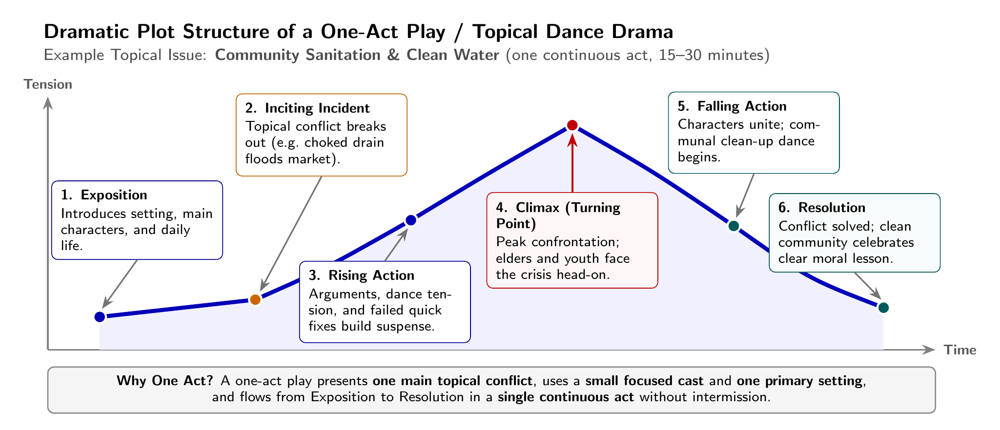
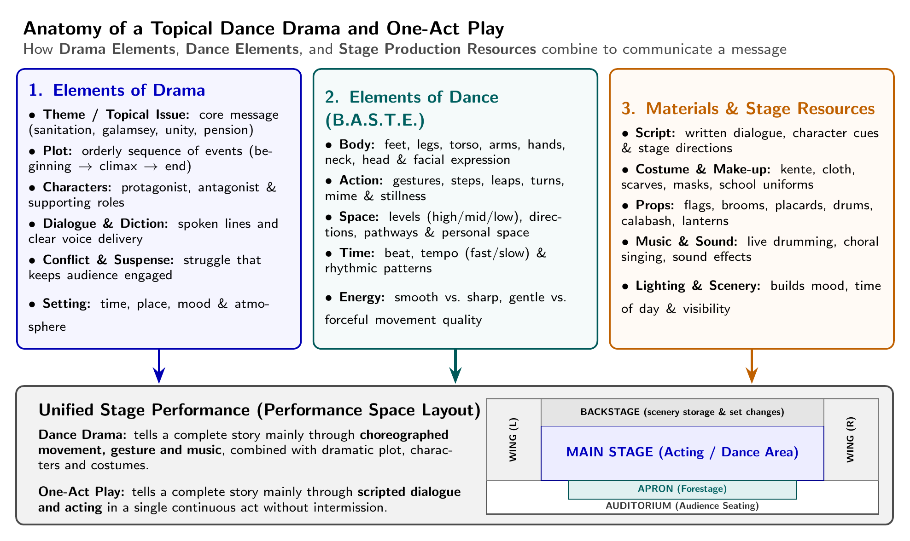

# Lesson 27 — Creating a Simple Dance Drama and/or One-Act Play on a Topical Issue

**Subject:** Creative Arts and Design (Grade 9 / Basic 9)
**BECE Paper 2 Schema:** Section C — Dance and Drama *(15 marks)*
**Strand 2:** Creative Arts | **Sub-strand 1:** Media and Techniques
**NaCCA Indicator:** `B9.2.1.3.7` — *Create a simple Dance Drama and/or one act based on a topical issue.*

---

## Preamble

Every society has urgent issues that affect daily life — choked gutters and poor sanitation, illegal mining (*galamsey*) polluting rivers, wasting electricity, drug abuse among youth, mental health stigma, or preparing for retirement and pension. A speech alone can sometimes be forgotten, but when performers bring a real problem to life on stage through **acting, dialogue, drumming and choreographed dance**, the audience feels the conflict and remembers the lesson long after the curtain closes.

In Grade 9 Dance and Drama, you learn how to select materials and build two closely related performance forms around a topical Ghanaian or African issue: a **dance drama** (which tells a complete story mainly through rhythmic movement, gesture, music and mime) and a **one-act play** (a focused scripted play that moves from beginning to resolution inside one continuous act). In BECE Paper 2 Section C *(15 marks)*, examiners routinely test your mastery of dance drama, drama elements (`plot, theme, setting, character, dialogue, mood, motivation`), body-part expression, Ghanaian traditional dance categories (`Royal, Ritual, War, Recreational`), and reading a short topical script excerpt to suggest a title *"in not more than four words"*, identify characters, name an occasion, and select appropriate props.

**Words to know first:**
- **Drama** — a performing art in which actors portray characters and act out a story live on a stage before an audience.
- **Dance drama** — a stage performance that tells a complete story by combining choreographed dance movements and music with dramatic elements such as plot, characters, costumes and sometimes brief dialogue or mime.
- **One-act play** — a short, complete play performed in a single continuous act without intermission, focused on one main conflict, a small cast and usually one primary setting.
- **Topical issue** — an important current social, environmental, economic or cultural problem affecting the community or nation today (for example, sanitation, energy conservation, *galamsey*, road safety, mental health or pension planning).
- **Script** — the written blueprint of a play containing character names, spoken dialogue and stage directions.
- **Playwright** — a person who writes plays (for example, Efua Sutherland, Ama Ata Aidoo, Martin Owusu or Uncle Ebo Whyte).
- **Plot** — the organised, logical sequence of events in a play or dance drama from opening to resolution.
- **Theme** — the central message, main idea or moral lesson the performance communicates to the audience.
- **Protagonist** — the main central character whose struggle drives the story forward.
- **Antagonist** — the character or force that opposes the protagonist and creates conflict.
- **Dialogue** — spoken conversation between two or more characters in a play.
- **Diction** — the clarity, pronunciation and choice of words an actor uses when speaking lines on stage.
- **Props (properties)** — movable objects handled or used by performers on stage to make the action realistic (for example, brooms, flags, placards, drums, torches or calabashes).
- **Costume** — the clothes, footwear and accessories worn by performers to show their character, role, status or culture.
- **Scenery (set)** — the painted backdrops, furniture and physical structures placed on stage to show where and when the story takes place.

---

## Theory Questions and Answers

### A. Understanding Dance Drama, One-Act Plays and Topical Issues

Q1. What is drama?
Ans. Drama is a performing art in which actors impersonate characters and act out a story through dialogue, gesture and movement on a stage before an audience.

Q2. What is a dance drama?
Ans. A dance drama is a performance form that tells a complete story using choreographed dance movements and music combined with dramatic elements such as characters, a plot, costumes, scenery and sometimes mime or brief dialogue.

Q3. What is a one-act play?
Ans. A one-act play is a compact, complete scripted play performed in one continuous act without a break, centred on one topical conflict, a small cast and a single main setting.

Q4. Differentiate between a dance drama and a one-act play.
Ans.

| Dance Drama | One-Act Play |
| :--- | :--- |
| Communicates the story **mainly through choreographed body movement, gesture, mime and music**. | Communicates the story **mainly through spoken scripted dialogue and acting**. |
| Uses dancers, drummers/musicians and rhythmic choreography to show conflict and emotion. | Uses actors delivering spoken lines, facial expressions and stage directions inside one continuous act. |
| Requires little or no spoken script; meaning is carried visually and rhythmically by the body. | Depends heavily on a written **script** with clear character dialogue and diction. |

The difference is that a dance drama tells its story primarily through choreographed movement and music, whereas a one-act play tells its story primarily through spoken scripted dialogue in a single act.

Q5. State five topical issues in Ghana and Africa suitable for creating a Grade 9 dance drama or one-act play.
Ans.
- Poor community sanitation and plastic waste pollution
- Illegal small-scale mining (*galamsey*) and destruction of water bodies
- Energy conservation and responsible use of electricity
- Drug abuse, peer pressure and mental health stigma among youth
- Financial literacy and preparing for retirement (pension / SSNIT) *(also correct: climate change, bushfires, road safety, girl-child education, national unity)*

Q6. State four roles of dance drama and drama in Ghanaian society.
Ans.
- **Education:** teaches moral values, civic duties, health habits and lessons on topical issues.
- **Cultural preservation:** preserves Ghanaian history, folktales, language, costumes and dance heritage across generations.
- **Entertainment:** brings joy, relaxation and celebration during festivals, durbars and national holidays.
- **Social bonding and advocacy:** unites the community around shared stories and inspires positive social action.

---

### B. Core Elements of Drama and Dance

Q7. State six core elements of drama used when creating a one-act play or dance drama.
Ans.
- **Theme** — the central message or topical lesson of the piece.
- **Plot** — the orderly arrangement of events from beginning to climax and resolution.
- **Characters** — the people or symbolic figures (protagonist, antagonist, chorus) who carry out the action.
- **Dialogue and Diction** — the spoken exchanges between characters and the clarity of their speech.
- **Conflict and Suspense** — the clash of opposing forces and the tension that keeps the audience curious about what happens next.
- **Setting (and Scenery)** — the time, place, mood and physical surroundings where the story happens.

Q8. Differentiate between **plot** and **setting** in drama.
Ans.

| Plot | Setting |
| :--- | :--- |
| The **orderly sequence of events** and actions that propel the story forward from conflict to climax and resolution. | The **time, place and social environment** that provide background context and atmosphere for the events. |

The difference is that plot is the organised chain of events driving the action forward, whereas setting is the time, place and environment in which those events occur.

Q9. Explain the drama terms **mood and atmosphere** and **motivation** (as tested in BECE Section C).
Ans.
- **Mood and atmosphere:** the emotional tone and overall feeling created in a performance through acting, lighting, music, costume and scenery that shapes how the audience feels.
- **Motivation:** the inner reason, desire or goal that drives a character to speak, react or move in a particular way on stage.

Q10. List the six sequential stages of a dramatic plot structure in a one-act play or dance drama.
Ans.
1. **Exposition:** introduces the setting, the main characters and the everyday situation before trouble starts.
2. **Inciting incident:** the specific event that triggers the topical problem or conflict.
3. **Rising action:** a chain of complications, arguments or tense movements that build suspense.
4. **Climax:** the highest emotional turning point where the conflict comes to a head.
5. **Falling action:** the immediate consequences after the turning point as characters begin solving the problem.
6. **Resolution (denouement):** the closing state where the conflict is settled and the moral message is clear.

*Figure 1: Six-stage dramatic plot structure (Exposition through Resolution) compressed into a single continuous act for a topical one-act play or dance drama.*

Q11. List the five elements of dance (remembered by the acronym **B.A.S.T.E.**) and explain each briefly.
Ans.
- **Body:** the dancer's physical instrument — feet, legs, torso, arms, hands, neck, head and facial expressions.
- **Action:** the movements performed — steps, gestures, leaps, turns, falls, mime and deliberate stillness.
- **Space:** how the dancer uses the performance area — levels (high, medium, low), directions (forward, backward, diagonal), pathways (straight, curved, zig-zag) and personal space.
- **Time:** the rhythmic organisation of movement — beat, tempo (fast or slow), duration and accents.
- **Energy (Dynamics):** the force and quality behind movement — sharp versus smooth, strong versus gentle, sudden versus sustained.

Q12. Explain how performers use specific body parts to express meaning and emotion in a dance drama (official BECE 2025 core).
Ans.
- **Feet:** establish rhythm and energy — stamping shows anger or firmness; soft gliding steps show calm; running shows urgency.
- **Legs:** create posture and power — bent knees ground traditional Ghanaian dance; high leaps show excitement; kneeling shows respect, pleading or submission.
- **Torso:** serves as the emotional centre — a lifted chest shows pride or confidence; a slumped chest shows defeat; a twisted torso shows tension.
- **Arms:** extend emotion into space — raised arms express victory or joy; open arms welcome; crossed arms show refusal or self-protection.
- **Hands:** communicate fine detail — clenched fists express anger or determination; open palms show honesty or pleading; pointing directs attention.
- **Head and neck:** show attitude and focus — nodding signals agreement; shaking signals refusal; a lowered head expresses sorrow or respect; a raised neck shows pride or alertness.

---

### C. Selecting Materials, Stage Space and Steps to Create a Topical Production

Q13. State five materials and production resources needed to create and stage a topical dance drama or one-act play.
Ans.
- **Written script or choreography outline** (dialogue, scene cues, character list and stage directions)
- **Costumes and make-up** (traditional cloth, kente, scarves, masks, uniforms or symbolic colours)
- **Props** (brooms, refuse bins, Ghana flag, placards, drums, torches, calabashes, stools)
- **Musical instruments and sound** (traditional drums, *gankogui* bell, *axatse* rattle, choral voices or sound cues)
- **Performance space, scenery and lighting** (backdrops, benches, spotlights to enhance visibility and build mood)

Q14. Identify the five main parts of a theatre performance space shown in **Figure 2** and state one function of each.
Ans.
- **Main stage:** the central acting and dancing area in full view of the audience where the performance takes place.
- **Backstage:** the hidden area behind the stage used for storing scenery, changing sets and moving out of audience view.
- **Wings:** the narrow concealed spaces on the left and right sides of the stage where performers wait before making entrances.
- **Apron (forestage):** the front extension of the stage projecting toward the audience, used for close direct address or narration.
- **Auditorium (house):** the seating area where the audience sits to watch and respond to the performance.

*Figure 2: Production blueprint showing how Drama Elements, Dance Elements (B.A.S.T.E.), and Stage Resources combine on the performance space (backstage, wings, main stage, apron and auditorium).*

Q15. State the procedural steps for creating a simple topical dance drama or one-act play in class (NaCCA `B9.2.1.3.7`).
Ans.
1. **Select a clear topical issue and theme:** brainstorm urgent community problems (such as sanitation or illegal mining) and agree on one clear message for the audience.
2. **Outline the plot and characters:** map the six plot stages (Figure 1) and create a small cast of relatable characters (protagonist, antagonist, elders/youth or symbolic dancers).
3. **Write the short script or movement synopsis:** draft clear dialogue and concise stage directions in brackets (for a one-act play) or divide the story into rhythmic movement scenes (for a dance drama).
4. **Select appropriate materials:** gather low-cost, culturally fitting costumes, props, drums/music and simple scenery that reinforce the setting and mood.
5. **Cast, block and rehearse:** assign roles, plan entrances/exits from the wings, practise clear diction, facial expressions and synchronised dance movements, and refine transitions.
6. **Perform and appraise:** present the work cleanly to the class or school audience and gather constructive peer feedback on clarity of message, acting and rhythm.

Q16. Differentiate between **diction** and **stage** in drama.
Ans.

| Diction | Stage |
| :--- | :--- |
| The **clarity, pronunciation and choice of spoken words** used by an actor so the audience hears and understands every line. | The **physical raised or marked performance area** where actors and dancers present the story to the audience. |

The difference is that diction refers to how clearly and effectively an actor speaks words, whereas the stage is the physical space on which the performance takes place.

---

### D. Ghanaian Dance Categories and Prominent Playwrights (BECE Section C Core)

Q17. Copy and study the four main traditional Ghanaian dance categories frequently tested in BECE Paper 2 Section C.
Ans.

| Dance Category | Purpose / Context of Performance | Classic Ghanaian Examples |
| :--- | :--- | :--- |
| **Royal (Court) dance** | Performed to honour chiefs, kings and royal state occasions. | **Takai** *(Dagomba)*, **Fontomfrom** *(Akan)*, **Adowa** *(royal funerals/durbars)* |
| **Ritual (Religious) dance** | Performed during puberty rites, spiritual ceremonies, healing or worship. | **Klama** *(Krobo Dipo)*, **Akom** *(Akan priests)*, **Yeve** *(Ewe)* |
| **War dance** | Performed historically to prepare warriors or honour bravery and defence. | **Asafo** *(Fante/Akan)*, **Atsiagbekor** *(Ewe)* |
| **Recreational (Social) dance** | Performed for community enjoyment, festivals, unity and social gatherings. | **Bɔbɔɔbɔ** *(Ewe)*, **Kpanlogo** *(Ga)*, **Agbadza** *(Ewe)*, **Bamaya** *(Dagomba)* |

Q18. Name three prominent Ghanaian playwrights or theatre figures and one notable work or contribution of each.
Ans.
- **Efua Theodora Sutherland:** Ghana's pioneer modern playwright-director and founder of the Ghana Drama Studio (*The Marriage of Anansewa*, *Edufa*).
- **Ama Ata Aidoo:** celebrated Ghanaian playwright and author who championed African women's voices (*The Dilemma of a Ghost*, *Anowa*).
- **Martin Owusu:** Ghanaian playwright and drama lecturer (*The Legend of Aku Sika*, *The Sudden Return*). *(Also prominent: **Uncle Ebo Whyte**, Roverman Productions contemporary Ghanaian playwright; **Grace Omaboe / Maame Dokono**, storytelling pioneer on By the Fireside; **Francis Nii Yartey**, choreographer and founder of the National Dance Company.)*

Q19. State three reasons why folktales should be encouraged as source material for Ghanaian drama (official BECE 2026 Section C).
Ans.
- They preserve Ghanaian culture, language and traditional wisdom across generations.
- They teach clear moral lessons about honesty, hard work, unity and good citizenship.
- They stimulate imagination and provide rich plots, characters and humour for community drama.

---

## Worked Exam Exemplars

*Study these authentic BECE Section C (Dance and Drama — 15 marks) questions and official marking schemes before starting the exercises.*

### Exemplar 1 *(Official BECE 2026, Paper 2 Section C — Full 15-Mark Question 6)*

**(a)** Folktales play an important role in Ghanaian drama. State three reasons why they should be encouraged in Ghanaian society. `[6 marks]`

**(b)** Ghanaian traditional dances are performed for different purposes, including recreational, war, ritual and royal ceremonies. Group the following traditional dances under the appropriate headings: **Bɔbɔɔbɔ, Asafo, Takai, Klama**. `[4 marks]`

**(c)** Read the short script below carefully and answer the questions that follow:
> **Narrator:** "Once, our land was not free. Our people toiled under foreign rule, longing for liberty."
> **Character 1:** "My brothers and sisters, the time has come! Ghana must be free! Forward ever, backward never!"
> **Chorus:** "Freedom! Justice! Peace! We are Ghana."
> **Young Girl:** "The future is ours to build! We must work together to make Ghana stronger."
> *(Finale: All performers join in high-energy patriotic spirit as the Ghana National Anthem plays.)*
> **Narrator:** "68 years of freedom, 68 years of pride! Let us honour our past and build a better tomorrow!" *(Curtain closes with the audience cheering.)*

(i) In not more than four words, suggest a suitable title for this script. `[2 marks]`
(ii) Who does Character 1 represent? `[1 mark]`
(iii) At what occasion could this drama be performed? `[1 mark]`
(iv) Name one prop that could be used in this drama. `[1 mark]`

**Model Marking-Scheme Answer:**
- **(a)** *(Any three explained clearly @ 2 marks each = 6 marks)*
  - They preserve Ghanaian culture and heritage by passing customs and history to younger generations.
  - They teach moral lessons and societal values such as honesty, respect and hard work.
  - They develop creativity, imagination and public-speaking confidence in learners.
- **(b)** *(1 mark each = 4 marks)*
  - **Royal:** Takai | **Ritual:** Klama | **War:** Asafo | **Recreational:** Bɔbɔɔbɔ
- **(c)**
  - (i) Any fitting title of **4 words or fewer** — e.g. *"Ghana's Journey to Freedom"*, *"Forward Ever"*, or *"Ghana Must Be Free"* *(2 marks; penalise if more than 4 words)*.
  - (ii) **Osagyefo Dr. Kwame Nkrumah** (or a Ghanaian independence / nationalist leader) *(1 mark)*.
  - (iii) **Independence Day Celebration (6th March)** (also correct: Founders' Day, Republic Day or School Cultural Festival) *(1 mark)*.
  - (iv) Any one appropriate prop — e.g. **Ghana national flag**, placard (*"Forward Ever, Backward Never"*), traditional drum, torch, chains or red cloth *(1 mark)*.

---

### Exemplar 2 *(Official BECE 2025, Paper 2 Section C — 15 Marks)*

**(a)** Explain **dance-drama**. `[3 marks]`
**(b)** Explain how actors and dancers use any three body parts (from feet, arms, hands, legs, head, torso) to convey meaning in performance. `[6 marks]`
**(c)** Explain the three elements of dance — **Body**, **Space** and **Energy** — giving one performance example for each. `[6 marks]`

**Model Marking-Scheme Answer:**
- **(a)** Dance-drama is a performance form that tells a complete story through choreographed dance movements and music combined with elements of drama such as characters, plot, costumes and scenery, carrying meaning mainly through the body rather than lengthy spoken words. `(3 marks)`
- **(b)** *(Any three body parts @ 2 marks each = 6 marks)*
  - **Feet:** establish rhythm and mood; stamping expresses anger or firmness, whereas gliding steps express calmness.
  - **Hands:** convey fine detail; clenched fists show anger or determination, while open palms signal pleading or honesty.
  - **Torso:** expresses inner emotion; a lifted chest signals confidence, while a collapsed chest conveys grief or defeat.
- **(c)** *(2 marks each: explanation 1 + performance example 1 = 6 marks)*
  - **Body:** the dancer's physical instrument used wholly or in isolated parts — *Example:* curling tightly into a ball to express grief, then slowly unfolding to show recovery.
  - **Space:** how the dancer uses levels, directions and pathways on stage — *Example:* travelling along a curved pathway from upstage to low centre stage to draw focus inward.
  - **Energy:** the quality or force of movement (sharp vs smooth, gentle vs strong) — *Example:* performing an arm gesture softly to show peace versus sharply to show anger.

---

### Exemplar 3 *(Official BECE 2024, Paper 1 Objective)* — `[1 mark]`

A group called "Young Stars" of Kromkrom D/A JHS wants to create a skit to educate learners about the importance of proper handwashing. Identify the most effective way to convey their message to learners.
A. Use complex scientific terms        B. Use humour and relatable characters        C. Show graphic images of germs and diseases        D. Give a long lecture on the importance of handwashing

**Model Answer:** **B — Use humour and relatable characters** `[1 mark]`.
*Why:* Relatable characters and light humour keep young audiences emotionally engaged and make the health message memorable without confusing or frightening them.

---

<!-- pagebreak -->

## Exercises (BECE Paper 1 & Paper 2 Blueprint — 40 Questions)

### Section 1 — Paper 1: Core Definitions and Concept Identification *(5 × 1 = 5 marks)*

1. *(bank, BECE 2024)* Select the statement that best describes a **plot**.
   A. An orderly arrangement of events of a play        B. A cue of a piece of drama        C. A random collection of jokes and songs        D. A list of costumes worn on stage

2. *(bank, Staralex Mock 2026)* The message or main idea of a drama is called the
   A. plot.        B. scene.        C. cast.        D. theme.

3. *(bank, Mock 2025)* The main character in a drama whose struggle drives the story forward is called the
   A. cast.        B. antagonist.        C. stagehand.        D. protagonist.

4. *(bank, Mock 2026)* Dialogue in drama refers to
   A. rhythmic foot movement.        B. spoken conversation between characters.        C. background drumming.        D. painted stage scenery.

5. *(bank, Mock 2023)* What artistic form involves live performance by actors portraying characters in a scripted narrative?
   A. Dance solo        B. Play        C. Sculpture        D. Painting

---

### Section 2 — Paper 1: Functions, Materials and Expressive Techniques *(5 × 1 = 5 marks)*

6. *(bank, BECE 2024)* A group called "Young Stars" of Kromkrom D/A JHS wants to create a skit to educate learners about the importance of proper handwashing. Identify the most effective way to convey their message to learners.
   A. Use complex scientific terms        B. Use humour and relatable characters        C. Show graphic images of germs and diseases        D. Give a long lecture on handwashing

7. *(bank, Mock 2026)* A **script** is primarily used in
   A. weaving.        B. drama.        C. painting.        D. clay modelling.

8. *(bank, Mock 2026)* The main purpose of **facial expressions** in drama and dance drama is to
   A. show emotion and enhance character portrayal.        B. memorise written lines.        C. replace the stage lighting.        D. close the curtain at the end.

9. *(bank, Mock 2026)* What is the primary role of **lighting** in a theatre performance?
   A. To replace the written script        B. To create mood and enhance visibility on stage        C. To replace costume design        D. To increase the number of actors

10. *(bank, Bank 2023)* Which of the following items is considered the most fundamental blueprint in a drama production class?
    A. Costumes        B. Gestures        C. Lighting        D. Script

---

### Section 3 — Paper 1: Classification, Exceptions and Cultural Knowledge *(5 × 1 = 5 marks)*

11. *(bank, BECE 2026)* A Ghanaian drama which is based on folktales and legends is known as
    A. modern television drama.        B. puppet drama.        C. radio drama.        D. traditional oral drama.

12. *(bank, BECE 2025)* A well-known contemporary playwright in Ghana is
    A. Majid Michel.        B. Ebo Whyte.        C. Yvonne Nelson.        D. Jackie Appiah.

13. *(bank, Bank 2023)* Which of the following is NOT a dance element?
    A. Space        B. Diction        C. Energy        D. Body

14. *(bank, Mock 2026)* Which of the following is NOT part of the performance stage?
    A. Backstage        B. Out front        C. Apron        D. Centre stage

15. *(bank, Bank 2023) [Review]* Which of the following is NOT a type of performing art?
    A. Coiffure        B. Dance        C. Drama        D. Music

---

### Section 4 — Paper 2: Visual, Diagram and Stage-Space Identification *(5 Questions)*

16. Study **Figure 1** showing the dramatic plot structure of a one-act play.
    (a) Name the six sequential stages of the plot arc shown in Figure 1 from start to finish. `(3 marks)`
    (b) Identify which single stage represents the highest emotional turning point of the story. `(1 mark)`
    (c) Explain two reasons why a **one-act play** is well suited for a 20-minute school assembly on sanitation. `(4 marks)`

17. Study **Figure 2** showing the anatomy of a dance drama and the performance space layout.
    (a) State the five elements of dance represented by the acronym **B.A.S.T.E.** in Figure 2. `(5 marks)`
    (b) Name any three production resources listed under *Materials and Stage Resources* in Figure 2. `(3 marks)`

18. *(bank, BECE 2025)* Refer to the performance space plan in the bottom-right panel of **Figure 2**.
    (a) Name three parts of the performance space shown in the plan. `(3 marks)`
    (b) State one specific function of each of the three parts you named in (a). `(3 marks)`

19. Sketch a neat, simple labelled diagram of a rectangular theatre performance space showing the **Backstage**, **Left and Right Wings**, **Main Stage**, **Apron**, and **Auditorium**. `(5 marks)`

20. *(bank, BECE 2024)* In the performance of African music and dance drama, the stage must be organised so the audience enjoys the performance clearly.
    (a) Describe how **drummers**, **dancers** and **singers** are arranged on stage during a *Kpanlogo* performance. `(3 marks)`
    (b) State three costume items Adzo and Komla would wear when performing the *Bɔbɔɔbɔ* dance. `(3 marks)`

---

### Section 5 — Paper 2: Structured Theory — Definitions and Enumerated Lists *(5 Questions)*

21. *(bank, Staralex Mock 2026)*
    (a) What is **drama**? `(2 marks)`
    (b) State six elements of drama a troupe uses during a performance. `(6 marks)`
    (c) Who is a **character**, and what is **scenery**? `(2 marks)`

22. *(bank, BECE 2026 Marking Scheme 7)* Describe each of the following drama terms clearly:
    (a) **Mood and atmosphere**; `(2 marks)`
    (b) **Motivation**; `(2 marks)`
    (c) **Setting**. `(2 marks)`

23. *(bank, Staralex Mock 2026)* Describe the following four terms as used in drama:
    (a) **Costume**; `(1½ marks)`
    (b) **Suspense**; `(1½ marks)`
    (c) **Theme**; `(1½ marks)`
    (d) **Plot**. `(1½ marks)`

24. *(bank, BECE 2024)* At a festival in your hometown, you watched colourfully dressed performers stage an energetic dance drama.
    (a) Explain what **dance drama** means. `(3 marks)`
    (b) State three roles that dance drama plays in Ghanaian society. `(3 marks)`

25. *(bank, BECE 2025)*
    (a) Explain how dancers and actors use each of the following four body parts to communicate meaning without speaking:
        (i) **Feet**; `(1 mark)`
        (ii) **Arms**; `(1 mark)`
        (iii) **Head**; `(1 mark)`
        (iv) **Legs**. `(1 mark)`
    (b) State two ways modern Ghanaian dances help preserve and promote Ghanaian culture. `(4 marks)`

---

### Section 6 — Paper 2: Comparisons, Differentiations and Table Completion *(5 Questions)*

26. Differentiate between:
    (a) a **dance drama** and a **one-act play**; `(2 marks)`
    (b) a **protagonist** and an **antagonist**. `(2 marks)`

27. *(bank, Staralex Mock 2026 & Bank 2023)* Differentiate between:
    (a) **diction** and **stage**; `(2 marks)`
    (b) **plot** and **setting**. `(2 marks)`

28. *(bank, BECE 2026)* Copy and complete the table below by classifying each Ghanaian traditional dance (**Bɔbɔɔbɔ, Asafo, Takai, Klama**) under its correct performance category and stating one occasion where it is performed. `(8 marks)`

| Category | Traditional Dance | Occasion / Purpose |
| :--- | :--- | :--- |
| Royal | ……… | ……… |
| Ritual | ……… | ……… |
| War | ……… | ……… |
| Recreational | ……… | ……… |

29. Copy and complete the table below matching each topical issue to one suitable **costume item** and one suitable **stage prop** for a school one-act play. `(6 marks)`

| Topical Issue | Suitable Costume Item | Suitable Stage Prop |
| :--- | :--- | :--- |
| Community sanitation | ……… | ……… |
| Illegal mining (*galamsey*) | ……… | ……… |
| Energy conservation | ……… | ……… |

30. *[Review — Grade 9 Music L19]* Differentiate between:
    (a) singing a triad **horizontally (arpeggio)** and singing a triad **vertically (harmony)**; `(2 marks)`
    (b) **melody** and **harmony** in accompanying a dance drama. `(2 marks)`

---

### Section 7 — Paper 2: Procedural Steps, Script Elements and Practical Craft *(5 Questions)*

31. Write **five** clear sequential steps for creating a simple topical one-act play or dance drama from initial idea to class performance. `(5 marks)`

32. Explain **four** practical factors a director should consider when selecting materials (costumes, props and music) for a school dance drama on a tight budget. `(4 marks)`

33. *(bank, Bank 2023)* A performing arts class wants to master authentic Ghanaian facial expressions and gestures before staging a dance drama.
    (a) Identify the most effective practical rehearsal method learners should use to improve their facial expressions and gestures. `(2 marks)`
    (b) State two reasons why rehearsing with peer and teacher feedback is better than only reading descriptions from a textbook. `(2 marks)`

34. Write a short four-line **dialogue opening** (including one stage direction in brackets) for a one-act play warning learners against littering the school compound. `(4 marks)`

35. *(bank, Staralex Mock 2026)*
    (a) Suggest a suitable title of **not more than four words** for a topical drama about saving electricity at home and school. `(2 marks)`
    (b) State two practical props that would immediately communicate the theme of energy conservation to the audience. `(2 marks)`

---

### Section 8 — Paper 2: BECE Real-World Topical Scenarios and Spiral Review *(5 Questions)*

36. *(bank, Mock Jan 2024 — Full Topical Dance Drama Analysis)* Read the dance drama synopsis below carefully and answer the questions that follow:
    > **Title:** *"Breaking the Stigma"*
    > **Synopsis:** Mia, a young woman struggling with anxiety and depression, appears in Act 1 wearing a mask while surrounded by **Shadow Figures** who represent inner turmoil and social stigma. In Act 2, her **Supportive Friends and Family** reach out through movement to break through the barrier surrounding her. In Act 3, Mia removes her mask and dances freely as the shadows fade. In Act 4, the wider community joins in unified dance movements symbolising understanding, ending in Act 5 with Mia dancing confidently in empowerment.
    (a) What is the central **theme** of this dance drama? `(2 marks)`
    (b) Briefly describe how the **story unfolds** from beginning to end. `(2 marks)`
    (c) What **message** does the performance convey to society? `(2 marks)`
    (d) Explain how the three groups of **characters** contribute to the narrative. `(2 marks)`
    (e) Explain the symbolic significance of Mia **removing her mask** during the dance. `(2 marks)`

37. **BECE Section C Script-Analysis Schema (5 marks):** Read the original Ghanaian topical script excerpt below and answer the questions that follow:
    > **Setting:** *A muddy riverbank in a rural cocoa community. Dried brown leaves litter the dry pump.*
    > **Nana Akua:** *(kneeling beside the murky river, holding an empty calabash)* "Once, our mothers fetched water as clear as glass from River Pra. Look at it now — thick mud and poison!"
    > **Kojo (Youth Leader):** "The machines tore up the banks for quick gold, Nana, and left our farms thirsting."
    > **Chorus of Youth:** *(beating slow, heavy rhythms on drums)* "Gold cannot quench thirst! Save our rivers, save our future!"
    > **Nana Akua:** *(rising firmly with arms lifted)* "Then let every chief, parent and student stand as one. Today, we reclaim our water!"
    (a) In **not more than four words**, suggest a suitable title for this script. `(2 marks)`
    (b) Identify the topical Ghanaian issue addressed in the script. `(1 mark)`
    (c) Name **one** occasion where this play could be performed effectively. `(1 mark)`
    (d) Name **one** prop explicitly mentioned in the script. `(1 mark)`

38. *(bank, BECE 2024)* Write short notes on **any one** of the following Ghanaian performing-arts personalities, stating their **profession**, **contribution to society**, and **one example of their works**:
    (i) **Martin Owusu**; *(or)* (ii) **Francis Nii Yartey**; *(or)* (iii) **Ama Ata Aidoo**. `(6 marks)`

39. *[Review — Grade 9 Visual Arts: Design Process & Exhibition]*
    (a) State three items that must be planned when organising a school art exhibition or stage showcase. `(3 marks)`
    (b) Explain how **casting** or **found-object construction** from Grade 9 Visual Arts can help a drama troupe make low-cost masks and stage props. `(2 marks)`

40. *[Review — Grade 9 Music L19]* A dance drama troupe wants live four-part choral accompaniment in C major during the finale of their topical play.
    (a) Write the tonic solfa members of the three primary triads (**I, IV, V**) the choir can sing. `(3 marks)`
    (b) Name the four voice parts that make up the choir from highest to lowest. `(2 marks)`

---

<!-- pagebreak -->

## Complete Answers and Marking Scheme

### Paper 1 — Objective Answers (Sections 1–3)

1. **A** — Plot is the logical, orderly sequence of events that makes up a play's story.
2. **D** — The theme is the central message, idea or moral lesson communicated by a drama.
3. **D** — The protagonist is the leading character around whose goal or struggle the play revolves.
4. **B** — Dialogue is the spoken conversation exchanged between characters on stage.
5. **B** — A play is a scripted dramatic narrative acted live by performers portraying characters.
6. **B** — Humour and relatable characters engage JHS learners and make health habits easy to remember.
7. **B** — A script is the written text of dialogue and stage directions used to produce a drama.
8. **A** — Facial expressions visually communicate a character's inner emotions to the audience.
9. **B** — Stage lighting makes performers clearly visible and establishes the time of day and emotional mood.
10. **D** — The script is the foundational blueprint guiding acting, dialogue, props, costumes and cues in a drama class.
11. **D** — Traditional oral drama draws directly on Ghanaian folktales, myths, proverbs and legends.
12. **B** — Uncle Ebo Whyte (founder of Roverman Productions) is a celebrated contemporary Ghanaian playwright; the others are film actors.
13. **B** — Diction is a vocal/drama element (clarity of speech), not one of the five dance elements (Body, Action, Space, Time, Energy).
14. **B** — *Out front* refers to the auditorium / audience side beyond the performance stage; backstage, apron and centre stage are parts of the stage.
15. **A** — `[Review]` Coiffure (hairdressing) is not a performing art; dance, drama and music are the three performing arts.

---

### Paper 2 — Theory Marking Scheme (Sections 4–8)

16. **(a)** 1. Exposition, 2. Inciting incident, 3. Rising action, 4. Climax, 5. Falling action, 6. Resolution (denouement). `(½ mark each = 3 marks)`
    **(b)** **Climax** (the turning point). `(1 mark)`
    **(c)** Any two valid reasons (`2 marks each = 4 marks`):
    - It focuses sharply on **one topical conflict** so the sanitation message is unmistakable.
    - It runs continuously in **15–30 minutes without intermission**, fitting a school assembly slot.
    - It needs only a **small cast and one main setting**, making preparation fast and affordable.

17. **(a)** **B**ody, **A**ction, **S**pace, **T**ime, **E**nergy. `(1 mark each = 5 marks)`
    **(b)** Any three resources (`1 mark each = 3 marks`): script, costume and make-up, props, music and sound, lighting and scenery.

18. **(a)** Any three parts (`1 mark each = 3 marks`): Main stage, Backstage, Wings (left/right), Apron (forestage), Auditorium.
    **(b)** Matching function for each part named (`1 mark each = 3 marks`):
    - **Main stage:** primary visible area where acting and dancing occur.
    - **Backstage:** hidden space behind stage for scenery storage and set changes.
    - **Wings:** side spaces where performers wait unseen before entrances.
    - **Apron:** forward stage extension for close direct narration to the audience.
    - **Auditorium:** area where the audience sits to watch the show.

19. Neat rectangular plan with all five zones clearly drawn in correct spatial relationship (`Backstage` at rear, `Wings` flanking left and right, `Main Stage` central, `Apron` projecting forward, `Auditorium` facing front) and cleanly labelled. `(1 mark per correctly positioned & labelled zone = 5 marks)`

20. **(a)** In *Kpanlogo*, **drummers** sit or stand at the rear of the stage (semi-circle or straight line with the master drummer in the centre) `(1 mark)`; **dancers** perform in front of the drummers facing the audience so expressions and footwork are clearly visible `(1 mark)`; **singers** stand behind or beside the drummers supporting with voice and clapping `(1 mark)`. `(3 marks)`
    **(b)** Any three *Bɔbɔɔbɔ* costume items (`1 mark each = 3 marks`): white handkerchiefs, traditional cloth (*kaba* and slit / wrapped cloth), scarves/head wraps, beaded necklaces.

21. **(a)** Drama is a performing art in which actors portray characters and act out a story live before an audience. `(2 marks)`
    **(b)** Any six elements (`1 mark each = 6 marks`): plot, theme, character, dialogue, setting/scenery, conflict, costume, props, music/sound, lighting, spectacle, diction.
    **(c)** A **character** is a person or symbolic figure portrayed by an actor in a play `(1 mark)`; **scenery** is the painted backdrop, furniture and physical pieces used to show the place and time of action `(1 mark)`. `(2 marks)`

22. **(a) Mood and atmosphere:** the emotional tone and overall ambience created by acting, music, lighting, costume and setting that influences how the audience feels. `(2 marks)`
    **(b) Motivation:** the inner reason, purpose or drive behind a character's behaviour, words and actions on stage. `(2 marks)`
    **(c) Setting:** the time, geographical place and social environment in which the events of a play take place. `(2 marks)`

23. **(a) Costume:** garments, footwear and accessories worn by performers to represent character identity, status or culture. `(1½ marks)`
    **(b) Suspense:** the feeling of anxious curiosity and excitement that keeps the audience eager to see how the conflict will turn out. `(1½ marks)`
    **(c) Theme:** the central idea, topical subject or moral lesson of the play. `(1½ marks)`
    **(d) Plot:** the orderly, connected sequence of events from opening to climax and resolution. `(1½ marks)`

24. **(a)** Dance drama is a stage performance that tells a complete story using choreographed dance movements and music together with dramatic elements such as plot, characters and costumes. `(3 marks)`
    **(b)** Any three roles (`1 mark each = 3 marks`): educates people on morals and topical issues; preserves cultural heritage; entertains during festivals and celebrations; promotes unity and community bonding; communicates important social warnings.

25. **(a)** `(1 mark each = 4 marks)`
    - (i) **Feet:** set rhythm and mood (stamping shows anger/strength; gliding shows calm).
    - (ii) **Arms:** extend emotion into space (raised arms show victory; crossed arms show refusal/defence).
    - (iii) **Head:** shows focus and attitude (nodding shows agreement; lowered head shows sorrow or respect).
    - (iv) **Legs:** build power and cultural posture (bent knees ground Ghanaian dance; kneeling shows submission/respect; leaps show joy).
    **(b)** Any two explained (`2 marks each = 4 marks`):
    - Keep Ghanaian cultural identity alive among youth by adapting traditional footwork and waist movements into modern social dances.
    - Promote Ghanaian music, local languages and tourism globally through festivals and digital media.

26. **(a)** A dance drama tells its story primarily through choreographed movement, gesture and music, whereas a one-act play tells its story primarily through spoken scripted dialogue in one continuous act. `(2 marks)`
    **(b)** The protagonist is the main central character driving the story's goal, whereas the antagonist is the opposing character or force creating conflict against the protagonist. `(2 marks)`

27. **(a)** Diction is the clarity and effectiveness of an actor's spoken words, whereas the stage is the physical performance space where the drama is acted out. `(2 marks)`
    **(b)** Plot is the organised sequence of events propelling the action forward, whereas setting is the time, place and background context in which those events happen. `(2 marks)`

28. Completed table (`1 mark` correct dance + `1 mark` accurate occasion/purpose per row = `8 marks`):
    - **Royal:** **Takai** — performed for Dagomba royalty, chiefs and state festivals.
    - **Ritual:** **Klama** — performed during Krobo *Dipo* puberty and spiritual rites.
    - **War:** **Asafo** — performed by Fante/Akan warrior groups to show bravery and historical defence.
    - **Recreational:** **Bɔbɔɔbɔ** — performed by Ewe communities for social joy, festivals and gatherings.

29. Any logical, culturally grounded pairing (`1 mark` per cell = `6 marks`):
    - **Community sanitation:** Costume — reflective vest / school uniform / apron; Prop — broom, refuse bin, dustpan or placard.
    - **Illegal mining (*galamsey*):** Costume — rubber boots / farmer's cloth / mud-stained work shirt; Prop — calabash of muddy water, shovel or dead seedling.
    - **Energy conservation:** Costume — everyday home attire / electrician's overalls; Prop — electric bulb/torch, mock meter bill or cardboard wall switch.

30. `[Review]`
    **(a)** Singing a triad horizontally sounds its three notes sequentially one after another as an arpeggio, whereas singing vertically sounds all notes simultaneously in harmony. `(2 marks)`
    **(b)** Melody is the main tune heard one note at a time, whereas harmony is the vertical blend of supporting pitches sounded together beneath or around the tune. `(2 marks)`

31. Five clear sequential steps (`1 mark each = 5 marks`):
    1. Choose one urgent topical issue and define the central theme/message.
    2. Map out the six-stage plot outline and create a small cast of characters.
    3. Write the short script (dialogue + stage directions) or choreographic scene outline.
    4. Gather affordable costumes, props, instruments and simple scenery.
    5. Block stage movements, rehearse thoroughly with feedback, and present the performance.

32. Any four valid factors (`1 mark each = 4 marks`):
    - **Relevance to theme and character:** items must immediately match the topical issue and Ghanaian setting.
    - **Cost and local availability:** use improvised, recycled or locally sourced materials instead of expensive rentals.
    - **Safety and durability:** props and costumes must be lightweight, safe to handle and sturdy enough for energetic dancing.
    - **Comfort and freedom of movement:** costumes must allow dancers to leap, bend and gesture freely without tripping.

33. **(a)** Practising in front of a **mirror** and actively seeking **feedback from peers and instructors**. `(2 marks)`
    **(b)** Any two valid reasons (`1 mark each = 2 marks`):
    - Allows performers to see and correct stiff posture or unclear expressions immediately in real time.
    - Builds muscle memory and stage confidence that passive reading alone cannot produce.

34. Any clear four-line dialogue between two characters addressing school littering, formatted with character names and at least one bracketed stage direction `(1 mark formatting + 1 mark stage direction + 2 marks clear topical message = 4 marks)`.
    *Model:*
    > **Ama:** *(picking up a dropped sachet near the veranda)* "Kofi, the bin is two steps away — why throw plastic on our compound?"
    > **Kofi:** *(shrugging)* "One small sachet will not choke any drain, Ama."
    > **Ama:** "If forty students say 'only one', our classroom floods when it rains!"
    > **Kofi:** *(taking the sachet and dropping it into the bin)* "You are right — keeping Staralex clean starts with me."

35. **(a)** Any apt title of **4 words or fewer** (`2 marks`), e.g. *"Switch Off, Save Power"*, *"Light for Tomorrow"*, or *"Save Every Watt"*.
    **(b)** Any two clear props (`1 mark each = 2 marks`): mock wall switch / bulb, high electricity bill sheet, torchlight, or *"Switch Off!"* placard.

36. **(a) Theme:** breaking the social stigma surrounding mental health (anxiety and depression) and promoting community empathy and support. `(2 marks)`
    **(b) Story unfolding:** Mia first hides her distress behind a mask surrounded by shadows; friends and family reach out to support her; she removes the mask to seek help; the community unites around her until she dances freely in empowerment. `(2 marks)`
    **(c) Message:** People facing mental health struggles should seek help without fear or judgement, and communities must replace stigma with compassion. `(2 marks)`
    **(d) Character contribution:** **Mia** embodies the personal struggle and courage to heal; **Shadow Figures** visualise internal pain and societal stigma; **Friends/Family and Community** represent empathy, unity and healing support. `(2 marks)`
    **(e) Symbolism of removing the mask:** It symbolises Mia letting go of shame and secrecy, accepting her vulnerability, and openly seeking help. `(2 marks)`

37. **(a)** Any fitting title of **4 words or fewer** (`2 marks`), e.g. *"Save Our Rivers"*, *"Water Over Gold"*, or *"Reclaim Our Water"*.
    **(b)** Illegal small-scale mining (*galamsey*) and water-body pollution. `(1 mark)`
    **(c)** Any appropriate occasion (`1 mark`): World Environment Day, School Cultural/Drama Festival, Community Durbar or National Sanitation Campaign.
    **(d)** **Empty calabash** *(or drums)*. `(1 mark)`

38. Any **one** personality (`2 marks` profession + `2 marks` contribution + `2 marks` example work = `6 marks`):
    - **Martin Owusu:** Ghanaian playwright, drama lecturer and former Director of the School of Performing Arts, University of Ghana. Shaped modern African theatre with culturally rooted plays and trained generations of actors. *Works:* *The Legend of Aku Sika*, *The Sudden Return*, *The Story Ananse Told*.
    - **Francis Nii Yartey:** Ghanaian choreographer, dancer, artistic director and founder of the National Dance Company of Ghana. Preserved traditional dances, pioneered contemporary African choreography and staged Ghana's dance heritage internationally. *Works:* CAN 2008 opening/closing ceremonies, *Musu: Saga of the Slaves*.
    - **Ama Ata Aidoo:** Ghanaian playwright, novelist, poet and former Minister of Education. Pioneered African feminist drama and illuminated the realities of African women and postcolonial identity. *Works:* *The Dilemma of a Ghost*, *Anowa*, *Changes*.

39. `[Review]`
    **(a)** Any three exhibition/showcase planning elements (`1 mark each = 3 marks`): target audience, venue selection and layout, finance/budgeting, publicity/invitations, security and programme schedule.
    **(b)** Casting (using paper pulp or clay moulds) and found-object construction (gluing, stitching and stapling cardboard, bottles and fabric scraps) allow troupes to build lightweight, expressive masks and durable props cheaply from recycled materials. `(2 marks)`

40. `[Review]`
    **(a)** Chord **I**: `d – m – s` `(1 mark)`; Chord **IV**: `f – l – d'` `(1 mark)`; Chord **V**: `s – t – r'` `(1 mark)`. `(3 marks)`
    **(b)** Soprano, Alto, Tenor, Bass. `(½ mark each = 2 marks)`
