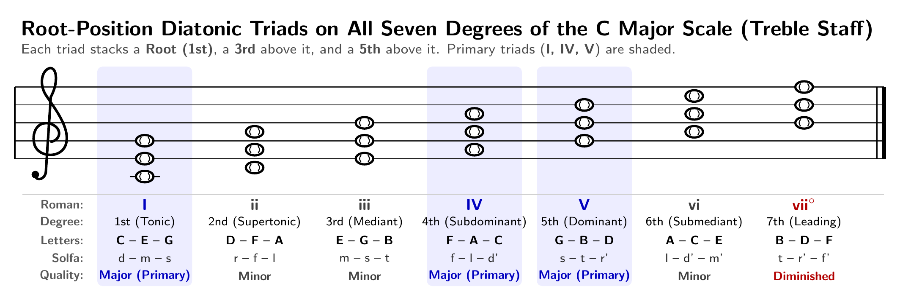
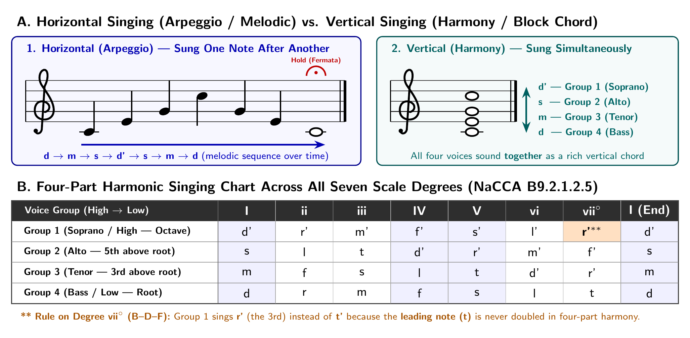
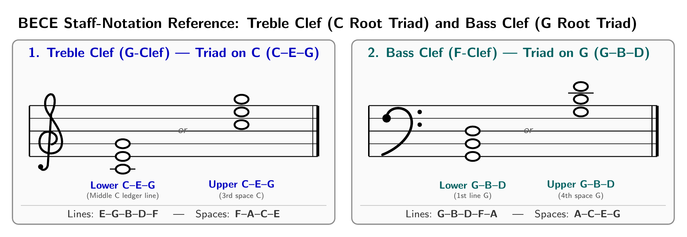

# Lesson 19 — Singing Triads on All Seven Degrees of the Scale (Horizontally as Arpeggios and Vertically in Harmony)

**Subject:** Creative Arts and Design (Grade 9 / Basic 9)
**BECE Paper 2 Schema:** Section B — Music *(15 marks)*
**Strand 2:** Creative Arts | **Sub-strand 1:** Media and Techniques
**NaCCA Indicator:** `B9.2.1.2.5` — *Sing in pitch triads on all the seven degrees of the scale horizontally (arpeggios) and vertically (harmony).*

---

## Preamble

When you hear a single singer perform a melody, the sound moves forward one note at a time like a single thread. When a school choir or church choir sings together, several voices sound different notes at the exact same moment, making the music feel rich, warm and full. That richness comes from **chords**, and the simplest, most important chord in music is the **triad** — three notes stacked in thirds on any step (degree) of a scale.

In Grade 7 you learnt the seven degrees of the diatonic major scale (`d r m f s l t d'`) and how to read notes on the five-line treble staff. In Grade 9 you take the next step: building a triad on every single one of those seven degrees, singing each triad **horizontally** one note after another as an **arpeggio**, and singing them **vertically** together in four voice groups as **harmony**. In the BECE Paper 2 Section B *(15 marks)*, examiners regularly ask candidates to write triads in tonic solfa (`I, IV, V`), construct root-position triads on the treble and bass staves, describe choir voice parts, and explain scales and harmony.

**Words to know first:**
- **Pitch** — how high or low a musical sound is.
- **Scale** — an orderly sequence of musical notes arranged in ascending (going up) or descending (going down) order of pitch according to a fixed pattern of tones and semitones.
- **Scale degree** — the numbered position (`1st` to `7th`, written in Roman numerals `I` to `VII`) of each note in a scale.
- **Staff (or stave)** — the set of five parallel horizontal lines and four spaces on which musical notes are written.
- **Clef** — a symbol placed at the beginning of a staff to fix the exact pitch names of the lines and spaces (the **treble / G-clef** for high voices and the **bass / F-clef** for low voices).
- **Chord** — two or more (usually three or more) notes of different pitches sounded together to produce harmony.
- **Triad** — the simplest three-note chord, made up of a **root** (1st note), the **3rd** above it, and the **5th** above it.
- **Root** — the bottom founding note on which a triad is built and from which the triad takes its name.
- **Arpeggio** — the notes of a triad or chord sung or played **horizontally** (one after another in melodic sequence) rather than at the same time; also called a **broken chord**.
- **Harmony** — the pleasing combination of two or more different pitches sounded **vertically** (simultaneously) to enrich a melody.
- **Fermata (pause)** — a curved arc with a dot underneath placed above a note to tell performers to hold that note longer than its normal value.
- **Leading note** — the 7th degree (`t`) of a major scale, which pulls strongly upward to the tonic (`d'`).

---

## Theory Questions and Answers

### A. Scales, Degrees and the Structure of a Triad

Q1. What is a scale in music?
Ans. A scale is a sequence of musical notes arranged in ascending or descending order of pitch following a fixed pattern of tones and semitones from a starting note (the tonic) to its octave.

Q2. How many distinct degrees make up a diatonic major scale before the octave repeats?
Ans. A diatonic major scale has seven distinct degrees, numbered `1st` to `7th` (Roman numerals `I` to `VII`), before the `8th` note repeats the tonic one octave higher.

Q3. State the seven technical degree names of a major scale in ascending order together with their tonic solfa syllables.
Ans.
- `1st` degree (`I`): **Tonic** — `doh (d)`
- `2nd` degree (`ii`): **Supertonic** — `ray (r)`
- `3rd` degree (`iii`): **Mediant** — `me (m)`
- `4th` degree (`IV`): **Subdominant** — `fah (f)`
- `5th` degree (`V`): **Dominant** — `soh (s)`
- `6th` degree (`vi`): **Submediant** — `lah (l)`
- `7th` degree (`vii°`): **Leading note** — `te (t)`

Q4. What is a chord in music?
Ans. A chord is a group of three or more notes of different pitches sounded together to support and harmonise a melody.

Q5. What is a triad?
Ans. A triad is the simplest type of chord, consisting of three notes built by stacking a **root** (1st), a **3rd** above the root, and a **5th** above the root.

Q6. How do you form a root-position triad on any note of a scale?
Ans. Start on the chosen scale note (the root), skip the very next scale note to take the 3rd, and skip the next note again to take the 5th (for example, starting on `d`, skip `r` to take `m`, skip `f` to take `s`, giving `d – m – s`).

Q7. How does a root-position triad look visually on a musical staff?
Ans. When the root sits on a **line**, the 3rd and 5th sit on the next two **lines** directly above it (line–line–line); when the root sits in a **space**, the 3rd and 5th sit in the next two **spaces** directly above it (space–space–space).

Q8. List the seven diatonic triads of the C major scale showing each Roman numeral, letter name, tonic solfa and chord quality.
Ans.

| Degree | Technical Name | Roman Numeral | Letter Names (C Major) | Tonic Solfa | Chord Quality | Category |
| :---: | :--- | :---: | :---: | :---: | :--- | :--- |
| 1st | Tonic | **I** | `C – E – G` | `d – m – s` | Major | Primary triad |
| 2nd | Supertonic | **ii** | `D – F – A` | `r – f – l` | Minor | Secondary triad |
| 3rd | Mediant | **iii** | `E – G – B` | `m – s – t` | Minor | Secondary triad |
| 4th | Subdominant | **IV** | `F – A – C` | `f – l – d'` | Major | Primary triad |
| 5th | Dominant | **V** | `G – B – D` | `s – t – r'` | Major | Primary triad |
| 6th | Submediant | **vi** | `A – C – E` | `l – d' – m'` | Minor | Secondary triad |
| 7th | Leading note | **vii°** | `B – D – F` | `t – r' – f'` | Diminished | Secondary triad |

*Figure 1: Root-position diatonic triads built on all seven degrees (`I` to `vii°`) of the C major scale on the treble staff, showing Roman numerals, degree names, letters, solfège and chord qualities.*

Q9. What are primary triads, and which three scale degrees produce them?
Ans. Primary triads are the three major triads of a major key — built on degrees **I** (tonic, `d–m–s`), **IV** (subdominant, `f–l–d'`) and **V** (dominant, `s–t–r'`) — which together contain every note of the major scale and form the backbone of harmony.

Q10. What are secondary triads, and which four scale degrees produce them?
Ans. Secondary triads are the remaining four triads of a major key — the three minor triads on degrees **ii** (`r–f–l`), **iii** (`m–s–t`) and **vi** (`l–d'–m'`), plus the diminished triad on degree **vii°** (`t–r'–f'`) — used to add colour and variety to harmony.

Q11. Why are Roman numerals written in uppercase for some triads and lowercase for others?
Ans. Uppercase Roman numerals (`I, IV, V`) mark **major** triads, lowercase Roman numerals (`ii, iii, vi`) mark **minor** triads, and a lowercase numeral with a small degree circle (`vii°`) marks a **diminished** triad.

---

### B. Singing Triads Horizontally (Arpeggios) and Vertically (Harmony)

Q12. What does it mean to sing triads horizontally (as arpeggios)?
Ans. Singing triads horizontally means singing the three notes of each triad sequentially one after another in melodic order (for example `d → m → s → d' → s → m → d`), like a rising and falling vocal exercise.

Q13. What does it mean to sing triads vertically (in harmony)?
Ans. Singing triads vertically means dividing singers into voice groups so that every group holds a different note of the same triad simultaneously, producing a rich blended chord.

Q14. Differentiate between singing a triad horizontally (arpeggio) and singing a triad vertically (harmony).
Ans.

| Singing Horizontally (Arpeggio / Melodic) | Singing Vertically (Harmony / Block Chord) |
| :--- | :--- |
| Notes of the triad are sung **one after another** in sequence over time (`d → m → s → d'`). | Notes of the triad are sung **at the exact same time** by different voice groups stacked together. |
| Can be performed by **one solo voice** or a whole class singing in unison. | Requires **at least three or four voice parts** sounding simultaneously. |
| Builds melodic pitch accuracy, vocal agility and ear training for chord tones. | Produces full, rich choral texture and trains singers to balance and blend in parts. |

The difference is that horizontal (arpeggio) singing sounds the notes of a triad sequentially one after another, whereas vertical (harmony) singing sounds all the notes of the triad simultaneously as a chord.

Q15. What is harmony in music, and why is it important in choral performance?
Ans. Harmony is the simultaneous combination of two or more different pitches that complement a melody; it is important because it makes music sound rich, full, balanced and emotionally expressive.

Q16. State the procedural steps for singing triads on all seven degrees horizontally as a technical vocal arpeggio exercise (NaCCA `B9.2.1.2.5`).
Ans.
1. Establish the key centre by sounding the tonic note (`d`) on a pitch pipe, keyboard or atenteben and singing the full ascending and descending major scale (`d r m f s l t d' t l s f m r d`).
2. Sing the degree **I** triad horizontally up and down (`d – m – s – d' – s – m – d`), keeping a steady beat and holding the final note with a long pause (fermata).
3. Step up to degree **ii** (`r – f – l – r' – l – f – r`) and continue sequentially across **iii** (`m – s – t – m' – t – s – m`), **IV** (`f – l – d' – f' – d' – l – f`), **V** (`s – t – r' – s' – r' – t – s`), **vi** (`l – d' – m' – l' – m' – d' – l`) and **vii°** (`t – r' – f' – t' – f' – r' – t`).
4. Conclude by returning cleanly to degree **I** (`d – m – s – d' – s – m – d`) with a held pause on the final `d` so the exercise resolves peacefully to the tonic.

Q17. State the four standard voice parts found in a four-part choir (from highest pitch to lowest pitch) and describe the role of each.
Ans.
- **Soprano (Treble):** the highest female or young boy's voice part; usually carries the main melody or the upper octave (`d'`) of the chord.
- **Alto:** the lower female (or high male countertenor) voice part sitting below soprano; supplies inner harmony (often the 5th of the triad).
- **Tenor:** the higher adult male voice part sitting between alto and bass; fills the middle harmonic space (often the 3rd of the triad).
- **Bass:** the lowest adult male voice part; sings the root of each triad and provides the harmonic and rhythmic foundation of the choir.

Q18. State the procedural steps for singing triads vertically in four-part harmony across all seven scale degrees (NaCCA `B9.2.1.2.5`).
Ans.
1. Divide the class into four balanced voice groups arranged from highest to lowest pitch: **Group 1** (Soprano/High — upper octave), **Group 2** (Alto — 5th), **Group 3** (Tenor — 3rd) and **Group 4** (Bass/Low — root).
2. Assign each group its starting note on Chord **I**: Group 4 takes `d`, Group 3 takes `m`, Group 2 takes `s`, and Group 1 takes high `d'`.
3. Cue all four groups to breathe together and sustain Chord **I** simultaneously, listening carefully to blend volume and lock in pitch.
4. Move step-by-step vertically through degrees **ii, iii, IV, V, vi** and **vii°** on the conductor's cue, following the four-part voice chart in Figure 2.
5. On degree **vii°** (`t – r' – f'`), instruct Group 1 to sing **`r'`** (doubling the 3rd) instead of `t'`, because the leading note (`t`) must never be doubled in four-part harmony.
6. Resolve onto degree **I** (`d – m – s – d'`) and hold the final tonic chord with a fermata until the conductor cuts off.

*Figure 2: (A) Contrast between horizontal arpeggio singing with a held pause (fermata) and vertical four-part harmonic singing; (B) NaCCA `B9.2.1.2.5` four-part choral stacking chart across all seven scale degrees, highlighting the non-doubling of the leading note (`r'**`) on degree `vii°`.*

Q19. Why does Group 1 sing `r'` instead of `t'` on the 7th degree (`vii°`) in four-part harmony?
Ans. Because `t` is the **leading note**, which has a very strong pull to resolve upward to `d'`; doubling it creates harsh parallel octaves when both voices resolve, so good four-part harmony doubles the 3rd (`r'`) instead.

---

### C. Reading and Constructing Triads on the Treble and Bass Staves (BECE Paper 2 Core)

Q20. What are the pitch letter names of the five lines and four spaces of the **treble clef (G-clef)** staff from bottom to top?
Ans.
- **Five lines (bottom to top):** `E – G – B – D – F` *(mnemonic: **E**very **G**ood **B**oy **D**eserves **F**ruit)*.
- **Four spaces (bottom to top):** `F – A – C – E` *(spells **FACE**)*.

Q21. What are the pitch letter names of the five lines and four spaces of the **bass clef (F-clef)** staff from bottom to top?
Ans.
- **Five lines (bottom to top):** `G – B – D – F – A` *(mnemonic: **G**ood **B**oys **D**eserve **F**ruit **A**lways)*.
- **Four spaces (bottom to top):** `A – C – E – G` *(mnemonic: **A**ll **C**ows **E**at **G**rass)*.

Q22. Why is the treble clef also called the G-clef and the bass clef also called the F-clef?
Ans. The treble clef curls around the **2nd line (`G`)** from the bottom (so it is the G-clef), whereas the two dots of the bass clef straddle the **4th line (`F`)** from the bottom (so it is the F-clef).

Q23. State the procedural steps to construct a root-position triad on a given staff (as tested in BECE Section B).
Ans.
1. Draw the required clef clearly at the left end of the five-line staff (**treble clef** for high pitches or **bass clef** for low pitches).
2. Locate the required **root** note on the correct line, space or ledger line (for example, Middle C on the first ledger line below the treble staff, or third-space C; G on the first line or fourth space of the bass staff).
3. Stack the **3rd** directly above the root (next line up if the root is on a line; next space up if the root is in a space).
4. Stack the **5th** directly above the 3rd, aligning all three noteheads vertically so they represent simultaneous harmony.
5. Check the letter names against the clef lines and spaces (for example, C triad = `C – E – G`; G triad = `G – B – D`; F triad = `F – A – C`).

*Figure 3: Official BECE staff-notation reference showing both accepted positions for the C root triad (`C – E – G`) on the treble staff and the G root triad (`G – B – D`) on the bass staff.*

Q24. What rule governs the direction of note stems on a five-line musical staff?
Ans. Notes placed **below** the 3rd (middle) line have stems pointing **upward on the right** of the notehead, whereas notes placed **on or above** the 3rd line (such as the 4th line) have stems pointing **downward on the left** of the notehead.

Q25. List the quick-reference key signatures and ascending scales of the three core BECE major keys (`C`, `F` and `G` major).
Ans.

| Major Key | Key Signature | Ascending Scale Notes | Primary Triads (`I`, `IV`, `V`) |
| :--- | :--- | :--- | :--- |
| **C major** | No sharps, no flats | `C – D – E – F – G – A – B – C` | `I: C–E–G`, `IV: F–A–C`, `V: G–B–D` |
| **G major** | 1 sharp (`F-sharp` on top line of treble / 4th line of bass) | `G – A – B – C – D – E – F-sharp – G` | `I: G–B–D`, `IV: C–E–G`, `V: D–F-sharp–A` |
| **F major** | 1 flat (`B-flat` on 3rd line of treble / 2nd line of bass) | `F – G – A – B-flat – C – D – E – F` | `I: F–A–C`, `IV: B-flat–D–F`, `V: C–E–G` |

---

## Worked Exam Exemplars

*Study how BECE Section B (Music — 15 marks) frames questions and awards marks before attempting the exercises.*

### Exemplar 1 *(Official BECE 2024, Paper 2 Section B)* — `[9 marks shown from 15-mark Q5]`

**(a)** Using the tonic solfa notation, write the members of the following:
(i) Chord I;
(ii) Chord IV;
(iii) Chord V. `[3 marks]`

**(b)** At a choral music concert in your school, you would enjoy the words and the harmonious voices as the performance unfolds. Identify and describe any three voice parts that you would find delightful during the performance. `[6 marks]`

**Model Marking-Scheme Answer:**
- **(a)**
  - (i) Chord I: `doh – me – soh` (`d – m – s`) *(1 mark)*
  - (ii) Chord IV: `fah – lah – doh'` (`f – l – d'`) *(1 mark)*
  - (iii) Chord V: `soh – te – ray'` (`s – t – r'`) *(1 mark)*
- **(b)** *(Any three voice parts: 1 mark for naming + 1 mark for accurate description = 2 marks each × 3 = 6 marks)*
  - **Soprano (Treble):** the highest female or boy's voice part in a choir, which normally sings the main melody high above the other parts.
  - **Alto:** the lower female voice part directly below soprano, which provides rich inner harmony under the melody.
  - **Tenor:** the higher adult male voice part sitting between alto and bass, which adds warmth and harmonic support.
  - **Bass:** the lowest adult male voice part, which carries the chord roots and gives harmonic foundation to the choir.

---

### Exemplar 2 *(Official BECE 2026, Paper 2 Section B)* — `[6 marks shown from 15-mark Q4(c)]`

Chords help to harmonise a melody, making the music sound fuller and more pleasant. The simplest type of chord is a triad, which is made up of three notes played together.
**(i)** On the staff provided, construct the triad with `C` as the root using the treble clef. `[3 marks]`
**(ii)** On the staff provided, construct the triad with `G` as the root using the bass clef. `[3 marks]`

**Model Marking-Scheme Answer *(See Figure 3)*:**
- **(i) Triad on C (Treble Staff):** Draw a clear **treble clef (G-clef)** at the start of the five-line staff *(1 mark)*. Stack three whole notes vertically on `C – E – G` — either on the **first ledger line below line 1** (`C4`), line 1 (`E4`) and line 2 (`G4`), **OR** in **space 3** (`C5`), space 4 (`E5`) and the space above line 5 (`G5`) *(2 marks)*. Total = `3 marks`.
- **(ii) Triad on G (Bass Staff):** Draw a clear **bass clef (F-clef)** with its two dots straddling line 4 *(1 mark)*. Stack three whole notes vertically on `G – B – D` — either on **line 1** (`G2`), line 2 (`B2`) and line 3 (`D3`), **OR** in **space 4** (`G3`), above line 5 (`B3`) and above the Middle C ledger line (`D4`) *(2 marks)*. Total = `3 marks`.

---

### Exemplar 3 *(Official BECE 2024, Paper 1 Objective)* — `[1 mark]`

In composing a piece of music, Emma decides to use chord I due to the *soh* in it. Select another chord that she can use apart from chord I.
A. Chord II        B. Chord III        C. Chord VI        D. Chord VII

**Model Answer:** **B — Chord III** `[1 mark]`.
*Why:* Listing the solfa members of every option proves the answer: Chord I = `d – m – s` (has `soh`); Chord II = `r – f – l` (no `soh`); **Chord III = `m – s – t` (contains `soh`!)**; Chord VI = `l – d' – m'` (no `soh`); Chord VII = `t – r' – f'` (no `soh`). *(Note: some unofficial pamphlets print C by mistake, but Chord VI is `l–d'–m'` and does not contain `soh`; Chord III is the only listed option containing `soh`, alongside Chord V `s–t–r'` which is not listed.)*

---

<!-- pagebreak -->

## Exercises (BECE Paper 1 & Paper 2 Blueprint — 40 Questions)

### Section 1 — Paper 1: Core Definitions and Concept Identification *(5 × 1 = 5 marks)*

1. *(bank, Mock 2026)* A group of notes arranged in ascending or descending order of pitch is known as a
   A. pitch.        B. scale.        C. beat.        D. rhythm.

2. *(bank, Mock 2025)* The aspect of music that makes it feel rich and full is known as
   A. harmony.        B. ostinato.        C. pitch trait.        D. melody.

3. *(bank, Mock 2026)* Harmony in music refers to
   A. a single melody played on one instrument.        B. many notes sounded simultaneously to create a pleasing sound.        C. a repeated rhythmic pulse.        D. a very fast tempo marking.

4. *(bank, Mock 2024)* In a musical context, what does singing triads vertically (harmony) mean?
   A. Singing notes of a triad in ascending order        B. Singing notes of a triad simultaneously as a chord        C. Singing notes of a triad in descending order        D. Singing notes of a triad in random order

5. *(bank, Mock 2024)* When singing in pitch triads horizontally on all seven degrees of the scale, what does it involve?
   A. Singing the notes of each triad simultaneously        B. Singing the notes of each triad sequentially one after the other        C. Singing a single note repeatedly in different pitches        D. Singing unrelated notes without a specific pattern

---

### Section 2 — Paper 1: Functions, Voice Parts and Practical Application *(5 × 1 = 5 marks)*

6. *(bank, BECE 2026)* Singers use different pitches in their singing to make
   A. it easy to pause the song.        B. the room sound louder.        C. their singing interesting.        D. all instruments play faster.

7. *(bank, BECE 2024)* In composing a piece of music, Emma decides to use chord I due to the *soh* in it. Select another chord that she can use apart from chord I.
   A. Chord II        B. Chord III        C. Chord VI        D. Chord VII

8. *(bank, Mock 2026)* A duet involves how many performers?
   A. One        B. Two        C. Three        D. Four

9. Which voice part in a standard four-part choir provides the deepest pitch and normally sings the root of each triad?
   A. Soprano        B. Alto        C. Tenor        D. Bass

10. When singing an arpeggio technical exercise horizontally across all seven scale degrees, what does the fermata (pause) mark at the end instruct the singer to do?
    A. Stop singing immediately before the last note        B. Hold the final note longer than its normal written value        C. Sing the final note an octave lower than written        D. Repeat the whole scale at double speed

---

### Section 3 — Paper 1: Classification, Exceptions and Staff-Notation Rules *(5 × 1 = 5 marks)*

11. *(bank, BECE 2026)* Which of the following voice types is NOT found in a standard four-part choir?
    A. Tenor        B. Soprano        C. Baritone        D. Alto

12. *(bank, BECE 2026)* The 7th degree of the F major scale is
    A. B.        B. C.        C. D.        D. E.

13. *(bank, Mock 2026)* What is the correct order of the five lines from bottom to top on a treble clef staff?
    A. F, A, C, E, G        B. E, G, B, D, F        C. C, E, G, B, D        D. G, B, D, F, A

14. *(bank, BECE 2024)* A quarter note (crotchet) is placed on the 4th line of the staff. Its stem will be drawn
    A. upward and on the right of the note.        B. upward and on the left of the note.        C. downward and on the left of the note.        D. downward and on the right of the note.

15. *(bank, BECE 2025) [Review]* Your school anthem is in `3/4` time. Which of the following conducting patterns would the conductor use?
    A. A square-shaped pattern        B. A triangular pattern        C. A straight-line pattern        D. A circular pattern

---

### Section 4 — Paper 2: Visual, Staff-Notation and Diagram Identification *(5 Questions)*

16. *(bank, BECE 2026)* Chords help to harmonise a melody, making the music sound fuller and more pleasant. Refer to **Figure 3** to guide your notation.
    (a) Define a triad in music. `(2 marks)`
    (b) On a treble staff, construct the root-position triad with **C** as the root using semibreves (whole notes). `(3 marks)`
    (c) On a bass staff, construct the root-position triad with **G** as the root using semibreves (whole notes). `(3 marks)`

17. Study **Figure 1** showing all seven diatonic triads of the C major scale on the treble staff.
    (a) Identify the three **primary triads** shaded in Figure 1 by Roman numeral and letter names. `(3 marks)`
    (b) Identify the single **diminished triad** in Figure 1 by Roman numeral, degree name and tonic solfa. `(3 marks)`
    (c) Explain why Middle C in Triad `I` requires a short horizontal stroke drawn through its notehead. `(2 marks)`

18. Study **Figure 2(A)** and **Figure 2(B)** carefully.
    (a) State which panel in Figure 2(A) shows **arpeggio** singing and which shows **harmonic** singing. `(2 marks)`
    (b) Using Figure 2(B), read off the four solfège notes sung simultaneously from Group 4 (Bass) up to Group 1 (Soprano) on:
        (i) Degree **IV**; `(2 marks)`
        (ii) Degree **V**. `(2 marks)`
    (c) Explain why Group 1 sings **`r'`** instead of **`t'`** on degree **`vii°`** in Figure 2(B). `(2 marks)`

19. *(bank, BECE 2024)* On a five-line treble staff, notate the following letter combinations using **minims (half notes)**, paying attention to stem direction:
    (a) `E – C – G`; `(2 marks)`
    (b) `B – A – D`; `(2 marks)`
    (c) `A – G – F`. `(2 marks)`

20. *(bank, BECE 2025) [Review]* On a five-line music staff, notate each of the following single pitches using a **semibreve (whole note)**:
    (a) `F` on a **line** using the treble clef; `(2 marks)`
    (b) `C` in a **space** using the treble clef; `(2 marks)`
    (c) `C` in a **space** using the bass clef. `(2 marks)`

---

### Section 5 — Paper 2: Structured Theory — Definitions and Enumerated Lists *(5 Questions)*

21. *(bank, Mock 2024)*
    (a) Define a scale in music. `(2 marks)`
    (b) State three pitch levels (or regions) heard in a scale in music. `(3 marks)`

22. *(bank, BECE 2024)*
    (a) Using tonic solfa notation, write the members of:
        (i) Chord I; `(1 mark)`
        (ii) Chord IV; `(1 mark)`
        (iii) Chord V. `(1 mark)`
    (b) State the tonic solfa members of the three minor triads (`ii`, `iii` and `vi`). `(3 marks)`

23. *(bank, BECE 2024)* At a choral music concert in your school, you enjoy the words and the harmonious voices as the performance unfolds.
    (a) Name the four voice parts of a standard mixed choir from highest to lowest. `(2 marks)`
    (b) Describe any three of those voice parts and state the musical role of each. `(6 marks)`

24. *(bank, BECE 2026)*
    (a) Explain the term **music appreciation**. `(3 marks)`
    (b) State two reasons why singing in harmony and appreciating choral music are important to learners. `(4 marks)`

25. *(bank, Mock 2026)*
    (a) State how many lines and how many spaces make up a standard music staff. `(2 marks)`
    (b) State the alternative letter name of:
        (i) the treble clef; `(1 mark)`
        (ii) the bass clef. `(1 mark)`
    (c) State the three note components that make up any root-position triad. `(3 marks)`

---

### Section 6 — Paper 2: Comparisons, Differentiations and Table Completion *(5 Questions)*

26. Differentiate between:
    (a) singing a triad **horizontally** and singing a triad **vertically**; `(2 marks)`
    (b) a **primary triad** and a **secondary triad**. `(2 marks)`

27. Copy and complete the table below for the seven degrees of the C major scale. `(7 marks)`

| Scale Degree | Roman Numeral | Letter Names | Tonic Solfa | Quality |
| :--- | :---: | :---: | :---: | :--- |
| 1st (Tonic) | `I` | `C – E – G` | ……… | Major |
| 2nd (Supertonic) | ……… | `D – F – A` | `r – f – l` | ……… |
| 3rd (Mediant) | `iii` | ……… | `m – s – t` | Minor |
| 4th (Subdominant) | `IV` | `F – A – C` | ……… | Major |
| 5th (Dominant) | `V` | ……… | `s – t – r'` | Major |
| 6th (Submediant) | `vi` | `A – C – E` | `l – d' – m'` | Minor |
| 7th (Leading note) | `vii°` | `B – D – F` | `t – r' – f'` | ……… |

28. Compare the **treble staff** and the **bass staff** under the following headings by copying and completing the table. `(4 marks)`

| Feature | Treble Staff | Bass Staff |
| :--- | :--- | :--- |
| Alternative clef name | ……… | ……… |
| Line letter names (bottom to top) | ……… | ……… |
| Space letter names (bottom to top) | ……… | ……… |
| Voice parts that commonly read it | Soprano, Alto | ……… |

29. Differentiate between:
    (a) **melody** and **harmony**; `(2 marks)`
    (b) a **scale** and an **arpeggio**. `(2 marks)`

30. *[Review]* Copy and complete the table below comparing note durational values in `4/4` time. `(4 marks)`

| British Name | American Name | Beats in `4/4` Time | Equivalent Quavers |
| :--- | :--- | :---: | :---: |
| Semibreve | Whole note | ……… | 8 |
| Minim | ……… | 2 | ……… |
| Crotchet | Quarter note | 1 | ……… |

---

### Section 7 — Paper 2: Procedural Steps, Scale Construction and Notation Rules *(5 Questions)*

31. *(bank, BECE 2024 WAEC)*
    (a) On a treble staff, list in exact ascending order the eight notes needed to construct the **F major scale** without a key signature (show which note carries the flat accidental). `(4 marks)`
    (b) On a bass staff, list in exact descending order the eight notes needed to construct the **G major scale** with its key signature, and state where the sharp sits on the bass staff. `(4 marks)`

32. *(bank, BECE 2026)*
    (a) Explain how to construct the **F major scale ascending** using semibreves (whole notes) on the treble staff **with a key signature**. `(4 marks)`
    (b) Write the letter names of the primary triads **I, IV** and **V** in the key of **F major**. `(3 marks)`

33. Write four clear sequential steps a Grade 9 music leader should follow to guide the class to sing all seven scale-degree triads **horizontally as arpeggios**. `(4 marks)`

34. Write four clear sequential steps to organise a class of 24 learners to sing all seven scale-degree triads **vertically in four-part harmony**. `(4 marks)`

35. *(bank, BECE 2025) [Review]*
    (a) State the meaning of the following Italian musical terms:
        (i) `Crescendo`; `(1 mark)`
        (ii) `Diminuendo`; `(1 mark)`
        (iii) `Forte`; `(1 mark)`
        (iv) `Piano`. `(1 mark)`
    (b) *(bank, BECE 2025)* Your music teacher wants a song to start loudly and then gradually become softer. Name the single dynamic marking that instructs singers to do this. `(1 mark)`

---

### Section 8 — Paper 2: BECE Real-World Scenarios and Spiral Review *(5 Questions)*

36. **BECE Section B Full-Schema Practice (15 marks):** Your school choir is preparing a four-part welcome song in C major for Speech and Prize-Giving Day.
    (a) State the three notes (in both letters and tonic solfa) of the three primary triads **I, IV** and **V** in C major that the choir will use for accompaniment. `(6 marks)`
    (b) During rehearsal, all four groups accidentally sing `t` (B) in both Bass and Soprano on degree `vii°`, and the chord sounds harsh. State the exact harmonic rule that was broken and give the correction for Soprano (Group 1). `(3 marks)`
    (c) Explain two ways singing the triads horizontally as warm-up arpeggios before singing them vertically improves the choir's performance. `(4 marks)`
    (d) Explain what the conductor's fermata mark over the final tonic chord tells the choir to do. `(2 marks)`

37. *(bank, BECE 2026 Section B)* Your school singing group is preparing to perform a hymn in `3/4` time.
    (a) State two features of **art music** (such as choral hymns and anthems). `(4 marks)`
    (b) Give two different combinations of notes that add up to exactly one bar of `3/4` time. `(2 marks)`
    (c) Describe the suitable conducting pattern for `3/4` time. `(2 marks)`

38. *(bank, Mock 2024) [Review — Grade 9 Design & Visual Arts]*
    (a) Mention four **digital tools** used for drawing, shading and colouring in Grade 9 Design. `(4 marks)`
    (b) State the difference between **creativity** and **innovation**. `(2 marks)`

39. *[Review — Grade 9 Visual Arts: Form & Value]*
    (a) Differentiate between **shape** and **form** in design. `(2 marks)`
    (b) State the three main **value areas** a designer observes on a lit three-dimensional form. `(3 marks)`

40. *[Review — Grade 7 Music Foundations]*
    (a) Name the British music educator who developed hand signs for singing the solfège syllables of the major scale. `(1 mark)`
    (b) Explain how holding the hand higher or lower during hand-sign singing helps learners sing triads accurately in pitch. `(2 marks)`

---

<!-- pagebreak -->

## Complete Answers and Marking Scheme

### Paper 1 — Objective Answers (Sections 1–3)

1. **B** — A scale is an ordered sequence of notes arranged ascending or descending by pitch.
2. **A** — Harmony combines simultaneous pitches to give music richness and fullness.
3. **B** — Harmony occurs when two or more different notes sound simultaneously to produce a pleasing blend.
4. **B** — Vertical singing means different voices hold the notes of a triad at the exact same time as a chord.
5. **B** — Horizontal (arpeggio) singing presents the notes of each triad sequentially one after another.
6. **C** — Varying pitch creates melody and expression, making singing interesting rather than monotonous.
7. **B** — Chord III (`m – s – t`) contains *soh* (`s`), just like Chord I (`d – m – s`). *(Correction note: Chord VI is `l – d' – m'` and contains no `soh`.)*
8. **B** — A duet is a musical piece performed by exactly two singers or instrumentalists.
9. **D** — Bass is the lowest voice part in a four-part choir and normally grounds each chord on its root.
10. **B** — A fermata (pause) tells singers to sustain the note longer than its ordinary beat value.
11. **C** — A standard four-part mixed choir uses Soprano, Alto, Tenor and Bass (SATB); baritone is an intermediate solo male voice.
12. **D** — The F major scale is `F – G – A – B-flat – C – D – E – F`, so its 7th degree is `E`.
13. **B** — From bottom to top, the five treble-staff lines spell `E, G, B, D, F` (*Every Good Boy Deserves Fruit*).
14. **C** — Any note on or above the 3rd (middle) line has its stem drawn downward on the left side of the notehead.
15. **B** — `[Review]` Simple triple (`3/4`) time is conducted with a three-beat triangular pattern (down – out – up).

---

### Paper 2 — Theory Marking Scheme (Sections 4–8)

16. **(a)** A triad is the simplest chord, made up of three notes stacked in thirds: a root, a 3rd above it, and a 5th above it. `(2 marks — 3 notes 1, root/3rd/5th structure 1)`
    **(b)** Treble clef clearly drawn `(1 mark)`; three whole notes stacked vertically on `C – E – G` (either Middle C ledger line + line 1 E + line 2 G, OR space 3 C + space 4 E + space above line 5 G) `(2 marks)`. `(3 marks)`
    **(c)** Bass clef clearly drawn with dots straddling line 4 `(1 mark)`; three whole notes stacked vertically on `G – B – D` (either line 1 G + line 2 B + line 3 D, OR space 4 G + space above line 5 B + D above Middle C ledger line) `(2 marks)`. `(3 marks)`

17. **(a)** Primary triads: **I** (`C – E – G`), **IV** (`F – A – C`) and **V** (`G – B – D`). `(1 mark each = 3 marks)`
    **(b)** Roman numeral: **`vii°`** `(1 mark)`; degree name: **Leading note (7th degree)** `(1 mark)`; tonic solfa: **`t – r' – f'`** `(1 mark)`. `(3 marks)`
    **(c)** Middle C (`C4`) sits lower than the bottom line (`E4`) of the treble staff, so a short **ledger line** is added below the staff to mark its exact pitch position. `(2 marks — below bottom line 1, ledger line function 1)`

18. **(a)** Left panel (`1. Horizontal`) shows **arpeggio** singing `(1 mark)`; right panel (`2. Vertical`) shows **harmonic** singing `(1 mark)`. `(2 marks)`
    **(b)** (i) Degree IV (Bass to Soprano): `f – l – d' – f'` `(2 marks — all four notes in correct order)`.
    (ii) Degree V (Bass to Soprano): `s – t – r' – s'` `(2 marks — all four notes in correct order)`.
    **(c)** Because `t` is the **leading note** and must never be doubled in four-part harmony; doubling the 3rd (`r'`) avoids harsh parallel octaves when `t` resolves to `d'`. `(2 marks — leading note rule 1, reason/doubling the 3rd 1)`

19. Draw a treble clef at the start of the staff and place hollow noteheads with stems (minims):
    **(a)** `E` (line 1, stem up-right), `C` (space 3, stem down-left), `G` (line 2, stem up-right). `(2 marks)`
    **(b)** `B` (line 3, stem down-left), `A` (space 2, stem up-right), `D` (line 4, stem down-left). `(2 marks)`
    **(c)** `A` (space 2, stem up-right), `G` (line 2, stem up-right), `F` (space 1, stem up-right — or line 5, stem down-left). `(2 marks)`

20. *(Hollow open noteheads with no stems, preceded by the named clef)*
    **(a)** Treble clef + semibreve on the **5th (top) line** (`F5`). `(2 marks — clef 1, line 5 position 1)`
    **(b)** Treble clef + semibreve in the **3rd space** from the bottom (`C5`). `(2 marks — clef 1, 3rd space 1)`
    **(c)** Bass clef + semibreve in the **2nd space** from the bottom (`C3`). `(2 marks — clef 1, 2nd space 1)`

21. **(a)** A scale is a sequence of musical notes arranged in ascending or descending order of pitch following a fixed pattern of tones and semitones. `(2 marks)`
    **(b)** Three pitch levels in a scale: **low pitch**, **medium (middle) pitch**, and **high pitch**. `(1 mark each = 3 marks)`

22. **(a)** (i) Chord I: `d – m – s` `(1 mark)`; (ii) Chord IV: `f – l – d'` `(1 mark)`; (iii) Chord V: `s – t – r'` `(1 mark)`. `(3 marks)`
    **(b)** Chord `ii`: `r – f – l` `(1 mark)`; Chord `iii`: `m – s – t` `(1 mark)`; Chord `vi`: `l – d' – m'` `(1 mark)`. `(3 marks)`

23. **(a)** Soprano, Alto, Tenor, Bass. `(½ mark each = 2 marks)`
    **(b)** Any three described accurately (`1 mark` name + `1 mark` accurate pitch range/role = `2 marks × 3 = 6 marks`):
    - **Soprano:** highest female/boy voice; carries the melody or highest chord tone.
    - **Alto:** lower female voice below soprano; fills inner harmony.
    - **Tenor:** higher male voice between alto and bass; supplies middle harmonic blend.
    - **Bass:** lowest male voice; sings roots and anchors the harmony and rhythm.

24. **(a)** Music appreciation is the act of listening attentively to, understanding and judging the qualities, elements and cultural worth of a piece of music. `(3 marks — attentive listening 1, understanding elements 1, informed judgement/value 1)`
    **(b)** Any two explained (`2 marks each = 4 marks`):
    - Develops careful listening skills, pitch control and deeper enjoyment of music.
    - Builds knowledge of musical elements such as melody, harmony, rhythm and dynamics.
    - Promotes teamwork, cultural awareness and fair evaluation of performances.

25. **(a)** Five (5) horizontal lines `(1 mark)` and four (4) spaces `(1 mark)`. `(2 marks)`
    **(b)** (i) G-clef `(1 mark)`; (ii) F-clef `(1 mark)`. `(2 marks)`
    **(c)** Root (1st), 3rd above the root, and 5th above the root. `(1 mark each = 3 marks)`

26. **(a)** Horizontal singing sounds the notes of a triad sequentially one after another as an arpeggio, whereas vertical singing sounds all notes of the triad simultaneously as a harmonic chord. `(2 marks — 1 mark each side with clear contrast)`
    **(b)** Primary triads (`I, IV, V`) are the three major triads forming the main harmonic framework of a key, whereas secondary triads (`ii, iii, vi, vii°`) are the minor and diminished triads used for colour and variety. `(2 marks)`

27. Completed missing cells (`1 mark each × 7 = 7 marks`):
    - 1st Tonic solfa: **`d – m – s`**
    - 2nd Roman numeral: **`ii`**; Quality: **`Minor`**
    - 3rd Letter names: **`E – G – B`**
    - 4th Tonic solfa: **`f – l – d'`**
    - 5th Letter names: **`G – B – D`**
    - 7th Quality: **`Diminished`**

28. Completed missing cells (`1 mark per row = 4 marks`):
    - Alternative clef name: Treble = **G-clef** | Bass = **F-clef**
    - Line letter names: Treble = **`E – G – B – D – F`** | Bass = **`G – B – D – F – A`**
    - Space letter names: Treble = **`F – A – C – E`** | Bass = **`A – C – E – G`**
    - Voice parts (Bass staff): **Tenor (lower), Bass**

29. **(a)** Melody is a horizontal sequence of single pitches heard one after another as a tune, whereas harmony is the vertical sounding of two or more different pitches simultaneously to support the tune. `(2 marks)`
    **(b)** A scale moves stepwise through every adjacent degree (`d r m f s l t d'`), whereas an arpeggio skips notes to sing only the chord tones of a triad (`d m s d'`). `(2 marks)`

30. `[Review]` Completed missing cells (`1 mark each = 4 marks`):
    - Semibreve beats in `4/4`: **`4`**
    - Minim American name: **`Half note`**; Minim equivalent quavers: **`4`**
    - Crotchet equivalent quavers: **`2`**

31. **(a)** Ascending F major scale (no key signature — place a flat sign directly in front of `B`): `F – G – A – B-flat – C – D – E – F` on treble staff from space 1 (`F4`) up to line 5 (`F5`). `(4 marks — clef/order 2, B-flat accidental 1, correct pitch span F4–F5 1)`
    **(b)** Descending G major scale (with key signature): place one sharp (`F-sharp`) on the **4th line** (`F3`) immediately after the bass clef `(1 mark)`, then write descending notes `G – F-sharp – E – D – C – B – A – G` from space 4 (`G3`) down to line 1 (`G2`) `(3 marks)`. `(4 marks)`

32. **(a)** Draw the treble clef `(1 mark)`; place one flat (`B-flat`) on the 3rd line immediately after the clef as the key signature `(1 mark)`; draw eight hollow semibreves rising stepwise from `F` (space 1) through `G, A, B, C, D, E` to `F` (line 5) `(2 marks)`. `(4 marks)`
    **(b)** Primary triads in F major: **I** = `F – A – C` `(1 mark)`; **IV** = `B-flat – D – F` `(1 mark)`; **V** = `C – E – G` `(1 mark)`. `(3 marks)`

33. Any four clear sequential steps (`1 mark each = 4 marks`):
    1. Give the starting pitch (`d`) and sing the C major scale up and down to lock in pitch.
    2. Sing Triad `I` horizontally up and down (`d – m – s – d' – s – m – d`) in steady tempo, holding the final note with a pause.
    3. Step progressively through degrees `ii, iii, IV, V, vi` and `vii°` using the same melodic broken-chord pattern.
    4. Return to Triad `I` and hold the final tonic note with a fermata until cut off.

34. Any four clear sequential steps (`1 mark each = 4 marks`):
    1. Divide the 24 learners into four balanced groups of 6 voices from highest to lowest (Group 1 Soprano, Group 2 Alto, Group 3 Tenor, Group 4 Bass).
    2. Assign each group its column note on Chord `I` (`d', s, m, d`) and let them practise sounding and blending the chord simultaneously.
    3. Move step-by-step vertically across degrees `I, ii, iii, IV, V, vi, vii°` on the conductor's cues.
    4. Ensure Group 1 sings `r'` instead of `t'` on degree `vii°`, then resolve together onto Chord `I` and sustain the final note.

35. `[Review]`
    **(a)** (i) `Crescendo`: gradually getting louder `(1 mark)`; (ii) `Diminuendo`: gradually getting softer `(1 mark)`; (iii) `Forte`: loud `(1 mark)`; (iv) `Piano`: soft `(1 mark)`. `(4 marks)`
    **(b)** **Diminuendo** (or *decrescendo*). `(1 mark)`

36. **(a)** Primary triads in C major (`1 mark` letters + `1 mark` solfa per chord = `6 marks`):
    - Chord **I**: `C – E – G` / `d – m – s` `(2 marks)`
    - Chord **IV**: `F – A – C` / `f – l – d'` `(2 marks)`
    - Chord **V**: `G – B – D` / `s – t – r'` `(2 marks)`
    **(b)** Rule broken: **never double the leading note (`t` / `B`) in four-part harmony** `(2 marks)`. Correction: Soprano (Group 1) must sing **`r'` (`D`)** — doubling the 3rd instead of `t'` `(1 mark)`. `(3 marks)`
    **(c)** Any two valid reasons (`2 marks each = 4 marks`):
    - Trains each singer's ear to hear the exact root, 3rd and 5th pitches before holding them against other parts.
    - Warms up vocal breath control and intonation across the full range of the scale.
    - Helps singers recognise chord qualities (major, minor, diminished) cleanly.
    **(d)** It instructs all four voice groups to **hold (sustain) the final tonic chord longer** than its written beat value while watching the conductor for the release cue. `(2 marks)`

37. **(a)** Any two features explained (`2 marks each = 4 marks`):
    - Composed and written down in staff notation by a known composer so it can be performed accurately from a score.
    - Uses structured Western/choral harmony, form and trained vocal or orchestral ensembles in formal concert settings.
    **(b)** Any two valid `3/4` bar combinations totalling 3 crotchet beats (`1 mark each = 2 marks`): e.g. one dotted minim (`3`); one minim + one crotchet (`2 + 1`); three crotchets (`1 + 1 + 1`); six quavers (`½ × 6 = 3`).
    **(c)** Use a **three-beat triangular conducting pattern**: move the hand **down** on beat 1, **out to the right (sideways)** on beat 2, and **up** back to the top on beat 3. `(2 marks)`

38. `[Review]`
    **(a)** Any four digital drawing tools (`1 mark each = 4 marks`): computer/laptop, graphics tablet and stylus, Adobe Photoshop, CorelDRAW, Illustrator, SketchUp, Blender, AutoCAD, scanner.
    **(b)** Creativity is the ability to generate original, imaginative ideas, whereas innovation is turning those creative ideas into practical, improved products or solutions that solve real problems. `(2 marks)`

39. `[Review]`
    **(a)** A shape is flat and two-dimensional (length and breadth only, e.g. square or circle), whereas a form is solid and three-dimensional (length, breadth and height, e.g. cube or sphere). `(2 marks)`
    **(b)** Highlight, midtone, and shadow (core shade). `(1 mark each = 3 marks)`

40. `[Review]`
    **(a)** **Rev. John Curwen**. `(1 mark)`
    **(b)** Moving the hand physically up and down in front of the body maps higher and lower pitch heights visually, helping singers leap accurately between the root, 3rd and 5th of each triad. `(2 marks)`
