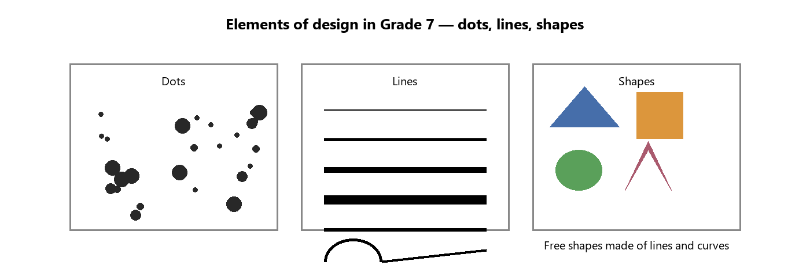

## Lesson 02 — Elements of design — dots, lines and shapes

Every design is built from small parts, just as a sentence is built from words. At Grade 7 the elements of design are dots, lines and shapes. This lesson defines each element and shows how designers combine them to build pictures and patterns.

*Figure: The three Grade 7 elements of design — dots, lines and shapes — shown side by side.*

**Words to know first**
- **Element** — a basic unit or part of a design.
- **Dot** — a small round spot made by a tool.
- **Line** — a long, thin mark from one point to another.
- **Shape** — a flat, closed area made when lines meet.
- **Motif** — a small design repeated to form a pattern.

### Theory Questions and Answers

Q1. What is an element of design?
Ans. An element of design is a basic unit, such as a dot, line or shape, used to build a design.

Q2. State the three elements of design studied at Grade 7.
Ans.
- Dots
- Lines
- Shapes

Q3. What is a dot?
Ans. A dot is a small round spot made where the nib or point of a tool touches the paper.

Q4. State three uses of dots in a design.
Ans.
- They can build up tone and shading.
- They can make patterns and parts of a motif.
- They can show details like the heads of people in a crowd.

Q5. What is a line?
Ans. A line is a long, thin mark drawn from one point to another; it is the element that defines the outline of a shape.

Q6. State three types of lines.
Ans.
- Straight lines (vertical, horizontal, diagonal)
- Curved lines
- Zigzag lines

Q7. What is a shape?
Ans. A shape is a flat, closed area made when lines meet, such as a circle, square or triangle.

Q8. State three geometric shapes a designer uses.
Ans.
- Circle
- Square
- Triangle

Q9. Differentiate between a line and a shape.
Ans. The difference is whether the space is closed:

| Line | Shape |
| --- | --- |
| A long, thin mark between two points | A closed, flat area with an edge all round |
| Used to draw outlines and build tone | Used to fill, arrange and build patterns |

The difference is closure — a line only suggests an edge, while a shape encloses space.

Q10. Give three natural things that show each element.
Ans. Dots — sand grains, seeds, stones; lines — tree branches, rivers, spider-web threads; shapes — honeycombs, leaves, moon face.

Q11. How do designers use the three elements together?
Ans. They arrange dots, lines and shapes to build motifs, patterns and complete designs.

Q12. Which element begins where a pencil touches the paper?
Ans. A dot — the first smallest unit of any design.

Q13. Give one emotional or natural meaning of a diagonal line.
Ans. A diagonal line suggests energy and movement, like a lightning bolt or a running athlete.

Q14. Why do we call the dot the basic unit of design?
Ans. Every line is a row of dots, and every shape is made of lines, so all designs begin from dots.

*Notice:* Design is graded across the years: Grade 7 works with dots, lines and shapes; Grade 8 adds texture and colour; Grade 9 adds form and value.

### Worked exam exemplars

1. Elements are used to form a composition. Which element of art is used to define the outline of a shape? *(bank)* [2 marks]
   Model answer: A line. (2 marks — naming "line" 1, "outlines a shape" 1)
2. Which of the following design elements can be used to create heads in a crowd? *(bank)* [2 marks]
   Model answer: Dots — small round dots drawn side by side show the heads of many people from a distance. (2 marks — naming dots 1, explaining the crowd use 1)
3. Ama uses a series of lines moving away from a spot. Which of the following lines does she use? *(bank)* [2 marks]
   Model answer: Radial lines — lines that spread out from one central spot. (2 marks — "radial" 1, "spread from a centre" 1)

### Exercises

**Paper 1 — Objective**

1.  Which of the following is the basic unit of design that begins where a pencil touches paper?
    A. Shape        B. Line        C. Dot        D. Texture
    Answer: C — the first mark a pencil makes on paper is a small round dot.
2.  What are the elements of design often observed in nature and the manmade environment?
    A. Dots, lines and shapes        B. Unity, balance and rhythm        C. Painting, printing and gluing        D. Brightness, weight and time
    Answer: A — dots, lines and shapes are the Grade 7 building units of design.
3.  Which of the following groups shows only shapes?
    A. Circle, square, triangle        B. Line, dot, curve        C. Rhythm, balance, unity        D. Pencil, paper, brush
    Answer: A — a circle, square and triangle are all closed, flat areas.
4.  In designing a poster for a musical festival, which of the following lines would an artist use to depict energy and movement?
    A. Vertical        B. Horizontal        C. Diagonal        D. Dotted
    Answer: C — slanting diagonal lines suggest energy and action.
5.  Which of the following shows lines only?
    A. A flowing river        B. Sand grains        C. Seeds        D. Stones
    Answer: A — the sand grains, seeds and stones read as dots, while the river reads as a line.

**Paper 2 — Theory**

1.  (a) Define the following elements of design: (i) dot  (ii) line  (iii) shape.  (6 marks)
    (b) Give one natural object that shows (i) dots and (ii) lines.  (2 marks)
    (c) State two ways dots can be used in a design.  (2 marks)

Answers
    (a) (i) A dot is a small round spot made where the point of a tool touches the paper. (2 marks)
        (ii) A line is a long, thin mark drawn from one point to another. (2 marks)
        (iii) A shape is a flat, closed area made when lines meet. (2 marks)
    (b) (i) Sand grains or seeds show dots. (1 mark)
        (ii) A tree branch or river shows lines. (1 mark)
    (c) • To build tone or shading.
        • To make patterns and parts of a motif.  (1 mark each = 2 marks)

2.  The Creative Art teacher of Kaison International School took the class to the school park for sightseeing. After discussing the natural and manmade things around the school, the teacher then tasked learners to associate the things observed to elements of design.  (4 marks)
    (i) Identify one natural object that the learners would cite as an example of a line.
    (ii) Draw the example identified in (i).
Answers
    (i) A tree branch (or a river or a spider-web thread).  (2 marks)
    (ii) Drawing shows a long, thin mark running from one point to another, with no colour fill.  (2 marks — a single clean line mark 1, no shading or fill 1)

3.  In five numbered steps, describe how to create a simple design that uses all three elements.  (5 marks)
Answers
    1. Lightly dot in the seed shapes of the picture.
    2. Join the dots with lines to form the outlines.
    3. Close the outlines to complete the shapes.
    4. Add rows of dots inside some shapes for tone.
    5. Go over the final lines neatly to finish the design.
    (1 mark each step = 5 marks)
