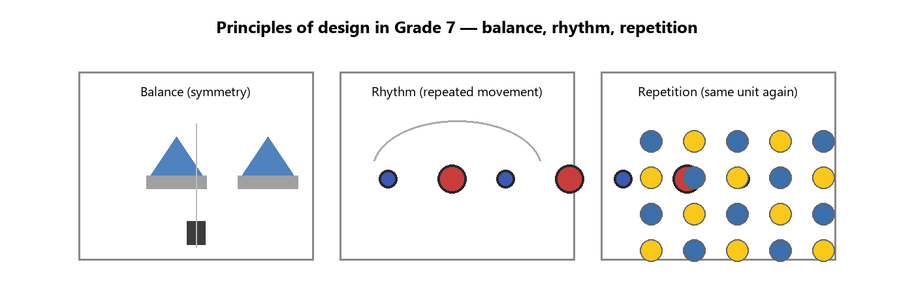

## Lesson 03 — Principles of design — balance, rhythm and repetition

Dots, lines and shapes are the building blocks; the principles of design are the rules for arranging them well. At Grade 7 the three key principles are balance, rhythm and repetition. This lesson explains each principle and shows how a design stays pleasing to the eye.

*Figure: Symmetrical balance, radial balance, and repetition building rhythm across a design.*

**Words to know first**
- **Principle** — a rule for arranging design elements well.
- **Balance** — an even pull of visual weight on both sides of a work.
- **Symmetry** — two equal sides that mirror each other.
- **Rhythm** — the beat or flow that carries the eye across a design.
- **Repetition** — using the same element again and again.

### Theory Questions and Answers

Q1. What is a principle of design?
Ans. A principle of design is a rule that guides how elements are arranged so the whole work looks organised and pleasing.

Q2. State the three principles of design studied at Grade 7.
Ans.
- Balance
- Rhythm
- Repetition

Q3. What is balance?
Ans. Balance is the even arrangement of visual weight on either side of an artwork.

Q4. State three types of balance.
Ans.
- Symmetrical (formal) balance
- Asymmetrical (informal) balance
- Radial balance

Q5. What is symmetrical balance?
Ans. Symmetrical balance places identical objects at equal distances on both sides of a central line.

Q6. What is radial balance?
Ans. Radial balance sends lines or objects spreading out from one central spot, like the spokes of a wheel.

Q7. What is rhythm?
Ans. Rhythm is the repeated flow or beat in a design that leads the viewer's eye around the work.

Q8. What is repetition?
Ans. Repetition is using the same dot, line, shape or colour again and again in a design.

Q9. Differentiate between rhythm and repetition.
Ans. The difference is flow against repeat:

| Repetition | Rhythm |
| --- | --- |
| The same element used again and again | The movement or beat created by repeating elements |
| A brick pattern with equal blocks | The way the eye steps from brick to brick across the wall |

The difference is that repetition supplies the repeated parts, while rhythm is the movement those parts create.

Q10. State three ways a designer creates rhythm.
Ans.
- Repeating the same shape or line in an order
- Changing the size of shapes little by little
- Turning lines so they seem to move in one direction

Q11. What is dominance?
Ans. Dominance is the principle that makes one part of a design stand out more than the rest.

Q12. Why does a poster designer need balance?
Ans. It stops the work from looking heavy on one side and makes the whole design restful to view.

Q13. In four numbered steps, describe how to check that a collage is balanced. (4 marks — procedural task)
Ans.
1. Draw a faint central line on the work.
2. Place matching shapes at equal distances on both sides of it.
3. Step back and compare the visual weight of the two halves.
4. Move pieces until both sides feel evenly weighted.

Q14. Which principle gives the repeated equal stripes in a patterned cloth?
Ans. Repetition — the same stripe is used again and again across the cloth.

Q15. How do the three principles work together in a real design?
Ans. Repeated parts build rhythm, and their even sharing across the work gives the design balance.

*Notice:* The Grade 7 principles of design are balance, rhythm and repetition; Grade 8 moves on to unity and variety, and Grade 9 to variety and proportion.

### Worked exam exemplars

1. A type of balance in which identical objects are placed at equal distances on both sides of a central line is called what? *(bank)* [2 marks]
   Model answer: Symmetrical (formal) balance. (2 marks — "symmetrical/formal" 1, "equal both sides of a central line" 1)
2. Mensah is experimenting with lines to suggest movement in a design. What principle is he going to achieve? *(bank)* [2 marks]
   Model answer: Rhythm — the flowing, ordered movement the repeated lines create for the eye. (2 marks — naming rhythm 1, explaining the movement 1)
3. Tim decides to design a pattern for his school's Friday wear. Identify the set of principles of design he would use. *(bank)* [2 marks]
   A. Variety, unity and balance  B. Balance, unity and colour  C. Contrast, balance and lines  D. Rhythm, variety and form
   Model answer: A — variety, unity and balance are principles of design; colour and line are elements, so the rest are mixed sets. (2 marks — correct set 1, rejecting sets with elements 1)

### Exercises

**Paper 1 — Objective**

1.  In a composition, objects of the same kind and weight placed on either side of a central line forms
    A. a formal (symmetrical) balance        B. an informal (asymmetrical) balance        C. an irregular balance        D. a radial balance
    Answer: A — equal matching things on both sides of a central line is symmetrical or formal balance.
2.  Adjoa wants the school emblem to be the first thing people notice in her poster. The principle of design she should apply is
    A. rhythm        B. balance        C. dominance        D. repetition
    Answer: C — dominance makes that one part stand out above the rest.
3.  Which principle of design refers to the visual arrangement where elements are repeated in a specific order?
    A. Balance        B. Rhythm        C. Dominance        D. Proportion
    Answer: B — repeating elements in an ordered flow gives the design its rhythm.
4.  A wheel with spokes spreading from the centre shows which type of balance?
    A. Radial balance        B. Symmetrical balance        C. Asymmetrical balance        D. Broken balance
    Answer: A — spokes radiating from a centre is the radial type of balance.
5.  Which of the following is a principle of design used to organize elements for creative expression?
    A. Balance        B. Dot        C. Line        D. Square
    Answer: A — balance (with rhythm and repetition) arranges elements; dots, lines and squares are elements.

**Paper 2 — Theory**

1.  Complete the table below by providing two examples each of the following principles of design in the environment.  (8 marks)

| Principle of design | Two examples in the environment |
| --- | --- |
| Rhythm |  |
| Balance |  |
| Repetition |  |
| Dominance |  |

Answers
    • Rhythm — the stepped lines of a staircase; the repeated waves on the sea. (2 marks)
    • Balance — a see-saw with equal children; window panes set evenly either side of a door. (2 marks)
    • Repetition — the prefabricated tiles on a patchwork wall; equal fence posts in a row. (2 marks)
    • Dominance — the black star standing out on the national flag; a big clock face on a hall wall. (2 marks)

2.  (a) What is balance in design?  (2 marks)
    (b) State three types of balance.  (3 marks)
    (c) Kofi is designing a poster for a school sports day event. Explain with one example how he can create balance in his composition.  (3 marks)

Answers
    (a) Balance is the even arrangement of visual weight on either side of an artwork.  (2 marks)
    (b) • Symmetrical (formal) balance
        • Asymmetrical (informal) balance
        • Radial balance
        (1 mark each × any 3 = 3 marks)
    (c) He can place matching shapes or equal-size blocks on both sides of the central line of the poster, for example identical sized balls left and right, so no side looks heavier.  (3 marks — matching/equal arrangement 2, restored example 1)

3.  Write the four numbered steps a learner follows to check that a collage is balanced.  (4 marks)
Answers
    1. Draw a faint central line on the work.
    2. Place matching shapes at equal distances on both sides of it.
    3. Step back and compare the visual weight of the two halves.
    4. Move pieces until both halves feel evenly weighted.
    (1 mark each step = 4 marks)
