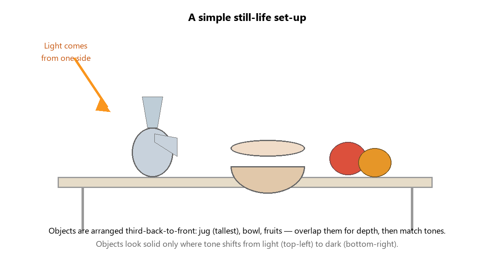

## Lesson 10 — Tools, materials and techniques for still-life drawing, pattern making and modelling — safe use, cleaning and storage

Creating artwork requires the right tools and materials, as well as the discipline to handle them safely. Whether you are drawing a group of objects, printing patterns on cloth, or shaping clay, caring for your equipment ensures good results and prevents accidents in the art room.

**Words to know first**
- **Still-life** — an arrangement of non-living objects placed together for drawing or painting.
- **Medium** (plural: **media**) — the material used to create an artwork (e.g., pencil, clay, ink).
- **Clay** — fine-grained natural earth that becomes plastic when wet and hard when fired.
- **Papier-mâché** — mashed paper pulp mixed with paste or glue used for modelling.
- **Maintenance** — keeping tools clean, sharp, and in good working order.

### Theory Questions and Answers

Q1. What is still-life drawing?
Ans. Still-life drawing is the drawing of an arrangement of non-living, inanimate objects such as pots, fruits, books, and bottles.

Q2. List four manual tools and materials used in still-life drawing.
Ans.
- Drawing pencils of varying grades (HB, 2B, 4B, 6B)
- Cartridge paper or drawing pad
- Drawing board and bulldog clips or masking tape
- Eraser (putty or vinyl eraser) and pencil sharpener

Q3. What tools and materials are used in simple pattern making?
Ans.
- Cardboard, foam, leaves, or potato blocks (for stamping)
- Brushes, sponges, and dabbing rags
- Poster paints, textile dyes, or coloured inks
- Paper, plain calico, or cotton fabric

Q4. What tools and materials are used in clay modelling?
Ans.
- Natural clay and water
- Modelling boards and rolling pins
- Wooden modelling tools (spatulas) and wire clay-cutters
- Sponge and water bowl for smoothing

Q5. What tools and materials are used in papier-mâché modelling?
Ans.
- Old newspapers or cardboard sheets
- Water basin and pestle and mortar (for pounding pulp)
- Starch or PVA white glue paste
- Armature wires or cardboard frames for internal support

Q6. State three general safety rules to observe in the art workshop.
Ans.
- Keep the floor dry and clear of wet clay slips or spilled paint to avoid slips.
- Cut away from your body when using craft knives and scissors.
- Wear an apron or overall to protect clothes, and wash hands thoroughly after handling dyes or clay.

Q7. How should drawing pencils and paper be cleaned and stored?
Ans. Keep pencils sharpened in a pencil pouch or tin; store drawing paper flat in clean, dry portfolios away from moisture and direct sunlight.

Q8. How should brushes be cleaned and preserved after painting or dabbing?
Ans. Wash brushes in clean soapy water immediately after use, reshape the bristles with your fingers, and store them upright in a jar with bristles pointing up.

Q9. How should leftover clay be preserved for future lessons?
Ans. Sprinkle the clay with water, wrap it securely in airtight polythene bags, and store it in a covered plastic bucket or clay bin so it does not dry out.

Q10. How should modelling tools and work surfaces be maintained?
Ans. Scrape off dried clay with a damp cloth, wash tools in clean water, wipe them dry to prevent mould or rust, and sponge down tables before leaving.

Q11. Why is it dangerous to inhale dry clay dust in the art studio?
Ans. Breathing dry clay dust over long periods can damage the lungs because it contains fine silica particles.

### Worked exam exemplars

1. Akosua has finished using her paintbrushes after a pattern-making lesson. How should she store them to preserve the bristles? *(bank)* [2 marks]
   Model answer: Wash them clean in water, reshape the bristles with fingers, and place them handle-down in a container so the bristles point upright. (2 marks — washing/reshaping 1, storing bristles up 1)
2. State two precautions to observe when preparing clay in the school workshop. [2 marks]
   Model answer:
   • Sponge down the work surfaces wet rather than sweeping dry dust to avoid breathing in silica particles.
   • Keep the floor free from wet clay lumps to prevent learners from slipping.
   (1 mark each for any 2 sensible precautions = 2 marks)

### Exercises

**Paper 1 — Objective**

1.  An arrangement of inanimate objects such as pots, bottles, and fruit set up for drawing is called a
    A. landscape        B. seascape        C. still-life        D. portrait
    Answer: C — still-life is the drawing of inanimate, non-moving objects.
2.  Which pencil grade produces the softest and darkest line suitable for shading deep shadows?
    A. 4H        B. 2H        C. HB        D. 6B
    Answer: D — B grades are soft and black; 6B is darker and softer than HB or H grades.
3.  To prevent natural clay from hardening into a dry rock between lessons, it should be stored in
    A. direct hot sunlight        B. an airtight plastic bag in a covered bin        C. an open cardboard box        D. an open metal tray
    Answer: B — airtight plastic bags keep moisture from evaporating.
4.  Why should paintbrush bristles never be left resting bent on the bottom of a water container?
    A. The bristles will permanently deform and split        B. The water will catch fire        C. The handle will grow longer        D. The bristles will turn into wire
    Answer: A — resting on bristles permanently curls and destroys their shape.
5.  Which tool is used by a sculptor or potter to cut large blocks of raw wet clay cleanly?
    A. A hacksaw        B. A wire clay-cutter        C. A razor blade        D. A chisel
    Answer: B — a taut wire with wooden toggle handles slices through wet clay cleanly.

**Paper 2 — Theory**

1.  (a) State three tools or materials needed to set up and draw a still-life group. (3 marks)
    (b) Describe two safety rules to follow when working with cutting tools in the art room. (4 marks)
    (c) State how you would store finished dry drawings to protect them from damage. (3 marks)

Answers
    (a) • Drawing paper / cartridge paper
        • Shading pencils (e.g. 2B, 4B)
        • Drawing board and clips
        (1 mark each = 3 marks)
    (b) • Always cut away from your body and fingers, never toward yourself. (2 marks)
        • Retract or sheath blades immediately after use and never walk around with an exposed blade. (2 marks)
    (c) Store them flat in an artists' folder or portfolio, interleaving sheets with clean newsprint or tracing paper to prevent pencil smudging. (3 marks — flat storage 1, portfolio/folder 1, interleaving/preventing smudge 1)

2.  (a) State two steps for cleaning paintbrushes after a fabric-printing lesson. (2 marks)
    (b) State two ways of caring for clay modelling tools. (2 marks)

Answers
    (a) • Rinse the bristles under running water with mild soap until no colour remains. (1 mark)
        • Reshape the wet hairs into a neat point and stand the brush upright in a jar to dry. (1 mark)
    (b) • Wash off all clay residues with water and a soft rag after use. (1 mark)
        • Dry wooden tools thoroughly before storing to prevent rotting or warping. (1 mark)
