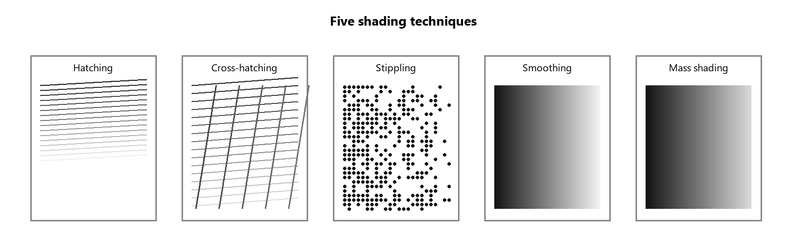
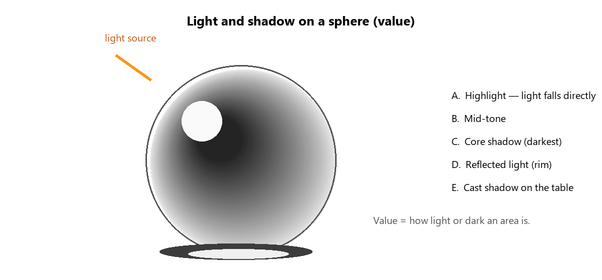

## Lesson 11 — Still-life drawing and shading techniques (hatching, cross-hatching, smoothing, mass shading, stippling)

When you look at an object in the light, one side is bright, one side is dark, and it casts a shadow on the table. Shading turns flat outline drawings into solid, three-dimensional forms. In this lesson, you will learn the five classic shading techniques and how to apply them to still-life drawings.

**Words to know first**
- **Tone (or Value)** — the lightness or darkness of a colour or shade.
- **Highlight** — the brightest spot on an object where light hits directly.
- **Cast shadow** — the dark shadow projected by an object onto a nearby surface.
- **Hatching** — shading using series of closely spaced parallel lines.
- **Cross-hatching** — shading using intersecting sets of parallel lines.
- **Stippling** — shading by applying countless small dots.

### Theory Questions and Answers

Q1. What is shading in drawing?
Ans. Shading is the darkening of parts of an illustration to create the illusion of three-dimensional depth, light, and shadow.

Q2. What is tone or value in art?
Ans. Tone or value is the degree of lightness or darkness of an area in an artwork.

Q3. What is hatching?
Ans. Hatching is a shading technique that uses a series of closely spaced parallel straight lines to build tone.

Q4. What is cross-hatching?
Ans. Cross-hatching is a shading technique in which two or more sets of parallel lines intersect at an angle to create darker tones.

Q5. What is smoothing (blending)?
Ans. Smoothing is a shading technique where pencil strokes are rubbed or blended together with a paper stump, tissue, or finger to create a seamless, continuous tone without visible lines.

Q6. What is mass shading?
Ans. Mass shading is applying tone broadly using the flat side of the pencil lead rather than the sharp tip to cover large areas quickly.

Q7. What is stippling?
Ans. Stippling is creating tonal gradations through the grouping and density of small dots or speckles.

Q8. How does dot density create tone in stippling?
Ans. Placing dots close together creates dark shadows, while placing dots far apart creates light areas.

Q9. State the key tonal zones seen when light shines on a sphere.
Ans.
- Highlight (brightest reflection)
- Mid-tone or halftone (true body colour)
- Core shadow (darkest area where light cannot reach)
- Reflected light (light bounced back from the table into the shadow)
- Cast shadow (shadow thrown onto the ground or wall)

Q10. Compare the five shading techniques in a summary table.
Ans.

| Technique | Description | Visual Appearance |
| --- | --- | --- |
| Hatching | Single direction parallel lines | Clean, linear texture |
| Cross-hatching | Intersecting sets of parallel lines | Dense, rich mesh pattern |
| Smoothing | Blended, rubbed graphite | Smooth, photographic graduation |
| Mass shading | Flat side of soft pencil lead | Broad, uniform textured wash |
| Stippling | Dots and speckles | Granular, patterned surface |

Q11. Why should an artist not outline an object with a dark line before shading?
Ans. Hard outline boundaries destroy the illusion of roundness; real objects are defined by changes in tone against their background, not black borders.

Q12. Which pencil grades are best suited for light tones and dark tones?
Ans. Harder pencils (H, 2H) produce light, fine lines for highlights, while softer pencils (2B, 4B, 6B) produce rich, dark tones for deep shadows.

### Worked exam exemplars

1. Shading an artwork using a series of small dots and speckles is called what? *(bank)* [2 marks]
   Model answer: Stippling (or pointillism). (2 marks — naming stippling 1, describing dots 1)
2. Which of the following shading techniques produces a smooth, even tone without any visible pencil strokes? *(bank)* [2 marks]
   A. Hatching  B. Cross-hatching  C. Smoothing (blending)  D. Stippling
   Model answer: C — Smoothing (blending). (2 marks — correct option C 1, explanation of blending strokes 1)
3. Ama wants to give depth to her drawing of a sphere. Mention three tonal zones she must show on the sphere. [3 marks]
   Model answer:
   • Highlight
   • Core shadow
   • Reflected light (or Cast shadow)
   (1 mark each for any 3 recognized tonal zones = 3 marks)

### Exercises

**Paper 1 — Objective**

1.  Shading an artwork using a series of small dots and speckles is called
    A. hatching        B. stippling        C. frottage        D. marbling
    Answer: B — stippling builds values and tone through dots.
2.  Which shading technique uses two sets of parallel lines crossing each other?
    A. Cross-hatching        B. Smoothing        C. Dabbing        D. Sponging
    Answer: A — cross-hatching consists of crossing sets of parallel lines.
3.  The brightest spot on a shaded ceramic pot where light hits directly is called the
    A. cast shadow        B. core shadow        C. highlight        D. penumbra
    Answer: C — the highlight is the point of direct light reflection.
4.  Akosua is using the stippling technique to shade her drawing. What tool is she most likely using?
    A. A wide paintbrush        B. A fine-tipped pen or sharp pencil        C. A sponge        D. A palette knife
    Answer: B — fine-point pens or pencils place crisp, controlled dots for stippling.
5.  What shading method uses the broad, flat side of a soft graphite lead to cover large shadow areas?
    A. Mass shading        B. Stencilling        C. Wet-on-wet        D. Etching
    Answer: A — mass shading lays down tone with the side of the lead.

**Paper 2 — Theory**

1.  (a) What is tone (value) in visual art? (2 marks)
    (b) Differentiate between hatching and cross-hatching. (4 marks)
    (c) Make a freehand sketch of a sphere showing highlight, core shadow, and cast shadow. (4 marks)

Answers
    (a) Tone is the lightness or darkness of a shade or colour in an artwork. (2 marks)
    (b) Hatching uses a single set of parallel lines running in one direction to build tone, whereas cross-hatching uses two or more sets of intersecting lines that cross over each other at angles to create deeper tones. (4 marks — hatching 2, cross-hatching 2)
    (c) Sketch shows:
        - A round circular outline of a sphere (1 mark)
        - Light highlight left white on top-facing side (1 mark)
        - Dark curved core shadow along the opposite side (1 mark)
        - Elliptical cast shadow on the ground surface (1 mark)

2.  (a) State two advantages of using the smoothing (blending) technique. (2 marks)
    (b) Explain why stippling requires patience and care from an artist. (2 marks)

Answers
    (a) • It creates a very realistic, smooth transition of tone without visible pencil lines. (1 mark)
        • It is ideal for rendering soft textures like skin or shiny fruits. (1 mark)
    (b) It requires placing thousands of individual dots with even pressure; rushing causes irregular lines and blotches rather than smooth tones. (2 marks)
