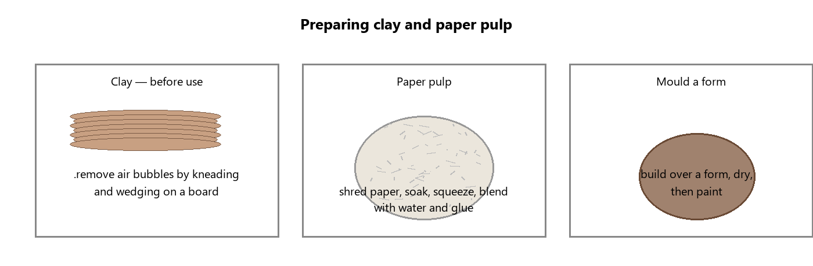
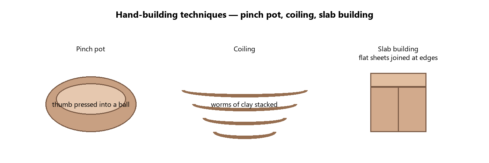

## Lesson 12 — Preparing and modelling with clay and paper pulp (papier-mâché)

Clay comes from the ground, and paper pulp comes from discarded paper, but both can be shaped by human hands into vessels, animals, and relief sculptures. Modelling is an additive art process — you build up forms piece by piece. In this lesson, you will learn how to prepare clay and paper pulp and shape them using traditional hand-building techniques.

**Words to know first**
- **Plasticity** — the ability of moist clay or pulp to be shaped easily and hold that shape without cracking.
- **Wedging (kneading)** — pressing and slamming clay repeatedly to remove air pockets and make it uniform.
- **Slip** — a creamy liquid mixture of clay and water used like glue to join clay parts.
- **Pinch pot** — a pot formed by pressing the thumb into a clay ball and pinching the walls upward.
- **Coil building** — building pottery by rolling long clay ropes and layering them in rings.
- **Slab building** — building forms from rolled flat sheets of uniform thickness.

### Theory Questions and Answers

Q1. What is clay?
Ans. Clay is a fine-grained natural soil material containing minerals that becomes plastic when wet and permanently hard when baked or fired.

Q2. What is papier-mâché?
Ans. Papier-mâché is a modelling medium made of shredded paper pulp or paper strips bound together with starch, flour paste, or white glue.

Q3. What are the four main stages in preparing raw natural clay for modelling?
Ans.
1. Digging and drying the clay lumps in the sun.
2. Crushing the dried lumps and soaking them in water (slaking).
3. Sieving the wet slurry through a wire screen to remove stones, roots, and sand.
4. Drying on a plaster or canvas bed to a workable consistency, followed by wedging.

Q4. What is wedging or kneading, and why is it important?
Ans. Wedging is the vigorous pressing, cutting, and folding of clay to eliminate air bubbles and ensure an even moisture content throughout.

Q5. What happens if clay containing trapped air bubbles is fired in a kiln?
Ans. The trapped air expands rapidly when heated and causes the pot to crack or explode violently.

Q6. Describe the five steps in preparing paper pulp (papier-mâché).
Ans.
1. Tear old newspaper or waste paper into tiny bits (about 1 cm square).
2. Soak the paper bits in a bucket of warm water for at least 24 hours.
3. Pound or mash the soaked paper with a mortar and pestle until it forms a smooth pulp.
4. Squeeze out excess water through a clean cotton cloth.
5. Mix the moist pulp thoroughly with cassava starch paste or PVA glue until dough-like.

Q7. What is the pinch pot technique?
Ans. A hand-building technique in which a smooth ball of clay is pressed in the centre with the thumb and pinched with fingers in a spiral motion to form walls.

Q8. What is the coil method of pottery?
Ans. A hand-building technique in which clay is rolled into long, snake-like ropes and coiled layer upon layer onto a base, with the seams smoothed together.

Q9. What is the slab method of pottery?
Ans. A hand-building technique in which clay is rolled flat into sheets of uniform thickness, cut into shapes, and joined at the edges using slip and scoring.

Q10. What is scoring and slipping?
Ans. Scoring is scratching grooves into the joining edges of clay, and slipping is brushing liquid clay (slip) onto the grooves so the two pieces bond strongly.

Q11. Why must finished clay pots dry slowly in the shade before firing?
Ans. Drying too fast in hot sun causes the outside to shrink faster than the inside, creating cracks.

Q12. What is firing?
Ans. Firing is the process of baking dry clay items in a high-temperature kiln or open bonfire to turn the clay into hard, permanent ceramic terracotta.

### Worked exam exemplars

1. The stage in clay preparation in which clay is kneaded like dough to push out trapped air bubbles is called what? *(bank)* [2 marks]
   Model answer: Wedging (or kneading). (2 marks — naming wedging 1, explaining removal of air bubbles 1)
2. A modelling method of rolling clay into long ropes and winding them up to build a pot is known as what? *(bank)* [2 marks]
   Model answer: Coil method (or coiling). (2 marks — coil method 1, rope description 1)
3. In the absence of white wood glue, which local material is suitable for making papier-mâché paste? *(bank)* [2 marks]
   A. Engine oil  B. Cassava starch paste  C. Kerosene  D. Sand
   Model answer: B — Cassava starch paste. (2 marks — identifying starch paste 1, explains adhesive property 1)

### Exercises

**Paper 1 — Objective**

1.  The property that allows moist clay to be shaped into any form without cracking is
    A. porosity        B. plasticity        C. elasticity        D. density
    Answer: B — plasticity is the clay's ability to bend and hold shape without fracturing.
2.  Trapped air bubbles inside a clay article must be removed by wedging because they
    A. make the clay too cold        B. cause the pot to explode during firing        C. attract insects to the pot        D. turn the clay white
    Answer: B — heated trapped air expands and shatters the ceramic during firing.
3.  The technique where a ball of clay is opened with the thumb and pressed with the fingers is the
    A. slab method        B. pinch pot method        C. casting method        D. wheel throwing
    Answer: B — the pinch pot is formed by thumb pressure and finger pinching.
4.  Liquid clay with the consistency of thick cream used to glue clay slabs together is called
    A. glaze        B. slip        C. wax        D. varnish
    Answer: B — slip is liquid clay used as an adhesive.
5.  Which adhesive is made locally by boiling starch powder in water for paper pulp modelling?
    A. PVA synthetic resin        B. Cassava starch paste        C. Epoxy glue        D. Rubber cement
    Answer: B — cassava starch paste is a reliable, low-cost local binder for paper pulp.

**Paper 2 — Theory**

1.  (a) What is wedging in clay preparation? (2 marks)
    (b) Describe three hand-building techniques used in clay modelling. (6 marks)
    (c) State two precautions to take when drying wet clay sculptures. (2 marks)

Answers
    (a) Wedging is the process of kneading and throwing clay against a board to expel air pockets and create uniform consistency. (2 marks)
    (b) • Pinch pot method: Shaping a ball of clay by pressing the thumb into the centre and pinching the walls outward to uniform thickness. (2 marks)
        • Coil method: Rolling clay into long cylindrical ropes and winding them upward in concentric layers, smoothing the seams inside and out. (2 marks)
        • Slab method: Rolling clay flat with a rolling pin into sheets of even thickness, cutting geometric panels, and joining them with score-and-slip. (2 marks)
    (c) • Dry the clay slowly in the shade away from direct wind or sun to prevent uneven shrinkage. (1 mark)
        • Cover large pieces lightly with plastic during early drying so thin handles do not dry faster than thick bases. (1 mark)

2.  (a) State the five sequential steps in preparing paper pulp (papier-mâché). (5 marks)
    (b) Mention two advantages of paper pulp over natural clay for classroom modelling. (2 marks)

Answers
    (a) 1. Tear waste paper into small bits.
        2. Soak paper bits in water for 24 hours.
        3. Pound paper into a fine pulp in a mortar.
        4. Squeeze out excess water through a cloth.
        5. Mix pulp with starch or PVA glue paste thoroughly.
        (1 mark each = 5 marks)
    (b) • Paper pulp is lightweight and does not shatter into sharp fragments if dropped. (1 mark)
        • It does not require high-temperature kiln firing to set hard. (1 mark)
