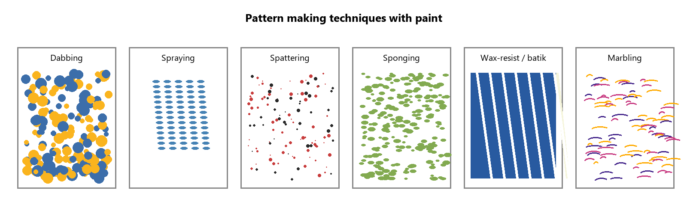

## Lesson 13 — Pattern making techniques (dabbing, sponging, spraying, wax-resist/crayon batik, marbling)

A single motif repeated across a cloth or wall turns an empty space into a living design. From Ghanaian Adinkra cloth to Kente borders, patterns are everywhere in our culture. In this lesson, you will explore five creative pattern-making techniques: dabbing, sponging, spraying, wax-resist (crayon batik), and marbling.

**Words to know first**
- **Motif** — a single unit of design or symbol that is repeated to make a pattern.
- **Pattern** — a decorative design created by repeating a motif at regular intervals.
- **Dabbing** — applying colour by pressing a cloth wad or cotton pad repeatedly onto a surface.
- **Wax-resist** — applying wax to block dye from penetrating certain areas of cloth or paper.
- **Marbling** — floating colours on water and swirling them into veins before transferring to paper.

### Theory Questions and Answers

Q1. What is a motif in art?
Ans. A motif is a single design idea, shape, or symbol that forms the building block of a pattern.

Q2. What is a pattern?
Ans. A pattern is a decorative design formed by the regular or planned repetition of one or more motifs.

Q3. What is the dabbing technique?
Ans. Dabbing is a technique in which colour is applied by gently pressing a wad of cloth, cotton wool, or soft leather onto a surface.

Q4. What is the sponging technique?
Ans. Sponging is applying paint to paper or fabric using a natural or synthetic sponge to create porous, cloud-like, textured impressions.

Q5. What is the spraying technique?
Ans. Spraying is a pattern technique in which liquid paint is flicked or atomised across a stencil onto paper using a stiff brush (like an old toothbrush) and a wire screen.

Q6. What is a stencil?
Ans. A stencil is a thin sheet of cardboard, plastic, or paper with a design cut out of it, through which paint is applied to print the shape.

Q7. What is wax-resist (crayon batik)?
Ans. Wax-resist is a technique where designs are drawn with molten wax or wax crayons; when a watery wash is brushed over, the oily wax repels the dye, keeping the design clean.

Q8. What scientific principle makes wax-resist work?
Ans. The principle that oil (wax) and water do not mix — the water-based dye cannot stick to the greasy wax.

Q9. What is paper marbling?
Ans. Marbling is a method where oil-based or thinned colours are floated on a liquid bath, combed into swirly veined patterns, and transferred onto paper laid gently on top.

Q10. Compare the five pattern techniques in a quick reference table.
Ans.

| Technique | Main Tool | Surface Effect |
| --- | --- | --- |
| Dabbing | Cloth pad / rag | Soft, stippled texture |
| Sponging | Natural/synthetic sponge | Porous, mottled, organic pattern |
| Spraying | Toothbrush & wire mesh / stencil | Fine mist of tiny speckles |
| Wax-resist (batik) | Wax crayon or melted wax & dye | Bold linear shapes resisting colour |
| Marbling | Oil colours on water bath | Swirling, stone-like veins |

Q11. State three traditional Ghanaian cloths that rely on pattern-making techniques.
Ans.
- Adinkra cloth (stamped geometric and philosophical symbols)
- Kente cloth (woven geometric stripe and block patterns)
- Batik cloth (wax-resist dyed cotton fabrics)

Q12. What is a repeat pattern?
Ans. A repeat pattern is a design where the motif is repeated in a structured grid, such as half-drop, mirror, brick, or radial repeat.

### Worked exam exemplars

1. Maame intends to make a wax-resist design on cotton fabric. Which property of wax makes this technique work? *(bank)* [2 marks]
   Model answer: Wax is greasy and repels water; therefore, water-based dye cannot penetrate the waxed areas. (2 marks — oil/water repulsion 1, wax blocking dye 1)
2. Mention two tools needed to produce a sprayed stencil pattern in the classroom. [2 marks]
   Model answer:
   • An old toothbrush (or spray diffuser)
   • A wire mesh / screen (or stencil cut-out)
   (1 mark each = 2 marks)
3. A student created a pattern by dipping an open-cell sponge into tempera paint and pressing it rhythmically on sugar paper. Which technique did the student use? [2 marks]
   Model answer: Sponging. (2 marks — naming sponging 1, noting porous texture 1)

### Exercises

**Paper 1 — Objective**

1.  A single shape or visual unit that is repeated to create a pattern is called a
    A. motif        B. canvas        C. mural        D. binder
    Answer: A — a motif is the fundamental repeating unit of a pattern.
2.  The wax-resist technique works because
    A. water dissolves wax instantly        B. wax repels water-based dye        C. wax burns the cloth        D. dye turns wax into paint
    Answer: B — wax is hydrophobic and repels water-based dyes.
3.  Which tool is used to flick a fine mist of colour across a stencil in the spraying technique?
    A. A palette knife        B. An old toothbrush rubbed against a wire mesh        C. A heavy iron hammer        D. A smoothing iron
    Answer: B — a toothbrush stroked over a mesh creates a spray of fine droplets.
4.  Floating thinned oil colours on water, swirling them with a comb, and lifting the print on paper is called
    A. marbling        B. stippling        C. frottage        D. embossing
    Answer: A — marbling transfers floating swirled colours from liquid onto paper.
5.  Which traditional Ghanaian cloth uses carved calabash stamps dipped in natural adinkra aduru ink to create patterns?
    A. Kente        B. Adinkra        C. Fugu        D. Bark cloth
    Answer: B — Adinkra cloth is stamped with carved calabash stamps.

**Paper 2 — Theory**

1.  (a) Define the term pattern in art. (2 marks)
    (b) Describe the steps for creating a crayon wax-resist pattern on paper. (5 marks)
    (c) State two safety rules when melting wax for fabric batik. (3 marks)

Answers
    (a) A pattern is a decorative design formed by the planned, repeated arrangement of one or more motifs. (2 marks)
    (b) 1. Draw your motifs firmly on paper using wax crayons, pressing hard to leave thick wax. (2 marks)
        2. Mix a watery wash of water-soluble poster colour or black ink. (1 mark)
        3. Brush the wash smoothly across the entire paper surface. (1 mark)
        4. Observe the wax repelling the paint so the crayon drawing shines brightly through. (1 mark)
    (c) • Melt wax in a double boiler (water bath), never directly over open high flame, to prevent fires. (2 marks)
        • Work in a well-ventilated room to avoid inhaling wax fumes. (1 mark)

2.  (a) Differentiate between dabbing and sponging. (3 marks)
    (b) List three natural objects you can collect from the school garden to use as stamping motifs. (3 marks)

Answers
    (a) Dabbing uses a wad of soft cloth or rag to deposit flat, stippled marks, whereas sponging uses a porous sponge to produce irregular, open, cloud-like textures. (3 marks)
    (b) • Veined leaves
        • Cross-section of an okra pod
        • Bark or cut onion/potato
        (1 mark each = 3 marks)
