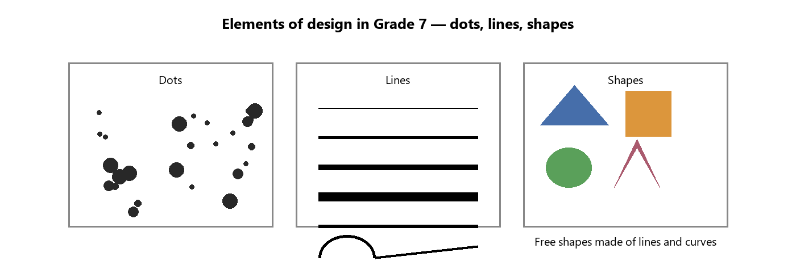
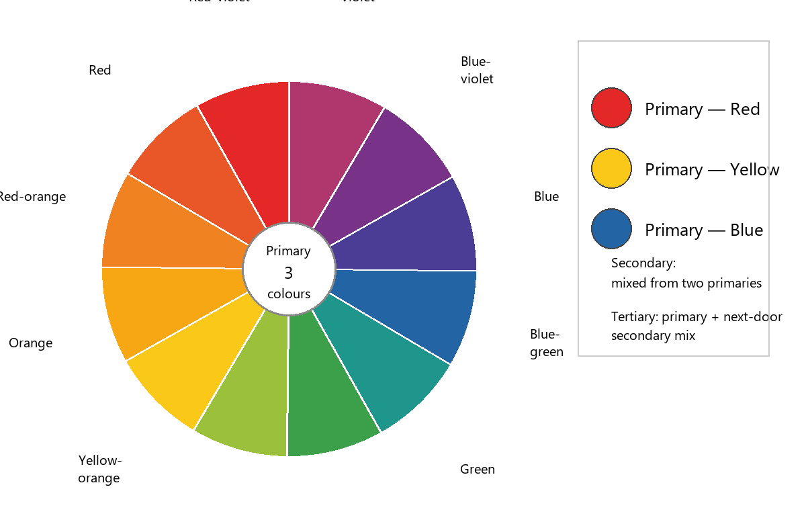

# Lesson 02 — Elements of design — texture and colour

This year the elements lesson moves from dots, lines and shapes (which you learned in Grade 7) to **texture** and **colour**. Texture is how a surface looks and feels; colour is the light effect our eyes detect. Together they give a flat drawing its life.

**Words to know first**
- **Texture** — how the surface of a thing looks and feels.
- **Colour** — the appearance a surface shows from its light.
- **Primary colour** — a colour that cannot be mixed from others.
- **Complementary** — colours directly opposite on the colour wheel.
- **Tone** — the lightness or darkness of a colour or area.

### Theory Questions and Answers

Q1. What is texture?
Ans. Texture is how the surface of a thing looks and feels — rough, smooth, soft or hard.

Q2. What is colour?
Ans. Colour is the visual effect a surface gives because of the light it reflects to the eye.

Q3. State the two main types of texture.
Ans.
- Actual (tactile) texture, which you can really touch.
- Visual (implied) texture, which is only made to look rough or smooth on a flat surface.

Q4. Contrast natural texture with manmade texture.

| Natural texture | Manmade texture |
| :--- | :--- |
| Made without human help — bark of trees, raffia, animal fur. | Made by people — woven kente, brick walls, plastics. |
| Usually irregular and uncountable patterns. | Usually repeated, regular patterns. |

The difference is that nature makes irregular textures while people often repeat textures in order.

Q5. Explain briefly how texture and colour interact to give visual and tactile quality.
Ans. Texture catches light unevenly while flat surfaces catch it evenly, so a rough surface painted dark looks ragged and deep, while the same colour on a smooth surface looks calm and shiny — texture decides how the colour's lightness and darkness reaches the eye.

Q6. What are primary colours?
Ans. Primary colours are red, yellow and blue — colours that cannot be made by mixing other colours.

Q7. How are secondary colours made?
Ans. Secondary colours are made by mixing two primary colours — red plus yellow gives orange, yellow plus blue gives green, and blue plus red gives violet.

Q8. What are complementary colours?
Ans. Complementary colours are colours that sit directly opposite each other on the colour wheel, such as red and green, and using them side by side creates a strong contrast.

Q9. Distinguish warm colours from cool colours.
Ans. Warm colours (red, yellow, orange) remind us of fire and sunshine, while cool colours (blue, green, violet) remind us of water, forest and shade.

Q10. What is the tone of a colour?
Ans. Tone is the relative lightness or darkness of a colour or an area in a design.

Q11. Give the steps for showing a rough texture in a drawing.
Ans.
1. Look closely at the real surface to see the direction and size of its marks.
2. Use light random strokes, dots or scribbles to imitate the marks.
3. Build the strokes up gradually in direction and depth.
4. Darken the hollow places and leave the raised places fair.
5. Step back and compare with the real surface, then adjust.

Q12. State two ways colour is used to send meaning in Ghana.
Ans.
- Red, gold/yellow, green and black on the national flag stand for the struggle, mineral wealth, vegetation and African black-star hope.
- Black or red cloth is worn at funerals to show mourning, while white is worn at naming ceremonies and happy events.

Q13. Which colour best expresses youthfulness and freshness, and why?
Ans. Green, because it is the colour of new leaves and growing things.

Q14. What happens when a primary colour and its neighbours are mixed?
Ans. Neighbouring colours on the wheel blend smoothly and do not clash, unlike complementary colours which excite the eye.

*Notice:* Design remains graded across the years — Grade 7: dots, lines, shapes; Grade 8 (this lesson): texture and colour; Grade 9 will add form and value as elements of design.

### Worked exam exemplars

1. *An artist mixes one table spoon of a red colour with another table spoon of a blue colour. What colour will the artist achieve?* A. Green B. Orange C. Yellow D. Violet *(bank, n.d.)* [1 mark]
   **Answer: D** — red and blue are neighbouring primaries and their mixture is violet, a secondary colour.

2. *Juuba intends to paint a poster with cool colours. Identify the set of cool colours Juuba could use.* A. Blue, yellow and violet B. Green, violet and blue C. Orange, blue and red D. Red, yellow and orange *(bank, n.d.)* [1 mark]
   **Answer: B** — green, violet and blue all appear on the cool side of the colour wheel.

3. *(a) In the space provided, draw the six point colour wheel. (b) List the complementary pair formed by one primary and one secondary colour.* *(bank, n.d.)* [4 marks]
   **Model answers:** (a) The wheel shows red, yellow, blue and between them orange, green, violet, arranged in a circle. (3 marks — primaries 1, secondaries 1, correct order 1.) (b) Red–green (gold/yellow–violet or blue–orange also correct). (1 mark — any one pair.)

### Exercises

**Paper 1 — Objective**

1. *In designing, texture can be described as* A. the way a surface looks and feels B. the weight of a material C. the price of a material D. the size of a material
    Answer: A — texture is about the surface being rough, smooth, soft or hard.

2. *Colours that are directly opposite on the colour wheel are called* A. primary colours B. complementary colours C. tertiary colours D. warm colours
    Answer: B — opposite colours on the wheel are complementary.

3. *Which of the following is a secondary colour?* A. Red B. Blue C. Green D. Yellow
    Answer: C — green is mixed from two primaries (yellow and blue).

4. *Ama wants her design to represent youthfulness and a sense of freshness. Which colour should she incorporate to best convey these qualities?* A. Grey B. Green C. Black D. Brown
    Answer: B — green is the colour of fresh, young leaves.

5. Which texture is best shown in a drawing with short random strokes and dots?
    A. A polished mirror        B. A smooth tiled wall        C. A rough tree trunk        D. A still water surface
    Answer: C — rough bark is drawn with irregular, random marks.

**Paper 2 — Theory**

6. (a) (i) Distinguish between elements and principle of design. (2 marks)
    (ii) Explain briefly how texture and colour interact with each other to translate their visual and tactile quality. (3 marks)
    (b) State two examples of natural textures. (2 marks)
    (c) State one meaning colour carries in the Ghana national flag. (1 mark)

**Answers**
    (a) (i) Elements are the building parts (dot, line, shape, texture, colour) while principles are the rules (balance, unity, rhythm) used to arrange them. (2 marks — one sentence both sides.) (ii) Texture controls how light plays on the colour: rough surfaces break the light and look deep and ragged, smooth surfaces return it evenly and look flat and shiny, so colour shows its lightness and darkness differently on each surface. (3 marks — interaction 1, rough effect 1, smooth effect 1.)
    (b) • Bark of a tree • Raffia or animal fur (any two — 1 mark each = 2 marks)
    (c) Gold/yellow stands for mineral wealth (or red — struggle for independence; green — vegetation; black — African hope). (1 mark)

7. (a) In the space provided, draw the six point colour wheel. Use any pattern to mark the primary colours, and use a second pattern to mark the secondary colours. (7 marks)
    (b) List the three cool colours found on the colour wheel you drew. (3 marks)
    (c) State the two primary colours you would mix to make orange. (2 marks)

**Answers**
    (a) Wheel shows red, yellow, blue evenly spaced, with orange between red and yellow, green between yellow and blue, and violet between blue and red. (7 marks — 1 per correct position × 6, neatness 1.)
    (b) • Blue • Green • Violet (1 mark each = 3 marks)
    (c) Red and yellow. (1 mark each = 2 marks)

8. Your class must paint a mural on the wall of the school park.
    (a) State the four-stage working order: prepare the surface, sketch, apply the colour, protect the finish. (4 marks) *(write them as a numbered list)*
    (b) State one texture you would imitate on the wall and how you would imitate it. (2 marks)
    (c) Give one cool colour and one warm colour that would suit the mural. (2 marks)

**Answers**
    (a) 1. Clean and prepare the wall to hold the paint. 2. Sketch the design lightly on the wall. 3. Apply colour, filling large areas first and details last. 4. Seal or protect the finished mural. (4 marks — 1 per stage in order)
    (b) Example: rough bark — apply paint in uneven dabs and random strokes to break the light. (2 marks — texture 1, method 1)
    (c) Example cool: blue/green (trees, water); example warm: yellow/orange (sunlight). (1 mark each = 2 marks)