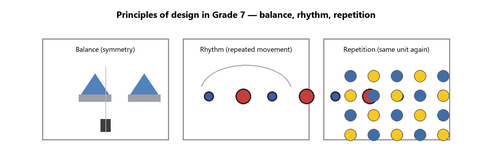

# Lesson 03 — Principles of design — unity and variety

The elements are your bricks; the principles are the building rules. This year the focus principles are **unity** (all parts agreeing as one whole) and **variety** (controlled differences that stop a design being boring), with balance, rhythm and proportion from Grade 7 still at work underneath.

**Words to know first**
- **Unity** — all parts of a work agreeing into one whole.
- **Variety** — controlled differences that keep a design lively.
- **Emphasis** — the part of a design the eye meets first.
- **Rhythm** — repeated elements creating a feeling of movement.
- **Proportion** — the size relationship between parts.

### Theory Questions and Answers

Q1. What is unity in design?
Ans. Unity is the principle that binds all parts of an artwork together into one whole.

Q2. What is variety in design?
Ans. Variety is the use of controlled differences in elements so that a design stays interesting instead of dull.

Q3. Contrast unity with variety.

| Unity | Variety |
| :--- | :--- |
| Pulls all the parts together into one whole. | Spreads controlled differences through the parts. |
| Without it a work looks loose and scattered. | Without it a work looks flat and monotonous. |

The difference is that unity joins the design while variety keeps the joined design from being boring.

Q4. How do unity and variety work together in one artwork?
Ans. A good artwork repeats one family of shapes or colours for unity, then shifts sizes or adds one contrasting accent for variety.

Q5. State three other principles of design that support unity and variety.
Ans.
- Balance
- Rhythm
- Proportion
(Also repetition, contrast and emphasis.)

Q6. What is rhythm in design?
Ans. Rhythm is the regular repetition of elements of design to create a feeling of movement.

Q7. What is emphasis, and how is it achieved?
Ans. Emphasis is arranging the design so that one part — for example the school emblem on a poster — is the first thing the eye notices; it is achieved by size, colour contrast or position.

Q8. What is proportion?
Ans. Proportion is the relationship in size between the objects that make up an artwork.

Q9. What is balance?
Ans. Balance is arranging the visual weight of the parts so the design does not look lop-sided — equal on both sides of an imagined centre.

Q10. How do the principles act together as a medium of creative expression?
Ans. The principles are the grammar of visual language — by combining unity, variety, balance, rhythm and proportion, the artist controls exactly how the viewer's eye travels and what feeling remains.

Q11. State three ways to create variety in a textile pattern.
Ans.
- Vary the size of repeats of one motif.
- Alternate two or three colours instead of one.
- Change the direction or spacing of the repeats.

Q12. State three ways to build unity in the same pattern.
Ans.
- Repeat one main motif everywhere in the design.
- Keep to one or two related colour families.
- Use even spacing and consistent line weight.

Q13. Give the steps for laying out a design that shows both unity and variety.
Ans.
1. Choose one main motif for the whole design.
2. Repeat it evenly to bind the design (unity).
3. Change the size, colour or direction of some repeats (variety).
4. Check balance and rhythm by viewing from a distance.
5. Refine the accents so one area is emphasised but the whole still agrees.

Q14. Why can a design with only variety never succeed?
Ans. Because differences without any agreement scatter the eye, so the design breaks into separate pieces instead of one message.

*Notice:* The principles are also graded across the years — Grade 7: balance, rhythm, repetition; Grade 8 (this lesson): unity and variety; Grade 9: variety and proportion. Learn the pairs; the same principles reappear every year.

### Worked exam exemplars

1. *The principle of design that binds all parts of an artwork together into one whole is* A. unity B. variety C. contrast D. balance *(bank, n.d.)* [1 mark]
   **Answer: A** — unity is the "one whole" principle.

2. *An artist arranges five circles of various sizes and colours in a design. It suggests that the artist is using the principle of* A. variety B. unity C. balance D. tone *(bank, n.d.)* [1 mark]
   **Answer: A** — varied sizes and colours of the same motif is controlled difference, that is, variety.

3. *Tim decides to design a pattern for his school's Friday wear. Identify the set of principles of design he would use. (i) (ii) (iii)* *(bank, n.d.)* [3 marks]
   **Model answer:** ① Variety — differences in motif size and colour give the cloth interest. ② Unity — repeated motifs bind the whole cloth together. ③ Balance — the repeats are evenly weighted so no corner feels heavier. (1 mark each = 3 marks.)

### Exercises

**Paper 1 — Objective**

1. *Adjoa wants the school emblem to be the first thing people notice in her poster. The principle of design she should apply is* A. emphasis B. texture C. shading D. blending
    Answer: A — making one part the first point of attention is emphasis.

2. *The regular repetition of elements of design to create a feeling of movement is* A. rhythm B. value C. texture D. form
    Answer: A — repeated elements + feeling of movement = rhythm.

3. *The relationship in size between the objects that make up an artwork is* A. proportion B. pattern C. hue D. media
    Answer: A — size relationships are proportion.

4. *The striking difference between light and dark in a work of art is* A. contrast B. harmony C. unity D. sequence
    Answer: A — a strong difference, such as light against dark, is contrast.

5. In a design, colour contrasting is achieved by using
    A. the same colour throughout        B. complementary colours        C. only line drawing        D. only grey tones
    Answer: B — opposite colours on the wheel clash pleasurably and give strong contrast.

**Paper 2 — Theory**

6. (a) An artist arranges five circles of various sizes and colours in a design. State the principle this shows and explain it. (2 marks)
    (b) State three ways of creating variety in a design. (3 marks)
    (c) State two ways of making sure the same design still shows unity. (2 marks)

**Answers**
    (a) The principle is variety; it is the use of controlled differences so the design stays lively. (2 marks — name 1, meaning 1.)
    (b) • Vary the sizes of repeats • Alternate colours • Change directions or spacing (1 mark each × any 3 = 3 marks)
    (c) • Repeat one main motif • Keep one or two related colour families (1 mark each = 2 marks)

7. (a) What is unity in design? (2 marks)
    (b) Give the five steps for laying out a fabric pattern that shows unity and variety. (5 marks)
    (c) Explain one difference between unity and rhythm. (2 marks)

**Answers**
    (a) Unity is the principle that binds all parts of an artwork into one whole. (2 marks — "binds parts/one whole".)
    (b) Choose one main motif → repeat it evenly → vary size, colour or direction of some repeats → check balance and rhythm from a distance → emphasise the focal part. (5 marks — 1 per step.)
    (c) Unity joins everything into one whole, while rhythm is the repeated, moving feel created by regular repeats. (2 marks — both sides of the difference.)

8. (a) Define emphasis as used in design. (2 marks)
    (b) State three devices a designer uses to emphasise the school emblem on a poster. (3 marks)
    (c) State the principle each device in (b) also supports. (2 marks)

**Answers**
    (a) Emphasis is arranging the design so that one part catches the eye before any other part. (2 marks — "one part first".)
    (b) • Make it larger • Give it a contrasting colour • Place it at the centrepoint or along the strongest line (1 mark each × any 3 = 3 marks)
    (c) Contrast and balance (size also touches proportion). (2 marks — any two sensible links.)