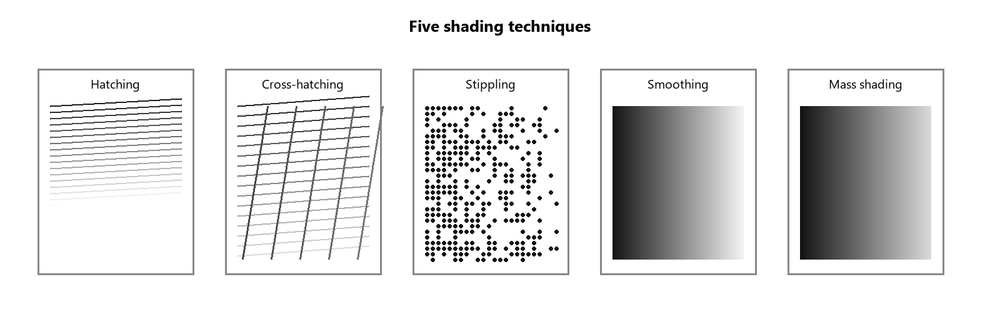

# Lesson 04 — Manual tools, materials and techniques for 2-D drawing, shading and colouring

Grade 7 taught you freehand outline drawing. This year the same tools do heavier work: full 2-D drawing with control of line, shading and colour. A 2-D drawing shows only height and width on a flat surface, and shading is what makes it look solid and real.

**Words to know first**
- **2-D** — flat, with only height and width.
- **Hatching** — shading with fine parallel strokes.
- **Cross-hatching** — strokes crossed over each other to darken.
- **Stippling** — shading with dots of different density.
- **Mass shading** — broad smooth tone over a whole area.

### Theory Questions and Answers

Q1. What is a 2-D drawing?
Ans. A 2-D drawing is a flat picture that shows only height and width, with no depth.

Q2. State three manual tools needed for 2-D drawing.
Ans.
- Pencils and an eraser
- Ruler, T-square and set square
- Protractor and compass

Q3. State three colouring materials used with manual drawings.
Ans.
- Crayons
- Colour pencils
- Watercolour paints

Q4. What do the letters on pencil grades mean?
Ans. H means hard (faint, fine lines), B means soft (dark, bold tones), and HB is the middle grade for general outlines.

Q5. Contrast hatching with cross-hatching.

| Hatching | Cross-hatching |
| :--- | :--- |
| Fine parallel strokes in one direction. | Fine strokes crossing over earlier strokes. |
| Gives a light, even tone. | Builds a deeper, darker tone. |

The difference is that crossing the strokes doubles the layers so the shade becomes progressively darker.

Q6. Name four shading techniques used on 2-D drawings.
Ans.
- Hatching
- Cross-hatching
- Stippling
- Mass shading
(Smoothing — softening the tone with bare fingers or paper — is also acceptable.)

Q7. What is stippling?
Ans. Stippling is shading by placing dots so that crowded dots make dark areas and scattered dots make light areas.

Q8. Give the steps for shading a drawn solid shape.
Ans.
1. Decide where the light is coming from.
2. Shade the darkest areas away from the light first.
3. Apply hatching, cross-hatching, stippling or mass shading in that order of darkness.
4. Keep white areas like reflections untouched.
5. Blend or soften edges of the tones so the object looks rounded.

Q9. How is watercolour classified as a colouring medium?
Ans. Watercolour is a wet medium, because it must be mixed or thinned with water before use.

Q10. Why do artists test strokes on rough paper before the final sheet?
Ans. To check the tone and colour match what the final drawing needs, so mistakes stay on the rough sheet, not the artwork.

Q11. State three ways to keep manual drawing tools in good condition.
Ans.
- Cap the pencils and wash brushes after use and dry them properly.
- Store rulers, T-squares and set squares flat so they do not bend.
- Keep sharp tools away from colleagues until they can be stored safely.

Q12. How is tone used with colour?
Ans. Tone is the relative lightness or darkness of colour; by pressing lightly or heavily, or layering colour, the artist creates light and dark sides that make the shape look solid.

Q13. Why is the 2-D drawing focus important for Grade 8?
Ans. Because controlled line, value and colour on a flat surface is the foundation that Grade 9's 3-D drawing will build upon.

Q14. What is the first stage of every shaded 2-D drawing?
Ans. A light outline sketch — structure first, details and dark tones last.

*Notice:* The Grade 7 drawing sub-strand (freehand/outline) repeats at Grade 8 level as 2-D drawing — the tools and lessons are the same, only the control of line, tone and colour deepens.

### Worked exam exemplars

1. *The relative lightness or darkness of a colour, object, or area in design is known as* A. tone B. textured area C. balance D. pattern *(bank, n.d.)* [1 mark]
   **Answer: A** — relative lightness or darkness is tone.

2. *Water colour is an example of ........ medium.* A. dry B. wet C. solid D. fixed *(bank, n.d.)* [1 mark]
   **Answer: B** — watercolour must be wetted before use, so it is a wet medium.

3. *(a) Using crayon or colour pencil, draw a cone in the space provided and render it solid using the mass shading technique. (b) In the spaces provided below, draw any two different objects that are conical in shape. Use the stippling technique to shade the drawn object in Box 'A' and the hatching technique to shade the other in Box 'B'.* *(bank, n.d.)* [8 marks]
   **Model answers:** (a) The cone is drawn with a circular base in perspective, an apex point, and one broad swept tone from light (side nearest the lamp) to dark edge — mass shading means smooth continuous tone, no visible strokes. (4 marks — cone shape 2, smooth tonal range 2.) (b) Box 'A' is built from dots, sparse on the lit side and crowded on the dark side; Box 'B' is built from parallel strokes, increasing layers where it should be dark. (4 marks — 2 per box, technique identifiable.)

### Exercises

**Paper 1 — Objective**

1. *The relative lightness or darkness of a colour, object, or area in design is known as* A. tone B. texture C. form D. rhythm
    Answer: A — tone is the light/dark degree of an area.

2. *Adjawa is inspired by nature to draw trees in her sketchbook. How would she effectively depict the texture of the tree bark?* A. Use of zigzag lines B. Use of cool colours C. Use of random lines D. Use of bright colours
    Answer: C — rough bark is imitated with irregular, random strokes.

3. Which pencil grade gives the darkest soft tone?
    A. 2H        B. HB        C. 2B        D. 6B
    Answer: D — the higher the B number, the softer and darker the mark.

4. Which of the following is **not** a shading technique?
    A. Hatching        B. Stippling        C. Wedging        D. Mass shading
    Answer: C — wedging is a clay-preparation step, not a shading technique.

5. Which tool is used to draw accurate vertical lines for a 2-D layout?
    A. T-square together with a set square        B. A soft rag        C. A blending stump        D. A paint roller
    Answer: A — the T-square guides the set square for true verticals.

**Paper 2 — Theory**

6. (a) What is mass shading? (2 marks)
    (b) State the five steps for shading a drawn solid shape. (5 marks)
    (c) State two uses of the HB pencil grade in a 2-D drawing. (2 marks)

**Answers**
    (a) Mass shading is applying one broad, smooth tone over a whole area so no individual strokes remain visible. (2 marks — "broad/smooth tone".)
    (b) Fix the light source → shade the darkest areas first → apply technique in order of darkness → keep reflections white → soften tone edges. (5 marks — 1 each.)
    (c) • Light first outlines • General medium shading (1 mark each = 2 marks)

7. (a) Draw a cone in the space provided and render it solid using the mass shading technique. (4 marks)
    (b) Draw any two different objects that are conical in shape. Use stippling to shade the object in Box 'A' and hatching to shade the other in Box 'B'. (6 marks)
    (c) Name the technique used in each box. (2 marks)

**Answers**
    (a) Correct cone with circle base and apex, one continuous smooth tone from light to dark. (4 marks — shape 2, smooth tone 2.)
    (b) Two conical objects (party hat, ice-cream cone), Box 'A' shaded only with dots, Box 'B' only with parallel strokes. (6 marks — objects 2, stippling correct 2, hatching correct 2.)
    (c) Box 'A' — stippling; Box 'B' — hatching. (1 mark each = 2 marks)

8. (a) State three ways of caring for manual drawing and colouring tools. (3 marks)
    (b) State two safety precautions when using sharp drawing tools. (2 marks)
    (c) Contrast a wet colouring medium with a dry one. (3 marks)

**Answers**
    (a) • Wash and dry brushes • Cap pencils/pens • Store rules flat (1 mark each × any 3 = 3 marks)
    (b) • Cut away from the body • Pass scissors handle-first / store sharp points covered (1 mark each = 2 marks)
    (c) A wet medium (watercolour, poster colour) must be mixed with water; a dry medium (crayon, colour pencil) works straight on the surface. (3 marks — wet defined 1, dry defined 1, contrast sense 1.)