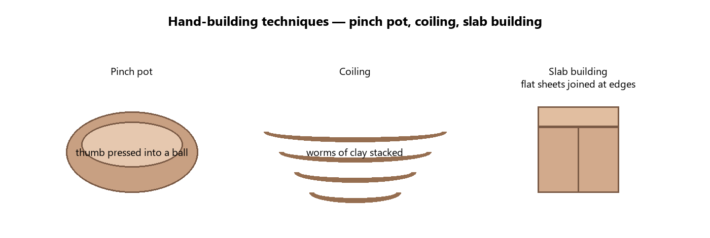

# Lesson 06 — Design ideas and model-making from 2-D drawings (templates, cardboard, Styrofoam, pulp paper, clay)

A drawing lives on paper; a model gives the same idea body. Grade 8 turns 2-D drawings into simple 3-D models using templates and materials like cardboard, Styrofoam, pulp paper (papier-mâché) and clay.

**Words to know first**
- **Model** — a copy of a design idea made in 3-D form.
- **Template** — a cut-out shape used as a guide to copy a shape.
- **Wedging** — kneading clay to push trapped air out.
- **Firing** — baking shaped clay in a kiln until hard.
- **Papier-mâché** — a moulding paste made of soaked paper and glue.

### Theory Questions and Answers

Q1. What is a model in design?
Ans. A model is a three-dimensional copy of a design idea, made so the designer can see, test and improve the idea before the real thing is built.

Q2. What is a template?
Ans. A template is a cut-out shape placed on the material so that every piece copied from it keeps the same outline.

Q3. State three materials used for model-making in the design class.
Ans.
- Cardboard
- Styrofoam
- Clay
(Pulp paper / papier-mâché is also correct.)

Q4. Contrast a 2-D drawing with a 3-D model.

| 2-D drawing | 3-D model |
| :--- | :--- |
| Flat — has height and width only. | Solid — has height, width and depth. |
| Made with pencil on paper. | Made from real materials like clay or cardboard. |

The difference is that a model adds depth andtouchable real material to a flat idea.

Q5. State the steps for turning a 2-D drawing into a cardboard model.
Ans.
1. Finalise the 2-D design and decide its height, width and depth.
2. Trace each side shape onto a template.
3. Draw around the template on cardboard and cut the pieces with care.
4. Join the pieces with glue or tape, strengthening the corners.
5. Add surface details and paint, then review the model against the original drawing.

Q6. How is clay tested for suitability before a big work?
Ans. clay is tested by the squeeze (elastic) test — a rolled coil bends without cracking — and by the wash test, which shows gritty unwanted particles.

Q7. State the steps for preparing clay for use.
Ans.
1. Pick out stones and rubbish from the clay.
2. Soak and pound the clay until it is even.
3. Wedge the clay — knead it like dough to push trapped air bubbles out.

Q8. What is the technique whereby a ball of clay is opened by pressing with the thumb and shaped with the fingers?
Ans. That technique is the pinch pot, one of the hand-building methods.

Q9. What is the modelling method of rolling clay into long ropes and winding them up to build a pot?
Ans. That method is coiling.

Q10. What is a slab?
Ans. A slab is a flat piece of even-thickness clay used for building pottery forms, cut from a rolled-out sheet of clay.

Q11. Why is a finished clay pot fired, and what is the process called?
Ans. The pot is put in a kiln to make it permanent, and the process is called firing.

Q12. Give the steps for making a papier-mâché (pulp paper) model.
Ans.
1. Shred or tear writing paper into small pieces.
2. Soak the paper in water until soft.
3. Beat it into a smooth pulp and mix it with glue or paste.
4. Mould the pulp over the form or inside the mould.
5. Allow it to dry hard, then sand and paint it.

Q13. State one technique for decorating a finished model.
Ans. Incised lines or impressed motifs carved into the surface before it dries are one decoration technique (painting after drying is also correct).

Q14. State two precautions to observe when modelling with clay.
Ans.
- Wash hands after handling clay and keep clay dust out of your mouth and eyes.
- Wedge clay properly so trapped air cannot crack the piece during firing.

*Notice:* The Grade 7 modelling lessons (cardboard, Styrofoam, clay, pulp paper — pinching, coiling, slab building, papier-mâché) repeat in Grade 8 on a 2-D drawing base: the model now follows a real measured design, not a free idea.

### Worked exam exemplars

1. *A 3-dimensional form of a square is the* A. cone B. cube C. cuboid D. cylinder *(bank, n.d.)* [1 mark]
   **Answer: B** — a cube is the square grown into three equal dimensions.

2. *(a) Aku has been tasked to produce a vase with clay for the upcoming interschool art competition. (i) List two tests that can be done on the clay for its suitability. (ii) Describe in three steps how to prepare the clay for the task. (iii) Identify one technique that can be used to decorate the vase.)* *(bank, n.d.)* [6 marks]
   **Model answers:** (a)(i) • Squeeze (elastic) test • Wash test (1 mark each = 2 marks.) (ii) 1. Pick out stones and rubbish. 2. Soak and pound the clay until even. 3. Wedge to drive out trapped air. (3 marks — 1 per step, in order.) (iii) Incised (carved) line decoration, or impressing motifs, or painting. (1 mark.)

### Exercises

**Paper 1 — Objective**

1. *After modelling a clay pot, Naa put it in a kiln to make it permanent. The process Naa carried out is* A. melting B. glazing C. firing D. burning
    Answer: C — firing in a kiln hardens clay permanently.

2. *The stage in clay preparation in which clay is kneaded like dough to push out trapped air bubbles is* A. wedging B. pouring C. carving D. burnishing
    Answer: A — kneading out air is wedging.

3. *The technique whereby a ball of clay is opened by pressing with the thumb and shaped with the fingers is* A. pinching B. cording C. slabbing D. screwing
    Answer: A — thumb-pressing a clay ball is the pinch pot technique.

4. *A modelling method of rolling clay into long ropes and winding them up to build a pot is* A. coiling B. twisting C. knotting D. layering
    Answer: A — rolled ropes of clay wound up is coiling.

5. *A flat piece of even-thickness clay used for building pottery forms is called a* A. slab B. pellet C. sheet D. wafer
    Answer: A — even-thickness flat clay is a slab.

**Paper 2 — Theory**

6. (a) Aku is to produce a vase with clay for an interschool art competition.
    (i) List two tests that can be done on the clay for its suitability. (2 marks)
    (ii) Describe in three steps how to prepare the clay for the task. (3 marks)
    (iii) Identify one technique that can be used to decorate the vase. (1 marks)
    (b) Explain the term modelling as used in Creative Arts and Design. (2 marks)
    (c) State two precautions to observe while modelling with clay. (2 marks)

**Answers**
    (a)(i) • Squeeze (elastic) test • Wash test (1 mark each = 2 marks)
    (ii) 1. Pick out stones and rubbish. 2. Soak and pound until even. 3. Wedge to remove trapped air. (3 marks — 1 per step.)
    (iii) Incised lines, impressed motifs or painting. (1 mark)
    (b) Modelling is shaping a soft material such as clay or pulp paper by hand or with simple tools into a solid form. (2 marks — "shaping soft material".
)
    (c) • Wedge out trapped air • Keep dust out of mouth/eyes and wash hands (1 mark each = 2 marks)

7. (a) What is a template? (2 marks)
    (b) List the five steps for turning a 2-D drawing into a cardboard model. (5 marks)
    (c) State one advantage of making a model before building the real product. (2 marks)

**Answers**
    (a) A template is a cut-out guide shape used to copy the same outline onto material. (2 marks — "cut-out guide".)
    (b) Finalise the design → make templates → trace and cut pieces → join with glue/tape → detail, paint and review. (5 marks — 1 per step.)
    (c) The designer sees and corrects faults cheaply before spending on the real product. (2 marks — reasoning accepted.)

8.(a) State the five steps for making a papier-mâché model. (5 marks)
    (b) Mention three materials, apart from clay, used for model-making. (3 marks)
    (c) Contrast a 2-D drawing with a 3-D model. (3 marks)

**Answers**
    (a) Tear paper → soak → beat to pulp with glue → mould over the form → dry, then paint. (5 marks — 1 per step.)
    (b) • Cardboard • Styrofoam • Pulp paper/papier-mâché (1 mark each × any 3 = 3 marks)
    (c) The drawing is flat with height and width only, while the model is solid with depth and made of real material. (3 marks — 2-D 1, 3-D 1, difference 1.)