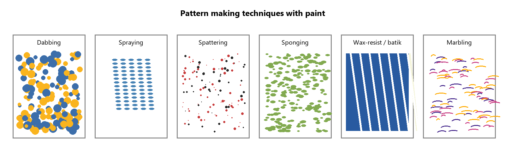

# Lesson 11 — Print making — relief, direct, stencil and block printing

Print making is the art of making many copies of one design from a prepared surface. A carved lino cut, a leaf pressed on cloth, a cut card with dabbed ink, or a stamped block — each is a print, and each belongs to one of this lesson's methods.

**Words to know first**
- **Print making** — making many copies of a design from a surface.
- **Relief printing** — printing from the raised (remaining) areas.
- **Stencil printing** — pushing colour through cut openings in card.
- **Block printing** — stamping an inked carved block onto a surface.
- **Serigraphy (screen printing)** — printing through a stretched mesh screen.

### Theory Questions and Answers

Q1. What is print making?
Ans. Print making is a technique of making many copies of a design from one prepared surface such as a block, screen or cut card.

Q2. State the four printing methods studied at Grade 8.
Ans.
- Relief (low/relief) printing
- Direct printing
- Stencil printing
- Block printing

Q3. What is relief printing?
Ans. Relief printing is printing from what remains raised — the artist cuts the design away from lino or wood, and the raised, inked parts print the image.

Q4. What is direct printing?
Ans. Direct printing is pressing found objects — leaves, strings, fingers, bottle tops — coated with colour directly onto the surface so their texture prints.

Q5. What is stencil printing?
Ans. Stencil printing is cutting openings in a card sheet, laying it on the surface, and dabbing or spraying colour through the openings.

Q6. What is block printing?
Ans. Block printing is carving a design on a block of wood, rubber or other firm material, inking it and pressing it repeatedly to stamp the same image many times.

Q7. Contrast stencil printing with block printing.

| Stencil printing | Block printing |
| :--- | :--- |
| Colour passes through cut openings in a flat card. | Colour is stamped from a carved raised block. |
| Edges may fray if the card is thin. | The same clean image repeats many times. |

The difference is that a stencil is a hole for colour to pass, while a block is a stamp that carries colour.

Q8. Which printing method suits a party that wants thousands of rally cloths in several colours?
Ans. Screen printing (serigraphy), because one prepared screen prints a large quantity quickly, and each colour needs its own screen.

Q9. Give the steps for making a block print.
Ans.
1. Draw the design on a block of firm material.
2. Carve away the parts that must not print.
3. Roll printing ink or paste evenly over the raised design.
4. Press the inked block firmly onto the paper or cloth.
5. Lift the block, and repeat to make as many copies as wanted.

Q10. Give the steps for making a stencil print.
Ans.
1. Draw the design on a sheet of stiff card.
2. Cut out the areas that must receive colour.
3. Lay the card on the paper or cloth.
4. Dab or spray colour through the cut openings.
5. Lift the stencil carefully and allow the print to dry.

Q11. Which tool ensures an even distribution of paste on the surface during printing?
Ans. A squeegee (or spreading knife) pulls the paste evenly across a screen or surface.

Q12. State three reasons a screen-printed rally cloth is appropriate for a large party.
Ans.
- One screen prints the same design hundreds of times quickly.
- Each colour gets its own screen, so several colours are possible.
- The prints are durable and clear on cloth.

Q13. Why is repetition useful in print making?
Ans. Because repeated impressions of one motif — held together by unity and rhythm — build a patterned cloth or border.

Q14. State two safety precautions when carving and printing.
Ans.
- Cut away from the body and keep fingers behind the cutting tool.
- Wash paste and ink off tools and skin immediately, and keep media away from the mouth.

*Notice:* Grade 7's pattern techniques (dabbing, sponging, spraying, stippling, wax-resist and marbling) feed into this year's true print methods; in the bank, party-cloth printing scenarios are common — remember one colour = one screen.

### Worked exam exemplars

1. *Print-making is a technique of making ........ copies.* A. many B. single C. faded D. manual *(bank, n.d.)* [1 mark]
   **Answer: A** — the entire point of print making is producing many copies.

2. *Kingsley wants to create a print using the block printing technique. What is the main characteristic of block printing?* *(bank, n.d.)* [1 mark]
   **Model answer:** A design carved on a block is inked and stamped repeatedly, printing the same image each time. (1 mark — "carved block"/"stamped repeatedly".)

3. *Read the scenario below carefully and use it to answer the question. "The Agbo Women" political party has 800,000 delegates. The party intends to print clothes for their upcoming rally. Yellow, Blue and Black are the colours for the political party. Select the number of screens to be developed in printing the clothes.* *(bank, n.d.)* [2 marks]
   **Model answer:** Three screens — one screen for each colour (yellow, blue and black). (2 marks — one screen per colour 1, correct count 1.)

### Exercises

**Paper 1 — Objective**

1. *Printmaking is a technique of making ........ copies.* A. many B. single C. manual D. secret
    Answer: A — print making exists to produce many copies.

2. *Kingsley wants to create a print using the block printing technique. What is the main characteristic of block printing?* A. Colour passes through cut card openings B. An inked carved block is stamped repeatedly on the surface C. Objects are thrown on wet paint D. Only pencil copies are made
    Answer: B — the carved, inked block stamps the same image repeatedly.

3. *Read the scenario carefully: "The Agbo Women" political party has 800,000 delegates and intends to print clothes for their upcoming rally in Yellow, Blue and Black. Identify the appropriate printing method.* A. Block printing B. Stencil printing C. Frottage printing D. Serigraphy printing
    Answer: D — for huge cloth quantities in several colours, screen printing (serigraphy) is the method.

4. *Select the number of screens to be developed in printing the clothes (three party colours).* A. One B. Two C. Three D. Four
    Answer: C — each colour needs its own screen.

5. Which method prints from **raised** surfaces?
    A. Relief printing        B. Stencil printing        C. Shadow printing        D. Air printing
    Answer: A — relief prints from the areas left standing after carving.

**Paper 2 — Theory**

6. (a) The Black star party has 85,000 members. The party intends to embark on a rally in December, 2025. They have therefore decided to print a new cloth for the rally. As a student artist:
    (i) Identify the most appropriate method to be used for printing the cloth for the members. (2 marks)
    (ii) State two reasons for the choice of printing method identified in (i) above. (4 marks)
    (iii) List three wet media that would be useful for the printing of the cloth. (3 marks)

**Answers**
    (a)(i) Screen printing (serigraphy). (2 marks)
    (ii) ① One screen prints the same design hundreds of copies quickly, which suits the 85,000 members. ② Each colour (yellow, blue, black) gets its own screen and the prints stay durable on cloth. (2 marks each = 4 marks)
    (iii) • Textile ink • Fabric paint • Acrylic colour (any three sensible wet media — 1 mark each = 3 marks)

7. (a) What is relief printing? (2 marks)
    (b) List the five steps for making a block print. (5 marks)
    (c) State two differences between stencil printing and block printing. (2 marks)

**Answers**
    (a) Relief printing is printing from the raised areas that remain on a carved lino or wood block. (2 marks — "raised/remaining areas" 1, "carved" 1.)
    (b) Draw the design on the block → carve away the non-printing parts → ink the raised design with a roller → press the block on the surface → lift and repeat for copies. (1 mark each = 5 marks)
    (c) Stencil passes colour through openings in flat card, while a block stamps colour from a carved raised surface; a stencil may fray while a block repeats cleanly. (1 mark per difference, 2 marks total.)

8. (a) State two safety precautions when carving printing blocks. (2 marks)
    (b) State the three steps for cleaning printing tools after use. (3 marks)
    (c) Name the tool used to spread printing paste evenly over a screen. (2 marks)

**Answers**
    (a) • Cut away from the body • Keep fingers behind the blade and store cutters covered (any two sensible — 1 mark each = 2 marks)
    (b) Scrape off excess paste or ink → wash with water until clean → dry before storage. (1 mark each = 3 marks)
    (c) A squeegee (spreading knife also accepted). (2 marks.)