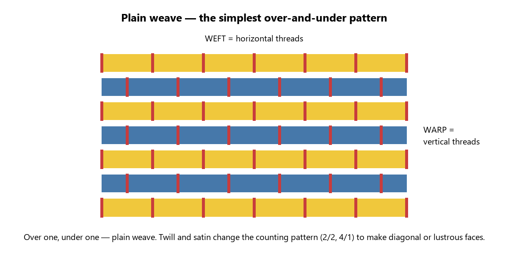

# Lesson 13 — Weaving — plain weave, twill and satin; cane, raffia, yarns, reeds

Weaving is one of Ghana's oldest crafts — kente, mats and baskets all interlace two sets of strands. The three weaves to know this year are plain, twill and satin, worked with cane, raffia, yarns and reeds.

**Words to know first**
- **Weaving** — interlacing two sets of strands at right angles.
- **Warp** — the lengthwise set of strands.
- **Weft** — the crosswise, horizontally passed set of strands.
- **Loom** — the frame used for weaving.
- **Selvedge** — the finished side edges of a woven piece.

### Theory Questions and Answers

Q1. What is weaving?
Ans. Weaving is the interlacing of two sets of materials — lengthwise and crosswise — at right angles to form fabric or articles.

Q2. Which two sets of yarns are used in weaving?
Ans. The warp (the lengthwise set held on the frame) and the weft (the crosswise set passed through the shed).

Q3. Contrast the warp with the weft.

| Warp | Weft |
| :--- | :--- |
| Runs lengthwise along the loom. | Runs crosswise, under and over the warp. |
| Held tight before weaving begins. | Inserted strand by strand with the shuttle. |

The difference is that the warp is the fixed skeleton, while the weft is the moving thread that builds the cloth.

Q4. What is plain weave?
Ans. Plain weave is the weave in which the weft passes over one strand and under the next in a regular over-under sequence.

Q5. What is twill weave?
Ans. Twill weave is the weave in which the weft passes over two or three strands and under one, staggering as it goes so the surface shows diagonal lines.

Q6. What is satin weave?
Ans. Satin weave is the weave in which the weft floats over many strands (four or more) before binding under one, giving a smooth, shiny surface.

Q7. State four materials used in weaving.
Ans.
- Cane
- Raffia
- Yarns
- Reeds

Q8. Contrast plain weave with twill weave.

| Plain weave | Twill weave |
| :--- | :--- |
| Weft goes over one, under one. | Weft goes over two or three, under one — staggered. |
| Strong, flat, even surface. | Marked diagonal ridges that drape better. |

The difference is that plain weave is the simplest checker repetition, while twill's stagger creates the classic diagonal.

Q9. Give the steps for weaving a simple stole in plain weave.
Ans.
1. Measure and tie the warp threads evenly on the loom.
2. Create the shed (the space) by lifting alternate warp threads.
3. Pass the weft yarn through the shed from selvedge to selvedge.
4. Beat the new weft up against the fell (the edge where weaving happens) so the rows sit tight.
5. Change the shed and repeat row after row until the stole reaches its full length, then finish the ends.

Q10. Why is cane or raffia soaked in water before weaving?
Ans. Soaking makes the strands soft and flexible so they bend without cracking or breaking.

Q11. Sally is weaving a mat that keeps rippling. What best keeps the mat lying flat?
Ans. She should beat the thread tighter, so each weft row presses close against the last and the mat lies flat.

Q12. In weaving, what does beating to the fell mean?
Ans. After every new weft is inserted through the shed, it is beaten up against the fell — the boundary where the woven part meets the yet-unwoven warp.

Q13. State two tools that help in weaving.
Ans.
- The loom (frame)
- A shuttle or weaving needle
(A shed stick and a beater or comb are also correct.)

Q14. State two care rules for looms and weaving materials.
Ans.
- Check and re-tie warp threads and fittings before each session.
- Keep raffia, cane and yarns dry, coiled and insect-free.

*Notice:* The NaCCA weaving list is exactly plain weave, twill and satin worked with cane, raffia, yarns and reeds — and in BECE scenarios (graduation stole, mats) the two "sets of yarns" asked for are always warp and weft.

### Worked exam exemplars

1. *In weaving a stole for graduation, Johny uses warp and weft yarns. For every new weft yarn he inserts into the shed, he beats to the* A. fell of the stole B. middle of the stole C. side of the stole D. selvedge of the stole *(bank, n.d.)* [1 mark]
   **Answer: A** — each new weft is beaten against the fell, where the woven part meets the unwoven warp.

2. *(Your teacher has tasked the class to weave a stole for the final year leavers' graduation celebration.) (i) Enumerate the two sets of yarns that would be used for the stole. (ii) Describe any one of the yarns enumerated in (i) above.* *(bank, n.d.)* [4 marks]
   **Model answers:** (i) • The warp yarns • The weft yarns. (1 mark each = 2 marks.) (ii) Example: the weft is the crosswise set of yarns passed through the shed over and under the warp to build the cloth. (2 marks — naming the set 1, describing its role 1.)

3. *Which weaving technique creates pattern by interlacing threads over and under each other in a regular sequence?* *(bank, n.d.)* [1 mark]
   **Model answer:** Plain weave — over one, under one, in a regular sequence. (1 mark.)

### Exercises

**Paper 1 — Objective**

1. *Which weaving technique creates pattern by interlacing threads over and under each other in a regular sequence?* A. Plain weave B. Satin weave C. Coiling D. Welding
    Answer: A — plain weave's regular over-under sequence.

2. *Which weaving technique creates diagonal patterns by passing the weft thread over and under multiple warp threads?* A. Twill weave B. Plain weave C. Pinch weave D. Slab weave
    Answer: A — the staggered crossings of twill make the diagonals.

3. *The name given to the frame used for weaving fabric is* A. loom B. lean-to C. shutter D. lathe
    Answer: A — the loom holds the warp and guides the work.

4. *Weaving involves interlacing ........* A. warp and weft B. dots and lines C. pulp and glue D. paste and screen
    Answer: A — the two interlacing sets are warp and weft.

5. *Sally was tasked to weave a mat. Select the best measure that she would take to ensure that the mat lies flat.* A. Use thicker thread B. Double the thread C. Beat the thread tighter D. Use fine threads
    Answer: C — tight beating presses the rows close so the mat lies flat.

**Paper 2 — Theory**

6. Your teacher has tasked the class to weave a stole to be used by the final year leavers for their graduation celebration. As a creative student:
    (a) Enumerate the two sets of yarns that would be used for the stole. (2 marks)
    (b) Describe any one of the yarns enumerated in (a) above. (2 marks)
    (c) List any two tools that would help in weaving the stole. (2 marks)

**Answers**
    (a) • The warp yarns • The weft yarns (1 mark each = 2 marks)
    (b) Example: the warp is the set of yarns stretched lengthwise on the loom before weaving begins. (2 marks — named set 1, role 1.)
    (c) • Loom • Shuttle or weaving needle (shed stick, beater also correct — 1 mark each = 2 marks)

7. (a) Define weaving. (2 marks)
    (b) List the five steps for weaving a simple stole in plain weave. (5 marks)
    (c) State one reason why raffia is soaked before weaving. (2 marks)

**Answers**
    (a) Weaving is interlacing two sets of strands at right angles to form fabric or articles. (2 marks — "two sets interlaced" 1, "right angles" 1.)
    (b) Tie the warp evenly on the loom → open the shed → pass the weft across → beat it up against the fell → repeat to length and finish the ends. (1 mark each = 5 marks)
    (c) Soaking makes the raffia flexible so it bends without cracking. (2 marks — flexibility 1, prevents cracking 1.)

8. (a) Contrast plain weave and twill weave (one difference). (2 marks)
    (b) Describe satin weave and the surface quality it gives. (3 marks)
    (c) State two care rules for looms and fibres. (2 marks) [Review]

**Answers**
    (a) Plain weave passes over one and under one, while twill staggers over two or three and under one to show diagonals. (2 marks — plain 1, twill 1.)
    (b) In satin weave the weft floats over four or more warp strands before binding under one, giving a smooth, shiny surface. (3 marks — float 1, bind 1, smooth/lustrous 1.)
    (c) • Check and re-tie warp threads before each session • Store fibres dry, coiled and insect-free (1 mark each = 2 marks) [Review — Lesson 10 storage.]