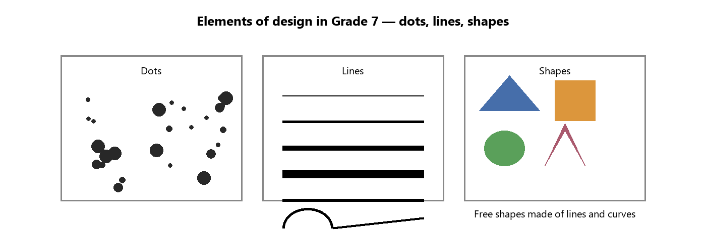
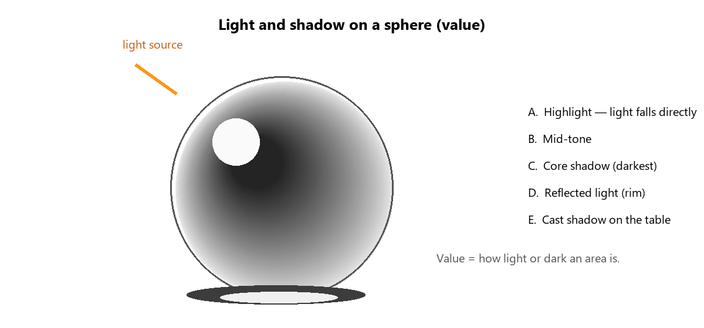

# Lesson 02 — Elements of design — form and value

At Grade 9 the two elements that must be mastered are **form** and **value**. Form is anything with length, breadth and height, while value is how light or dark a surface is — and value is exactly what makes a flat circle look like a solid ball.

**Words to know first:** form — a 3-D shape with height, width and depth; value — how light or dark a surface is; tone — another word for value; gradation — smooth change from light to dark; source — where light comes from.

**Theory Questions and Answers**

Q1. What is form in design?
Ans. Form is an element of design that has three dimensions — length, breadth and height — such as a cube, sphere, cylinder or cone.

Q2. What is value in design?
Ans. Value is the lightness or darkness of a surface, from white through greys to black.

Q3. What name is also given to value?
Ans. Value is also called tone.

Q4. Differentiate between shape and form.
Ans.

| Shape | Form |
| :--- | :--- |
| Flat, two-dimensional, with only length and breadth (a square, circle or triangle) | Solid, three-dimensional, with length, breadth and height (a cube, sphere or cone) |

The difference is that a shape is 2-D while a form is 3-D.

Q5. State three three-dimensional forms.
Ans.
- Cube
- Sphere
- Cylinder (also correct: cone, pyramid)

Q6. What is a value scale?
Ans. A value scale is a strip of steps running from pure white through light greys to pure black, used to control tonal work.

Q7. List the three value areas a designer reads on a lit object.
Ans.
- Highlight — the brightest part facing the light
- Midtone — the middle greys
- Shadow (core shade) — the darkest part away from the light

Q8. What is gradation of value?
Ans. Gradation is the smooth change from light to dark on a surface, such as on a shaded sphere.

Q9. Why is value important when drawing a form?
Ans. Value gives the drawing depth and solidity, turning a flat outline into something that looks three-dimensional.

Q10. How does a designer control value in a drawing?
Ans. By choosing the right pencil grades or pressure — light pressure and hard pencils for light areas, soft pencils and heavy pressure for dark areas.

Q11. How does the position of a light source affect value?
Ans. The side of the form facing the light becomes light in value and the side away from it becomes dark, with the shadow falling opposite the light source.

Q12. State three natural objects with obvious form.
Ans.
- Stones
- Fruits (for example mango)
- Egg (also correct: calabash, coconut)

Q13. How does value help a design communicate?
Ans. Strong value contrast makes the most important part of a design stand out first to the viewer.

Q14. What is the relationship between form and value?
Ans. Value models the form — light and dark together are what make a flat picture of a cube or sphere read as a solid body.

*Figure: the basic elements of design — dot, line, shape, value, texture and colour.*

*Figure: value on a form — highlight, midtone, core shade and cast shadow on a sphere.*

*Notice:* Design is graded across the years — Grade 7: dots, lines, shapes (balance, rhythm, repetition); Grade 8: texture, colour (unity, variety); Grade 9: form, value (variety, proportion). Classic links: the kingfisher's beak inspired the Shinkansen Bullet Train; the anthill inspired the Eastgate Building in Zimbabwe.

### Worked exam exemplars

1. *(bank, 2025)* [1 mark]
   A 3-dimensional form of a square is the
   A. cone.        B. cube.        C. cuboid.        D. cylinder.
   Answer: B [1 mark] — a square pushed into three dimensions becomes a cube; the cuboid comes from a rectangle and the cone and cylinder from circles.

2. *(bank, 2025)* [1 mark]
   Applying countless small dots to build up darker value in drawing is known as
   A. hatching.        B. stippling.        C. smudging.        D. outlining.
   Answer: B [1 mark] — stippling builds dark value out of many small dots.

3. *(bank)* [1 mark]
   Which of the following is not a form?
   A. Cube        B. Sphere        C. Triangle        D. Cone
   Answer: C [1 mark] — a triangle is a flat shape with only two dimensions, so it is not a form.

### Exercises

**Paper 1 — Objective**

1. A 3-dimensional form of a square is the
    A. cone.        B. cube.        C. cuboid.        D. cylinder.
   Answer: B — a square grown in the third dimension becomes a cube.

2. Applying countless small dots to build up darker value in drawing is known as
    A. hatching.        B. stippling.        C. smudging.        D. outlining.
   Answer: B — stippling piles small dots until they read as darkness.

3. Which element of design is created when white light falls on a form and part of it stays dark?
    A. Colour        B. Texture        C. Value        D. Pattern
   Answer: C — the light and dark areas show value (tone).

4. The brightest part of a shaded sphere, where light hits directly, is called the
    A. cast shadow.        B. highlight.        C. core shade.        D. outline.
   Answer: B — the highlight is the lightest spot facing the light source.

5. Which of these drawings shows a form rather than a shape?
    A. A flat square        B. A flat circle        C. A shaded sphere        D. A straight line
   Answer: C — shading (value) turns the circle into a solid-looking sphere, a true form.

**Paper 2 — Theory**

6. (a) What is a form in design? (2 marks)
   (b) Give two examples of three-dimensional forms. (2 marks)
   (c) Explain, with one example, how value makes a flat drawing look solid. (3 marks)

Answers
    (a) A form is a three-dimensional element of design with length, breadth and height. (2 marks)
    (b) Any two of cube, sphere, cylinder, cone, pyramid. (1 mark each)
    (c) Shading the side away from the light dark in value and the side facing the light light in value turns a flat circle into a sphere. (1 mark for light area, 1 for dark area, 1 for the example)

7. (a) What is value? (2 marks)
   (b) State the three value areas on a lit object. (3 marks)
   (c) A classmate drew a paper bag with no tonal change. State one correction and say why it helps. (3 marks)

Answers
    (a) Value is the lightness or darkness of a surface. (2 marks)
    (b) Highlight, midtone, core shadow. (1 mark each)
    (c) Add graded tones from the light source side across the bag; the tonal gradation gives the flat shape depth and solidity. (1 mark for the correction, 2 marks for the reason)

8. (a) Which element of design is studied with form at Grade 9? (1 mark)
   (b) State three solid objects in your community whose forms a designer could copy. (3 marks)
   (c) Copy and complete the table below on form. (3 marks)

| Form | Natural or manmade? | Example |
| :-- | :-- | :-- |
| Sphere | ……… | ……… |
| Cube | ……… | ……… |

Answers
    (a) Value (tone). (1 mark)
    (b) Calabash, coconut, drinking cup, pencil sharpener, stool. (1 mark each, any three)
    (c) Sphere — natural — orange/egg; Cube — manmade — box/dice. (1 mark per correct row)