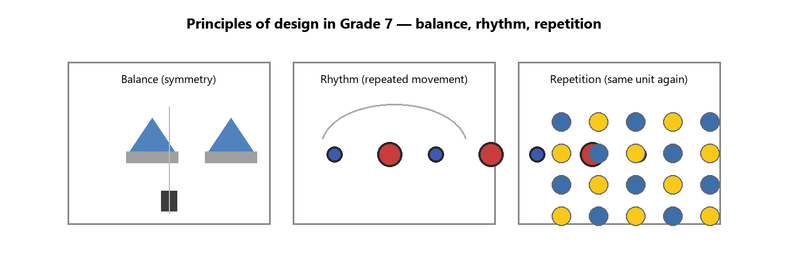

# Lesson 03 — Principles of design — variety and proportion

The Grade 9 pair of principles is **variety** and **proportion**. Variety keeps a design alive by giving it differences to look at, and proportion keeps the design believable by making every part the right size compared with the whole.

**Words to know first:** variety — deliberate differences within a design; proportion — the size of a part compared with the whole; scale — the overall size of the work; monotony — boring sameness; emphasis — making a focal part stand out.

**Theory Questions and Answers**

Q1. What is variety as a principle of design?
Ans. Variety is the use of deliberate differences in size, colour, shape, texture or direction within a design to make it interesting.

Q2. What is proportion as a principle of design?
Ans. Proportion is the comparative size relationship between the parts of a design and the whole.

Q3. What is monotony in a design?
Ans. Monotony is the plain, boring sameness that a design shows when every part is the same.

Q4. Contrast variety and proportion.
Ans.

| Variety | Proportion |
| :--- | :--- |
| Creates differences between parts so the design is lively | Creates correct size relationships between the parts and the whole |

The difference is that variety controls *how different* the parts look, while proportion controls *how much of the whole* each part takes up.

Q5. State three ways of creating variety in a design.
Ans.
- Changing the sizes of similar shapes
- Changing colours or values between areas
- Mixing directions, textures or patterns

Q6. Give one everyday example of good proportion.
Ans. In a well-drawn human figure the head is about one seventh of the whole body, which the eye accepts as correct proportion.

Q7. How can variety go wrong?
Ans. If the differences are too many and too random, the design loses unity and becomes chaos rather than interesting.

Q8. How do unity and variety work together?
Ans. Unity holds all the different parts together as one whole work while variety supplies the interesting differences between them.

Q9. How is proportion applied in a 3-D drawing?
Ans. Every part of the object — for example the lid of a storage box — is drawn at a size that agrees with the rest of the object.

Q10. What is emphasis, and how does it relate to proportion?
Ans. Emphasis is making one part the centre of attention, and a designer can achieve it by making focal part proportionally larger, brighter or more detailed.

Q11. State three principles of design to apply with variety and proportion at Grade 9.
Ans.
- Balance
- Emphasis (dominance)
- Unity

Q12. How does a designer use scale with proportion?
Ans. Scale fixes the overall size of the whole design, and proportion then keeps its parts in correct ratios within that size.

Q13. Give one example of proportion failing in design.
Ans. A door drawn taller than the school building containing it shows wrongly exaggerated proportion.

Q14. Why is variety described as "seasoning" of a design?
Ans. Because just as a small amount of pepper lifts a whole bowl of rice, a controlled amount of difference lifts an otherwise repetitive design.

*Figure: principles of design at work — balance, rhythm, proportion, variety and emphasis in one composition.*

*Notice:* Design is graded across the years — Grade 7: dots, lines, shapes (balance, rhythm, repetition); Grade 8: texture, colour (unity, variety); Grade 9: form, value (variety, proportion). Classic links: the kingfisher's beak inspired the Shinkansen Bullet Train; the anthill inspired the Eastgate Building in Zimbabwe.

### Worked exam exemplars

1. *(bank)* [2 marks]
   Tim decides to design a pattern for his school's Friday wear. Identify the set of principles of design he would use.
   A. Variety, unity and balance        B. Balance, unity and colour        C. Contrast, balance and lines        D. Rhythm, variety and form
   Answer: A [2 marks] — variety, unity and balance are all principles; colour and lines are elements, and form is an element.

2. *(bank)* [2 marks]
   Adjoa wants the school emblem to be the first thing people notice in her poster. The principle of design she should apply is
   Answer: emphasis [2 marks] — emphasis makes the emblem the centre of attention, and its proportion can be enlarged to strengthen it.

3. *(bank, 2024)* [1 mark]
   Which principle of design focuses on the balance of visual weight in a composition?
   Answer: balance [1 mark] — balance distributes the visual weight of elements across the composition.

### Exercises

**Paper 1 — Objective**

1. Tim decides to design a pattern for his school's Friday wear. Identify the set of principles of design he would use.
    A. Variety, unity and balance        B. Balance, unity and colour        C. Contrast, balance and lines        D. Rhythm, variety and form
   Answer: A — variety, unity and balance are principles; colour, lines and form are elements.

2. Adjoa wants the school emblem to be the first thing people notice in her poster. The principle of design she should apply is
    A. proportion.        B. emphasis.        C. rhythm.        D. unity.
   Answer: B — emphasis makes one part stand out first.

3. The principle of design that controls the size relationship between parts and the whole is
    A. variety.        B. proportion.        C. balance.        D. texture.
   Answer: B — proportion compares part sizes with the whole.

4. A design whose every element is identical in size, colour and direction will mostly suffer from
    A. variety.        B. emphasis.        C. monotony.        D. unity.
   Answer: C — total sameness reads as monotony, so variety is needed.

5. Which pair of principles works together so that a design has interesting differences but still looks like one whole work?
    A. Variety and unity        B. Weight and length        C. Colour and texture        D. Dot and line
   Answer: A — unity binds the many differences that variety supplies.

**Paper 2 — Theory**

6. (a) Define variety as a principle of design. (2 marks)
   (b) State three ways of creating variety in a design. (3 marks)
   (c) Give one reason why a designer controls the amount of variety in a work. (2 marks)

Answers
    (a) Variety is the deliberate use of differences among the parts of a design to create interest. (2 marks)
    (b) Change sizes (1), change colours or values (1), change shapes, textures or directions (1). (1 mark each)
    (c) Too much variety destroys unity and confuses the viewer. (2 marks)

7. (a) Define proportion. (2 marks)
   (b) In a drawing of a person, state one correct proportional relationship. (2 marks)
   (c) Explain how proportion and emphasis can be used together on a school notice-board design. (4 marks)

Answers
    (a) Proportion is the size relationship among the parts of a design and the whole. (2 marks)
    (b) The head is about one seventh of the body length (or two hands make about one face width). (2 marks)
    (c) The designer enlarges the headline beyond ordinary proportion so it dominates (2), keeps the remaining text proportionally smaller so the emphasis remains believable (2). (2 marks per good half)

8. (a) What is a principle of design? (2 marks)
   (b) State three principles of design. (3 marks)
   (c) Differentiate between variety and proportion in one sentence each. (3 marks)

Answers
    (a) A principle is a rule for organising the elements of a design. (2 marks)
    (b) Any three of balance, rhythm, repetition, unity, variety, proportion, emphasis. (1 mark each)
    (c) Variety creates deliberate differences within a design; proportion fixes the size of each part relative to the whole. (1 mark per contrast, 1 for clarity)