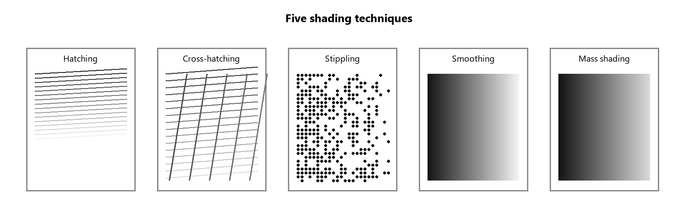

# Lesson 04 — Manual tools, materials and techniques for 3-D drawing, shading and colouring

Grade 9 drawing goes solid: you now draw forms — boxes, bottles, balls — not flat outlines. That calls for the right manual tools, the right shading tones and the right colouring materials, used safely and cared for properly.

**Words to know first:** isometric — a 3-D drawing along angled axes; blending — merging tones smoothly; gradation — stepwise light-to-dark change; medium — the drawing or painting material used; care — keeping tools clean and working well.

**Theory Questions and Answers**

Q1. What is a 3-D drawing?
Ans. A 3-D drawing shows an object with length, breadth and height, so it looks solid on flat paper.

Q2. State three types of 3-D drawing.
Ans.
- Isometric drawing
- Oblique drawing
- Perspective drawing

Q3. State three manual tools used for 3-D drawing.
Ans.
- Pencil (with grades from HB to 6B)
- Ruler, set square and protractor
- Eraser (plus sharpener)

Q4. Which pencil grades belong on a manual drawing table?
Ans.

| Grade | Character | Best use |
| :-- | :-- | :-- |
| H, 2H | Hard, light line | Light construction lines and light values |
| HB | Medium | Outlines and general sketching |
| 2B–6B | Soft, dark line | Dark shading and solid masses |

Q5. State the five common shading techniques.
Ans.
- Hatching
- Cross-hatching
- Stippling
- Smoothing (blending/smudging)
- Mass shading

Q6. What role does shading play in a 3-D drawing?
Ans. Shading supplies the light and dark values that give the drawing depth, volume and a solid appearance.

Q7. Name one technique for a smooth, even tone without visible pencil strokes.
Ans. Smoothing (blending with a finger, tissue or stump) gives an even tone with no visible strokes.

Q8. State four colouring materials for design work.
Ans.
- Colour pencils
- Crayons
- Water colours
- Poster colours (also correct: pastels)

Q9. Give the steps for a shaded 3-D drawing of a cylinder.
Ans. 1. Draw the two ovals at top and bottom and join the sides lightly with an HB pencil.
2. Mark the direction of the light source.
3. Shade the core shade on the side away from the light with a soft pencil.
4. Blend gradually towards the highlight so the tone changes smoothly.
5. Add the cast shadow and fix with a fixing agent if available.

Q10. Why must you erase construction lines before final shading?
Ans. Because faint stray lines show through the shading and spoil the clean solid look.

Q11. State two ways to protect finished shaded drawings.
Ans.
- Fix the drawing with a fixing agent or dust it with a final spray
- Keep drawings flat inside a folder or portfolio away from moisture

Q12. State two safety precautions when using manual drawing materials.
Ans.
- Handle sharp blades and pins with care and cut away from the body
- Read the labels on all pastes and fixatives and work in a ventilated space

Q13. How do you care for shading pencils and blenders?
Ans. Keep pencils sharpened, store them in a pencil case or box, and clean blending stumps by scraping or sanding.

Q14. Which equipment helps an artist achieve accurate proportions when drawing from direct observation?
Ans. The pencil, held at arm's length in a sighting line, is used to measure comparative sizes against the object.

*Figure: from left, hatching, cross-hatching, stippling, smoothing and mass shading.*

*Notice:* The same three design lessons repeat each year, but the work deepens: Grade 7 – freehand/outline drawing, Grade 8 – 2-D drawing, Grade 9 – 3-D drawing.

### Worked exam exemplars

1. *(bank, 2024)* [5 marks + 10 marks]
   (a) In the space provided, draw a football boot and render it solid (three tones) using the hatching technique. | DRAWING SPACE | [5 marks]
   (b) In the spaces provided, draw any two different objects that are cylindrical in shape. Use the smoothing (smudging) technique to shade the drawn object in BOX A and the dot shading technique to shade the other in BOX B. | BOX A (smudging) | BOX B (dot shading) | [10 marks]
   Model answer: (a) The boot is drawn solid with light, middle and dark hatched tones in the correct direction. (3 marks for accurate outline and proportions, 2 marks for three visible hatched tones.) (b) Two cylinders, such as a tin and a cup, are drawn in the boxes; BOX A shows blended, stroke-free tones and BOX B shows even stippled tone. (2 marks per correct cylinder, 2 marks per correct shading technique.)

2. *(bank)* [1 mark]
   Amadu, in an attempt to make his still-life drawing look real, used parallel lines to depict the tones. This suggests that his shading is based on
   A. hatching.        B. stippling.        C. spraying.        D. wax resist.
   Answer: A [1 mark] — parallel lines shaded across an area is hatching.

3. *(bank)* [1 mark]
   Akosua wants to use the mass shading technique to render a two-dimensional drawing solid. Identify the most appropriate type of pencil for the task.
   A. 4H        B. HB        C. 4B        D. A pen
   Answer: C [1 mark] — mass shading needs a soft, dark pencil such as a 4B to build solid tone quickly.

### Exercises

**Paper 1 — Objective**

1. Marmah applied many small dots to build up darker values in her artwork. The shading technique she used was……
    A. smudging.        B. stippling.        C. hatching.        D. cross-hatching.
   Answer: B — dots building darker values = stippling.

2. Which of the following shading techniques produces a smooth, even tone without any visible pencil strokes?
    A. Hatching        B. Stippling        C. Smoothing        D. Cross-hatching
   Answer: C — smoothing blends the graphite so no strokes show.

3. Kojo is shading a drawing of a cylinder and wants to give it a solid form. Which pencil grade would be most suitable for shading the dark areas?
    A. 4H        B. 2H        C. HB        D. 6B
   Answer: D — a soft 6B lays down the darkest value quickly.

4. Which of the following is a type of 3-D drawing?
    A. Isometric        B. Hatching        C. Stippling        D. Marbling
   Answer: A — isometric is a drawing type; the others are surface techniques.

5. Which tool is commonly used to add depth and realism to a 3-D drawing?
    A. Shading pencil        B. Stapler        C. Glue gun        D. Bone folder
   Answer: A — a shading pencil builds the values that give depth and realism.

**Paper 2 — Theory**

6. (a) What is shading? (2 marks)
   (b) State three shading techniques. (3 marks)
   (c) List the three manual drawing tools in the pairs most needed for clean straight outlines. (3 marks)

Answers
    (a) Shading is the application of light, medium and dark values to a drawing. (2 marks)
    (b) Any three of hatching, cross-hatching, stippling, smoothing, mass shading. (1 mark each)
    (c) Ruler, T-square (or set square), protractor with compass. (1 mark each, any three honest instruments)

7. (a) In the space provided, draw any three-dimensional object. (3 marks)
   (b) Render it solid using one shading technique you know. (4 marks)
   (c) State one safety and one care rule for drawing tools used. (2 marks)

Answers
    (a) Accept cube, cylinder, cone or bottle drawn wholly in three dimensions. (3 marks)
    (b) Marks for correct application of the named technique and a believable light and dark arrangement (4 marks — technique 2, tones and light source 2).
    (c) Safety — cut or jab with care; care — store tools clean and sharp in a case. (1 mark each)

8. (a) State two manual colouring materials. (2 marks)
   (b) Name the shading technique each description points to. (3 marks)
        (i) Parallel lines           (ii) Crossed parallel lines           (iii) Dots alone
   (c) Why are soft pencils better for dark values than hard pencils? (3 marks)

Answers
    (a) Any two of colour pencils, crayons, water colours, poster colours, pastels. (1 mark each)
    (b) (i) Hatching (1) (ii) Cross-hatching (1) (iii) Stippling (1)
    (c) Soft pencils contain more graphite pigment and leave heavier, darker deposits than hard grades. (2 marks for reason, 1 mark for mentioning grades)