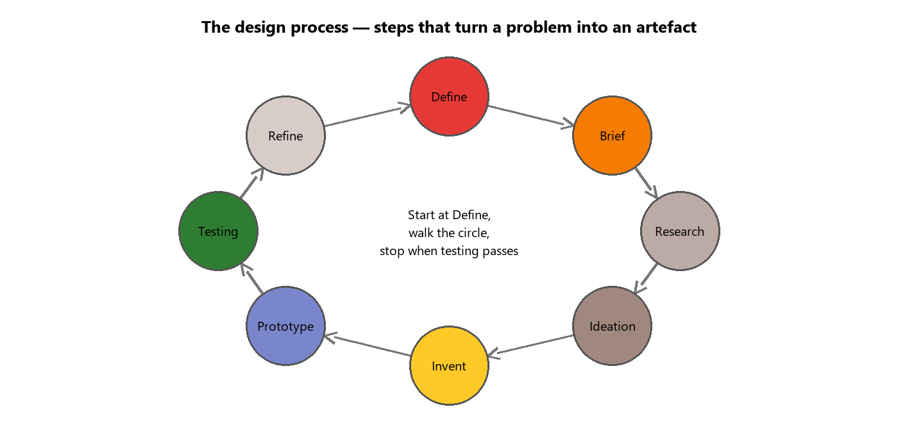

# Lesson 09 — Applying the design process — making prototypes for community problems

The design process becomes real when it is walked for a neighbour: define a problem in your own community, generate ideas, and build a working **prototype** that is tested and refined until it truly helps.

**Words to know first:** community — the people and place you live with; artefact — a made object; assess — to weigh how well something works; feedback — comments from users; workshop — safe space for making.

**Theory Questions and Answers**

Q1. What is a community problem in design terms?
Ans. A community problem is a felt need in the local environment — for example littering, unsafe stairs or noisy, dusty work paths.

Q2. State two problems in the local community that design can solve.
Ans.
- Sanitation problems such as littering and open waste
- Energy wastage in the classroom and on the compound

Q3. Give four steps in applying the design process to a community artefact.
Ans. 1. Define the community problem precisely from observation and complaints.
2. Write the design brief and investigate the users.
3. Ideate: sketch several candidate designs and select one.
4. Make the prototype, test it with real users, and refine it.

Q4. Give two artworks a class could produce to keep the school compound and classrooms clean.
Ans.
- Posters and murals with clean-compound messages
- Model waste bins and sculptures made from cleaned discarded bottles and cans

Q5. Why must a community prototype be tested with its real users?
Ans. Because the users reveal whether the artefact truly fits their situation — its size, materials and habits — before it is finalised.

Q6. What makes a design solution acceptable to a community?
Ans. It solves the felt problem, uses available materials, is affordable, and was refined through user feedback.

Q7. Name the three design processes that come immediately after prototyping, in order.
Ans. Testing, evaluation, refining.

Q8. What is a prototype used for before mass production of a community product?
Ans. The prototype is used to find faults and take user feedback cheaply before the final version is produced.

Q9. How does the design process aid in creating artefacts to solve local community problems?
Ans. By marching step by step from defining the problem through testing and refining, it guarantees the artefact actually fits the community's need.

Q10. State two safety precautions during production of a community artefact.
Ans.
- Work in a well-ventilated area when using glues, paints or solvents
- Handle knives, blades and hot tools with care and keep first aid near

Q11. Why do designers consider cost when designing for a community?
Ans. Because an expensive artefact will not be adopted; the community must afford and maintain what is offered.

Q12. Give one example of a local design worth examining and the problem it solves.
Ans. The farming cutlass solves bush-clearing problems for the community farmer.

Q13. Why must a school-team artefact for a community also be labelled?
Ans. The label states the name of the work, the team and the problem it solves, so viewers can appraise it fairly.

Q14. What record should a design team keep after refining a product?
Ans. The team should keep photographs, user feedback and the final drawings in their design folder.

*Figure: the same design process — define, brief, investigate, ideate, invent, prototype, test, refine — applied to a community artefact.*

*Notice:* The creativity, innovation and design-process lessons revisit each year; Grade 9 focuses on energy conservation and energy efficiency, and on examining local designs: the cutlass in farming, kitchen stool, farming basket.

### Worked exam exemplars

1. *(bank)* [15 marks]
   A Creative Art and Design teacher assigned the class to produce artworks intended to educate learners on keeping the school compound and the classrooms neat. As a Creative Art and Design learner:
   (a) Give two artworks that you would produce to solve the problem. (2 marks)
   (b) State the appropriate technique that you would use to produce each artwork in (a) above. (2 marks)
   (c) In an orderly manner, state the first four design processes that you would use in designing the artworks. (4 marks)
   (d) Balance is one of the key principles of design that could be used in the production of the artworks in (a). Identify any two types of balance and explain only one of them. (4 marks)
   (e) Enumerate two precautions that should be observed during the production of the artworks in (a) above. (3 marks)
   Model answer: (a) Posters or murals carrying neat-compound messages; model bins or sculptures from cleaned discarded bottles and cans. (1 mark each) (b) Painting/printing for the posters; assembly (or papier-mâché modelling) for the bins and sculptures. (1 mark each pairing) (c) Define the problem; write the design brief; investigate; ideate. (1 mark each, in order) (d) Types: symmetrical and asymmetrical balance; symmetrical balance places identical objects at equal distances about a central line, appearing calm and formal. (1 + 1 for types; 2 for explanation) (e) Read labels before using art materials; work in a ventilated area; wear gloves with sharp or chemical-bearing materials; collect and safely dispose of waste. (1 or 2 marks per sensible precaution)

2. *(bank)* [4 marks]
   Your school has been selected to represent the district in a creativity and innovation exhibition. As a member of the school team, you are required to develop a new product from discarded plastic bottles for the exhibition. As a Creative Arts and Design learner:
   (a)(i) In an orderly manner, list the first four steps in idea development. [4 marks]
   Model answer: 1. Investigate the problem and the users. 2. Write the specification: size, materials, resources. 3. Generate design ideas as sketches. 4. Select the most workable idea. (1 mark each, in order)

### Exercises

**Paper 1 — Objective**

1. How does the design process aid in creating artefacts to solve local community problems?
    A. By moving step by step from defining the problem to testing and refining a product that meets the need
    B. By guessing the community's desire and producing quickly
    C. By copying any product on the market
    D. By skipping testing to save time
   Answer: A — the ordered process ensures the artefact truly fits the community's need.

2. Select the technique that involves shaping materials into three-dimensional forms.
    A. Carving        B. Modelling        C. Spraying        D. Mounting
   Answer: B — modelling shapes soft materials into solid 3-D forms, such as a prototype bin.

3. Which community artefact should a class prototype FIRST for testing with real users?
    A. The refined final product        B. A cheap trial sample        C. A poster of the advertisement        D. The certificate of completion
   Answer: B — a prototype is the cheap sample for testing.

4. What should a design team do immediately after testing reveals a fault in the artefact?
    A. Refine the design before final production
    B. Sell the faulty units quickly
    C. Hide the fault from users
    D. Scrap the project entirely
   Answer: A — faults exposed by testing are corrected through refinement.

5. Which of the following reports the cleanliness art education to the community best?
    A. A class poster displayed at the market square
    B. A poster locked in a teacher's drawer
    C. A poster drawn and immediately torn
    D. A poster with no message at all
   Answer: A — publicity through display lets the message reach the community for whom it was designed.

**Paper 2 — Theory**

6. Your school has been selected to represent the district in a creativity and innovation exhibition. As a member of the school team, you are required to develop a new product from discarded plastic bottles for the exhibition. As a Creative Arts and Design learner:
   (a) In an orderly manner, list the first four steps in idea development. (4 marks)
   (b) State two reasons for developing ideas before the production of the product. (2 marks)
   (c) Identify four elements of design you would apply in the production of the product. (4 marks)

Answers
    (a) Investigate the problem and users (1); write the specification (1); generate ideas as sketches (1); select the best idea (1).
    (b) Faults would be found early and cheaply (1); the best idea would be selected from alternatives (1).
    (c) Any four of line, shape, form, value, texture, colour. (1 mark each)

7. (a) Define a prototype. (2 marks)
   (b) State two features that make a community prototype acceptable. (2 marks)
   (c) Your team is making a prototype litter bin from discarded bottles. Describe the steps from defining the problem to refining the final prototype. (5 marks)

Answers
    (a) A prototype is the first working sample made to test the design. (2 marks)
    (b) It solves the felt problem; it uses available, affordable materials. (1 mark each or any two sensible features)
    (c) Define the littering problem (1); investigate users and sites (1); ideate and select a bottle-bin design (1); prototype and test with real users (1); refine size, opening and finish (1).

8. (a) State two pieces of feedback that a community user could give about a prototype broom. (2 marks)
   (b) Name the design stage that gives the user that feedback. (2 marks)
   (c) Explain two ways a class can show the refined artefact to the community for further feedback. (3 marks)

Answers
    (a) The broom is too heavy; the bristles fall out — any two sensible feedback points. (1 mark each)
    (b) The test (testing/evaluation) stage. (2 marks)
    (c) Exhibit the artefact at a class or school display and invite comments (2); hand the prototype to a user for daily use and collect written views (1).