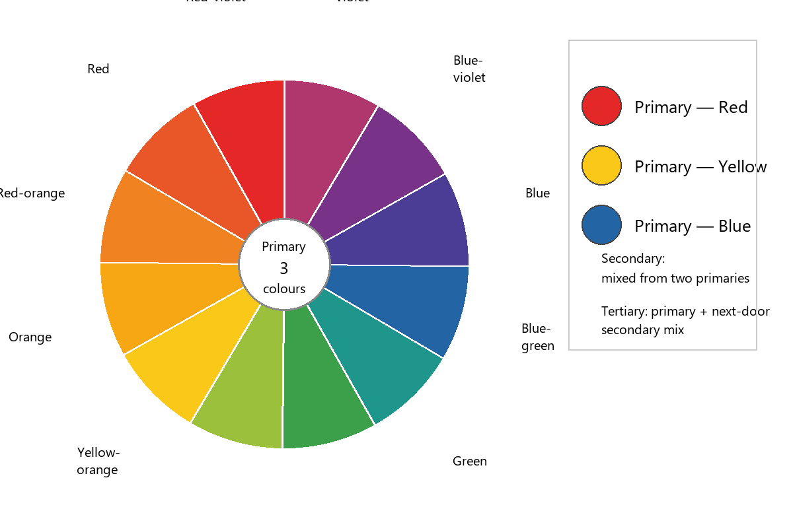

# Lesson 14 — Design and produce artworks from the philosophies of different times and cultures

Every artwork carries a way of thinking — a **philosophy** — from its time and culture. A Grade 9 artist studies those ideas, borrows their signs and processes, and produces own works that speak with that depth.

**Words to know first:** philosophy — a way of thinking that guides a people; culture — the total way of life of a people; motif — a repeated design sign; hierarchy — ranking by importance; topical — about current affairs.

**Theory Questions and Answers**

Q1. What is a philosophy in art?
Ans. A philosophy is a people's way of thinking — about life, God, nature or society — that guides what their artworks express.

Q2. What is culture as used in design?
Ans. Culture is the total way of life of a people — beliefs, festivals, dress, food and arts — that artworks can reflect.

Q3. How do philosophies of different times and cultures show in artworks?
Ans. They show through themes, symbols, motifs, materials and processes that the artist chooses.

Q4. Contrast an artwork built on traditional Ghanaian philosophy and one built on a topical issue.
Ans.

| Traditional philosophical artwork | Topical-issue artwork |
| :--- | :--- |
| Carries timeless cultural ideas, such as Sankofa ("go back and pick it") | Carries an urgent present concern, such as sanitation or energy waste |

The difference is that the first expresses enduring cultural wisdom while the second responds to a current problem.

Q5. Name one design feature of ancient Egyptian artworks.
Ans. Egyptian artworks show figures in strict profile with symbolic colours and written hieroglyphic signs.

Q6. Name one design feature of traditional Akan visual art.
Ans. Akan art such as adinkra uses repeated symbolic motifs to express proverbs and values.

Q7. Name one design feature of Islamic visual design.
Ans. Islamic design uses repeating geometric patterns and calligraphy rather than figures.

Q8. Name one design feature of Renaissance European art.
Ans. Renaissance artworks used realism and the rules of perspective to depict space.

Q9. Give the steps for designing and producing artwork from a chosen philosophy.
Ans. 1. Study the philosophy, its symbols and its message.
2. Define your own message from the chosen philosophy and write the brief.
3. Generate ideas sketching motifs, materials and processes.
4. Select an idea and plan the elements, principles and colour scheme.
5. Produce the prototype or final piece.
6. Appraise it against the philosophy and refine it.

Q10. How is colour scheme chosen when appraising a philosophical artwork?
Ans. The colour wheel is studied — primary, secondary and cool/warm relationships — so the chosen scheme supports the mood and message.

Q11. Which of the following sets of materials suits sculpture production?
Ans. Metal, wood and clay — the classic sculptor's set of materials.

Q12. What is a motif?
Ans. A motif is a design sign — for example an adinkra symbol — repeated to build a pattern.

Q13. How can a learner produce own artwork reflecting European Renaissance practices?
Ans. The learner can draw a realistic still life using perspective and careful tonal shading, in the manner of the time.

Q14. Why study philosophies of other times and cultures?
Ans. Because understanding their ideas enriches the learner's own message, widens design vocabulary and deepens appreciation of African philosophies.

*Figure: the six-point colour wheel — three primary and three secondary colours — used when appraising colour schemes.*

*Notice:* No plan notice line appears for this sub-strand; Grade 9 brief is to design and produce artworks from the philosophies, designs and processes of different times and cultures.

### Worked exam exemplars

1. *(bank)* [12 marks + 3 marks]
   (a) In the space provided, draw the six point colour wheel. (i) Use the hatching technique to shade the secondary colours. (ii) Use the stippling technique to shade the primary colours. [12 marks]
   (b) List cool colours found on the colour wheel drawn in (a). [3 marks]
   Model answer: (a) The wheel shows three primaries (red, yellow, blue) and three secondaries (orange, green, violet) arranged in correct circular order (marks: wheel 3, correct colours and positions 6, secondary hatching 2, primary stippling 1). (b) Blue, green and violet — any three among blue, green, violet/purple (1 mark each).

2. *(bank)* [1 mark]
   In producing sculpture, the artist uses which of the following set of materials?
   A. Fabric, acrylic and clay        B. Metal, wood and clay        C. Metal, fabric and charcoal        D. Wood, charcoal and clay
   Answer: B [1 mark] — metal, wood and clay form the sculptor's working set; charcoal belongs to drawing.

3. *(bank)* [3 marks]
   Explain briefly how texture and colour interact in an Akan adinkra-inspired artwork.
   Model answer: The adinkra motifs carry the philosophical meaning; the stamped texture raises the cloth's surface (1) while the chosen colour scheme states the mood of the proverb (1) so that both visual and tactile qualities translate the message (1).

### Exercises

**Paper 1 — Objective**

1. In producing sculpture, the artist uses which of the following set of materials?
    A. Fabric, acrylic and clay        B. Metal, wood and clay        C. Metal, fabric and charcoal        D. Wood, charcoal and clay
   Answer: B — metal, wood and clay are sculpture materials; charcoal is a drawing material.

2. Which term describes a way of thinking that guides a people's artwork message?
    A. Philosophy        B. Resolution        C. Portfolio        D. Gradation
   Answer: A — philosophy is the guiding way of thought.

3. The repeated symbolic signs used in adinkra cloth are examples of
    A. motifs.        B. pencils.        C. crucibles.        D. wedges.
   Answer: A — an adinkra symbol is a motif repeated to pattern the cloth.

4. On the six-point colour wheel, the three primary colours are
    A. red, yellow, blue.        B. orange, green, violet.        C. pink, brown, grey.        D. blue, orange, red.
   Answer: A — red, yellow and blue cannot be mixed from others; the second set is secondary.

5. An artwork carrying a message about sanitation is built on
    A. foreign currency.        B. a topical issue.        C. a colour wheel.        D. a portfolio.
   Answer: B — topical issues are current community concerns.

**Paper 2 — Theory**

6. (a) In the space provided, draw the six point colour wheel. (i) Use the hatching technique to shade the secondary colours. (ii) Use the stippling technique to shade the primary colours. (12 marks)
   (b) List cool colours found on the colour wheel drawn in (a). (3 marks)

Answers
    (a) Wheel and order (3); three primaries correctly placed (3); three secondaries correctly placed (3); hatching on the secondaries (2); stippling on the primaries (1).
    (b) Blue, green, violet/purple. (1 mark each)

7. (a) What is a philosophy in art? (2 marks)
   (b) Name one design feature each of traditional Akan art and of Egyptian art. (4 marks)
   (c) State four steps for producing artwork from a chosen philosophy. (4 marks)

Answers
    (a) A philosophy is a people's way of thinking that guides what their artworks express. (2 marks)
    (b) Akan — repeated adinkra motifs expressing proverbs (2); Egyptian — strict profile figures and hieroglyphic signs (2).
    (c) Study the philosophy and symbols (1); define your message and brief (1); ideate with sketches (1); produce and appraise the work (1).

8. (a) Contrast a traditional philosophical artwork and a topical-issue artwork. (4 marks)
   (b) Give one example of a motif from Ghanaian culture. (3 marks)
   (c) Why do artists appraise a finished work against the philosophy that inspired it? (3 marks)

Answers
    (a) The traditional work carries timeless cultural ideas such as Sankofa (2); the topical work responds to an urgent present concern such as sanitation (2).
    (b) Any genuine motif — for example Sankofa or Gye Nyame from adinkra. (3 marks — name 2, meaning 1)
    (c) To confirm the motifs, materials and colour scheme truly express the philosophy's message. (2 marks for the rule, 1 for a stated check)