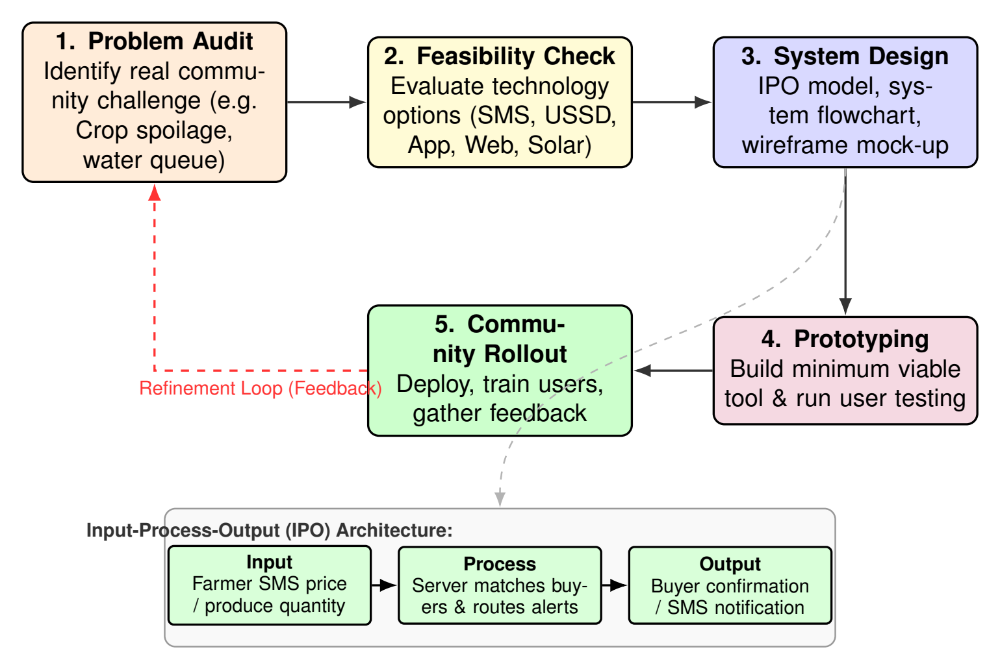
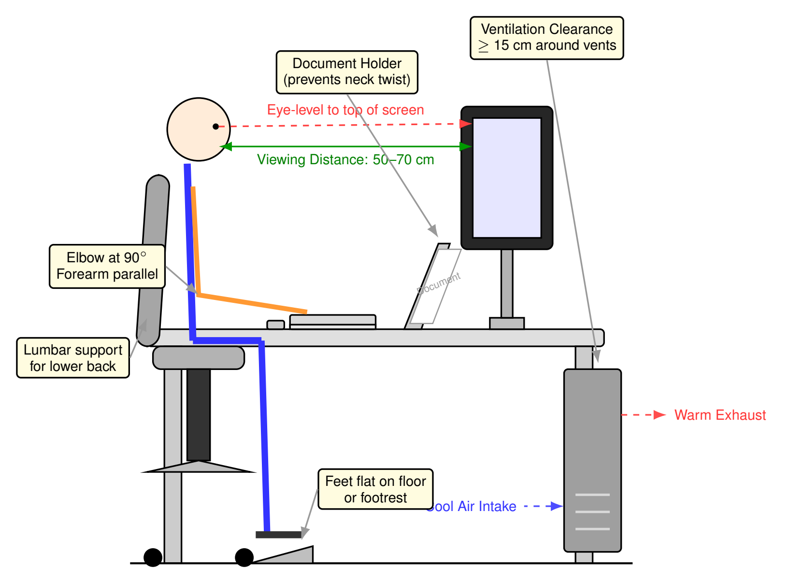

# Lesson 05 — Community Problem Solving & Workstation Health Compliance Auditing

**Strand 1 — Introduction to Computing · Sub-strand 2 — Technology in the Community · Sub-strand 3 — Health and Safety in the Use of ICT Tools**  
**Indicators:** B9.1.2.1.1 (evaluating community problems) · B9.1.2.1.2 (proposing technological solutions) · B9.1.2.1.3 (designing the selected solution project) · B9.1.3.1.1 (evaluating workstation health issues) · B9.1.3.1.2 (evaluating safety and thermal risk reduction)  
**Source coverage:** NaCCA Common Core Programme (CCP) Curriculum · BECE Past Examinations (2014–2024) · WAEC Chief Examiners' Reports.

---

## Preamble (why this lesson, in everyday words)

Computers are not meant to stay locked inside air-conditioned rooms just for typing letters. The real power of computing is felt when it steps outside into the community to solve painful, everyday human problems. In many Ghanaian towns and farming villages, farmers lose baskets of fresh tomatoes because they cannot find buyers before the crop rots. Market women lose money because sales are recorded in damp paper notebooks that get torn or misplaced. In clinics, patients queue for hours because folders cannot be traced quickly. In this lesson, we learn how to investigate real community problems, evaluate feasible technology tools (like SMS alerts, mobile apps, or USSD menus), and design an end-to-end working solution.

At the same time, we must protect the human being operating the technology. Sitting at a poorly arranged computer workstation for five or six hours a day strains the neck, ruins the lower back, inflames the wrist tendons, and exhausts the eyes. Furthermore, electronic machines generate intense heat; when several computers, power supplies, and laser printers run in a cramped room with poor ventilation, the heat can cause machine failure or even electrical fire. Here, we learn how to audit a workstation, set up ergonomic aids (like document holders and split keyboards), control room lighting, and manage thermal ventilation so that working with technology remains safe, healthy, and productive.

---

## Words to know first

| Word | Simple meaning |
|---|---|
| Community problem | A difficulty or challenge shared by many people in a town, village, school, or market. |
| Feasibility | How possible, affordable, and practical a project is to carry out with available resources. |
| Prototype | A simple preliminary model or draft of a system built to test how it works before full rollout. |
| Input-Process-Output (IPO) | A model describing how data enters a system, is transformed, and produces a useful result. |
| Ergonomics | The scientific study of designing equipment and workplaces to fit the natural shape and movements of the human body. |
| Ergonomic keyboard | A keyboard split or curved into two halves to keep the typist's hands and wrists in a relaxed, straight line. |
| Document holder (paper stand) | An upright stand placed beside the monitor to hold reading sheets at eye level, preventing neck twist. |
| Computer Vision Syndrome (CVS) | A collection of eye problems (dryness, blurred vision, strain, headache) caused by prolonged screen glare. |
| Repetitive Strain Injury (RSI) | Pain and inflammation in muscles, nerves, and tendons caused by repeated movements like typing or clicking. |
| Thermal management | Methods used to remove excess heat generated by computer processors, power supplies, and printers. |
| Heat sink | A block of metal with fins (usually aluminium or copper) that draws heat away from a hot processor. |
| Glare | Harsh, dazzling light reflecting off a display screen that makes it difficult to read text. |
| Workstation audit | A systematic physical inspection of a desk, chair, screen, cables, and room to check safety and health compliance. |

> Memory hook: **Ergonomics = fitting the job to the person, not forcing the person to fit the job.**

---

## Section 1: Evaluating Community Problems (Theory Q&A)

**Q1. What is a community problem in computing terms?**  
Ans. A community problem is an everyday challenge faced by people in a locality that involves slow communication, lost information, or inefficient manual effort that technology can help solve.

**Q2. Mention four common problems in Ghanaian communities that can be tackled using technology.**  
Ans.  
- High post-harvest losses among crop farmers due to lack of real-time market price information and buyer contacts.  
- Long queues and delays in community health clinics caused by searching for misplaced paper medical folders.  
- Overflowing municipal rubbish skips due to irregular and unmonitored waste collection schedules.  
- Difficulty tracking school fee payments and student daily attendance in rural schools.

**Q3. State three signs that indicate a community problem can be solved effectively using digital technology.**  
Ans.  
- The current manual method is repetitive, slow, and prone to human calculation errors.  
- Important records are frequently damaged, lost, or difficult to retrieve quickly.  
- People must travel long physical distances simply to deliver short messages or check prices.

**Q4. Why must learners work in pairs or groups when identifying community problems?**  
Ans. Working in teams combines different viewpoints, enables deeper community interviews, and ensures the problem is understood from multiple angles before solutions are attempted.

---

## Section 2: Proposing and Designing Technological Solutions (Theory Q&A)

**Q5. Mention four technology tools or platforms that can be proposed to solve community challenges.**  
Ans.  
- Unstructured Supplementary Service Data (USSD) menus (e.g. `*920#`) accessible on basic mobile phones without the internet.  
- Short Message Service (SMS) broadcast alerts for community announcements and farm weather forecasts.  
- Mobile applications with digital payment integration (such as Mobile Money) for local market trade.  
- Low-cost Internet of Things (IoT) sensors for monitoring borehole water levels or detecting full waste bins.

**Q6. What factors must be evaluated before choosing a technology solution for a rural community?**  
Ans. (Any three) Availability and stability of electrical power; mobile network signal coverage; cost of user devices; digital literacy level of the local community members; and maintenance requirements.

**Q7. What is an Input-Process-Output (IPO) model?**  
Ans. The IPO model is a system design framework that identifies what data enters the system (Input), what calculations or actions the computer performs (Process), and what result or action is delivered (Output).

**Q8. Illustrate the IPO model for a community farm produce pricing alert system.**  
Ans.  
- **Input:** Farmer sends an SMS with crop type and quantity (e.g. "Tomatoes 10 crates").  
- **Process:** The server searches current market prices, matches nearby registered buyers, and logs the offer into the database.  
- **Output:** Farmer receives an SMS confirmation with the recommended selling price and buyer telephone numbers.

```
+-------------------------------------------------------------------------------+
|                       THE 5-STAGE COMMUNITY SOLUTION CYCLE                    |
+-------------------------------------------------------------------------------+
| 1. Problem Audit    -> Identify real local challenge (e.g. crop spoilage).     |
| 2. Feasibility      -> Check electricity, network signal, and user literacy.  |
| 3. System Design    -> Draft the Input-Process-Output (IPO) flow & wireframes. |
| 4. Prototyping      -> Build a sample tool (paper draft or simple script).    |
| 5. Community Rollout-> Test with local users, gather feedback, and refine.    |
+-------------------------------------------------------------------------------+
```



**Q9. What is a wireframe or mock-up in system design?**  
Ans. A wireframe is a simple visual sketch or outline of a computer screen or mobile application that shows where buttons, menus, and text will appear before actual programming begins.

---

## Section 3: Workstation Health Compliance and Ergonomics (Theory Q&A)

**Q10. What is computer workstation ergonomics?**  
Ans. Computer workstation ergonomics is the science of arranging desks, chairs, monitors, keyboards, and room lighting to keep the user comfortable and free from physical strain or injury.

**Q11. What is an ergonomic keyboard, and how does it protect the user?**  
Ans. An ergonomic keyboard is a keyboard split into two angled halves with a cushioned wrist pad, designed to keep the hands, wrists, and forearms in a natural straight line to prevent tendon inflammation and Carpal Tunnel Syndrome.

**Q12. What is a document holder (paper stand), and why is it important at a workstation?**  
Ans. A document holder is an upright stand that holds paper sheets at the same height and distance as the computer monitor, preventing the operator from constantly twisting and bending their neck while typing.

**Q13. How should a computer monitor be positioned relative to the user's eyes?**  
Ans. The monitor should be placed directly in front of the user at an arm's length distance (50 to 70 centimetres), with the top edge of the screen at or slightly below eye level.



**Q14. State three health hazards caused by improper workstation arrangements.**  
Ans.  
- **Repetitive Strain Injury (RSI):** Chronic stiffness and pain in the wrists, fingers, and elbows.  
- **Postural Back and Neck Strain:** Chronic aches in the cervical spine and lumbar lower back caused by slouching.  
- **Computer Vision Syndrome (CVS):** Burning eyes, dry cornea, headaches, and blurred vision caused by screen glare.

**Q15. Explain the "20-20-20 rule" in computer eye safety.**  
Ans. The 20-20-20 rule states that every 20 minutes of screen time, the user must look away at an object at least 20 feet (6 metres) away for at least 20 seconds to relax the eye focusing muscles.

**Q16. Describe the appropriate room lighting system for a computer laboratory.**  
Ans. The room should use indirect, diffused ambient lighting (about 300 to 500 lux) with window blinds to eliminate harsh reflections and direct sunlight from bouncing off computer screens.

---

## Section 4: Workstation Thermal Management and Safety Audits (Theory Q&A)

**Q17. Why do computers, power supplies, and printers generate heat during operation?**  
Ans. Electronic components consume electrical energy, and due to internal electrical resistance, a portion of that energy is unavoidably converted into thermal heat.

**Q18. Mention three dangers of excessive heat buildup inside a computer system.**  
Ans.  
- The central processing unit (CPU) throttles down its operating speed, causing extreme system slowdowns.  
- High temperatures cause unexpected automatic shutdowns, system crashes, and corrupted data files.  
- Prolonged heat dries out capacitors, warps motherboards, and creates fire hazards in enclosed computer rooms.

**Q19. Mention three components or methods used to reduce excess heat in computer workstations.**  
Ans.  
- **Heat Sinks and Cooling Fans:** Metal cooling fins and spinning fans mounted directly on hot processors to blow warm air out of the case.  
- **Adequate Ventilation Clearance:** Keeping at least 15 centimetres of open space around all computer air intake and exhaust vents.  
- **Laboratory Air Conditioning and Dust Removal:** Using air conditioners to lower room temperature and regularly blowing dust out of computer casings.

**Q20. What is a workstation compliance audit?**  
Ans. A workstation compliance audit is an organized physical inspection of a computer setup using a checklist to verify that furniture, lighting, cables, and ventilation meet health and safety standards.

---

## Contrast and Comparison Tables

### Table 1: Manual Community System vs Digital System

| Feature | Manual Community System | Digital / Technological System |
|---|---|---|
| **Speed of Communication** | Slow; requires physical travel or paper notes | Instant; transmitted across mobile networks in seconds |
| **Record Durability** | Poor; paper books get wet, torn, or burnt | High; data saved securely on memory or cloud servers |
| **Search & Retrieval** | Tedious; flipping through large paper registers | Instant; automated keyword or ID search |
| **Cost over Time** | High ongoing travel, stationery, and labour costs | Low recurring cost once infrastructure is deployed |
| **Dependency** | Relies entirely on human memory and presence | Can send automated SMS alerts 24 hours a day |

### Table 2: Standard Keyboard vs Ergonomic Split Keyboard

| Feature | Standard Rectangular Keyboard | Ergonomic Split Keyboard |
|---|---|---|
| **Key Layout** | Straight horizontal rows of keys | Keys split into two angled halves |
| **Wrist Posture** | Wrists forced outward (ulnar deviation) | Wrists remain straight in a neutral handshake posture |
| **Palm Support** | Rarely has built-in wrist rest | Includes cushioned palm and wrist rest |
| **Injury Risk** | High risk of Carpal Tunnel Syndrome and RSI | Significantly lowers muscle fatigue and tendon strain |

### Table 3: Natural Airflow Cooling vs Active Cooling Systems

| Feature | Natural Airflow Cooling | Active Cooling Systems |
|---|---|---|
| **Mechanism** | Uses open room ventilation and convection currents | Uses powered fans, heat sinks, and air conditioners |
| **Power Consumption** | Zero additional electrical power | Consumes electricity to drive electric motors and compressors |
| **Cooling Efficiency** | Limited; insufficient for high-density computer labs | High; rapidly drops processor temperatures under heavy load |
| **Maintenance** | Keeping vents clear and unobstructed | Requires regular dust cleaning, fan lubrication, and servicing |

---

## Procedural Step-by-Step Guides

### Procedure A: How to Conduct a Community Technology Needs Assessment
1. **Identify the Locality and Stakeholders:** Select the target group (e.g. vegetable market traders, clinic staff, or student body).  
2. **Interview and Observe:** Spend time observing their daily routine and record where delays, money loss, or manual fatigue happen.  
3. **Formulate the Core Problem Statement:** Summarise the challenge in one clear sentence (e.g. "Traders lose fresh tomatoes because buyers do not know stock is available").  
4. **Evaluate Constraints:** Check mobile network signal strength, smartphone availability, literacy, and ability to pay.  
5. **Select the Delivery Channel:** Choose the simplest workable platform (e.g. USSD/SMS over a native Android app if basic feature phones predominate).

### Procedure B: How to Perform a Physical Workstation Health & Safety Audit
1. **Check Chair and Desk Height:** Ensure the user's feet sit flat on the floor and elbows rest at a 90-degree angle level with the desk.  
2. **Inspect Monitor Alignment:** Verify the screen is 50–70 cm away with the top line of text at eye level.  
3. **Check Document Placement:** Confirm a document holder is positioned right next to the monitor screen.  
4. **Measure Room Illumination:** Inspect for direct window glare or blinding overhead fluorescent lights reflecting on the glass screen.  
5. **Examine Casing Clearance & Thermal Airflow:** Verify that nothing blocks the air intake vents at the front and exhaust vents at the back ($\ge 15$ cm clearance).  
6. **Inspect Electrical Cables:** Ensure power cables are neatly trunked, not stretched across walkways, and plugged into a surge-protected UPS.

---

## Syllabus Acronyms Table

| Acronym | Complete Meaning | Context in Computing |
|---|---|---|
| **IPO** | Input, Process, Output | Fundamental data processing cycle of computer systems |
| **UI** | User Interface | The visual screens, buttons, and icons that a human interacts with |
| **UX** | User Experience | How easy, pleasant, and efficient a user finds a software tool |
| **USSD** | Unstructured Supplementary Service Data | GSM technology used for text menus (e.g. `*170#`) on any phone |
| **SMS** | Short Message Service | Text messaging protocol over cellular telephone networks |
| **IoT** | Internet of Things | Physical objects embedded with sensors and connected to the internet |
| **RSI** | Repetitive Strain Injury | Nerve and tendon damage from continuous repeated motions |
| **CVS** | Computer Vision Syndrome | Eye strain, irritation, and headache caused by prolonged screen viewing |
| **UPS** | Uninterruptible Power Supply | Battery backup device providing clean power during outages |
| **PSU** | Power Supply Unit | Internal hardware box converting mains AC voltage to DC voltage |
| **CPU** | Central Processing Unit | Primary electronic chip executing instructions and generating heat |
| **HVAC** | Heating, Ventilation, and Air Conditioning | Climate control system used to cool high-density server/computer rooms |

---

## Worked BECE Examination Exemplars

### Exemplar 1 (Community Problem-Solving Design)
**Question:**  
A farming community in the Afram Plains produces abundant watermelons each season. However, due to poor road networks and delayed communication, middle-men arrive late, resulting in over 40% of the harvest rotting on the farm.  
(a) Propose one technological solution that can assist the watermelon farmers. `[1 mark]`  
(b) Outline the Input, Process, and Output (IPO) cycle for your proposed solution. `[3 marks]`  
(c) State two practical constraints that must be considered before deploying this system in the village. `[2 marks]`

**Marking Scheme & Model Answer:**  
(a) An automated SMS/USSD crop notification broadcast system connecting farmers directly to wholesale fruit buyers in urban centres. `[1 mark]`  
(b)  
- **Input:** Farmer dials a USSD code and enters watermelon quantity and farm location. `[1 mark]`  
- **Process:** The central database matches available quantities with registered wholesale fruit buyers and prepares automated dispatch alerts. `[1 mark]`  
- **Output:** Wholesale buyers receive instant SMS alerts with contact numbers, and the farmer receives an SMS confirming the scheduled pickup date. `[1 mark]`  
(c) (Any two) Reliability of cellular network signal coverage in the farming area; availability of solar charging or electrical power for phones; and basic literacy levels of the farmers. `[2 marks]`

---

### Exemplar 2 (Workstation Ergonomics & Health Hazards)
**Question:**  
Mr. Mensah is a school data entry clerk who types exam results on his desktop computer for seven continuous hours each day. Recently, he has been complaining of sharp burning pains in his right wrist and severe neck stiffness.  
(a) Name the specific physical condition likely affecting Mr. Mensah's wrist. `[1 mark]`  
(b) Explain the primary cause of his neck stiffness. `[1 mark]`  
(c) Suggest three specific ergonomic modifications Mr. Mensah must make to his workstation to eliminate these pains. `[3 marks]`

**Marking Scheme & Model Answer:**  
(a) Repetitive Strain Injury (RSI) / Carpal Tunnel Syndrome. `[1 mark]`  
(b) Slouching or continuously bending the neck downward to read mark sheets resting flat on the table surface. `[1 mark]`  
(c)  
- Install an upright document holder (paper stand) adjacent to the screen at eye level. `[1 mark]`  
- Replace the standard keyboard with an ergonomic split keyboard equipped with a padded wrist rest. `[1 mark]`  
- Adjust the desk and chair height so his elbows rest at a 90-degree angle with forearms parallel to the floor. `[1 mark]`

---

### Exemplar 3 (Thermal Safety & Equipment Maintenance)
**Question:**  
During a computer practical session in a newly built ICT laboratory, three computers suddenly shut down while students were typing. Upon inspection, the computer casings felt unusually hot to the touch.  
(a) State two reasons why the computers overheated. `[2 marks]`  
(b) Mention two long-term consequences of operating computer equipment in an overheated environment. `[2 marks]`  
(c) State two preventative measures the school must adopt to maintain a safe operating temperature in the laboratory. `[2 marks]`

**Marking Scheme & Model Answer:**  
(a) (Any two) Inadequate ventilation clearance around the computer casings (pushed tight against walls); cooling fans clogged with dust; or high ambient room temperature with poor ventilation. `[2 marks]`  
(b) (Any two) Premature degradation and damage to delicate internal motherboard circuits; frequent thermal shutdowns resulting in permanent data corruption; and fire risk from overheated power supply units. `[2 marks]`  
(c) (Any two) Maintain at least 15 cm of open space around all computer exhaust vents; install laboratory air conditioning or oscillating extractor fans; and service casings every term using an air blower to remove internal dust. `[2 marks]`

---

<!-- pagebreak -->

# BECE-Shaped Exercise Battery

## Section A: Paper 1 — Objective Test (10 Questions)

*Answer all questions by selecting the correct option (A–D).*

1. Which of the following is the primary objective of community technology problem-solving?  
   A. To replace all human workers with automated robots  
   B. To address real local challenges using practical digital tools  
   C. To force rural communities to buy high-end computers  
   D. To ensure everyone learns computer programming syntax  

2. The scientific study of designing equipment and workplace environments to prevent human injury and fatigue is known as  
   A. Computer ergonomics  
   B. Computer cybernetics  
   C. Artificial intelligence  
   D. Perceptual computing  

3. An upright accessory used at a computer workstation to hold paper sheets at monitor eye level is called a  
   A. Document holder  
   B. Graphics digitiser  
   C. Flatbed scanner  
   D. Keyboard bridge  

4. In the Input-Process-Output (IPO) model of a community clinic queue management system, patient registration details represent the  
   A. Storage  
   B. Process  
   C. Input  
   D. Output  

5. A databank entry clerk experiences stinging eyes and persistent headaches after looking at a bright computer screen for six hours. This condition is termed  
   A. Repetitive Strain Injury  
   B. Computer Vision Syndrome  
   C. Carpal Tunnel Syndrome  
   D. System Thermal Throttling  

6. To prevent severe neck strain while typing documents from printed drafts, the monitor should be positioned so that the  
   A. Screen touches the desk surface directly  
   B. User looks upward at a 45-degree angle  
   C. Top edge of the screen is at or slightly below eye level  
   D. Display is placed exactly 10 centimetres from the face  

7. What is the main purpose of maintaining at least 15 centimetres of open space around a computer system unit?  
   A. To make it easy to wipe dust off the table  
   B. To allow free airflow and heat dissipation from cooling vents  
   C. To prevent power cables from touching the wall  
   D. To make the computer laboratory look spacious  

8. Which of the following practices effectively eliminates screen glare in an ICT laboratory?  
   A. Placing the monitor directly facing an unshaded open window  
   B. Turning off all computer cooling fans  
   C. Using indirect, diffused room lighting and window blinds  
   D. Increasing the screen brightness control to 100 percent  

9. The 20-20-20 visual rest rule instructs computer operators to  
   A. Look at an object 20 feet away for 20 seconds every 20 minutes  
   B. Blink 20 times every 20 seconds for 20 minutes  
   C. Turn off the computer for 20 minutes every 2 hours  
   D. Type 20 words per minute for 20 consecutive days  

10. Which technology delivery channel is most suitable for a rural community system where majority of users own basic feature phones and lack internet access?  
    A. Cloud-hosted web portals  
    B. USSD and SMS services  
    C. Native Android application packages  
    D. High-definition video conferencing  

---

## Section B: Paper 2 — Theory & Practical Applications (5 Questions)

### Question 1 (Compulsory Core — Workstation Audit Checklist)
Figure 1 below shows an office computer workstation setup that has failed a school safety inspection.

```text
       [Direct Window Sunlight]
                 |
                 v
         +---------------+
         | High Monitor  | <--- Screen above head level; severe glare
         +---------------+
                 |
                 v
   +-----------------------------+
   |  Paper flat on desk surface | <--- Typist bends neck downwards
   +-----------------------------+
   | Keyboard on table edge      | <--- Wrists bent sharply backward
   +-----------------------------+
         |                       |
         | Computer pushed tight | <--- Back vents pressed flush to wall;
         | against concrete wall |      zero airflow clearance
         +-----------------------+
```

(a) Identify **four** major health or safety defects in the workstation layout shown above. `[4 marks]`  
(b) For each defect identified in (a), prescribe the exact corrective ergonomic or safety adjustment. `[4 marks]`  
(c) State **two** regulatory health standards an inspector looks for regarding computer laboratory electrical cabling. `[2 marks]`

---

### Question 2 (Scenario-Based Community Project)
The municipal market in your district experiences chaotic billing and revenue leakage because toll collectors issue paper tickets from receipt books that often get rain-soaked or torn. Traders complain of unfair charges, and the district assembly cannot track daily revenue accurately.  
(a) Formulate a clear problem statement for this market challenge. `[2 marks]`  
(b) Propose a modern technological solution to resolve the revenue leakage. `[2 marks]`  
(c) Map out the Input, Process, and Output (IPO) architecture for your proposed solution. `[3 marks]`  
(d) Mention **three** practical challenges the market toll collectors might face during the first week of deployment. `[3 marks]`

---

### Question 3 (Thermal Management & Safety Auditing)
(a) Explain the term *thermal throttling* as applied to computer microprocessors. `[2 marks]`  
(b) Differentiate between a *heat sink* and a *cooling fan* in computer thermal control. `[2 marks]`  
(c) Outline **four** critical checkpoints that must be included in a school computer laboratory weekly maintenance audit. `[4 marks]`  
(d) Explain why liquid drinks and uncovered beverages are strictly prohibited at computer workstations. `[2 marks]`

---

### Question 4 (Ergonomics & Assistive Workstation Tools)
(a) What is Carpal Tunnel Syndrome, and which daily computer activity causes it? `[2 marks]`  
(b) Describe **two** design features of an ergonomic office chair that promote good spinal posture. `[2 marks]`  
(c) Explain how improper lighting in an ICT laboratory leads to human error during data entry. `[3 marks]`  
(d) State the difference between an *assistive device* and an *ergonomic device*. `[3 marks]`

---

### Question 5 (Cumulative Spiral Review — Lessons 01 to 04 Recap)
*(15% Cumulative review testing prior foundational indicators: B9.1.1.1.1, B9.1.1.1.3, B9.1.1.2.2)*  
(a) How does Google’s Quantum AI *Sycamore* processor differ fundamentally from classical supercomputers in the way it processes data? `[2 marks]`  
(b) State **two** reasons why electronic paper (E-Paper) displays like the Amazon Kindle cause significantly less eyestrain than backlit LCD smartphone displays. `[2 marks]`  
(c) What is a *device driver*, and what happens when an operating system lacks the correct driver for an attached graphics card? `[3 marks]`  
(d) Distinguish between *plug-and-play (PnP)* devices and devices that require manual driver installation. `[3 marks]`

---

<!-- pagebreak -->

# Full Marking Scheme & Solutions

## Section A: Paper 1 Objective Solutions

1. **Answer: B** — Technology problem-solving is aimed at delivering practical, measurable solutions to real human community challenges.  
2. **Answer: A** — Ergonomics is the science of designing tools and workspaces to prevent human strain and injury.  
3. **Answer: A** — A document holder (paper stand) keeps reference sheets upright at eye level beside the monitor.  
4. **Answer: C** — Raw patient names, symptoms, and numbers entered into a system constitute Input.  
5. **Answer: B** — Computer Vision Syndrome (CVS) describes eye strain, dryness, and headaches resulting from extended screen viewing.  
6. **Answer: C** — For proper cervical spine alignment, the top line of the display screen should sit at or slightly below eye level.  
7. **Answer: B** — A minimum clearance of 15 cm allows cooling fans to expel heated exhaust air without thermal trapping.  
8. **Answer: C** — Diffused ambient lighting and window blinds scatter light gently, eliminating harsh reflective glare.  
9. **Answer: A** — The 20-20-20 rule instructs taking a 20-second break every 20 minutes to gaze 20 feet away.  
10. **Answer: B** — USSD and SMS run over basic GSM cellular channels and require neither smartphones nor internet data subscriptions.

---

## Section B: Paper 2 Theory Solutions

### Question 1 (Workstation Audit Checklist)
(a) **Four defects identified:** `[1 mark each]`  
1. Monitor placed above eye level.  
2. Reference papers lying flat on the desk surface.  
3. Keyboard placed at table edge without palm rest, forcing wrists to bend sharply.  
4. Computer unit pushed flush against the wall, blocking exhaust vents.  
*(Also acceptable: Direct unshaded window sunlight causing screen glare).*

(b) **Corrective adjustments:** `[1 mark each]`  
1. Lower the monitor stand so the top edge is at or slightly below eye level (viewing distance 50–70 cm).  
2. Mount an upright document holder beside the screen at eye level.  
3. Move the keyboard 10–15 cm inward and add a cushioned wrist pad so wrists stay straight.  
4. Pull the computer casing at least 15 cm forward from the wall to restore clear airflow.  

(c) **Two regulatory cabling standards:** `[1 mark each]`  
- Power cables must be enclosed in protective plastic trunking along walls, never trailing across walkways.  
- Workstations must be grounded (earthed) and connected through surge protectors/UPS units without overloading wall sockets.

---

### Question 2 (Scenario-Based Community Project)
(a) **Problem statement:** `[2 marks]`  
The municipal market suffers revenue loss and trader friction due to slow, fragile, and unverified manual paper ticketing by revenue collectors.

(b) **Technological solution:** `[2 marks]`  
Deploy rugged handheld Point-of-Sale (POS) electronic terminals that issue instant digital receipts with QR codes and record daily collections directly into a cloud database.

(c) **IPO Architecture:** `[1 mark each, total 3 marks]`  
- **Input:** Collector enters trader stall number, fee category, and payment method (cash or Mobile Money).  
- **Process:** Device verifies fee, logs timestamp and collector ID, transmits transaction to assembly server, and generates receipt payload.  
- **Output:** Machine prints a timestamped paper receipt with QR code and sends an SMS receipt to the trader's mobile phone.

(d) **Three deployment challenges:** `[1 mark each, total 3 marks]`  
- Battery depletion of handheld devices during full-day market operations in places without charging booths.  
- Initial resistance or suspicion from market women accustomed to physical receipt books.  
- Occasional mobile network downtime delaying real-time cloud data sync.

---

### Question 3 (Thermal Management & Safety Auditing)
(a) **Thermal throttling:** `[2 marks]`  
Thermal throttling is an automated safety feature where a processor deliberately cuts its clock speed to generate less heat when temperature exceeds safe thresholds, preventing permanent chip burn.

(b) **Heat sink vs Cooling fan:** `[2 marks]`  
A heat sink is a passive metal block that absorbs and draws heat away from the chip surface via conduction; a cooling fan is an active mechanical device that blows air across heat sink fins to expel hot air via convection.

(c) **Four maintenance checkpoints:** `[1 mark each, total 4 marks]`  
1. Checking that all cooling fans spin freely without bearing noise.  
2. Blowing dust out of casing vents and power supplies using an air blower.  
3. Inspecting power cords and plugs for frayed insulation or burn marks.  
4. Verifying that room air conditioners and ventilation extractors operate correctly.

(d) **Prohibition of liquids:** `[2 marks]`  
Accidental liquid spills cause immediate electrical short circuits, destroying computer motherboards and presenting lethal electric shock hazards to operators.

---

### Question 4 (Ergonomics & Assistive Workstation Tools)
(a) **Carpal Tunnel Syndrome:** `[2 marks]`  
Carpal Tunnel Syndrome is an inflammation that compresses the median nerve inside the wrist tunnel, caused by repetitive typing and mouse clicking with wrists bent against hard desk edges.

(b) **Two chair features:** `[1 mark each, total 2 marks]`  
- Adjustable lumbar contour that supports the inward curve of the lower back.  
- Pneumatic height adjustment allowing feet to rest flat on the floor with thighs parallel to the ground.

(c) **Lighting and human error:** `[3 marks]`  
Harsh screen glare or dim ambient light forces data entry clerks to squint, lean forward awkwardly, and misread figures and letters (e.g. confusing '8' with '0' or '1' with 'l'), directly multiplying data entry mistakes.

(d) **Assistive device vs Ergonomic device:** `[3 marks]`  
An **assistive device** (e.g. screen magnifier, Braille keyboard) is designed to help persons with disabilities overcome impairments to access computers; an **ergonomic device** (e.g. split keyboard, wrist rest) is designed to prevent able-bodied and disabled users alike from developing physical strain injuries.

---

### Question 5 (Cumulative Spiral Review — Lessons 01 to 04 Recap)
(a) **Quantum Sycamore vs Classical Supercomputer:** `[2 marks]`  
Classical supercomputers process information sequentially or in parallel using binary bits (either 0 or 1); Google Sycamore uses quantum bits (qubits) that exist as 0 and 1 simultaneously (superposition), allowing it to evaluate complex calculations exponentially faster.

(b) **E-Paper vs Backlit LCD:** `[2 marks]`  
E-Paper reflects natural room light or sunlight just like real printed paper without emitting harsh blue light into the eyes, completely eliminating screen glare and visual fatigue.

(c) **Device driver function & missing driver effect:** `[3 marks]`  
A device driver is specialized software that translates commands between the operating system and a specific hardware part. If an OS lacks the correct graphics driver, the computer falls back to low-resolution generic display modes, causing stretched, blurry screens and disabling multi-monitor output.

(d) **Plug-and-play (PnP) vs Manual installation:** `[3 marks]`  
A **plug-and-play** device is automatically identified, configured, and initialized by the operating system the moment it is plugged in (e.g. USB flash drives, standard mice); a device requiring **manual installation** requires the user to insert an installation disc or run a downloaded setup program before the computer can communicate with it.
