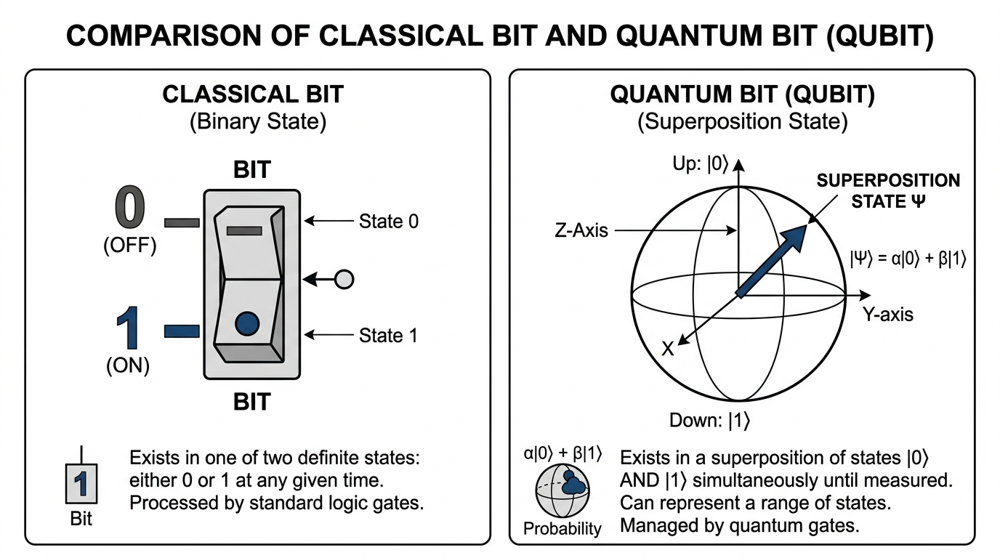
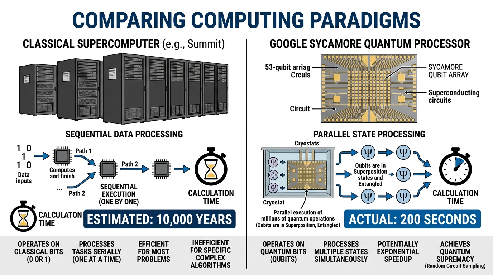

# Strand 1: Introduction to Computing
## Sub-strand 1: Components of Computers and Computer Systems
### Lesson 1: Next-Generation Computers and Supercomputing

---

## Part 1: Foundational Preamble and Basics

Before examining next-generation computers, it is essential to understand how computers function and how they have evolved over time.

### Q1. What is a computer?
**Ans.** A computer is an electronic device that accepts raw data as input, processes it according to stored instructions, and produces meaningful information as output.

### Q2. What are the five historical generations of electronic computers?
**Ans.** The five historical computer generations are:
* **First Generation (1940–1956):** Used vacuum tubes for circuitry and magnetic drums for memory.
* **Second Generation (1956–1963):** Replaced vacuum tubes with smaller and more reliable transistors.
* **Third Generation (1964–1971):** Utilised integrated circuits (ICs) combining many transistors on silicon chips.
* **Fourth Generation (1971–Present):** Built using microprocessors that contain thousands or millions of integrated circuits on a single chip.
* **Fifth Generation (Present & Beyond):** Focused on artificial intelligence, parallel processing, and voice recognition.

### Q3. What is a classical computer bit?
**Ans.** A bit, short for binary digit, is the most basic unit of data in classical computing and can only hold a value of either 0 or 1 at any single moment.

### Q4. How does a classical microprocessor process information?
**Ans.** A classical microprocessor processes data sequentially by switching billions of tiny electronic transistors on (representing 1) or off (representing 0).

### Q5. What is the main physical limitation facing classical microprocessors today?
**Ans.** Classical microprocessors are reaching physical limits because transistors cannot be made much smaller without generating excessive heat and experiencing quantum leakage.

---

## Visual Comparison: Classical Bit vs Quantum Bit (Qubit)

```text
+------------------------------------+------------------------------------+
|       CLASSICAL BIT (BINARY)       |         QUANTUM BIT (QUBIT)        |
+------------------------------------+------------------------------------+
|  State: EITHER 0 OR 1              |  State: 0 AND 1 SIMULTANEOUSLY     |
|                                    |         (Superposition State)      |
|           [ OFF = 0 ]              |                 |0>                |
|               OR                   |                  |  /              |
|           [ ON  = 1 ]              |                  | / Vector        |
|                                    |                  |/                |
|                                    |      ------+-----+------           |
|                                    |            |                       |
|                                    |           |1>                      |
|                                    |                                    |
|  Only 1 state at any given moment  |  Infinite possible combinations of |
|                                    |  0 and 1 until measured            |
+------------------------------------+------------------------------------+
```



---

## Part 2: Trends in Next-Generation Computers

### Q6. What is a next-generation computer?
**Ans.** A next-generation computer is an advanced computing system designed using emerging technologies such as quantum physics, optical light circuits, and artificial intelligence to surpass the processing boundaries of traditional silicon computers.

### Q7. State five major features expected to be seen in next-generation computers.
**Ans.** Five key features expected in next-generation computers are:
* **Unprecedented Processing Speed:** Ability to perform complex mathematical calculations millions of times faster than modern desktop computers.
* **Nanoscale and Molecular Architecture:** Use of atomic-scale components, carbon nanotubes, or optical photons instead of standard silicon transistors.
* **Embedded Artificial Intelligence:** Hardware built specifically to execute neural network routines and machine learning models autonomously.
* **Minimal Energy Consumption:** Highly efficient power consumption with innovative low-resistance or superconducting materials.
* **Quantum State Manipulation:** Processing data using subatomic particles that can exist in multiple states at the same time.

### Q8. What is an optical computer?
**Ans.** An optical computer is a computing machine that uses beams of light (photons) instead of electrical currents (electrons) to process and transmit data at higher speeds with lower heat.

---

## Part 3: Quantum Computing Foundations

### Q9. What is quantum computing?
**Ans.** Quantum computing is a rapidly emerging branch of computer science that harnesses the unique laws of quantum mechanics to solve problems that are too complex for classical computers.

### Q10. What is a qubit?
**Ans.** A qubit, or quantum bit, is the basic unit of information in a quantum computer that can represent 0, 1, or any proportion of both simultaneously.

### Q11. What is superposition in quantum computing?
**Ans.** Superposition is a quantum property that allows a qubit to exist in multiple states at once rather than being confined to a single definite state of 0 or 1.

### Q12. What is quantum entanglement?
**Ans.** Quantum entanglement is a phenomenon where two or more qubits become inextricably linked so that the physical state of one instantly dictates the state of another, regardless of distance.

### Q13. Why can a quantum computer process exponentially more data than a classical computer?
**Ans.** A quantum computer processes data exponentially because each additional qubit doubles the total number of computational states that can be analysed simultaneously.

---

## Part 4: Google Sycamore and Classical Supercomputers

### Q14. What is a classical supercomputer?
**Ans.** A classical supercomputer is an exceptionally powerful machine composed of thousands of linked traditional processors working together to solve massive data-intensive problems.

### Q15. Give one prominent real-world example of a classical supercomputer.
**Ans.** The IBM Summit supercomputer at the Oak Ridge National Laboratory is a leading example of a classical supercomputer.

### Q16. What is Google Sycamore?
**Ans.** Google Sycamore is an advanced quantum processor developed by Google that operates using superconducting circuits kept at cryogenic temperatures near absolute zero.

### Q17. How many physical qubits were built into the Google Sycamore processor?
**Ans.** The Google Sycamore processor was fabricated with fifty-four (54) physical qubits arranged in a rectangular grid.

### Q18. How many qubits were operational during Google Sycamore's milestone demonstration?
**Ans.** During its milestone experiment, fifty-three (53) qubits were fully operational because one qubit did not function properly.

---

## Visual Comparison: Classical Supercomputer vs Google Sycamore

```text
+-----------------------------------------+-----------------------------------------+
|      CLASSICAL SUPERCOMPUTER            |       GOOGLE SYCAMORE PROCESSOR         |
|           (e.g., IBM Summit)            |        (Superconducting Qubits)         |
+-----------------------------------------+-----------------------------------------+
| Architecture: Thousands of silicon CPUs | Architecture: 54-qubit array (53 active)|
| Size: Warehouse-sized room              | Size: Small chip inside a cryogenic vat |
| Processing: Sequential & parallel binary| Processing: Simultaneous quantum states |
| Benchmark Time: Estimated 10,000 Years  | Benchmark Time: Completed in 200 Seconds|
| Paradigm: Deterministic 0 or 1 bits     | Paradigm: Probabilistic entangled qubits|
+-----------------------------------------+-----------------------------------------+
```



---

## Part 5: Processing Power Comparison and Quantum Supremacy

### Q19. What specific benchmark task did Google use to test the Sycamore processor?
**Ans.** Google tasked Sycamore with sampling the output distribution of a random quantum circuit, which tests how quickly a machine can verify complex random patterns.

### Q20. How long did it take Google Sycamore to complete this benchmark task?
**Ans.** Google Sycamore completed the computational task in approximately two hundred (200) seconds.

### Q21. How long would the world's fastest classical supercomputer take to complete the exact same task?
**Ans.** Google estimated that the fastest classical supercomputer at the time would take approximately ten thousand (10,000) years to calculate the same result.

### Q22. What is quantum supremacy?
**Ans.** Quantum supremacy, also known as quantum advantage, is the technical milestone where a programmable quantum device successfully solves a calculation that no classical computer can complete in any feasible amount of time.

### Q23. Mention four real-world fields that will benefit from next-generation supercomputing.
**Ans.** Four fields that will benefit from next-generation supercomputing are:
* **Pharmaceutical Medicine Design:** Simulating molecular structures to discover lifesaving drugs rapidly.
* **Climate and Weather Modelling:** Forecasting extreme atmospheric conditions with exceptional precision.
* **Cryptography and Data Security:** Developing uncrackable encryption protocols to protect global communication networks.
* **Materials Science:** Designing lighter, stronger, and more energy-efficient materials for engineering and aerospace.

---

## Key Vocabulary Summary Table

| Term | Meaning in Plain English | British Context / Note |
| :--- | :--- | :--- |
| **Bit** | A single classical digit (0 or 1). | Short for binary digit. |
| **Qubit** | A quantum bit capable of superposition. | Basic unit of quantum information. |
| **Superposition** | The ability of a quantum particle to be in multiple states simultaneously. | From quantum physics. |
| **Entanglement** | A physical link between particles where one dictates the other. | Enables instant coordinated behaviour. |
| **Cryogenic** | Operating at temperatures close to absolute zero (-273.15 degrees Celsius). | Required to keep Sycamore stable. |
| **Quantum Supremacy** | The milestone where a quantum processor outperforms any classical computer. | Also termed quantum advantage. |

---

## Day 1 Checkpoint Drill

### Question 1
State the main difference between a classical bit and a quantum qubit.

**Marking Guide / Answer:**
A classical bit can only be in one state (either 0 or 1) at a time, whereas a quantum qubit can represent both 0 and 1 simultaneously through superposition.

### Question 2
How many physical qubits are contained on the Google Sycamore chip, and how many were operational during its landmark test?

**Marking Guide / Answer:**
Google Sycamore contains 54 physical qubits, of which 53 were operational during the landmark experiment.

### Question 3
State the time difference between Google Sycamore and the classical supercomputer IBM Summit when performing the random circuit sampling task.

**Marking Guide / Answer:**
Google Sycamore completed the task in 200 seconds, whereas IBM Summit was estimated to require approximately 10,000 years.

### Question 4
Mention three characteristics expected in next-generation computer systems.

**Marking Guide / Answer:**
Any three of the following:
* Extreme processing speed.
* Nanoscale and molecular components.
* Built-in artificial intelligence acceleration.
* Ultra-low power consumption.
* Quantum state processing.

### Question 5
Define the term *quantum supremacy*.

**Marking Guide / Answer:**
Quantum supremacy is the milestone where a quantum computer solves a problem that no classical supercomputer can complete within a feasible timeframe.


---

## Authentic BECE & Mock Examination Questions (With Verified Worked Solutions)

The following authentic questions have been retrieved from the central BECE Question Bank (`BECE_MOCK_PAPERS`), mapped to curriculum indicator **B9.1.1.1.1** (Fifth-Generation Computers and Computer Systems), and verified against the official GES/WAEC marking scheme rubric.

---

### Question 1 — 2024 Super Mock Paper 2 (Theory), Q1 (`Q_7fc75acad948`)
**Question:**
- **a.** Mr. Mensah gave an assignment to the students to research and write down four characteristics of the fifth generation of computers. Imagine you are one of the students in his class. Write down four characteristics of the fifth generation of computers. *(4 marks)*
- **b.**
  - **i.** Give three ways of reducing the heat of a printer. *(3 marks)*
  - **ii.** List three wearable display technologies. *(3 marks)*
- **c.** State the uses of the following MS Excel functions:
  - **i.** `MAX`
  - **ii.** `AVERAGE` *(2 marks)*

**Verified Worked Solution:**

#### **(a) Four Characteristics of Fifth-Generation Computers (4 marks)**
1. **Artificial Intelligence (AI) Integration:** Built around AI technologies such as machine learning, neural networks, and expert systems so that systems can learn, reason, and make autonomous decisions.
2. **Advanced Parallel Processing & ULSI:** Uses Ultra Large-Scale Integration (ULSI) microprocessors with millions to billions of electronic components on a single chip, running instructions simultaneously.
3. **Natural Language Processing (NLP) & Voice Recognition:** Understands, interprets, and responds to human spoken and written languages.
4. **Quantum & Bio-Computing Capabilities:** Incorporates emerging quantum bits (qubits) and biometric security features (e.g. fingerprint and facial recognition).

---

#### **(b)(i) Three Ways of Reducing the Heat of a Printer (3 marks)**
1. **Ensure proper ventilation:** Place the printer in an open, well-ventilated area away from walls, enclosures, or direct sunlight to enable adequate heat dissipation.
2. **Avoid continuous bulk printing:** Divide large print jobs into smaller batches to give internal thermal components (such as the fuser unit) time to cool down.
3. **Clean internal components regularly:** Periodically remove dust, paper debris, and toner particles from cooling vents, fans, and paper paths.

#### **(b)(ii) Three Wearable Display Technologies (3 marks)**
1. **Virtual Reality (VR) and Augmented Reality (AR) Headsets** (e.g. Meta Quest, Apple Vision Pro).
2. **Smart Glasses with Micro-LED / Optical Heads-Up Displays**.
3. **Smartwatches and Fitness/Health-Monitoring Wrist Displays**.

---

#### **(c) Uses of MS Excel Functions (2 marks)**
- **(i) `MAX`:** Returns the **highest (maximum) numeric value** in a selected range of cells (e.g. `=MAX(B2:B50)` to find the top score in a class).
- **(ii) `AVERAGE`:** Computes the **arithmetic mean** (total sum divided by the count of numbers) of a specified range of cells (e.g. `=AVERAGE(C2:C30)`).

- **Verification Status:** `Marking Scheme & Pedagogical Rubric Verified`

---

### Question 2 — 2024 4th Mock Paper 1 (Objective), Q1 (`Q_b5663163dbbf`)
**Question:**
The basic unit of information in quantum computing is ..........

- **A.** bit.
- **B.** qubit.
- **C.** byte.
- **D.** word.

**Verified Worked Solution:**
- In a **classical computer**, the fundamental unit of data is the binary digit (**bit**), which can only exist in one of two distinct states: $0$ or $1$.
- In **quantum computing**, the fundamental unit of information is the **qubit** (quantum bit). Due to the principle of **superposition**, a qubit can represent $0$, $1$, or any quantum combination of both states simultaneously.
- **Correct Option:** **B. qubit.**
- **Verification Status:** `Marking Scheme Verified`

---

### Question 3 — BECE Past Question (Objective), Q5 (`Q_7e347d7515d8`)
**Question:**
Computers are classified into different generations based on:

- **A.** shape.
- **B.** weight.
- **C.** size.
- **D.** technology.

**Verified Worked Solution:**
- Computers are categorised into generations primarily according to the **underlying hardware and electronic switching technology** used:
  - 1st Generation: Vacuum tubes
  - 2nd Generation: Transistors
  - 3rd Generation: Integrated Circuits (ICs)
  - 4th Generation: Microprocessors (VLSI)
  - 5th Generation: Artificial Intelligence, Parallel Processing, and Quantum Technology (ULSI)
- **Correct Option:** **D. technology.**
- **Verification Status:** `Marking Scheme Verified`

---

### Question 4 — BECE 2015 Paper 1 (Objective), Q3 (`Q_dff4520dcfb3`)
**Question:**
The component of the computer that houses the motherboard and the power supply unit is called:

- **A.** central processing unit
- **B.** monitor
- **C.** printer
- **D.** system unit

**Verified Worked Solution:**
- The **system unit** (computer case / tower) is the primary chassis that encloses and protects internal hardware, including the motherboard, Power Supply Unit (PSU), CPU, memory modules (RAM), and storage drives (HDD/SSD).
- *(Common exam trap:* The CPU is the microprocessor mounted onto the motherboard inside the system unit, not the enclosure itself.)
- **Correct Option:** **D. system unit**
- **Verification Status:** `Marking Scheme Verified`
