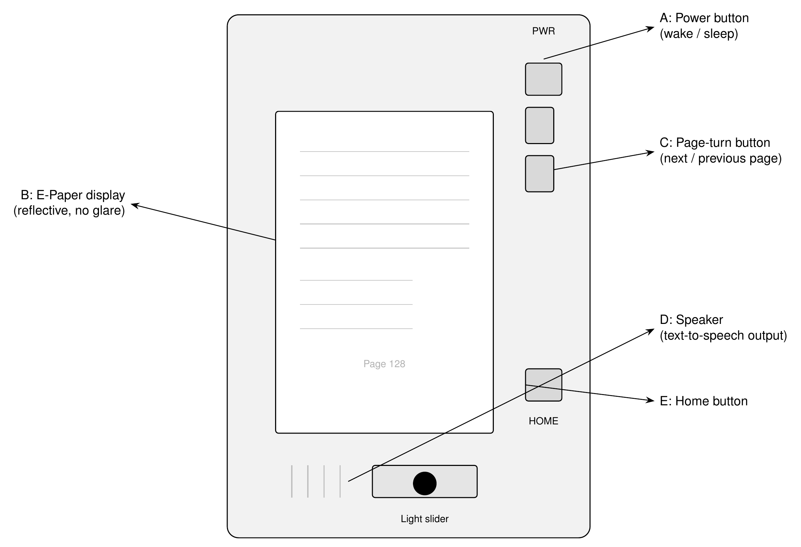
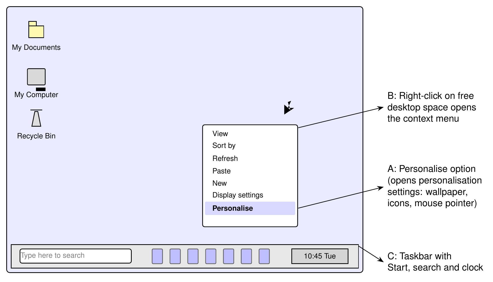

# Lesson 04 — Perceptual Computing, E-Paper Readers and Personalisation

**Strand 1 — Introduction to Computing · Sub-strand 1 — Components of Computers and Computer Systems**
Indicators: B9.1.1.1.2 (perceptual computing) · B9.1.1.1.3 (novel output devices: wearable displays, E-Paper, e-readers) · B9.1.1.2.1 (desktop personalisation) · B9.1.1.2.2 (device drivers and plug-and-play — completing the sub-strand)
Source coverage: BECE past questions (2013, 2015, 2021) · 2024 mocks + authentic bank questions.

---

## Preamble (why this lesson, in everyday words)

For a long time, the only way to talk to a computer was through your fingers — typing keys and clicking buttons. But a computer cannot shake your hand, hear your voice or see your face. Computers are now being taught to *sense* people: to see your face, hear your voice and read your movements. This family of technology is called **perceptual computing**, from the word *perceive* — to notice through the senses.

At the same time, the *output* side is quietly changing. Some screens now look exactly like printed paper, readable in the bright Ghanaian sun without any glare, and use almost no power. Computers are even worn like spectacles.

Finally, we make the computer *yours*: you change the wallpaper (background picture), the icons and the mouse pointer, so that every time you switch on the machine it feels like your own desk. Behind the scenes, small helper programmes called **device drivers** make sure the computer speaks the language of every part attached to it.

## Words to know first

| Word | Simple meaning |
|---|---|
| Perceive | To notice or understand something through the senses — seeing, hearing, feeling. |
| Perceptual computing | Computers that take in human senses (face, voice, movement) as input. |
| Gesture | A movement of the hand, arm or body that carries a message, e.g. a wave. |
| Facial recognition | When a computer identifies a person by the shape of their face. |
| Voice processing | When a computer listens to spoken words and makes meaning of them. |
| E-Paper (electronic paper) | A screen that reflects light like real paper — no glare in sunlight, very little power. |
| E-reader | A small device with an E-Paper screen, made mainly for reading books. |
| Wearable display | An output device worn on the body, e.g. computer spectacles. |
| Device driver | A small programme that lets the operating system talk to one hardware part. |
| Plug-and-play | When you connect a device and the computer detects and sets it up by itself. |
| Icon | A small picture on the desktop that stands for a programme, folder or file. |
| Wallpaper | The background picture on the desktop. |
| Mouse pointer | The moving symbol (often an arrow) that follows your hand movements. |
| Shortcut | An icon that links quickly to a file, folder or programme. |

> Memory hook: **Perceptual = the computer perceived (senses) you. Personalise = the computer suits you.**

---

## Teaching body — Section 1: Perceptual computing (Theory Q&A)

**Q1. What is perceptual computing?**
Ans. Perceptual computing is the use of computers that can perceive the user through human senses, by recognising faces, voices, gestures and touch, so that people interact with the machine naturally.

**Q2. What is facial recognition?**
Ans. Facial recognition is technology that identifies a person by measuring the unique shapes and distances of the features of the face, such as the eyes, nose and jaw.

**Q3. State one everyday use of facial recognition.**
Ans. Unlocking a smartphone by simply looking at it (face unlock), and controlling entry into secure buildings.

**Q4. What is gesture control?**
Ans. Gesture control is a way of commanding a computer using movements of the hand, arm or body instead of touching a keyboard or mouse.

**Q5. Give three examples of gesture control in real life.**
Ans.
- Waving a hand in front of a smart TV to skip to the next song or picture.
- Swinging the arm in a motion-sensing games console so the character on screen copies the movement.
- Pointing at a menu projected on a wall and "pressing" it in mid-air.

**Q6. What is voice processing?**
Ans. Voice processing is when a computer takes in spoken words, understands the request, and answers or carries out a task, for example a voice assistant that is asked for the time.

**Q7. How is perceptual input different from the ordinary keyboard and mouse?**
Ans. The keyboard and mouse demand that the human learns the machine's ways, while perceptual input lets the machine learn the human's ways — face, voice and body movement.

| Point | Traditional input | Perceptual input |
|---|---|---|
| What is captured | Key presses and clicks | Faces, voices, gestures, touch |
| Who adjusts | The person adapts to the machine | The machine adapts to the person |
| Examples | Keyboard, mouse, touchpad | Face unlock, voice assistant, motion games |
| Needs | Hands and practice | Only natural human behaviour |

**Q8. State two benefits of perceptual computing.**
Ans. (Any two) It makes computers usable by people who cannot type, such as babies or persons with disabilities; it is faster and more natural; it keeps hands free for other work.

**Q9. State one danger or concern of perceptual computing.**
Ans. It collects sensitive personal data — face images and voice recordings — so the data can be misused or stolen if not protected (privacy risk).

---

## Teaching body — Section 2: E-Paper, e-readers and wearable displays

*Figure 1: An e-reader. A — power button; B — E-Paper display; C — page-turn button; D — speaker; E — home button.*

**Q10. What is E-Paper?**
Ans. E-Paper (electronic paper) is a display technology that reflects light like real printed paper, so it is readable in direct sunlight, produces no glare and consumes almost no power when showing a fixed page.

**Q11. What is an e-reader?**
Ans. An e-reader is a small, light device with an E-Paper screen, designed mainly for storing and reading electronic books (e-books), for example the Amazon Kindle.

**Q12. State three advantages of E-Paper over a normal LCD phone screen for reading.**
Ans. (Any three) It is readable in bright sunlight without glare; it uses far less battery power; it weighs less and feels like real paper; it does not emit blue light, so it tires the eyes less.

**Q13. State one limitation of E-Paper.**
Ans. It refreshes slowly, so it cannot show smooth video or fast-moving games like an LCD screen.

**Q14. What is a wearable display?**
Ans. A wearable display is an output device worn on the body, commonly on the head like spectacles, that shows information right in front of the user's eye, for example Google Glass.

**Q15. State two differences between a wearable display and a smartphone screen.**
Ans. A wearable display is hands-free and always in the line of sight, while a phone must be held in the hand and glanced at; a wearable is worn on the body, while a phone is carried in a bag or pocket.

**Q16. Study Figure 1. Name the parts labelled A to E.**
Ans. A — power button; B — E-Paper display (screen); C — page-turn button; D — speaker; E — home button.

**Q17. Which part of the e-reader in Figure 1 supports a learner who cannot read small text?**
Ans. The speaker (D), because it can read the text aloud through text-to-speech output.

---

## Teaching body — Section 3: Device drivers and plug-and-play

**Q18. What is a device driver?**
Ans. A device driver is a small programme that lets the operating system communicate with a particular hardware device and control how it works.

**Q19. Give three examples of device drivers.**
Ans. Printer driver; sound (audio) driver; graphics/display (video) driver. (Also: network card, scanner and keyboard drivers.)

**Q20. What happens when a device driver is missing or damaged?**
Ans. The device will not work properly — it may appear as an "unknown device", produce no sound, or refuse to print, even though it is connected and powered.

**Q21. What is plug-and-play?**
Ans. Plug-and-play is an operating system feature by which a newly connected device is automatically detected, and its driver installed, without the user doing any manual setup.

**Q22. State the steps for updating a device driver in Windows.**
Ans.
1. Open Device Manager (right-click the Start button and select Device Manager).
2. Find the device category, for example Sound, video and game controllers.
3. Right-click the device and select Update driver.
4. Choose Search automatically for updated driver software and follow the prompts.
5. Restart the computer if the system asks for it.

---

## Teaching body — Section 4: Desktop personalisation

*Figure 2: The desktop. A — the Personalise option in the right-click context menu; B — right-clicking free desktop space opens the menu; C — the taskbar with search and clock.*

**Q23. What is the desktop?**
Ans. The desktop is the main screen that appears after the computer has booted, where icons, shortcuts, the wallpaper and the taskbar are displayed and work is organised.

**Q24. What is an icon?**
Ans. An icon is a small picture on the desktop or in a folder that represents a programme, a file, a folder or a device.

**Q25. What is wallpaper?**
Ans. Wallpaper is the background picture or colour displayed behind the icons on the desktop.

**Q26. What is a mouse pointer?**
Ans. The mouse pointer is the moving symbol, usually an arrow, that shows where the mouse is pointing on the screen and changes shape depending on the task.

**Q27. What is a shortcut?**
Ans. A shortcut is a desktop icon with a small arrow that links quickly to the original file, folder or programme without opening its storage location.

**Q28. Where do deleted files and folders go on a Windows computer?**
Ans. They go into the Recycle Bin, where they stay until the bin is emptied or the files are restored.

**Q29. State three ways of removing unwanted shortcuts from the desktop.**
Ans.
1. Click the shortcut icon once and press the Delete key on the keyboard.
2. Drag the shortcut icon into the Recycle Bin.
3. Right-click the shortcut icon and select Delete from the pop-up menu.

**Q30. State the steps for changing the desktop wallpaper.**
Ans.
1. Right-click on free desktop space to open the context menu.
2. Select Personalise (or Display settings, then Background) — see Figure 2.
3. Choose Picture, Solid colour or Slideshow under Background.
4. Pick the desired picture or browse for one, and the desktop changes at once.

**Q31. State the steps for changing the mouse pointer scheme.**
Ans.
1. Open the Control Panel (or Settings, then Easy of Access/Mouse).
2. Open Mouse, then click the Pointers tab.
3. Choose a pointer scheme from the Scheme drop-down list.
4. Click Apply, then OK.

**Q32. What is the purpose of the taskbar buttons in Windows?**
Ans. They give quick access to open programmes and pinned applications, so the user can switch between them with one click.

**Q33. What do the computer devices mouse, trackpad and joystick have in common, and what are they called?**
Ans. They are all used to control the position of the pointer on the screen; they are called pointing devices.

---

## Worked Exam Exemplars — solved in the exam voice

**Example 1** [BECE 2021, P1] *Which of the following items is not a feature on the computer desktop? — A. Icon B. Cursor C. Wallpaper D. Screen saver.* (1 mark)
Ans. **B — Cursor.** Icons, wallpaper and the screen saver are items of the desktop; the cursor is the moving pointer produced by the mouse, not a fixed desktop feature. (Mark 1 for the correct letter.)

**Example 2** [BECE 2015, P1] *When files and folders are deleted from the computer, they go into the — A. Briefcase B. Desktop C. Delete bin D. Recycle bin.* (1 mark)
Ans. **D — Recycle bin.** Deleted items are held there so they can be restored before the bin is emptied. (1 mark.)

**Example 3** [BECE 2021, P1] *To remove unwanted shortcuts from the desktop: I. Click the shortcut once and press Delete; II. Drag it into the Recycle Bin; III. Right-click it and select Delete. Which are appropriate? — A. I and II only B. I and III only C. II and III only D. I, II and III.* (1 mark)
Ans. **D — I, II and III.** All three methods remove shortcuts. (1 mark.)

**Example 4** [2024 Mock, P1] *What is the purpose of taskbar buttons in Windows? — A. Displays live weather updates B. Launching virtual assistants C. Quick access to open programs D. Displays the date and time.* (1 mark)
Ans. **C — Quick access to open programs.** (1 mark.)

**Example 5** [2024 Mock, P1] *Which icon is used to find files, apps and settings on your computer? — A. Search B. Share C. Start D. Devices.* (1 mark)
Ans. **A — Search.** (1 mark.)

**Example 6** [2024 Mock, P1] *Which of the following is not a feature of the Settings icon in the Charms bar? — A. Change computer wallpaper B. Change screen resolution C. Change your computer's language D. Install new apps.* (1 mark)
Ans. **D — Install new apps.** Wallpaper, resolution and language are adjusted in Settings; installing apps is done through the Store. (1 mark.)

**Example 7** [2024 Mock, P1] *Which of the following is not a feature of the Start icon in the Charms bar? — A. Open the Start screen B. Close all open apps C. Search for files, apps and settings D. Shut down your computer.* (1 mark)
Ans. **B — Close all open apps.** (1 mark.)

**Example 8** [BECE 2015, P2 style] *Outline the steps involved in changing the desktop of a personal computer (wallpaper).* (3 marks)
Ans. Right-click free desktop space (1); select Personalise → Background (1); choose picture/colour and apply (1).

**Example 9** [Own, Paper 2 style] *What is a device driver? Give one example.* (2 marks)
Ans. A driver is a small programme that lets the operating system communicate with a hardware device (1); example: printer driver or sound driver (1).

**Example 10** [Own, Paper 2 style] *A pupil connects a new printer and the computer installs it by itself with no setup. Name this feature.* (1 mark)
Ans. Plug-and-play. (1 mark.)

**Example 11** [Own, Paper 2 style] *State two advantages of E-Paper over an LCD screen for reading in the sun.* (2 marks)
Ans. No glare — readable in direct sunlight (1); uses very little power, so the battery lasts long (1).

**Example 12** [Own, Paper 2 style] *Explain what perceptual computing is and give two examples.* (3 marks)
Ans. Computers that perceive the user through human senses (1); e.g. face unlock, voice assistant, motion-sensing games (1 each, any two).

---

## Exercises — 5 sections × 5 questions (write full answers)

### Exercise 1 — Perceptual computing

1. What is perceptual computing? (2 marks)
2. What is facial recognition? (1 mark)
3. Give three everyday examples of gesture control. (3 marks)
4. State two benefits and one concern of perceptual computing. (3 marks)
5. How does perceptual input differ from the ordinary keyboard and mouse? (2 marks)

### Exercise 2 — E-Paper, e-readers and wearable displays

1. What is E-Paper? (2 marks)
2. State three advantages of E-Paper for reading. (3 marks)
3. State one limitation of E-Paper compared with an LCD screen. (1 mark)
4. Study Figure 1. Name the parts labelled A, B, C, D and E. (2½ marks)
5. What is a wearable display? Give one example. (2 marks)

### Exercise 3 — Device drivers and plug-and-play

1. What is a device driver? (2 marks)
2. Give three examples of device drivers. (3 marks)
3. A computer speaker produces no sound although it is connected. Name the software most likely to be missing. (1 mark)
4. What is plug-and-play? (1 mark)
5. Write the steps for updating a device driver in Windows. (3 marks)

### Exercise 4 — Desktop personalisation

1. What is the desktop? (2 marks)
2. Study Figure 2. Name the items labelled A, B and C. (3 marks)
3. Write the steps for changing the desktop wallpaper. (3 marks)
4. State three ways of removing an unwanted shortcut from the desktop. (3 marks)
5. After deleting a file, where does it rest, and what can still be done about it? (2 marks)

### Exercise 5 — Mixed review + scenarios

1. Ama's school opens the gate by matching each teacher's face with stored records. Which family of computing is in use, and which sense is being imitated? (2 marks)
2. **[Review]** An e-book shop issued 300 copies of a textbook. Which lesson device stores all those books? (2 marks)
3. **[Review]** Give one reason a barcode in a shop enables direct data entry. (2 marks)
4. **[Review]** Classify as assistive or adaptive: a reading device that speaks the text of a screen aloud for a visually impaired learner. (2 marks)
5. Draw a well labelled computer mouse and name the parts you show. (3 marks)

---

## Answers / marking scheme

### Exercise 1
1. Perceptual computing is the use of computers that perceive the user through human senses — faces, voices, gestures and touch — so people interact with the machine naturally. (2 marks — "perceive/senses" 1, "interact naturally" 1)
2. Identifying a person by the unique features of the face. (1 mark)
3. Any three: waving at a smart TV to change songs or pictures; arm movement in a motion-sensing game; pressing a projected menu in mid-air; a robot copying head movement. (1 mark each)
4. Benefits: usable by people who cannot type; faster and natural; hands stay free (1 each, any 2). Concern: stores sensitive face/voice data that can be stolen (privacy). (1 mark)
5. Keyboard and mouse need the human to learn the machine; perceptual input lets the machine learn the human's face, voice and movements. (2 marks)

### Exercise 2
1. A display that reflects light like printed paper, readable in sunlight, with no glare and very low power use. (2 marks)
2. Any three: no glare in sunlight; very low battery use; light weight, paper-like feel; less eye strain (no blue light). (1 mark each)
3. It refreshes slowly, so it cannot show smooth video or fast games. (1 mark)
4. A — power button (½), B — E-Paper display (½), C — page-turn button (½), D — speaker (½), E — home button (½) = 2½ marks.
5. An output device worn on the body showing information in the user's line of sight (1); e.g. Google Glass (1).

### Exercise 3
1. A small programme that lets the operating system communicate with and control a particular hardware device. (2 marks)
2. Any three: printer driver; sound driver; graphics/video driver; network card driver. (1 mark each)
3. The sound (audio) driver. (1 mark)
4. The operating system automatically detects a newly connected device and installs its driver without manual setup. (1 mark)
5. Open Device Manager (1); find the device and right-click → Update driver (1); search automatically, follow prompts, restart (1).

### Exercise 4
1. The main screen after booting, on which icons, shortcuts, wallpaper and the taskbar are displayed. (2 marks)
2. A — Personalise option (1); B — right-click context menu (1); C — taskbar with search, icons and clock (1).
3. Right-click free desktop space (1); choose Personalise → Background (1); select picture/colour and apply (1).
4. Any three: click it once and press Delete; drag it to the Recycle Bin; right-click it and choose Delete. (1 mark each)
5. It goes into the Recycle Bin (1); it can still be restored before the bin is emptied (1).

### Exercise 5
1. Perceptual computing (1); sight — the sense of seeing (facial recognition) (1).
2. An e-reader with an E-Paper display. (2 marks)
3. The scanner reads the black-and-white lines straight into the computer without any typing. (2 marks)
4. Assistive technology (1) — the device is purpose-built to add reading by listening for learners with visual impairment (1). (2 marks)
5. Sketch shows a body (mouse shell) (1), left and right buttons (1), scroll wheel between them (1); labels correct = full marks.

---

*Next lesson: Health and Safety at Workstations — ergonomics, lighting and heat (Strand 1, Sub-strand 3); the sub-strand 1 exercise battery is now complete.*
