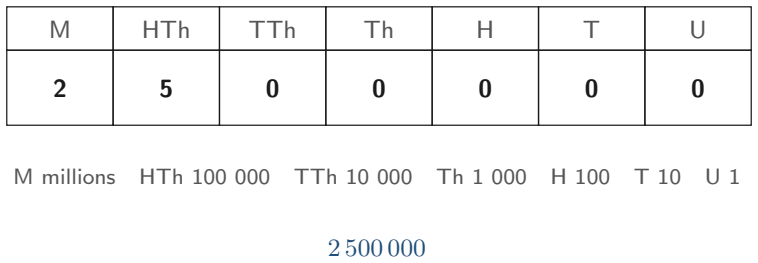

# Strand 1: Number
## Sub-strand 1: Number and Numeration Systems
### Lesson 1: Place Value, Large Numbers, Rounding, and Standard Form

---

## 1. Curriculum Standard and Overview

- **Strand**: 1 — Number
- **Sub-strand**: 1 — Number and Numeration Systems
- **Content Standard**: B9.1.1.1 — Use place value and notation to work with integers and decimals, and express numbers in standard form.
- **Indicators**:
  - **B9.1.1.1.1** — Express integers to a given number of significant and decimal places (including writing numbers in standard form).
  - **B9.1.1.1.2** — Use knowledge and understanding of place value to solve real-life problems.
- **Scope of this lesson**:
  1. How our number system is built (place value architecture).
  2. Reading, writing, and comparing very large and very small numbers.
  3. Rounding to decimal places (d.p.) and to significant figures (s.f.).
  4. Ordinary notation ↔ standard form $A \times 10^n$.
  5. Time and quantity conversions expressed in standard form.
  6. Real-life place-value problems (money, population, science).
- **Mock-paper links (this lesson covers)**:
  - Paper 2, Q1(a): convert 31 days → minutes and 6 hours → seconds, answers in standard form.

---

## 2. Preamble — What Even Is a Number?

Before any formulas, we need a solid picture of how numbers are written.

When you write **4 725**, you are not writing four separate symbols. You are writing a **code** in which each digit's **position** gives it a value:

| Position (from right) | 4th | 3rd | 2nd | 1st |
| :--- | :---: | :---: | :---: | :---: |
| **Place name** | Thousands | Hundreds | Tens | Units (ones) |
| **Digit in 4 725** | 4 | 7 | 2 | 5 |
| **Value of that digit** | 4 000 | 700 | 20 | 5 |

So $4\,725 = 4\,000 + 700 + 20 + 5$.

This idea — **a digit's value depends on where it sits** — is called **place value**. It is the foundation of every calculation you will ever do.

**Important word — "digit":** a digit is a single symbol from 0 to 9. Ten digits, that is all our system uses. We call it the **base-10** (or **denary**) system because it is built on powers of 10.

---

## 3. Place Value Architecture for Large Numbers and Decimals

### 3.1 The place-value chart



Going left, each place is **10 times bigger** than the one before. Going right (past the decimal point), each place is **10 times smaller**.

```
  …  | 100 000 | 10 000 | 1 000 | 100 | 10 | 1 | . | 0.1 | 0.01 | 0.001 | …
      hundred-  ten-     thou-   hun-  ten  units   tenth hun-  thou-
      thousands thousands sands         s            s     dredth sandth
```

**Example:** write out the number 3 050 082.17 in words.

1. Split at the decimal point: **3 050 082** and **.17**
2. Read the whole-number part in groups of three from the right: `3 | 050 | 082`
   - 082 → "eighty-two"
   - 050 → "and fifty" (the leading zero means "no hundreds")
   - 3 → "three million"
3. Combine: **three million, fifty thousand, eighty-two**
4. Decimal part: **.17** → "point one seven" (or "and seventeen hundredths" in formal writing)

**Answer:** Three million, fifty thousand, eighty-two point one seven.

### 3.2 The value of a single digit

**Example:** In the number **9 463 285**, what is the value of the digit 6?

- Locate 6: it sits in the **ten-thousands** place (count from the right: 5, 8, 2, 3, **6**).
- Value = $6 \times 10\,000 = 60\,000$.

**Answer:** 60 000 (not "6").

> **Common trap:** students answer "6" when asked for the *value*. The digit is 6; its **value** is 60 000. Read the question carefully: "digit" vs "value of the digit".

---

## 4. Rounding Numbers

Rounding means **replacing a number with a nearby "neater" number** that is easier to use, while keeping it as close as possible to the truth.

### 4.1 The universal rounding rule

1. Find the **place** you are rounding to (the "rounding digit").
2. Look at the **next digit to the right** (the "decider").
   - Decider **0, 1, 2, 3, 4** → round **down** (keep the rounding digit, drop the rest).
   - Decider **5, 6, 7, 8, 9** → round **up** (add 1 to the rounding digit, drop the rest).
3. If you rounded a whole number, fill empty places with zeros (or leave them off only if told to).

### 4.2 Rounding to decimal places (d.p.)

"Correct to 1 d.p." means: keep **one** digit after the decimal point.

**Example:** Round 12.473 to (i) 1 d.p. (ii) 2 d.p. (iii) 3 d.p.

| Target | Rounding digit | Decider | Decision | Answer |
| :--- | :---: | :---: | :--- | :--- |
| 1 d.p. | 4 (tenths) | 7 | up | **12.5** |
| 2 d.p. | 7 (hundredths) | 3 | down | **12.47** |
| 3 d.p. | 3 (thousandths) | 0 (nothing after) | — | **12.473** (already exact) |

### 4.3 Rounding to significant figures (s.f.)

**Significant figures** count the digits that actually carry meaning — starting from the **first non-zero digit**.

Rules:
- All non-zero digits are significant.
- Zeros **between** non-zero digits are significant (e.g. 2 005 has 4 s.f.).
- Leading zeros (before the first non-zero digit) are **never** significant — they only position the decimal point (e.g. 0.0042 has 2 s.f.).
- Trailing zeros after a decimal point **are** significant (e.g. 4.20 has 3 s.f.).
- Trailing zeros in a whole number **may or may not** be significant — use a decimal point to make it clear (420. has 3 s.f.).

**Example:** Round 0.006 845 to (i) 1 s.f. (ii) 2 s.f. (iii) 3 s.f.

1. First significant digit is **6** (the leading zeros do not count).
2. 1 s.f. → look at next digit 8 → up → **0.007**
3. 2 s.f. → 6.8…, decider 4 → down → **0.0068**
4. 3 s.f. → 6.84…, decider 5 → up → **0.00685**

---

## 5. Standard Form (Index Form)

### 5.1 What standard form is

**Standard form** writes a number as

$$A \times 10^n$$

where

- $1 \le A < 10$ (A is a number with **one** non-zero digit before the decimal point), and
- $n$ is an **integer** (positive, zero, or negative).

Why? Because scientists and engineers constantly work with numbers that are absurdly large (distance to a star) or absurdly small (size of a bacterium). Standard form makes them **comparable at a glance** by showing the "shape" ($A$) and the "size" ($10^n$).

### 5.2 Writing a number in standard form

**Recipe:**
1. Put the decimal point so there is **exactly one** non-zero digit to its left. That number is $A$.
2. Count how many places you **moved** the decimal point. That count is $|n|$.
3. Direction:
   - Moved **left** (original number was large) → $n$ is **positive**.
   - Moved **right** (original number was small) → $n$ is **negative**.

**Example A:** Write 47 300 in standard form.

1. Decimal point currently at the end: `47300.`
2. Move left 4 places → `4.73`
3. Moved left → $n = +4$
4. **Answer:** $4.73 \times 10^4$

**Example B:** Write 0.000 56 in standard form.

1. Move right 4 places → `5.6`
2. Moved right → $n = -4$
3. **Answer:** $5.6 \times 10^{-4}$

### 5.3 Writing standard form as an ordinary number

**Reverse recipe:** $A \times 10^n$

- $n > 0$: move the decimal point $n$ places **right** (pad with zeros if needed).
- $n < 0$: move the decimal point $|n|$ places **left**.

**Example C:** Write $3.05 \times 10^5$ as an ordinary number.

Move 5 places right: `3` → `30` → `305` → `3 050` → `30 500` → `305 000`
**Answer:** 305 000

**Example D:** Write $8.2 \times 10^{-3}$ as an ordinary number.

Move 3 places left: `8.2` → `0.82` → `0.082` → `0.0082`
**Answer:** 0.0082

### 5.4 Comparing numbers in standard form

Compare the **powers first**. Bigger power = bigger number (for positive powers).

- $2.9 \times 10^5$ vs $7.1 \times 10^4$ → $10^5 > 10^4$, so **$2.9 \times 10^5$ is larger** (even though 7.1 > 2.9).
- Only if the powers are equal do you compare the $A$ values: $3.2 \times 10^3 < 4.1 \times 10^3$.

---

## 6. Twenty Fully Worked Examples

### Example 1 — Place value of a digit
What is the value of the digit 7 in 83 713?

Count from the right: 3 (units), 1 (tens), 7 (hundreds).
Value $= 7 \times 100 = \mathbf{700}$.

---

### Example 2 — Writing a large number in words
Write 5 040 007 in words.

Groups: `5 | 040 | 007` → "five million, forty thousand, and seven".

---

### Example 3 — Rounding to 1 d.p.
Round 198.649 to 1 d.p.

Rounding digit: 6 (tenths). Decider: 4 → down.
**Answer: 198.6**

---

### Example 4 — Rounding to 2 d.p.
Round 198.649 to 2 d.p.

Rounding digit: 4 (hundredths). Decider: 9 → up → 5.
**Answer: 198.65**

---

### Example 5 — Rounding to 1 s.f.
Round 0.047 28 to 1 s.f.

First significant digit: 4. Decider: 7 → up.
**Answer: 0.05**

---

### Example 6 — Rounding to 3 s.f.
Round 0.047 28 to 3 s.f.

Significant digits: 4, 7, 2 | decider 8 → up the 2 to 3.
**Answer: 0.0473**

---

### Example 7 — Standard form of a large number
Write 602 000 000 000 000 in standard form.

Move decimal 14 places left → 6.02
**Answer:** $6.02 \times 10^{14}$

---

### Example 8 — Standard form of a small number
Write 0.000 000 034 in standard form.

Move decimal 8 places right → 3.4
**Answer:** $3.4 \times 10^{-8}$

---

### Example 9 — Ordinary number from standard form
Write $7.4 \times 10^6$ as an ordinary number.

Move 6 places right: **7 400 000**

---

### Example 10 — Ordinary number from negative standard form
Write $9.05 \times 10^{-4}$ as an ordinary number.

Move 4 places left: **0.000 905**

---

### Example 11 — Mock Paper 2 Q1(a)(i): 31 days into minutes
Convert 31 days into minutes. Give the answer in standard form.

1. 1 day $= 24$ hours, 1 hour $= 60$ minutes.
2. Minutes in 1 day $= 24 \times 60 = 1\,440$.
3. Minutes in 31 days $= 31 \times 1\,440$.

```
   1 440
×    31
------
   1 440   (1 × 1440)
  43 200   (30 × 1440)
------
  44 640
```

4. $44\,640 = 4.464 \times 10^4$ (decimal moved 4 places left).

**Answer:** $4.464 \times 10^4$ minutes.

---

### Example 12 — Mock Paper 2 Q1(a)(ii): 6 hours into seconds
Convert 6 hours into seconds. Give the answer in standard form.

1. 1 hour $= 60$ minutes, 1 minute $= 60$ seconds → 1 hour $= 3\,600$ s.
2. $6 \times 3\,600 = 21\,600$.
3. $21\,600 = 2.16 \times 10^4$.

**Answer:** $2.16 \times 10^4$ seconds.

---

### Example 13 — Mixed unit conversion in standard form
Express 2 days 3 hours in minutes, in standard form.

1. 2 days $= 2 \times 1\,440 = 2\,880$ min.
2. 3 hours $= 3 \times 60 = 180$ min.
3. Total $= 3\,060 = 3.06 \times 10^3$.

**Answer:** $3.06 \times 10^3$ minutes.

---

### Example 14 — Scientific measurement
The wavelength of green light is about 0.000 000 55 m. Write this in standard form.

Move decimal 7 places right → 5.5
**Answer:** $5.5 \times 10^{-7}$ m

---

### Example 15 — Population problem
A town has $2.4 \times 10^5$ people. Write the population as an ordinary number.

Move 5 places right: **240 000** people.

---

### Example 16 — Difference of two standard-form numbers
Find $(5.2 \times 10^4) - (1.8 \times 10^4)$.

Same power, so subtract the $A$s:
$(5.2 - 1.8) \times 10^4 = 3.4 \times 10^4$.

**Answer:** $3.4 \times 10^4$

---

### Example 17 — Adding standard-form numbers with different powers
Find $(4.5 \times 10^3) + (2.2 \times 10^2)$.

Make powers equal: $2.2 \times 10^2 = 0.22 \times 10^3$.
$(4.5 + 0.22) \times 10^3 = 4.72 \times 10^3$.

**Answer:** $4.72 \times 10^3$

---

### Example 18 — Multiplication in standard form
Find $(3 \times 10^4) \times (2 \times 10^3)$.

Multiply the $A$s, add the powers: $6 \times 10^{4+3} = 6 \times 10^7$.
Check $A = 6$ is still between 1 and 10 — yes.

**Answer:** $6 \times 10^7$

---

### Example 19 — Multiplication that needs adjusting
Find $(6.2 \times 10^5) \times (4 \times 10^3)$.

$6.2 \times 4 = 24.8$, powers add to 8.
So $24.8 \times 10^8$. But $24.8$ is **not** between 1 and 10.
$24.8 \times 10^8 = 2.48 \times 10^1 \times 10^8 = 2.48 \times 10^9$.

**Answer:** $2.48 \times 10^9$

---

### Example 20 — Real-life money place value
A company earns GH₵ 4 750 000 in a year. Write this in standard form, and state the value of the digit 7.

1. Standard form: $4.75 \times 10^6$ cedis.
2. Digit 7 is in the hundred-thousands place → value $= 700\,000$ cedis = GH₵ 700 000.

**Answer:** $4.75 \times 10^6$; GH₵ 700 000.

---

## 7. Comprehensive Exercise Sets (40 Questions)

In line with `Rules.md` and the lesson rules: **8 exercise sections × 5 questions = 40 questions**.  
**All authentic BECE / Mock / Exam questions for this topic are included in full** (marked **[BECE/Mock]** with source). The remaining slots are original questions written to cover every question style seen under this indicator (objective and structured).

> **Spiral review:** 15% of these questions (6 questions) revisit prior number skills (basic arithmetic, times tables, comparing integers).

---

### Exercise 1 — Place value of digits (including [BECE/Mock] items)

1. **[BECE 2011]** What is the value of 7 in the number 832 713?  
   A. Seven thousand  B. Seven hundred  C. Seventy  D. Seven

2. In the number 9 463 285, state the value of the digit 6.

3. **[Mock 2026 P2 Q1]** Convert the following and express your answers in standard form:  
   (i) 31 days into minutes;  
   (ii) 6 hours into seconds.

4. Write the place-value name of the digit 4 in 40 508 216.

5. The digit 9 in 7 904 512 stands for what value?

---

### Exercise 2 — Reading, writing, and comparing whole numbers

1. Write 5 040 007 in words.

2. Write "three million, fifty thousand, eighty-two" in figures.

3. Arrange these in ascending order: 3 050 082; 3 005 820; 3 500 082; 3 050 802.

4. A country's road network measures 38 040 km. Write this number in words.

5. Which is larger: 4.7 million or 4 070 000?

---

### Exercise 3 — Rounding to decimal places

1. **[Mock-style]** Find the value of $124.3 + 0.275 + 74.06$, correct to one decimal place.

2. Round 12.473 to (i) 1 d.p. (ii) 2 d.p. (iii) 3 d.p.

3. Round 0.997 84 to 2 d.p.

4. Round 99.95 to 1 d.p.

5. Calculate $18.4 \times 1.27$ and give the answer to 2 d.p.

---

### Exercise 4 — Rounding to significant figures

1. Round 0.006 845 to (i) 1 s.f. (ii) 2 s.f. (iii) 3 s.f.

2. Round 84 730 to (i) 1 s.f. (ii) 2 s.f. (iii) 3 s.f.

3. Express 0.000 090 5 to 2 s.f.

4. A bacterium measures 0.000 004 7 m across. Write this length to 1 s.f.

5. **Spiral review:** Calculate $48 \div 6 + 5 \times 2$ (BODMAS), then round the result to 2 s.f.

---

### Exercise 5 — Standard form of ordinary numbers

1. Write 47 300 in standard form.

2. Write 0.000 56 in standard form.

3. Write 602 000 000 000 000 in standard form.

4. Write 0.000 000 034 in standard form.

5. **Spiral review:** Simplify $36 \div (4 + 2) \times 5$ before writing the answer in standard form.

---

### Exercise 6 — Ordinary numbers from standard form

1. Write $7.4 \times 10^6$ as an ordinary number.

2. Write $9.05 \times 10^{-4}$ as an ordinary number.

3. Write $2.16 \times 10^4$ as an ordinary number.

4. Write $3.4 \times 10^{-8}$ as an ordinary number.

5. **Spiral review:** Evaluate $15^2 - 12^2$, then express the answer in standard form.

---

### Exercise 7 — Calculating with standard form

1. Find $(5.2 \times 10^4) - (1.8 \times 10^4)$.

2. Find $(4.5 \times 10^3) + (2.2 \times 10^2)$.

3. Find $(3 \times 10^4) \times (2 \times 10^3)$.

4. Find $(6.2 \times 10^5) \times (4 \times 10^3)$.

5. **Spiral review:** A bag holds 240 sweets. They are shared equally among 16 children. How many sweets does each child get? Express the answer in standard form.

---

### Exercise 8 — Real-life place value and standard form problems

1. **[Mock 2026 style]** Convert 2 days 3 hours into minutes and express the answer in standard form.

2. The wavelength of green light is about 0.000 000 55 m. Write this in standard form.

3. A town has $2.4 \times 10^5$ people. Write the population as an ordinary number.

4. A company earns GH₵ 4 750 000 in a year. Write this in standard form and state the value of the digit 7.

5. **Spiral review:** Arrange these integers from smallest to largest: $-12,\; 7,\; -3,\; 0,\; 5$.

---

## 8. Full Step-by-Step Worked Solutions

### Solutions to Exercise 1

**1.** Value of 7 in 832 713.  
Count from the right: 3, 1, 7 → hundreds place.  
$7 \times 100 = \mathbf{700}$. **Answer: B. Seven hundred.**

**2.** Digit 6 in 9 463 285 sits in the ten-thousands place.  
$6 \times 10\,000 = \mathbf{60\,000}$.

**3. (i)** 31 days → minutes.  
1 day $= 24 \times 60 = 1\,440$ min.  
$31 \times 1\,440 = 44\,640$.  
$44\,640 = \mathbf{4.464 \times 10^4}$ minutes.

**(ii)** 6 hours → seconds.  
1 hour $= 3\,600$ s.  
$6 \times 3\,600 = 21\,600 = \mathbf{2.16 \times 10^4}$ seconds.

**4.** Digit 4 in 40 508 216 is in the **ten-millions** place → $\mathbf{40\,000\,000}$.

**5.** Digit 9 in 7 904 512 is in the hundred-thousands place → $\mathbf{900\,000}$.

---

### Solutions to Exercise 2

**1.** 5 040 007 = **five million, forty thousand, and seven**.

**2.** Three million = 3 000 000; fifty thousand = 50 000; eighty-two = 82.  
Total $= \mathbf{3\,050\,082}$.

**3.** Align by millions then compare further left-to-right:  
3 005 820 < 3 050 082 < 3 050 802 < 3 500 082.  
**Answer:** 3 005 820, 3 050 082, 3 050 802, 3 500 082.

**4.** 38 040 = **thirty-eight thousand and forty**.

**5.** 4.7 million $= 4\,700\,000 > 4\,070\,000$.  
**4.7 million is larger.**

---

### Solutions to Exercise 3

**1.** $124.3 + 0.275 + 74.06 = 198.635$.  
To 1 d.p.: decider is 3 → down → **198.6**.

**2.** 12.473 → (i) 1 d.p.: decider 7 → **12.5**; (ii) 2 d.p.: decider 3 → **12.47**; (iii) 3 d.p.: **12.473**.

**3.** 0.997 84 to 2 d.p.: 0.99|7 → up → **1.00**.  
*(Note: rounding up carries through — 0.997 84 ≈ 1.00 to 2 d.p.)*

**4.** 99.95 to 1 d.p.: decider 5 → up → 99.9 + 0.1 = **100.0**.

**5.** $18.4 \times 1.27 = 23.368$.  
To 2 d.p.: decider 8 → up → **23.37**.

---

### Solutions to Exercise 4

**1.** 0.006 845 → (i) 1 s.f.: **0.007**; (ii) 2 s.f.: **0.0068**; (iii) 3 s.f.: **0.00685**.

**2.** 84 730 → (i) 1 s.f.: 80 000 ($8 \times 10^4$); (ii) 2 s.f.: **85 000**; (iii) 3 s.f.: **84 700**.

**3.** 0.000 090 5 → first s.f. is 9; 2 s.f. → **0.000 091** (or $9.1 \times 10^{-5}$).

**4.** 0.000 004 7 m to 1 s.f. → **0.000 005 m** (or $5 \times 10^{-6}$ m).

**5.** BODMAS: $48 \div 6 = 8$; $5 \times 2 = 10$; $8 + 10 = 18$.  
18 to 2 s.f. is **18** (exactly 2 s.f.).

---

### Solutions to Exercise 5

**1.** 47 300 → move 4 left → $\mathbf{4.73 \times 10^4}$.

**2.** 0.000 56 → move 4 right → $\mathbf{5.6 \times 10^{-4}}$.

**3.** 602 000 000 000 000 → move 14 left → $\mathbf{6.02 \times 10^{14}}$.

**4.** 0.000 000 034 → move 8 right → $\mathbf{3.4 \times 10^{-8}}$.

**5.** $36 \div 6 \times 5 = 6 \times 5 = 30 = \mathbf{3 \times 10^1}$.

---

### Solutions to Exercise 6

**1.** $7.4 \times 10^6$ → 6 places right → **7 400 000**.

**2.** $9.05 \times 10^{-4}$ → 4 places left → **0.000 905**.

**3.** $2.16 \times 10^4$ → **21 600**.

**4.** $3.4 \times 10^{-8}$ → **0.000 000 034**.

**5.** $15^2 - 12^2 = 225 - 144 = 81 = \mathbf{8.1 \times 10^1}$.

---

### Solutions to Exercise 7

**1.** Same powers: $(5.2 - 1.8) \times 10^4 = \mathbf{3.4 \times 10^4}$.

**2.** $2.2 \times 10^2 = 0.22 \times 10^3$; $(4.5 + 0.22)\times 10^3 = \mathbf{4.72 \times 10^3}$.

**3.** $(3 \times 2) \times 10^{4+3} = \mathbf{6 \times 10^7}$.

**4.** $6.2 \times 4 = 24.8$; $24.8 \times 10^8 = \mathbf{2.48 \times 10^9}$.

**5.** $240 \div 16 = 15 = \mathbf{1.5 \times 10^1}$ sweets.

---

### Solutions to Exercise 8

**1.** 2 days $= 2 \times 1\,440 = 2\,880$ min; 3 hours $= 180$ min.  
Total $= 3\,060 = \mathbf{3.06 \times 10^3}$ minutes.

**2.** 0.000 000 55 m → move 7 right → $\mathbf{5.5 \times 10^{-7}}$ m.

**3.** $2.4 \times 10^5$ → 5 places right → **240 000** people.

**4.** GH₵ 4 750 000 $= \mathbf{4.75 \times 10^6}$ cedis.  
Digit 7 sits in the hundred-thousands place → **GH₵ 700 000**.

**5.** Negatives first (further from zero is smaller): $-12 < -3 < 0 < 5 < 7$.  
**Answer:** $-12,\; -3,\; 0,\; 5,\; 7$.

---

## 9. Authentic BECE & Mock Examination Questions (with Bank IDs)

These are the tagged bank items under Indicators B9.1.1.1.1 / B9.1.1.1.2 used in this lesson. Full solutions are above (or inlined here for objective items).

| # | Bank ID | Source | Question | Answer |
| :--- | :--- | :--- | :--- | :--- |
| 1 | `Q_bcd5f9644525` | Mock 2026 Paper 2 Q1(a) | 31 days → minutes; 6 hours → seconds, in standard form | $4.464\times10^4$ min; $2.16\times10^4$ s |
| 2 | `Q_bc2e5e09ed3d` | BECE 2011 Paper 1 | Value of 7 in 832 713 | B (Seven hundred) |

Additional bank items under B9.1.1.1.1 include integer/set recognition questions (e.g. `Q_1a610f562b46`, `Q_b7f6b9e5031a`) which are reserved for **Lesson 2 (Number Systems & Venn Diagrams)** so this lesson stays focused.

---

## 10. Lesson Summary (Cheat Sheet)

| Skill | Rule to remember |
| :--- | :--- |
| Place value | Each step left is ×10; each step right is ÷10 |
| Value of a digit | Digit × (its place) |
| Round to d.p. | Count digits after the point; use next digit as decider |
| Round to s.f. | Start at first non-zero digit |
| Standard form | $A \times 10^n$ with $1 \le A < 10$ |
| Positive $n$ | Big number (decimal moved left) |
| Negative $n$ | Small number (decimal moved right) |

---

*Lesson prepared under `Grade9-Maths/Rules.md` — plain English, British notation, full workings required.*
