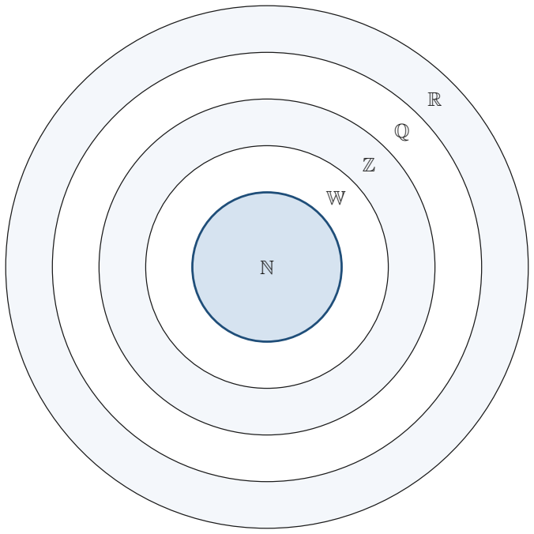
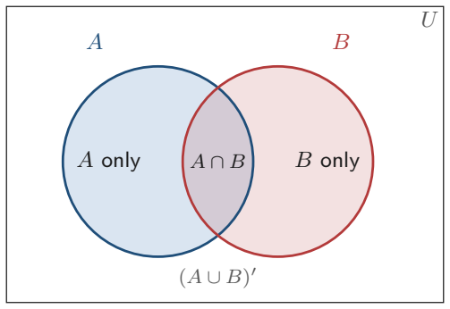
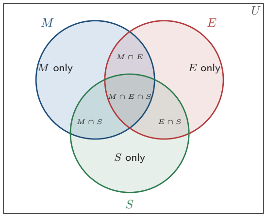

# Strand 1: Number
## Sub-strand 1: Number and Numeration Systems
### Lesson 2: Real Number System, Sets, and Venn Diagrams

---

## 1. Curriculum Standard and Overview

- **Strand**: 1 — Number
- **Sub-strand**: 1 — Number and Numeration Systems
- **Content Standard**: B9.1.1.2 — Understand the structure of the real number system and use set ideas to solve problems.
- **Indicators**:
  - **B9.1.1.2.1** — Solve problems on relationships between members of the rational number system.
  - **B9.1.1.2.2** — Apply the concept of sets to solve problems on relationships between members of the number system and in real-life surveys.
- **Scope**:
  1. The number family tree: Natural → Whole → Integers → Rational → Real.
  2. Deciding which set a number belongs to.
  3. Set language: elements, universal set, complement, union, intersection.
  4. Drawing and reading 2-set and 3-set Venn diagrams.
  5. Survey word problems (the classic "in a market of …" type).
- **Mock-paper links**: Paper 1 Q15 (largest set); Paper 2 Q5(d) (fishmongers Venn diagram).

---

## 2. Preamble — Numbers Live in Families

You already know counting numbers: 1, 2, 3, …  
But maths also needs zero, negatives, fractions, and numbers like √2 that never end.

Mathematicians **group numbers into families** (called **sets**) so we can talk about "what kind of number is this?" precisely.

> **Key word — SET.** A set is simply a **collection of well-defined objects**, usually written inside curly brackets: {1, 2, 3}.  
> **Key word — ELEMENT.** Each member of a set is an element. We write ∈ for "is an element of" and ∉ for "is not".

---

## 3. The Number Family Tree

### 3.1 The five big families

| Symbol | Name | What it contains | Examples |
| :---: | :--- | :--- | :--- |
| ℕ | Natural (counting) numbers | 1, 2, 3, 4, … | 7, 100 |
| 𝕎 | Whole numbers | Natural numbers + 0 | 0, 5 |
| ℤ | Integers | Whole numbers + negatives | −9, 0, 12 |
| ℚ | Rational numbers | Any number you can write as p/q (p, q integers, q ≠ 0). Includes terminating and recurring decimals | 3/4, −2, 0.25 |
| ℚ′ | Irrational numbers | Numbers that **cannot** be written as p/q; decimals go on forever without repeating | √2, π |

Together, ℚ and ℚ′ make the **Real numbers** (ℝ).

### 3.2 Nesting picture (each family is inside the one after it)

```
┌─────────────────────────────────────────────┐
│ REAL NUMBERS                                │
│  ┌───────────────────────────────────────┐  │
│  │ RATIONAL (ℚ)                          │  │
│  │  ┌───────────────────────────────┐    │  │
│  │  │ INTEGERS (ℤ)                  │    │  │
│  │  │  ┌───────────────────────┐    │    │  │
│  │  │  │ WHOLE (𝕎)            │    │    │  │
│  │  │  │  ┌───────────────┐    │    │    │  │
│  │  │  │  │ NATURAL (ℕ)   │    │    │    │  │
│  │  │  │  │  1, 2, 3, …   │    │    │    │  │
│  │  │  │  └───────────────┘    │    │    │  │
│  │  │  │  + 0                  │    │    │  │
│  │  │  └───────────────────────┘    │    │  │
│  │  │  + −1, −2, −3, …             │    │  │
│  │  └───────────────────────────────┘    │  │
│  │  + ½, 0.25, −3.7, …                   │  │
│  └───────────────────────────────────────┘  │
│  Irrationals (ℚ′): √2, π, …                │
└─────────────────────────────────────────────┘
```

### 3.3 How to classify a number quickly

Ask these questions **in order**:

1. Is it a negative whole number? → Integer only (not whole/natural).
2. Is it a positive whole number (or zero)? → Natural and whole (and integer and rational).
3. Can it be written exactly as a fraction p/q? → Rational.
4. Does its decimal go on forever with no repeating pattern? → Irrational.

**Examples:**
- 5 → Natural, Whole, Integer, Rational.
- 0 → Whole, Integer, Rational (not natural).
- −8 → Integer, Rational.
- 0.75 = 3/4 → Rational.
- 1.333… = 4/3 → Rational (recurring).
- √2 ≈ 1.414213… → Irrational.

---

## 4. Set Notation You Must Know

| Symbol | Meaning | Example |
| :---: | :--- | :--- |
| ∈ | is an element of | 5 ∈ {1, 3, 5} |
| ∉ | is not an element of | 4 ∉ {1, 3, 5} |
| ∪ | union (everything in either set) | {1,2} ∪ {2,3} = {1,2,3} |
| ∩ | intersection (only what is in both) | {1,2} ∩ {2,3} = {2} |
| A′ or Aᶜ | complement of A (not in A, but in U) | If U = {1..6}, A = {1,2}, A′ = {3,4,5,6} |
| U or ξ | universal set (everything we are talking about) | |
| n(A) | number of elements in A (the **count**) | n({2,4,6}) = 3 |
| ⊂ | is a subset of | ℕ ⊂ ℤ |
| ∅ or {} | empty set | |

---

## 5. Venn Diagrams

### 5.1 What a Venn diagram does



A Venn diagram is a **picture of sets**. A rectangle is the **universal set**. Each circle is one set. The overlapping region is the **intersection**.

### 5.2 Two-set Venn diagram layout



```
    ┌───────────────────────────────────┐
    │           Universal set U         │
    │    ┌──────────┐   ┌──────────┐    │
    │    │  only A  │ A │  only B  │    │
    │    │          │ ∩ │          │    │
    │    │          │ B │          │    │
    │    └──────────┘   └──────────┘    │
    │         outside both = (A∪B)′     │
    └───────────────────────────────────┘
```

### 5.3 The golden counting rule (2 sets)

For two sets A and B inside a universal set of size n(U):

$$n(A \cup B) = n(A) + n(B) - n(A \cap B)$$

We subtract the overlap once because adding n(A) and n(B) **counts the overlap twice**.

Rearranged:

$$n(A \text{ only}) = n(A) - n(A \cap B)$$
$$n(B \text{ only}) = n(B) - n(A \cap B)$$
$$n(\text{neither}) = n(U) - n(A \cup B)$$

**Always fill a Venn from the middle (the overlap) outwards.**

---

## 6. Twenty Fully Worked Examples

### Example 1 — Classify 7
7 is a counting number → **Natural, Whole, Integer, Rational**.

### Example 2 — Classify 0
0 is not a counting number → **Whole, Integer, Rational** (not natural).

### Example 3 — Classify −12
**Integer, Rational** (also rational because −12 = −12/1).

### Example 4 — Is 0.25 rational?
$0.25 = \frac{1}{4}$, so **yes — Rational**.

### Example 5 — Is √9 rational?
$\sqrt{9} = 3$, which is a natural number → **Rational**.  
*(Careful: the square root symbol does not automatically mean irrational.)*

### Example 6 — Is √7 rational?
7 is not a perfect square, so √7 = 2.6457… (no repeating block) → **Irrational**.

### Example 7 — Largest of these sets
Which is the largest set: {whole numbers}, {composite numbers}, {natural numbers}, {integers}?

- Natural = {1,2,3,…}
- Whole = {0,1,2,3,…}
- Integers = {…,−2,−1,0,1,2,…}
- Composite = {4,6,8,9,10,…} (smallest family here)

**Answer: {integers}** (Mock 2026 P1 Q15 — option D).

### Example 8 — Smallest of those sets
From the list above, the **composite numbers** form the smallest set.

### Example 9 — Simple union
If A = {1, 2, 3} and B = {3, 4, 5}, find A ∪ B.
A ∪ B = {1, 2, 3, 4, 5}.

### Example 10 — Simple intersection
Using the same A and B: A ∩ B = {3}.

### Example 11 — Complement
U = {1,2,3,4,5,6}, A = {1,2}. Find A′.
A′ = {3, 4, 5, 6}.

### Example 12 — Two-set counts
In a class of 40, 22 play football, 18 play hockey, 9 play both. How many play neither?

1. $n(F \cup H) = 22 + 18 - 9 = 31$.
2. Neither $= 40 - 31 = 9$.

**Answer: 9 students.**

### Example 13 — Fill the Venn from Example 12
Football only $= 22 - 9 = 13$.  
Hockey only $= 18 - 9 = 9$.  
Both $= 9$.  
Neither $= 9$.  
Check: $13 + 9 + 9 + 9 = 40$ ✓

### Example 14 — Mock Paper 2 Q5(d): fishmongers
In a market of 36 fishmongers, 28 sell mackerel (M), 18 sell tilapia (T), 13 sell both.

(i) Venn diagram:  
- Both: 13  
- Mackerel only: $28 - 13 = 15$  
- Tilapia only: $18 - 13 = 5$  
- Outside both: $36 - (15+13+5) = 3$

(ii) Not selling any of the two: **3**.

```
    ┌───────────────────────────────────┐
    │  U (36)                           │
    │   ┌─────────┐     ┌─────────┐     │
    │   │  15     │  13 │    5    │     │
    │   │ mackerel│both │ tilapia │     │
    │   │  only   │     │  only   │     │
    │   └─────────┘     └─────────┘     │
    │              3                    │
    └───────────────────────────────────┘
```

### Example 15 — Finding n(A) from the picture
From Example 14, how many sell mackerel?  
Mackerel only + both = $15 + 13 = 28$ ✓ (matches the question).

### Example 16 — Three-set introduction
If we add a third set C (say, those who sell crabs), we draw a third circle. The centre region is A ∩ B ∩ C (all three). We still fill the **innermost** regions first.



### Example 17 — Subset
True or false: ℕ ⊂ ℤ?  
True — every natural number is an integer.

### Example 18 — True/False on membership
Is −3 ∈ {whole numbers}?  
No → **False** (whole numbers start at 0).

### Example 19 — Word → set
"The set of even numbers between 1 and 11."  
= {2, 4, 6, 8, 10}.

### Example 20 — Survey with percentages
In a survey of 200 people, 120 like tea, 90 like coffee, and 40 like both. How many like neither?

$n(T \cup C) = 120 + 90 - 40 = 170$.  
Neither $= 200 - 170 = 30$.

**Answer: 30 people.**

---

## 7. Comprehensive Exercise Sets (40 Questions)

> All authentic BECE/Mock questions for this topic are **included in full**. Generated questions top up to the 40-quota. Spiral review ≈ 15%.

### Exercise 1 — Identifying number families

1. **[Mock 2026 P1 Q15]** Which of the following sets is the largest?  
   A. {whole numbers}  B. {composite numbers}  C. {natural numbers}  D. {integers}

2. Which of these sets is the **smallest**?  
   A. {whole numbers}  B. {composite numbers}  C. {natural numbers}  D. {integers}

3. Classify 5 under every family that fits (ℕ, 𝕎, ℤ, ℚ).

4. Classify −3 under every family that fits.

5. Classify 0 under every family that fits.

### Exercise 2 — Rational vs irrational

1. Is 0.25 rational? Give a reason.

2. Is √9 rational? Give a reason.

3. Is √7 rational or irrational?

4. Write 0.333… as a fraction; hence show it is rational.

5. **Spiral review:** Write 47 300 in standard form (Lesson 1 revision).

### Exercise 3 — Set notation

1. If A = {1, 2, 3}, state whether 2 ∈ A.

2. If A = {1, 2, 3}, state whether 4 ∈ A.

3. U = {1,2,3,4,5,6}, A = {1,2}. Find A′.

4. Let X = {2,4,6}, Y = {4,6,8}. Find X ∩ Y.

5. Let X = {2,4,6}, Y = {4,6,8}. Find X ∪ Y.

### Exercise 4 — Counting elements

1. Find n({3, 5, 7, 9}).

2. Find n(∅).

3. If n(A) = 7 and n(B) = 5 and A ∩ B = {2}, find n(A ∪ B).

4. **Spiral review:** Evaluate $36 \div (4 + 2) \times 5$ (BODMAS).

5. **Spiral review:** Round 0.006 845 to 2 s.f.

### Exercise 5 — Two-set Venn diagrams (counts)

1. In a class of 40, 22 play football, 18 play hockey, 9 play both. How many play neither?

2. For the same class, how many play football only?

3. For the same class, how many play hockey only?

4. In a group of 50, 30 drink tea, 25 drink coffee, 10 drink both. How many drink neither?

5. In a group of 50, 30 drink tea, 25 drink coffee, 10 drink both. How many drink tea only?

### Exercise 6 — Survey problems (the mock style)

1. **[Mock 2026 P2 Q5(d)]** In a market of 36 fishmongers, 28 sell mackerel, 18 sell tilapia and 13 of them sell both.  
   (i) Represent this information on a Venn diagram.  
   (ii) How many in the market are not selling any of the two fishes?

2. In a survey of 200 people, 120 like tea, 90 like coffee, and 40 like both. How many like neither?

3. In a school of 180 pupils, 100 study French, 80 study Twi, and 30 study both. How many study neither?

4. From Question 3, how many study French only?

5. **Spiral review:** Convert 31 days into minutes and write the answer in standard form.

### Exercise 7 — Subsets and true/false

1. True or false: ℕ ⊂ ℤ?

2. True or false: −3 ∈ {whole numbers}?

3. Write "the set of even numbers between 1 and 11" in curly-bracket notation.

4. List all elements of {x : x is a factor of 12}.

5. **Spiral review:** Write 5 040 007 in words.

### Exercise 8 — Mixed and challenge

1. If U = {1,2,3,4,5,6,7,8,9,10}, A = {2,4,6,8,10}, B = {3,6,9}, find  
   (i) A ∩ B  (ii) A ∪ B  (iii) A′.

2. In a class of 35, every pupil studies at least one of Maths (M) and Science (S). 20 study M, 18 study S, and 8 study both. How many study Maths only?

3. A Venn diagram shows n(U) = 60, n(A) = 25, n(B) = 30, n(A ∪ B) = 45. Find n(A ∩ B).

4. **Spiral review:** Arrange in ascending order: 3 050 082; 3 005 820; 3 500 082; 3 050 802.

5. **Spiral review:** Find the value of the digit 6 in 9 463 285.

---

## 8. Full Step-by-Step Worked Solutions

### Solutions to Exercise 1

**1.** Integers contain negatives, zero, and all whole numbers — the biggest family listed. **Answer: D.**

**2.** Composite numbers (4, 6, 8, 9, …) are the most restricted. **Answer: B.**

**3.** 5 is a counting number, so **5 ∈ ℕ, 𝕎, ℤ, ℚ**.

**4.** −3 is not counting/whole → **−3 ∈ ℤ, ℚ** only.

**5.** 0 is whole but not natural → **0 ∈ 𝕎, ℤ, ℚ**.

### Solutions to Exercise 2

**1.** $0.25 = \frac{1}{4}$ (p/q form) → **Rational**.

**2.** $\sqrt{9} = 3 \in \mathbb{N}$ → **Rational**.

**3.** √7 ≈ 2.645751… with no repeating block → **Irrational**.

**4.** Let $x = 0.333\ldots$; then $10x = 3.333\ldots$; subtract: $9x = 3 \Rightarrow x = \frac{1}{3}$ → **Rational**.

**5.** $47\,300 = 4.73 \times 10^4$.

### Solutions to Exercise 3

**1.** 2 is listed in A → **True**.

**2.** 4 is not listed in A → **False**.

**3.** A′ = {3, 4, 5, 6}.

**4.** X ∩ Y = {4, 6}.

**5.** X ∪ Y = {2, 4, 6, 8}.

### Solutions to Exercise 4

**1.** Count the elements: **4**.

**2.** The empty set has **0** elements.

**3.** $n(A \cup B) = 7 + 5 - 1 = 11$.

**4.** $36 \div 6 = 6$; $6 \times 5 = 30$ → **30**.

**5.** 0.006 845 → 2 s.f. → **0.0068**.

### Solutions to Exercise 5

**1.** $n(F \cup H) = 22 + 18 - 9 = 31$; neither $= 40 - 31 = \mathbf{9}$.

**2.** Football only $= 22 - 9 = \mathbf{13}$.

**3.** Hockey only $= 18 - 9 = \mathbf{9}$.

**4.** $n(T \cup C) = 30 + 25 - 10 = 45$; neither $= 50 - 45 = \mathbf{5}$.

**5.** Tea only $= 30 - 10 = \mathbf{20}$.

### Solutions to Exercise 6

**1. (i)** Overlap 13; M only $= 28-13 = 15$; T only $= 18-13 = 5$.  
**(ii)** Outside $= 36 - (15+13+5) = \mathbf{3}$.

**2.** $120 + 90 - 40 = 170$; neither $= 200 - 170 = \mathbf{30}$.

**3.** $100 + 80 - 30 = 150$; neither $= 180 - 150 = \mathbf{30}$.

**4.** French only $= 100 - 30 = \mathbf{70}$.

**5.** $31 \times 1440 = 44\,640 = \mathbf{4.464 \times 10^4}$ minutes.

### Solutions to Exercise 7

**1.** Every natural number is an integer → **True**.

**2.** Whole numbers are 0, 1, 2, … → **False**.

**3.** {2, 4, 6, 8, 10}.

**4.** Factors of 12: 1, 2, 3, 4, 6, 12 → {1, 2, 3, 4, 6, 12}.

**5.** 5 040 007 = **five million, forty thousand, and seven**.

### Solutions to Exercise 8

**1.**  
(i) A ∩ B = {6}  
(ii) A ∪ B = {2, 3, 4, 6, 8, 9, 10}  
(iii) A′ = {1, 3, 5, 7, 9}

**2.** Maths only $= 20 - 8 = \mathbf{12}$.

**3.** $n(A \cap B) = 25 + 30 - 45 = \mathbf{10}$.

**4.** 3 005 820 < 3 050 082 < 3 050 802 < 3 500 082.

**5.** Digit 6 is in the ten-thousands place → **60 000**.

---

## 9. Authentic BECE & Mock Questions Used

| Bank / source | Question | Answer |
| :--- | :--- | :--- |
| Mock 2026 P1 Q15 | Largest set? | D — {integers} |
| Mock 2026 P2 Q5(d) | Fishmongers Venn: 36 total, 28 M, 18 T, 13 both | Neither = 3 |

---

## 10. Lesson Summary

| Skill | Rule |
| :--- | :--- |
| Classify numbers | Ask: integer? whole? fraction? non-repeating decimal? |
| Union | Everything in either set |
| Intersection | Only the overlap |
| Complement | Inside U but outside the set |
| Two-set count | n(A∪B) = n(A) + n(B) − n(A∩B) |
| Venn strategy | **Fill from the middle outwards** |

---

*Lesson prepared under `Grade9-Maths/Rules.md` — plain English, British notation, full workings required.*
