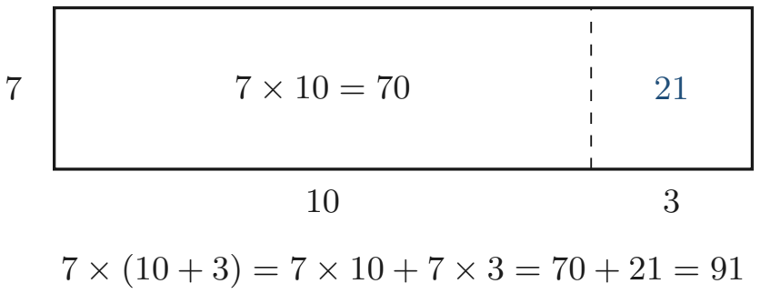

# Strand 1: Number
## Sub-strand 2: Number Operations
### Lesson 2 (Day 4): Number Properties and Operational Laws

---

## 1. Curriculum Standard and Overview

- **Strand**: 1 — Number
- **Sub-strand**: 2 — Number Operations
- **Content Standard**: B9.1.2.1 — Demonstrate understanding of number properties and operational laws, and apply them to solve problems.
- **Indicators**:
  - **B9.1.2.1.2** — Determine the commutative properties of addition and multiplication.
  - **B9.1.2.1.3** — Use the associative property of addition and multiplication.
  - **B9.1.2.1.4** — Use the distributive property in solving problems.
- **Scope of this lesson**:
  1. The commutative property — swapping numbers.
  2. The associative property — re-grouping numbers.
  3. Operations that break the laws (subtraction and division).
  4. The distributive property — sharing a multiplier out.
  5. Using the three laws for fast mental arithmetic.
  6. A bridge into algebra: why these laws make expressions like $5(3-y)$ expand the way they do.
- **Mock-paper links (this lesson feeds)**:
  - Mock 2026 P1 Q18 — expanding $5 - 5(3-y)$ requires the distributive property (full inequality treatment comes in the Equations & Inequalities lesson).
  - Mock 2026 P1 Q40 — dividing 12 cakes into equal packets builds on the structure of multiplication (included as an exercise).
  - Mock 2026 P2 Q4(d) and Q6(a) — expanding brackets such as $2[(x+2)+(2x+1)]$ and $(6x+2)(5x+8)$ is powered by the distributive property.
- **Exercise quota (user override, October 2026)**: **5 exercise sections × 5 questions = 25 questions, no multiple choice, every question with a full worked answer.** (This replaces the tracker's default 8 × 5 quota for lessons delivered in this round. Spiral review: 20% — questions 4(d)5, 5(e)4, 5(e)5 revisit earlier lessons.)

---

## 2. Preamble — What Is a "Property" or a "Law"?

Every game has rules that never change. Football: the ball must cross the line to be a goal — every match, every pitch, every referee. Mathematics has rules like that too. We call them **properties** or **laws of operation**.

A **property** is a fact about how numbers behave that is true *always*, not just sometimes. If a statement is true for *every possible pair or group of numbers*, it deserves the title "property". If it fails even once, it is **not** a property — and part of this lesson is spotting the failures.

Why should you care? Two reasons:

1. **Speed.** The laws are the engine of mental arithmetic. $8 \times 43 \times 125$ looks slow, but re-group it (associative property) and it takes two seconds.
2. **Algebra.** Everything you will do later with brackets — expand, factorise, solve equations — is just these three laws wearing algebraic clothes. Learn them now with plain numbers, and algebra will feel familiar.

**Unpacking the three key words** (each is stolen from ordinary English):

| Word | Everyday meaning | In mathematics |
| :--- | :--- | :--- |
| **Commutative** | from *commute* — to swap/interchange places (like commuting between Kumasi and Accra: two direction options) | You can **swap the two numbers** — the order does not matter |
| **Associative** | from *associate* — to group with/keep company | You can **re-group the numbers** (move the brackets) — the grouping does not matter |
| **Distributive** | from *distribute* — to hand out, share out (like a teacher distributing books) | You can **hand out the multiplication** to each number inside the bracket |

---

## 3. The Commutative Property — Swap the Numbers

### 3.1 Addition is commutative

For **any** numbers $a$ and $b$:

$$a + b = b + a$$

Check with real values: $7 + 5 = 12$ and $5 + 7 = 12$. Same sum. Put $5\,000$ cakes on one side and $7$ on the other — swapping which one you count first does not change how many you have in total.

### 3.2 Multiplication is commutative

For **any** numbers $a$ and $b$:

$$a \times b = b \times a$$

$4 \times 927 = 927 \times 4 = 3\,708$. Think of an array: 4 rows of 927 dots vs 927 rows of 4 dots — different orientations, same number of dots.

### 3.3 Subtraction and division are NOT commutative

This is where students lose marks: assuming "it works" for subtraction and division.

$$9 - 4 = 5, \qquad 4 - 9 = -5. \qquad 5 \ne -5.$$

$$12 \div 3 = 4, \qquad 3 \div 12 = 0.25. \qquad 4 \ne 0.25.$$

> **Rule to hold on to:** the commutative property belongs to **addition and multiplication only**. If you ever see $a - b = b - a$ or $a \div b = b \div a$ claimed as a general rule, it is false — one counterexample settles it.

---

## 4. The Associative Property — Move the Brackets

### 4.1 Addition is associative

For **any** numbers $a$, $b$, $c$:

$$(a + b) + c = a + (b + c)$$

The brackets only say "do this pair first". With addition you can compute any pair first and land on the same total:

$$(2 + 19) + 81 = 21 + 81 = 102, \qquad 2 + (19 + 81) = 2 + 100 = 102.$$

Notice how the second version was *easier*: $19 + 81$ gives a round $100$. This is the associative property at work as a mental maths tool — **hunt for pairs that make multiples of 10**.

### 4.2 Multiplication is associative

For **any** numbers $a$, $b$, $c$:

$$(a \times b) \times c = a \times (b \times c)$$

$(8 \times 5) \times 20 = 40 \times 20 = 800$ and $8 \times (5 \times 20) = 8 \times 100 = 800$. The first grouping gave $40$; the second gave a friendlier $100$. Choose the grouping that produces round numbers!

### 4.3 The identities (special neutral numbers)

Two small properties travel with the associative property:

- **Additive identity:** $a + 0 = 0 + a = a$. Zero changes nothing.
- **Multiplicative identity:** $a \times 1 = 1 \times a = a$. One changes nothing.

### 4.4 Subtraction and division are NOT associative

$$(20 - 10) - 5 = 10 - 5 = 5, \qquad 20 - (10 - 5) = 20 - 5 = 15.$$

Two different totals from the same three numbers — the bracket move fails.

$$(16 \div 4) \div 2 = 4 \div 2 = 2, \qquad 16 \div (4 \div 2) = 16 \div 2 = 8.$$

Again, two different answers — the law does not hold.

Moving the brackets in subtraction or division **changes the answer**. BODMAS exists partly because of this: the position of the brackets is meaningful for these operations.

---

## 5. The Distributive Property — Hand the Multiplier Out

### 5.1 The rule

For **any** numbers $a$, $b$, $c$:

$$a \times (b + c) = a \times b + a \times c$$

$$a \times (b - c) = a \times b - a \times c$$

The multiplier $a$ does not see $(b + c)$ as one lump — it **distributes itself** to each member of the bracket.

### 5.2 The rectangle picture

See Figure 1: one big rectangle of base $10 + 3$ and height $7$ has the same area as the two smaller rectangles $7 \times 10$ and $7 \times 3$ glued side by side. The distributive property is really a statement about cutting rectangles.

### 5.3 Working both directions

- **Expanding (bracket side):** $7 \times 13 = 7 \times (10 + 3) = 70 + 21 = 91$.
- **Collecting (product side — used far more in algebra):** $36 + 4 = 4 \times 9 + 4 \times 1 = 4 \times (9 + 1) = 40$.

---

## 6. Mental Arithmetic with the Laws

This is the section that turns the laws from theory into marks on a speed test.

### 6.1 Make the addition round (commutative + associative)

For $199 + 364$: swap so the awkward $199$ becomes $200$, add, then correct the extra $1$:

$$199 + 364 = (200 + 364) - 1 = 564 - 1 = 563.$$

### 6.2 Re-group the multiplication (associative)

Multiply in whatever order makes a round product. Learn these friends: $2 \times 5 = 10$, $4 \times 25 = 100$, $8 \times 125 = 1\,000$.

$$25 \times 16 = 25 \times (4 \times 4) = (25 \times 4) \times 4 = 100 \times 4 = 400.$$

$$8 \times 43 \times 125 = (8 \times 125) \times 43 = 1\,000 \times 43 = 43\,000.$$

### 6.3 Split a factor near a round number (distributive)

$$98 \times 7 = (100 - 2) \times 7 = 700 - 14 = 686.$$

$$501 \times 12 = (500 + 1) \times 12 = 6\,000 + 12 = 6\,012.$$

> **Exam habit:** when a question says "without a calculator" or "use suitable properties", the examiner is telling you the intended route — a law, not long column arithmetic.

---

## 7. Fifteen Fully Worked Examples (Mixed Angles)

### Example 1 — Spot the swapped sum
Ara's working shows $345 + 78 = 78 + 345$. Which property makes this true?

Both sides equal $423$. Swapping the two addends changed nothing, and it would work for **any** two numbers.
**Answer:** The commutative property of addition.

### Example 2 — Spot the swapped product
Show that $4 \times 927 = 927 \times 4$ without long multiplication.

$4 \times 927$: split $927 = 900 + 27$ (distributive): $3\,600 + 108 = 3\,708$.
$927 \times 4 = 927 + 927 + 927 + 927 = 3\,708$ (repeated addition, same total).
**Answer:** Both are $3\,708$ — commutative property of multiplication.

### Example 3 — Moving brackets in addition
Evaluate $(2 + 19) + 81$ and $2 + (19 + 81)$.

First: $21 + 81 = 102$. Second: $2 + 100 = 102$.
**Answer:** Both $= 102$ — the associative property of addition. The second grouping was faster because $19 + 81$ makes $100$.

### Example 4 — Why subtraction cannot commute
Kwame says: "It never matters which way you compute: $9 - 4$ or $4 - 9$." Correct him with a counterexample.

$9 - 4 = 5$, but $4 - 9 = -5$. Different answers, so subtraction is **not** commutative. One counterexample is enough to disprove a claimed property.

### Example 5 — Why division cannot be regrouped
Evaluate $(16 \div 4) \div 2$ and $16 \div (4 \div 2)$.

$(16 \div 4) \div 2 = 4 \div 2 = 2$. But $16 \div (4 \div 2) = 16 \div 2 = 8$.
**Answer:** $2 \ne 8$, so division is **not** associative. Brackets are compulsory in division.

### Example 6 — Distributive into a sum
Work out $7 \times (10 + 3)$ in two ways.

Way 1 (distribute): $7 \times 10 + 7 \times 3 = 70 + 21 = 91$.
Way 2 (bracket first): $7 \times 13 = 91$.
**Answer:** $91$ both ways — same property, same result.

### Example 7 — Distributive into a difference
Work out $6 \times (50 - 2)$ by distributing.

$6 \times 50 - 6 \times 2 = 300 - 12 = 288$.
(Check: $6 \times 48 = 288$, correct.)

### Example 8 — Distributive in three parts
Work out $8 \times (100 + 30 + 7)$.

$800 + 240 + 56 = 1\,096$.
**Answer:** $1\,096$ (= $8 \times 137$). The multiplier may be handed out to any number of parts of the bracket.

### Example 9 — The mystery bracket
Find $?$ if $7 \times (12 + ?) = 84 + 35$.

Distribute the left side: $7 \times 12 + 7 \times ? = 84 + 7\,?$.
Compare with the right side: $84 + 7? = 84 + 35 \Rightarrow 7? = 35 \Rightarrow ? = 5$.
(Check: $7 \times 17 = 119$ and $84 + 35 = 119$ — correct.)

### Example 10 — Round-up-and-correct addition
Mentally compute $199 + 364$.

$(200 + 364) - 1 = 564 - 1 = 563$.
**Answer:** $563$. Used laws: commutative + associative to reach the friendly $200$.

### Example 11 — Friendly pair re-grouping
Mentally compute $25 \times 16$.

$16 = 4 \times 4$, so $25 \times (4 \times 4) = (25 \times 4) \times 4 = 100 \times 4 = 400$.
**Answer:** $400$ — associative property chosen so a round $100$ appears first.

### Example 12 — Three-factor re-grouping
Mentally compute $8 \times 43 \times 125$.

Re-order and re-group: $(8 \times 125) \times 43 = 1\,000 \times 43 = 43\,000$.
**Answer:** $43\,000$ (uses commutative + associative of multiplication).

### Example 13 — Near-round multiplier
Mentally compute $98 \times 7$.

$(100 - 2) \times 7 = 700 - 14 = 686$.
**Answer:** $686$ — distributive property over subtraction.

### Example 14 — Authentic BECE 1998: name the property
**State the property used in the statement** $p(q + r) = pq + pr$.

The multiplier $p$ on the outside of the bracket has been handed out to both $q$ and $r$ inside it, becoming $pq + pr$.
**Answer:** The **distributive** property (official key: distributive). *(Bank item `Q_db644641d061`.)*

### Example 15 — Bridge to algebra (mock-linked)
**Expand and simplify, using the distributive property:**

**(a)** $5(3 - y)$ — the shape of Mock P1 Q18's first move.
$5 \times 3 - 5 \times y = 15 - 5y$.

**(b)** $2(3x + 3)$ — the shape of Mock P2 Q4(d)'s inner step.
$2 \times 3x + 2 \times 3 = 6x + 6$.

**(c)** Stretch (authentic BECE 2009, `Q_cbcf875f87f8`): solve $2x - 3(x - 1) = 6$.
Distribute: $2x - 3x + 3 = 6 \Rightarrow -x + 3 = 6 \Rightarrow x = -3$ (official key: $-3$). Full equation-solving technique is delivered in the Equations & Inequalities lesson — here, notice that the *only new move* was the distributive property.

---

## 8. Exercise Sets (5 × 5, No MCQ)

**Instructions:** write full workings for every question. Where a question asks you to *state* a property, name it and say briefly why. Calculator use is not needed anywhere.

### Exercise 1 — Name that property

1. $7 + 519 = 519 + 7$. What property does this show?
2. $(8 \times 5) \times 20 = 8 \times (5 \times 20)$. What property does this show?
3. $12 \times (30 + 4) = 360 + 48$. What property turns the left side into the right side?
4. Explain, with numbers, why $9 - 4$ is not equal to $4 - 9$. Which property is *missing* in subtraction?
5. Find the missing number so that the statement stays true for any value: $? \times 35 = 35 \times 72$. Then name the property that guarantees your answer is the *only* possible one.

### Exercise 2 — True or false (justify each)

1. "Multiplication is commutative." True or false? Give a reason or example.
2. "Subtraction is associative." True or false? Justify with $(20 - 10) - 5$ vs $20 - (10 - 5)$.
3. $a \times (b + c) = a \times b + a \times c$ for all numbers $a$, $b$, $c$. True or false?
4. $12 \div 3 = 3 \div 12$. True or false? Compute both sides to justify.
5. Adding zero changes nothing; multiplying by one changes nothing. State the names of these two properties.

### Exercise 3 — Mental arithmetic with the laws

Compute mentally, and write one sentence naming the properties you used.

1. $199 + 450$
2. $25 \times 36$
3. $8 \times 34 \times 125$
4. $97 \times 4$
5. A trader buys 98 exercise books at GH₵ 4 each. Use the distributive property to find the total cost mentally.

### Exercise 4 — Fill the gaps

1. Complete: $6 \times (12 + ?) = 72 + 30$.
2. Complete: $9 \times (100 - 2) = 900 - ?$.
3. Complete: $(7 + 8) + 25 = 7 + (? + 25)$.
4. Using friendly re-grouping, find $?$ in $4 \times 5 \times ? = 400$.
5. **Spiral review (standard form, Day 1):** Without long multiplication, use a friendly pair to compute $5 \times 2\,000 \times 8$, then write the answer in standard form.

### Exercise 5 — Applied problems and the bridge to algebra

1. Expand $5(3 - y)$ using the distributive property.
2. Expand and simplify $2(3x + 3)$.
3. **[Mock 2026 P1 Q40]** A baker has 12 identical cakes. In how many different ways can he divide them up into equal packets? List every way.
4. **Spiral review (indices/number operations, Day 3):** Evaluate $5 \times 2^3 \times 2^2$ in a quick way using re-grouping, then express the answer as a power of 2 combined with 5, and in standard form.
5. **Spiral review (standard form, Day 1):** Use a friendly pair to compute $25 \times 400$, and express the answer in standard form.

---

## 9. Full Worked Solutions

### Exercise 1

**1.** $7 + 519 = 526$ and $519 + 7 = 526$. The two addends swapp­ed places without changing the sum.
**Property: commutative property of addition.**

**2.** Both sides regroup the three factors. Left: $40 \times 20 = 800$. Right: $8 \times 100 = 800$.
**Property: associative property of multiplication.**

**3.** The multiplier $12$ has been handed out to $30$ and to $4$: $360 + 48$.
**Property: distributive property.**

**4.** $9 - 4 = 5$ but $4 - 9 = -5$. Different answers, so the operations cannot be swapped freely.
**Subtraction is missing the commutative property.**

**5.** By the commutative property of multiplication, $a \times b = b \times a$ is true for **every** pair of numbers, so the other factor must be $72$: the blank is $\mathbf{72}$.
The guarantee is the **commutative property** — whatever number multiplies 35 on the left must be the number 35 multiplies on the right.

### Exercise 2

**1. True.** $a \times b = b \times a$ always; e.g. $4 \times 11 = 11 \times 4 = 44$.

**2. False.** $(20 - 10) - 5 = 5$, but $20 - (10 - 5) = 15$. The two groupings give different results, so moving brackets is not allowed in subtraction.

**3. True.** This is the distributive property — true for all numbers (the rectangle picture guarantees it).

**4. False.** $12 \div 3 = 4$ but $3 \div 12 = 0.25$. Division is not commutative — swapping divisor and dividend changes the answer.

**5.** Zero is the **additive identity** ($a + 0 = a$); one is the **multiplicative identity** ($a \times 1 = a$).

### Exercise 3

**1.** $199 + 450 = (200 + 450) - 1 = 650 - 1 = \mathbf{649}$.
Used: commutative + associative to reach the round $200$, then corrected by the extra $1$.

**2.** $25 \times 36 = 25 \times (4 \times 9) = (25 \times 4) \times 9 = 100 \times 9 = \mathbf{900}$.
Used: factorising $36 = 4 \times 9$, then the associative property for the friendly $100$.

**3.** $8 \times 34 \times 125 = (8 \times 125) \times 34 = 1\,000 \times 34 = \mathbf{34\,000}$.
Used: commutative property to place $8 \times 125$ together, then associativity.

**4.** $97 \times 4 = (100 - 3) \times 4 = 400 - 12 = \mathbf{388}$.
Used: writing $97 = 100 - 3$, then the distributive property over subtraction.

**5.** Total $= 98 \times 4$, and $98 = 100 - 2$:
$(100 - 2) \times 4 = 400 - 8 = \mathbf{GH₵\,392}$.
Used: distributive property over subtraction.

### Exercise 4

**1.** $6 \times (12 + ?) = 6 \times 12 + 6? = 72 + 6?$. Compare with $72 + 30$: $6? = 30 \Rightarrow ? = \mathbf{5}$.
(Check: $6 \times 17 = 102$ and $72 + 30 = 102$ — correct.)

**2.** $9 \times (100 - 2) = 900 - 9 \times 2 = 900 - \mathbf{18}$.

**3.** The associative property keeps the *values* in place and only moves the brackets, so the blank is $\mathbf{8}$.

**4.** Friendly re-grouping: we want two of the three factors to give a round product. $4 \times 5 = 20$ is not round, so choose $? = 20$ so that $5 \times 20 = 100$ can be grouped next to the remaining factor: $4 \times (5 \times 20) = 4 \times 100 = 400$, check confirmed, so $? = \mathbf{20}$.

**5.** Friendly pair: $5 \times 8 = 40$, so $5 \times 2\,000 \times 8 = (5 \times 8) \times 2\,000 = 40 \times 2\,000 = 80\,000$.
Standard form: $80\,000 = \mathbf{8 \times 10^4}$.

### Exercise 5

**1.** $5(3 - y) = 5 \times 3 - 5 \times y = \mathbf{15 - 5y}$ (distributive property).

**2.** $2(3x + 3) = 2 \times 3x + 2 \times 3 = \mathbf{6x + 6}$.

**3.** Equal packets of size $k$ means $k$ is a factor of 12. Bonus method (distributive thinking): if 12 cakes split into $p$ packets with $k$ cakes each, then $p \times k = 12$.
Factor pairs of 12: $1 \times 12$, $2 \times 6$, $3 \times 4$, $4 \times 3$, $6 \times 2$, $12 \times 1$.
Distinct equal-packet groupings: 12 packets of 1; 6 of 2; 4 of 3; 3 of 4; 2 of 6; 1 packet of 12.
**Answer: 6 ways** (matches the official key **C**).

**4.** Multiply the powers of 2 first (associative cs.): $5 \times (2^3 \times 2^2) = 5 \times 2^5 = 5 \times 32 = 160$.
As an expression: $\mathbf{5 \times 2^5}$; in standard form: $160 = \mathbf{1.6 \times 10^2}$.

**5.** Friendly pair: $25 \times 4 = 100$, and $400 = 4 \times 100$, so
$25 \times 400 = 25 \times (4 \times 100) = (25 \times 4) \times 100 = 10\,000$.
Standard form: $10\,000 = \mathbf{1 \times 10^4}$.

---

## 10. Bank and Mock Links

| Item | ID | Source | Where used |
| :--- | :--- | :--- | :--- |
| State the property in $p(q+r) = pq+pr$ (BECE 1998) | `Q_db644641d061` | BECE 1990–2013 compilation | Example 14 |
| Solve $2x - 3(x-1) = 6$ (BECE 2009) | `Q_cbcf875f87f8` | BECE 1990–2013 compilation | Example 15(c) |
| 12 cakes into equal packets (Mock 2026 P1 Q40) | `Q_d5a5e61b82f1` | user mock 0201-026/27 | Exercise 5, Q3 |

---

## 11. Lesson Summary (Cheat Sheet)

| Law | Statement | Works for | Fails for |
| :--- | :--- | :--- | :--- |
| Commutative | $a + b = b + a$; $a \times b = b \times a$ | $+$ and $\times$ | $-$ and $\div$ |
| Associative | $(a+b)+c = a+(b+c)$; $(ab)c = a(bc)$ | $+$ and $\times$ | $-$ and $\div$ |
| Distributive | $a(b \pm c) = ab \pm ac$ | bridges $\times$ into $+/- $ | — |
| Identities | $a + 0 = a$; $a \times 1 = a$ | all | — |

**Mental maths trio:** make the addition round (swap + re-group), make the product round (friendly pairs: $4\times25$, $8\times125$), split the near-round factor (distribute $100 - 2$ style).

---

*Lesson prepared under `Grade9-Maths/Rules.md` — plain English, British notation, full workings for every question. Quota override in force for this round: 5 sections × 5 questions.*
