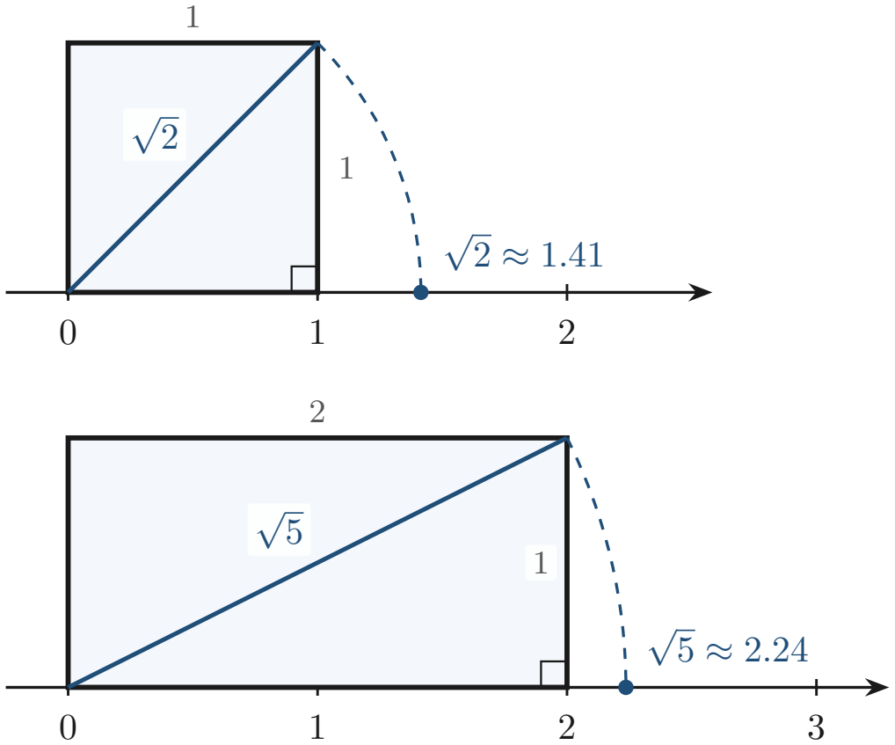
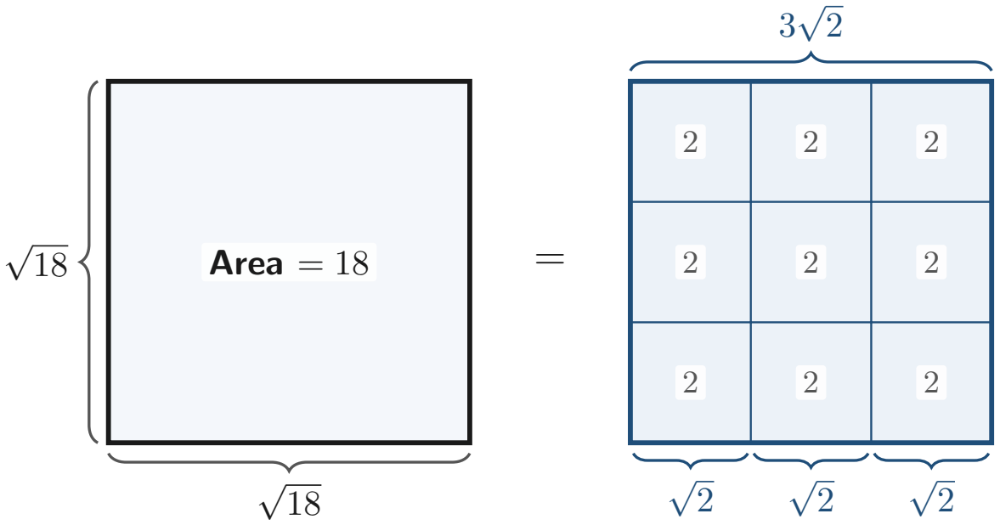
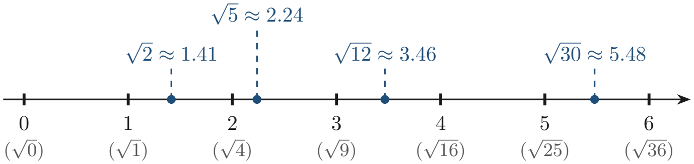

# Strand 1: Number
## Sub-strand 2: Number Operations
### Lesson 4: Surds and Irrational Roots

---

## 1. Curriculum Standard and Overview

- **Strand**: 1 — Number
- **Sub-strand**: 2 — Number Operations
- **Content Standard**: `B9.1.2.4` — Demonstrate understanding of surds as real numbers, the process of adding and subtracting surds, and determining the approximate square root of a number that is not a perfect square.
- **Indicators**:
  - **B9.1.2.4.1** — Identify simple and compound surds.
  - **B9.1.2.4.2** — Explain and apply the six identities/rules of surds (product, quotient, monomial rationalisation, like-surd addition/subtraction, and binomial conjugate rationalisation).
  - **B9.1.2.4.3** — Simplify given surds (whole-number, fractional, and squared surd expressions).
  - **B9.1.2.4.4** *(listed as `B9.1.2.3.4` in the NaCCA print schedule)* — Approximate the square roots of non-perfect squares using bounding perfect squares, tables, and calculators.
- **Scope of this lesson**:
  1. Words to know first: perfect squares, square roots, rational numbers, irrational numbers, and surds.
  2. Locating surds on the real number line using right-angled triangles.
  3. Distinguishing simple surds from compound surds (and spotting non-surd traps).
  4. The six rules of surds — multiplication, division, like-surd addition/subtraction, and rationalisation.
  5. Simplifying whole-number and fractional surds by extracting the largest perfect-square factor.
  6. Expanding brackets and using conjugate pairs to rationalise binomial denominators.
  7. Bounding and approximating non-perfect square roots ($\sqrt{2}$, $\sqrt{5}$, $\sqrt{12}$, $\sqrt{30}$).
- **Authentic BECE and Mock Bank links covered**:
  - Bank `Q_035c3af8e14a` & `Q_1408c497fc6a` (2026 P2 Essay) — testing whether $\sqrt{9}$ and $\sqrt{7}$ are rational or irrational.
  - Bank `Q_211cd01da916` (Paper 1) — simplifying $\sqrt{0.49}$ *(flagging and correcting the scraped key error)*.
  - Bank `Q_100763c6357d`, `Q_8918a066bbc2` *(scraped key corrected)*, `Q_b09353377c3e`, `Q_440eb256be37`, `Q_7b450aaffce5`, `Q_2e8db88bdca3` (Paper 1) — simplifying and combining like surds.
  - Bank `Q_798dd0c63efe` (Paper 1) — expanding binomial surd products.
  - Bank `Q_997c6cd544af` (Paper 2 Theory) — rationalising a binomial surd denominator into $a + b\sqrt{c}$ form.
- **Exercise quota**: **8 exercise sections × 5 questions = 40 questions** (Paper 1 Objective Sections 1–3 and Paper 2 Structured Theory Sections 4–8 with `[marks]`), including **15% spiral review (`6/40` questions tagged `[Review]`)** from Lessons 1–3, plus complete step-by-step marking-scheme solutions.

---

## 2. Preamble — Why Do Surds Exist?

Take a square tile whose side is $1\text{ m}$ by $1\text{ m}$. Its area is $1 \times 1 = 1\text{ m}²$. Now cut a diagonal straight across it from corner to corner. By Pythagoras' theorem, the length of that diagonal satisfies:

$$d^2 = 1^2 + 1^2 = 2 \qquad \Longrightarrow \qquad d = \sqrt{2}$$

You can see that diagonal and measure it on the tile. It is a genuine physical length. Yet if you try to write $\sqrt{2}$ as an exact decimal or fraction, it refuses to settle:

$$\sqrt{2} = 1.41421356237…$$

The digits go on forever without ever repeating in a cycle. Because you **cannot** write $\sqrt{2}$ as an exact whole-number fraction $\frac{p}{q}$, we leave the root sign on and write **$\sqrt{2}$** as an **exact value**. Leaving the square-root symbol intact gives us a **surd**.

Look at **Figure 1**. Even though $\sqrt{2} \approx 1.41$ and $\sqrt{5} \approx 2.24$ have endless decimals, compass arcs drop them onto exact points on the number line between $1$ and $2$, and between $2$ and $3$. Every surd is a **real number** with one fixed position on the number line.

### Words to know first

| Term | Plain-English meaning | Examples |
| :--- | :--- | :--- |
| **Perfect square** | A whole number made by multiplying a whole number by itself ($n²$). | $1, 4, 9, 16, 25, 36, 49, 64, 81, 100, 121, 144$ |
| **Square root ($\sqrt{a}$)** | The positive number which, when multiplied by itself, gives $a$. | $\sqrt{25} = 5$ because $5 \times 5 = 25$ |
| **Radicand** | The number sitting inside (underneath) the root sign. | In $7\sqrt{3}$, the radicand is $3$ |
| **Rational number ($\mathbb{Q}$)** | Any number that can be written exactly as $\frac{p}{q}$ ($p, q \in \mathbb{Z},\; q \ne 0$). | $4,\; -3,\; \frac{5}{8},\; 0.7,\; \sqrt{9} = 3$ |
| **Irrational number ($\mathbb{Q}'$)** | A real number whose decimal never ends and never repeats. | $\sqrt{2},\; \sqrt{7},\; \pi$ |
| **Surd** | An **irrational root** of a rational number — a root that cannot simplify to an exact fraction or whole number. | $\sqrt{2},\; \sqrt{18},\; 7\sqrt{3}$ *(NOT $\sqrt{9}$ or $\sqrt{0.49}$!)* |
| **Conjugate pair** | Two binomial surd expressions that differ only by the middle $+$ or $-$ sign. | $3 + \sqrt{2}$ and $3 - \sqrt{2}$ |
| **Rationalise** | Rewriting a fraction so there is **no surd left in the denominator** (bottom). | $\frac{1}{\sqrt{2}} = \frac{\sqrt{2}}{2}$ |

> **The quick test for a surd:** Ask *"Does the number inside the root have an exact whole-number or terminating/repeating fraction root?"*  
> - If **YES** (like $\sqrt{36} = 6$, $\sqrt{0.49} = 0.7$, or $\sqrt{16/25} = \frac{4}{5}$), it is **rational — NOT a surd**.  
> - If **NO** (like $\sqrt{2}$, $\sqrt{12}$, or $\sqrt{5/9}$), it is **irrational — a surd**.

---

## 3. Simple and Compound Surds (`B9.1.2.4.1`)

Surds come in two structural shapes:

1. **Simple (monomial) surds** — have **one term** of the form $\sqrt{b}$ or $a\sqrt{b}$ (a rational coefficient multiplied by a single irrational root):
   - Examples: $\sqrt{2}$, $7\sqrt{3}$, $2\sqrt{5}$, $-\frac{1}{2}\sqrt{11}$.
2. **Compound (binomial / polynomial) surds** — made by **adding or subtracting** two or more unlike terms where at least one term is a surd:
   - Examples: $3 + \sqrt{2}$, $\sqrt{5} - \sqrt{3}$, $4 - 2\sqrt{7}$, and $(\sqrt{3} + \sqrt{7} - \sqrt{5})$.

### Watch out for disguised rationals and disguised simple surds

- **Disguised rational:** $\sqrt{0.49} = \frac{\sqrt{49}}{\sqrt{100}} = \frac{7}{10} = 0.7$. Because $49$ and $100$ are both perfect squares, $\sqrt{0.49}$ is **not a surd**.
- **Disguised rational product:** $\sqrt{3} \times \sqrt{12} = \sqrt{36} = 6$. Two surds multiplied together can simplify to a rational number!
- **Disguised simple surd:** $\sqrt{12} + \sqrt{27}$ looks compound at first glance, but $\sqrt{12} = 2\sqrt{3}$ and $\sqrt{27} = 3\sqrt{3}$, so $\sqrt{12} + \sqrt{27} = 5\sqrt{3}$, which is actually a **simple surd**! Always simplify first before classifying.

---

## 4. The Six Rules of Surds (`B9.1.2.4.2`)

The NaCCA curriculum specifies **six core identities** for manipulating surds. Let $a, b, m, n, c$ be positive numbers (with $m$ not a perfect square):

### Rule 1 — Multiplication (Product Rule)

$$\sqrt{a \times b} = \sqrt{a} \times \sqrt{b}$$

**Special square identity:** When $b = a$, $\sqrt{a} \times \sqrt{a} = (\sqrt{a})² = \sqrt{a²} = a$. Squaring a square root cancels the root sign!

**Why Rule 1 works geometrically:** Look at **Figure 2**. A square of area $18$ has side $\sqrt{18}$. If you cut that $18$-unit square into a $3 \times 3$ grid of $9$ smaller tiles of area $2$, each small tile has side $\sqrt{2}$. Counting along one edge gives $3$ tiles of length $\sqrt{2}$:

$$\sqrt{18} = \sqrt{9 \times 2} = \sqrt{9} \times \sqrt{2} = 3\sqrt{2}$$

### Rule 2 — Division (Quotient Rule)

$$\sqrt{\frac{a}{b}} = \frac{\sqrt{a}}{\sqrt{b}} \qquad (b \ne 0)$$

A root of a fraction equals the root of the numerator divided by the root of the denominator.  
Example:

$$\sqrt{\frac{12}{121}} = \frac{\sqrt{12}}{\sqrt{121}} = \frac{\sqrt{4 \times 3}}{11} = \frac{2\sqrt{3}}{11}$$

### Rule 3 — Rationalising a Monomial Denominator

$$\frac{a}{\sqrt{b}} = \frac{a}{\sqrt{b}} \times \frac{\sqrt{b}}{\sqrt{b}} = \frac{a\sqrt{b}}{b}$$

Why multiply top and bottom by $\sqrt{b}$? Because $\frac{\sqrt{b}}{\sqrt{b}} = 1$, so the value of the fraction does not change, while the bottom becomes $\sqrt{b} \times \sqrt{b} = b$ — a clean whole number!

### Rule 4 — Adding and Subtracting Like Surds

$$m\sqrt{a} \pm n\sqrt{a} = (m \pm n)\sqrt{a}$$

Surds with the **same simplified radicand** behave exactly like algebraic like terms ($5x + 2x = 7x$).  
- **Like surds:** $5\sqrt{3} + 2\sqrt{3} = 7\sqrt{3}$.
- **Unlike surds:** $5\sqrt{3} + 2\sqrt{2}$ **cannot** be combined further.

> **Common mistake to avoid forever:** You can split roots across **multiplication and division**, NEVER across addition or subtraction.

$$\sqrt{a + b} \ne \sqrt{a} + \sqrt{b}$$

Test with numbers: $\sqrt{9 + 16} = \sqrt{25} = 5$, whereas $\sqrt{9} + \sqrt{16} = 3 + 4 = 7$. Clearly $5 \ne 7$!

### Rules 5 & 6 — Rationalising a Binomial Denominator Using Conjugates

**Rule 5 ($+$ in the denominator — multiply by the $-$ conjugate):**

$$\frac{c}{a + b\sqrt{m}} = \frac{c}{a + b\sqrt{m}} \times \frac{a - b\sqrt{m}}{a - b\sqrt{m}} = \frac{c(a - b\sqrt{m})}{a^2 - b^2 m}$$

**Rule 6 ($-$ in the denominator — multiply by the $+$ conjugate):**

$$\frac{c}{a - b\sqrt{m}} = \frac{c}{a - b\sqrt{m}} \times \frac{a + b\sqrt{m}}{a + b\sqrt{m}} = \frac{c(a + b\sqrt{m})}{a^2 - b^2 m}$$

**Why does the conjugate kill the root in the bottom?** Because of the **difference of two squares** identity $(A + B)(A - B) = A² - B²$:

$$(a + b\sqrt{m})(a - b\sqrt{m}) = a^2 - (b\sqrt{m})^2 = a^2 - b^2 m$$

The cross-terms $+ab\sqrt{m}$ and $-ab\sqrt{m}$ cancel out completely, leaving a pure rational integer $a² - b²m$.

---

## 5. Simplifying Surds and Expanding Brackets (`B9.1.2.4.3`)

### 5.1 Simplest surd form ($k\sqrt{p}$)

A surd is in **simplest form** when the radicand $p$ contains **no perfect-square factor other than $1$**. Always scan for the **largest** square factor from $\{4, 9, 16, 25, 36, 49, 64, 81, 100, 121, 144\}$:

1. $\sqrt{27} = \sqrt{9 \times 3} = \sqrt{9} \times \sqrt{3} = 3\sqrt{3}$.
2. $\sqrt{72} = \sqrt{36 \times 2} = 6\sqrt{2}$ *(faster than $\sqrt{4 \times 18}$, though both give $6\sqrt{2}$ if you keep factoring!)*.
3. $\sqrt{147} = \sqrt{49 \times 3} = 7\sqrt{3}$.
4. Fractional simplification *(or reduce the fraction inside first)*:

$$\sqrt{\frac{8}{16}} = \frac{\sqrt{8}}{\sqrt{16}} = \frac{2\sqrt{2}}{4} = \frac{\sqrt{2}}{2} \qquad \text{or} \qquad \sqrt{\frac{8}{16}} = \sqrt{\frac{1}{2}} = \frac{1}{\sqrt{2}} = \frac{\sqrt{2}}{2}$$

### 5.2 Expanding brackets with surds

Use the distributive law (every term in the first bracket multiplies every term in the second):

$$(a + \sqrt{b})(c + \sqrt{d}) = ac + a\sqrt{d} + c\sqrt{b} + \sqrt{bd}$$

Then simplify each root and collect like surds and whole numbers separately.

---

## 6. Approximating Non-Perfect Square Roots (`B9.1.2.3.4` / `B9.1.2.4.4`)

Even without a calculator, you can locate any square root between two consecutive whole numbers in seconds by sandwiching the radicand between two neighbouring perfect squares:

| Non-perfect root | Neighbouring squares | Integer bracket | Closer integer | Calculator value (2 d.p.) |
| :--- | :--- | :--- | :---: | :---: |
| $\sqrt{2}$ | $1 < 2 < 4$ | $1 < \sqrt{2} < 2$ | $1$ ($2$ is closer to $1$) | $1.41$ |
| $\sqrt{5}$ | $4 < 5 < 9$ | $2 < \sqrt{5} < 3$ | $2$ ($5$ is closer to $4$) | $2.24$ |
| $\sqrt{12}$ | $9 < 12 < 16$ | $3 < \sqrt{12} < 4$ | $3$ ($12$ is $3$ above $9$, $4$ below $16$) | $3.46$ |
| $\sqrt{30}$ | $25 < 30 < 36$ | $5 < \sqrt{30} < 6$ | $5$ ($30$ is $5$ above $25$, $6$ below $36$) | $5.48$ |

Look at **Figure 3**. Every non-perfect root sits cleanly inside its square-number window: $\sqrt{12}$ lies between $\sqrt{9} = 3$ and $\sqrt{16} = 4$, slightly below the halfway mark because $12$ is slightly closer to $9$ than to $16$. When using a calculator or four-figure square-root table, read the digits carefully and apply standard rounding rules to the requested decimal places or significant figures.

---

## 7. Fifteen Fully Worked Examples (NaCCA & Authentic BECE/Mock Items)

### Example 1 — Rational vs irrational square root (2026 P2 Essay — `Q_035c3af8e14a`)
**Is the square root of 9 rational? Give a reason.**

$$\sqrt{9} = 3 = \dfrac{3}{1}$$

Yes, $\sqrt{9}$ is **rational**, because $9$ is a perfect square ($3² = 9$) and $3$ can be written as the ratio of two integers $\frac{3}{1}$ with a non-zero denominator. *(It is NOT a surd.)*

---

### Example 2 — Identifying an irrational root (2026 P2 Essay — `Q_1408c497fc6a`)
**Is the square root of 7 rational or irrational? Give a reason.**

Since $4 < 7 < 9$, we know $2 < \sqrt{7} < 3$. Because $7$ is not a perfect square, $\sqrt{7} = 2.645751…$ has a non-terminating, non-repeating decimal expansion and cannot be written as $\frac{p}{q}$ for integers $p, q$. Therefore $\sqrt{7}$ is **irrational** (a simple surd).

---

### Example 3 — Classifying simple and compound surds (`B9.1.2.4.1`)
**Classify each expression as rational, a simple surd, or a compound surd: (i) $7\sqrt{3}$, (ii) $(\sqrt{3} + \sqrt{7} - \sqrt{5})$, (iii) $\sqrt{0.49}$, (iv) $\sqrt{8} + \sqrt{18}$.**

- (i) $7\sqrt{3}$ has one irrational root term → **simple surd**.
- (ii) $\sqrt{3} + \sqrt{7} - \sqrt{5}$ combines three unlike surds → **compound surd**.
- (iii) $\sqrt{0.49} = \frac{\sqrt{49}}{\sqrt{100}} = \frac{7}{10} = 0.7$ → **rational** *(not a surd)*.
- (iv) Simplify first: $\sqrt{8} + \sqrt{18} = 2\sqrt{2} + 3\sqrt{2} = 5\sqrt{2}$ → **simple surd**!

---

### Example 4 — Decimal square root trap (BECE Bank `Q_211cd01da916`)
**Simplify $\sqrt{0.49}$.**  
*Options in bank: A. $\frac{3}{5}$, B. $\frac{7}{10}$, C. $1$, D. $\sqrt{7}$. (Note: the scraped bank key incorrectly recorded C; we solve rigorously below.)*

$$\sqrt{0.49} = \sqrt{\frac{49}{100}} = \frac{\sqrt{49}}{\sqrt{100}} = \frac{7}{10}$$

Check: $0.7 \times 0.7 = 0.49$.  
**Correct Answer: B — $\frac{7}{10}$ (or $0.7$).**

---

### Example 5 — Simplifying whole-number and fractional surds (`B9.1.2.4.3` NaCCA)
**Simplify: (i) $\sqrt{27}$, (ii) $\sqrt{8/16}$, (iii) $\sqrt{12/121}$, (iv) $(\sqrt{2})²$.**

- (i) $\sqrt{27} = \sqrt{9 \times 3} = \sqrt{9} \times \sqrt{3} = 3\sqrt{3}$.
- (ii) $\sqrt{8/16} = \frac{\sqrt{4 \times 2}}{\sqrt{16}} = \frac{2\sqrt{2}}{4} = \frac{\sqrt{2}}{2}$.
- (iii) $\sqrt{12/121} = \frac{\sqrt{4 \times 3}}{\sqrt{121}} = \frac{2\sqrt{3}}{11}$.
- (iv) $(\sqrt{2})² = \sqrt{2} \times \sqrt{2} = 2$.

---

### Example 6 — Combining like surds (BECE Bank `Q_100763c6357d`)
**Simplify $\sqrt{27} - 3\sqrt{3} + \sqrt{3}$.**

Rewrite $\sqrt{27}$ in terms of $\sqrt{3}$:

$$\sqrt{27} - 3\sqrt{3} + \sqrt{3} = \sqrt{9 \times 3} - 3\sqrt{3} + \sqrt{3} = 3\sqrt{3} - 3\sqrt{3} + 1\sqrt{3} = (3 - 3 + 1)\sqrt{3} = \sqrt{3}$$

**Answer: $\sqrt{3}$ (Option C).**

---

### Example 7 — Multi-term surd reduction (BECE Bank `Q_b09353377c3e`)
**Evaluate $\sqrt{147} - \sqrt{75} + \sqrt{27}$.**

Factor out the largest perfect square from each term:
- $\sqrt{147} = \sqrt{49 \times 3} = 7\sqrt{3}$
- $\sqrt{75} = \sqrt{25 \times 3} = 5\sqrt{3}$
- $\sqrt{27} = \sqrt{9 \times 3} = 3\sqrt{3}$

Combine like terms:

$$7\sqrt{3} - 5\sqrt{3} + 3\sqrt{3} = (7 - 5 + 3)\sqrt{3} = 5\sqrt{3}$$

**Answer: $5\sqrt{3}$ (Option B).**

---

### Example 8 — Surds with leading multipliers (BECE Bank `Q_8918a066bbc2`)
**Simplify $3\sqrt{90} - \sqrt{40}$.**  
*(Note: the scraped bank record mis-keyed A; verify each step cleanly below.)*

$$3\sqrt{90} = 3\sqrt{9 \times 10} = 3 \times 3\sqrt{10} = 9\sqrt{10}$$

$$\sqrt{40} = \sqrt{4 \times 10} = 2\sqrt{10}$$

Subtract:

$$9\sqrt{10} - 2\sqrt{10} = 7\sqrt{10}$$

**Correct Answer: $7\sqrt{10}$ (Option C).**

---

### Example 9 — Two separate surd families (BECE Bank `Q_2e8db88bdca3`)
**Simplify $\sqrt{75} - \sqrt{18} - \sqrt{3} + \sqrt{2}$.**

Simplify the $\sqrt{3}$ family and the $\sqrt{2}$ family separately:
- $\sqrt{75} - \sqrt{3} = 5\sqrt{3} - \sqrt{3} = 4\sqrt{3}$
- $-\sqrt{18} + \sqrt{2} = -3\sqrt{2} + \sqrt{2} = -2\sqrt{2}$

Because $\sqrt{3}$ and $\sqrt{2}$ are unlike surds, leave them side by side:

$$\text{Result} = 4\sqrt{3} - 2\sqrt{2}$$

**Answer: $4\sqrt{3} - 2\sqrt{2}$ (Option A).**

---

### Example 10 — Expanding binomial surd brackets (BECE Bank `Q_798dd0c63efe`)
**Find the product of $(\sqrt{3} - 1)$ and $(2 - \sqrt{3})$.**

Multiply term by term using the distributive law:

$$(\sqrt{3} - 1)(2 - \sqrt{3}) = \sqrt{3}(2) - \sqrt{3}(\sqrt{3}) - 1(2) + 1(\sqrt{3})$$

$$= 2\sqrt{3} - 3 - 2 + \sqrt{3} = -5 + 3\sqrt{3}$$

**Answer: $-5 + 3\sqrt{3}$ (Option C).**

---

### Example 11 — Rationalising a monomial denominator (NaCCA Rule 3)
**Rationalise the denominator and simplify: $\frac{18}{\sqrt{6}}$.**

Multiply numerator and denominator by $\sqrt{6}$:

$$\frac{18}{\sqrt{6}} \times \frac{\sqrt{6}}{\sqrt{6}} = \frac{18\sqrt{6}}{6} = 3\sqrt{6}$$

**Answer: $3\sqrt{6}$.**

---

### Example 12 — Rationalising a binomial denominator (NaCCA Rules 5 & 6)
**Simplify $\frac{14}{3 - \sqrt{2}}$ by rationalising the denominator.**

The conjugate of $3 - \sqrt{2}$ is $3 + \sqrt{2}$. Multiply numerator and denominator by $(3 + \sqrt{2})$:

$$\frac{14}{3 - \sqrt{2}} \times \frac{3 + \sqrt{2}}{3 + \sqrt{2}} = \frac{14(3 + \sqrt{2})}{3^2 - (\sqrt{2})^2} = \frac{14(3 + \sqrt{2})}{9 - 2} = \frac{14(3 + \sqrt{2})}{7} = 2(3 + \sqrt{2}) = 6 + 2\sqrt{2}$$

**Answer: $6 + 2\sqrt{2}$.**

---

### Example 13 — Simplifying before rationalising (BECE Bank P2 `Q_997c6cd544af`)
**Simplify $\frac{\sqrt{72}}{\sqrt{18} - \sqrt{12}}$, leaving the answer in the form $a + b\sqrt{c}$, where $a$, $b$, and $c$ are integers.**

First simplify every root in the fraction:
- $\sqrt{72} = \sqrt{36 \times 2} = 6\sqrt{2}$
- $\sqrt{18} = \sqrt{9 \times 2} = 3\sqrt{2}$
- $\sqrt{12} = \sqrt{4 \times 3} = 2\sqrt{3}$

Substitute and multiply by the conjugate $3\sqrt{2} + 2\sqrt{3}$:

$$\frac{6\sqrt{2}}{3\sqrt{2} - 2\sqrt{3}} \times \frac{3\sqrt{2} + 2\sqrt{3}}{3\sqrt{2} + 2\sqrt{3}} = \frac{6\sqrt{2}(3\sqrt{2}) + 6\sqrt{2}(2\sqrt{3})}{(3\sqrt{2})^2 - (2\sqrt{3})^2}$$

Numerator: $18(\sqrt{2})² + 12\sqrt{6} = 36 + 12\sqrt{6}$.  
Denominator: $(9 \times 2) - (4 \times 3) = 18 - 12 = 6$.

$$\frac{36 + 12\sqrt{6}}{6} = 6 + 2\sqrt{6}$$

**Answer: $6 + 2\sqrt{6}$ ($a = 6$, $b = 2$, $c = 6$).**

---

### Example 14 — Approximating non-perfect square roots (`B9.1.2.3.4` NaCCA)
**Without using a calculator, determine which two consecutive integers $\sqrt{30}$ lies between, and state which integer it is closer to. Then verify with a calculator to 2 decimal places.**

Perfect squares around $30$: $5² = 25$ and $6² = 36$.

$$25 < 30 < 36 \qquad \Longrightarrow \qquad 5 < \sqrt{30} < 6$$

Distance from $25$ is $30 - 25 = 5$. Distance from $36$ is $36 - 30 = 6$. Since $5 < 6$, $\sqrt{30}$ is slightly closer to $5$ than to $6$ (just under $5.5$).  
Using a calculator: $\sqrt{30} \approx 5.4772 \approx 5.48$ (2 d.p.).

---

### Example 15 — Surds in geometry (perimeter and area of a rectangle)
**A rectangular plot has length $(\sqrt{45} + 2)\text{ m}$ and width $(\sqrt{20} - 1)\text{ m}$. Find (a) its perimeter in simplest surd form, and (b) its exact area.**

First simplify the surds: $\sqrt{45} = 3\sqrt{5}$ and $\sqrt{20} = 2\sqrt{5}$.  
- Length $L = 3\sqrt{5} + 2$, Width $W = 2\sqrt{5} - 1$.

**(a) Perimeter:**

$$P = 2(L + W) = 2[(3\sqrt{5} + 2) + (2\sqrt{5} - 1)] = 2(5\sqrt{5} + 1) = (10\sqrt{5} + 2)\text{ m}$$

**(b) Area:**

$$A = (3\sqrt{5} + 2)(2\sqrt{5} - 1) = 6(\sqrt{5})^2 - 3\sqrt{5} + 4\sqrt{5} - 2 = 30 + \sqrt{5} - 2 = (28 + \sqrt{5})\text{ m}^2$$

---

## 8. Exercises (8 Sections × 5 Questions = 40 Questions)

*Sections 1–3 follow Paper 1 Objective format (choose A–D). Sections 4–8 follow Paper 2 Essay/Theory format with mark allocations. Items tagged `[Review]` revisit earlier Grade 9 Number lessons (`15%` spiral review).*

### Exercise 1 — Paper 1: Definitions, Rational vs Surd & Classification

**1.1** Which of the following numbers is **NOT** a surd?  
**A.** $\sqrt{11}$    |  **B.** $\sqrt{20}$    |  **C.** $\sqrt{0.49}$ *(Bank `Q_211cd01da916` variant)*    |  **D.** $3\sqrt{5}$

**1.2** Which expression represents a **compound surd**?  
**A.** $7\sqrt{3}$    |  **B.** $\sqrt{3} + \sqrt{7} - \sqrt{5}$    |  **C.** $\sqrt{12} + \sqrt{27}$    |  **D.** $2\sqrt{5}$

**1.3** Which statement is **ALWAYS FALSE** for positive numbers $a$ and $b$?  
**A.** $\sqrt{a \times b} = \sqrt{a} \times \sqrt{b}$    |  **B.** $(\sqrt{a})² = a$    |  **C.** $\sqrt{a + b} = \sqrt{a} + \sqrt{b}$    |  **D.** $\sqrt{a/b} = \frac{\sqrt{a}}{\sqrt{b}}$

**1.4** Which of the following pairs are **conjugate surds**?  
**A.** $4 + \sqrt{3}$ and $\sqrt{3} + 4$    |  **B.** $4 + \sqrt{3}$ and $4 - \sqrt{3}$    |  **C.** $\sqrt{4}$ and $\sqrt{3}$    |  **D.** $4\sqrt{3}$ and $-3\sqrt{4}$

**1.5** `[Review]` *(Bank `Q_fea861b2adb4`)* Write down all the integers in the set $A = \{-10, -4, 0, \frac{1}{4}, 2\frac{1}{2}, 45, 100\}$.  
**A.** $\{-10, -4, 0, 45, 100\}$    |  **B.** $\{-10, -4\}$    |  **C.** $\{0, 45, 100\}$    |  **D.** $\{\frac{1}{4}, 2\frac{1}{2}\}$

---

### Exercise 2 — Paper 1: Simplifying Single & Fractional Surds

**2.1** Simplify $\sqrt{72}$ to its simplest surd form.  
**A.** $3\sqrt{8}$    |  **B.** $6\sqrt{2}$    |  **C.** $2\sqrt{18}$    |  **D.** $8\sqrt{9}$

**2.2** Simplify $\sqrt{12/121}$.  
**A.** $\frac{3\sqrt{2}}{11}$    |  **B.** $\frac{2\sqrt{3}}{11}$    |  **C.** $\frac{4\sqrt{3}}{11}$    |  **D.** $\frac{2\sqrt{3}}{121}$

**2.3** Simplify $\sqrt{0.49}$. *(Authentic Bank `Q_211cd01da916`)*  
**A.** $\frac{3}{5}$    |  **B.** $\frac{7}{10}$    |  **C.** $1$    |  **D.** $\sqrt{7}$

**2.4** Express $4\sqrt{5}$ as a single root $\sqrt{k}$.  
**A.** $\sqrt{20}$    |  **B.** $\sqrt{45}$    |  **C.** $\sqrt{80}$    |  **D.** $\sqrt{100}$

**2.5** `[Review]` *(Bank `Q_82f6e72e656c`)* Express $\frac{5}{16}$ as a decimal fraction.  
**A.** $0.3333$    |  **B.** $0.3125$    |  **C.** $0.2667$    |  **D.** $0.2500$

---

### Exercise 3 — Paper 1: Adding, Subtracting & Multiplying Surds

**3.1** Simplify $\sqrt{27} - 3\sqrt{3} + \sqrt{3}$. *(Authentic Bank `Q_100763c6357d`)*  
**A.** $2\sqrt{3}$    |  **B.** $3\sqrt{3}$    |  **C.** $\sqrt{3}$    |  **D.** $0$

**3.2** Simplify $\sqrt{12} + \sqrt{48} - \sqrt{3}$. *(Authentic Bank `Q_440eb256be37`)*  
**A.** $5\sqrt{3}$    |  **B.** $4\sqrt{3}$    |  **C.** $7\sqrt{3}$    |  **D.** $6\sqrt{3}$

**3.3** Evaluate $\sqrt{147} - \sqrt{75} + \sqrt{27}$. *(Authentic Bank `Q_b09353377c3e`)*  
**A.** $15\sqrt{3}$    |  **B.** $5\sqrt{3}$    |  **C.** $3\sqrt{5}$    |  **D.** $\sqrt{3}$

**3.4** Simplify $2\sqrt{18} - 3\sqrt{72} + 3\sqrt{50}$, leaving your answer as a surd. *(Authentic Bank `Q_7b450aaffce5`)*  
**A.** $3\sqrt{2}$    |  **B.** $4\sqrt{2}$    |  **C.** $-3\sqrt{2}$    |  **D.** $-4\sqrt{2}$

**3.5** Simplify $3\sqrt{90} - \sqrt{40}$. *(Authentic Bank `Q_8918a066bbc2`)*  
**A.** $3\sqrt{10}$    |  **B.** $7\sqrt{5}$    |  **C.** $7\sqrt{10}$    |  **D.** $6\sqrt{5}$

---

### Exercise 4 — Paper 2: Visual Figures & Geometric Reasoning

**4.1** Look at **Figure 1**.  
(a) Using Pythagoras' theorem on the $2 \times 1$ rectangle, show why the diagonal equals $\sqrt{5}$. *(2 marks)*  
(b) State which two consecutive whole numbers $\sqrt{5}$ lies between on the number line. *(1 mark)*

**4.2** Look at **Figure 2**.  
(a) Explain how the $3 \times 3$ grid of area-$2$ squares proves that $\sqrt{18} = 3\sqrt{2}$. *(2 marks)*  
(b) Draw or describe a similar grid to show why $\sqrt{50} = 5\sqrt{2}$. *(2 marks)*

**4.3** Look at **Figure 3**.  
(a) Which pair of perfect squares brackets $\sqrt{12}$? *(1 mark)*  
(b) Without a calculator, state whether $\sqrt{12}$ is closer to $3$ or to $4$, giving a numerical reason. *(2 marks)*

**4.4** *(Authentic Bank `Q_035c3af8e14a` & `Q_1408c497fc6a`)*  
(a) Is $\sqrt{9}$ rational? Give a reason. *(2 marks)*  
(b) Is $\sqrt{7}$ rational or irrational? Give a reason. *(2 marks)*

**4.5** A right-angled triangle has legs of length $3\sqrt{2}\text{ cm}$ and $4\sqrt{2}\text{ cm}$. Calculate the exact length of its hypotenuse. *(3 marks)*

---

### Exercise 5 — Paper 2: Simplifying & Reducing Surd Expressions

**5.1** Simplify completely:  
(a) $\sqrt{200}$ *(1 mark)*  
(b) $\sqrt{8/16}$ *(2 marks)*  
(c) $(\sqrt{7})² + \sqrt{28}$ *(2 marks)*

**5.2** Express $5\sqrt{3} + \sqrt{75} - \sqrt{108}$ in the form $k\sqrt{3}$. *(3 marks)*

**5.3** *(Authentic Bank `Q_2e8db88bdca3` adapted)* Simplify $\sqrt{75} - \sqrt{18} - \sqrt{3} + \sqrt{2}$, leaving your answer in exact surd form. *(3 marks)*

**5.4** Evaluate $\sqrt{80} + \sqrt{45} - 2\sqrt{5} - \sqrt{20}$. *(3 marks)*

**5.5** `[Review]` Simplify $(2⁶ × 3⁴) ÷ (2⁴ × 3²)$ and state the exact numerical value. *(2 marks)*

---

### Exercise 6 — Paper 2: Expanding Brackets & Binomial Products

**6.1** *(Authentic Bank `Q_798dd0c63efe` adapted)* Find the product of $(\sqrt{3} - 1)$ and $(2 - \sqrt{3})$. *(3 marks)*

**6.2** Expand and simplify $(2\sqrt{5} + 3)(\sqrt{5} - 2)$. *(3 marks)*

**6.3** Expand and simplify $(3 + \sqrt{7})²$. *(3 marks)*

**6.4** Evaluate $(4 + \sqrt{11})(4 - \sqrt{11})$ and explain why the surd disappears. *(2 marks)*

**6.5** `[Review]` *(Bank `Q_43583cf6f8fe`)* Evaluate $(3m)² - 3m²$ when $m = 2$. *(2 marks)*

---

### Exercise 7 — Paper 2: Rationalising Denominators (Monomial & Binomial)

**7.1** Rationalise the denominator of $\frac{12}{\sqrt{3}}$ and simplify. *(2 marks)*

**7.2** Rationalise and simplify $\frac{5\sqrt{2}}{\sqrt{10}}$. *(2 marks)*

**7.3** Rationalise the denominator of $\frac{10}{4 - \sqrt{6}}$. *(3 marks)*

**7.4** *(Authentic Bank `Q_997c6cd544af`)* Simplify $\frac{\sqrt{72}}{\sqrt{18} - \sqrt{12}}$, leaving the answer in the form $a + b\sqrt{c}$, where $a$, $b$, and $c$ are integers. *(4 marks)*

**7.5** Express $\frac{3 + \sqrt{5}}{3 - \sqrt{5}}$ in the form $p + q\sqrt{5}$, where $p$ and $q$ are rational numbers. *(4 marks)*

---

### Exercise 8 — Paper 2: Approximations, Applications & Spiral Review

**8.1** Bound each non-perfect square root between two consecutive integers, then approximate each to 2 decimal places using a calculator or square-root table (`B9.1.2.3.4`):  
(a) $\sqrt{2}$      (b) $\sqrt{5}$      (c) $\sqrt{12}$      (d) $\sqrt{30}$ *(4 marks)*

**8.2** Given that $\sqrt{2} \approx 1.414$ and $\sqrt{3} \approx 1.732$, evaluate $\sqrt{50} + \sqrt{27}$ correct to 2 decimal places **without** taking any new square roots directly. *(3 marks)*

**8.3** A square garden has an area of $98\text{ m}²$.  
(a) Write the exact side length of the garden as a simplified surd. *(2 marks)*  
(b) Find the exact perimeter of the garden, and approximate it to 1 decimal place using $\sqrt{2} \approx 1.414$. *(2 marks)*

**8.4** `[Review]` *(Bank `Q_1c7800706f6b`)* Simplify $3⁵ ÷ 18 - 15⁰$. *(3 marks)*

**8.5** `[Review]` *(Lesson 1 & 3)* Evaluate $(0.07 \times 0.02) \div 14$, expressing your final answer in standard form $A × 10ⁿ$. *(3 marks)*

---

## 9. Complete Worked Solutions & Marking Scheme

### Solutions — Exercise 1
- **1.1 — C.** $\sqrt{0.49} = \frac{7}{10} = 0.7$, which is rational and therefore not a surd.
- **1.2 — B.** $\sqrt{3} + \sqrt{7} - \sqrt{5}$ is a sum/difference of unlike surds; note $\sqrt{12}+\sqrt{27} = 2\sqrt{3}+3\sqrt{3} = 5\sqrt{3}$ reduces to a simple surd.
- **1.3 — C.** Square roots do not distribute over addition ($\sqrt{9+16} = 5 \ne 3+4$).
- **1.4 — B.** $4 + \sqrt{3}$ and $4 - \sqrt{3}$ differ only by the sign between the terms.
- **1.5 — A.** `[Review]` The integers (positive/negative whole numbers and zero) in $A$ are $\{-10, -4, 0, 45, 100\}$; $\frac{1}{4}$ and $2\frac{1}{2}$ are non-integer fractions.

### Solutions — Exercise 2
- **2.1 — B.** $\sqrt{72} = \sqrt{36 \times 2} = 6\sqrt{2}$.
- **2.2 — B.** $\sqrt{\frac{12}{121}} = \frac{\sqrt{4 \times 3}}{\sqrt{121}} = \frac{2\sqrt{3}}{11}$.
- **2.3 — B.** $\sqrt{0.49} = \sqrt{\frac{49}{100}} = \frac{7}{10}$. *(Corrects the scraped bank key error `C=1`.)*
- **2.4 — C.** $4\sqrt{5} = \sqrt{4² × 5} = \sqrt{16 \times 5} = \sqrt{80}$.
- **2.5 — B.** `[Review]` $\frac{5}{16} = 5 \div 16 = 0.3125$.

### Solutions — Exercise 3
- **3.1 — C.** $\sqrt{27} - 3\sqrt{3} + \sqrt{3} = 3\sqrt{3} - 3\sqrt{3} + \sqrt{3} = \sqrt{3}$.
- **3.2 — A.** $\sqrt{12} + \sqrt{48} - \sqrt{3} = 2\sqrt{3} + 4\sqrt{3} - \sqrt{3} = 5\sqrt{3}$.
- **3.3 — B.** $\sqrt{147} - \sqrt{75} + \sqrt{27} = 7\sqrt{3} - 5\sqrt{3} + 3\sqrt{3} = 5\sqrt{3}$.
- **3.4 — A.** $2\sqrt{18} - 3\sqrt{72} + 3\sqrt{50} = 2(3\sqrt{2}) - 3(6\sqrt{2}) + 3(5\sqrt{2}) = 6\sqrt{2} - 18\sqrt{2} + 15\sqrt{2} = 3\sqrt{2}$.
- **3.5 — C.** $3\sqrt{90} - \sqrt{40} = 3(3\sqrt{10}) - 2\sqrt{10} = 9\sqrt{10} - 2\sqrt{10} = 7\sqrt{10}$. *(Corrects scraped key `A`.)*

### Solutions — Exercise 4
- **4.1** *(3 marks)*
  - (a) $d² = 2² + 1² = 4 + 1 = 5$, so $d = \sqrt{5}$. *(2 marks — formula substitution 1, $\sqrt{5}$ 1)*
  - (b) Since $4 < 5 < 9$, $\sqrt{5}$ lies between **$2$ and $3$**. *(1 mark)*
- **4.2** *(4 marks)*
  - (a) Nine small squares of area $2$ tile an area of $9 \times 2 = 18$, so the big square of side $\sqrt{18}$ is exactly $3$ small sides of $\sqrt{2}$ long, hence $\sqrt{18} = 3\sqrt{2}$. *(2 marks)*
  - (b) Draw a $5 \times 5$ grid of $25$ small squares, each of area $2$ (side $\sqrt{2}$). Total area $= 25 \times 2 = 50$, so total side $\sqrt{50} = 5\sqrt{2}$. *(2 marks — $5\times 5$ grid of area $2$ = 1, side $5\sqrt{2}$ = 1)*
- **4.3** *(3 marks)*
  - (a) **$9$ and $16$** (i.e. $3²$ and $4²$). *(1 mark)*
  - (b) Closer to **$3$**, because $12 - 9 = 3$ whereas $16 - 12 = 4$ ($3 < 4$). *(2 marks — choice 1, numerical comparison 1)*
- **4.4** *(4 marks)*
  - (a) **Yes**, $\sqrt{9} = 3 = \frac{3}{1}$, which is an exact integer/ratio of integers. *(2 marks)*
  - (b) **Irrational**, because $7$ is not a perfect square, so $\sqrt{7}$ cannot be written as an exact fraction $\frac{p}{q}$ ($q \ne 0$). *(2 marks)*
- **4.5** *(3 marks)*
  $$c^2 = (3\sqrt{2})^2 + (4\sqrt{2})^2 = (9 \times 2) + (16 \times 2) = 18 + 32 = 50$$
  $$c = \sqrt{50} = \sqrt{25 \times 2} = 5\sqrt{2}\text{ cm}$$
  *(3 marks — squaring both legs 1, summing to 50 1, simplifying to $5\sqrt{2}\text{ cm}$ 1)*

### Solutions — Exercise 5
- **5.1** *(5 marks)*
  - (a) $\sqrt{200} = \sqrt{100 \times 2} = 10\sqrt{2}$. *(1 mark)*
  - (b) $\sqrt{8/16} = \frac{\sqrt{4 \times 2}}{4} = \frac{2\sqrt{2}}{4} = \frac{\sqrt{2}}{2}$. *(2 marks)*
  - (c) $(\sqrt{7})² + \sqrt{28} = 7 + 2\sqrt{7}$. *(2 marks)*
- **5.2** *(3 marks)*
  $$5\sqrt{3} + \sqrt{25 \times 3} - \sqrt{36 \times 3} = 5\sqrt{3} + 5\sqrt{3} - 6\sqrt{3} = 4\sqrt{3}$$
  *(3 marks — $\sqrt{75} = 5\sqrt{3}$ 1, $\sqrt{108} = 6\sqrt{3}$ 1, final $4\sqrt{3}$ 1)*
- **5.3** *(3 marks)*
  $$\sqrt{75} - \sqrt{18} - \sqrt{3} + \sqrt{2} = 5\sqrt{3} - 3\sqrt{2} - \sqrt{3} + \sqrt{2} = 4\sqrt{3} - 2\sqrt{2}$$
  *(3 marks — simplifying roots 1, collecting $\sqrt{3}$ terms 1, collecting $\sqrt{2}$ terms 1)*
- **5.4** *(3 marks)*
  $$\sqrt{80} + \sqrt{45} - 2\sqrt{5} - \sqrt{20} = 4\sqrt{5} + 3\sqrt{5} - 2\sqrt{5} - 2\sqrt{5} = 3\sqrt{5}$$
  *(3 marks — each root factorised cleanly 2, final sum $3\sqrt{5}$ 1)*
- **5.5** *(2 marks)*  
  `[Review]` $(2⁶ × 3⁴) ÷ (2⁴ × 3²) = 2⁶⁻⁴ × 3⁴⁻² = 2² × 3² = 4 × 9 = 36$. *(2 marks)*

### Solutions — Exercise 6
- **6.1** *(3 marks)*
  $$(\sqrt{3} - 1)(2 - \sqrt{3}) = 2\sqrt{3} - (\sqrt{3})^2 - 2 + \sqrt{3} = 3\sqrt{3} - 3 - 2 = -5 + 3\sqrt{3}$$
  *(3 marks — expansion 1, $(\sqrt{3})² = 3$ 1, final $-5 + 3\sqrt{3}$ 1)*
- **6.2** *(3 marks)*
  $$(2\sqrt{5} + 3)(\sqrt{5} - 2) = 2(5) - 4\sqrt{5} + 3\sqrt{5} - 6 = 10 - 6 - \sqrt{5} = 4 - \sqrt{5}$$
  *(3 marks)*
- **6.3** *(3 marks)*
  $$(3 + \sqrt{7})^2 = (3 + \sqrt{7})(3 + \sqrt{7}) = 9 + 3\sqrt{7} + 3\sqrt{7} + 7 = 16 + 6\sqrt{7}$$
  *(3 marks)*
- **6.4** *(2 marks)*
  $$(4 + \sqrt{11})(4 - \sqrt{11}) = 4^2 - (\sqrt{11})^2 = 16 - 11 = 5$$
  The surd disappears because the two middle cross-terms $+4\sqrt{11}$ and $-4\sqrt{11}$ cancel to zero (difference of two squares). *(2 marks)*
- **6.5** *(2 marks)*
  `[Review]` When $m = 2$: $(3 × 2)² - 3(2)² = 6² - 3(4) = 36 - 12 = 24$. *(2 marks)*

### Solutions — Exercise 7
- **7.1** *(2 marks)*
  $$\frac{12}{\sqrt{3}} \times \frac{\sqrt{3}}{\sqrt{3}} = \frac{12\sqrt{3}}{3} = 4\sqrt{3}$$
- **7.2** *(2 marks)*
  $$\frac{5\sqrt{2}}{\sqrt{10}} = \frac{5\sqrt{2}}{\sqrt{2}\sqrt{5}} = \frac{5}{\sqrt{5}} = \frac{5\sqrt{5}}{5} = \sqrt{5}$$
- **7.3** *(3 marks)*
  $$\frac{10}{4 - \sqrt{6}} \times \frac{4 + \sqrt{6}}{4 + \sqrt{6}} = \frac{10(4 + \sqrt{6})}{16 - 6} = \frac{10(4 + \sqrt{6})}{10} = 4 + \sqrt{6}$$
- **7.4** *(4 marks)*
  $$\frac{\sqrt{72}}{\sqrt{18} - \sqrt{12}} = \frac{6\sqrt{2}}{3\sqrt{2} - 2\sqrt{3}} \times \frac{3\sqrt{2} + 2\sqrt{3}}{3\sqrt{2} + 2\sqrt{3}} = \frac{36 + 12\sqrt{6}}{18 - 12} = \frac{36 + 12\sqrt{6}}{6} = 6 + 2\sqrt{6}$$
  *(4 marks — simplifying roots 1, multiplying by conjugate 1, denominator $18 - 12 = 6$ 1, final $6 + 2\sqrt{6}$ 1)*
- **7.5** *(4 marks)*
  $$\frac{3 + \sqrt{5}}{3 - \sqrt{5}} \times \frac{3 + \sqrt{5}}{3 + \sqrt{5}} = \frac{9 + 6\sqrt{5} + 5}{9 - 5} = \frac{14 + 6\sqrt{5}}{4} = \frac{7}{2} + \frac{3}{2}\sqrt{5}$$
  *(4 marks — conjugate 1, expanding numerator $14 + 6\sqrt{5}$ 1, denominator $4$ 1, simplified $\frac{7}{2} + \frac{3}{2}\sqrt{5}$ 1)*

### Solutions — Exercise 8
- **8.1** *(4 marks — 1 mark each)*
  - (a) $1 < \sqrt{2} < 2$; $\sqrt{2} \approx 1.41$
  - (b) $2 < \sqrt{5} < 3$; $\sqrt{5} \approx 2.24$
  - (c) $3 < \sqrt{12} < 4$; $\sqrt{12} \approx 3.46$
  - (d) $5 < \sqrt{30} < 6$; $\sqrt{30} \approx 5.48$
- **8.2** *(3 marks)*
  $$\sqrt{50} + \sqrt{27} = 5\sqrt{2} + 3\sqrt{3} \approx 5(1.414) + 3(1.732) = 7.070 + 5.196 = 12.266 \approx 12.27$$
  *(3 marks — simplifying to $5\sqrt{2}+3\sqrt{3}$ 1, substitution 1, rounding to $12.27$ 1)*
- **8.3** *(4 marks)*
  - (a) Side $s = \sqrt{98} = \sqrt{49 \times 2} = 7\sqrt{2}\text{ m}$. *(2 marks)*
  - (b) Perimeter $= 4 \times 7\sqrt{2} = 28\sqrt{2}\text{ m} \approx 28 \times 1.414 = 39.592 \approx 39.6\text{ m}$. *(2 marks)*
- **8.4** *(3 marks)*
  `[Review]` $3⁵ = 243$ and $15⁰ = 1$. Then $243 \div 18 - 1 = 13.5 - 1 = 12.5$. *(3 marks)*
- **8.5** *(3 marks)*
  `[Review]` $(0.07 \times 0.02) \div 14 = 0.0014 \div 14 = 0.0001 = 1 × 10⁻⁴$ *(or $1.0 × 10⁻⁴$)*. *(3 marks)*
