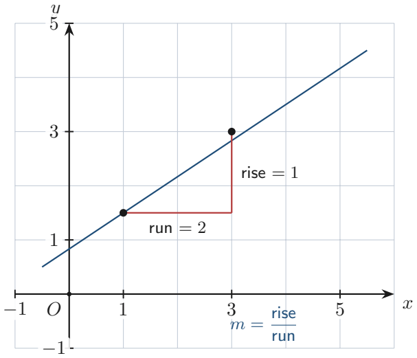

# Strand 2: Algebra
## Sub-strand 1: Patterns and Relations
### Lesson 1: Linear Relations, Gradient, and Equations of Straight Lines

---

## 1. Curriculum Standard and Overview

- **Strand**: 2 — Algebra
- **Sub-strand**: 1 — Patterns and Relations
- **Content Standard**: B9.2.1.1
- **Indicators**:
  - **B9.2.1.1.1** — Construct tables of values for linear relations and graph them; find the equation of a line.
  - **B9.2.1.1.2 / B9.2.1.1.3** — Use graphs of linear relations to find missing elements and solve equations.
- **Also links to** B9.1.4.1.4 (gradient as unit rate — reading graphs).

- **Mock-paper links**: P2 Q4(b) (gradient 7 through (−2, −3)); P1 Q20 (gradient −2 through (1,2) and (4,y)); P1 Q35–37 (steep / shallow / zero gradient on a walker's height graph).

---

## 2. Preamble — What Is a Relation?

A **relation** is a rule that turns an input $x$ into an output $y$.

**Example rule:** $y = 2x + 1$.  
Input 3 → output $2(3) + 1 = 7$.

When the rule is a straight line, we call it a **linear relation**. Straight lines have two key properties:

1. **Gradient** (slope) — how steep the line is.
2. **Y-intercept** — where the line crosses the vertical axis.

---

## 3. Tables of Values

Pick $x$-values, apply the rule, record $y$.

**Rule:** $y = 2x - 3$

| $x$ | $-2$ | $-1$ | $0$ | $1$ | $2$ | $3$ |
| :---: | :---: | :---: | :---: | :---: | :---: | :---: |
| $y = 2x-3$ | $-7$ | $-5$ | $-3$ | $-1$ | $1$ | $3$ |

Plot the pairs $(x, y)$ and join with a straight line.

---

## 4. Gradient

### 4.1 Definition
The **gradient** $m$ measures rise over run:

$$m = \frac{y_2 - y_1}{x_2 - x_1} = \frac{\text{change in } y}{\text{change in } x}$$

| Gradient | Line looks like |
| :---: | :--- |
| $m > 0$ | uphill left → right |
| $m < 0$ | downhill left → right |
| $m = 0$ | perfectly flat (horizontal) |
| large $|m|$ | very steep |
| small $|m|$ | shallow |

### 4.2 Reading a graph without a formula
On a distance–time or height–time graph:
- **Steepest positive** section = largest positive gradient (fastest climb).
- **Shallowest positive** section = smallest positive gradient (slow climb).
- **Zero gradient** = flat section (height not changing).
- **Negative** section = going down.

**Mock P1 Q35–37:** On a walker's height graph, you must compare sections A–H.  
- Steepest positive → the section with the biggest height gain over the shortest horizontal run.  
- Shallowest positive → small gain over a long run.  
- Zero gradient → a flat horizontal piece.  
*(Always read the actual diagram in the paper; the letters A–H identify segments of the path.)*

### 4.3 Example calculation
Line through (1, 2) and (4, −4).  
$m = \frac{-4 - 2}{4 - 1} = \frac{-6}{3} = -2$.

---

## 5. Equation of a Straight Line

### 5.1 Gradient–intercept form
$$y = mx + c$$
- $m$ = gradient
- $c$ = $y$-intercept (where $x = 0$)

### 5.2 Finding the equation when you know $m$ and one point
**Mock P2 Q4(b):** gradient $m = 7$, passes through $P(-2, -3)$.

1. Start from $y = 7x + c$.
2. Substitute $x = -2$, $y = -3$:  
   $-3 = 7(-2) + c \Rightarrow -3 = -14 + c \Rightarrow c = 11$.
3. **Equation:** $y = 7x + 11$.

**(ii)** Point $R(k, 4)$ lies on the line:  
$4 = 7k + 11 \Rightarrow 7k = -7 \Rightarrow k = -1$.

### 5.3 Two-point method
1. Find $m$ from the two points.
2. Substitute one point into $y = mx + c$ to find $c$.

---

## 6. Parallel and Perpendicular (preview)

- **Parallel** lines have **equal** gradients.
- **Perpendicular** lines have gradients $m_1 \times m_2 = -1$.

---

## 7. Twenty Fully Worked Examples

### Example 1 — Table of values
$y = 2x - 3$, $x = -2..3$ (see §3).

### Example 2 — Table with negative coefficient
$y = -x + 5$:

| $x$ | 0 | 1 | 2 | 3 |
| :---: | :---: | :---: | :---: | :---: |
| $y$ | 5 | 4 | 3 | 2 |

### Example 3 — Table with fraction
$y = \frac{1}{2}x - 3$ at $x = 0, 2, 4, 6$: $y = -3, -2, -1, 0$.

### Example 4 — Gradient from two points
(1, 2) and (4, −4): $m = -2$.

### Example 5 — Gradient from (2, 6) and (4, 12)
$m = \frac{12-6}{4-2} = 3$. *(Also constant of proportionality = 3.)*

### Example 6 — Gradient from (1, 2) and (4, y) with $m = -2$ (Mock P1 Q20)
$m = \frac{y - 2}{4 - 1} = -2 \Rightarrow \frac{y-2}{3} = -2 \Rightarrow y - 2 = -6 \Rightarrow y = -4$.  
**Answer: D.**

### Example 7 — Equation from gradient and point (Mock P2 Q4b)
$m = 7$ through $(−2, −3)$: $y = 7x + 11$.

### Example 8 — Find $k$ on the line (Mock P2 Q4b ii)
$R(k, 4)$ on $y = 7x + 11$: $k = -1$.

### Example 9 — Equation from two points
(0, 1) and (2, 5): $m = 2$, $c = 1$ → $y = 2x + 1$.

### Example 10 — Identify gradient and intercept
$y = -3x + 4$: $m = -3$, $c = 4$.

### Example 11 — Zero gradient
$y = 5$ is a horizontal line; $m = 0$.

### Example 12 — Steepest of three lines
$y = 2x$, $y = 5x$, $y = -7x$: steepest positive is $y = 5x$; steepest overall (most steep incl. negative) is $y = -7x$.

### Example 13 — Missing output
$y = 3x - 1$; find $y$ when $x = 7$: $y = 20$.

### Example 14 — Missing input
$y = 3x - 1$; find $x$ when $y = 11$: $11 = 3x - 1 \Rightarrow x = 4$.

### Example 15 — Graph reading (walker heights)
Section with the biggest rise over 1 unit of time = steepest positive gradient.  
*(In the mock, compare sections A–H visually.)*

### Example 16 — Flat section
If height stays constant over an interval, gradient $= 0$ (Mock P1 Q37 style).

### Example 17 — Real-life rate as gradient
Cost $= 5 \times \text{items}$. Gradient = GH₵ 5 per item (unit rate).

### Example 18 — Distance–time gradient
Distance–time graph gradient = **speed**. Steeper = faster.

### Example 19 — Perpendicular preview
$m_1 = 2$; perpendicular $m_2 = -\frac{1}{2}$.

### Example 20 — Parallel lines
Line $y = 4x + 1$; parallel through (0, 9): $y = 4x + 9$.

---

## 8. Comprehensive Exercise Sets (40 Questions)

> Authentic mock items included in full. Generated questions top up to 40. Spiral review ≈ 15%.

### Exercise 1 — Tables of values

1. Complete the table for $y = 2x - 3$, $x = -2..3$.

2. Complete the table for $y = -x + 5$, $x = 0..3$.

3. Complete the table for $y = \frac{1}{2}x - 3$, $x = 0, 2, 4, 6$.

4. For $y = 3x - 1$, find $y$ when $x = 7$.

5. **Spiral review:** Share GH₵ 720 in the ratio 2 : 3.

### Exercise 2 — Gradient from two points (includes mock)

1. Find the gradient of the line through (1, 2) and (4, −4).

2. **[Mock 2026 P1 Q20]** A line passes through (1, 2) and (4, y). What is $y$ if the gradient is −2?  
   A. 4  B. −2  C. 0  D. −4

3. Find the gradient through (2, 6) and (4, 12).

4. Find the gradient through (0, 1) and (2, 5).

5. **Spiral review:** 9 men finish work in 51 days. Days for 17 men?

### Exercise 3 — Equation of a line (includes mock)

1. **[Mock 2026 P2 Q4(b)]** A straight line has gradient 7 and passes through P(−2, −3). Find (i) the equation of the line; (ii) the value of $k$ if R(k, 4) lies on the line.

2. Find the equation of the line through (0, 1) and (2, 5).

3. Write down the gradient and $y$-intercept of $y = -3x + 4$.

4. Find the equation of the line through (0, 9) parallel to $y = 4x + 1$.

5. **Spiral review:** Evaluate $\frac{2}{3} \times \frac{1}{4} + \frac{2}{5} \div \frac{14}{15}$.

### Exercise 4 — Reading graphs (includes mock)

1. **[Mock 2026 P1 Q35]** On the walker's height graph, which section shows the **steepest positive** gradient?  
   A. Section A  B. Section B  C. Section H  D. Section F

2. **[Mock 2026 P1 Q36]** Which section shows the **shallowest positive** gradient?  
   A. Section A  B. Section B  C. Section F  D. Section G

3. **[Mock 2026 P1 Q37]** In which section is the gradient **zero**?  
   A. Section A  B. Section B  C. Section D  D. Section E

4. On a distance–time graph, what does the gradient represent?

5. **Spiral review:** A van travels 154 km in $1\frac{3}{4}$ hours. Find its speed.

### Exercise 5 — Missing elements

1. For $y = 3x - 1$, find $x$ when $y = 11$.

2. The line $y = 2x + c$ passes through (3, 10). Find $c$.

3. A line has gradient 5 and $y$-intercept −2. Write its equation.

4. **Spiral review:** $124.3 + 0.275 + 74.06$ to 1 d.p.

5. **Spiral review:** Classify 0 under ℕ, 𝕎, ℤ, ℚ.

### Exercise 6 — Slope as unit rate

1. Cost $= 5 \times \text{items}$. What is the unit rate?

2. On a distance–time graph, a car covers 80 km in 2 hours. What is the gradient?

3. Which is faster: a gradient of 40 (km/h) or 25 (km/h)?

4. **Spiral review:** $(0.07 \times 0.02) \div 14$.

5. **Spiral review:** Find $n$ if $\frac{n}{100} = 10.5$.

### Exercise 7 — Parallel and perpendicular

1. What is the gradient of a line parallel to $y = 4x + 1$?

2. What is the gradient of a line perpendicular to $y = 2x + 3$?

3. Find the equation of the line through (0, 9) parallel to $y = 4x + 1$.

4. **Spiral review:** $(-3)^{x-2} = -243$. Find $x$.

5. **Spiral review:** Write 31 days in minutes, in standard form.

### Exercise 8 — Mixed linear challenge

1. A line has equation $y = 7x + 11$. Find $y$ when $x = -1$.

2. Does the point (2, 25) lie on $y = 7x + 11$? Justify.

3. The points (1, 3) and (3, 7) lie on a line. Find its equation.

4. **Spiral review:** 28 sell mackerel, 18 tilapia, 13 both, 36 total. How many sell neither?

5. **Spiral review:** Order $\frac{3}{8}, \frac{1}{2}, \frac{5}{16}$.

---

## 9. Full Step-by-Step Worked Solutions

### Solutions to Exercise 1
1. $y = -7, -5, -3, -1, 1, 3$.  
2. $y = 5, 4, 3, 2$.  
3. $y = -3, -2, -1, 0$.  
4. $y = 20$.  
5. $\mathbf{GH₵\,288}$ and $\mathbf{GH₵\,432}$.

### Solutions to Exercise 2
1. $m = \frac{-4-2}{4-1} = \mathbf{-2}$.  
2. $\frac{y-2}{3} = -2 \Rightarrow y = \mathbf{-4}$ → **D**.  
3. $m = \mathbf{3}$.  
4. $m = \frac{5-1}{2-0} = \mathbf{2}$.  
5. $\mathbf{27}$ days.

### Solutions to Exercise 3
1. (i) $c = 11$ → $y = \mathbf{7x + 11}$. (ii) $4 = 7k + 11 \Rightarrow k = \mathbf{-1}$.  
2. $m = 2$, $c = 1$ → $y = \mathbf{2x + 1}$.  
3. $m = \mathbf{-3}$, $c = \mathbf{4}$.  
4. $y = \mathbf{4x + 9}$.  
5. $\mathbf{\frac{25}{42}}$.

### Solutions to Exercise 4
1. Compare rise/run of each section in the mock diagram → **B** (Section B in the mock key).  
2. Smallest positive rise/run → **C** (Section F).  
3. Flat horizontal piece → **C** (Section D).  
4. **Speed** (km/h).  
5. $154 \div 1.75 = \mathbf{88}$ km/h.

### Solutions to Exercise 5
1. $11 = 3x - 1 \Rightarrow x = \mathbf{4}$.  
2. $10 = 6 + c \Rightarrow c = \mathbf{4}$.  
3. $y = \mathbf{5x - 2}$.  
4. $\mathbf{198.6}$.  
5. **𝕎, ℤ, ℚ**.

### Solutions to Exercise 6
1. **GH₵ 5 per item**.  
2. $80 \div 2 = \mathbf{40}$ km/h.  
3. **40 km/h is faster**.  
4. $\mathbf{0.0001}$.  
5. $n = \mathbf{1050}$.

### Solutions to Exercise 7
1. $\mathbf{4}$.  
2. $m_1 m_2 = -1 \Rightarrow m_2 = \mathbf{-\frac{1}{2}}$.  
3. $y = \mathbf{4x + 9}$.  
4. $x = \mathbf{7}$.  
5. $\mathbf{4.464 \times 10^4}$ minutes.

### Solutions to Exercise 8
1. $y = 7(-1) + 11 = \mathbf{4}$.  
2. $7(2) + 11 = 25$ → **yes, it lies on the line**.  
3. $m = 2$, $c = 1$ → $y = \mathbf{2x + 1}$.  
4. $\mathbf{3}$.  
5. $\frac{5}{16} < \frac{3}{8} < \frac{1}{2}$.

---

## 10. Authentic Mock Items in This Lesson

| Ref | Question | Answer |
| :--- | :--- | :--- |
| P2 Q4(b) | $m=7$ through $(−2,−3)$; $R(k,4)$ | $y = 7x + 11$; $k = -1$ |
| P1 Q20 | $(1,2)$ and $(4,y)$, $m = -2$ | D — $y = -4$ |
| P1 Q35 | Steepest positive gradient section | B (Section B in key) |
| P1 Q36 | Shallowest positive gradient section | C (Section F) |
| P1 Q37 | Zero gradient section | C (Section D) |

---

## 11. Lesson Summary

| Skill | Rule |
| :--- | :--- |
| Gradient | $m = \frac{y_2 - y_1}{x_2 - x_1}$ |
| Equation | $y = mx + c$ |
| Flat line | $m = 0$ |
| Uphill / downhill | $m > 0$ / $m < 0$ |
| Parallel | equal gradients |
| Perpendicular | $m_1 m_2 = -1$ |

---

*Lesson prepared under `Grade9-Maths/Rules.md` — plain English, British notation, full workings required.*
