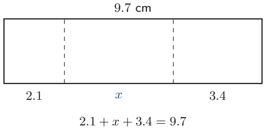

# Strand 2: Algebra
## Sub-strand 2: Algebraic Expressions
### Lesson 1: Substitution, Simplification, and Real-Life Algebraic Modelling

---

## 1. Curriculum Standard and Overview

- **Strand**: 2 — Algebra
- **Sub-strand**: 2 — Algebraic Expressions
- **Content Standard**: B9.2.2.1
- **Indicators**:
  - **B9.2.2.1.2** — Substitute values into given formulae to evaluate them and use them to solve problems.
  - **B9.2.2.1.4** — Use knowledge of simplifying and factorising expressions to solve real-life problems (perimeter, area, age, money, quantities).
- **Mock-paper links**: P1 Q10, Q16, Q17, Q19, Q29; P2 Q4(d), Q6(a), Q6(c).

---

## 2. Preamble — Letters That Stand for Numbers

In algebra, a **letter** (called a **variable** or **pronumeral**) stands for a number we may not know yet — or a number that changes.

- **Expression**: a combination of numbers, letters and operations — e.g. $3x + 5$.
- **Term**: one chunk of an expression — $3x$, $5$, $-2xy$ are terms.
- **Coefficient**: the number multiplying the letter — in $3x$, the coefficient is 3.
- **Like terms**: terms with the **same letters raised to the same powers** — $3x$ and $5x$ are like terms; $3x$ and $3x^2$ are **not**.

---

## 3. Substitution

To **substitute** means: replace the letter with the given number, then calculate carefully (keep brackets!).

**Mock P1 Q10:** Find $12x + 9q$ when $x = 11$ and $q = 3$.

$$12(11) + 9(3) = 132 + 27 = 159$$

**Answer: B — 159.**

> **Sign trap:** if $x = -2$, then $3x = -6$ and $x^2 = 4$. Always use brackets: $3(-2) = -6$.

---

## 4. Simplifying Expressions

### 4.1 Collect like terms
$3x + 5x = 8x$; $7a - 2a = 5a$; $4xy + xy = 5xy$.

### 4.2 Multiply terms
$3 \times 2x = 6x$; $4(x + 2) = 4x + 8$ (distributive property).

### 4.3 Difference of like products (Mock P1 Q16)
Sam has $5xy$ toffees, Joe has $20xy$. Difference:
$$20xy - 5xy = 15xy$$
**Answer: A — 15xy.**

### 4.4 Indices in expressions
$$\frac{25x^{-4}}{5^{-3} \times 10x \times t^{-8}}$$

Work with numbers and letters separately.

**Mock P2 Q6(c):** Simplify $\frac{25x^{-4}}{5^{-3} \times 10x \times t^{-8}}$.

**Numbers:** $25 \div (5^{-3} \times 10)$.  
$5^{-3} = \frac{1}{125}$, so $5^{-3} \times 10 = \frac{10}{125} = \frac{2}{25}$.  
$25 \div \frac{2}{25} = 25 \times \frac{25}{2} = \frac{625}{2}$.

**x terms:** $x^{-4} \div x = x^{-4-1} = x^{-5} = \frac{1}{x^5}$.

**t terms:** dividing by $t^{-8}$ = multiplying by $t^{8}$.

$$\text{Answer: } \frac{625\, t^{8}}{2\, x^{5}} = \frac{625 t^8}{2 x^5}$$

---

## 5. Algebraic Modelling (Turning Words into Algebra)

### 5.1 Age problems (Mock P1 Q19)
Mina is $x$ years old **now**. How old in $10 + y$ years?
$$\text{Age} = x + 10 + y$$
**Answer: C — $(x + 10 + y)$ years.**

### 5.2 Evaluating a model (Mock P1 Q29)
Pig population $= 5(2x - 3)$, $x$ in months. After 4 months:
$$5(2(4) - 3) = 5(8 - 3) = 5 \times 5 = 25$$
**Answer: B — 25.**

### 5.3 Perimeter modelling (Mock P2 Q4d)
A rectangular route has length $(x + 2)$ km and breadth $(2x + 1)$ km. Perimeter $= 48$ km.

$$2\big[(x + 2) + (2x + 1)\big] = 48$$
$$2(3x + 3) = 48$$
$$6x + 6 = 48$$
$$6x = 42$$
$$x = 7$$

**Answer: $x = 7$ km.**

### 5.4 Area of a shaded region (Mock P2 Q6a)
Outer rectangle: $(5x + 8)$ by $(6x + 2)$.  
Inner unshaded: $(x + 6)$ by $5x$.

$$\text{Shaded} = (5x+8)(6x+2) - (x+6)(5x)$$

Expand:
- $(5x+8)(6x+2) = 30x^2 + 10x + 48x + 16 = 30x^2 + 58x + 16$
- $(x+6)(5x) = 5x^2 + 30x$

$$\text{Shaded} = (30x^2 + 58x + 16) - (5x^2 + 30x) = 25x^2 + 28x + 16$$

**Answer: $25x^2 + 28x + 16$ square units.**

### 5.5 Length from a diagram (Mock P1 Q17)
A rectangle has total length 9.7 cm along the top. The bottom is split $2.1$, $x$, $3.4$.

To find $x$: add 2.1 and 3.4, then subtract that sum from 9.7.
$$x = 9.7 - (2.1 + 3.4) = 9.7 - 5.5 = 4.2 \text{ cm}$$

**Answer: A.**

---

## 6. Factorising (Quick Preview — full treatment in later work)

Factorising = writing an expression as a **product**.

- Common factor: $6x + 9 = 3(2x + 3)$.
- Difference of squares: $a^2 - b^2 = (a-b)(a+b)$.

---

## 7. Twenty Fully Worked Examples

### Example 1 — Substitute (Mock P1 Q10)
$12x + 9q$ at $x = 11$, $q = 3$ → $132 + 27 = 159$. **B.**

### Example 2 — Substitute with negatives
$3x - 5$ at $x = -2$: $3(-2) - 5 = -11$.

### Example 3 — Difference of like terms (Mock P1 Q16)
$20xy - 5xy = 15xy$. **A.**

### Example 4 — Age (Mock P1 Q19)
$x$ now → $x + 10 + y$ in $10 + y$ years. **C.**

### Example 5 — Evaluate a model (Mock P1 Q29)
$5(2(4) - 3) = 25$. **B.**

### Example 6 — Perimeter (Mock P2 Q4d)
$2[(x+2)+(2x+1)] = 48 \Rightarrow x = 7$.

### Example 7 — Shaded area (Mock P2 Q6a)
$(5x+8)(6x+2) - (x+6)(5x) = 25x^2 + 28x + 16$.

### Example 8 — Length from diagram (Mock P1 Q17)

$x = 9.7 - 2.1 - 3.4 = 4.2$. **A.**

### Example 9 — Simplify indices (Mock P2 Q6c)
$\frac{25x^{-4}}{5^{-3} \cdot 10x \cdot t^{-8}} = \frac{625 t^8}{2 x^5}$.

### Example 10 — Collect like terms
$3a + 5b - a + 2b = 2a + 7b$.

### Example 11 — Expand brackets
$4(x + 2) = 4x + 8$.

### Example 12 — Expand and simplify
$3(2x + 1) - 2(x - 4) = 6x + 3 - 2x + 8 = 4x + 11$.

### Example 13 — Cost model
Pens at GH₵ 2.50 each; $n$ pens cost $2.5n$ cedis.

### Example 14 — Evaluate cost model
$n = 14$: $2.5 \times 14 = 35$ cedis.

### Example 15 — Rectangle area
Length $(x + 3)$, width $(x - 1)$: area $= x^2 + 2x - 3$.

### Example 16 — Average of expressions
Mean of $2x$ and $10$: $\frac{2x + 10}{2} = x + 5$.

### Example 17 — Money sharing
Share $12x$ cedis in ratio 1 : 2 → $4x$ and $8x$.

### Example 18 — Factorise common term
$12a + 16b = 4(3a + 4b)$.

### Example 19 — Word → algebra
"Three more than twice a number $n$": $2n + 3$.

### Example 20 — Mixed modelling
A box holds $5x - 3$ sweets. 4 boxes hold $4(5x - 3) = 20x - 12$ sweets.

---

## 8. Comprehensive Exercise Sets (40 Questions)

> All 8 authentic mock items for this topic are included. Generated questions top up to 40. Spiral review ≈ 15%.

### Exercise 1 — Substitution (includes mock)

1. **[Mock 2026 P1 Q10]** Find $12x + 9q$ when $x = 11$ and $q = 3$.  
   A. 148  B. 159  C. 168  D. 172

2. Evaluate $3x - 5$ when $x = -2$.

3. Evaluate $x^2 + 2x$ when $x = -3$.

4. Evaluate $5(2x - 3)$ when $x = 4$.

5. **Spiral review:** Find the gradient through (1, 2) and (4, −4).

### Exercise 2 — Like terms & expansion (includes mock)

1. **[Mock 2026 P1 Q16]** Sam has $5xy$ toffees and Joe has $20xy$ toffees. How many more toffees has Joe?  
   A. $15xy$  B. $15x$  C. $15y$  D. $4xy$

2. Simplify $3a + 5b - a + 2b$.

3. Expand $4(x + 2)$.

4. Expand and simplify $3(2x + 1) - 2(x - 4)$.

5. **Spiral review:** $124.3 + 0.275 + 74.06$ to 1 d.p.

### Exercise 3 — Age and quantity models (includes mock)

1. **[Mock 2026 P1 Q19]** Mina is $x$ years old now. How old will she be in $10 + y$ years?  
   A. $(x - 10 + y)$  B. $(x - 10 - y)$  C. $(x + 10 + y)$  D. $(x + 10 - y)$

2. **[Mock 2026 P1 Q29]** The population of pigs is $5(2x - 3)$, $x$ in months. Find the population after 4 months.  
   A. 52  B. 25  C. 30  D. 15

3. Kofi is $x$ years old. His father is 3 times as old. Find the father's age in 5 years.

4. A box holds $5x - 3$ sweets. How many sweets do 4 boxes hold?

5. **Spiral review:** 9 men finish work in 51 days. Days for 17 men?

### Exercise 4 — Perimeter & length models (includes mock)

1. **[Mock 2026 P2 Q4(d)]** The distance from A to B is $(x + 2)$ km and from C to D is $(2x + 1)$ km. These are the length and breadth of a rectangular route. The perimeter is 48 km. Find $x$.

2. **[Mock 2026 P1 Q17]** A rectangle has total length 9.7 cm along the top. The bottom edge is 2.1 cm, $x$ cm, and 3.4 cm. Which method finds $x$?  
   A. Add 2.1 and 3.4, then subtract the sum from 9.7  
   B. Add 9.7 and 3.4, then subtract 2.1  
   C. Subtract 2.1 from 3.4, then subtract the difference from 9.7  
   D. Subtract 3.4 from 9.7, then add 2.1

3. A rectangle has length $(x + 3)$ and width $(x - 1)$. Find the area.

4. A rectangle has perimeter 20 cm and length $(x + 2)$, width $(x - 1)$. Find $x$.

5. **Spiral review:** Evaluate $\frac{2}{3} \times \frac{1}{4} + \frac{2}{5} \div \frac{14}{15}$.

### Exercise 5 — Shaded regions (includes mock)

1. **[Mock 2026 P2 Q6(a)]** Find the area of the shaded region: outer rectangle $(5x + 8)$ by $(6x + 2)$, inner unshaded rectangle $(x + 6)$ by $5x$.

2. A square of side $(x + 4)$ has a square of side $x$ cut out. Find the shaded area.

3. A rectangle $10$ by $6$ has a rectangle $4$ by $y$ removed. Express the remaining area.

4. **Spiral review:** $\frac{n}{100} = 10.5$. Find $n$.

5. **Spiral review:** Classify $-3$ under $\mathbb{N}, \mathbb{W}, \mathbb{Z}, \mathbb{Q}$.

### Exercise 6 — Indices in expressions (includes mock)

1. **[Mock 2026 P2 Q6(c)]** Simplify $\frac{25x^{-4}}{5^{-3} \times 10x \times t^{-8}}$.

2. Simplify $x^3 \times x^4$.

3. Simplify $a^7 \div a^2$.

4. Simplify $(2x^2)^3$.

5. **Spiral review:** Solve $(-3)^{x-2} = -243$.

### Exercise 7 — Word → algebra

1. Write "three more than twice a number $n$".

2. Write "the total cost of $n$ pens at GH₵ 2.50 each".

3. Share $12x$ cedis in the ratio 1 : 2.

4. The mean of $2x$ and $10$ is $x + 5$. Verify by substitution when $x = 3$.

5. **Spiral review:** A van travels 154 km in $1\frac{3}{4}$ hours. Speed?

### Exercise 8 — Mixed modelling challenge

1. A rectangle has length $(2x + 3)$ and width $(x - 1)$. Expand the area expression.

2. Factorise $12a + 16b$.

3. If the perimeter of a square is $4(x + 5)$, find the side length.

4. **Spiral review:** In a market of 36 fishmongers, 28 sell mackerel, 18 tilapia, 13 both. How many sell neither?

5. **Spiral review:** Find the equation of the line with gradient 7 through $(−2, −3)$.

---

## 9. Full Step-by-Step Worked Solutions

### Solutions to Exercise 1
1. $132 + 27 = \mathbf{159}$ → **B**.  
2. $-6 - 5 = \mathbf{-11}$.  
3. $9 - 6 = \mathbf{3}$.  
4. $5(5) = \mathbf{25}$.  
5. $m = \mathbf{-2}$.

### Solutions to Exercise 2
1. $20xy - 5xy = \mathbf{15xy}$ → **A**.  
2. $2a + 7b$.  
3. $4x + 8$.  
4. $4x + 11$.  
5. $\mathbf{198.6}$.

### Solutions to Exercise 3
1. $\mathbf{x + 10 + y}$ → **C**.  
2. $5(5) = \mathbf{25}$ → **B**.  
3. Father now $= 3x$; in 5 years $= 3x + 5$.  
4. $20x - 12$.  
5. $\mathbf{27}$ days.

### Solutions to Exercise 4
1. $2(3x + 3) = 48 \Rightarrow 6x = 42 \Rightarrow x = \mathbf{7}$.  
2. $x = 9.7 - (2.1 + 3.4) = 4.2$ → **A**.  
3. $x^2 + 2x - 3$.  
4. $2(2x + 1) = 20 \Rightarrow x = \mathbf{4.5}$.  
5. $\mathbf{\frac{25}{42}}$.

### Solutions to Exercise 5
1. $25x^2 + 28x + 16$.  
2. $(x+4)^2 - x^2 = 8x + 16$.  
3. $60 - 4y$.  
4. $n = \mathbf{1050}$.  
5. **ℤ, ℚ**.

### Solutions to Exercise 6
1. $\mathbf{\frac{625 t^8}{2 x^5}}$.  
2. $x^7$.  
3. $a^5$.  
4. $8x^6$.  
5. $x = \mathbf{7}$.

### Solutions to Exercise 7
1. $2n + 3$.  
2. $2.5n$.  
3. $4x$ and $8x$.  
4. $x + 5 = 8$; $\frac{6 + 10}{2} = 8$ ✓.  
5. $\mathbf{88}$ km/h.

### Solutions to Exercise 8
1. $2x^2 + x - 3$.  
2. $4(3a + 4b)$.  
3. $x + 5$.  
4. $\mathbf{3}$.  
5. $y = \mathbf{7x + 11}$.

---

## 10. Authentic Mock Items in This Lesson

| Ref | Question | Answer |
| :--- | :--- | :--- |
| P1 Q10 | $12x + 9q$, $x=11$, $q=3$ | B — 159 |
| P1 Q16 | $20xy - 5xy$ | A — 15xy |
| P1 Q17 | Length 9.7 split 2.1, x, 3.4 | A (and $x = 4.2$) |
| P1 Q19 | Age in $10 + y$ years | C — $x + 10 + y$ |
| P1 Q29 | $5(2(4) - 3)$ pigs | B — 25 |
| P2 Q4(d) | Perimeter 48, $(x+2)$ and $(2x+1)$ | $x = 7$ |
| P2 Q6(a) | Shaded area | $25x^2 + 28x + 16$ |
| P2 Q6(c) | Simplify index expression | $\frac{625 t^8}{2 x^5}$ |

---

## 11. Lesson Summary

| Skill | Rule |
| :--- | :--- |
| Substitute | Replace letter, keep brackets, calculate |
| Like terms | Same letters, same powers |
| Expand | $a(b + c) = ab + ac$ |
| Perimeter model | $2(l + w)$ |
| Shaded area | outer − inner |
| Indices | $a^m \times a^n = a^{m+n}$, $a^m \div a^n = a^{m-n}$ |

---

*Lesson prepared under `Grade9-Maths/Rules.md` — plain English, British notation, full workings required.*
