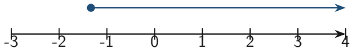
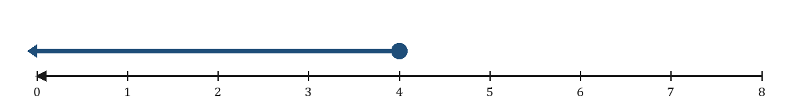
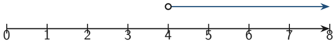
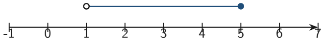

# Strand 2: Algebra
## Sub-strand 3: Variables and Equations
### Lesson 1: Linear Equations, Inequalities, and Number-Line Solutions

---

## 1. Curriculum Standard and Overview

- **Strand**: 2 — Algebra
- **Sub-strand**: 3 — Variables and Equations
- **Content Standard**: B9.2.3.1
- **Indicators**:
  - **B9.2.3.1.1** — Solve single-variable linear equations and inequalities with rational coefficients.
  - **B9.2.3.1.2** — Illustrate solution sets of linear inequalities on the number line.
  - **B9.2.3.1.3** — Solve real-life problems involving linear equations and inequalities.
- **Mock-paper links**: P1 Q2, Q4, Q8, Q18, Q25, Q39; P2 Q3(c), Q6(b).

---

## 2. Preamble — Equation vs Inequality

- An **equation** says two things are **equal**: $2x + 1 = 9$.
- An **inequality** says one is bigger/smaller: $2x + 1 > 9$.

Solving means: **find every value of $x$ that makes the statement true.**

---

## 3. Solving Linear Equations

### 3.1 Golden rule
Whatever you do to one side, do to the other.

**Mock P1 Q25:** $13x - 12 = 5x + 60$

1. Subtract $5x$ from both sides: $8x - 12 = 60$.
2. Add 12: $8x = 72$.
3. Divide by 8: $x = 9$.

**Answer: C — 9.**

### 3.2 Simple two-step (Mock P1 Q39)
$15 - 2x = 6$

1. Subtract 15: $-2x = -9$.
2. Divide by $-2$: $x = 4.5$.

**Answer: C — 4.5.**

### 3.3 Equations with fractions (Mock P2 Q6b)
$\frac{4}{3x} = 7 - \frac{3}{x}$

1. Multiply every term by $3x$ (the LCM of the denominators):
   $$4 = 21x - 9$$
2. $4 + 9 = 21x \Rightarrow 13 = 21x \Rightarrow x = \frac{13}{21}$.

**Answer: $x = \frac{13}{21}$.**

---

## 4. Solving Inequalities

### 4.1 Same as equations — with one extra rule
> **If you multiply or divide by a negative number, flip the inequality sign.**

### 4.2 Worked: Mock P1 Q2
$2x + 1 > 9$

1. Subtract 1: $2x > 8$.
2. Divide by 2: $x > 4$.

**Answer: B — $x > 4$.**

### 4.3 Worked: Mock P2 Q3(c)
$6 \ge 2 - 3x$

1. Subtract 2: $4 \ge -3x$.
2. Divide by $-3$ **and flip**: $-\frac{4}{3} \le x$, i.e. $x \ge -\frac{4}{3}$ (or $x \ge -1\frac{1}{3}$).

See Figure 1.

### 4.4 Brackets first (Mock P1 Q18)
$5 - 5(3 - y) \le 65$, $y$ is one of the first 6 multiples of 5.

1. Expand: $5 - 15 + 5y \le 65 \Rightarrow -10 + 5y \le 65$.
2. $5y \le 75 \Rightarrow y \le 15$.
3. First 6 multiples of 5: 5, 10, 15, 20, 25, 30.
4. Those with $y \le 15$: **{5, 10, 15}**.

**Answer: A.**

---

## 5. Word Problems → Equations

### 5.1 Consecutive odd integers (Mock P1 Q4)
Three consecutive odd integers sum to 33.

Let them be $n, n+2, n+4$ (odd numbers jump by 2).

$$n + (n+2) + (n+4) = 33 \Rightarrow 3n + 6 = 33 \Rightarrow 3n = 27 \Rightarrow n = 9$$

Numbers: **9, 11, 13**. **Answer: A.**

### 5.2 Age problems (Mock P1 Q8)
Kojo's age in the next 10 years will be 4 times his age 5 years ago.

Let Kojo be $x$ now.

$$x + 10 = 4(x - 5)$$
$$x + 10 = 4x - 20$$
$$10 + 20 = 4x - x$$
$$30 = 3x \Rightarrow x = 10$$

**Check:** in 10 years he is 20; 5 years ago he was 5; $4 \times 5 = 20$ (correct).

**Answer: C — 10.**

---

## 6. Number-Line Representation

| Symbol | Dot | Meaning |
| :---: | :---: | :--- |
| $>$ or $<$ | open ○ | endpoint **not** included |
| $\ge$ or $\le$ | solid ● | endpoint **included** |

Arrow points toward larger numbers (to the right).

---

## 7. Twenty Fully Worked Examples

### Example 1 — Mock P1 Q25
$13x - 12 = 5x + 60 \Rightarrow x = 9$. **C.**

### Example 2 — Mock P1 Q39
$15 - 2x = 6 \Rightarrow x = 4.5$. **C.**

### Example 3 — Mock P1 Q2
$2x + 1 > 9 \Rightarrow x > 4$. **B.**

### Example 4 — Mock P2 Q3(c)
$6 \ge 2 - 3x \Rightarrow x \ge -\frac{4}{3}$.

### Example 5 — Mock P1 Q18
$5 - 5(3-y) \le 65 \Rightarrow y \le 15$; from {5,10,15,20,25,30} → {5, 10, 15}. **A.**

### Example 6 — Mock P2 Q6(b)
$\frac{4}{3x} = 7 - \frac{3}{x} \Rightarrow x = \frac{13}{21}$.

### Example 7 — Mock P1 Q4
Consecutive odd integers summing to 33: **9, 11, 13**. **A.**

### Example 8 — Mock P1 Q8 (age)
$x + 10 = 4(x - 5) \Rightarrow x = 10$.

### Example 9 — One-step
$x + 7 = 12 \Rightarrow x = 5$.

### Example 10 — Two-step
$3x - 4 = 11 \Rightarrow 3x = 15 \Rightarrow x = 5$.

### Example 11 — Unknowns on both sides
$5x + 2 = 2x + 14 \Rightarrow 3x = 12 \Rightarrow x = 4$.

### Example 12 — Inequality with flip
$-2x > 6 \Rightarrow x < -3$ (divided by $-2$, sign flipped).

### Example 13 — Inequality on number line
$x \le 4$.

### Example 13b — Strict inequality on number line
$x > 4$.

### Example 14 — Strict inequality
$x < 4$.

### Example 15 — Consecutive integers (not odd)
Three consecutive integers sum to 27: $n + (n+1) + (n+2) = 27 \Rightarrow n = 8$ → 8, 9, 10.

### Example 16 — Rectangle perimeter equation
Perimeter 30, length is 2 more than width: $2(w + w + 2) = 30 \Rightarrow w = 6.5$.

### Example 17 — Fraction equation
$\frac{x}{3} + 2 = 6 \Rightarrow \frac{x}{3} = 4 \Rightarrow x = 12$.

### Example 18 — Bracket equation
$2(x - 3) = 8 \Rightarrow 2x - 6 = 8 \Rightarrow x = 7$.

### Example 19 — Verify a solution
Is $x = 9$ a solution of $13x - 12 = 5x + 60$?  
LHS $= 117 - 12 = 105$; RHS $= 45 + 60 = 105$ (correct).

### Example 20 — Compound inequality
$1 < x \le 5$.

---

## 8. Comprehensive Exercise Sets (40 Questions)

Work through these in order. Questions marked **[Mock 2026]** come from the BECE mock paper.

### Exercise 1 — Basic equations (includes mock)

1. **[Mock 2026 P1 Q39]** Solve $15 - 2x = 6$.

   A. −10.5

   B. −4.5

   C. 4.5

   D. 10.5

2. **[Mock 2026 P1 Q25]** If $13x - 12 = 5x + 60$, find $x$.

   A. −9

   B. −6

   C. 9

   D. 6

3. Solve $x + 7 = 12$.

4. Solve $3x - 4 = 11$.

5. **Spiral review:** Find $12x + 9q$ when $x = 11$, $q = 3$.

### Exercise 2 — Unknowns on both sides

1. Solve $5x + 2 = 2x + 14$.

2. Solve $7x - 5 = 3x + 15$.

3. Solve $4(x - 3) = 2x$.

4. **Spiral review:** $20xy - 5xy = ?$

5. **Spiral review:** Evaluate $5(2x - 3)$ when $x = 4$.

### Exercise 3 — Inequalities (includes mock)

1. **[Mock 2026 P1 Q2]** Solve the inequality $2x + 1 > 9$.

   A. $x > 3$

   B. $x > 4$

   C. $x > 2$

   D. $x > 1$

2. Solve $-2x > 6$.

3. Solve $3x - 1 \le 8$.

4. Solve $-x < 5$.

5. **Spiral review:** Write $5.6 \times 10^{-4}$ as an ordinary number.

### Exercise 4 — Number line (includes mock)

1. **[Mock 2026 P2 Q3(c)]** Find the truth set of $6 \ge 2 - 3x$ and represent your result on the number line.

2. Represent $x \le 4$ on a number line.

3. Represent $x < 4$ on a number line. How does it differ from Question 2?

4. Represent $1 < x \le 5$ on a number line.

5. **Spiral review:** Share GH₵ 720 in the ratio 2 : 3.

### Exercise 5 — Bracket inequalities (includes mock)

1. **[Mock 2026 P1 Q18]** Find the solution set of $5 - 5(3 - y) \le 65$, if $y$ is one of the first 6 multiples of 5.

   A. $\{5, 10, 15\}$

   B. $\{5, 10\}$

   C. $\{5, 10, 15, 20\}$

   D. $\{5, 10, 15, 20, 25, 30\}$

2. Solve $2(x - 3) = 8$.

3. Solve $3(2x + 1) = 21$.

4. **Spiral review:** $(-3)^{x-2} = -243$. Find $x$.

5. **Spiral review:** Speed of a van covering 154 km in $1\frac{3}{4}$ h.

### Exercise 6 — Fraction equations (includes mock)

1. **[Mock 2026 P2 Q6(b)]** Solve $\frac{4}{3x} = 7 - \frac{3}{x}$.

2. Solve $\frac{x}{3} + 2 = 6$.

3. Solve $\frac{2x + 1}{2} = 5$.

4. **Spiral review:** $(0.07 \times 0.02) \div 14$.

5. **Spiral review:** Classify $-3$ under $\mathbb{N}, \mathbb{W}, \mathbb{Z}, \mathbb{Q}$.

### Exercise 7 — Word problems (includes mock)

1. **[Mock 2026 P1 Q4]** The sum of three consecutive odd integers is 33. Find the numbers.

   A. 9, 11 and 13

   B. 7, 9 and 11

   C. 11, 13 and 15

   D. 13, 15 and 17

2. **[Mock 2026 P1 Q8]** Kojo's age in the next 10 years will be 4 times his age 5 years ago. How old is Kojo now?

   A. 5

   B. 6

   C. 10

   D. 15

3. Three consecutive integers sum to 27. Find them.

4. A rectangle has perimeter 30 cm. The length is 2 cm more than the width. Find the width.

5. **Spiral review:** In a market of 36 fishmongers, 28 sell mackerel, 18 tilapia, 13 both. How many sell neither?

### Exercise 8 — Mixed challenge

1. Verify that $x = 9$ satisfies $13x - 12 = 5x + 60$.

2. Solve $|x| = 3$ (two answers).

3. Solve $2x > -4$ and write the truth set on a number line.

4. **Spiral review:** Simplify $\frac{25x^{-4}}{5^{-3} \times 10x \times t^{-8}}$.

5. **Spiral review:** Find the gradient of the line through $(1, 2)$ and $(4, y)$ if the gradient is $-2$.

---

## 9. Full Step-by-Step Worked Solutions

### Solutions to Exercise 1
1. $-2x = -9 \Rightarrow x = \mathbf{4.5}$ → **C**.  
2. $8x = 72 \Rightarrow x = \mathbf{9}$ → **C**.  
3. $x = \mathbf{5}$.  
4. $3x = 15 \Rightarrow x = \mathbf{5}$.  
5. $\mathbf{159}$.

### Solutions to Exercise 2
1. $3x = 12 \Rightarrow x = \mathbf{4}$.  
2. $4x = 20 \Rightarrow x = \mathbf{5}$.  
3. $4x - 12 = 2x \Rightarrow x = \mathbf{6}$.  
4. $15xy$.  
5. $\mathbf{25}$.

### Solutions to Exercise 3
1. $2x > 8 \Rightarrow x > 4$ → **B**.  
2. $x < -3$ (sign flipped).  
3. $x \le 3$.  
4. $x > -5$ (sign flipped).  
5. $\mathbf{0.00056}$.

### Solutions to Exercise 4
1. $x \ge -\frac{4}{3}$ (Figure 1).  
2. $x \le 4$.  
3. $x < 4$.  
4. Open at 1, solid at 5, segment between.  
5. $\mathbf{GH₵\,288}$ and $\mathbf{GH₵\,432}$.

### Solutions to Exercise 5
1. $y \le 15$ → $\{5, 10, 15\}$ → **A**.  
2. $x = \mathbf{7}$.  
3. $2x + 1 = 7 \Rightarrow x = \mathbf{3}$.  
4. $x = \mathbf{7}$.  
5. $\mathbf{88}$ km/h.

### Solutions to Exercise 6
1. $4 = 21x - 9 \Rightarrow x = \mathbf{\frac{13}{21}}$.  
2. $x = \mathbf{12}$.  
3. $2x + 1 = 10 \Rightarrow x = 4.5$.  
4. $\mathbf{0.0001}$.  
5. **ℤ, ℚ**.

### Solutions to Exercise 7
1. $3n + 6 = 33 \Rightarrow n = 9$ → **9, 11, 13** → **A**.  
2. $x + 10 = 4(x-5) \Rightarrow x = \mathbf{10}$ → **C**.  
3. $3n + 3 = 27 \Rightarrow n = 8$ → **8, 9, 10**.  
4. $w = 6.5$ cm.  
5. $\mathbf{3}$.

### Solutions to Exercise 8
1. LHS $= 105$, RHS $= 105$ (correct).  
2. $x = 3$ or $x = -3$.  
3. $x > -2$.  
4. $\mathbf{\frac{625 t^8}{2 x^5}}$.  
5. $y = \mathbf{-4}$.

---

## 10. Authentic Mock Items in This Lesson

| Ref | Question | Answer |
| :--- | :--- | :--- |
| P1 Q2 | $2x + 1 > 9$ | B — $x > 4$ |
| P1 Q4 | Consecutive odd integers sum 33 | A — 9, 11, 13 |
| P1 Q8 | Kojo age | C — 10 |
| P1 Q18 | $5 - 5(3-y) \le 65$, multiples of 5 | A — {5, 10, 15} |
| P1 Q25 | $13x - 12 = 5x + 60$ | C — 9 |
| P1 Q39 | $15 - 2x = 6$ | C — 4.5 |
| P2 Q3(c) | $6 \ge 2 - 3x$ | $x \ge -\frac{4}{3}$ |
| P2 Q6(b) | $\frac{4}{3x} = 7 - \frac{3}{x}$ | $x = \frac{13}{21}$ |

---

## 11. Lesson Summary

| Skill | Rule |
| :--- | :--- |
| Solve equation | Inverse operations, balance both sides |
| Solve inequality | Same — **flip sign if ÷/× by negative** |
| Number line | ○ for $<,>$; ● for $\le,\ge$ |
| Word problem | Let $x = \ldots$, write equation, solve, check |

---

*Lesson prepared under `Grade9-Maths/Rules.md` — plain English, British notation, full workings required.*
