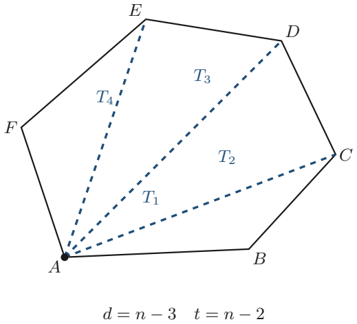
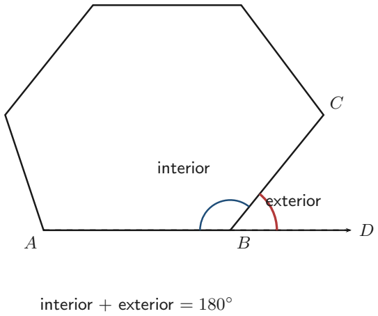
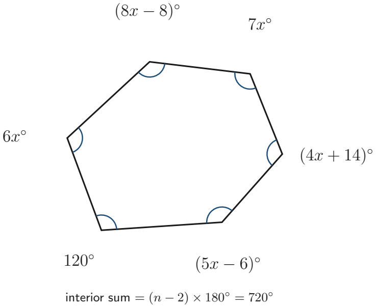
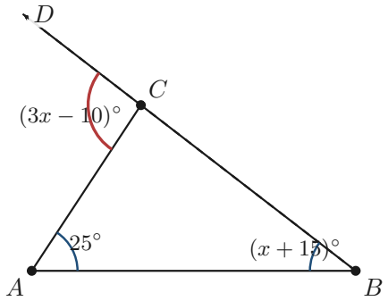

# Strand 3: Geometry and Measurement
## Sub-strand 1: Shapes and Space
### Lesson 1: Polygons, Angle Properties, and the Derivation of Angle Formulas

---

## 1. Curriculum Standard and Overview

- **Strand**: 3 — Geometry and Measurement
- **Sub-strand**: 1 — Shapes and Space
- **Content Standard**: B9.3.1.1 — Apply the properties of angles at a point, angles on a straight line, vertically opposite angles, and corresponding angles to solve problems.
- **Indicator**: B9.3.1.1.1 — Derive the formula for calculating the sum of angles in any polygon and use this to calculate the value of missing angles in polygons.
- **Scope**:
  1. Systematic taxonomy and nomenclature of polygons (3 to 12 sides).
  2. First-principles derivation of the interior angle sum formula: $S = (n - 2) \times 180^\circ$.
  3. Properties of regular vs irregular polygons.
  4. The exterior angle sum theorem: $\sum \text{exterior angles} = 360^\circ$.
  5. The linear pair relationship: $\text{Interior Angle} + \text{Exterior Angle} = 180^\circ$.
  6. Multi-step algebraic problem solving for missing variables and angle values.

---

## 2. Theoretical Foundations and Terminology Breakdown

Before manipulating equations, we establish precise mathematical definitions.

### 2.1 What is a Polygon?
The term **polygon** originates from two Greek roots:
- *Polus* meaning "many"
- *Gonia* meaning "corner" or "angle"

In Euclidean geometry, a **polygon** is a closed two-dimensional plane figure bounded by three or more straight line segments joined consecutively end-to-end. 
- The line segments are termed **edges** or **sides**.
- The intersection points where two adjacent sides meet are termed **vertices** (singular: **vertex**).

### 2.2 Classification by Geometry: Convex vs Concave
1. **Convex Polygon**: A polygon where every interior angle measures strictly less than $180^\circ$. If you draw a straight line through any two vertices, the line segment between them lies entirely inside or on the boundary of the polygon. All vertices point outwards.
2. **Concave Polygon**: A polygon containing at least one interior reflex angle (an angle greater than $180^\circ$ and less than $360^\circ$). At least one vertex points inwards, creating an indentation or "cave".

In standard Grade 9 syllabus work, all polygons discussed are assumed to be **convex** unless explicitly stated otherwise.

### 2.3 Regular vs Irregular Polygons
- **Regular Polygon**: A polygon that is both **equilateral** (all sides have equal length) and **equiangular** (all interior angles have equal measure). Examples include equilateral triangles and squares.
- **Irregular Polygon**: A polygon whose sides and/or interior angles are not all equal.

---

## 3. Nomenclature of Polygons

Polygons are classified according to the number of sides ($n$) they possess:

| Number of Sides ($n$) | Name of Polygon | Derivation of Name |
| :--- | :--- | :--- |
| 3 | Triangle (or Trigon) | Tri- (three) + angle |
| 4 | Quadrilateral (or Tetragon) | Quad- (four) + latus (side) |
| 5 | Pentagon | Penta- (five) + gonia |
| 6 | Hexagon | Hexa- (six) + gonia |
| 7 | Heptagon (or Septagon) | Hepta- (seven) + gonia |
| 8 | Octagon | Octa- (eight) + gonia |
| 9 | Nonagon (or Enneagon) | Nona- (nine) / Ennea- (nine) |
| 10 | Decagon | Deca- (ten) + gonia |
| 11 | Undecagon (or Hendecagon) | Un- (one) + deca- (ten) |
| 12 | Dodecagon | Do- (two) + deca- (ten) |
| $n$ | $n$-gon | A polygon with $n$ sides |

---

## 4. First-Principles Derivation of Angle Formulas

### 4.1 The Triangulation Method for Interior Angles

How do we determine the total sum of all interior angles inside any polygon without measuring with a protractor? We employ the fundamental geometric technique known as **triangulation**.

#### The Geometric Proof:
1. Consider any convex polygon with $n$ sides and $n$ vertices.
2. Select any single vertex, say vertex $A$.
3. Draw straight line segments (**diagonals**) from vertex $A$ to all other non-adjacent vertices.
4. How many diagonals can you draw from vertex $A$?
   - You cannot draw a diagonal to vertex $A$ itself.
   - You cannot draw a diagonal to the two immediately adjacent neighboring vertices, because those connecting lines are already existing exterior sides of the polygon.
   - Therefore, from any single vertex, you can draw exactly:
     $$\text{Number of diagonals from one vertex} = n - 3$$
5. These $(n - 3)$ diagonals partition the entire polygon into non-overlapping triangles.
   - 0 diagonals (Triangle, $n=3$) $\implies 1$ triangle
   - 1 diagonal (Quadrilateral, $n=4$) $\implies 2$ triangles
   - 2 diagonals (Pentagon, $n=5$) $\implies 3$ triangles
   - In general:
     $$\text{Number of triangles} = (n - 3) + 1 = n - 2$$
6. Since the sum of the interior angles of any planar triangle is exactly $180^\circ$, and the sum of all angles of these $(n - 2)$ triangles reconstitutes the entire interior angle sum of the polygon:
   $$S = (n - 2) \times 180^\circ$$

#### Summary of Interior Angle Sums:
- Triangle ($n=3$): $(3 - 2) \times 180^\circ = 1 \times 180^\circ = 180^\circ$
- Quadrilateral ($n=4$): $(4 - 2) \times 180^\circ = 2 \times 180^\circ = 360^\circ$
- Pentagon ($n=5$): $(5 - 2) \times 180^\circ = 3 \times 180^\circ = 540^\circ$
- Hexagon ($n=6$): $(6 - 2) \times 180^\circ = 4 \times 180^\circ = 720^\circ$
- Heptagon ($n=7$): $(7 - 2) \times 180^\circ = 5 \times 180^\circ = 900^\circ$
- Octagon ($n=8$): $(8 - 2) \times 180^\circ = 6 \times 180^\circ = 1080^\circ$
- Decagon ($n=10$): $(10 - 2) \times 180^\circ = 8 \times 180^\circ = 1440^\circ$
- Dodecagon ($n=12$): $(12 - 2) \times 180^\circ = 10 \times 180^\circ = 1800^\circ$

---

### 4.2 Individual Angles of a Regular Polygon

In a regular polygon with $n$ sides, all $n$ interior angles are identical in magnitude.

$$\text{Each Interior Angle of a Regular Polygon} = \frac{(n - 2) \times 180^\circ}{n}$$

For example:
- Regular Triangle (Equilateral): $\frac{(3 - 2) \times 180^\circ}{3} = \frac{180^\circ}{3} = 60^\circ$
- Regular Quadrilateral (Square): $\frac{(4 - 2) \times 180^\circ}{4} = \frac{360^\circ}{4} = 90^\circ$
- Regular Pentagon: $\frac{(5 - 2) \times 180^\circ}{5} = \frac{540^\circ}{5} = 108^\circ$
- Regular Hexagon: $\frac{(6 - 2) \times 180^\circ}{6} = \frac{720^\circ}{6} = 120^\circ$
- Regular Octagon: $\frac{(8 - 2) \times 180^\circ}{8} = \frac{1080^\circ}{8} = 135^\circ$

---

### 4.3 Exterior Angles and the $360^\circ$ Perimeter Tour Theorem

#### Definition:
An **exterior angle** of a polygon is formed between any side of the polygon and the extension of its adjacent side.

#### Key Theorems:
1. **Linear Pair Identity**: Because an interior angle and its adjacent exterior angle sit on a common straight line:
   $$\text{Interior Angle} + \text{Exterior Angle} = 180^\circ$$

2. **Sum of Exterior Angles Theorem**: For **any** convex polygon, regardless of the number of sides $n$:
   $$\sum \text{Exterior Angles} = 360^\circ$$
   *Physical Intuition*: Imagine walking along the perimeter of the polygon. At each vertex, you turn by the magnitude of the exterior angle. By the time you return to your starting side facing your original direction, you have executed exactly one full $360^\circ$ revolution.

3. **Regular Polygon Exterior Angle**:
   $$\text{Each Exterior Angle} = \frac{360^\circ}{n}$$

4. **Determining Number of Sides ($n$) from Exterior Angle**:
   $$n = \frac{360^\circ}{\text{Exterior Angle}} = \frac{360^\circ}{180^\circ - \text{Interior Angle}}$$

---

## 5. Fully Worked Exemplars from Curriculum Standard

### Exemplar 1: The Curriculum Hexagon Problem (PDF Page 34)

**Problem Statement**:
An irregular convex hexagon has interior angles given by $120^\circ$, $(5x - 6)^\circ$, $(4x + 14)^\circ$, $7x^\circ$, $(8x - 8)^\circ$, and $6x^\circ$.
1. Find the value of $x$.
2. Calculate the measure of each interior angle.

**Step-by-Step Solution**:

**Step 1: Calculate the theoretical sum of the interior angles of a hexagon ($n=6$)**
$$S = (n - 2) \times 180^\circ$$
$$S = (6 - 2) \times 180^\circ = 4 \times 180^\circ = 720^\circ$$

**Step 2: Formulate the algebraic equation**
$$120 + (5x - 6) + (4x + 14) + 7x + (8x - 8) + 6x = 720$$

**Step 3: Collect like terms**
- Group variable coefficients:
  $$5x + 4x + 7x + 8x + 6x = 30x$$
- Group constant terms:
  $$120 - 6 + 14 - 8 = 120$$
- Combined equation:
  $$30x + 120 = 720$$

**Step 4: Solve for $x$**
$$30x = 720 - 120$$
$$30x = 600$$
$$x = \frac{600}{30} = 20$$

**Step 5: Compute each individual angle**
- Angle 1: $120^\circ$
- Angle 2: $5x - 6 = 5(20) - 6 = 100 - 6 = 94^\circ$
- Angle 3: $4x + 14 = 4(20) + 14 = 80 + 14 = 94^\circ$
- Angle 4: $7x = 7(20) = 140^\circ$
- Angle 5: $8x - 8 = 8(20) - 8 = 160 - 8 = 152^\circ$
- Angle 6: $6x = 6(20) = 120^\circ$

**Step 6: Verification**
$$120^\circ + 94^\circ + 94^\circ + 140^\circ + 152^\circ + 120^\circ = 720^\circ$$
The sum matches $720^\circ$ identically.

---

### Exemplar 2: Triangle Exterior Angle Relationship (PDF Page 34)

**Problem Statement**:
In a triangle, one interior angle is $25^\circ$, another interior angle is $(x + 15)^\circ$, and the exterior angle opposite to these two angles is $(3x - 10)^\circ$. Calculate the value of $x$ and the measure of all three interior angles.

**Step-by-Step Solution**:

**Theorem Applied**:
The exterior angle of a triangle is equal to the sum of the two opposite (remote) interior angles:
$$\angle ACD = \angle ABC + \angle BAC$$

**Step 1: Set up the equation**
$$3x - 10 = 25 + (x + 15)$$

**Step 2: Simplify both sides**
$$3x - 10 = x + 40$$

**Step 3: Collect like terms**
$$3x - x = 40 + 10$$
$$2x = 50$$
$$x = 25$$

**Step 4: Find the angles**
- $\angle BAC = 25^\circ$
- $\angle ABC = x + 15 = 25 + 15 = 40^\circ$
- Exterior angle $\angle ACD = 3x - 10 = 3(25) - 10 = 75 - 10 = 65^\circ$
- Interior angle $\angle ACB = 180^\circ - 65^\circ = 115^\circ$

**Check**:
$\angle BAC + \angle ABC + \angle ACB = 25^\circ + 40^\circ + 115^\circ = 180^\circ$. Correct.

---

### Exemplar 3: Reverse Polygon Deducing (Finding $n$ from Angles)

**Problem Statement**:
Each interior angle of a regular polygon is $156^\circ$. How many sides does this polygon have?

**Step-by-Step Solution**:

*Method 1: Using Exterior Angles (Most efficient)*
1. The exterior angle is supplementary to the interior angle:
   $$\text{Exterior Angle} = 180^\circ - 156^\circ = 24^\circ$$
2. Since the sum of all exterior angles is $360^\circ$:
   $$n = \frac{360^\circ}{\text{Exterior Angle}} = \frac{360^\circ}{24^\circ} = 15$$
   The polygon has **15 sides** (a pentadecagon).

*Method 2: Using the Interior Angle Formula directly*
$$\frac{(n - 2) \times 180}{n} = 156$$
$$180n - 360 = 156n$$
$$180n - 156n = 360$$
$$24n = 360 \implies n = 15$$

---

## 6. Comprehensive Exercise Sets (40 Questions)

In accordance with `Rules.md`, here are 8 comprehensive exercises containing 5 questions each (40 questions total), designed to build deep mastery from basic calculation to multi-step geometric problem solving.

---

### Exercise 1: Nomenclature & Diagonal Triangulation
1. State the specific geometric names of polygons with: (a) 7 sides, (b) 9 sides, (c) 10 sides, (d) 11 sides, (e) 12 sides.
2. How many diagonals can be drawn from a single vertex of: (a) a hexagon, (b) a nonagon, (c) a 16-gon?
3. How many non-overlapping triangles are formed by drawing all diagonals from one vertex of: (a) an octagon, (b) an undecagon, (c) a 20-gon?
4. A student attempts to draw diagonals from one vertex of a polygon and counts 9 diagonals. How many sides does the polygon have?
5. A polygon is split into 11 triangles by diagonals originating from a single vertex. Calculate the number of sides and state the name of this polygon.

---

### Exercise 2: Sum of Interior Angles of Polygons
1. Calculate the total sum of the interior angles of: (a) a heptagon, (b) an octagon, (c) a decagon.
2. What is the sum of the interior angles of a 14-sided polygon?
3. The sum of the interior angles of a polygon is $1980^\circ$. How many sides does it have?
4. Is it possible for a convex polygon to have an interior angle sum of $2400^\circ$? Justify mathematically.
5. Three angles of a pentagon are $100^\circ, 110^\circ,$ and $125^\circ$. If the remaining two angles are equal, find the size of each remaining angle.

---

### Exercise 3: Regular Polygons — Interior and Exterior Angles
1. Find the size of each interior angle and each exterior angle of a regular octagon.
2. Find the size of each interior angle and each exterior angle of a regular decagon.
3. Calculate each exterior angle of a regular dodecagon ($n = 12$).
4. What is the measure of each interior angle of a regular polygon with 18 sides?
5. The ratio of an interior angle to an exterior angle of a regular polygon is $5 : 1$. Calculate the measure of the interior angle and exterior angle.

---

### Exercise 4: Reverse Problems — Finding the Number of Sides ($n$)
1. Each exterior angle of a regular polygon measures $30^\circ$. How many sides does it have?
2. Each interior angle of a regular polygon is $140^\circ$. Determine the number of sides.
3. Each interior angle of a regular polygon is $165^\circ$. Calculate the number of sides.
4. The exterior angle of a regular polygon is $18^\circ$. What is the specific name of this polygon?
5. The sum of the interior angles of a regular polygon is four times the sum of its exterior angles. How many sides does it have?

---

### Exercise 5: Solving for Variables in Irregular Polygons
1. The angles of a quadrilateral are $x^\circ, (2x + 10)^\circ, (3x - 20)^\circ,$ and $(4x + 10)^\circ$. Find the value of $x$ and the largest angle.
2. The interior angles of a pentagon are $x^\circ, (x + 20)^\circ, (x + 40)^\circ, (x + 60)^\circ,$ and $(x + 80)^\circ$. Determine $x$ and all five angles.
3. An irregular hexagon has five angles measuring $110^\circ, 125^\circ, 115^\circ, 130^\circ,$ and $100^\circ$. Calculate the sixth angle.
4. The interior angles of a hexagon are $2x, 3x, 4x, 5x, 6x,$ and $7x$. Find the value of $x$ and the size of the smallest angle.
5. In a heptagon, six of the angles each measure $130^\circ$. Calculate the measure of the seventh angle.

---

### Exercise 6: Triangles, Parallel Lines, and Exterior Angle Theorems
1. In $\triangle ABC$, the exterior angle at vertex $C$ measures $132^\circ$. If $\angle A = 54^\circ$, calculate the measure of $\angle B$.
2. The exterior angles of a triangle are in the ratio $2 : 3 : 4$. Find the size of each exterior angle and each corresponding interior angle.
3. In a triangle, one interior angle is $(2x - 5)^\circ$, a second interior angle is $(3x + 15)^\circ$, and the remote exterior angle is $(6x - 20)^\circ$. Solve for $x$.
4. Two parallel lines are intersected by a transversal. If two consecutive interior (co-interior) angles are $(3x + 15)^\circ$ and $(2x + 5)^\circ$, find $x$ and both angles.
5. A quadrilateral $ABCD$ has $AB \parallel CD$. If $\angle A = 75^\circ$ and $\angle B = 110^\circ$, determine the measures of angles $C$ and $D$.

---

### Exercise 7: Real-World Architecture, Tiling, and Tessellation
1. Explain mathematically why regular hexagons can tile a flat floor with no gaps or overlaps (tessellate), whereas regular octagons cannot do so on their own.
2. A hexagonal gazebo roof is built in the shape of a regular hexagon. What angle do two adjacent outer boundary beams form?
3. A stop sign is in the shape of a regular octagon. Calculate the interior angle between any two consecutive edges of the sign.
4. An architect wants to tile a plaza using a combination of regular octagons and squares. Prove that an octagon and a square can meet at a single vertex without overlapping.
5. A soccer ball consists of regular pentagons and regular hexagons stitched together. What is the difference between the interior angle of a regular hexagon and a regular pentagon?

---

### Exercise 8: Challenge & Multi-Step Geometric Deduction
1. A polygon has $n$ sides. If two of its interior angles are right angles and the remaining $(n - 2)$ angles each measure $150^\circ$, determine $n$.
2. The ratio of the interior angle of regular polygon $A$ to regular polygon $B$ is $3 : 4$. If polygon $A$ has 6 sides, how many sides does polygon $B$ have?
3. Five angles of a hexagon are each equal to $x^\circ$, while the sixth angle is $80^\circ$. Calculate $x$.
4. In a convex decagon, nine of the interior angles each measure $145^\circ$. What does the tenth interior angle measure? Is this decagon convex?
5. The difference between an interior angle of a regular polygon with $(n + 1)$ sides and an interior angle of a regular polygon with $n$ sides is $4^\circ$. Find $n$.

---

## 7. Full Step-by-Step Worked Solutions

### Solutions to Exercise 1
1. (a) Heptagon, (b) Nonagon, (c) Decagon, (d) Undecagon, (e) Dodecagon.
2. Number of diagonals from one vertex $= n - 3$:
   (a) Hexagon ($n=6$): $6 - 3 = 3$ diagonals.
   (b) Nonagon ($n=9$): $9 - 3 = 6$ diagonals.
   (c) 16-gon ($n=16$): $16 - 3 = 13$ diagonals.
3. Number of non-overlapping triangles $= n - 2$:
   (a) Octagon ($n=8$): $8 - 2 = 6$ triangles.
   (b) Undecagon ($n=11$): $11 - 2 = 9$ triangles.
   (c) 20-gon ($n=20$): $20 - 2 = 18$ triangles.
4. $n - 3 = 9 \implies n = 9 + 3 = 12$ sides (Dodecagon).
5. $n - 2 = 11 \implies n = 11 + 2 = 13$ sides (Tridecagon / 13-gon).

---

### Solutions to Exercise 2
1. Formula: $S = (n - 2) \times 180^\circ$:
   (a) Heptagon ($n=7$): $(7 - 2) \times 180^\circ = 5 \times 180^\circ = 900^\circ$.
   (b) Octagon ($n=8$): $(8 - 2) \times 180^\circ = 6 \times 180^\circ = 1080^\circ$.
   (c) Decagon ($n=10$): $(10 - 2) \times 180^\circ = 8 \times 180^\circ = 1440^\circ$.
2. For $n = 14$: $S = (14 - 2) \times 180^\circ = 12 \times 180^\circ = 2160^\circ$.
3. $(n - 2) \times 180 = 1980 \implies n - 2 = \frac{1980}{180} = 11 \implies n = 13$ sides.
4. Set $(n - 2) \times 180 = 2400 \implies n - 2 = \frac{2400}{180} = \frac{40}{3} = 13.333...$
   Since $n$ must be an integer, **no**, a polygon cannot have an interior angle sum of $2400^\circ$.
5. Total angle sum of a pentagon ($n=5$): $(5 - 2) \times 180^\circ = 540^\circ$.
   Sum of known angles $= 100^\circ + 110^\circ + 125^\circ = 335^\circ$.
   Remaining sum for two equal angles $= 540^\circ - 335^\circ = 205^\circ$.
   Each remaining angle $= \frac{205^\circ}{2} = 102.5^\circ$.

---

### Solutions to Exercise 3
1. For regular octagon ($n=8$):
   - Exterior angle $= \frac{360^\circ}{8} = 45^\circ$.
   - Interior angle $= 180^\circ - 45^\circ = 135^\circ$.
2. For regular decagon ($n=10$):
   - Exterior angle $= \frac{360^\circ}{10} = 36^\circ$.
   - Interior angle $= 180^\circ - 36^\circ = 144^\circ$.
3. For regular dodecagon ($n=12$):
   - Exterior angle $= \frac{360^\circ}{12} = 30^\circ$.
4. For $n = 18$:
   - Exterior angle $= \frac{360^\circ}{18} = 20^\circ$.
   - Interior angle $= 180^\circ - 20^\circ = 160^\circ$.
5. Let exterior angle $= x^\circ$, then interior angle $= 5x^\circ$.
   $x + 5x = 180 \implies 6x = 180 \implies x = 30^\circ$.
   - Exterior angle $= 30^\circ$.
   - Interior angle $= 5(30^\circ) = 150^\circ$.

---

### Solutions to Exercise 4
1. $n = \frac{360^\circ}{30^\circ} = 12$ sides.
2. Exterior angle $= 180^\circ - 140^\circ = 40^\circ$.
   $n = \frac{360^\circ}{40^\circ} = 9$ sides.
3. Exterior angle $= 180^\circ - 165^\circ = 15^\circ$.
   $n = \frac{360^\circ}{15^\circ} = 24$ sides.
4. $n = \frac{360^\circ}{18^\circ} = 20$ sides (an Icosagon or 20-gon).
5. Interior sum $= 4 \times (\text{Exterior sum})$.
   Since exterior sum is always $360^\circ$:
   $(n - 2) \times 180 = 4 \times 360 = 1440$.
   $n - 2 = \frac{1440}{180} = 8 \implies n = 10$ sides (Decagon).

---

### Solutions to Exercise 5
1. Quadrilateral sum $= 360^\circ$.
   $x + (2x + 10) + (3x - 20) + (4x + 10) = 360$
   $10x + 0 = 360 \implies 10x = 360 \implies x = 36$.
   Angles: $36^\circ, 2(36)+10 = 82^\circ, 3(36)-20 = 88^\circ, 4(36)+10 = 154^\circ$.
   Largest angle $= 154^\circ$.
2. Pentagon sum $= 540^\circ$.
   $x + (x + 20) + (x + 40) + (x + 60) + (x + 80) = 540$
   $5x + 200 = 540 \implies 5x = 340 \implies x = 68$.
   Angles: $68^\circ, 88^\circ, 108^\circ, 128^\circ, 148^\circ$.
3. Hexagon sum $= 720^\circ$.
   Sum of five angles $= 110 + 125 + 115 + 130 + 100 = 580^\circ$.
   Sixth angle $= 720^\circ - 580^\circ = 140^\circ$.
4. Hexagon sum $= 720^\circ$.
   $2x + 3x + 4x + 5x + 6x + 7x = 720 \implies 27x = 720 \implies x = \frac{720}{27} = \frac{80}{3} = 26\frac{2}{3}^\circ$.
   Smallest angle $= 2x = 2 \times \frac{80}{3} = \frac{160}{3} = 53\frac{1}{3}^\circ$.
5. Heptagon sum $= (7 - 2) \times 180^\circ = 900^\circ$.
   Sum of six angles $= 6 \times 130^\circ = 780^\circ$.
   Seventh angle $= 900^\circ - 780^\circ = 120^\circ$.

---

### Solutions to Exercise 6
1. Exterior angle $=$ sum of remote interior angles:
   $\angle A + \angle B = 132^\circ \implies 54^\circ + \angle B = 132^\circ \implies \angle B = 132^\circ - 54^\circ = 78^\circ$.
2. Sum of exterior angles $= 360^\circ$.
   Ratio parts $= 2 + 3 + 4 = 9$ parts.
   1 part $= \frac{360^\circ}{9} = 40^\circ$.
   - Exterior angles: $2 \times 40 = 80^\circ$, $3 \times 40 = 120^\circ$, $4 \times 40 = 160^\circ$.
   - Interior angles: $180 - 80 = 100^\circ$, $180 - 120 = 60^\circ$, $180 - 160 = 20^\circ$.
3. Remote exterior angle identity:
   $(2x - 5) + (3x + 15) = 6x - 20$
   $5x + 10 = 6x - 20 \implies 6x - 5x = 10 + 20 \implies x = 30$.
4. Co-interior angles on parallel lines sum to $180^\circ$:
   $(3x + 15) + (2x + 5) = 180$
   $5x + 20 = 180 \implies 5x = 160 \implies x = 32$.
   Angles: $3(32) + 15 = 111^\circ$; $2(32) + 5 = 69^\circ$. Check: $111 + 69 = 180^\circ$.
5. In quadrilateral $ABCD$ with $AB \parallel CD$:
   $\angle A$ and $\angle D$ are co-interior $\implies \angle D = 180^\circ - 75^\circ = 105^\circ$.
   $\angle B$ and $\angle C$ are co-interior $\implies \angle C = 180^\circ - 110^\circ = 70^\circ$.

---

### Solutions to Exercise 7
1. For regular polygons to tessellate at a vertex, the interior angle must divide $360^\circ$ into a whole integer.
   - Regular hexagon interior angle $= 120^\circ$. Since $\frac{360^\circ}{120^\circ} = 3$ (an exact integer), 3 hexagons fit perfectly around a single point with no gaps.
   - Regular octagon interior angle $= 135^\circ$. Since $\frac{360^\circ}{135^\circ} = 2.67$ (not an integer), octagons alone cannot tessellate.
2. The outer beams of a regular hexagon meet at its interior angle:
   $\frac{(6 - 2) \times 180^\circ}{6} = 120^\circ$.
3. An octagon stop sign has interior angle:
   $\frac{(8 - 2) \times 180^\circ}{8} = \frac{1080^\circ}{8} = 135^\circ$.
4. At a vertex shared by two regular octagons and one square:
   - Interior angle of regular octagon $= 135^\circ$ (two octagons $= 2 \times 135^\circ = 270^\circ$).
   - Interior angle of square $= 90^\circ$.
   - Total angle sum around vertex $= 270^\circ + 90^\circ = 360^\circ$.
   Because the angles sum exactly to $360^\circ$, they tile seamlessly without overlap.
5. Hexagon interior angle $= 120^\circ$; Pentagon interior angle $= 108^\circ$.
   Difference $= 120^\circ - 108^\circ = 12^\circ$.

---

### Solutions to Exercise 8
1. Total angle sum $= 2 \times 90^\circ + (n - 2) \times 150^\circ = 180 + 150n - 300 = 150n - 120$.
   Theoretical sum formula $= (n - 2) \times 180 = 180n - 360$.
   Equating the two:
   $180n - 360 = 150n - 120$
   $30n = 240 \implies n = 8$ sides (an Octagon).
2. For polygon $A$ ($n = 6$):
   Interior angle $= \frac{(6 - 2) \times 180^\circ}{6} = 120^\circ$.
   Ratio $A : B = 3 : 4 \implies \frac{120^\circ}{\text{Angle } B} = \frac{3}{4}$.
   $\text{Angle } B = \frac{120 \times 4}{3} = 160^\circ$.
   Exterior angle of $B = 180^\circ - 160^\circ = 20^\circ$.
   Number of sides of $B = \frac{360^\circ}{20^\circ} = 18$ sides.
3. Total sum for hexagon $= 720^\circ$.
   $5x + 80 = 720 \implies 5x = 640 \implies x = \frac{640}{5} = 128^\circ$.
4. Total sum for decagon ($n=10$) $= (10 - 2) \times 180^\circ = 1440^\circ$.
   Sum of nine angles $= 9 \times 145^\circ = 1305^\circ$.
   Tenth angle $= 1440^\circ - 1305^\circ = 135^\circ$.
   Yes, this decagon is convex because every interior angle ($145^\circ$ and $135^\circ$) is strictly less than $180^\circ$.
5. Exterior angle of $n$-gon $= \frac{360^\circ}{n}$; Exterior angle of $(n+1)$-gon $= \frac{360^\circ}{n+1}$.
   The difference between their interior angles equals the difference between their exterior angles:
   $$\frac{360}{n} - \frac{360}{n+1} = 4$$
   Divide through by 4:
   $$\frac{90}{n} - \frac{90}{n+1} = 1$$
   $$90(n + 1) - 90n = n(n + 1)$$
   $$90n + 90 - 90n = n^2 + n$$
   $$n^2 + n - 90 = 0$$
   $$(n + 10)(n - 9) = 0$$
   Since $n$ must be positive, $n = 9$ sides.

---

## Authentic BECE & Mock Examination Questions (With Verified Worked Solutions)

The following authentic questions have been retrieved from the central BECE Question Bank (`BECE_MOCK_PAPERS`), mapped to curriculum indicator **B9.3.1.1.1**, and verified via SymPy algebraic proof.

---

### Question 1 — BECE 2010 Paper 1 (Objective), Q21 (`Q_b6f04f33590b`)
**Question:**
The interior angle of a regular polygon is $120^\circ$. How many sides has this polygon?

- **A.** 3
- **B.** 4
- **C.** 5
- **D.** 6

**Verified Worked Solution:**
- **Given:** Each interior angle of a regular polygon is $120^\circ$.
- **Step 1 — Find the exterior angle:**
  At any vertex of a polygon, the interior angle and exterior angle lie on a straight line and add up to $180^\circ$:
  $$\text{Exterior angle} = 180^\circ - 120^\circ = 60^\circ$$
- **Step 2 — Use the sum of exterior angles ($360^\circ$) to find the number of sides $n$:**
  For any regular polygon with $n$ sides, all exterior angles are equal and sum to $360^\circ$:
  $$n = \frac{360^\circ}{60^\circ} = 6$$

*(Alternative check using the interior angle sum formula $S = (n - 2) \times 180^\circ$):*
$$\frac{(n - 2) \times 180^\circ}{n} = 120^\circ \implies 180n - 360 = 120n \implies 60n = 360 \implies n = 6$$

- **Correct Option:** **D** ($6$ sides — a regular hexagon).
- **Verification Status:** `SymPy Verified` (Canonical: $6$).

---

### Question 2 — BECE 2002 Paper 1 (Objective), Q15 (`Q_b9450ebd8a51`)
**Question:**
The interior angle of a regular polygon is $135^\circ$. How many sides has the polygon?

- **A.** 6
- **B.** 8
- **C.** 9
- **D.** 12

**Verified Worked Solution:**
- **Given:** Each interior angle of a regular polygon is $135^\circ$.
- **Step 1 — Find the exterior angle:**
  Since the interior and exterior angles at a vertex form a straight line ($180^\circ$):
  $$\text{Exterior angle} = 180^\circ - 135^\circ = 45^\circ$$
- **Step 2 — Divide the total exterior angle sum ($360^\circ$) by one exterior angle:**
  $$n = \frac{360^\circ}{45^\circ} = 8$$

- **Correct Option:** **B** ($8$ sides — a regular octagon).
- **Verification Status:** `SymPy Verified` (Canonical: $8$).

---

### Question 3 — BECE 2016 Paper 1 (Objective), Q19 (`Q_1240484974a1`)
**Question:**
The sum of the interior angles of a regular polygon is $540^\circ$. Find the number of sides of the polygon.

- **A.** 7
- **B.** 6
- **C.** 5
- **D.** 4

**Verified Worked Solution:**
- **Given:** The sum of the interior angles of a regular polygon is $S = 540^\circ$.
- **Step 1 — Write down the interior angle sum formula for an $n$-sided polygon:**
  $$S = (n - 2) \times 180^\circ$$
- **Step 2 — Substitute $S = 540^\circ$ and solve for $n$:**
  $$(n - 2) \times 180^\circ = 540^\circ$$
  $$n - 2 = \frac{540^\circ}{180^\circ} = 3$$
  $$n = 3 + 2 = 5$$

- **Correct Option:** **C** ($5$ sides — a regular pentagon).
- **Verification Status:** `SymPy Verified` (Canonical: $5$).

