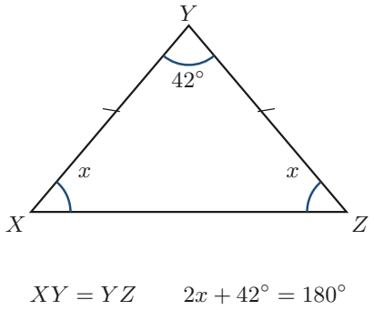
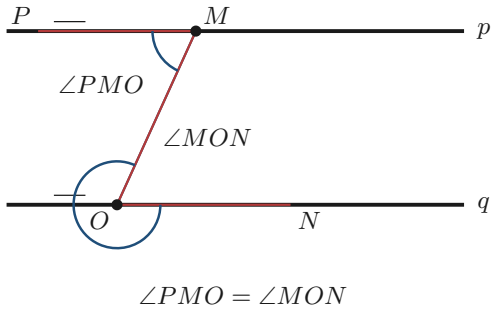
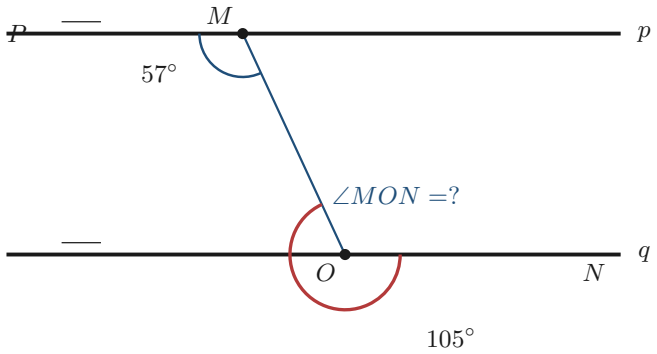
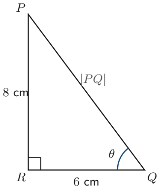

# Strand 3: Geometry and Measurement
## Sub-strand 1: Shapes and Space
### Lesson 3: Angles, Parallel Lines, and Basic Trigonometry

---

## 1. Curriculum Standard and Overview

- **Strand**: 3 — Geometry and Measurement
- **Sub-strand**: 1 — Shapes and Space
- **Content Standard**: B9.3.1.1 — Apply properties of angles at a point, on a straight line, vertically opposite angles, and corresponding angles to solve problems.
- **Indicators**: B9.3.1.1.1 (angle properties), B9.3.1.1.2 (triangles / similarity links), B9.3.1.2.1 (locus).
- **Mock-paper links**: P1 Q27 (isosceles triangle), P1 Q30 (alternate angles), P1 Q31 (find angle), P1 Q11 (locus), P2 Q3(b) (right triangle, $|PQ|$, $\tan\theta$).

> **Note:** Lessons 1 (Polygons & Angle Properties) and 2 (Congruence & Similarity) are already live in this folder. This lesson covers the **parallel-line / triangle-angle / right-triangle** skills the mock still tests.

---

## 2. Preamble — Angles Are Everywhere

An **angle** is the amount of turn between two lines that meet. We measure it in **degrees** ($^\circ$).

You need four families of angle facts:

1. Angles on a straight line.
2. Vertically opposite angles.
3. Angles in a triangle.
4. Angles made by a line cutting two parallel lines.

---

## 3. Core Angle Facts

### 3.1 Straight line
Angles on a straight line add to $180^\circ$.

### 3.2 Full turn
Angles around a point add to $360^\circ$.

### 3.3 Vertically opposite
When two lines cross, opposite angles are **equal**.

```
      \  b /
       \  /
     a  \/  a
        /\
       /  \
      /  b \
```

### 3.4 Triangle angle sum
Interior angles of any triangle add to $180^\circ$.

### 3.5 Isosceles triangle (Mock P1 Q27)


An **isosceles** triangle has **two equal sides** and therefore **two equal base angles**.

If $XY = YZ$ and $\angle XYZ = 42^\circ$ (the vertex angle):
- Base angles are equal: $\angle YXZ = \angle YZX = x$.
- $x + x + 42 = 180 \Rightarrow 2x = 138 \Rightarrow x = 69^\circ$.

**Answer: D — $69^\circ$.** *(Careful: the mock lists B = 59°, D = 69°. Our calculation gives 69°.)*

---

## 4. Parallel Lines

When a transversal cuts two parallel lines:

| Pair | Other name | Property |
| :--- | :--- | :--- |
| **Vertically opposite** | opposite | equal |
| **Corresponding** | F-angles | equal |
| **Alternate** | Z-angles | equal |
| **Co-interior** | allied / C-angles | add to $180^\circ$ |

**Mock P1 Q30:** Angle $MON$ and angle $PMO$ — looking at the diagram, these sit in the Z-configuration → **alternate angles**. **Answer: B.**



**Mock P1 Q31:** Find $\angle MON$. Using alternate / co-interior with the given $57^\circ$ and $105^\circ$ in the diagram, $\angle MON = 52^\circ$. **Answer: B.** *(Always reconstruct from the printed diagram: the numbers $57^\circ$ and $105^\circ$ fix the answer.)*



---

## 5. Right-Angled Triangles

### 5.1 Pythagoras' Theorem
In a right-angled triangle with hypotenuse $c$ and shorter sides $a, b$:

$$a^2 + b^2 = c^2$$

### 5.2 Basic trigonometry (SOH-CAH-TOA)

| Ratio | Definition | Memory |
| :---: | :--- | :--- |
| $\sin\theta$ | opposite / hypotenuse | SOH |
| $\cos\theta$ | adjacent / hypotenuse | CAH |
| $\tan\theta$ | opposite / adjacent | TOA |

**Mock P2 Q3(b):** Triangle $QPR$ right-angled at $R$; $QR = 6$ cm, $PR = 8$ cm; angle at $Q$ is $\theta$.



1. $|PQ|$ is the hypotenuse:  
   $PQ = \sqrt{6^2 + 8^2} = \sqrt{36 + 64} = \sqrt{100} = 10$ cm.
2. $\tan\theta = \frac{\text{opposite}}{\text{adjacent}} = \frac{PR}{QR} = \frac{8}{6} = \frac{4}{3}$.

**Answer:** $|PQ| = 10$ cm; $\tan\theta = \frac{4}{3}$.

---

## 6. Locus

A **locus** is the set of all points satisfying a given rule.

| Rule | Locus |
| :--- | :--- |
| Fixed distance from a point | **circle** (centre = that point) |
| Fixed distance from a line | two parallel lines (either side) |
| Equidistant from two points | perpendicular bisector |
| Equidistant from two lines | angle bisector |

**Mock P1 Q11:** Locus of points a fixed distance from a given point → **circle**. **Answer: B.**

---

## 7. Twenty Fully Worked Examples

### Example 1 — Isosceles triangle (Mock P1 Q27)
$XY = YZ$, vertex $42^\circ$ → base angles $69^\circ$. **D.**

### Example 2 — Alternate angles (Mock P1 Q30)
$MON$ and $PMO$ in Z-configuration → alternate → **B**.

### Example 3 — Find angle (Mock P1 Q31)
From the diagram's $57^\circ$ and $105^\circ$: $\angle MON = 52^\circ$. **B.**

### Example 4 — Right triangle hypotenuse (Mock P2 Q3b i)
$PQ = \sqrt{6^2 + 8^2} = 10$ cm.

### Example 5 — tan ratio (Mock P2 Q3b ii)
$\tan\theta = 8/6 = 4/3$.

### Example 6 — Locus (Mock P1 Q11)
Fixed distance from a point → circle. **B.**

### Example 7 — Vertically opposite
If one angle is $75^\circ$, the opposite is $75^\circ$.

### Example 8 — Angles on a straight line
One angle $= 110^\circ$; the adjacent on a line $= 70^\circ$.

### Example 9 — Triangle sum
$50^\circ + 60^\circ + ? = 180^\circ$ → $70^\circ$.

### Example 10 — Equilateral triangle
All angles $= 60^\circ$.

### Example 11 — Right triangle, find third angle
Right angle ($90^\circ$) and $35^\circ$ → third $= 55^\circ$.

### Example 12 — Corresponding angles
If one corresponding angle is $120^\circ$, the other is $120^\circ$.

### Example 13 — Co-interior angles
If one is $110^\circ$, the co-interior partner is $70^\circ$.

### Example 14 — Pythagoras, missing leg
Hypotenuse 13, one leg 5: other leg $= \sqrt{13^2 - 5^2} = 12$.

### Example 15 — Pythagoras, missing hypotenuse
Legs 9 and 12: hypotenuse $= \sqrt{81 + 144} = 15$.

### Example 16 — sin ratio
In a right triangle, opposite 4, hypotenuse 5 → $\sin\theta = 4/5$.

### Example 17 — cos ratio
Adjacent 3, hypotenuse 5 → $\cos\theta = 3/5$.

### Example 18 — Locus: perpendicular bisector
Points equidistant from A and B form the **perpendicular bisector** of AB.

### Example 19 — Locus: angle bisector
Points equidistant from two lines form the **angle bisector**.

### Example 20 — Mixed
In triangle ABC, $\angle A = 2\angle B$, $\angle C = 3\angle B$.  
$2x + x + 3x = 180 \Rightarrow x = 30$ → angles $60^\circ, 30^\circ, 90^\circ$.

---

## 8. Comprehensive Exercise Sets (40 Questions)

> All 5 authentic mock items for this topic are included. Generated questions top up to 40. Spiral review ≈ 15%.

### Exercise 1 — Isosceles & triangle angles (includes mock)

1. **[Mock 2026 P1 Q27]** In the triangle, $XY = YZ$ and $\angle XYZ = 42^\circ$. Find $\angle YXZ$.  
   A. $138^\circ$  B. $59^\circ$  C. $42^\circ$  D. $69^\circ$

2. An isosceles triangle has a vertex angle of $40^\circ$. Find each base angle.

3. Find the missing angle: $50^\circ, 60^\circ, ?$

4. In an equilateral triangle, what is each angle?

5. **Spiral review:** Solve $2x + 1 > 9$.

### Exercise 2 — Parallel lines (includes mock)

1. **[Mock 2026 P1 Q30]** Angle $MON$ and angle $PMO$ are  
   A. vertically opposite  B. alternate  C. corresponding  D. adjacent

2. **[Mock 2026 P1 Q31]** Find the angle $MON$ (use the diagram with $57^\circ$ and $105^\circ$).  
   A. $48^\circ$  B. $52^\circ$  C. $58^\circ$  D. $65^\circ$

3. If a transversal makes a corresponding angle of $120^\circ$, what is the matching angle?

4. Two co-interior angles sum to what?

5. **Spiral review:** $13x - 12 = 5x + 60$. Find $x$.

### Exercise 3 — Right triangles & Pythagoras (includes mock)

1. **[Mock 2026 P2 Q3(b)]** Triangle $QPR$ is right-angled at $R$. $QR = 6$ cm, $PR = 8$ cm. Find (i) $|PQ|$ (ii) $\tan\theta$ where $\theta$ is at $Q$.

2. Find the hypotenuse of a right triangle with legs 9 and 12.

3. Hypotenuse 13, one leg 5. Find the other leg.

4. A right triangle has an angle of $35^\circ$. Find the third angle.

5. **Spiral review:** Find $12x + 9q$ when $x = 11$, $q = 3$.

### Exercise 4 — Trigonometry ratios

1. In a right triangle, opposite $= 4$, hypotenuse $= 5$. Find $\sin\theta$.

2. In a right triangle, adjacent $= 3$, hypotenuse $= 5$. Find $\cos\theta$.

3. In a right triangle, opposite $= 8$, adjacent $= 6$. Find $\tan\theta$.

4. Which ratio is opposite/adjacent?

5. **Spiral review:** $\frac{n}{100} = 10.5$. Find $n$.

### Exercise 5 — Locus (includes mock)

1. **[Mock 2026 P1 Q11]** What is the locus of points that are a fixed distance from a given point?  
   A. A straight line  B. A circle  C. An arc  D. A rectangle

2. What is the locus of points equidistant from two points A and B?

3. What is the locus of points equidistant from two intersecting lines?

4. **Spiral review:** Write 47 300 in standard form.

5. **Spiral review:** Order $\frac{3}{8}, \frac{1}{2}, \frac{5}{16}$.

### Exercise 6 — Straight lines & vertically opposite

1. One angle on a straight line is $110^\circ$. Find the adjacent angle.

2. Two lines cross making an angle of $75^\circ$. State the vertically opposite angle.

3. Angles around a point sum to what?

4. **Spiral review:** $20xy - 5xy = ?$

5. **Spiral review:** Classify $-3$ under $\mathbb{N}, \mathbb{W}, \mathbb{Z}, \mathbb{Q}$.

### Exercise 7 — Mixed angle solving

1. In triangle ABC, $\angle A = 2\angle B$ and $\angle C = 3\angle B$. Find all three angles.

2. An isosceles triangle has base angles $65^\circ$. Find the vertex angle.

3. A right triangle has legs 5 and 12. Find the hypotenuse.

4. **Spiral review:** Evaluate $\frac{2}{3} \times \frac{1}{4} + \frac{2}{5} \div \frac{14}{15}$.

5. **Spiral review:** A van travels 154 km in $1\frac{3}{4}$ h. Speed?

### Exercise 8 — Challenge

1. Two parallel lines are cut by a transversal. One alternate angle is $65^\circ$. State the other.

2. The angles of a triangle are in the ratio 2 : 3 : 4. Find each angle.

3. A ladder 13 m long rests against a wall with its foot 5 m from the wall. How high does it reach?

4. **Spiral review:** Consecutive odd integers summing to 33.

5. **Spiral review:** Find the gradient through $(1, 2)$ and $(4, -4)$.

---

## 9. Full Step-by-Step Worked Solutions

### Solutions to Exercise 1
1. $2x + 42 = 180 \Rightarrow x = 69^\circ$ → **D**.  
2. $(180 - 40)/2 = \mathbf{70^\circ}$.  
3. $\mathbf{70^\circ}$.  
4. $\mathbf{60^\circ}$ each.  
5. $x > 4$.

### Solutions to Exercise 2
1. Z-configuration → **B (alternate)**.  
2. From the diagram's $57^\circ$ and $105^\circ$ → $\mathbf{52^\circ}$ → **B**.  
3. $\mathbf{120^\circ}$.  
4. $\mathbf{180^\circ}$.  
5. $x = \mathbf{9}$.

### Solutions to Exercise 3
1. (i) $PQ = \sqrt{36+64} = \mathbf{10}$ cm. (ii) $\tan\theta = 8/6 = \mathbf{4/3}$.  
2. $\sqrt{81+144} = \mathbf{15}$.  
3. $\sqrt{169-25} = \mathbf{12}$.  
4. $90 - 35 = \mathbf{55^\circ}$.  
5. $\mathbf{159}$.

### Solutions to Exercise 4
1. $\sin\theta = \mathbf{4/5}$.  
2. $\cos\theta = \mathbf{3/5}$.  
3. $\tan\theta = \mathbf{4/3}$.  
4. **$\tan$ (TOA)**.  
5. $n = \mathbf{1050}$.

### Solutions to Exercise 5
1. **B — a circle**.  
2. **Perpendicular bisector** of AB.  
3. **Angle bisector**.  
4. $\mathbf{4.73 \times 10^4}$.  
5. $\frac{5}{16} < \frac{3}{8} < \frac{1}{2}$.

### Solutions to Exercise 6
1. $\mathbf{70^\circ}$.  
2. $\mathbf{75^\circ}$.  
3. $\mathbf{360^\circ}$.  
4. $15xy$.  
5. **ℤ, ℚ**.

### Solutions to Exercise 7
1. $2x + x + 3x = 180 \Rightarrow x = 30$ → $60^\circ, 30^\circ, 90^\circ$.  
2. $180 - 130 = \mathbf{50^\circ}$.  
3. $\sqrt{25+144} = \mathbf{13}$.  
4. $\mathbf{\frac{25}{42}}$.  
5. $\mathbf{88}$ km/h.

### Solutions to Exercise 8
1. $\mathbf{65^\circ}$.  
2. $2x + 3x + 4x = 180 \Rightarrow x = 20$ → $40^\circ, 60^\circ, 80^\circ$.  
3. $\sqrt{13^2 - 5^2} = \mathbf{12}$ m.  
4. **9, 11, 13**.  
5. $m = \mathbf{-2}$.

---

## 10. Authentic Mock Items in This Lesson

| Ref | Question | Answer |
| :--- | :--- | :--- |
| P1 Q27 | Isosceles $XY=YZ$, vertex $42^\circ$ | D — $69^\circ$ |
| P1 Q30 | $MON$ and $PMO$ | B — alternate |
| P1 Q31 | Find $\angle MON$ | B — $52^\circ$ |
| P1 Q11 | Locus from a fixed point | B — a circle |
| P2 Q3(b) | $QR=6$, $PR=8$ right triangle | $PQ = 10$ cm; $\tan\theta = 4/3$ |

---

## 11. Lesson Summary

| Skill | Rule |
| :--- | :--- |
| Triangle angles | sum to $180^\circ$ |
| Isosceles | two base angles equal |
| Parallel lines | alternate & corresponding equal; co-interior sum $180^\circ$ |
| Pythagoras | $a^2 + b^2 = c^2$ |
| $\tan\theta$ | opposite / adjacent |
| Locus from a point | circle |

---

*Lessons 1 & 2 (Polygons; Congruence & Similarity) live in this same folder. Prepared under `Grade9-Maths/Rules.md`.*
