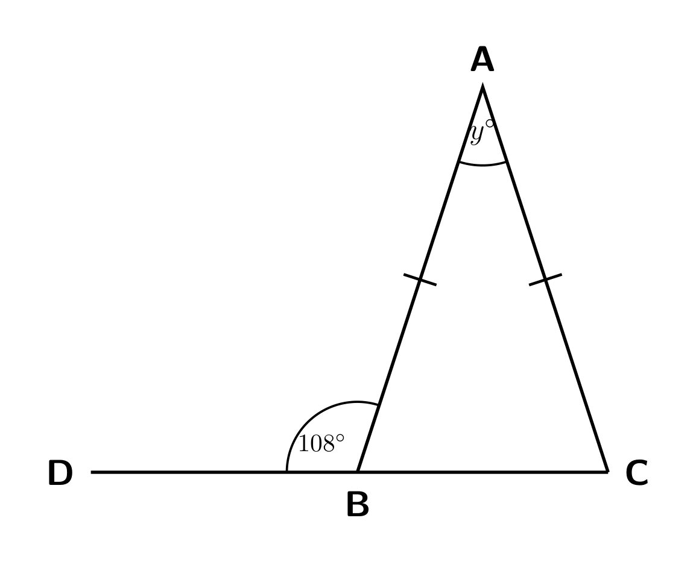
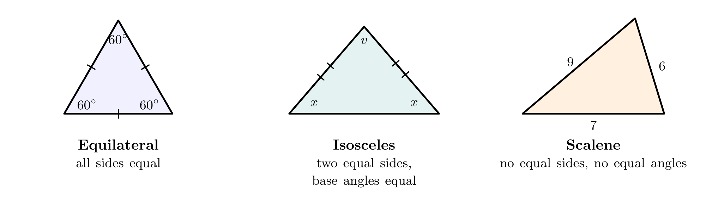
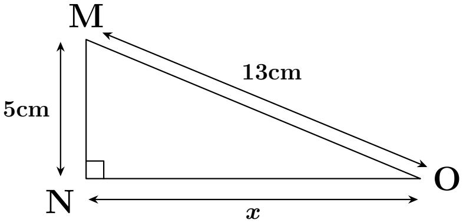
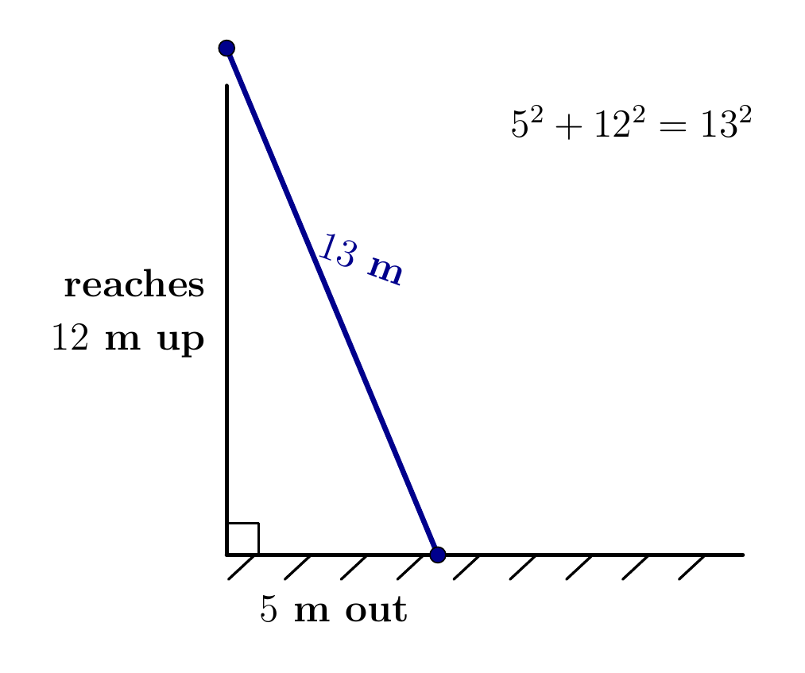

# Strand 3: Geometry and Measurement
## Sub-strand 1: Shapes and Space
### Lesson 4 (Requested topic): Working with Different Types of Triangles

---

## 1. Curriculum Standard and Overview

- **Strand**: 3 — Geometry and Measurement
- **Sub-strand**: 1 — Shapes and Space
- **Content Standards**: B8.3.1.1 (properties of shapes and space), B8.3.2.1 (measurement with right-angled triangles).
- **Indicators**: B8.3.1.1.2 (determine angles in a triangle using the angle-sum fact), B8.3.2.1.2 (relationship between hypotenuse $c$ and sides $a, b$ — Pythagoras), B8.3.2.1.3 (solve right-triangle problems), B8.3.2.1.4 (use Pythagoras in real-life problems).
- **Why this lesson before the others**: the **area of a triangle** (next lesson) and the **construction of triangles** (Constructions I & II) both require you to know the three side-families, the three angle-families, the angle sum, and Pythagoras' theorem. This is the foundation lesson.

> **Already delivered and assumed**: angle facts (straight line $180^\circ$, point $360^\circ$, vertically opposite, parallel lines) from Lesson 3 of this folder; triangle = polygon with $n = 3$, so angle sum $= (3-2)\times180 = 180^\circ$ from Lesson 1 (Polygons).

---

## 2. Preamble — Six Names for Any Triangle

Every triangle gets **two names at once**:

1. A name by its **sides** (how many sides are equal).
2. A name by its **largest angle** (how wide the widest corner is).

| By sides | Meaning | Angle fact |
| :--- | :--- | :--- |
| **Equilateral** | all 3 sides equal | all 3 angles $= 60^\circ$ |
| **Isosceles** | exactly 2 sides equal | the 2 **base angles** (opposite the equal sides) are equal |
| **Scalene** | no sides equal | no angle equal |

| By largest angle | Meaning |
| :--- | :--- |
| **Acute-angled** | all angles $< 90^\circ$ |
| **Right-angled** | exactly one angle $= 90^\circ$ |
| **Obtuse-angled** | one angle between $90^\circ$ and $180^\circ$ |

*Figure 3 shows the three side names side by side; equal ticks mark equal sides, and the letters $x$, $x$ mark the equal base angles of the isosceles.*

Example: a triangle with sides $5, 5, 8$ and all angles below $90^\circ$ is **isosceles acute-angled**. A triangle with angles $90^\circ, 30^\circ, 60^\circ$ is **scalene right-angled**.

### 2.1 The three angle facts inside every triangle

1. **Angle sum**: $\angle A + \angle B + \angle C = 180^\circ$.
2. **Isosceles base angles**: the angles opposite the equal sides are equal.
3. **Exterior angle**: an exterior angle equals the sum of the two opposite (remote) interior angles.
   In Figure 1, the exterior angle at the extended vertex $=$ the two far interior angles added.

---

## 3. Core Concept — Pythagoras' Theorem (the right-triangle engine)

In **any right-angled triangle**, with $c$ the **hypotenuse** (the longest side, opposite the right angle) and $a, b$ the two shorter sides:

$$a^2 + b^2 = c^2$$

Three uses:

| Find | Rearrangement |
| :--- | :--- |
| hypotenuse $c$ | $c = \sqrt{a^2+b^2}$ |
| short side | $a = \sqrt{c^2 - b^2}$ (subtract, never add!) |

**Converse test (to classify a triangle)**: given three sides, check the biggest side $c$:

- $a^2 + b^2 = c^2$ → **right-angled**
- $a^2 + b^2 > c^2$ → **acute-angled**
- $a^2 + b^2 < c^2$ → **obtuse-angled**

**Must-know Pythagorean triples**: $(3,4,5)$, $(5,12,13)$, $(8,15,17)$, $(7,24,25)$ — and their multiples like $(6,8,10)$, $(9,12,15)$, $(10,24,26)$.

---

## 4. Fifteen Fully Worked Examples

### Example 1 — Classification check (own)
A triangle has angles $55^\circ$, $45^\circ$, $80^\circ$. Name it fully.

All angles $< 90^\circ$ → **acute-angled**; all three angle values differ (so no equal opposite sides) → **scalene**. Name: *acute-angled scalene triangle*. (Check: $55+45+80 = 180$ ✓.)

### Example 2 — BECE 2003 (authentic)
In triangle $XYZ$, $\angle XZY = 90^\circ$, $|XY| = 13$ cm and $|YZ| = 5$ cm. Find $|XZ|$.

$|XY| = 13$ is opposite the right angle → hypotenuse.
$|XZ|^2 = 13^2 - 5^2 = 169 - 25 = 144$, so $|XZ| = 12$ cm. *(Triple 5-12-13.)*

### Example 3 — BECE 2015 (authentic)
The hypotenuse and a side of a right-angled triangle are $13$ cm and $5$ cm. Find the third side.

Same triple: third side $= \sqrt{13^2-5^2} = \sqrt{144} = 12$ cm.

### Example 4 — Isosceles vertex angle (own)
An isosceles triangle has vertex angle $40^\circ$. Find each base angle.

Base angles $= (180 - 40) \div 2 = 140 \div 2 = 70^\circ$ each.

### Example 5 — BECE 1997 (authentic)
In triangle $PQR$, $|PQ| = |QR|$ and $\angle PQR = 90^\circ$. Find the equal base angles.

$|PQ|=|QR|$ → equal angles at $R$ and $P$. $2x + 90 = 180 \Rightarrow x = 45^\circ$ each.
(This is the famous **isosceles right triangle** — halves of a square.)

### Example 6 — Exterior angle (own)
Two interior angles of a triangle are $55^\circ$ and $65^\circ$. Find the exterior angle at the third vertex.

Exterior angle $= 55 + 65 = 120^\circ$. *(Check: interior at that vertex $= 180-55-65 = 60^\circ$, and its straight-line partner is $180 - 60 = 120$ ✓.)*

### Example 7 — BECE 1998 (authentic)
$PQR$ is isosceles with $|PQ| = |PR|$, $\angle QPR = 40^\circ$, and $QRS$ is a straight line. Find $\angle PRS$.

Base angles: $(180-40)\div2 = 70^\circ$ each, so $\angle PRQ = 70^\circ$.
$\angle PRS$ is on the straight line $QRS$: $\angle PRS = 180 - 70 = 110^\circ$.
*(Shortcut: exterior angle = sum of remote interiors $= 70 + 40 = 110$ ✓, matches the authentic key.)*

### Example 8 — Algebra angles (own)
The angles of a triangle are $x$, $2x$, $3x$. Find $x$ and name the triangle.

$6x = 180 \Rightarrow x = 30$. Angles: $30^\circ, 60^\circ, 90^\circ$ → **right-angled scalene**.

### Example 9 — Isosceles + algebra (own)
An isosceles triangle has base angles $x$ each and vertex angle $4x$. Find all angles and name it.

$6x = 180 \Rightarrow x = 30$. Angles: $30^\circ, 30^\circ, 120^\circ$ → **obtuse-angled isosceles**.

### Example 10 — BECE 2002 (authentic, area × right angle)
$PQR$ is a right-angled triangle. Its area is $6$ cm² and $|QR| = 3$ cm. Find the other short side (the printed options are 2, 3, 4, 6 — the correct maths gives one of these).

With the right angle between the two short sides, area $= \frac{1}{2} \times 3 \times h = 6 \Rightarrow h = 4$ cm.
So the other short side is **4 cm**. *(Note: if that side's name in your printed paper differs, match the side by the working — the value is 4 cm.)*

### Example 11 — BECE 2002 (authentic — Pythagoras inside a rectangle)
A rectangle has length $8$ cm and breadth $6$ cm. How long is its diagonal?

The diagonal cuts the rectangle into two right triangles with legs $8, 6$:
$d^2 = 8^2 + 6^2 = 64 + 36 = 100 \Rightarrow d = 10$ cm. *(Triple 6-8-10.)*

### Example 12 — Converse test (own)
Classify the triangles: (a) sides $6, 8, 10$; (b) sides $4, 5, 6$.

(a) $6^2 + 8^2 = 100 = 10^2$ → **right-angled scalene**.
(b) biggest side $6$: $4^2+5^2 = 41 > 36 = 6^2$ → **acute-angled scalene**.

### Example 13 — BECE 1994 style (height of an isosceles)
Triangle $ABC$: $|AB| = |BC| = 5$ cm, $|AC| = 8$ cm. $BD$ is the perpendicular from $B$ to $AC$. Find $|BD|$.

$D$ is the **midpoint** of $AC$ (isosceles symmetry): $|AD| = 4$ cm.
$|BD|^2 = 5^2 - 4^2 = 9 \Rightarrow |BD| = 3$ cm.

### Example 14 — Real-life (own)
A ladder $13$ m long leans against a wall with its foot $5$ m out on level ground. How high does it reach?

Wall $= \sqrt{13^2 - 5^2} = \sqrt{144} = 12$ m.

### Example 15 — Equilateral fact (own, P2 style)
An equilateral triangle has side $6$ cm and vertical height $5.2$ cm. Find (a) each angle, (b) its area.

(a) Each angle $= 60^\circ$.
(b) $A = \frac{1}{2} b h = \frac{1}{2} \times 6 \times 5.2 = 15.6$ cm².

---

## 5. Exercises — 5 Sections × 5 Questions (No MCQ)

**Show every step. State the type of triangle when asked.**

### Exercise 1 — Naming triangles
1. A triangle has angles $100^\circ$, $40^\circ$, $40^\circ$. Name it fully (both names).
2. A triangle has sides $7$ cm, $7$ cm, $7$ cm. Name it and state all three angles.
3. A triangle has sides $4, 6, 8$. Use the converse test to name it.
4. A triangle has sides $9, 12, 15$. Name it.
5. Give one word meaning: a triangle with exactly two equal angles.

### Exercise 2 — Angle sum and isosceles work
1. Two angles of a triangle are $48^\circ$ and $61^\circ$. Find the third.
2. An isosceles triangle has base angles of $64^\circ$ each. Find the vertex angle.
3. An isosceles triangle has vertex angle $96^\circ$. Find each base angle.
4. The angles of a triangle are in the ratio $2 : 3 : 4$. Find them all and name the triangle.
5. In an isosceles triangle the vertex angle is $(3x)^\circ$ and each base angle is $(x + 15)^\circ$. Find $x$ and all angles.

### Exercise 3 — Exterior angles
1. Interior angles of $72^\circ$ and $58^\circ$; find the exterior angle at the third vertex.
2. An exterior angle of a triangle is $135^\circ$ and one remote interior angle is $85^\circ$. Find the other remote interior angle, and the interior angle at the same vertex.
3. $\triangle ABC$ is isosceles, $|AB| = |AC|$, vertex $\angle A = 36^\circ$. The side $BA$ is extended to $D$. Find $\angle CAD$.
4. In $\triangle PQR$, $\angle PQR = 70^\circ$ and $\angle QRP = 65^\circ$. Side $QR$ is produced to $S$. Find $\angle PRS$.
5. One exterior angle of a triangle is $110^\circ$; an adjacent interior angle (at the same vertex) is $x^\circ$ and a *different* interior angle is $55^\circ$. Find $x$ and the third angle.

### Exercise 4 — Pythagoras engine
1. Legs $9$ cm and $12$ cm: find the hypotenuse.
2. Hypotenuse $17$ cm, one leg $8$ cm: find the other leg.
3. A rectangle is $24$ cm by $7$ cm. Find its diagonal.
4. Triangle sides $5, 12, 13$: prove it is right-angled, then find its area (right angle between the two shorter sides).
5. A sail is a right triangle: two edges of $15$ cm and $20$ cm meet at a right angle. How long is the closing (third) edge?

### Exercise 5 — Spiral review
1. *(Perimeter & area, Lesson 3)* A square has perimeter $96$ cm; find its area.
2. *(Polygons, earlier geometry)* A regular pentagon has interior angle $108^\circ$ each. Verify with the formula $(n-2)\times180 \div n$.
3. *(Algebra)* Solve $5(x-2) = 3x + 6$ and use the answer as an angle in degrees; state whether it is acute, right, obtuse or reflex.
4. *(Percent)* A triangle's area is $150$ cm². A sticker covers $40\%$ of it. Find the sticker area.
5. *(Congruence, earlier geometry)* $\triangle ABC \cong \triangle DEF$ with $|AB| = 7$ cm, $\angle A = 50^\circ$. State $|DE|$ and $\angle D$.

---

## 6. Full Worked Solutions — Exercises

### Exercise 1
1. Angles $100^\circ$ (obtuse, the largest), two equal $40^\circ$ → **obtuse-angled isosceles**.
2. All sides equal → **equilateral**; all angles $60^\circ$.
3. Biggest side $8$: $4^2+6^2 = 52 < 64 = 8^2$ → **obtuse-angled scalene**.
4. $9^2+12^2 = 81+144 = 225 = 15^2$ → **right-angled scalene**. *(Triple 3-4-5 scaled ×3.)*
5. **Isosceles** (equal angles opposite equal sides; the two equal angles make it so).

### Exercise 2
1. $180 - (48+61) = 71^\circ$.
2. $180 - 2(64) = 52^\circ$.
3. $(180-96)\div2 = 42^\circ$ each.
4. Total parts $9$; one part $= 20^\circ$; angles $40^\circ, 60^\circ, 80^\circ$ → **acute-angled scalene**.
5. $3x + 2(x+15) = 180 \Rightarrow 5x + 30 = 180 \Rightarrow x = 30$. Angles: $90^\circ$ vertex, $45^\circ, 45^\circ$ base → **right-angled isosceles**.

### Exercise 3
1. $72 + 58 = 130^\circ$.
2. Other remote interior $= 135 - 85 = 50^\circ$; interior at the vertex $= 180 - 135 = 45^\circ$.
3. Base angles $= (180-36)\div2 = 72^\circ$; $\angle CAD = 180 - 72 = 108^\circ$ (or exterior rule $36 + 72$).
4. $\angle PRS = 70 + 65 = 135^\circ$.
5. $x = 180 - 110 = 70^\circ$; third angle $= 180 - (70 + 55) = 55^\circ$. *(Check with the exterior rule: remote interiors $55^\circ + 55^\circ = 110^\circ$ ✓.)*

### Exercise 4
1. $c = \sqrt{81+144} = \sqrt{225} = 15$ cm.
2. $b = \sqrt{17^2 - 8^2} = \sqrt{225} = 15$ cm.
3. $d = \sqrt{24^2+7^2} = \sqrt{625} = 25$ cm.
4. $5^2 + 12^2 = 169 = 13^2$ ✓ right-angled; area $= \frac{1}{2}\times5\times12 = 30$ units².
5. $15^2 + 20^2 = 225 + 400 = 625 = 25^2$ → string $= 25$ cm.

### Exercise 5
1. Side $= 24$; area $= 576$ cm².
2. $(5-2)\times180\div5 = 540\div5 = 108^\circ$ ✓.
3. $5x - 10 = 3x + 6 \Rightarrow 2x = 16 \Rightarrow x = 8$ → $8^\circ$, **acute**.
4. $0.40 \times 150 = 60$ cm².
5. $|DE| = 7$ cm, $\angle D = 50^\circ$ (congruent = identical).

---

## 7. Memory Card

- Every triangle: **two names** (sides + angles).
- Angle sum $= 180^\circ$; exterior $=$ sum of the two remote interiors.
- Isosceles → base angles equal; equilateral → three $60^\circ$ angles.
- Pythagoras: $a^2 + b^2 = c^2$; triples $(3,4,5)$, $(5,12,13)$, $(8,15,17)$, $(7,24,25)$.
- Converse test sorts any three sides into right / acute / obtuse.

**Next lesson**: *area of polygons* — the triangle area formula $\frac{1}{2}bh$ is the centrepiece, and you now know how to find $h$ inside isosceles and right triangles.
