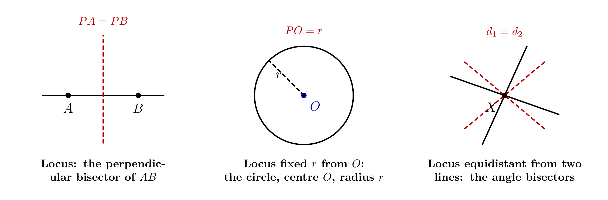
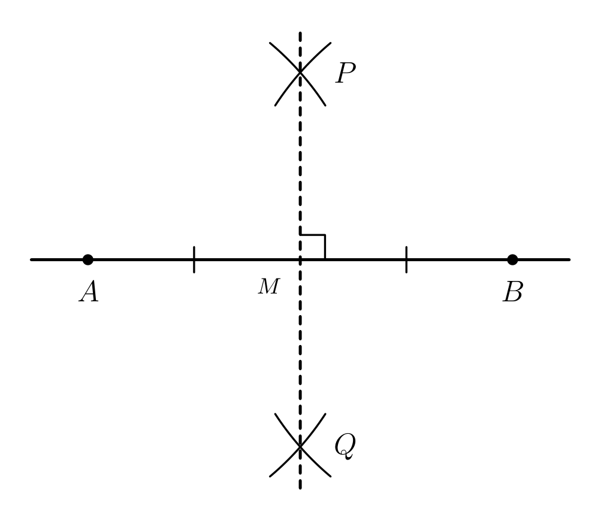
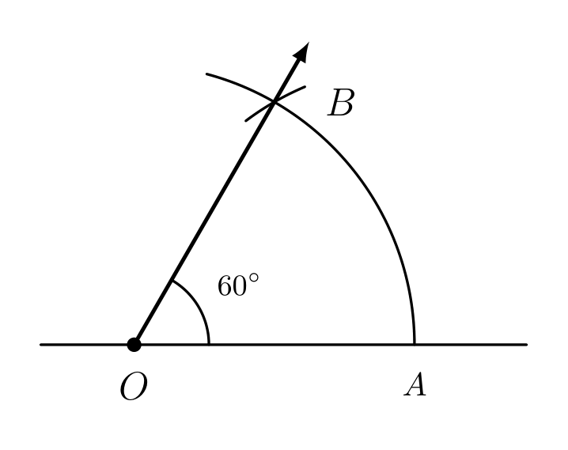
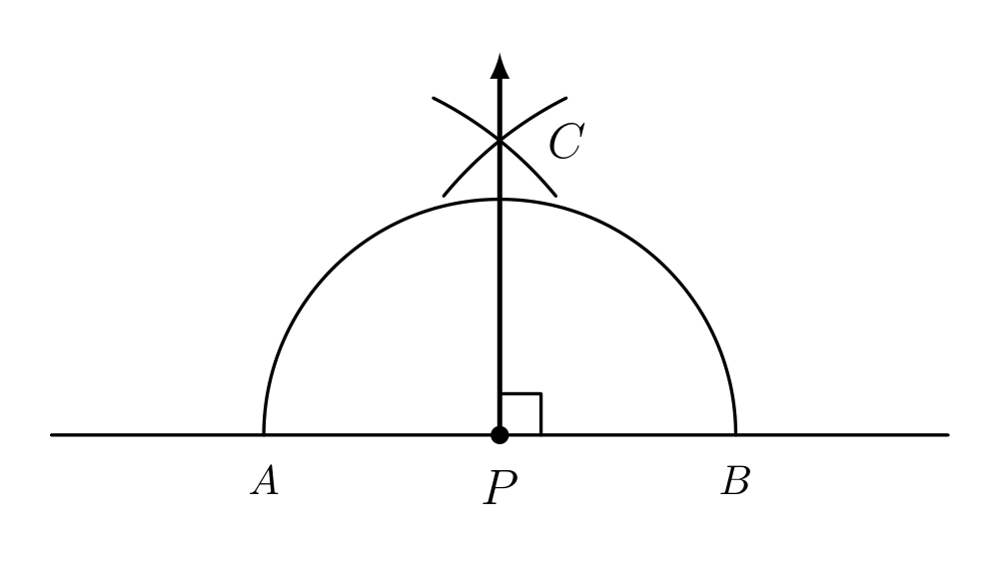
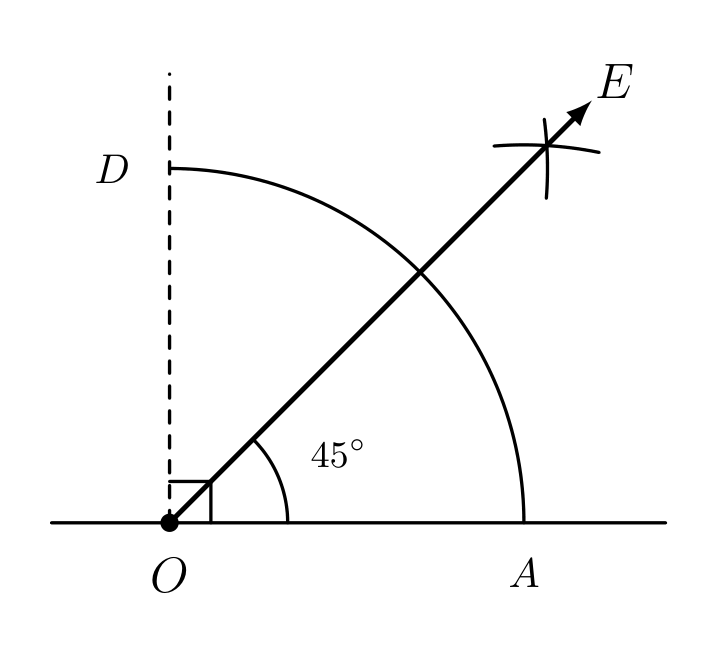
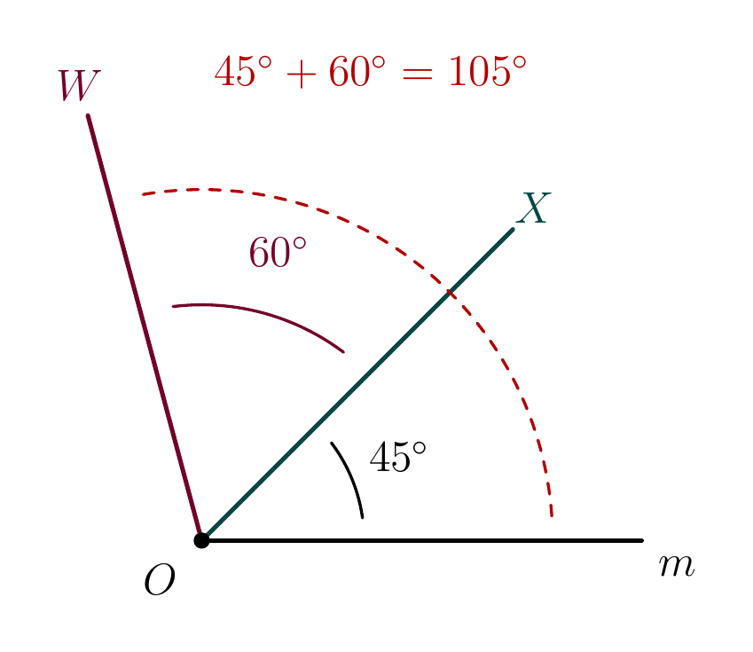
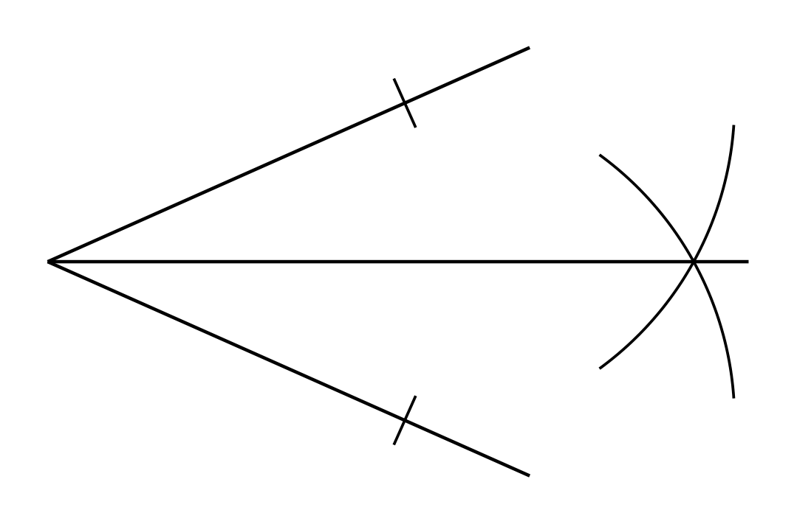

# Strand 3: Geometry and Measurement
## Sub-strand 1: Shapes and Space
### Lesson 5 (Requested topic): Geometric Constructions I — Lines, Perpendiculars, Bisectors, Standard Angles and Loci

---

## 1. Curriculum Standard and Overview

- **Strand**: 3 — Geometry and Measurement
- **Sub-strand**: 1 — Shapes and Space
- **Content Standards**: B7.3.1.2 and B8.3.1.2 (Constructions and loci).
- **Indicators**: B7.3.1.2.1 (distinguish between a construction and a drawing; construct perpendiculars from and to a line), B7.3.1.2.2 (construct the perpendicular bisector / "mediator" of a line segment), B8.3.1.2.1 (construct the bisector of a given angle and construct angles of 60°/90°/45°/30° and their multiples), B8.3.1.2.3 (simple loci — perpendicular bisector, circle, angle bisector).
- **Mock-paper links**: WAEC/BECE Paper 2 construction questions always begin with "using a ruler and a pair of compasses only" — Lesson 6 (next) builds on these skills to construct whole triangles, so master every step here first.

> **Prerequisites delivered**: angle facts, parallel lines and triangle angles (Lesson 4 of this folder, and Package 13 in the mock-paper folder: angles, parallel lines, trigonometry). Complementary and supplementary angles power about half of this lesson.

---

## 2. Preamble — Construction vs Drawing

A **construction** uses **only two tools**:

1. a **ruler** (to draw straight lines and measure lengths), and
2. a **pair of compasses** (to draw arcs and circles).

No protractor, no set square. Every angle you need is *created* by intersecting arcs.

**Golden habits in the exam:**

- **Never erase your arcs.** The arcs are the proof that you constructed, not drew. Examiners award marks for construction arcs.
- Keep the compass opening **exactly the same** unless a step tells you to change it.
- Draw **faint** construction lines and a **firm** final line.
- Identical arcs on both sides of a line = "same radius" = equal distances. That idea drives everything below.

**Key inequality rule**: when cutting a line segment into two arcs that must cross, always open the compasses to **more than half** the segment. Half the length or less → the arcs miss each other or merely touch.

---

## 3. Core Concepts

### 3.1 The four basic constructions

| Construction | Idea | Key fact produced |
| :--- | :--- | :--- |
| **Perpendicular bisector** of $AB$ (also called the **mediator**) | equal-radius arcs from $A$ and from $B$ cross above and below; join the crossings | passes through the **midpoint** of $AB$; meets $AB$ at **90°**; every point on it is **equidistant from $A$ and $B$** |
| **Perpendicular at a point** on a line | the point cuts the line at two equal distances either side; equal-radius arcs from those two cuts cross; join | the new line is 90° to the given line at that exact point |
| **Perpendicular from an external point** to a line | arcs centred on the external point cut the line at two points; then bisect | the shortest distance from the point to the line |
| **Angle bisector** of $\angle AOB$ | one arc from the vertex cuts both arms; equal-radius arcs from those two cuts cross; join vertex to crossing | a ray making **equal angles** with both arms; every point on it is **equidistant from the two arms** |

### 3.2 Building angles from 60°

Constructing 60° is the *seed* (equilateral triangle construction — three equal arcs). From 60°:

| Angle | How to obtain it |
| :--- | :--- |
| **60°** | direct construction (equilateral arc method) |
| **30°** | bisect the 60° |
| **15°** | bisect the 30° |
| **120°** | 60° + 60° side by side |
| **90°** | construct 60° on **both** sides at the vertex, then bisect the 120° between them (each half is 90°) — or bisect the supplementary pair |
| **45°** | bisect the 90° |
| **75°** | construct **150°** (= 90° + 60°) then bisect it; *or* 60° + 15° |
| **105°** | 90° + 15°, *or* 60° + 45° (**simplest**) |
| **135°** | 90° + 45° |
| **150°** | the supplement of 30° |
| **165°** | bisect the 30° left over on the straight line: $180° − 15°$; *or* supplementary construction of 15° |

> **One-idea summary**: bisecting **halves** an angle; adding two constructed angles **side by side at the same vertex** builds new ones. Everything in the table above is just these two moves.

### 3.3 Loci — the shape that a rule draws

A **locus** (plural *loci*) is the path or set of all points satisfying a stated condition. Learn these five:

| Condition on a point $P$ | Locus |
| :--- | :--- |
| Equidistant from **two fixed points** $A$ and $B$ | the **perpendicular bisector** of $AB$ |
| Fixed distance $r$ from a **fixed point** $O$ | a **circle**, centre $O$, radius $r$ |
| Equidistant from **two intersecting lines** | the **bisectors of the angles** between them |
| Equidistant from **two parallel lines** | the **parallel line** halfway between them |
| Fixed distance $d$ from a **given straight line** | **two parallel lines**, one on each side, $d$ away |

*Figure 7 draws the three workhorse loci together: the red dashed curves are the answers.*

---

## 4. Fifteen Fully Worked Examples

### Example 1 — Identify the construction (BECE 2002, authentic: Q_ebb9722370cd)
A question shows: a line $AB$; arcs of the same radius drawn from **both** $A$ and $B$, crossing above and below the line; a straight line through the two crossings, meeting $AB$ at 90°.

Which best describes it?
A. Constructing an angle of 60°  B. Constructing the perpendicular bisector of $AB$  C. Constructing a circle about the midpoint of $AB$  D. Constructing an angle of 180°

Same-radius arcs from both endpoints, crossing, then a joining line through the crossings that is perpendicular — that is exactly the perpendicular bisector recipe.
**Answer: B.**

### Example 2 — Perpendicular bisector step by step (diagram)

Construct the perpendicular bisector of $AB$ where $|AB| = 10$ cm, and state where it meets $AB$.

1. Draw $AB = 10$ cm.
2. Open the compasses to more than $5$ cm (say $7$ cm).
3. With centre $A$, draw arcs above and below $AB$.
4. **Same radius**, with centre $B$, draw arcs cutting the first pair at $P$ (above) and $Q$ (below).
5. Rule the line $PQ$.

$PQ$ meets $AB$ at its **midpoint** $M$, with $AM = MB = 5$ cm, and $PQ \perp AB$.
*(Check: measuring $AP$, $BP$ on your diagram — both are equal because both arcs had radius 7.)*

### Example 3 — Locus: two fixed points (BECE 2003, authentic: Q_92dad9b0b7f0)
The point $P$ moves in a plane such that it is always at equal distance from two fixed points $A$ and $B$. Which of these is the locus of $P$?
A. The bisector of angle $PAB$  B. A circle centre $B$ and radius $AB$  C. A circle with $AB$ as the diameter  D. The perpendicular bisector of line $AB$

"Always equidistant from two fixed points" is the defining property of the perpendicular bisector — indeed every point on the perpendicular bisector of $AB$ satisfies $PA = PB$.
**Answer: D.**

### Example 4 — Locus: fixed distance from a point (BECE 1998, authentic: Q_f64fcf2cfcfc)
Which best describes "the locus of points 6 cm from a fixed point $O$"?

All points at distance 6 cm from $O$ form a **circle with centre $O$ and radius 6 cm** — that is literally the definition of a circle.
**Answer: a circle, centre $O$, radius 6 cm.**
> ⚠️ The banked option list for this item lost that correct choice in text extraction; the official answer shown was "A circle with centre O and radius 6 cm". Trust the mathematics: distance-fixed-from-a-point = circle.

### Example 5 — Same locus, different wording (BECE 2015 style, authentic: Q_8f0ebff1735e)
Which best describes "the locus of a point which moves so that its distances from two fixed points are always equal"?
A. Bisector of angle  B. Perpendicular bisector  C. Circle  D. Two parallel lines

Identical condition to Example 3, worded differently —
**Answer: B, the perpendicular bisector.**
*(Guard against the trap "bisector of angle": an angle bisector holds points equidistant from two **lines**, not two **points**.)*

### Example 6 — Perpendicular at a point on the line (BECE 1991, authentic: Q_38a0bb47f43b)
Which of these best describes a construction where a point $C$ lies **on** line $AB$, an arc cuts $AB$ on both sides of $C$, and equal arcs from those cuts meet at $D$ above the line, with $CD$ ruled?

That is **constructing a perpendicular to a given line through a point on the line** (the official key).
**Answer: perpendicular to the line at the point on it.**
*(Distinguish from option D of the original — "from a point outside the line": in that version the compasses start at the external point, not at a point of the line.)*

### Example 7 — Dropping a perpendicular from an external point (BECE 2018 style, authentic: Q_a3725eb9973f)
$P$ is a point **above** a line. An arc centred at $P$ cuts the line at $X$ and $Y$; equal-radius arcs centred at $X$ and $Y$ meet at $Q$ below the line; $PQ$ is ruled and meets the line at $N$.

(a) What construction is this? (b) What is special about $PN$?

(a) Constructing the **perpendicular from the point $P$ to meet the line** (official key of the 2018 item).
(b) $PN$ is the **shortest** distance from $P$ to the line, and $\angle PNX = \angle PNY = 90°$.

### Example 8 — Constructing 60° directly

Construct an angle of 60° at $A$ on ray $AB$.

1. Draw ray $AB$.
2. Centre $A$, a comfortable radius $r$: draw an arc cutting $AB$ at $C$.
3. **Same radius $r$**, centre $C$: draw an arc cutting the first arc at $D$.
4. Rule $AD$. Then $\angle DAB = 60°$.

*Why 60°?* $AC = AD = CD$, all radius $r$, so triangle $ACD$ is **equilateral** — every angle 60°.

### Example 9 — Constructing 30° by bisection (BECE 1990 identify-style: Q_c850691b7838)
A 1990 bank item shows a construction whose stated purpose is **"drawing an angle of 30°"** — built by first constructing a 60° angle at a vertex and then **bisecting it** with one more arc pair.

Advice for the exam: when a diagram shows **three sets of arcs** — one from the vertex, one from a point on the ray, then a small equal-radius pair splitting the two rays — read it as *60° constructed, then bisected → 30°*.

Steps: draw ray $AB$; construct 60° ($\angle DAB = 60°$); then centre $A$ an arc cutting $AD$ at $E$ and $AB$ at $C$; equal-radius arcs from $E$ and $C$ meet at $F$; rule $AF$. Then $\angle FAB = 30°$.

### Example 10 — Constructing 90° (BECE 1993, authentic: Q_9207d72af9b8)
A 1993 objective item asks what a diagram shows and the key is **"an angle of 90° at the point $B$"**.

Two reliable methods:
- **Method 1 (both sides):** centre $B$, equal arcs cut the line at $X$ (left) and $Y$ (right); radius $> \tfrac{1}{2}XY$, arcs from $X$ and $Y$ meet at $T$ above; rule $BT$. Since the construction is the perpendicular bisector of $XY$ through its midpoint $B$, $\angle XBT = 90°$.
- **Method 2 (bisecting 120):** construct 60° each side of the line, then bisect the full angle; each half is $120° \div 2 = 90°$.

### Example 11 — Constructing 45°

Construct a 45° angle at point $O$.

1. Construct 90° at $O$ (Example 10) with arms $Ox$ and $Oy$.
2. Centre $O$, any radius: arc cutting $Ox$ at $P$ and $Oy$ at $Q$.
3. Radius $> \tfrac12 PQ$: equal arcs from $P$ and $Q$ meet at $R$.
4. Rule $OR$: $\angle ROx = \angle ROy = 45°$ (each half of 90°).

### Example 12 — Building 75°
Construct an angle of 75° at a point.

75 is not one of the direct sizes, so: **construct 150° first, then bisect it.**
1. Draw ray $AB$. Construct 60° at $A$ ($\angle DAB = 60°$), then bisect it to get 30° ($\angle EAB = 30°$).
2. Continue $BA$ backwards through $A$ to make a full straight line $B{-}A{-}B'$. The angle remaining on the far side is the supplement: $180° − 30° = 150°$.
3. Bisect that 150° angle: each bisector half is $75°$.

*Equally valid routes:* construct 90° and 60° side by side at the same vertex → the joint measure is $150°$; bisect. Or build $60° + 15°$ (15 = bisect 30). **Any of these earns full marks if the arcs are shown.**

### Example 13 — Building 105° and 135°
Construct (a) 105°, (b) 135°.

(a) $105° = 60° + 45°$: construct 60° at $O$ ($\angle XOY$), then **adjacent** to it construct 45° on the outside of $OY$ (bisect the 90° built on the same side). The total $\angle XOW = 105°$.
Alternatively $90° + 15°$. Either is correct with arcs shown.

(b) $135° = 90° + 45°$: construct 90° at $O$ on ray $Om$ ($\angle mOn = 90°$), then bisect $\angle mOn$ to get 45°, **keeping** the outer ray — the angle from $Om$ round past the bisector to the 90° ray is $135°$. Or: bisect the 90° angle on the **other side** of the straight line — $90° + 45° = 135°$.

### Example 14 — Angle bisector and its locus power

Construct the bisector of $\angle AOB$ and state a property of any point on it.

1. Centre $O$, any radius: one arc cutting $OA$ at $P$ and $OB$ at $Q$.
2. Radius $> \tfrac12 PQ$: equal-radius arcs from $P$ and from $Q$, meeting inside the angle at $R$.
3. Rule $OR$.

$OR$ bisects $\angle AOB$: if $\angle AOB = 84°$, then $\angle AOR = \angle ROB = 42°$.
**Property**: every point on $OR$ is **equidistant from the two arms** $OA$ and $OB$ — so $OR$ is also the **locus** of points equidistant from two intersecting lines. (This pairing is tested in Paper 2: bisect two lines meeting at a point $Y$, and $Y$ turns out to be equidistant from both sides.)

### Example 15 — Two loci together (the classic Paper 2 setup)
A point $T$ is such that it is **equidistant from two parallel lines** $m$ and $n$ (12 cm apart), and also **4 cm from a third point $O$** lying midway between them. Describe the loci and find how many points satisfy both.

- Locus 1: the **parallel line** halfway between $m$ and $n$ — that is, a line parallel to both, 6 cm from each. (Place $O$ on this midline.)
- Locus 2: the **circle** centre $O$, radius 4 cm.

The circle of radius 4 cm centred on the midline crosses the midline at exactly **2 points**.
**Answer: 2 points.**

> **Loci survivor-pack (memorise the middle column of §3.3):** two points → perpendicular bisector; one point → circle; two intersecting lines → angle bisectors; two parallel lines → mid-parallel line; one line → two parallel lines.

---

## 5. Exercises

> Quota for this lesson: **5 sections × 5 questions + full worked solutions** (user quota override).

### Exercise 1 — The perpendicular bisector (mediator)

**Q1.** Describe, in five numbered steps, the construction of the perpendicular bisector of a line segment $PQ = 12$ cm. State the compass opening you would start with.

**Q2.** $|AB| = 14$ cm. After constructing the perpendicular bisector, it meets $AB$ at $M$. State (a) $|AM|$, (b) the size of the angle the bisector makes with $AB$, (c) the names of **two** other words BECE papers use for this construction.

**Q3.** In your own diagram, $A$ and $B$ are two fixed points and $X$ is a point on the perpendicular bisector of $AB$. If $|AX| = 9$ cm, what is $|BX|$? Give the reason.

**Q4.** A student constructs arcs of radius 4 cm from both endpoints of a segment $CD = 10$ cm and the arcs fail to cross. Explain the mistake and give the smallest compass radius that would work.

**Q5.** *(Spiral review — triangles and angle sums)* In triangle $ABX$, $M$ is the midpoint of $AB$ and $XM \perp AB$. If $|AB| = 16$ cm and $|XM| = 6$ cm, find $|AX|$ (Pythagoras, as in Lesson 4 / Package 13).

### Exercise 2 — Perpendiculars from and to a line

**Q1.** Describe the construction of a perpendicular to a line $AB$ **at a point $C$ on the line** (include the compass radius guidance).

**Q2.** Describe the construction of a perpendicular **from an external point $P$** to a line $AB$, meeting $AB$ at $N$. Why is $PN$ called the shortest distance from $P$ to $AB$?

**Q3.** Which construction does this describe (BECE 1991 style): a point $C$ **on** line $AB$, one arc centred at $C$ cutting the line on both sides of $C$, then equal arcs from those two cuts meeting at $D$; $CD$ is ruled. Choose: bisecting $AB$, or perpendicular at $C$, or perpendicular from an external point?

**Q4.** Using the construction of Example 7: $|PX| = |PY| = 6$ cm where $X$, $Y$ are 8 cm apart on the line, and $PN \perp XY$. Find $|PN|$ (drop into right triangle $PNX$).

**Q5.** *(Spiral review — area)* A rectangular plot of 18 m by 10 m is to be split into two right triangles by the diagonal. Find the area of one triangle and the length of the diagonal (1 d.p.).

### Exercise 3 — Angle bisectors and their locus

**Q1.** Construct (describe) the bisector of $\angle AOB = 80°$. State the size of each half-angle.

**Q2.** Complete: every point on the bisector of an angle is ____________ from the two ______ of the angle.

**Q3.** The bisector of $\angle BOC$ is drawn and a point $T$ on it is 5 cm from the arm $OB$. What is the distance of $T$ from the arm $OC$? Give the reason.

**Q4.** What is the locus of points equidistant from two lines that cross at a point? Which single construction draws it?

**Q5.** *(Spiral review — angles from Package 13)* Two intersecting lines make angles of $x$ and $3x − 40°$ that are vertically opposite. Find $x$ and its vertically opposite partner.

### Exercise 4 — Constructing standard and composite angles

**Q1.** Write the construction steps for 60°, and explain in one sentence why the method must produce exactly 60°.

**Q2.** You have constructed a 30° angle. Describe how to obtain **15°** from it in one more construction step.

**Q3.** Describe the construction of **90°** using the "60° on both sides" method, naming the sizes at each stage.

**Q4.** Describe how to construct **75°** without a protractor. Give the sizes of all intermediate angles.

**Q5.** *(Spiral review — mixed)* Without a protractor, state a construction route for: (a) 120°, (b) 135°, (c) 105°, (d) 150°.

### Exercise 5 — Loci and mixed identification

**Q1.** (BECE 2003 style) A point $P$ moves so that it is always equidistant from two fixed points $A$ and $B$. Name its locus and give the one-line reason.

**Q2.** (BECE 1998 style) Describe the locus of points 6 cm from a fixed point $O$, and state how the locus changes if the distance is halved to 3 cm.

**Q3.** Two parallel roads are 20 m apart. Describe the locus of a tapping point that is always equidistant from both roads, and state its distance from each road.

**Q4.** A point moves at a fixed distance of 3 cm from the straight line $AB$. Describe its complete locus (be careful — there are **two** pieces).

**Q5.** *(Spiral review — circle parts, Lesson 5 of Substrand 2)* A circle of radius 5 cm has a chord $AB = 8$ cm. The perpendicular from the centre to $AB$ meets it at $M$. Find $|AM|$ and the distance $|OM|$ (this is the same right-triangle drop you practised in the circle lesson).

---

## 6. Worked Solutions to Exercises

### Exercise 1 — Solutions

**S1.** 1) Draw $PQ = 12$ cm. 2) Open the compasses to **more than 6 cm** (e.g. 8 cm). 3) Centre $P$: arcs above and below the line. 4) Same radius, centre $Q$: arcs crossing the first pair at $R$ (above) and $S$ (below). 5) Rule $RS$ — it is the perpendicular bisector, passing through the midpoint of $PQ$. *(The radius must exceed half of 12 cm = 6 cm, or the arcs cannot cross.)*

**S2.** (a) $|AM| = 14 \div 2 = 7$ cm. (b) $90°$. (c) "**mediator**" and "**perpendicular bisector**" (papers also say "bisector of $AB$").

**S3.** $|BX| = 9$ cm — because every point on the perpendicular bisector is **equidistant from the two endpoints** ($XA = XB$ is the very definition of the locus).

**S4.** The radius (4 cm) was **less than half** of $CD$ (half = 5 cm), so the arcs cannot intersect — same-radius arcs from the two endpoints only meet when radius $> \tfrac12 CD$. Minimum usable radius: anything **greater than 5 cm** (5 cm itself only lets them just touch at one point, which is degenerate).

**S5.** $M$ is midpoint: $|AM| = 8$ cm. Right triangle $AMX$ with the right angle at $M$:
$$|AX| = \sqrt{8^2 + 6^2} = \sqrt{64 + 36} = \sqrt{100} = 10 \text{ cm}.$$

### Exercise 2 — Solutions

**S1.** 1) Centre $C$, any radius: an arc cutting $AB$ at $X$ and $Y$ (equal distances either side of $C$). 2) Open to more than half of $XY$. 3) Centres $X$ and $Y$: equal arcs meeting at $D$ (above the line). 4) Rule $CD$. Then $CD \perp AB$ at the point $C$. *(Same construction below the line gives a second crossing — joining both crossings also works and makes the 90° obvious.)*

**S2.** 1) Centre $P$, radius more than half the eventual cut: an arc crossing $AB$ at $X$ and $Y$. 2) Radius more than $\tfrac12 XY$, centres $X$ and $Y$: arcs meeting at $Q$ (on the far side of $AB$ from $P$). 3) Rule $PQ$; it meets $AB$ at $N$. $PN$ is shortest because, of all the segments joining $P$ to the line, the **perpendicular** one is the least — compare triangle $PNX$: the hypotenuse $PX$ is longer than the leg $PN$.

**S3.** The compass starts at a point **on the line** — so it is the **perpendicular at $C$** (BECE 1991 official key: "constructing a perpendicular to a given line through a point on the line").

**S4.** $N$ is the midpoint of $XY$: $|NX| = 4$ cm. In right triangle $PNX$:
$$|PN| = \sqrt{PX^2 - NX^2} = \sqrt{36 - 16} = \sqrt{20} \approx 4.5 \text{ cm.}$$

**S5.** Area of one triangle $= \tfrac12 \times 18 \times 10 = 90$ m². Diagonal $= \sqrt{18^2 + 10^2} = \sqrt{324 + 100} = \sqrt{424} \approx 20.6$ m (1 d.p.).

### Exercise 3 — Solutions

**S1.** 1) Centre $O$: an arc cutting $OA$ at $P$ and $OB$ at $Q$. 2) Radius $> \tfrac12 PQ$, centres $P$ and $Q$: equal arcs meeting at $R$ inside the angle. 3) Rule $OR$. Each half-angle $= 80° \div 2 = 40°$.

**S2.** ...is **equidistant** from the two **arms** (sides) of the angle.

**S3.** 5 cm — points on an angle bisector are equidistant from both arms, so the distance to $OC$ equals the distance to $OB$.

**S4.** The **two angle bisectors** of the four angles at the crossing — one line bisects one pair of vertical angles, the second (perpendicular to it) bisects the other pair. The single construction to draw: bisect one angle at the crossing point.

**S5.** Vertically opposite angles are equal: $x = 3x − 40° \Rightarrow 40° = 2x \Rightarrow x = 20°$. Its partner is also $20°$.

### Exercise 4 — Solutions

**S1.** 1) Ray $AB$. 2) Centre $A$, radius $r$: arc cutting $AB$ at $C$. 3) Same radius $r$, centre $C$: arc cutting the first at $D$. 4) Rule $AD$. $\angle DAB = 60°$ **because** $AC = AD = CD = r$ makes triangle $ACD$ equilateral, and an equilateral triangle has three $60°$ angles.

**S2.** **Bisect** the 30°: one more arc pair (arc from the vertex cutting both arms, equal arcs from those cuts, join) — each half is $30° \div 2 = 15°$.

**S3.** 1) Point $B$ on line $XY$; centre $B$, radius $r$: arcs to $X$ and $Y$ ($BX = BY$). 2) Construct 60° above $BX$ (centre $X$, same radius, mark $D$; $\angle DBX = 60°$) and 60° above $BY$ (centre $Y$, radius, mark $E$; $\angle EBY = 60°$). The remaining angle between $BD$ and $BE$ is $180° − 60° − 60° = 60°$. 3) Bisect that 60° ($\Rightarrow 30°$) on **each side** or bisect the full $120°$ span from $BD$ to $BE$: the bisector makes $90°$ with $XY$ at $B$. *(Simpler to state: bisecting the $120°$ gives two $60°$ halves; the bisector of the vertical 60° above the line makes 90° with the line — accept any equivalent arc-labelled route.)*

**S4.** Route: construct 60° → bisect to 30° → the angle left on the **straight line** is $150°$ (supplement of 30°) → bisect the 150°: each half $= 75°$. Intermediate sizes: 60°, 30°, 150°, 75°.

**S5.** (a) 120° = 60° + 60° side by side. (b) 135° = 90° + 45° (or bisect 90 on the supplementary side). (c) 105° = 60° + 45° (or 90° + 15°). (d) 150° = the supplement of the constructed 30° on a straight line.

### Exercise 5 — Solutions

**S1.** The **perpendicular bisector** of $AB$. Reason: its defining property is exactly $PA = PB$ for every point $P$ on it (proved by the congruent triangles $APM$ and $BPM$ with $AM = BM$, right angles at $M$, shared side).

**S2.** A **circle, centre $O$, radius 6 cm**. Halving the distance to 3 cm shrinks the locus to a circle of the **same centre** but radius 3 cm (concentric, half the size).

**S3.** The locus is a **line parallel to both roads**, exactly **10 m** from each (half of 20 m), running midway between them.

**S4.** **Two parallel lines**, one on each side of $AB$, each **3 cm** from it (and, strictly, extending alongside the full line — in BECE answers students draw both parallels clearly labelled 3 cm away).

**S5.** Chord bisected by the perpendicular from the centre: $|AM| = 8 \div 2 = 4$ cm. Then in right triangle $OMA$ (right angle at $M$, hypotenuse = radius $OA = 5$):
$$|OM| = \sqrt{5^2 - 4^2} = \sqrt{9} = 3 \text{ cm}.$$

---

## 7. Lesson Summary — Your Pocket Card

1. **Construction = ruler + compasses only. Arcs stay visible — they are the marks, not scribbles.**
2. **Perpendicular bisector** = equal arcs from both ends, join the crossings; every point on it is equidistant from the two ends (mediator).
3. **Perpendicular at a point / from a point**: cut the line from the given point first, then bisect the cut.
4. **Angle bisector**: one arc cuts both arms; two equal arcs from those cuts; join to the vertex. Points on it are equidistant from the **arms**.
5. **60° → 30° → 15° → 7.5°... by bisection; 60+60 = 120; 90 built by bisecting 120 or by the both-sides cut; 45, 75, 105, 135, 150 all follow.**
6. **Loci**: two points → ⊥ bisector; one point → circle; intersecting lines → angle bisectors; parallel lines → midline; one line → twin parallels.
7. **Bisecting or adding at the same vertex never needs a protractor — angles are made of arcs.**

**Next lesson (Constructions II)** puts all of this into Paper 2's favourite tasks: constructing whole triangles from SSS/SAS/ASA data, four-sided figures, incircles and circumcircles — starting with the authentic 2017, 2012 and 1998 BECE theory questions.
