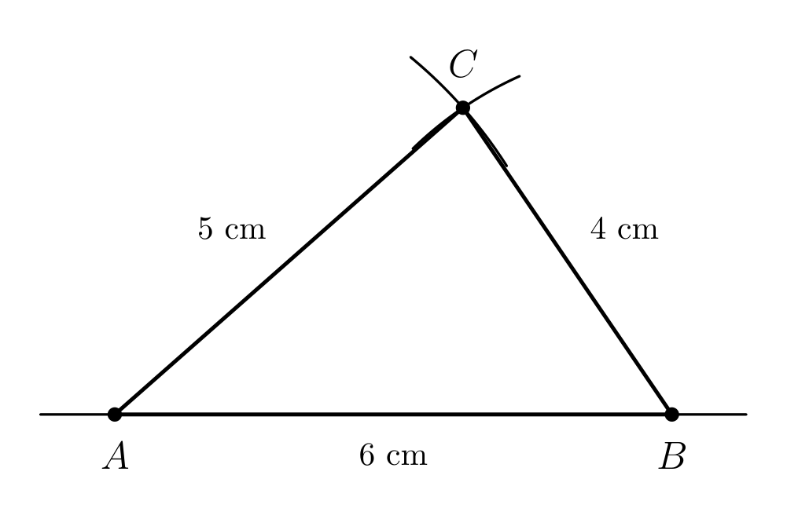
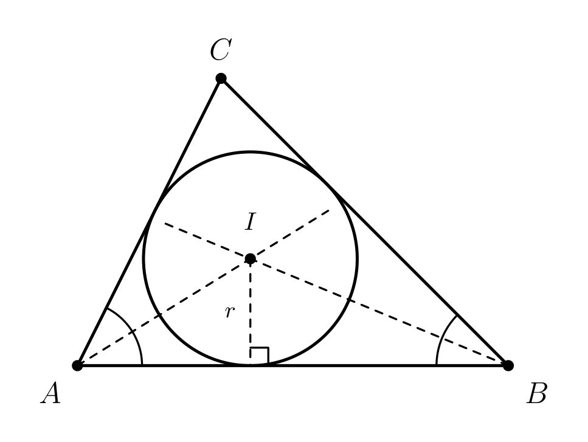
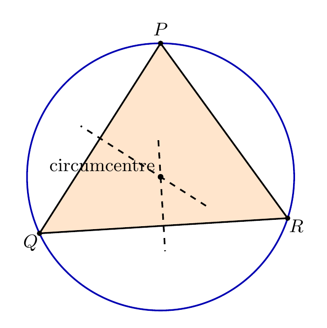
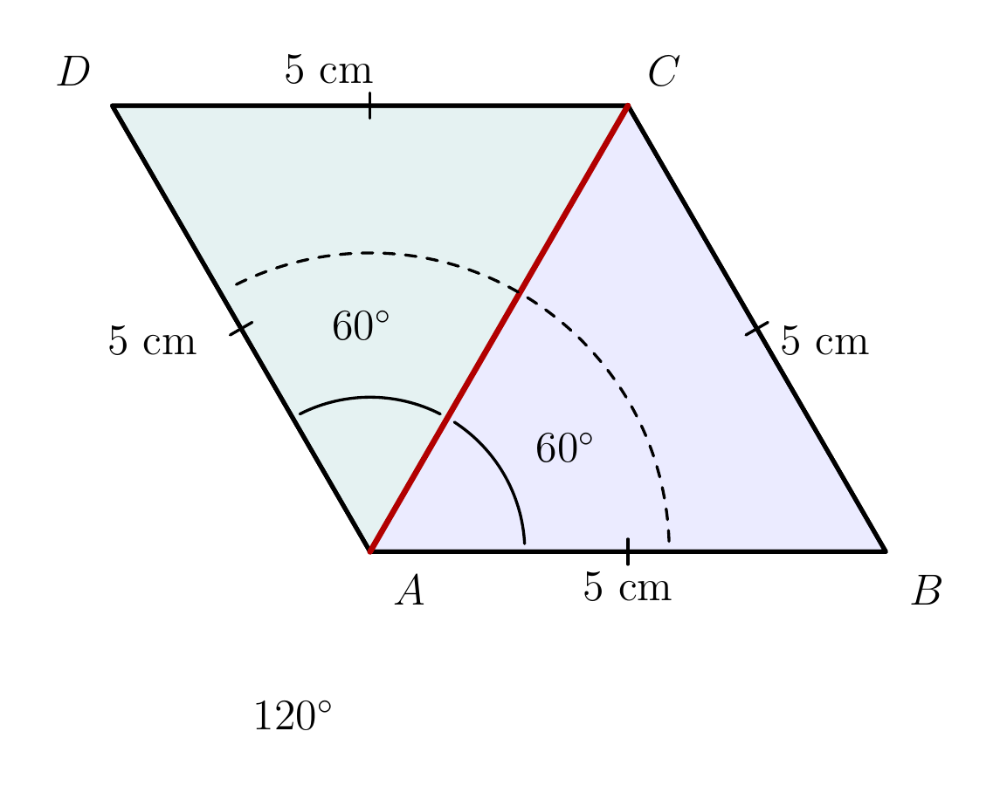

# Strand 3: Geometry and Measurement
## Sub-strand 1: Shapes and Space
### Lesson 6 (Requested topic): Geometric Constructions II — Triangles, Quadrilaterals, Incircles and Circumcircles

---

## 1. Curriculum Standard and Overview

- **Strand**: 3 — Geometry and Measurement
- **Sub-strand**: 1 — Shapes and Space
- **Content Standards**: B8.3.1.2 and B9.3.1.2 (Constructions of triangles and quadrilaterals; in- and circumcircles).
- **Indicators**: B8.3.1.2.2 (construct triangles from SSS, SAS and ASA data with ruler and compasses), B9.3.1.2.2 (construct squares, rectangles, rhombi and parallelograms), B9.3.1.2.1 (construct the inscribed circle — incircle — and the circumscribed circle — circumcircle — of a triangle).
- **Mock-paper links**: the three classic BECE Paper 2 construction tasks are used as Examples 2, 4 and 5 (BECE 2017, 2012 and 1998), plus BECE 1990 in Example 6.

> **Prerequisites delivered**: Geometric Constructions I (Lesson 5 — perpendicular bisector, angle bisector, 60°/90°/45°/30° and the loci table). Every circle theorem here also leans on the circle-parts lesson (Substrand 2, Lesson 5) and on triangle angles (Lesson 4).

---

## 2. Preamble — The Three Triangle Blueprints

A triangle has 3 sides and 3 angles, but drawing it needs only **3 correct facts**. BECE uses exactly three blueprints:

| Blueprint | Given data | Main tools |
| :--- | :--- | :--- |
| **SSS** | the three side lengths | ruler + compasses (arcs from two endpoints cross) |
| **SAS** | two sides and the angle **between** them | ruler + compasses + the constructed angle (from Lesson 5) |
| **ASA** | one side and the two angles at its ends | constructed angles at both ends; the third point is where the rays cross |

> **Golden rule for Paper 2**: "using a ruler and a pair of compasses only" — no protractor. The angles you need must be built by bisecting/adding (Lesson 5, §3.2). **Keep every arc**: construction arcs carry the method marks.

**Accuracy tolerance**: measured answers in marking schemes admit about $\pm 0.1$ cm and $\pm 1°$ (schemes show e.g. "$4.8$ cm $[\pm 0.1\text{ cm}]$"). Draw **large**, sharp, exact constructions and the numbers land inside tolerance.

**Two circles every triangle hides:**

- **Circumcircle** (circle *around*): centre = the **circumcentre** $O$, found by intersecting the **perpendicular bisectors of the sides**. $O$ is equidistant from all three vertices, so $OP = OQ = OR$.
- **Incircle** (circle *inside*): centre = the **incentre**, found by intersecting the **bisectors of the three angles**. Its radius is the perpendicular distance from the incentre to any side.

*Special power of a right triangle*: the midpoint of the **hypotenuse** is equidistant from all three vertices — so the circumcentre of a right triangle is the midpoint of the hypotenuse. You will use this twice below.

---

## 3. Core Concepts — Steps for Each Blueprint and Each Circle

### 3.1 SSS construction (sides $a$, $b$, $c$)

1. Draw the base side (say $c$) with the ruler.
2. Open the compasses to the second side ($b$); arc from one endpoint.
3. Open the compasses to the third side ($a$); arc from the other endpoint, crossing arc 2.
4. Join the crossing point to both endpoints. **Triangle inequality check**: the two shorter sides must add to more than the longest side, or the arcs never cross.

### 3.2 SAS construction (sides $a$, $b$ with included angle $\theta$)

1. Draw one of the given sides.
2. At its endpoint, construct angle $\theta$ (Lesson 5 methods if $\theta$ is 90/60/45/30; otherwise the paper says "measure" only when construction is impossible).
3. Mark the second given side along the new ray with compasses.
4. Join the marked point back to the free endpoint.

### 3.3 ASA construction (one side, angles $\alpha$ and $\beta$ at its ends)

1. Draw the given side.
2. Construct angle $\alpha$ at one end and angle $\beta$ at the other end (each as a construction with arcs).
3. The two new rays meet at the third vertex.

### 3.4 Circumcircle

1. Construct the triangle.
2. Construct the perpendicular bisector of one side, then of a second side (two bisectors are enough — same construction as Lesson 5, Example 2, with its arcs preserved).
3. They meet at the circumcentre $O$. 4. Compass opening $OP$: draw the circle through all three vertices.

*Figure 3 is the engine behind step 2: the four arcs swung from $A$ and $B$ fix the perpendicular bisector, and the bisectors of two sides cross at $O$.*

### 3.5 Incircle

1. Construct the triangle.
2. Bisect one angle, then a second; the bisectors meet at the incentre $I$.
3. From $I$, drop the perpendicular to a side (Lesson 5, Example 7 method); that foot is the touch point.
4. Compass opening $I$ → touch point: draw the circle — it touches **all three sides** from inside.

### 3.6 Parallelogram family quickies

- **Rectangle** $w \times h$: base $w$; perpendiculars of heights $h$ at both ends (Lesson 5); join the tops.
- **Square** side $s$: the same construction with $h = s$; or construct 90° at both ends of side $s$.
- **Rhombus** side $s$, one angle $\theta$: SAS construction twice (draw side; angle $\theta$; mark second side; repeat at the other endpoint).
- **Parallelogram**: identical to the rhombus recipe with unequal sides; or transfer the top side by an arc of radius = base from the marked top vertex.

---

## 4. Fifteen Fully Worked Examples

### Example 1 — SSS: the BECE 2017 opener (authentic: Q_da71f1c9b67d, part a–i)

Construct triangle $ABC$ with $|BC| = 9$ cm, $|AC| = 8$ cm, $|AB| = 6$ cm, using ruler and compasses only.

1. Draw $BC = 9$ cm.
2. Compasses on $8$ cm: centre $C$, an arc above $BC$.
3. Compasses on $6$ cm: centre $B$, an arc cutting the first at $A$.
4. Join $A$ to $B$ and to $C$.

(The two shorter sides: $6 + 8 = 14 > 9$ — the arcs cross, so the triangle exists.)

### Example 2 — The full 2017 Paper 2 task (authentic: Q_da71f1c9b67d)
Using the triangle of Example 1, construct (ii) the **perpendicular bisector of $BC$**, (iii) the **bisector of $\angle ACB$**. Label their intersection $Y$ (inside the triangle). Join $B$ to $Y$.

**Measurements the marking scheme accepts:**
- $|BY| = 4.8$ cm $[\pm 0.1]$
- $|YC| = 4.8$ cm $[\pm 0.1]$
- the base angles of triangle $BYC$: about $20.5°$ (or $20°$/$21°$ with tolerance)

Why $|BY| = |YC|$: $Y$ lies on the **perpendicular bisector of $BC$**, so $Y$ is equidistant from $B$ and $C$ — that single locus fact (Lesson 5) predicts both measurements before you ever rule the line.
**Type of triangle $BYC$: isosceles** ($BY = YC$), base angles equal ($\angle YBC = \angle YCB \approx 20.5°$).
*(This is the pattern of a full-mark answer: construct → measure → name the triangle using the locus property.)*

### Example 3 — SAS: sides 5 cm and 7 cm with included angle 90°
Construct triangle $XYZ$ with $|XY| = 7$ cm, $\angle ZXY = 90°$ and $|XZ| = 5$ cm. Measure $|YZ|$.

1. Draw $XY = 7$ cm.
2. Construct 90° at $X$ (Lesson 5, Example 10 — perpendicular at a point on the line).
3. Compasses on $5$ cm, centre $X$: mark $Z$ on the vertical ray.
4. Join $Z$ to $Y$.

$|YZ|$ lands at $\sqrt{49 + 25} = \sqrt{74} \approx 8.6$ cm — your drawn check. **SAS with 90° is the friendliest right-triangle build in the exam.**

### Example 4 — ASA + circumcentre: BECE 2012 (authentic: Q_4d332001f417)
Using ruler and compasses only, (i) construct triangle $PQR$ with $|PQ| = 10$ cm, $\angle QPR = 45°$ and $\angle PQR = 60°$. (ii) Construct the perpendicular bisectors of $PR$ and $RQ$ to meet at $T$. (iii) Measure $|TP|$.

1. Draw $PQ = 10$ cm.
2. At $P$: construct 45° (90° then bisect — Lesson 5). Ray $P$.
3. At $Q$: construct 60° (equilateral arc method). Ray $Q$.
4. The rays meet at $R$.
5. Perpendicular bisector of $PR$; perpendicular bisector of $RQ$; they meet at $T$.
6. Measure: $|TP| \approx 5.2$ cm (scheme tolerance $\pm 0.1$).

*Why $T$ matters*: $T$ is the **circumcentre**, so $TP = TQ = TR$ — the circle centred at $T$ with radius $TP$ passes through all three vertices. (Check by trigonometry, for trust: $\angle R = 75°$, radius $= \dfrac{10}{2\sin 75°} \approx 5.2$ cm.)

### Example 5 — Right triangle + circle: BECE 1998 (authentic: Q_a2090beb1d30)
(a) Construct triangle $PQR$ with $|PQ| = 8$ cm, $\angle RPQ = 90°$, $\angle PQR = 30°$. (i) How long is $|RQ|$?

1. Draw $PQ = 8$ cm. 2. Construct 90° at $P$ (perpendicular at a point). 3. Construct 30° at $Q$ (60° then bisect); extend the ray up towards the vertical from $P$ until the two rays meet at $R$.

The third angle is $60°$, so triangle $PQR$ is a 30-60-90 triangle: $RQ$ is the hypotenuse.
$$|RQ| = \frac{8}{\sin 60°} = \frac{16}{\sqrt3} \approx 9.2 \text{ cm (measured on the drawing: about } 9.2 \text{ cm).}$$

(ii) Construct the **perpendicular bisector (mediator) of $RQ$**, meeting $RQ$ at $O$. (b) With centre $O$ and radius $OP$, draw a circle. **Measure $|OP|$.**

Since $P$ sits on the perpendicular bisector of $RQ$, $OP = OR = OQ$ — and indeed for a right triangle the midpoint of the hypotenuse is equidistant from all three vertices.
$$|OP| = \tfrac12 |RQ| \approx 4.6 \text{ cm.}$$
The circle through $P$, $Q$, $R$ is the **circumcircle**.

(c) **What is the special name for the chord $RQ$?** $RQ$ passes through the centre $O$, so it is a **diameter**.

### Example 6 — BECE 1990 twin (authentic: Q_8e7a4d2c7104)
(a) Construct triangle $PQR$ with $|PQ| = 6$ cm, $|QR| = 4$ cm, $\angle PQR = 90°$. (ii) Construct the perpendicular bisectors of $PQ$ and $QR$; name their intersection $O$. (iii) Draw a circle, centre $O$, radius $OQ$. (b) Measure (i) $|PR|$, (ii) $\angle QPR$.

1. Draw $PQ = 6$ cm; construct 90° at $Q$ (perpendicular at a point on the line); mark $|QR| = 4$ cm along the vertical ray; join $P$ to $R$.
2. Perpendicular bisector of $PQ$; perpendicular bisector of $QR$; they meet at $O$ (the midpoint of hypotenuse $PR$).
3. Circle centre $O$, radius $OQ$ — it passes through $P$, $Q$, $R$ (circumcircle).

**Measurements:**
- $|PR| = \sqrt{6^2 + 4^2} = \sqrt{52} \approx 7.2$ cm (same on the drawing).
- $\angle QPR = \arctan \tfrac{4}{6} \approx 33.7°$ (measured: about $34°$, with tolerance).

### Example 7 — The 6-8-10 twin: incircle vs circumcircle of one triangle
A right triangle has legs 6 cm and 8 cm. Construct it and find (a) its circumradius, (b) its inradius.

Build: draw the 6 cm base; 90° at one end; cut 8 cm on the vertical; join. The hypotenuse is exactly $10$ cm (6-8-10 is a Pythagorean triple).

(a) Circumradius = half the hypotenuse (right triangle!):
$$r_{circ} = \tfrac12 \times 10 = 5 \text{ cm}.$$
(b) Area $= \tfrac12 \times 6 \times 8 = 24$ cm²; and for any triangle $\text{Area} = r_{in} \times s$ (semiperimeter), $s = \tfrac{6+8+10}{2} = 12$:
$$r_{in} = \frac{24}{12} = 2 \text{ cm}.$$
**Same triangle: circle of radius 5 around it, circle of radius 2 inside it.** (For construction: the circumcentre is at the midpoint of the hypotenuse; the incentre needs the bisectors of the angles — you draw them and the perpendicular from $I$ to the 6 cm side to set the radius.)

### Example 8 — Incircle of an equilateral triangle

Construct an equilateral triangle of side 6 cm and its incircle.

1. Equilateral construction = the 60° "seed": arc of radius 6 from each endpoint of the 6 cm base.
2. Bisect all three angles (two are enough). The bisectors meet at the incentre $I$ — for an equilateral triangle $I$ is also the centroid, one third of the height above the base.
3. Height $= 6 \times \tfrac{\sqrt3}{2} \approx 5.2$ cm, so $|I\text{base}| \approx 1.7$ cm.
4. Drop the perpendicular from $I$ to the base; radius $\approx 1.7$ cm; draw the incircle — it touches all three sides.

(Trust check: inradius $= \tfrac{h}{3} = \tfrac{3\sqrt3}{3} \approx 1.73$ cm; circumradius $= \tfrac{2h}{3} \approx 3.46$ cm — for an **equilateral** triangle the two circles share the same centre.)

### Example 9 — Circumcircle of a scalene triangle

Construct triangle $XYZ$ with $|XY| = 7$ cm, $|YZ| = 5$ cm, $\angle XYZ = 60°$, then draw its circumcircle.

1. SAS: draw $XY = 7$ cm; construct 60° at $Y$ (equilateral arc method); cut $|YZ| = 5$ cm on the ray; join $Z$ to $X$.
2. Perpendicular bisector of $XY$; perpendicular bisector of $YZ$; they meet at $O$.
3. Circle centre $O$, radius $OX$ passes through $X$, $Y$, $Z$.

**Inspection bonus**: measuring shows $OX = OY = OZ$ — this equality is the whole point of step 2 and the reason the circle is "circumscribed".

### Example 10 — Constructing a square of side 6 cm
**Steps**: 1) Draw the base $AB = 6$ cm. 2) Construct 90° at $A$ and 90° at $B$ (both on the same side — perpendicular at a point, twice). 3) Compasses on 6 cm, centres $A$ and $B$: cut the two verticals at $D$ and $C$ respectively. 4) Join $DC$.

**Check**: $|DC|$ comes out exactly 6 cm because $DC$ is opposite $AB$ in the rectangle you built with all four angles 90°. A square's construction is just a rectangle with equal settings — one compass opening throughout.

### Example 11 — Constructing a rhombus: side 5 cm, one angle 120°
Construct a rhombus $ABCD$ with $|AB| = 5$ cm and $\angle DAB = 120°$.

1. Draw $AB = 5$ cm.
2. At $A$, build the 120°: draw the straight line through $A$ continuing $AB$ backwards; construct 60° on it (equilateral arc method); the **supplement** — the angle from that 60° ray round to the backward extension of $AB$ — is $180° − 60° = 120°$. (Or: 90° + 30° side by side.)
3. Compasses on 5 cm, centre $A$: mark $D$ on the 120° ray.
4. Compasses still on 5 cm: arc from $D$; arc of radius 5 from $B$; they meet at $C$. Join $D$ to $C$ and $C$ to $B$.

All four sides are 5 cm by construction and opposite sides are parallel — a **rhombus**. (*Trust check*: the other angles are $\angle B = \angle D = 60°$ and $\angle C = 120°$.)

### Example 12 — Constructing a parallelogram: 7 cm, 4 cm, included angle 60°
Construct parallelogram $WXYZ$ with $|WX| = 7$ cm, $|WZ| = 4$ cm, $\angle ZWX = 60°$.

1. Draw $WX = 7$ cm; construct 60° at $W$; mark $|WZ| = 4$ cm; join $Z$ to $X$ (the SAS triangle built first).
2. Compasses on 4 cm, centre $X$: arc above.
3. Compasses on 7 cm, centre $Z$: arc cutting the first at $Y$.
4. Join $Y$ to $X$ and $Y$ to $Z$.

$|XY| = 4$ cm $= |WZ|$ and $|ZY| = 7$ cm $= |WX|$: **both pairs of opposite sides equal ⇒ parallelogram**.

### Example 13 — Quadrilateral P2 combo: rectangle 8 cm × 5 cm with its diagonal
Construct a rectangle $PQRS$ with $|PQ| = 8$ cm and $|QR| = 5$ cm; draw diagonal $PR$; measure it and $\angle QPR$.

1. Base $PQ = 8$ cm; perpendiculars of height 5 cm at $P$ and at $Q$; join the tops.
2. Rule diagonal $PR$.

**Measures**: $|PR| = \sqrt{8^2 + 5^2} = \sqrt{89} \approx 9.4$ cm; $\angle QPR = \arctan \tfrac58 \approx 32°$ (both within tolerance on a careful drawing).

### Example 14 — The bisector shortcut inside quadrilaterals (spiral into loci)
In the rhombus of Example 11, why do its diagonals bisect its angles (and why does the exam love this)?

Because a rhombus is symmetric about its diagonals: reflecting the figure about diagonal $AC$ maps $B$ onto $D$, so $\angle BAC = \angle DAC$. In construction language: the diagonal of a rhombus **is** the bisector of both angles it touches — draw diagonal $AC$ and it is also the bisector of $\angle DAB$. Test items ask you to bisect the angle of a rhombus and the honest check is: your bisector should land right on the diagonal.

### Example 15 — Pull it together: measure, name, and justify (mixed spiral)
A student constructs triangle $ABC$ ($|AB| = 6$, $|BC| = 9$, $|CA| = 8$ — Example 1), draws the perpendicular bisector of $BC$ and the bisector of $\angle ACB$, calling the crossing $Y$, then joins $B$ to $Y$.

(a) State the locus property that makes $|YB| = |YC|$.
(b) $\angle BYC = 139°$ (measured). Use the angle property of isosceles triangles to check the base angles.
(c) Name triangle $BYC$.

(a) $Y$ is on the **perpendicular bisector of $BC$** ⇒ $YB = YC$.
(b) $BYC$ has the vertex angle $\angle BYC = 139°$, so each base angle $= \tfrac{180° − 139°}{2} \approx 20.5°$ — matching the 2017 measured answers exactly. The angle-sum does the arithmetic the drawing only approximates.
(c) **Isosceles** ($YB = YC$).

---

## 5. Exercises

> Quota for this lesson: **5 sections × 5 questions + full worked solutions** (user quota override).

### Exercise 1 — SSS and triangle feasibility

**Q1.** Write the four steps for an SSS construction of triangle $ABC$ with $|AB| = 8$ cm, $|BC| = 7$ cm, $|AC| = 5$ cm, naming the compass openings.

**Q2.** Can a triangle be constructed with sides 4 cm, 5 cm and 10 cm? Give a one-line reason.

**Q3.** In your own SSS diagram of Q1, measure the angle opposite the longest side. Roughly what should it measure (state its type: acute/obtuse/right), and which Lesson 4 result justifies your expectation?

**Q4.** $|AB| = 10$ cm and $|AC| = 6$ cm. Between which two lengths may $|BC|$ lie for a triangle to be possible? (Inequality both ways.)

**Q5.** *(Spiral review — angles)* In the constructed triangle of Q1 (sides $AB = 8$, $BC = 7$, $AC = 5$), the angle facing the 5 cm side measures $44°$ and the angle between the 8 cm and 5 cm sides measures $51°$. Find the third angle, and state which angle must be the largest and why.

### Exercise 2 — SAS and ASA constructions

**Q1.** Describe the SAS construction of triangle $XYZ$ with $|XY| = 6$ cm, $\angle ZXY = 60°$, $|XZ| = 9$ cm. Which Lesson 5 method builds the 60°?

**Q2.** Describe the ASA construction of triangle $ABC$ with $|AB| = 8$ cm, $\angle BAC = 45°$, $\angle ABC = 60°$, and state how the third vertex is found.

**Q3.** For the Q2 triangle, what is the third angle (no drawing needed)?

**Q4.** A running-diagonal question: triangle with $|XY| = 6$, $|XZ| = 9$, included 60°. Compute $|YZ|$ by the cosine rule, then say what the drawn length should show (1 d.p.).

**Q5.** *(Spiral review — constructions I)* In the Q2 construction, state exactly how you built the 45° with compasses (sizes of every intermediate angle).

### Exercise 3 — Circumcircles and right triangles

**Q1.** State the two constructions whose intersection gives the circumcentre, and the equality the circumcentre satisfies.

**Q2.** For triangle $ABC$ with $|AB| = 8$, $|AC| = 6$, angle $A = 90°$ (constructed SAS): measure $|BC|$ by Pythagoras and state the circumradius without drawing anything.

**Q3.** (BECE 1998 reasoning) In Example 5's triangle ($|PQ| = 8$, $\angle P = 90°$, $\angle Q = 30°$), why is the chord $RQ$ a diameter of the drawn circle? Two facts, one line.

**Q4.** (Semicircle angle, BECE 1998 reasoning) The circle drawn in Example 5 has $RQ$ as a diameter. State the size of the angle subtended by $RQ$ at any other point on the circle, and say which angle of triangle $PQR$ is the one that realises this "angle in a semicircle" fact.

**Q5.** *(Spiral review — circle parts)* A circumcircle has radius 5.2 cm. State its diameter, and name the locus fact that made the three perpendicular-bisector rays all meet in one point.

### Exercise 4 — Incircles

**Q1.** Which bisectors meet at the incentre, and what equality does the incentre satisfy?

**Q2.** Describe how to set the **radius** of the incircle after locating the incentre (include the Lesson 5 construction you use).

**Q3.** An equilateral triangle has side 12 cm. Find its height (1 d.p.), its inradius and its circumradius ($1$ d.p.). What do you notice about the two radii?

**Q4.** For the 6-8-10 right triangle (Example 7), draw the incircle (radius 2 cm). Let the incircle touch the 10 cm hypotenuse at $T_1$, the 6 cm leg at $T_2$ and the 8 cm leg at $T_3$. The two tangent lengths drawn from each vertex to the circle are equal. Use this to find the three tangent lengths from the right-angle vertex, and verify with a Pythagoras statement that the distance from the vertex to the incentre is $r\sqrt{2} \approx 2.8$ cm.

**Q5.** *(Spiral review — area)* Using Area = $r\times s$ with $r = 2$ and sides 6, 8, 10, recompute the triangle's area and agree with $\tfrac12 \times 6 \times 8 = 24$ cm².

### Exercise 5 — Quadrilaterals and mixed construction reasoning

**Q1.** Write the construction steps for a **square** of side 4 cm and the one-sentence check that the fourth side must equal 4 cm.

**Q2.** Write the construction steps for a **rectangle** 10 cm by 4 cm, and state which Loci/parallel-line fact guarantees $PQ \parallel SR$.

**Q3.** Parallelogram $WXYZ$: $|WX| = 9$, $|WZ| = 4$, $\angle ZWX = 45°$. After the construction, state (i) the two pairs of equal opposite sides with lengths, and (ii) all four angles (opposite angles equal; co-interior angles supplementary).

**Q4.** **Diagonal as bisector**: in rhombus $ABCD$ (side 5, $\angle A = 120°$), a diagonal $AC$ is drawn. State the two angles into which it splits $\angle DAB$ and the type of each half-triangle.

**Q5.** *(Spiral review — full P2 toolkit)* A triangle is built with $|PQ| = 10$ cm, $\angle QPR = 45°$, $\angle PQR = 60°$ (BECE 2012). Its perpendicular bisectors of $PR$ and $RQ$ meet at $T$. (a) Name the centre $T$ represents (circumcentre/incentre / centroid). (b) Circle centre $T$, radius $TP$ is drawn — name the circle. (c) $|TP|$ should measure about what (scheme value)?

---

## 6. Worked Solutions to Exercises

### Exercise 1 — Solutions

**S1.** 1) Draw $AB = 8$ cm (ruler). 2) Compass opening **7 cm**: centre $B$, arc above the base. 3) Compass opening **5 cm**: centre $A$, arc cutting the first at $C$. 4) Join $C$ to $A$ and $C$ to $B$.

**S2.** No — fails the triangle inequality: $4 + 5 = 9$, which is **not more than** 10, so the two arcs would never cross (they cannot reach each other past the endpoints).

**S3.** Opposite the longest side (8 cm) sits the **largest** angle (Lesson 4 side–angle ordering). It is **acute but close to a right angle**: the angle test $8^2 = 64 < 5^2 + 7^2 = 74$ shows it stays below 90°, and measuring the drawing gives about $82°$.

**S4.** By the triangle inequality applied twice: $|BC| > 10 − 6 = 4$ cm and $|BC| < 10 + 6 = 16$ cm. So $4 \text{ cm} < |BC| < 16 \text{ cm}$.

**S5.** The angle between the 8 cm and 5 cm sides sits at vertex $A$ and faces the **7 cm** side; the $44°$ angle faces the **5 cm** side. Third angle $= 180° − 44° − 51° = 85°$. Ordering check: longest side 8 cm ⇒ $85°$ (largest) faces it ✓; middle side 7 cm ⇒ $51°$ faces it ✓; shortest side 5 cm ⇒ $44°$ faces it ✓. Everything consistent: an acute scalene triangle.

### Exercise 2 — Solutions

**S1.** 1) Draw $XY = 6$ cm. 2) At $X$ construct **60°** by the equilateral arc method (arc of any radius $r$ centred at $X$ cuts $XY$; same radius centred at that cut; join $X$ to the new crossing). 3) Compass opening **9 cm**, centre $X$: mark $Z$ on the 60° ray. 4) Join $Z$ to $Y$.

**S2.** 1) Draw $AB = 8$ cm. 2) At $A$, construct 45°: build 90° (perpendicular at the point), then bisect it. Ray 1. 3) At $B$, construct 60° by the equilateral arc method. Ray 2. 4) The **two rays meet at the third vertex $C$** — no second side is given, the crossing *defines* it. Join back.

**S3.** $\angle ACB = 180° − 45° − 60° = 75°$ (angle sum).

**S4.** Cosine rule: $|YZ|^2 = 6^2 + 9^2 − 2(6)(9)\cos 60° = 36 + 81 − 54 = 63$, so $|YZ| = \sqrt{63} \approx 7.9$ cm (1 d.p.) — the drawing must show about 7.9 cm.

**S5.** 90° first: arc from the vertex cutting the line on both sides; equal arcs from those two cuts; join (Lesson 5, Example 10). Then **bisect** the 90° (arc from the vertex cutting both arms; equal arcs; join) → $45°$. Intermediate sizes: 90° → $45° + 45°$.

### Exercise 3 — Solutions

**S1.** The **perpendicular bisectors of the sides** (two of them suffice). The circumcentre $O$ satisfies $OA = OB = OC$ — equidistant from **all three vertices**.

**S2.** $|BC| = \sqrt{8^2 + 6^2} = 10$ cm (6-8-10 triple). Circumradius $= \tfrac12 \times 10 = 5$ cm (midpoint of the hypotenuse for any right triangle).

**S3.** $O$ is the midpoint of $RQ$ (the mediator crossed there), and a chord passing through the centre is a **diameter**. Circle-theorem version: $P$ lies on the circle and the angle it subtends from $R$ and $Q$ is $\angle RPQ = 90°$ — an angle of 90° at the circumference stands on a diameter (angle-in-a-semicircle used backwards).

**S4.** Any chord that is a **diameter** subtends $90°$ at every other point of the circle ("angle in a semicircle"). In triangle $PQR$ the angle that stands on $RQ$ is $\angle RPQ = 90°$ — the constructed right angle at $P$ is itself the semicircle angle. (Notice the triangle's $30°$ at $Q$ and $60°$ at $R$ are ordinary inscribed angles; only the $90°$ at $P$ signals the diameter.)

**S5.** Diameter $= 2 \times 5.2 = 10.4$ cm. The meeting point fact: every point on a perpendicular bisector is equidistant from the endpoints of that side, so the crossing of two mediators is equidistant from **all three** vertices at once — that is why the rays must concur (and why the design works on your diagram).

### Exercise 4 — Solutions

**S1.** The **bisectors of the (three) angles of the triangle** meet at the incentre $I$; the equality is $I$'s perpendicular distance to each **side** is the same (equidistant from all three sides).

**S2.** From $I$, drop a **perpendicular to one side** (Lesson 5 external-point method: arc centred at $I$ cutting the side twice; equal arcs from the two cuts; join through to the side at $N$). The compass opening $I \to N$ is the inradius; draw the circle.

**S3.** Height $= 12 \times \tfrac{\sqrt3}{2} \approx 10.4$ cm. Inradius $= \tfrac13 \times 10.4 \approx 3.5$ cm; circumradius $= \tfrac23 \times 10.4 \approx 6.9$ cm. Notice $r_{out} = 2\, r_{in}$ **and both circles share the same centre** (equilateral case: all the "centres" coincide).

**S4.** At the right-angle vertex $V$, the radius to each touch point meets the leg at 90°, so $V$ + the incentre $I$ + two touch points form a **small square $r \times r$**: both tangent lengths from $V$ measure $|VT_2| = |VT_3| = r = 2$ cm. Check: $|VI| = \sqrt{r^2 + r^2} = r\sqrt{2} = 2\sqrt2 \approx 2.8$ cm. Bonus pattern (worth quoting): the tangent lengths from each vertex of the 6-8-10 triangle come to $2$, $4$ and $6$ cm — and $2 + 4 + 6 = s = 12$, the semiperimeter.

**S5.** $s = \tfrac{6+8+10}{2} = 12$; Area $= r \cdot s = 2 \times 12 = 24$ cm² — agrees with $\tfrac12 \times 6 \times 8 = 24$ cm². (This identity is the incircle's superpower: one radius × semiperimeter converts the whole triangle into area.)

### Exercise 5 — Solutions

**S1.** 1) Draw $AB = 4$ cm. 2) Construct 90° at $A$ and at $B$, both above the line. 3) Opening **4 cm**: centres $A$ and $B$ cut the verticals at $D$ and $C$. 4) Join $DC$. Check: $ABCD$ is a rectangle (all angles 90°) with $|AD| = |BC| = 4$; opposite sides of a rectangle are equal, so $|DC| = |AB| = 4$ cm — equal sides + right angles = square.

**S2.** 1) Draw $PQ = 10$ cm. 2) Construct 90° at $P$ and at $Q$, both on the same side of the base. 3) Compass opening **4 cm**: centres $P$ and $Q$ cut the verticals at $S$ (above $P$) and $R$ (above $Q$). 4) Join $S$ to $R$. Guarantee: both verticals were built perpendicular to the same base line, so they are **parallel** to each other (two lines perpendicular to the same line are parallel), and the equal 4 cm marks keep the top level.

**S3.** Equal opposite sides: $|XY| = |WZ| = 4$ cm and $|ZY| = |WX| = 9$ cm. Angle facts: $\angle ZWX = 45°$; the opposite angle $\angle XYZ = 45°$ too. Each co-interior partner is $180° − 45° = 135°$: so $\angle WXY = 135°$ and $\angle YZW = 135°$. The drawing must show two $45°$ and two $135°$ angles, equal in opposite pairs.

**S4.** $AC$ splits $\angle DAB = 120°$ into $60° + 60°$ (the diagonal of a rhombus bisects the angles it meets). Each half-triangle $ABC$ and $ADC$ is **isosceles** ($|AB| = |BC| = 5$ and $|AD| = |DC| = 5$), and since the rhombus's other angle is $60°$, measure confirms each half-triangle's angles as $60°/60°/60°$ — a $120°$/$60°$ rhombus splits into **two equilateral triangles** of side 5 cm.

**S5.** (a) $T$ is the **circumcentre** (intersection of perpendicular bisectors of two sides). (b) The circle centred at the circumcentre through all three vertices is the **circumcircle** of triangle $PQR$. (c) $|TP| \approx 5.2$ cm (BECE 2012 scheme: $5.2$ cm, tolerance $\pm 0.1$; trig check $\tfrac{10}{2\sin 75°} = 5.2$).

---

## 7. Lesson Summary — Your Pocket Card

1. **Three blueprints**: SSS (two crossing arcs), SAS (side + constructed angle + cut), ASA (two constructed angles; crossing defines the third vertex).
2. **Triangle inequality**: two shortest sides must beat the longest, or the arcs will never meet.
3. **Circumcircle**: perpendicular bisectors of sides → circumcentre, $OA = OB = OC$. **Right triangle bonus: circumcentre = midpoint of hypotenuse; hypotenuse = diameter.**
4. **Incircle**: angle bisectors → incentre; radius = perpendicular drop to a side. Area $= r \times s$ (semiperimeter).
5. **Equilateral triangle**: incentre = circumcentre; circumradius = $\tfrac23 h$, inradius = $\tfrac13 h$.
6. **Quadrilaterals**: square/rectangle = two perpendiculars + one opening; rhombus/parallelogram = SAS twice; opposite sides of both are parallel and equal; a rhombus's diagonal bisects its angles (120°/60° rhombus = two equilateral half-triangles).
7. **Measurements**: expect and give schemes' tolerances (about $\pm 0.1$ cm, $\pm 1°$) — large sharp drawings win. 2017 gave $BY = YC = 4.8$ cm, base $\approx 20.5°$; 2012 gave $TP \approx 5.2$ cm; 1998 gave $RQ \approx 9.2$ cm, $OP \approx 4.6$ cm, and $RQ$ = **diameter**.

**Where you stand**: the whole requested block — perimeter/area, triangles, polygon areas, circle measures, and both construction lessons — is now complete. Work through the six lessons in order A→F; Lessons E and especially F are the Paper 2 mark-makers for construction questions, and they reuse everything from before.
