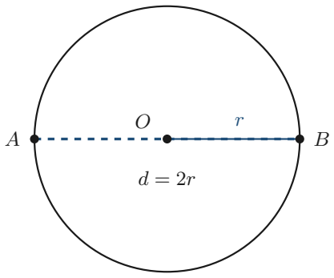
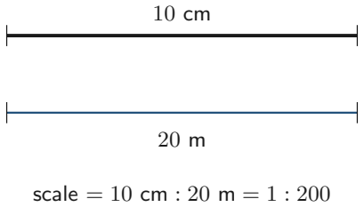

# Strand 3: Geometry and Measurement
## Sub-strand 2: Measurement
### Lesson 1: Circles, Semicircles, Scale Drawings, and Measurement

---

## 1. Curriculum Standard and Overview

- **Strand**: 3 — Geometry and Measurement
- **Sub-strand**: 2 — Measurement
- **Content Standard**: B9.3.2.1 (measurement of plane figures and scale)
- **Indicators**: B9.3.2.1.1–1.3 (surface area of solids — partly covered in later lessons), with circle/scale measurement as the mock-tested core here.
- **Mock-paper links**: P1 Q5 (area $64\pi$ → circumference), P1 Q24 (scale 20 m → 10 cm), P2 Q3(d) (area of semicircle, $r = 7$ cm).

---

## 2. Preamble — Measuring Round Things

Circles are not polygons. We measure them with two special numbers:

- **Circumference** — the distance **around** a circle.
- **Area** — the space **inside** a circle.

Both need $\pi$ (pi). In BECE, use $\pi = \frac{22}{7}$ or $3.142$ unless told otherwise (exact $64\pi$ style answers leave $\pi$ in).

---

## 3. Circle Formulae

| Quantity | Formula |
| :--- | :--- |
| Circumference | $C = 2\pi r$ or $C = \pi d$ |
| Area | $A = \pi r^2$ |
| Semicircle area | $\frac{1}{2}\pi r^2$ |
| Semicircle perimeter | $\pi r + 2r$ (curved part + diameter) |

**Working backwards:** if $A = 64\pi$, then $\pi r^2 = 64\pi \Rightarrow r^2 = 64 \Rightarrow r = 8$.  
Then $C = 2\pi r = 16\pi$.

**Mock P1 Q5:** Area of a circle is $64\pi$. Circumference?  
$r = 8$, so $C = 16\pi$. **Answer: B — $16\pi$.**

**Mock P2 Q3(d):** Area of a semicircle with $r = 7$ cm, $\pi = \frac{22}{7}$.

$$A = \frac{1}{2}\pi r^2 = \frac{1}{2} \times \frac{22}{7} \times 49 = \frac{1}{2} \times 154 = 77 \text{ cm}^2$$

**Answer: 77 cm².**

---

## 4. Scale Drawings

A **scale** compares a drawing length to the real length.

### 4.1 Writing a scale
Scale $= \frac{\text{drawing}}{\text{real}}$ (same units).

**Mock P1 Q24:** Hall 20 m long drawn as 10 cm. Scale?

$$\frac{10 \text{ cm}}{20 \text{ m}} = \frac{10 \text{ cm}}{2000 \text{ cm}} = \frac{1}{200}$$

**Answer: A — 1 : 200.**

### 4.2 Using a scale
If scale is $1 : 50\,000$, then 4 cm on the map $= 4 \times 50\,000 = 200\,000$ cm $= 2$ km.

### 4.3 Real → drawing
A 30 m room drawn at $1 : 500$:  
$30$ m $= 3000$ cm; drawing $= 3000 \div 500 = 6$ cm.

---

## 5. Other Measurement Essentials

- $1$ m $= 100$ cm; $1$ km $= 1000$ m $= 100\,000$ cm.
- $1$ litre $= 1000$ cm³; $1$ m³ $= 1000$ litres.
- Time: $1$ day $= 24$ h; $1$ h $= 60$ min; $1$ min $= 60$ s.

---

## 6. Twenty Fully Worked Examples

### Example 1 — Mock P1 Q5
$A = 64\pi \Rightarrow r = 8 \Rightarrow C = 16\pi$. **B.**

### Example 2 — Mock P2 Q3(d)
Semicircle $r = 7$, $\pi = 22/7$: $A = 77$ cm².

### Example 3 — Mock P1 Q24
20 m → 10 cm ⇒ scale 1 : 200. **A.**

### Example 4 — Circumference from radius

$r = 14$ cm, $\pi = 22/7$: $C = 2 \times 22/7 \times 14 = 88$ cm.

### Example 5 — Area from radius
$r = 7$ cm: $A = 22/7 \times 49 = 154$ cm².

### Example 6 — Radius from area
$A = 154$ cm², $\pi = 22/7$: $r^2 = 49 \Rightarrow r = 7$ cm.

### Example 7 — Diameter given
$d = 20$ cm ⇒ $r = 10$; $C = \pi d = 20\pi$ cm.

### Example 8 — Semicircle perimeter
$r = 7$: $P = \pi r + 2r = 22 + 14 = 36$ cm.

### Example 9 — Scale: map to ground
Scale 1 : 50 000, map 4 cm ⇒ 2 km.

### Example 10 — Scale: ground to map
30 m at 1 : 500 ⇒ 6 cm.

### Example 11 — Unit conversion
$3$ m $= 300$ cm.

### Example 12 — Unit conversion
$2.5$ km $= 2500$ m.

### Example 13 — Time conversion
31 days $= 44\,640$ minutes.

### Example 14 — Area of rectangle
$l = 8$ cm, $w = 5$ cm ⇒ $A = 40$ cm².

### Example 15 — Perimeter of rectangle
$l = 8$ cm, $w = 5$ cm ⇒ $P = 26$ cm.

### Example 16 — Triangle area
$b = 10$ cm, $h = 6$ cm ⇒ $A = 30$ cm².

### Example 17 — Trapezium area (preview)
$a = 8$, $b = 5$, $h = 4$: $A = \frac{1}{2}(a+b)h = 26$.

### Example 18 — Circle from diameter
$d = 10$ cm ⇒ $A = \pi (5)^2 = 25\pi$ cm².

### Example 19 — Compare circle areas
$r$ doubles ⇒ area × 4.

### Example 20 — Composite shape
Rectangle 20 × 10 with semicircle (r = 5) on top:  
$A = 200 + \frac{1}{2}\pi(25) = 200 + 12.5\pi$.

---

## 7. Comprehensive Exercise Sets (40 Questions)

> All 3 authentic mock items for this topic are included. Generated questions top up to 40. Spiral review ≈ 15%.

### Exercise 1 — Circumference & area (includes mock)

1. **[Mock 2026 P1 Q5]** If the area of a circle is $64\pi$, what is the circumference?  
   A. $8\pi$  B. $16\pi$  C. $32\pi$  D. $64\pi$

2. Find the circumference of a circle with $r = 14$ cm ($\pi = 22/7$).

3. Find the area of a circle with $r = 7$ cm ($\pi = 22/7$).

4. The area of a circle is $154$ cm². Find its radius ($\pi = 22/7$).

5. **Spiral review:** Find $12x + 9q$ when $x = 11$, $q = 3$.

### Exercise 2 — Semicircles (includes mock)

1. **[Mock 2026 P2 Q3(d)]** Find the area of a semi-circle whose radius is 7 cm. [Take $\pi = 22/7$]

2. Find the perimeter of a semicircle with $r = 7$ cm (straight edge = diameter).

3. Find the area of a semicircle with $r = 14$ cm ($\pi = 22/7$).

4. **Spiral review:** $2x + 1 > 9$. Solve.

5. **Spiral review:** $13x - 12 = 5x + 60$. Find $x$.

### Exercise 3 — Scale drawings (includes mock)

1. **[Mock 2026 P1 Q24]** A hall 20 m long is represented on a diagram as 10 cm. What is the scale?  

   A. 1 : 200  B. 1 : 250  C. 1 : 400  D. 1 : 500

2. A map has scale 1 : 50 000. What distance does 4 cm represent in km?

3. A 30 m room is drawn at scale 1 : 500. How long is the drawing?

4. **Spiral review:** $20xy - 5xy = ?$

5. **Spiral review:** Classify $-3$ under $\mathbb{N}, \mathbb{W}, \mathbb{Z}, \mathbb{Q}$.

### Exercise 4 — Unit conversion

1. $3$ m $= ?$ cm

2. $2.5$ km $= ?$ m

3. $1$ litre $= ?$ cm³

4. $31$ days $= ?$ minutes (leave in ordinary form)

5. **Spiral review:** $(-3)^{x-2} = -243$. Find $x$.

### Exercise 5 — Rectangles & triangles

1. Find the area of a rectangle 8 cm by 5 cm.

2. Find the perimeter of a rectangle 8 cm by 5 cm.

3. Find the area of a triangle with base 10 cm and height 6 cm.

4. A rectangle has perimeter 30 cm and length 8 cm. Find the width.

5. **Spiral review:** Evaluate $\frac{2}{3} \times \frac{1}{4} + \frac{2}{5} \div \frac{14}{15}$.

### Exercise 6 — Circles from diameter

1. $d = 20$ cm. Find the circumference in terms of $\pi$.

2. $d = 10$ cm. Find the area in terms of $\pi$.

3. If $r$ doubles, what happens to the area?

4. **Spiral review:** Find $12x + 9q$ when $x = 11$, $q = 3$.

5. **Spiral review:** A van travels 154 km in $1\frac{3}{4}$ h. Speed?

### Exercise 7 — Working backwards

1. The area of a circle is $154$ cm². Find $r$.

2. The circumference of a circle is $44$ cm. Find $r$ ($\pi = 22/7$).

3. The area of a semicircle is $77$ cm². Find $r$ ($\pi = 22/7$).

4. **Spiral review:** Solve $\frac{4}{3x} = 7 - \frac{3}{x}$.

5. **Spiral review:** Order $\frac{3}{8}, \frac{1}{2}, \frac{5}{16}$.

### Exercise 8 — Composite & challenge

1. A rectangle 20 by 10 has a semicircle of radius 5 on top. Find the total area in terms of $\pi$.

2. A circle has area $36\pi$. Find its circumference.

3. A square of side 14 cm has a circle of radius 7 cm cut out. Find the remaining area ($\pi = 22/7$).

4. **Spiral review:** Three consecutive odd integers sum to 33. Find them.

5. **Spiral review:** Find the gradient through $(1, 2)$ and $(4, -4)$.

---

## 8. Full Step-by-Step Worked Solutions

### Solutions to Exercise 1
1. $r = 8$, $C = 16\pi$ → **B**.  
2. $C = 2 \times 22/7 \times 14 = \mathbf{88}$ cm.  
3. $A = 22/7 \times 49 = \mathbf{154}$ cm².  
4. $r^2 = 49 \Rightarrow r = \mathbf{7}$ cm.  
5. $\mathbf{159}$.

### Solutions to Exercise 2
1. $A = \frac{1}{2} \times 22/7 \times 49 = \mathbf{77}$ cm².  
2. $P = 22 + 14 = \mathbf{36}$ cm.  
3. $A = \frac{1}{2} \times 22/7 \times 196 = \mathbf{308}$ cm².  
4. $x > 4$.  
5. $x = 9$.

### Solutions to Exercise 3
1. $10 : 2000 = 1 : 200$ → **A**.  
2. $4 \times 50\,000 = 200\,000$ cm $= \mathbf{2}$ km.  
3. $3000 \div 500 = \mathbf{6}$ cm.  
4. $15xy$.  
5. **ℤ, ℚ**.

### Solutions to Exercise 4
1. $\mathbf{300}$ cm.  
2. $\mathbf{2500}$ m.  
3. $\mathbf{1000}$ cm³.  
4. $\mathbf{44\,640}$ minutes.  
5. $x = 7$.

### Solutions to Exercise 5
1. $\mathbf{40}$ cm².  
2. $\mathbf{26}$ cm.  
3. $\mathbf{30}$ cm².  
4. $w = \mathbf{7}$ cm.  
5. $\mathbf{\frac{25}{42}}$.

### Solutions to Exercise 6
1. $C = \pi d = \mathbf{20\pi}$ cm.  
2. $A = 25\pi$ cm².  
3. **Area × 4**.  
4. $\mathbf{159}$.  
5. $\mathbf{88}$ km/h.

### Solutions to Exercise 7
1. $r = \mathbf{7}$ cm.  
2. $2 \times 22/7 \times r = 44 \Rightarrow r = \mathbf{7}$ cm.  
3. $\frac{1}{2} \times 22/7 \times r^2 = 77 \Rightarrow r^2 = 49 \Rightarrow r = \mathbf{7}$ cm.  
4. $x = \mathbf{\frac{13}{21}}$.  
5. $\frac{5}{16} < \frac{3}{8} < \frac{1}{2}$.

### Solutions to Exercise 8
1. $200 + 12.5\pi$.  
2. $r = 6$, $C = \mathbf{12\pi}$.  
3. $196 - 154 = \mathbf{42}$ cm².  
4. **9, 11, 13**.  
5. $m = \mathbf{-2}$.

---

## 9. Authentic Mock Items in This Lesson

| Ref | Question | Answer |
| :--- | :--- | :--- |
| P1 Q5 | $A = 64\pi$ → circumference | B — $16\pi$ |
| P2 Q3(d) | Semicircle $r = 7$ | $77$ cm² |
| P1 Q24 | 20 m drawn as 10 cm | A — 1 : 200 |

---

## 10. Lesson Summary

| Skill | Formula |
| :--- | :--- |
| Circumference | $C = 2\pi r = \pi d$ |
| Area of circle | $A = \pi r^2$ |
| Semicircle area | $\frac{1}{2}\pi r^2$ |
| Scale | drawing : real (same units) |
| Conversion | 1 m = 100 cm; 1 km = 1000 m |

---

*Lesson prepared under `Grade9-Maths/Rules.md` — plain English, British notation, full workings required.*
