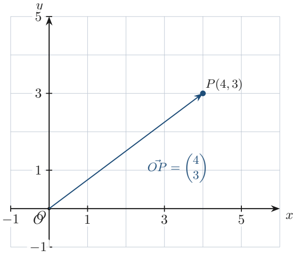
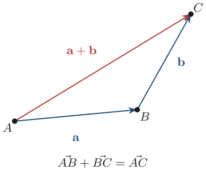

# Strand 3: Geometry and Measurement
## Sub-strand 2: Measurement and Vectors
### Lesson 2: Position Vectors, Vector Arithmetic, and Component Equations

---

## 1. Curriculum Standard and Overview

- **Strand**: 3 — Geometry and Measurement
- **Sub-strand**: 2 — Measurement and Vectors
- **Content Standard**: B9.3.2.1 / B9.3.2.2
- **Indicators**:
  - **B9.3.2.1.4** — Express points in the Cartesian plane as position vectors.
  - **B9.3.2.2.2** — Apply the triangular and parallelogram laws of addition to resolve vectors.
- **Mock-paper links**: P1 Q13 (find B given A and $\vec{AB}$), P1 Q21 (find $\vec{BC}$), P1 Q38 (equate vector components), P2 Q6(d) (vector addition with unknowns).

---

## 2. Preamble — What Is a Vector?

A **vector** is a quantity with **size and direction**.

- Displacement "3 km North" is a vector.
- Speed "10 km/h" is a **scalar** (size only). Velocity "10 km/h East" is a vector.

We write a 2-D vector as a **column**:

$$\vec{v} = \begin{pmatrix} x \\ y \end{pmatrix}$$

- $x$ = horizontal component (east–west)
- $y$ = vertical component (north–south)

---

## 3. Position Vectors

The **position vector** of a point $P(x, y)$ is the vector from the origin $O(0,0)$ to $P$:

$$\vec{OP} = \begin{pmatrix} x \\ y \end{pmatrix}$$

**Displacement between two points:**

$$\vec{AB} = \vec{OB} - \vec{OA} = \begin{pmatrix} x_B - x_A \\ y_B - y_A \end{pmatrix}$$

### Mock P1 Q13
$A$ is $(2, 3)$ and $\vec{AB} = \begin{pmatrix} 5 \\ -4 \end{pmatrix}$. Find $B$.

$$\vec{OB} = \vec{OA} + \vec{AB} = \begin{pmatrix} 2 \\ 3 \end{pmatrix} + \begin{pmatrix} 5 \\ -4 \end{pmatrix} = \begin{pmatrix} 7 \\ -1 \end{pmatrix}$$

**Answer: A — $(7, -1)$.**

---

## 4. Vector Addition and Subtraction

### 4.1 Adding components
$$\begin{pmatrix} a \\ b \end{pmatrix} + \begin{pmatrix} c \\ d \end{pmatrix} = \begin{pmatrix} a+c \\ b+d \end{pmatrix}$$

### 4.2 Triangle Law
$$\vec{AB} + \vec{BC} = \vec{AC} \quad \Rightarrow \quad \vec{BC} = \vec{AC} - \vec{AB}$$

### Mock P1 Q21
$\vec{AB} = \begin{pmatrix} 3 \\ 5 \end{pmatrix}$, $\vec{AC} = \begin{pmatrix} -4 \\ 5 \end{pmatrix}$. Find $\vec{BC}$.

$$\vec{BC} = \vec{AC} - \vec{AB} = \begin{pmatrix} -4-3 \\ 5-5 \end{pmatrix} = \begin{pmatrix} -7 \\ 0 \end{pmatrix}$$

**Answer: D — $\begin{pmatrix} -7 \\ 0 \end{pmatrix}$.**

### Mock P2 Q6(d)
$a = \begin{pmatrix} -4 \\ p \end{pmatrix}$, $b = \begin{pmatrix} q \\ 1 \end{pmatrix}$, $a + b = \begin{pmatrix} -1 \\ -8 \end{pmatrix}$. Find $p$ and $q$.

**Top:** $-4 + q = -1 \Rightarrow q = 3$.  
**Bottom:** $p + 1 = -8 \Rightarrow p = -9$.

**Answer: $p = -9$, $q = 3$.**

### Mock P1 Q38
$P = \begin{pmatrix} 3x-6 \\ 2y+5 \end{pmatrix}$, $R = \begin{pmatrix} 9 \\ 7 \end{pmatrix}$, $P = R$. Find $x$ and $y$.

**Top:** $3x - 6 = 9 \Rightarrow 3x = 15 \Rightarrow x = 5$.  
**Bottom:** $2y + 5 = 7 \Rightarrow 2y = 2 \Rightarrow y = 1$.

**Answer: C — $x = 5$ and $y = 1$.**

---

## 5. Parallel, Perpendicular, and Magnitude (Preview)

- **Equal vectors:** same components.
- **Parallel:** $a = k b$ (components proportional).
- **Magnitude:** $|v| = \sqrt{x^2 + y^2}$.

---

## 6. Twenty Fully Worked Examples

### Example 1 — Mock P1 Q13
$B = (7, -1)$. **A.**

### Example 2 — Mock P1 Q21
$\vec{BC} = \begin{pmatrix} -7 \\ 0 \end{pmatrix}$. **D.**

### Example 3 — Mock P2 Q6(d)
$q = 3$, $p = -9$.

### Example 4 — Mock P1 Q38
$x = 5$, $y = 1$. **C.**

### Example 5 — Position vector

$P(4, -3) \Rightarrow \vec{OP} = \begin{pmatrix} 4 \\ -3 \end{pmatrix}$.

### Example 6 — Add vectors

$\begin{pmatrix} 2 \\ 3 \end{pmatrix} + \begin{pmatrix} 1 \\ -1 \end{pmatrix} = \begin{pmatrix} 3 \\ 2 \end{pmatrix}$.

### Example 7 — Subtract vectors
$\begin{pmatrix} 5 \\ 4 \end{pmatrix} - \begin{pmatrix} 2 \\ 6 \end{pmatrix} = \begin{pmatrix} 3 \\ -2 \end{pmatrix}$.

### Example 8 — Displacement
$A(1, 2)$, $B(4, 6)$: $\vec{AB} = \begin{pmatrix} 3 \\ 4 \end{pmatrix}$.

### Example 9 — Find $A$ given $B$ and $\vec{AB}$
$B(5, 5)$, $\vec{AB} = \begin{pmatrix} 2 \\ 1 \end{pmatrix}$: $\vec{OA} = \vec{OB} - \vec{AB} = \begin{pmatrix} 3 \\ 4 \end{pmatrix}$.

### Example 10 — Triangle law
$\vec{AB} = \begin{pmatrix} 1 \\ 2 \end{pmatrix}$, $\vec{BC} = \begin{pmatrix} 3 \\ -2 \end{pmatrix} \Rightarrow \vec{AC} = \begin{pmatrix} 4 \\ 0 \end{pmatrix}$.

### Example 11 — Equate components
$\begin{pmatrix} 2a \\ b+1 \end{pmatrix} = \begin{pmatrix} 6 \\ 5 \end{pmatrix} \Rightarrow a = 3$, $b = 4$.

### Example 12 — Scalar multiplication
$3\begin{pmatrix} 2 \\ -1 \end{pmatrix} = \begin{pmatrix} 6 \\ -3 \end{pmatrix}$.

### Example 13 — Magnitude
$\begin{pmatrix} 3 \\ 4 \end{pmatrix}$: $|v| = \sqrt{9+16} = 5$.

### Example 14 — Zero vector
$\begin{pmatrix} 0 \\ 0 \end{pmatrix}$.

### Example 15 — Midpoint as vector
$A(0,0)$, $B(6,8)$: midpoint position $= \begin{pmatrix} 3 \\ 4 \end{pmatrix}$.

### Example 16 — Parallel vectors
$\begin{pmatrix} 2 \\ 4 \end{pmatrix}$ and $\begin{pmatrix} 1 \\ 2 \end{pmatrix}$ are parallel (one is $2\times$ the other).

### Example 17 — Word: displacement
Walk 3 km East, 4 km North: resultant $= \begin{pmatrix} 3 \\ 4 \end{pmatrix}$, magnitude 5 km.

### Example 18 — Reverse displacement
$\vec{AB} = \begin{pmatrix} 2 \\ -3 \end{pmatrix} \Rightarrow \vec{BA} = \begin{pmatrix} -2 \\ 3 \end{pmatrix}$.

### Example 19 — Unknown in displacement
$A(2, 1)$, $B(x, 5)$, $\vec{AB} = \begin{pmatrix} 3 \\ 4 \end{pmatrix} \Rightarrow x = 5$.

### Example 20 — Combined
$a = \begin{pmatrix} 1 \\ 2 \end{pmatrix}$, $b = \begin{pmatrix} -2 \\ 0 \end{pmatrix}$: $2a + b = \begin{pmatrix} 0 \\ 4 \end{pmatrix}$.

---

## 7. Comprehensive Exercise Sets (40 Questions)

> All 4 authentic mock vector items are included. Generated questions top up to 40. Spiral review ≈ 15%.

### Exercise 1 — Position vectors (includes mock)

1. **[Mock 2026 P1 Q13]** A is $(2, 3)$. If $\vec{AB} = \begin{pmatrix} 5 \\ -4 \end{pmatrix}$, find the coordinates of $B$.  
   A. $(7, -1)$  B. $(-3, 7)$  C. $(3, -7)$  D. $(5, 4)$

2. Write the position vector of $P(4, -3)$.

3. $A(1, 2)$, $B(4, 6)$. Find $\vec{AB}$.

4. $B(5, 5)$, $\vec{AB} = \begin{pmatrix} 2 \\ 1 \end{pmatrix}$. Find $A$.

5. **Spiral review:** If the area of a circle is $64\pi$, find the circumference.

### Exercise 2 — Vector addition & subtraction (includes mock)

1. **[Mock 2026 P1 Q21]** If $\vec{AB} = \begin{pmatrix} 3 \\ 5 \end{pmatrix}$ and $\vec{AC} = \begin{pmatrix} -4 \\ 5 \end{pmatrix}$, find $\vec{BC}$.  
   A. $\begin{pmatrix} 7 \\ 10 \end{pmatrix}$  B. $\begin{pmatrix} -7 \\ -10 \end{pmatrix}$  C. $\begin{pmatrix} 7 \\ -10 \end{pmatrix}$  D. $\begin{pmatrix} -7 \\ 0 \end{pmatrix}$

2. $\begin{pmatrix} 2 \\ 3 \end{pmatrix} + \begin{pmatrix} 1 \\ -1 \end{pmatrix} = ?$

3. $\begin{pmatrix} 5 \\ 4 \end{pmatrix} - \begin{pmatrix} 2 \\ 6 \end{pmatrix} = ?$

4. $\vec{AB} = \begin{pmatrix} 1 \\ 2 \end{pmatrix}$, $\vec{BC} = \begin{pmatrix} 3 \\ -2 \end{pmatrix}$. Find $\vec{AC}$.

5. **Spiral review:** A hall 20 m long is drawn as 10 cm. What is the scale?

### Exercise 3 — Component equations (includes mock)

1. **[Mock 2026 P2 Q6(d)]** $a = \begin{pmatrix} -4 \\ p \end{pmatrix}$, $b = \begin{pmatrix} q \\ 1 \end{pmatrix}$, $a + b = \begin{pmatrix} -1 \\ -8 \end{pmatrix}$. Find $p$ and $q$.

2. **[Mock 2026 P1 Q38]** $P = \begin{pmatrix} 3x-6 \\ 2y+5 \end{pmatrix}$, $R = \begin{pmatrix} 9 \\ 7 \end{pmatrix}$, $P = R$. Find $x$ and $y$.  
   A. $x = 1$, $y = 5$  B. $x = -5$, $y = -1$  C. $x = 5$, $y = 1$  D. $x = -1$, $y = 5$

3. $\begin{pmatrix} 2a \\ b+1 \end{pmatrix} = \begin{pmatrix} 6 \\ 5 \end{pmatrix}$. Find $a$ and $b$.

4. **Spiral review:** $13x - 12 = 5x + 60$. Find $x$.

5. **Spiral review:** Classify $-3$ under $\mathbb{N}, \mathbb{W}, \mathbb{Z}, \mathbb{Q}$.

### Exercise 4 — Scalar multiplication & magnitude

1. $3\begin{pmatrix} 2 \\ -1 \end{pmatrix} = ?$

2. Find the magnitude of $\begin{pmatrix} 3 \\ 4 \end{pmatrix}$.

3. $\vec{AB} = \begin{pmatrix} 2 \\ -3 \end{pmatrix}$. Find $\vec{BA}$.

4. **Spiral review:** Find $12x + 9q$ when $x = 11$, $q = 3$.

5. **Spiral review:** A van travels 154 km in $1\frac{3}{4}$ h. Speed?

### Exercise 5 — Displacement problems

1. Walk 3 km East and 4 km North. Express the resultant as a vector and find its magnitude.

2. $A(2, 1)$, $B(x, 5)$, $\vec{AB} = \begin{pmatrix} 3 \\ 4 \end{pmatrix}$. Find $x$.

3. $A(0,0)$, $B(6,8)$. Find the position vector of the midpoint.

4. **Spiral review:** Area of a semicircle with $r = 7$ ($\pi = 22/7$).

5. **Spiral review:** $\frac{n}{100} = 10.5$. Find $n$.

### Exercise 6 — Parallel & zero vectors

1. Are $\begin{pmatrix} 2 \\ 4 \end{pmatrix}$ and $\begin{pmatrix} 1 \\ 2 \end{pmatrix}$ parallel?

2. Write the zero vector.

3. $a = \begin{pmatrix} 1 \\ 2 \end{pmatrix}$, $b = \begin{pmatrix} -2 \\ 0 \end{pmatrix}$. Find $2a + b$.

4. **Spiral review:** $2x + 1 > 9$. Solve.

5. **Spiral review:** Solve $(-3)^{x-2} = -243$.

### Exercise 7 — Mixed vector arithmetic

1. $\begin{pmatrix} 2 \\ 3 \end{pmatrix} + \begin{pmatrix} -1 \\ 4 \end{pmatrix} - \begin{pmatrix} 1 \\ 1 \end{pmatrix} = ?$

2. $\vec{AB} = \begin{pmatrix} 3 \\ -1 \end{pmatrix}$, $\vec{CD} = \begin{pmatrix} -3 \\ 1 \end{pmatrix}$. What is the relationship?

3. Find $k$ if $k\begin{pmatrix} 2 \\ 6 \end{pmatrix} = \begin{pmatrix} 1 \\ 3 \end{pmatrix}$.

4. **Spiral review:** Three consecutive odd integers sum to 33.

5. **Spiral review:** Order $\frac{3}{8}, \frac{1}{2}, \frac{5}{16}$.

### Exercise 8 — Challenge

1. $A = \begin{pmatrix} 2a \\ b-1 \end{pmatrix}$ and $B = \begin{pmatrix} 8 \\ 3 \end{pmatrix}$ are equal. Find $a$ and $b$.

2. $A(1, 2)$, $B(4, 6)$, $C(0, 0)$. Find $\vec{AB} + \vec{BC} + \vec{CA}$.

3. If $\vec{AB} = \begin{pmatrix} -7 \\ 0 \end{pmatrix}$ and $A = (10, 3)$, find $B$.

4. **Spiral review:** Isosceles triangle $XY = YZ$, vertex $42^\circ$. Find base angle.

5. **Spiral review:** Find the gradient through $(1, 2)$ and $(4, -4)$.

---

## 8. Full Step-by-Step Worked Solutions

### Solutions to Exercise 1
1. $B = (2+5, 3-4) = (7, -1)$ → **A**.  
2. $\begin{pmatrix} 4 \\ -3 \end{pmatrix}$.  
3. $\begin{pmatrix} 3 \\ 4 \end{pmatrix}$.  
4. $A = (3, 4)$.  
5. $16\pi$.

### Solutions to Exercise 2
1. $\begin{pmatrix} -4-3 \\ 5-5 \end{pmatrix} = \begin{pmatrix} -7 \\ 0 \end{pmatrix}$ → **D**.  
2. $\begin{pmatrix} 3 \\ 2 \end{pmatrix}$.  
3. $\begin{pmatrix} 3 \\ -2 \end{pmatrix}$.  
4. $\begin{pmatrix} 4 \\ 0 \end{pmatrix}$.  
5. $1 : 200$.

### Solutions to Exercise 3
1. $q = 3$, $p = -9$.  
2. $x = 5$, $y = 1$ → **C**.  
3. $a = 3$, $b = 4$.  
4. $x = 9$.  
5. **ℤ, ℚ**.

### Solutions to Exercise 4
1. $\begin{pmatrix} 6 \\ -3 \end{pmatrix}$.  
2. $|v| = 5$.  
3. $\vec{BA} = \begin{pmatrix} -2 \\ 3 \end{pmatrix}$.  
4. $\mathbf{159}$.  
5. $\mathbf{88}$ km/h.

### Solutions to Exercise 5
1. $\begin{pmatrix} 3 \\ 4 \end{pmatrix}$; magnitude 5 km.  
2. $x = 5$.  
3. $\begin{pmatrix} 3 \\ 4 \end{pmatrix}$.  
4. $77$ cm².  
5. $n = 1050$.

### Solutions to Exercise 6
1. **Yes** (one is $2\times$ the other).  
2. $\begin{pmatrix} 0 \\ 0 \end{pmatrix}$.  
3. $\begin{pmatrix} 0 \\ 4 \end{pmatrix}$.  
4. $x > 4$.  
5. $x = 7$.

### Solutions to Exercise 7
1. $\begin{pmatrix} 0 \\ 6 \end{pmatrix}$.  
2. **Opposite** (negatives of each other).  
3. $k = \frac{1}{2}$.  
4. **9, 11, 13**.  
5. $\frac{5}{16} < \frac{3}{8} < \frac{1}{2}$.

### Solutions to Exercise 8
1. $a = 4$, $b = 4$.  
2. $\vec{AB} + \vec{BC} + \vec{CA} = \vec{0} = \begin{pmatrix} 0 \\ 0 \end{pmatrix}$.  
3. $B = (10-7, 3+0) = (3, 3)$.  
4. $69^\circ$.  
5. $m = -2$.

---

## 9. Authentic Mock Items in This Lesson

| Ref | Question | Answer |
| :--- | :--- | :--- |
| P1 Q13 | $A(2,3)$, $\vec{AB} = (5,-4)$ | A — $(7, -1)$ |
| P1 Q21 | $\vec{AB}=(3,5)$, $\vec{AC}=(-4,5)$ | D — $(-7, 0)$ |
| P1 Q38 | $P = R$ component equations | C — $x = 5$, $y = 1$ |
| P2 Q6(d) | $a + b = (-1, -8)$ | $p = -9$, $q = 3$ |

---

## 10. Lesson Summary

| Skill | Rule |
| :--- | :--- |
| Position vector | $\vec{OP} = (x, y)$ |
| Displacement | $\vec{AB} = \vec{OB} - \vec{OA}$ |
| Triangle law | $\vec{AB} + \vec{BC} = \vec{AC}$ |
| Component equation | equate tops and bottoms |
| Magnitude | $\sqrt{x^2 + y^2}$ |

---

*Lesson prepared under `Grade9-Maths/Rules.md` — plain English, British notation, full workings required.*
