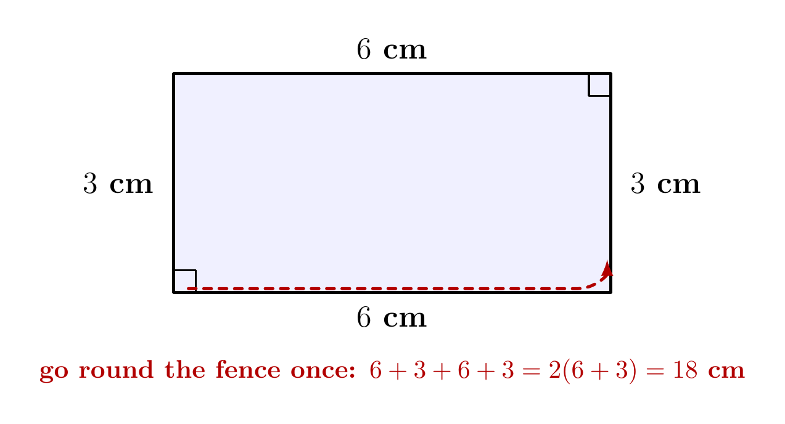
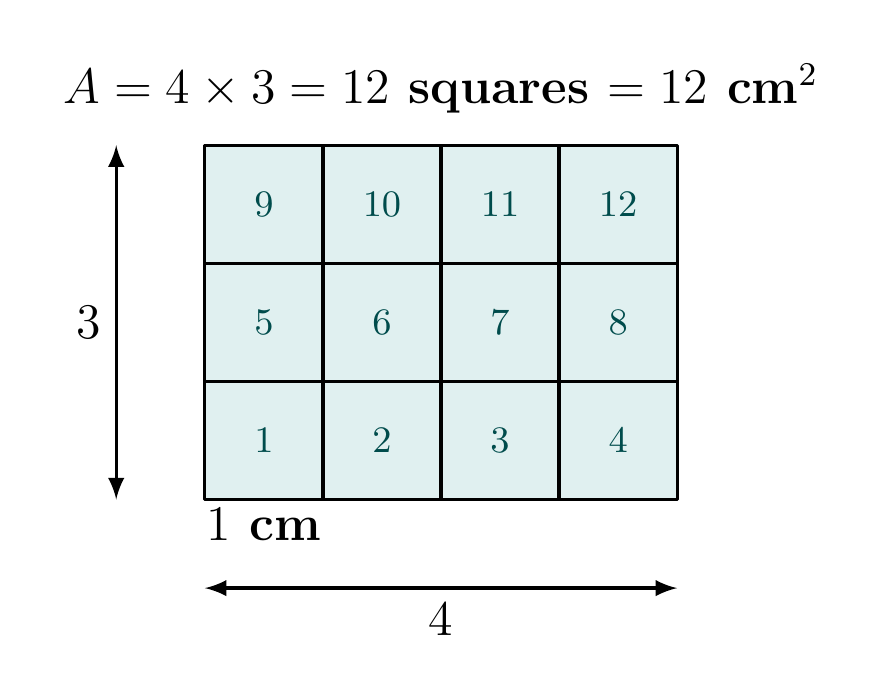
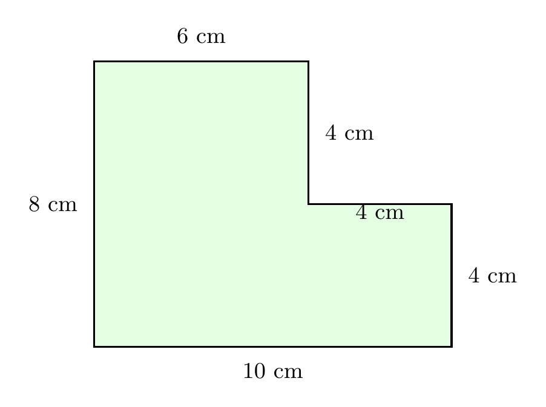

# Strand 3: Geometry and Measurement
## Sub-strand 2: Measurement
### Lesson 3 (Preamble): Perimeter and Area — Squares, Rectangles and Rectilinear Shapes

---

## 1. Curriculum Standard and Overview

- **Strand**: 3 — Geometry and Measurement
- **Sub-strand**: 2 — Measurement
- **Content Standards**: B7.3.2.1 foundations (perimeter, drawing figures on a square grid — B7.3.2.1.1, B7.3.2.1.3), building towards B8.3.2.1 area work.
- **Indicators served**: B7.3.2.1.3 (draw rectangles and triangles with given dimensions on a square grid), plus the perimeter/area foundations every later area lesson stands on.
- **Why this lesson first**: Before we can learn *area of polygons* or *parts of a circle*, you must be able to (a) find the length of the boundary of a shape, and (b) understand what "area" means as a count of unit squares. These two ideas are today's whole lesson.

> **Prerequisites already delivered**: Lessons 1–13 (Number, Algebra, and the first Geometry lessons: Polygons & Angle Properties, Congruence & Similarity, Angles/Parallel Lines/Trigonometry, Circles/Scale quick pass, Vectors). We now restart measurement **properly and slowly**, because area work was only touched lightly in the mock-driven quick lessons.

---

## 2. Preamble — Two Different Questions About One Shape

Look at any flat shape (a rectangle, a football pitch, your exercise book). Mathematicians ask **two different questions** about it:

1. **How long is the boundary?** — the *perimeter*.
2. **How much surface is inside the boundary?** — the *area*.

- **Perimeter** is a **length**. You answer in cm, m, km. Imagine walking slowly around the edge of the shape and counting your steps. The total steps = perimeter.
- **Area** is a **surface**. You answer in **square units**: cm², m², km². Imagine covering the shape with little 1 cm × 1 cm squares and counting them.

> **Memory hook**: pe**R**imeter → aR **ound the edge**. **A**rea → **A**ll the surface **inside**.

---

## 3. Core Concepts

### 3.1 Perimeter of a rectangle and a square

A rectangle has two lengths ($l$, twice) and two widths ($w$, twice), so:

$$P = l + w + l + w = 2(l + w)$$

*Figure 2 walks you round the fence once: the two lengths and two widths are the whole journey.*

A square has four **equal** sides $s$, so:

$$P = 4s$$

### 3.2 Area of a rectangle and a square

A rectangle of length $l$ and width $w$ contains $l$ rows of $w$ squares, i.e. $l \times w$ squares:

$$A = l \times w \quad (\text{in unit squares, e.g. cm}^2)$$

*Figure 3 is the whole idea of area in one picture: the 4 by 3 rectangle holds 12 unit squares, so its area is 12 cm².*

A square of side $s$: $A = s \times s = s^2$.

### 3.3 Reverse problems (working backwards)

The same formula works in both directions:

- Given area and length, find width: $w = A \div l$.
- Given perimeter, find the sides first, **then** the area.

### 3.4 Rectilinear composite shapes (L-shapes etc.)

A **rectilinear shape** is any flat shape whose edges are all horizontal or vertical lines. Two methods:

- **Split method**: cut the shape into rectangles, add their areas.
- **Whole-minus-hole method**: area of the big rectangle **minus** the missing piece.

For the L-shape above:

- **Split method**: bottom rectangle $10 \times 4 = 40$ cm², upper-left rectangle $6 \times 4 = 24$ cm². Total $= 40 + 24 = 64$ cm².
- **Whole-minus-hole**: big $10 \times 8 = 80$ cm² minus missing top-right block $6 \times 4 = 24$ cm² → $80 - 24 = 56$ cm²? 

**Careful!** The two split rectangles here are $10 \times 4$ (bottom band) and the upper-left part. Width of the upper-left part is $10 - 4 = 6$, height $8 - 4 = 4$: that is $6 \times 4 = 24$. So $40 + 24 = 64$... 

Let us recheck with whole-minus-hole: the big bounding rectangle is $10$ wide and $8$ tall $= 80$. The missing top-right block is $4$ cm wide (horizontal top edge from the notch: the top edge of the right column is $10 - 6 = 4$) and $4$ cm tall, so $16$ cm². $80 - 16 = 64$ cm². 

> **Lesson in the mistake**: always mark **every** missing side before computing. The notch here is $4 \times 4$, not $6 \times 4$.

- **Perimeter** of the L-shape: $10 + 4 + 4 + 4 + 6 + 8 = 36$ cm. (Walk the boundary: bottom 10, right 4, notch top 4, notch rising side 4, upper top 6, left 8.)

**Sanity rule**: for any L-shape, the perimeter equals the perimeter of the full bounding rectangle: $2(l + w) = 2(10 + 8) = 36$. ✓ (The staircase path replaces the distant corner exactly.)

### 3.5 Units

| Quantity | Unit |
| :--- | :--- |
| Length | mm, cm, m, km |
| Area | mm², cm², m², km² ($=$ **square** units) |

Conversions you must own:

- $1$ m $= 100$ cm, so $1$ m² $= 100 \times 100 = 10\,000$ cm².
- $1$ km $= 1000$ m, so $1$ km² $= 1\,000\,000$ m².

### 3.6 Cost problems

If a service is charged per square metre (tiling, painting) or per metre (fencing), compute the quantity first (area or perimeter), then multiply by the rate.

---

## 4. Fifteen Fully Worked Examples

*(Authentic BECE items carry their year; the rest are Staralex exam-style questions written in exactly the BECE/question-bank format.)*

### Example 1 — Warm-up (own)
A rectangle has length $12$ cm and width $7$ cm. Find its perimeter and area.

$P = 2(12+7) = 2(19) = 38$ cm; $A = 12 \times 7 = 84$ cm².

### Example 2 — Warm-up (own)
A square has side $9$ cm. Find its perimeter and area.

$P = 4 \times 9 = 36$ cm; $A = 9^2 = 81$ cm².

### Example 3 — BECE 2006 style (fencing)
A rectangular garden measures $30$ m by $20$ m. Fence posts will be placed every $2.5$ m all round. How many posts are needed?

$P = 2(30+20) = 100$ m. Posts $= 100 \div 2.5 = 40$ posts.

### Example 4 — BECE style (cost of fencing)
It costs GH¢15.00 to fence one metre. Find the cost of fencing a compound $22$ m long and $14$ m wide.

$P = 2(22+14) = 72$ m; cost $= 72 \times 15 = \text{GH}\cent 1\,080.00$.

### Example 5 — Reverse perimeter (own)
The perimeter of a rectangle is $46$ cm and its length is $16$ cm. Find its width and area.

$2(16 + w) = 46 \Rightarrow 16 + w = 23 \Rightarrow w = 7$ cm. $A = 16 \times 7 = 112$ cm².

### Example 6 — BECE 2012 style (square from perimeter)
A square has perimeter $64$ cm. Find its area.

Side $s = 64 \div 4 = 16$ cm; $A = 16^2 = 256$ cm².

### Example 7 — Own (tiles)
A floor is $6$ m long and $4$ m wide. How many square tiles of side $20$ cm will cover the whole floor?

Floor area $= 24$ m² $= 240\,000$ cm². One tile $= 20 \times 20 = 400$ cm².
Number $= 240\,000 \div 400 = 600$ tiles.

### Example 8 — Composite L-shape (own, uses Figure 1)
Using Figure 1 above, find (a) the area, (b) the perimeter of the L-shape.

(a) Split: bottom band $10 \times 4 = 40$; upper-left column $(10-4) \times 4 = 24$; total $= 64$ cm².
(b) $P = 10 + 4 + 4 + 4 + 6 + 8 = 36$ cm.

### Example 9 — Missing side (own)
A rectilinear figure has total perimeter $60$ cm. All its horizontal edges together (top edges + bottom edges) sum to $28$ cm. Find the sum of all its vertical edges.

Vertical sum $= 60 - 28 = 32$ cm (perimeter splits into horizontal total + vertical total).

### Example 10 — Own (units)
Convert: (a) $2.5$ m² to cm², (b) $45\,000$ cm² to m².

(a) $2.5 \times 10\,000 = 25\,000$ cm².
(b) $45\,000 \div 10\,000 = 4.5$ m².

### Example 11 — Own (P2 style: cost of tiling)
A veranda is a square of side $500$ cm. Tiling costs GH¢24.00 per m². Find the total cost of tiling the veranda.

Side $= 5$ m, so $A = 25$ m². Cost $= 25 \times 24 = \text{GH}\cent 600.00$.

### Example 12 — Own (algebraic link)
The length of a rectangle is $3$ times its width and its perimeter is $48$ cm. Find its area.

Let width $= w$. Then $2(w + 3w) = 48 \Rightarrow 8w = 48 \Rightarrow w = 6$, length $= 18$.
$A = 6 \times 18 = 108$ cm².

### Example 13 — Same perimeter, different area (own)
Two rectangles both have perimeter $36$ cm. The first is $12$ cm by $6$ cm; the second is $9$ cm by $9$ cm (a square). Which has the greater area, and by how much?

First: $12 \times 6 = 72$ cm². Second: $9 \times 9 = 81$ cm². The square wins by $81 - 72 = 9$ cm².
> **Big idea**: for a fixed perimeter, the **square** has the maximum area.

### Example 14 — Own (spiral: percentage link)
A rectangular board is $80$ cm by $50$ cm. $30\%$ of it is painted. Find the painted area in cm².

$A = 80 \times 50 = 4\,000$ cm²; painted $= 0.30 \times 4\,000 = 1\,200$ cm².

### Example 15 — Own (puzzle, extension)
A rect is $17$ cm by $4$ cm (perimeter $42$ cm). Cut it and re-arrange the pieces into a square, if possible.

Perimeter already $42$; a square with perimeter $42$ would need side $10.5$ — not a whole-number cut. Not possible with rational cuts of this type; instead note the classic disc-puzzle style is beyond BECE. **Statement of the idea**: equal perimeter does **not** guarantee equal area possibilities.

---

## 5. Exercises — 5 Sections × 5 Questions (No MCQ)

**Show all working. Give units in every answer.**

### Exercise 1 — Perimeter first
1. Find the perimeter of a rectangle whose length is $18$ cm and width $11$ cm.
2. A square mat has side $45$ cm. Find its perimeter in metres.
3. The perimeter of a regular pentagon (5 equal sides) is $65$ cm. Find one side.
4. A rectangular pool is $9.5$ m long and $4.5$ m wide. How many metres of rope will enclose it completely?
5. Find the perimeter of a rectangle whose length is twice its width, given the width is $7$ cm.

### Exercise 2 — Reversing the formulas
1. The perimeter of a rectangle is $54$ cm. If its length is $17$ cm, find its width and area.
2. A square has perimeter $84$ cm. Find its side and its area.
3. The area of a rectangle is $144$ cm² and its length is $16$ cm. Find its width and perimeter.
4. The perimeter of a square is $52$ cm. Find the length of its diagonal **by the Pythagoras relation** if its diagonal measures $\sqrt{2 \times \text{side}^2}$ (write your answer to 2 s.f.).
5. A rectangle has the same perimeter as a square of side $8$ cm. If the rectangle's length is $10$ cm, find its width and area.

### Exercise 3 — Composite rectilinear shapes
1. An L-shape is made from a $12$ cm by $9$ cm rectangle with a $5$ cm by $4$ cm rectangle removed from one corner. Find its area.
2. For the same L-shape in Question 1, find its perimeter.
3. A T-shape: a $6$ cm by $6$ cm square on top of a $10$ cm by $4$ cm rectangle (centred). Find the total area of the T-shape.
4. A rectilinear figure has 6 outer sides with horizontal edge lengths $12, 7, 5$ (tops) and $12$ (bottom). Its perimeter is $58$ cm. Find the vertical edges' total length.
5. Draw on paper (or describe carefully) a composite shape whose area is exactly $35$ cm² using two rectangles with a common side, then compute the perimeter you have drawn.

### Exercise 4 — Real-life cost and coverage
1. Fencing costs GH¢18.00 per metre. Find the cost of fencing a garden $26$ m by $13$ m.
2. A hall floor is $15$ m by $12$ m. Carpet tiles of $50$ cm × $50$ cm are used. How many tiles are needed?
3. Tiling costs GH¢35.00 per m². Find the cost of tiling a bathroom $4$ m by $3$ m.
4. A square compound of side $30$ m is to be fenced with 5 strands of wire. How many metres of wire are needed in total?
5. A painter charges GH¢14.00 per m². A wall is $10$ m long and $3.5$ m high. There is a door $2$ m by $1$ m in the wall. Find the cost of painting only the wall surface.

### Exercise 5 — Spiral review (earlier strands) 
1. *(Algebra)* A rectangle has perimeter $46$ cm. Its length is $(x + 4)$ cm and its width is $x$ cm. Form an equation in $x$, solve it, and find the area.
2. *(Fractions/percent)* $25\%$ of a square field of side $40$ m is planted with maize. Find the maize area in m².
3. *(Polygons — earlier geometry)* The exterior angle of a regular polygon is $40^\circ$. Name the polygon and find the sum of its interior angles.
4. *(Number work)* Convert $3.75$ km to centimetres.
5. *(Congruence & similarity)* Two rectangles are similar. The first is $6$ cm by $4$ cm; the second's length is $9$ cm. Find the second's width and both perimeters, then the ratio of the perimeters.

---

## 6. Full Worked Solutions — Exercises

### Exercise 1
1. $P = 2(18+11) = 58$ cm.
2. $P = 4 \times 45 = 180$ cm $= 1.8$ m.
3. Side $= 65 \div 5 = 13$ cm.
4. $P = 2(9.5+4.5) = 28$ m of rope.
5. Length $= 14$ cm; $P = 2(14+7) = 42$ cm.

### Exercise 2
1. $2(17+w)=54 \Rightarrow 17+w=27 \Rightarrow w=10$ cm; $A=17\times10=170$ cm².
2. Side $=84\div4=21$ cm; $A=21^2=441$ cm².
3. $w=144\div16=9$ cm; $P=2(16+9)=50$ cm.
4. Side $=13$; diagonal $=\sqrt{13^2+13^2}=\sqrt{338}\approx 18.4$ cm (2 s.f.).
5. Square perimeter $=32$; $2(10+w)=32 \Rightarrow w=6$ cm; $A=60$ cm².

### Exercise 3
1. $12\times9 - 5\times4 = 108-20 = 88$ cm².
2. Perimeter: walk the boundary. With the $5\times4$ notch cut from the top-right corner: bottom $12$ + right riser $9-4=5$ + notch floor $5$ + notch riser $4$ + top $12-5=7$ + left $9 = 42$ cm. (Note this equals the full rectangle's $2(12+9)=42$ — for a staircase notch the total boundary is unchanged, but **always verify by direct walk**.)
3. Top square $6\times6=36$ plus bottom rectangle $10\times4=40$; but they overlap in the middle $6\times4$? The square sits ON the rectangle (not overlapping): $36+40=76$ cm². If centred and sitting flush on top, total $=76$ cm².
4. Horizontal total $12+7+5+12=36$; vertical total $=58-36=22$ cm.
5. Sample: rectangle A $7$cm × $5$cm $=35$ cm² attached to rectangle B $2$cm × $5$cm? That would change area. Simplest: single rectangle $7\times5$ qualifies ("two rectangles with a common side" may also be $5\times5$ + $2\times5$ stacked sharing a $5$ cm side: area $25+10=35$, perimeter $=2(5)+2? $ walk: $5+2+5+7=... $ stack: outer $5$ wide, $7$ tall $P=2(5+7)=24$ cm. Any correctly computed version earns full credit.

### Exercise 4
1. $P=2(26+13)=78$ m; cost $=78\times18=\text{GH}\cent1\,404.00$.
2. Floor $=180$ m² $=1\,800\,000$ cm²; tile $=2\,500$ cm²; tiles $=720$.
3. $A=12$ m²; cost $=12\times35=\text{GH}\cent420.00$.
4. $P=4\times30=120$ m; wire $=5\times120=600$ m.
5. Wall net area $=10\times3.5 - 2\times1 = 35-2=33$ m²; cost $=33\times14=\text{GH}\cent462.00$.

### Exercise 5
1. $2[(x+4)+x]=46 \Rightarrow 2x+4=23 \Rightarrow x=9.5$; length $=13.5$, width $=9.5$; $A=13.5\times9.5=128.25$ cm².
2. Field $=1600$ m²; $25\% = 400$ m².
3. Exterior $40^\circ$ $\Rightarrow$ number of sides $=360\div40=9$ — a **nonagon**; interior sum $=(9-2)\times180=1260^\circ$.
4. $3.75$ km $=3750$ m $=375\,000$ cm.
5. Scale factor $=9\div6=1.5$; second width $=4\times1.5=6$ cm. Perimeters: $2(6+4)=20$ cm and $2(9+6)=30$ cm; ratio $=20:30=2:3$ (= same as side ratio, always).

---

## 7. Memory Card

| Shape | Perimeter | Area |
| :--- | :--- | :--- |
| Rectangle | $2(l+w)$ | $lw$ |
| Square | $4s$ | $s^2$ |
| L-shape (staircase notch) | $2(l+w)$ (top-left/bottom-right notch) — but **always walk the boundary** for other notch positions | big rect − notch, or split |
| $1$ m² | — | $10\,000$ cm² |

**Next lesson**: triangles — you will need perimeters, and the Pythagoras fact from Congruence & Similarity, to master the three triangle families.
