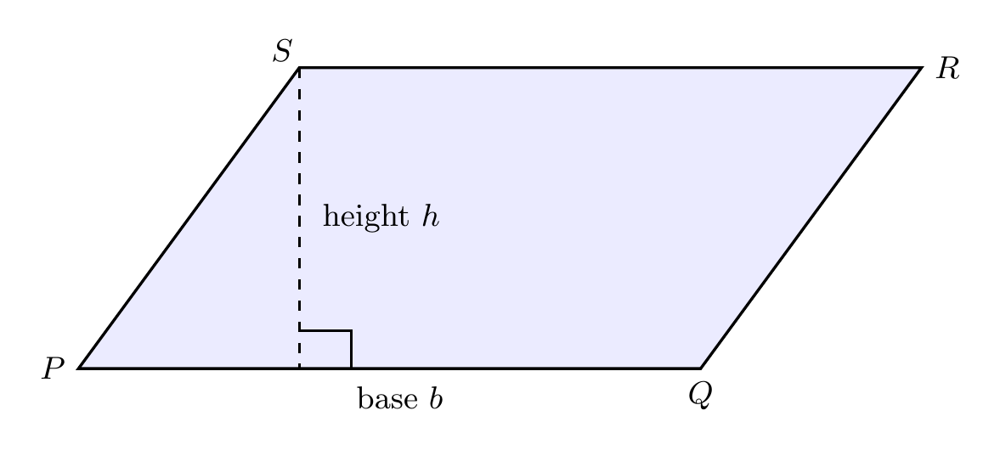
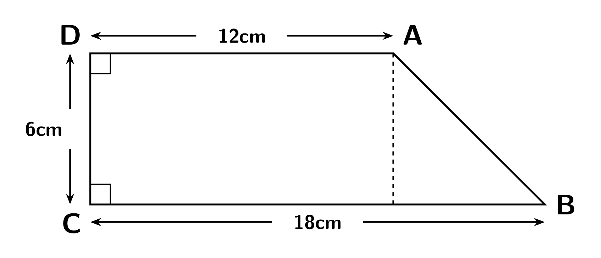
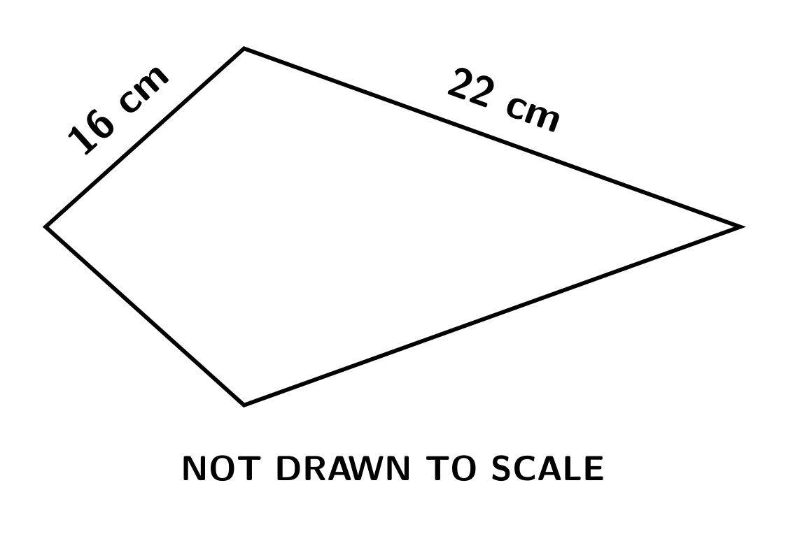

# Strand 3: Geometry and Measurement
## Sub-strand 2: Measurement
### Lesson 4 (Requested topic): Area of Polygons — Square, Rectangle, Parallelogram, Triangle, Trapezium, Rhombus & Kite

---

## 1. Curriculum Standard and Overview

- **Strand**: 3 — Geometry and Measurement
- **Sub-strand**: 2 — Measurement
- **Content Standard**: B7.3.2.2 (area of plane shapes) carried into B8.3.2.1 measurement applications.
- **Indicators**: B7.3.2.2.1 (deduce the triangle area from a rectangle/parallelogram), B7.3.2.2.2 (determine the area of a triangle), B8.3.2.1.4 (apply it in real-life problems).
- **Mock link**: the 2010 Paper 2 trapezium item (area $31.5$ cm², parallel sides $5.3$ cm and $7.3$ cm) is rebuilt in Example 5.

> **Prerequisites delivered**: perimeter & area basics (this folder, Lesson 3) and triangle families incl. Pythagoras (Sub-strand 1, Lesson 4). You know what area means; today we collect **formulas** and, more importantly, learn **which number is the height** — the #1 exam trap.

---

## 2. Preamble — Base and Perpendicular Height

For every formula below, the two star numbers are:

- **Base ($b$)**: any one side you choose to work from.
- **Perpendicular height ($h$)**: the **rapid distance** from the base to the opposite corner/edge — always measured at **right angles** to the base, never along a slanted edge.

> **Trap**: in a parallelogram or trapezium, the slanted *edge* is **not** the height. If a diagram gives you base $10$, slant $6$ and height $5$, the area uses $10 \times 5$ — the $6$ is a distractor (often placed there on purpose in BECE).

### The master idea (indicator B7.3.2.2.1)

Any triangle is **half of the parallelogram** built around it. Draw a rectangle, draw one diagonal: two congruent triangles, each half the rectangle. That is the whole reason:

$$A_{\text{triangle}} = \frac{1}{2} b h, \qquad A_{\text{parallelogram}} = b h$$

---

## 3. The Formula Table (learn by heart)

| Shape | Area formula | Notes |
| :--- | :--- | :--- |
| Square (side $s$) | $A = s^2$ | from Lesson 3 |
| Rectangle | $A = l \times w$ | from Lesson 3 |
| Parallelogram | $A = b \times h$ | $h$ ⊥ to $b$ |
| Triangle | $A = \frac{1}{2} b h$ | any triangle, any chosen base |
| Right triangle | $A = \frac{1}{2}(\text{leg}_1)(\text{leg}_2)$ | the legs are base & height |
| Trapezium | $A = \frac{1}{2}(a + b)h$ | $a, b$ are the two **parallel** sides |
| Rhombus / Kite | $A = \frac{d_1 \times d_2}{2}$ | product of diagonals, halved |

**Reverse moves**: $h = \dfrac{2A}{b}$, $b = \dfrac{2A}{h}$, $h = \dfrac{2A}{a+b}$.

---

## 4. Fifteen Fully Worked Examples

### Example 1 — Parallelogram (own, uses figure)

A parallelogram has base $12$ cm and perpendicular height $8$ cm. Find its area.

$A = bh = 12 \times 8 = 96$ cm².

### Example 2 — The slant-edged distractor (own)
A parallelogram has base $10$ cm, a slanted edge of $6$ cm, and perpendicular height $5$ cm. Find its area. Then find its perimeter if the opposite side is also $10$ cm.

$A = 10 \times 5 = 50$ cm². ($6$ is not the height!)
$P = 2(10 + 6) = 32$ cm.

### Example 3 — Triangle basic (own)
A triangle has base $14$ cm and height $6$ cm. Find its area.

$A = \frac{1}{2}(14)(6) = 42$ cm².

### Example 4 — Reverse (own)
The area of a triangle is $60$ cm² and its base is $12$ cm. Find its height.

$h = \dfrac{2A}{b} = \dfrac{120}{12} = 10$ cm.

### Example 5 — BECE 2010 Paper 2 (authentic, rebuilt cleanly)
The area of a trapezium is $31.5$ cm². Its parallel sides are $5.3$ cm and $7.3$ cm. Find the perpendicular distance ($h$) between them.

$$\frac{1}{2}(5.3 + 7.3)h = 31.5 \Rightarrow \frac{1}{2}(12.6)h = 31.5 \Rightarrow 6.3h = 31.5 \Rightarrow h = 5 \text{ cm}$$

### Example 6 — BECE 1997 (authentic composite)
A figure is made of a rectangle $8$ cm by $6$ cm with a triangle on it, base $6$ cm, height $3$ cm. Find the total area.

Rectangle $= 48$ cm²; triangle $= \frac{1}{2}(6)(3) = 9$ cm²; total $= 57$ cm².

### Example 7 — Trapezium basic (own, canonical figure)

A trapezium has parallel sides $10$ cm and $6$ cm, and height $5$ cm. Find its area.

$A = \frac{1}{2}(10+6)(5) = \frac{1}{2}(16)(5) = 40$ cm².

### Example 8 — Rhombus & kite (own, canonical figure)

Find the area of (a) a rhombus with diagonals $10$ cm and $24$ cm; (b) a kite with diagonals $12$ cm and $8$ cm.

(a) $A = \frac{10 \times 24}{2} = 120$ cm². *(Bonus from triangles lesson: side $= \sqrt{5^2+12^2}=13$, perimeter $52$ cm.)*
(b) $A = \frac{12 \times 8}{2} = 48$ cm².

### Example 9 — BECE 1996 (authentic)
A square of side $6$ cm has the same area as a rectangle of length $9$ cm. Find the breadth of the rectangle.

Square $= 36$ cm². Breadth $= 36 \div 9 = 4$ cm.

### Example 10 — Own (reverse parallelogram)
A parallelogram has area $240$ cm² and base $20$ cm. Find its perpendicular height, then its perimeter if one slanted pair of sides measures $13$ cm.

$h = 240 \div 20 = 12$ cm. $P = 2(20+13) = 66$ cm.

### Example 11 — Own (algebraic modelling, P2 style)
A triangle has base $2x$ cm and height $x$ cm. Its area is $144$ cm². Find $x$, the base, and the height.

$\frac{1}{2}(2x)(x) = x^2 = 144 \Rightarrow x = 12$. Base $= 24$ cm, height $= 12$ cm.

### Example 12 — Own (composite with grid logic)
A pentagon is a square of side $8$ cm topped by a triangle of base $8$ cm and height $6$ cm. Find the total area.

Square $= 64$ cm²; triangle $= \frac{1}{2}(8)(6) = 24$ cm²; total $= 88$ cm².

### Example 13 — Real-life cost (own)
A farmer's plot is a trapezium: parallel sides $120$ m and $80$ m, distance between them $60$ m. Weeding is charged at GH¢0.50 per m². Find the total cost.

$A = \frac{1}{2}(120+80)(60) = 6\,000$ m²; cost $= 6\,000 \times 0.50 = \text{GH}\cent3\,000.00$.

### Example 14 — Area from perimeter (own)
A square has perimeter $36$ cm. Find its area. A rectangle with the same $36$ cm perimeter is $11$ cm long; find its area.

Square: $s = 9$, $A = 81$ cm². Rectangle: $2(11+w) = 36 \Rightarrow w = 7$, $A = 77$ cm². (Again the square wins.)

### Example 15 — In-scripted triangle inside a rectangle (own)
A rectangle is $20$ cm by $14$ cm. A triangle has one full side of the rectangle ($20$ cm) as base and the opposite side's midpoint as apex. Find the area of the triangle and of the leftover region.

Height of triangle $= 14$; area $= \frac{1}{2}(20)(14) = 140$ cm².
Leftover $= 280 - 140 = 140$ cm² (half the rectangle — diagonal-style split).

---

## 5. Exercises — 5 Sections × 5 Questions (No MCQ)

**Show all working; state units.**

### Exercise 1 — Parallelograms
1. Find the area of a parallelogram with base $15$ cm and height $9$ cm.
2. A parallelogram has area $180$ m² and height $12$ m. Find the base.
3. A parallelogram's base and height are respectively $7$ cm and $(x - 3)$ cm; its area is $28$ cm². Find $x$.
4. A parallelogram has base $11$ cm, slant $6$ cm, height $5$ cm. Find (a) area, (b) perimeter.
5. A rhombus has side $9$ cm and height $8$ cm. Find its area. (A rhombus IS a parallelogram.)

### Exercise 2 — Triangles
1. Triangle: base $18$ cm, height $7$ cm. Area?
2. Area $90$ cm²; base $15$ cm. Height?
3. Right triangle with legs $8$ cm and $11$ cm. Area?
4. An isosceles triangle has equal sides $10$ cm and base $12$ cm. Use Pythagoras to find the height, then the area.
5. A triangle has area $42$ cm² and height $12$ cm. Find its base.

### Exercise 3 — Trapezia, rhombi & kites
1. Parallel sides $13$ cm and $7$ cm; height $6$ cm. Find the trapezium's area.
2. A trapezium's area is $84$ cm² with parallel sides $10$ cm and $14$ cm. Find the distance between them.
3. A kite has diagonals $16$ cm and $5$ cm. Find its area.
4. A rhombus has diagonals $12$ cm and $16$ cm. Find (a) area, (b) one side, (c) perimeter.
5. A trapezium has parallel sides $a$ cm and $(a+4)$ cm, height $6$ cm, area $66$ cm². Find $a$.

### Exercise 4 — Composite shapes
1. A figure is a rectangle $16$ cm by $10$ cm with a triangle attached on the $16$ cm side, triangle height $6$ cm. Find the total area.
2. A moon-shaped badge: a square of side $12$ cm has a right triangle (legs $12$ cm and $5$ cm) cut from one corner. Find the remaining area.
3. An L-shape: big rectangle $14$ cm by $9$ cm minus a $6$ cm by $4$ cm corner. Find the area and perimeter.
4. A plot is a trapezium (parallel sides $40$ m, $25$ m, height $20$ m). Find its area and the cost of fencing it at GH¢9.00 per metre if its non-parallel sides are $25$ m each. (Perimeter $= 40 + 25 + 25 + 25$.)
5. A hexagon = rectangle $10$ cm by $6$ cm with one triangle (base $10$, height $4$) on top and an identical one below. Find the total area.

### Exercise 5 — Spiral review
1. *(Lesson 3)* A rect floor $8$ m by $5$ m is tiled with $25$ cm × $25$ cm tiles. How many tiles?
2. *(Triangles lesson)* A triangle has sides $7, 24, 25$. Name it and find its area (right angle between $7$ and $24$).
3. *(Percent)* A trapezium field of area $900$ m² loses $15\%$ to a pathway. Find the farmed area.
4. *(Algebra)* A parallelogram has base $(2x)$ cm, height $(x+3)$ cm and area $36$ cm². Form the equation, solve for $x$, and find the base and height.
5. *(Congruence/similarity)* Two similar triangles have areas $50$ cm² and $200$ cm². What is the ratio of (a) their sides, (b) their areas? *(Think: similarity from your earlier lesson, scale factor $k$ on lengths → area factor $k^2$.)*

---

## 6. Full Worked Solutions — Exercises

### Exercise 1
1. $15 \times 9 = 135$ cm².
2. $b = 180 \div 12 = 15$ m.
3. $7(x-3) = 28 \Rightarrow x - 3 = 4 \Rightarrow x = 7$.
4. (a) $11 \times 5 = 55$ cm². (b) $2(11+6) = 34$ cm.
5. Rhombus = parallelogram: $A = 9 \times 8 = 72$ cm².

### Exercise 2
1. $\frac{1}{2}(18)(7) = 63$ cm².
2. $h = \frac{2 \times 90}{15} = 12$ cm.
3. $\frac{1}{2}(8)(11) = 44$ cm².
4. Height $= \sqrt{10^2 - 6^2} = \sqrt{64} = 8$ cm; $A = \frac{1}{2}(12)(8) = 48$ cm².
5. $b = \frac{2 \times 42}{12} = 7$ cm.

### Exercise 3
1. $\frac{1}{2}(13+7)(6) = 60$ cm².
2. $\frac{1}{2}(24)h = 84 \Rightarrow h = 7$ cm.
3. $\frac{16 \times 5}{2} = 40$ cm².
4. (a) $\frac{12\times16}{2} = 96$ cm². (b) side $= \sqrt{6^2 + 8^2} = 10$ cm. (c) $P = 40$ cm.
5. $\frac{1}{2}(a + a + 4)(6) = 66 \Rightarrow 3(2a+4) = 66 \Rightarrow 2a + 4 = 22 \Rightarrow a = 9$.

### Exercise 4
1. $160 + \frac{1}{2}(16)(6) = 160 + 48 = 208$ cm².
2. $144 - \frac{1}{2}(12)(5) = 144 - 30 = 114$ cm².
3. Area $= 14\times9 - 6\times4 = 126 - 24 = 102$ cm²; perimeter (walk): $14 + 9 + 6 + 4 + 6 + 5 = 44$ cm — check: full rect $2(14+9) = 46$ ≠ 44. Walk honestly with the notch $6$ wide, $4$ deep at a top corner: bottom $14$? For a top-right notch: $14 + 5 + 6 + 4 + 8 + 9$... Set vertices: $(0,0)\to(14,0)\to(14,9)\to(8,9)\to(8,5)\to(2,5)\to(2,9)\to(0,9)\to(0,0)$ — that's a U! Simpler single notch: $(0,0)\to(14,0)\to(14,9-4=5)\to(14-6=8,5)\to(8,9)\to(0,9)\to(0,0)$: sides $14+5+6+4+8+9 = 46$ cm $= 2(14+9)$ ✓ (staircase notch preserves total).
4. Area $= \frac{1}{2}(65)(20) = 650$ m². Perimeter $= 40 + 25 + 25 + 25 = 115$ m; cost $= 115 \times 9 = \text{GH}\cent1,035.00$.
5. $60 + \frac{1}{2}(10)(4) \times 2 = 60 + 40 = 100$ cm².

### Exercise 5
1. Floor $= 40$ m² $= 400\,000$ cm²; tile $= 625$ cm²; tiles $= 640$.
2. $7^2 + 24^2 = 625 = 25^2$ → right-angled scalene; $A = \frac{1}{2}(7)(24) = 84$ units².
3. Farmed $= 900 \times 0.85 = 765$ m².
4. $(2x)(x+3) = 36 \Rightarrow x^2 + 3x - 18 = 0 \Rightarrow (x+6)(x-3) = 0 \Rightarrow x = 3$ (reject $-6$). Base $= 6$ cm, height $= 6$ cm. Check: $6 \times 6 = 36$ ✓. *(Exam habit: check your roots are sensible — lengths cannot be negative.)*
5. (a) Area ratio $= 200\div50 = 4$, so side ratio $= \sqrt{4} = 2 : 1$. (b) $4 : 1$.

---

## 7. Memory Card

- Parallelogram $= bh$; triangle $= \frac{1}{2}bh$; trapezium $= \frac{1}{2}(a+b)h$; rhombus/kite $= \frac{d_1 d_2}{2}$.
- Height **is never the slanted edge**.
- Reverse: $h = \frac{2A}{b}$.
- Similar shapes: sides in ratio $k$ → areas in ratio $k^2$.

**Next lesson**: *Parts of a circle* — the last shape family, ruler-free: centre, radius, diameter, chord, arc, sector, segment, tangent, and the $\pi$ formulas that measure them all.
