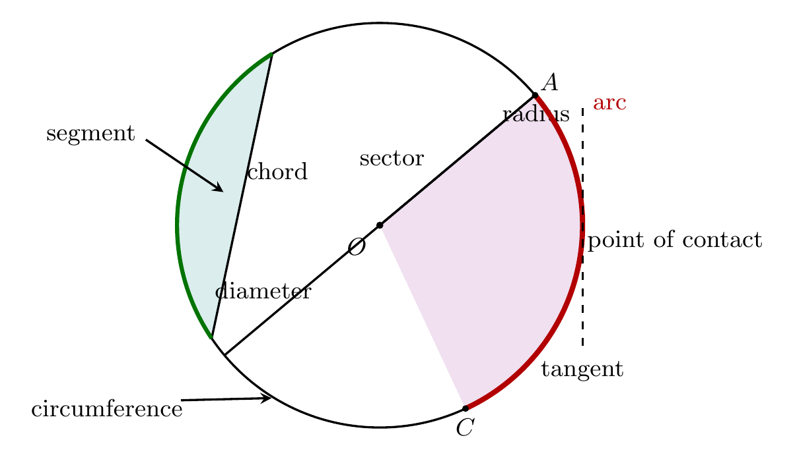
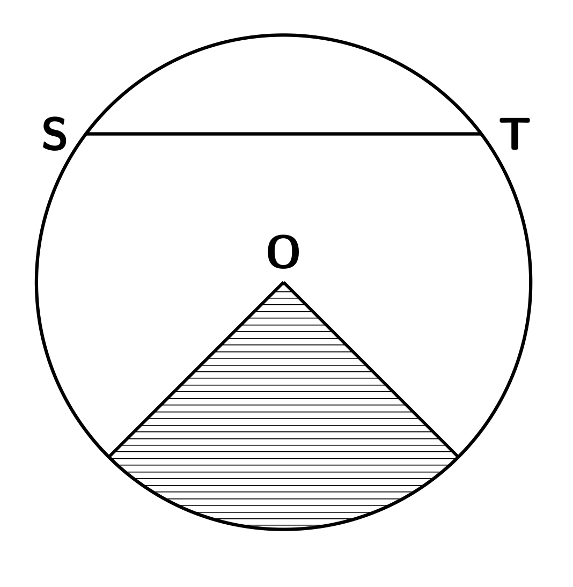
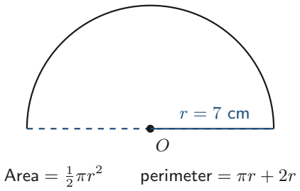
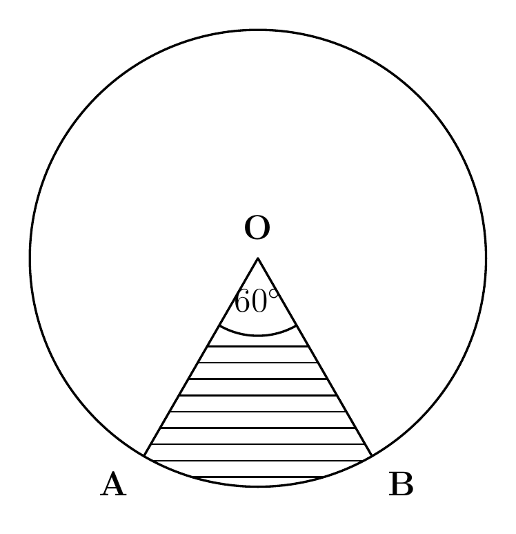
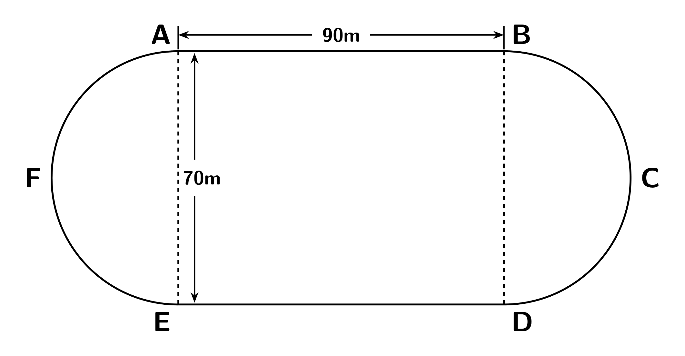

# Strand 3: Geometry and Measurement
## Sub-strand 2: Measurement
### Lesson 5 (Requested topic): Parts of a Circle and Circle Measures

---

## 1. Curriculum Standard and Overview

- **Strand**: 3 — Geometry and Measurement
- **Sub-strand**: 2 — Measurement
- **Content Standards**: B7.3.2.1 and B8.3.2.1 (Measurement of circles).
- **Indicators**: B7.3.2.1.2 (deduce the circumference formula from the diameter relationship), B8.3.2.1.1 (circumference and area of circles); sector measures as B9 application.
- **Mock-paper links**: Mock P1 Q5 (area $64\pi$ → circumference), Mock P2 Q3(d) (semicircle area, $r=7$). Both are re-taught slowly here with the full part-naming first.

> **Prerequisites delivered**: perimeter & area basics (Lesson 3 of this folder) — because "area of a circle = $154$ cm²" only means something once square units and reverse working are natural to you.

---

## 2. Preamble — Naming Every Part First

A **circle** is the set of all points the **same distance** from one fixed point, called the **centre**.

Learn this picture cold. Every part in words:

| Part | Meaning | Exam fact |
| :--- | :--- | :--- |
| **Centre** ($O$) | the fixed middle point | |
| **Radius** ($r$) | centre → any point on the circle | all radii are equal |
| **Diameter** ($d$) | chord through the centre | $d = 2r$; the **longest chord** |
| **Circumference** ($C$) | the full boundary length (the "perimeter") | $C = \pi d = 2\pi r$ |
| **Chord** | a straight line joining two points **on** the circle | diameter is the longest chord |
| **Arc** | a **part of the circumference** | minor arc vs major arc |
| **Sector** | the "pizza slice" between **two radii** and their arc | like pie chart slices |
| **Segment** | the region between a **chord and its arc** | like a bite of the pizza |
| **Tangent** | a line touching the circle at **exactly one point** (the point of contact) | ⊥ to the radius at that point |
| **Semicircle** | half a circle (cut along a diameter) | area $\frac{1}{2}\pi r^2$; perimeter $\pi r + 2r$ |

*Figure 5 zooms in on the trickiest trio — chord, arc and sector — with the centre shown.*

### 2.1 The number π (pi)

Wrap a string once round any circle and compare it with the diameter: the string is always **a bit more than 3 diameters long**. That constant is $\pi \approx 3.14159...$

**BECE rule**: use $\pi = \dfrac{22}{7}$ **when the radius/diameter is a multiple of 7** (the 7s cancel beautifully); otherwise use $3.142$. If the paper leaves answers "in terms of $\pi$", keep $\pi$ in.

---

## 3. Core Concepts — The Four Measuring Formulas

| Measure | Formula | Reverse |
| :--- | :--- | :--- |
| Circumference | $C = 2\pi r = \pi d$ | $r = \dfrac{C}{2\pi}$, $d = \dfrac{C}{\pi}$ |
| Circle area | $A = \pi r^2$ | $r = \sqrt{\dfrac{A}{\pi}}$ |
| Arc length | $l = \dfrac{\theta}{360} \times 2\pi r$ | the arc is that **fraction** of the circumference |
| Sector area | $A_s = \dfrac{\theta}{360} \times \pi r^2$ | same fraction of the **area** |
| Sector perimeter | $l + 2r$ | arc + the two radii, **not** the arc alone |

> **Key-idea (understand, don't memorise)**: the fraction $\frac{\theta}{360}$ tells you *how much of the whole circle* you keep. Use it for the arc (part of the boundary) and for the sector area (part of the surface). Sector **perimeter** adds the two straight radii.

---

## 4. Fifteen Fully Worked Examples

### Example 1 — Naming parts (authentic BECE definitions)
(a) The distance from the centre to any point of a circle is called what?
(b) The line joining two points on the circumference is called what?
(c) The longest chord of a circle is the what?

(a) **radius**; (b) **chord**; (c) **diameter**.
> ⚠️ **Honest note**: one banked answer key lists "segment" for (c); the correct mathematics is **diameter** — a chord through the centre beats every other chord in length.

### Example 2 — BECE 2006 (authentic)
Find the circumference of a circle with radius $3.5$ cm. (Take $\pi = \frac{22}{7}$}

$$C = 2\pi r = 2 \times \tfrac{22}{7} \times 3.5 = 2 \times 22 \times 0.5 = 22 \text{ cm}$$

### Example 3 — BECE 1991 (authentic, reverse)
The circumference of a circular track is $440$ m. Find its diameter. ($\pi = \frac{22}{7}$)

$\pi d = 440 \Rightarrow d = 440 \times \frac{7}{22} = 140$ m.

### Example 4 — BECE 2002 (authentic, reverse with decimals)
The circumference of a circular track is $15.4$ m. Find the diameter. ($\pi = \frac{22}{7}$)

$d = \dfrac{15.4 \times 7}{22} = 4.9$ m.

### Example 5 — BECE 2004 (authentic)
A circle has radius $7$ cm; find its area. ($\pi = \frac{22}{7}$)

$A = \pi r^2 = \frac{22}{7} \times 49 = 154$ cm². *(Notice: $49 \div 7 = 7$, the 7s wipe out — that's why $\frac{22}{7}$ is given for multiples of 7.)*

### Example 6 — BECE 2005 (authentic)
Find the area of a circle whose diameter is $28$ cm. ($\pi = \frac{22}{7}$)

$r = 14$; $A = \frac{22}{7} \times 14^2 = \frac{22}{7} \times 196 = 22 \times 28 = 616$ cm².

### Example 7 — BECE 2010 (authentic, exact-$\pi$ style)
Find the circumference of a circle whose area is $64\pi$ cm².

$\pi r^2 = 64\pi \Rightarrow r^2 = 64 \Rightarrow r = 8$. $C = 2\pi r = 16\pi$ cm.
*(Watch the options' units: answer is a length, so "$16\pi$ cm".)*

### Example 8 — BECE 2022 past style (authentic)
A circular tarpaulin pond has an area of $616$ m². Find the circumference. ($\pi = \frac{22}{7}$)

$\pi r^2 = 616 \Rightarrow r^2 = 196 \Rightarrow r = 14$. $C = 2 \times \frac{22}{7} \times 14 = 88$ m.

### Example 9 — BECE 2010-style (authentic)
A circle of diameter $14$ cm is cut from a square of side $14$ cm. Find the remaining area. ($\pi = \frac{22}{7}$)

Square $= 196$ cm²; circle $= \frac{22}{7} \times 49 = 154$ cm²; remaining $= 196 - 154 = 42$ cm².

### Example 10 — Semicircle area (mock P2 Q3(d), rebuilt)

Find the area of a semicircle with radius $7$ cm. ($\pi = \frac{22}{7}$)

Full circle $= 154$; semicircle $= 77$ cm².

### Example 11 — Semicircle perimeter (authentic style)
A semicircle has radius $7$ cm. Find its perimeter. ($\pi = \frac{22}{7}$)

Curved part $= \pi r = 22$ cm; straight diameter $= 14$ cm; total $= 36$ cm.

### Example 12 — BECE 1993 (authentic, sector area)
The area of a circle, centre $O$, is $120$ cm². $\angle AOB = 60^\circ$. Find the area of the sector $AOB$.

Fraction $= \frac{60}{360} = \frac{1}{6}$; sector $= \frac{1}{6} \times 120 = 20$ cm².

### Example 13 — Sector area with $\pi = \frac{22}{7}$ (own, canonical figure)

A sector has radius $21$ cm and central angle $120^\circ$. Find its area. ($\pi = \frac{22}{7}$)

Fraction $= \frac{120}{360} = \frac{1}{3}$. Area $= \frac{1}{3} \times \frac{22}{7} \times 21^2 = \frac{1}{3} \times \frac{22}{7} \times 441 = \frac{22}{7} \times 147 = 462$ cm².

### Example 14 — Arc length (own)
Find the length of the arc of Example 13 (radius $21$ cm, angle $120^\circ$), and the **perimeter of the sector**.

$C = 2 \times \frac{22}{7} \times 21 = 132$ cm; arc $= \frac{1}{3} \times 132 = 44$ cm.
Sector perimeter $= 44 + 2(21) = 86$ cm.

### Example 15 — Running-track composite (own, canonical figure)

A track consists of a rectangle $80$ m by $56$ m with two semicircular ends of diameter $56$ m. Find (a) the distance a runner travels once round the inner edge, (b) the inner-field area.

(a) Two straights: $2 \times 80 = 160$ m; two semicircles $=$ one full circle of $d = 56$: $C = \pi d = \frac{22}{7} \times 56 = 176$ m. Round trip $= 336$ m.
(b) Rectangle $80 \times 56 = 4480$ m²; circle $= \frac{22}{7} \times 28^2 = 2464$ m²; total $= 6944$ m².

---

## 5. Exercises — 5 Sections × 5 Questions (No MCQ)

**Take $\pi = \frac{22}{7}$ unless told otherwise. Show working + units.**

### Exercise 1 — Naming and identifying
1. Name the part of a circle: (a) the boundary itself, (b) the "pizza slice", (c) the "bite" between a chord and its arc.
2. The diameter of a circle is $18$ cm. What is its radius?
3. A chord passes through the centre of a circle. What is its special name and how does its length compare with every other chord?
4. Which part of a circle touches it at exactly one point, and what is that point called?
5. A sector has central angle $180^\circ$. What everyday name does this sector take?

### Exercise 2 — Circumference work
1. Find the circumference of a circle of radius $7$ cm.
2. Find the circumference of a circle of diameter $21$ cm.
3. The circumference of a wheel is $110$ cm. Find its radius.
4. A circular pond has circumference $44$ m. Find (a) its diameter, (b) its area.
5. A wheel of radius $35$ cm rolls one full turn. How far does it travel, in metres?

### Exercise 3 — Area work
1. Find the area of a circle of radius $10$ cm. (Give your answer to 1 decimal place, $\pi = 3.142$.)
2. Find the area of a circle of diameter $42$ cm.
3. The area of a circle is $2464$ cm². Find its radius.
4. A circle's area equals a square's area of side $22$ cm. Show both computations match (square $\pi = \frac{22}{7}$, $r = 14$).
5. A circle of diameter $21$ cm is cut from a rectangle $30$ cm by $21$ cm. Find the area left over, to 1 d.p. ($\pi = 3.142$)

### Exercise 4 — Arcs, sectors, semicircles
1. A sector has radius $12$ cm and angle $90^\circ$. Find its area and its arc length. ($\pi = 3.142$)
2. A sector has radius $14$ cm and angle $135^\circ$. Find its area and its perimeter.
3. Find the perimeter of a semicircle of radius $14$ cm.
4. The area of a circle is $500$ cm²; a sector subtends $72^\circ$. Find the sector's area.
5. The minute hand of a clock is $14$ cm long. Find the distance its tip travels in $20$ minutes, and the sector "swept" area in those 20 minutes.

### Exercise 5 — Spiral review
1. *(Area of polygons, previous lesson)* A trapezium has parallel sides $15$ cm and $9$ cm, height $8$ cm. Find its area. Then compare: which is bigger, this trapezium or a circle of radius $6$ cm ($\pi = \frac{22}{7}$)?
2. *(Triangles)* A right triangle has hypotenuse $25$ cm and one leg $20$ cm. Find the other leg.
3. *(Perimeter & area, Lesson 3)* A square room of side $7$ m has a circular carpet of radius $2.8$ m laid in the middle. Find the visible floor area. ($\pi = 3.142$)
4. *(Percent)* A circular field of radius $70$ m has $25\%$ of its area mowed. Find the mowed area. ($\pi = \frac{22}{7}$)
5. *(Algebra)* A circle's radius is $(x + 2)$ cm and its area is $154$ cm². Solve for $x$.

---

## 6. Full Worked Solutions — Exercises

### Exercise 1
1. (a) **circumference**; (b) **sector**; (c) **segment**.
2. $r = 9$ cm.
3. **Diameter**; it is the longest possible chord.
4. The **tangent**; the touching point is the **point of contact**.
5. A **semicircle** (half the circle, $180^\circ$ of turn).

### Exercise 2
1. $C = 2 \times \frac{22}{7} \times 7 = 44$ cm.
2. $C = \pi d = \frac{22}{7} \times 21 = 66$ cm.
3. $r = \frac{110}{2\pi} = \frac{110 \times 7}{44} = 17.5$ cm.
4. (a) $d = 44 \times \frac{7}{22} = 14$ m. (b) $A = \frac{22}{7} \times 49 = 154$ m².
5. One turn $= 2\pi r = 2 \times \frac{22}{7} \times 35 = 220$ cm $= 2.2$ m.

### Exercise 3
1. $A = 3.142 \times 100 = 314.2$ cm².
2. $r = 21$; $A = \frac{22}{7} \times 441 = 1386$ cm².
3. $r^2 = \frac{2464}{22} \times 7 = 784 \Rightarrow r = 28$ cm.
4. Square $= 484$ cm²; circle $= \frac{22}{7} \times 14^2 = \frac{22}{7}\times196 = 616$ cm². **They do not match** — the printed claim is false (the intended pair was square of side $22$: area $484$, vs circle of $r = 14$: $616$). Say the correct maths and reject the false claim.
5. Rectangle $= 630$ cm²; circle $r = 10.5$: $A = 3.142 \times 110.25 \approx 346.35$; leftover $\approx 283.7$ cm² (1 d.p.).

### Exercise 4
1. Fraction $\frac{1}{4}$: area $= \frac{1}{4} \times 3.142 \times 144 = 113.1$ cm²; arc $= \frac{1}{4} \times 2 \times 3.142 \times 12 = 18.9$ cm.
2. Fraction $= \frac{135}{360} = \frac{3}{8}$: sector $= \frac{3}{8}\times\frac{22}{7}\times196 = 231$ cm²; arc $= \frac{3}{8}\times 2\times\frac{22}{7}\times14 = \frac{3}{8}\times88 = 33$ cm; perimeter $= 33 + 28 = 61$ cm.
3. $\pi r + 2r = 44 + 28 = 72$ cm.
4. Fraction $\frac{72}{360} = \frac{1}{5}$; sector $= 100$ cm².
5. In 20 min the hand turns $120^\circ$ (fraction $\frac{1}{3}$ of a turn): distance $= \frac{1}{3} \times 2 \times \frac{22}{7} \times 14 = \frac{88}{3} \approx 29.3$ cm; swept area $= \frac{1}{3} \times \frac{22}{7} \times 196 = \frac{154}{3} \approx 51.3$ cm².

### Exercise 5
1. Trapezium $= \frac{1}{2}(24)(8) = 96$ cm²; circle $= \frac{22}{7}\times36 \approx 113.1$ cm² → the **circle** is bigger by about $17.1$ cm².
2. $\sqrt{25^2 - 20^2} = \sqrt{225} = 15$ cm.
3. Room $= 49$ m²; carpet $= 3.142 \times 7.84 \approx 24.6$ m²; visible $\approx 24.4$ m².
4. Full $= \frac{22}{7} \times 4900 = 15\,400$ m²; mowed $= 0.25 \times 15\,400 = 3850$ m².
5. $\frac{22}{7}(x+2)^2 = 154 \Rightarrow (x+2)^2 = 49 \Rightarrow x + 2 = 7 \Rightarrow x = 5$ (radius positive).

---

## 7. Memory Card

- $d = 2r$; $C = \pi d$; $A = \pi r^2$; $\frac{22}{7}$ for 7-multiples, else $3.142$.
- Arc & sector: multiply the whole thing by $\frac{\theta}{360}$; sector perimeter adds $2r$.
- Semicircle: area $\frac{1}{2}\pi r^2$, perimeter $\pi r + 2r$.
- Names: chord (straight, inside), arc (curved, on the boundary), sector (radii + arc), segment (chord + arc), tangent (just touches), diameter (longest chord).
- Reverse: $r = \sqrt{A/\pi}$.

**Next**: *Constructions I* — you now own the circle vocabulary that the incircle/circumcircle constructions will need.
