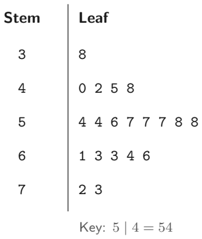
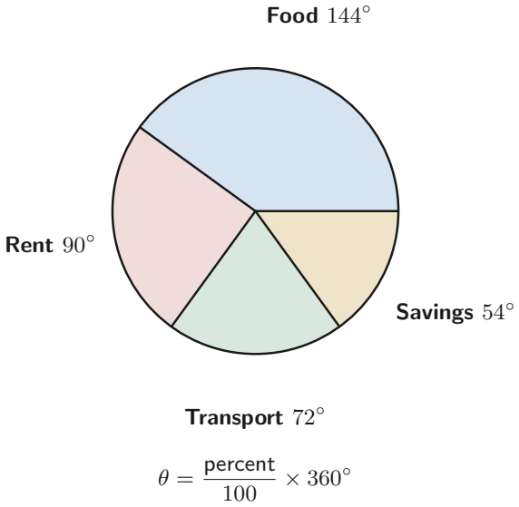

# Strand 4: Handling Data
## Sub-strand 1: Data and Statistics
### Lesson 1: Data Types, Frequency Tables, Stem-and-Leaf, and Descriptive Statistics

---

## 1. Curriculum Standard and Overview

- **Strand**: 4 — Handling Data
- **Sub-strand**: 1 — Data and Statistics
- **Content Standard**: B9.4.1.1 / B9.4.1.2
- **Indicators**:
  - **B9.4.1.1.1** — Select and justify a method to collect data (quantitative vs qualitative).
  - **B9.4.1.1.2** — Organise data (grouped/ungrouped) and present it in frequency tables, stem-and-leaf plots, pie charts.
  - **B9.4.1.2.2** — Analyse data using descriptive statistics (mean, median, mode).
- **Mock-paper links**: P2 Q1(c) (median with unknown), P2 Q1(d) (stem-and-leaf, mode, median), P2 Q2(b) (mean height), P2 Q2(d) (frequency table), P2 Q4(a) (pie chart), P1 Q7 (mean with unknown), P1 Q28 (mean of remaining nine), P1 Q34 (numerical data).

---

## 2. Preamble — What Is Data?

**Data** is information collected for a purpose — test marks, heights, favourite colours.

### 2.1 Two big families

| Type | Meaning | Examples |
| :--- | :--- | :--- |
| **Quantitative** (numerical) | counts or measurements | height in metres, number of pens, marks |
| **Qualitative** (categorical) | labels / words | eye colour, type of car, favourite food |

**Mock P1 Q34:** Which is an example of numerical data?  
A. Eye color  B. Height in metres  C. Type of car  D. Favourite food  
**Answer: B — Height in metres.**

---

## 3. Organising Data

### 3.1 Frequency table
Count how often each value appears.

**Mock P2 Q2(d):** Marbles $(x)$ vs number of students $(f)$.

| $x$ | $f$ | $f(x)$ |
| :---: | :---: | :---: |
| 1 | 4 | 4 |
| 2 | 5 | 10 |
| 3 | ? | 42 |
| 4 | 9 | 36 |
| 5 | ? | 30 |
| 6 | 2 | 12 |

Complete: $f(3) = 42 \div 3 = 14$; $f(5) = 30 \div 5 = 6$.

- Total students $\Sigma f = 4 + 5 + 14 + 9 + 6 + 2 = 40$.
- Total marbles $\Sigma fx = 4 + 10 + 42 + 36 + 30 + 12 = 134$.
- Highest number of marbles brought by a student: **6**.

### 3.2 Stem-and-leaf plot
Split each number into a **stem** (leading digits) and a **leaf** (last digit). Leaves must be written in **ascending order**.



**Mock P2 Q1(d):** 20 marks:  
68, 42, 63, 57, 66, 54, 72, 58, 57, 73, 61, 54, 63, 45, 38, 40, 57, 58, 56, 48

```
Stem | Leaf
  3  | 8
  4  | 0 2 5 8
  5  | 4 4 6 7 7 7 8 8
  6  | 1 3 3 6 8
  7  | 2 3
```

- **Mode** = most frequent = 57 (appears 3 times).
- **Median** = average of 10th and 11th values.  
  Ordered 1–20: the 10th is 57, the 11th is 58.  
  Median $= \frac{57 + 58}{2} = 57.5$.

---

## 4. Descriptive Statistics

| Measure | How to find it | Notes |
| :--- | :--- | :--- |
| **Mean** | sum of values ÷ number of values | pulled by outliers |
| **Median** | middle value (or mean of two middles) | resistant to outliers |
| **Mode** | most frequent | may be none or several |
| **Range** | max − min | simple spread |

### 4.1 Mean with an unknown (Mock P1 Q7)
Mean of $5, 8, 4, 7, 2x$ is 6.

$$\frac{5+8+4+7+2x}{5} = 6 \Rightarrow 24 + 2x = 30 \Rightarrow 2x = 6 \Rightarrow x = 3$$

**Answer: C — 3.**

### 4.2 Mean of a part of the data (Mock P1 Q28)
Mean of ten numbers is 58; one number is 40. Mean of the other nine?

Total $= 580$. Remaining sum $= 580 - 40 = 540$.  
Mean $= 540 \div 9 = 60$.

**Answer: D — 60.**

### 4.3 Mean with algebraic values (Mock P2 Q1c)
Data: $2, 3, (4m-3), (3m+1), 11, 13$. Median in ascending order is 6. Find $m$.

Six values → median is the mean of the 3rd and 4th when ordered.  
For the median to be 6, the two middle values must average to 6.

Try $m = 1$: values $2, 3, 1, 4, 11, 13$. Ordered: $1, 2, 3, 4, 11, 13$. Median $= \frac{3+4}{2} = 3.5$ ✗  
Try $m = 2$: $2, 3, 5, 7, 11, 13$. Ordered: $2, 3, 5, 7, 11, 13$. Median $= \frac{5+7}{2} = 6$ ✓

**Answer: $m = 2$.**

### 4.4 New mean when data changes (Mock P2 Q2b)
Mean height of 28 students is 162 cm. A new girl of 149 cm joins.

Total $= 28 \times 162 = 4536$. New total $= 4536 + 149 = 4685$.  
New count $= 29$. New mean $= 4685 \div 29 = 161.55\ldots \approx 161.6$ cm (to 1 d.p.).

**Answer: 161.6 cm (2 d.p.: 161.55 cm).**

---

## 5. Pie Charts

Each sector angle $= \frac{\text{category value}}{\text{total}} \times 360^\circ$.

**Mock P2 Q4(a):** Pupils: One 35, Two 45, Three 24, Four 33, Five 23, Six 20. Total $= 180$.

- Fraction in Primary Two $= \frac{45}{180} = \frac{1}{4}$.
- Percentage of Primary Three, Four and Five together $= \frac{24+33+23}{180} \times 100 = \frac{80}{180} \times 100 = 44.44\%$.

---

## 6. Twenty Fully Worked Examples

### Example 1 — Mock P1 Q34
Height in metres is numerical. **B.**

### Example 2 — Mock P1 Q7
$x = 3$. **C.**

### Example 3 — Mock P1 Q28
Mean of other nine $= 60$. **D.**

### Example 4 — Mock P2 Q1(c)
$m = 2$.

### Example 5 — Mock P2 Q2(b)
New mean $= 161.6$ cm (1 d.p.).

### Example 6 — Mock P2 Q2(d)
Complete table: $f(3) = 14$, $f(5) = 6$; $\Sigma f = 40$; $\Sigma fx = 134$; highest $= 6$.

### Example 7 — Mock P2 Q1(d)
Stem-and-leaf; mode 57; median 57.5.

### Example 8 — Mock P2 Q4(a)
Two $= \frac{1}{4}$ of pupils; Three+Four+Five $= 44.44\%$.

### Example 9 — Simple mean
Mean of 3, 5, 7, 9 = 6.

### Example 10 — Simple median
Median of 3, 5, 7, 9, 11 = 7.

### Example 11 — Simple mode
Mode of 2, 3, 3, 5, 5, 5, 7 = 5.

### Example 12 — Range
Range of 12, 18, 20, 25 = 13.

### Example 13 — Mean of larger set
Mean of 2, 4, 6, 8, 10, 12 = 7.

### Example 14 — Median of even count
Median of 2, 4, 6, 8 = 5.

### Example 15 — Mean with unknown
Mean of $x, 10, 12$ is 11. Sum $= 33$; $x = 11$.

### Example 16 — Pie chart angle
Category 30 out of 120: angle $= \frac{30}{120} \times 360 = 90^\circ$.

### Example 17 — Frequency table total
$f = 2, 3, 5$; $x = 1, 2, 3$: $\Sigma fx = 2 + 6 + 15 = 23$.

### Example 18 — Stem-and-leaf key
4 | 3 means 43. Always state the key.

### Example 19 — Qualitative data
"Type of car" is qualitative (categorical).

### Example 20 — Combined
Marks 50, 60, 70, 80. Mean $= 65$; median $= 65$; range $= 30$.

---

## 7. Comprehensive Exercise Sets (40 Questions)

> All 8 authentic mock data items are included. Generated questions top up to 40. Spiral review ≈ 15%.

### Exercise 1 — Data types (includes mock)

1. **[Mock 2026 P1 Q34]** Which of the following is an example of numerical data?  
   A. Eye color  B. Height in metres  C. Type of car  D. Favourite food

2. Which is qualitative: "number of pens" or "type of pen"?

3. Give one example of discrete quantitative data.

4. Give one example of continuous quantitative data.

5. **Spiral review:** Find $12x + 9q$ when $x = 11$, $q = 3$.

### Exercise 2 — Mean (includes mock)

1. **[Mock 2026 P1 Q7]** The mean of 5, 8, 4, 7 and $2x$ is 6. Find $x$.  
   A. 6  B. 4  C. 3  D. 2

2. **[Mock 2026 P1 Q28]** The mean of ten numbers is 58. One of the numbers is 40. What is the mean of the other nine?  
   A. 54  B. 56  C. 58  D. 60

3. **[Mock 2026 P2 Q2(b)]** The mean height of 28 students is 162 cm. A new girl of 149 cm joins. Find the new mean.

4. Find the mean of 3, 5, 7, 9.

5. **Spiral review:** $13x - 12 = 5x + 60$. Find $x$.

### Exercise 3 — Median & mode (includes mock)

1. **[Mock 2026 P2 Q1(c)]** Data: $2, 3, (4m-3), (3m+1), 11, 13$. The median in ascending order is 6. Find $m$.

2. Find the median of 3, 5, 7, 9, 11.

3. Find the median of 2, 4, 6, 8.

4. Find the mode of 2, 3, 3, 5, 5, 5, 7.

5. **Spiral review:** Area of a semicircle with $r = 7$ ($\pi = 22/7$).

### Exercise 4 — Stem-and-leaf (includes mock)

1. **[Mock 2026 P2 Q1(d)]** The marks of 20 students are: 68, 42, 63, 57, 66, 54, 72, 58, 57, 73, 61, 54, 63, 45, 38, 40, 57, 58, 56, 48.  
   (i) Draw a stem-and-leaf plot in ascending order.  
   (ii) What is the mode?  
   (iii) Determine the median.

2. Using the same data, find the range.

3. Using the same data, find the mean.

4. **Spiral review:** If the area of a circle is $64\pi$, find the circumference.

5. **Spiral review:** A hall 20 m long is drawn as 10 cm. What is the scale?

### Exercise 5 — Frequency tables (includes mock)

1. **[Mock 2026 P2 Q2(d)]** Complete the table: $x = 1,2,3,4,5,6$; $f = 4,5,?,9,?,2$; $f(x)$ has 42 at $x=3$, 30 at $x=5$, 12 at $x=6$.  
   (i) Complete the table.  
   (ii) How many students were in the class?  
   (iii) How many marbles were brought altogether?  
   (iv) What is the highest number of marbles brought by a student?

2. If $f = 2, 3, 5$ and $x = 1, 2, 3$, find $\Sigma fx$.

3. **Spiral review:** $2x + 1 > 9$. Solve.

4. **Spiral review:** Classify $-3$ under $\mathbb{N}, \mathbb{W}, \mathbb{Z}, \mathbb{Q}$.

5. **Spiral review:** $\begin{pmatrix} 3 \\ 5 \end{pmatrix} + \begin{pmatrix} -1 \\ 2 \end{pmatrix} = ?$

### Exercise 6 — Pie charts (includes mock)

1. **[Mock 2026 P2 Q4(a)]** Pupils: One 35, Two 45, Three 24, Four 33, Five 23, Six 20.  
   (i) Draw a pie chart for the data.  


   (ii) What fraction of the pupils are in primary two?  
   (iii) Calculate the percentage of pupils in primary three, four and five altogether, correct to 2 decimal places.

2. A category has 30 out of 120 items. Find its pie chart angle.

3. **Spiral review:** $(-3)^{x-2} = -243$. Find $x$.

4. **Spiral review:** A van travels 154 km in $1\frac{3}{4}$ h. Speed?

5. **Spiral review:** $\frac{n}{100} = 10.5$. Find $n$.

### Exercise 7 — Range & spread

1. Find the range of 12, 18, 20, 25.

2. Find the mean, median and range of 50, 60, 70, 80.

3. Find the mean of 2, 4, 6, 8, 10, 12.

4. **Spiral review:** Solve $\frac{4}{3x} = 7 - \frac{3}{x}$.

5. **Spiral review:** Three consecutive odd integers sum to 33.

### Exercise 8 — Mixed statistics challenge

1. Mean of $x, 10, 12$ is 11. Find $x$.

2. Median of $3, 7, x, 15$ is 9. Find $x$.

3. A set has mean 20 and 5 values. Four of them are 15, 18, 22, 25. Find the fifth.

4. **Spiral review:** In a market of 36 fishmongers, 28 sell mackerel, 18 tilapia, 13 both. How many sell neither?

5. **Spiral review:** Find the gradient through $(1, 2)$ and $(4, -4)$.

---

## 8. Full Step-by-Step Worked Solutions

### Solutions to Exercise 1
1. **B — Height in metres**.  
2. **Type of pen** (qualitative).  
3. e.g. number of pupils in a class.  
4. e.g. height in metres.  
5. $\mathbf{159}$.

### Solutions to Exercise 2
1. $24 + 2x = 30 \Rightarrow x = 3$ → **C**.  
2. $(580 - 40) \div 9 = 60$ → **D**.  
3. $(4536 + 149) \div 29 = \mathbf{161.6}$ cm (1 d.p.).  
4. $\mathbf{6}$.  
5. $x = \mathbf{9}$.

### Solutions to Exercise 3
1. $m = \mathbf{2}$ (check: ordered $2,3,5,7,11,13$, median 6).  
2. $\mathbf{7}$.  
3. $\mathbf{5}$.  
4. $\mathbf{5}$.  
5. $\mathbf{77}$ cm².

### Solutions to Exercise 4
1. (i) stems 3–7 as above; (ii) mode **57**; (iii) median **57.5**.  
2. Range $= 73 - 38 = \mathbf{35}$.  
3. Sum $= 1097$; mean $= 1097 \div 20 = \mathbf{54.85}$.  
4. $16\pi$.  
5. $1 : 200$.

### Solutions to Exercise 5
1. (i) $f(3) = 14$, $f(5) = 6$; (ii) $\Sigma f = \mathbf{40}$; (iii) $\Sigma fx = \mathbf{134}$; (iv) **6**.  
2. $\Sigma fx = 2 + 6 + 15 = \mathbf{23}$.  
3. $x > 4$.  
4. **ℤ, ℚ**.  
5. $\begin{pmatrix} 2 \\ 7 \end{pmatrix}$.

### Solutions to Exercise 6
1. (ii) $45/180 = \mathbf{1/4}$; (iii) $80/180 \times 100 = \mathbf{44.44\%}$.  
2. $90^\circ$.  
3. $x = 7$.  
4. $88$ km/h.  
5. $n = 1050$.

### Solutions to Exercise 7
1. $\mathbf{13}$.  
2. Mean $= 65$; median $= 65$; range $= 30$.  
3. $\mathbf{7}$.  
4. $x = \frac{13}{21}$.  
5. **9, 11, 13**.

### Solutions to Exercise 8
1. $x = \mathbf{11}$.  
2. $(7 + x) / 2 = 9 \Rightarrow x = \mathbf{11}$.  
3. $100 - 80 = \mathbf{20}$.  
4. $\mathbf{3}$.  
5. $m = \mathbf{-2}$.

---

## 9. Authentic Mock Items in This Lesson

| Ref | Question | Answer |
| :--- | :--- | :--- |
| P1 Q34 | Numerical data example | B — Height in metres |
| P1 Q7 | Mean of 5, 8, 4, 7, 2x is 6 | C — $x = 3$ |
| P1 Q28 | Mean of ten is 58, one is 40 | D — 60 |
| P2 Q1(c) | Median 6 with unknowns | $m = 2$ |
| P2 Q1(d) | Stem-and-leaf of 20 marks | mode 57; median 57.5 |
| P2 Q2(b) | New mean after girl joins | 161.6 cm |
| P2 Q2(d) | Marbles frequency table | $\Sigma f = 40$, $\Sigma fx = 134$ |
| P2 Q4(a) | Pupils pie chart | Two = 1/4; Three+Four+Five = 44.44% |

---

## 10. Lesson Summary

| Skill | Rule |
| :--- | :--- |
| Mean | sum ÷ count |
| Median | middle (mean of two middles if even) |
| Mode | most frequent |
| Range | max − min |
| Pie chart angle | (value ÷ total) × 360° |
| Stem-and-leaf | stems + ordered leaves; state the key |

---

*Lesson prepared under `Grade9-Maths/Rules.md` — plain English, British notation, full workings required.*
